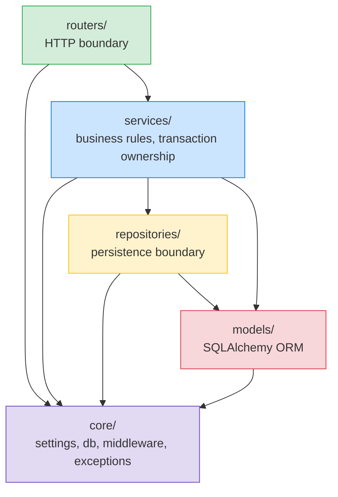
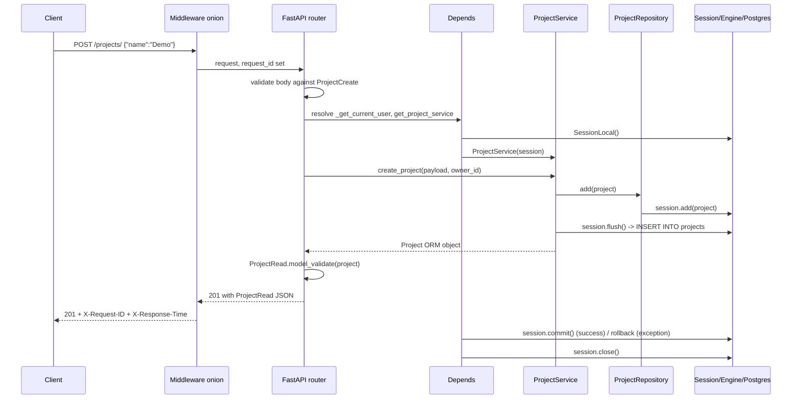

# Lesson 01: Layered FastAPI Apps

*Refactoring `Boardly` from a flat package into a layered one: `core/`, `models/`, `schemas/`, `services/`, `repositories/`, `routers/`. The rule that dependencies point inward. Real SQLAlchemy models replacing the in-memory `storage.py` from Section 03.*

**You are at the start of Section 05.**

In Section 03 you built a working `Boardly` API. It was deliberately flat — `main.py`, `routers/`, `models.py`, `storage.py`, `deps.py`, `middleware.py`, `errors.py` — because the lesson was about FastAPI mechanics, not project shape. That shape was a teaching scaffold. In this lesson we refactor it into the layout every later section assumes, and we explain why each folder exists and what its import rule is. Take your time. Move the files yourself. Read the tracebacks. This is how you learn.


#architecture #fastapi #sqlalchemy

## Learning Objectives

By the end of this lesson you will be able to:

1. **Name the six folders** a non-trivial FastAPI app uses, the responsibility of each, and the allowed imports of each.
2. **State the "dependencies point inward" rule** and translate it into concrete import statements a linter could check.
3. **Refactor `Boardly`** from a flat package into a layered one, replacing the in-memory `storage.py` with real SQLAlchemy `User` and `Project` ORM models behind a real `engine` and request-scoped `Session`.
4. **Distinguish `get_session` from `session_scope`** — which one is a FastAPI dependency, which one is a context manager the service owns, and why the split matters.
5. **Wire the `engine` into the `lifespan`** so it is created once at startup and disposed once at shutdown.
6. **Identify the three classic layering mistakes** — business logic in routers, FastAPI imports in services, and `core/db.py` that knows about every model.

## Prerequisites

Before starting, you need:

- **The `Boardly` package from Section 03.** Re-read [[03-FastAPI-Core/Routers-and-Modular-Apps]] and [[03-FastAPI-Core/Dependency-Injection]] if you have not. The refactor in this lesson takes that code as its starting point.
- **SQLAlchemy basics** — [[07-SQLAlchemy/03-Declarative-Base-and-Mapped]] for `DeclarativeBase` and `Mapped`, [[07-SQLAlchemy/02-Engines-Connections-Pools]] for `create_engine` and `pool_pre_ping`, [[07-SQLAlchemy/05-Session-and-Transaction-Management]] for `Session` and `sessionmaker`.
- **Pydantic v2** — [[04-Pydantic/Pydantic-Settings]] for `BaseSettings`, [[04-Pydantic/Serialization-and-Model-Dump]] for `model_validate`, `from_attributes`, `model_dump`.
- **Python packaging** — `__init__.py`, relative imports, the dotted import path `from boardly.core.db import get_session`.
- **About an hour and a half.** This lesson's code is more files but fewer lines per file than Section 03. The work is understanding the wiring.

**The most common gap: SQLAlchemy 2.x typed ORM.**

If `Mapped[str] = mapped_column(String(255))` looks unfamiliar, you have been reading SQLAlchemy 1.x tutorials. The 2.x typed ORM is the modern form (since SQLAlchemy 2.0, December 2022) and is what this section uses. Read [[07-SQLAlchemy/03-Declarative-Base-and-Mapped]] first. The TL;DR: `Mapped[T]` declares a typed attribute; `mapped_column(...)` configures the column. They go together.


## The Problem

A `Boardly` package that lives in seven files at the root of `boardly/` is fine up to about 500 lines. Past that point, three pressures build simultaneously:

1. **Pressure from features.** Adding `User`, `Project`, `Task`, `Comment`, `Org`, `AuditLog` — each entity brings an ORM model, a Pydantic schema, a service, and a router. Six entities times four files is twenty-four files. Flat packages don't survive twenty-four files.
2. **Pressure from reuse.** The same business rule ("no duplicate email", "a project's owner can archive it") must run from HTTP, from a CLI command, and from a background worker. If those rules live inside router functions, you cannot call them from anywhere except HTTP.
3. **Pressure from change.** A new persistence backend (a read replica, a Redis cache, an event-sourced store) must not require rewriting the routers. A new web framework (gRPC, a CLI, a message consumer) must not require rewriting the persistence layer.

The fix is to arrange the code into **layers** — folders that share a single responsibility — and to make the dependency graph between those layers **point inward**: outer layers depend on inner layers, never the reverse. The rule comes from Robert C. Martin's "Clean Architecture" essay (2012), but in FastAPI terms it reduces to a handful of import rules that are easy to enforce.

**Note — Historical context — the layering debate**

"Layered architecture" was a phrase in software engineering long before FastAPI. The 1996 book *Pattern-Oriented Software Architecture* (Buschmann et al.) defined it; Martin Fowler's 2003 *Patterns of Enterprise Application Architecture* catalogued the variants (layered, pipeline, microkernel). The FastAPI community inherited the question and answered it inconsistently: official docs (as of 0.148) show a flat `main.py` for tutorial purposes and a `routers/` split for "bigger applications" — but stop short of recommending a layered layout. The layout in this lesson is what we have found works across the projects in the vault: enough folders to keep concerns separate, few enough that you don't need a map to find a file.


## The Code

Here is the `Boardly` package layout after this lesson. Each file is small. Compare this tree to the Section 03 layout: `models.py` and `storage.py` are gone; `deps.py`, `middleware.py`, and `errors.py` have been promoted into `core/`; the routers have been renamed to `*_routes.py` for naming consistency with `user_routes.py`.

```
boardly/
├── pyproject.toml
├── alembic.ini
├── alembic/
│ ├── env.py
│ └── versions/
└── boardly/
 ├── __init__.py
 ├── main.py
 ├── core/
 │ ├── __init__.py
 │ ├── config.py
 │ ├── db.py
 │ ├── exceptions.py
 │ └── middleware.py
 ├── models/
 │ ├── __init__.py
 │ ├── base.py
 │ ├── user.py
 │ └── project.py
 ├── schemas/
 │ ├── __init__.py
 │ ├── user.py
 │ └── project.py
 ├── services/
 │ ├── __init__.py
 │ ├── dependencies.py
 │ └── project_service.py
 ├── repositories/
 │ ├── __init__.py
 │ └── project_repository.py
 └── routers/
 ├── __init__.py
 ├── health.py
 └── project_routes.py
```

**Warning — This lesson deliberately omits `services/user_service.py` and `repositories/user_repository.py`.**

They appear in the next lesson, [[Service-and-Repository-Patterns]], because they are the canonical example for the `Repository pattern` concept and need their own line-by-line treatment. The folder structure is in place at the end of this lesson; the contents land in Lesson 02.


The full code follows, file by file. We then explain every meaningful line in the Line-by-Line Deep Dive.

### `boardly/core/config.py`

```python
# boardly/core/config.py
"""Application settings, loaded from environment variables."""
from pydantic_settings import BaseSettings, SettingsConfigDict


class Settings(BaseSettings):
 model_config = SettingsConfigDict(
 env_prefix="BOARDLY_",
 env_file=".env",
 env_file_encoding="utf-8",
 extra="ignore",
 )

 database_url: str = "postgresql+psycopg://localhost/boardly"
 debug: bool = False
 log_level: str = "INFO"
 cors_origins: list[str] = ["http://localhost:5173"]


settings = Settings()
```

**Sync driver here, async driver elsewhere**

The default `database_url` uses the sync `psycopg` (v3) driver (`postgresql+psycopg://`). Section 04's [[04-Pydantic/Pydantic-Settings|Pydantic Settings]] lesson used the async `asyncpg` driver (`postgresql+asyncpg://`) for its `DatabaseSettings` default — that lesson was demonstrating an async-first Settings shape. Here in Section 05 we are deliberately using the sync driver so the layered layout can be read without the cognitive overhead of `await session.commit()` everywhere. The async equivalent (driver swap + `AsyncSession` + `async_sessionmaker`) is in [[07-SQLAlchemy/07-Async-SQLAlchemy]]; the layering does not change.


### `boardly/core/db.py`

```python
# boardly/core/db.py
"""Engine, session factory, request-scoped Session dependency, session_scope helper."""
from collections.abc import Iterator
from contextlib import contextmanager

from sqlalchemy import create_engine
from sqlalchemy.orm import Session, sessionmaker

from boardly.core.config import settings

engine = create_engine(
 settings.database_url,
 pool_pre_ping=True,
 pool_size=5,
 max_overflow=10,
 future=True,
)
SessionLocal = sessionmaker(
 bind=engine,
 autoflush=False,
 expire_on_commit=False,
)


def get_session() -> Iterator[Session]:
 """FastAPI dependency. Yields a request-scoped Session.

 Commits on success, rolls back on any exception, closes in all cases.
 The service layer calls `.flush()` to surface constraint errors *before*
 the route returns; the dependency commits once the route returns clean.
 """
 session = SessionLocal()
 try:
 yield session
 session.commit() # commit only if the route + service did not raise
 except Exception:
 session.rollback()
 raise
 finally:
 session.close()


@contextmanager
def session_scope() -> Iterator[Session]:
 """Context manager that commits on success and rolls back on exception.

 Use this from the service layer when a service needs to span multiple
 repositories with a single commit point. The request-scoped `get_session`
 dependency is the right choice for most endpoints; `session_scope` is for
 operations that must commit independently of the HTTP request lifecycle
 (a CLI command, a background worker, a multi-step migration).
 """
 session = SessionLocal()
 try:
 yield session
 session.commit()
 except Exception:
 session.rollback()
 raise
 finally:
 session.close()
```

### `boardly/core/exceptions.py`

```python
# boardly/core/exceptions.py
"""Domain exception hierarchy. The router translates these to HTTP responses."""
from __future__ import annotations


class DomainError(Exception):
 """Base class for all domain-level errors.

 Services raise subclasses of this. Routers (or global exception handlers,
 installed in `main.py`) translate each subclass to a precise HTTP response.
 See [[Domain-vs-HTTP-Concerns]] for the full pattern.
 """


class NotFoundError(DomainError):
 """The referenced entity does not exist (or has been soft-deleted)."""


class ConflictError(DomainError):
 """The operation conflicts with the current state of the system."""


class QuotaError(DomainError):
 """The operation would exceed a configured limit (e.g. seats per tenant)."""


class ValidationError(DomainError):
 """A cross-field invariant failed. Not to be confused with Pydantic's
 `ValidationError`, which catches format errors on the request body."""
```

### `boardly/core/middleware.py`

```python
# boardly/core/middleware.py
"""Request-id and timing middleware, moved here from boardly/middleware.py."""
import time
import uuid

from starlette.middleware.base import BaseHTTPMiddleware
from starlette.requests import Request
from starlette.responses import Response


class RequestIDMiddleware(BaseHTTPMiddleware):
 """Reads X-Request-ID from the request or mints a UUID; echoes it back."""

 HEADER = "X-Request-ID"

 async def dispatch(self, request: Request, call_next):
 request_id = request.headers.get(self.HEADER) or str(uuid.uuid4())
 request.state.request_id = request_id
 response: Response = await call_next(request)
 response.headers[self.HEADER] = request_id
 return response


class TimingMiddleware(BaseHTTPMiddleware):
 """Adds X-Response-Time in milliseconds."""

 async def dispatch(self, request: Request, call_next):
 start = time.perf_counter()
 response: Response = await call_next(request)
 elapsed_ms = (time.perf_counter() - start) * 1000
 response.headers["X-Response-Time"] = f"{elapsed_ms:.2f}ms"
 return response
```

### `boardly/models/base.py`

```python
# boardly/models/base.py
"""DeclarativeBase shared by all ORM models."""
from sqlalchemy.orm import DeclarativeBase


class Base(DeclarativeBase):
 """Empty marker. All ORM models inherit from this. Alembic's env.py
 imports `Base.metadata` to discover the schema."""
 pass
```

### `boardly/models/user.py`

```python
# boardly/models/user.py
"""User ORM model."""
from __future__ import annotations

from datetime import datetime
from uuid import UUID, uuid4

from sqlalchemy import DateTime, String, func
from sqlalchemy.orm import Mapped, mapped_column

from boardly.models.base import Base


class User(Base):
 __tablename__ = "users"

 id: Mapped[UUID] = mapped_column(primary_key=True, default=uuid4)
 email: Mapped[str] = mapped_column(String(320), unique=True, index=True)
 hashed_password: Mapped[str] = mapped_column(String(255))
 display_name: Mapped[str] = mapped_column(String(120), default="")
 is_active: Mapped[bool] = mapped_column(default=True, server_default="true")
 created_at: Mapped[datetime] = mapped_column(
 DateTime(timezone=True), server_default=func.now()
 )
 updated_at: Mapped[datetime] = mapped_column(
 DateTime(timezone=True), server_default=func.now(), onupdate=func.now()
 )
```

### `boardly/models/project.py`

```python
# boardly/models/project.py
"""Project ORM model."""
from __future__ import annotations

from datetime import datetime
from typing import TYPE_CHECKING
from uuid import UUID, uuid4

from sqlalchemy import DateTime, ForeignKey, String, func
from sqlalchemy.orm import Mapped, mapped_column

from boardly.models.base import Base

if TYPE_CHECKING:
 from boardly.models.user import User


class Project(Base):
 __tablename__ = "projects"

 id: Mapped[UUID] = mapped_column(primary_key=True, default=uuid4)
 owner_id: Mapped[UUID] = mapped_column(
 ForeignKey("users.id", ondelete="CASCADE"),
 index=True,
 )
 name: Mapped[str] = mapped_column(String(120))
 status: Mapped[str] = mapped_column(
 String(16), default="active", server_default="active"
 )
 description: Mapped[str | None] = mapped_column(String(2000), nullable=True)
 created_at: Mapped[datetime] = mapped_column(
 DateTime(timezone=True), server_default=func.now()
 )
 updated_at: Mapped[datetime] = mapped_column(
 DateTime(timezone=True), server_default=func.now(), onupdate=func.now()
 )
```

### `boardly/schemas/user.py`

```python
# boardly/schemas/user.py
"""Pydantic DTOs for the User resource. Three shapes for the same entity."""
from datetime import datetime
from uuid import UUID

from pydantic import BaseModel, ConfigDict, EmailStr, Field


PASSWORD_MIN = 12


class UserCreate(BaseModel):
 """What a client may send when registering. Notice what is missing:
 no `id`, no `hashed_password`, no `is_active`, no timestamps."""
 email: EmailStr
 password: str = Field(min_length=PASSWORD_MIN, max_length=128)


class UserUpdate(BaseModel):
 """What a client may send when updating their own profile.
 No `is_active`, no admin-only fields. Each of those has its own endpoint."""
 email: EmailStr | None = None
 password: str | None = Field(default=None, min_length=PASSWORD_MIN, max_length=128)
 display_name: str | None = Field(default=None, max_length=120)


class UserRead(BaseModel):
 """What a client may see when reading a user. Notice what is missing:
 no `hashed_password`, no `updated_at`."""
 model_config = ConfigDict(from_attributes=True)

 id: UUID
 email: EmailStr
 display_name: str
 is_active: bool
 created_at: datetime
```

### `boardly/schemas/project.py`

```python
# boardly/schemas/project.py
"""Pydantic DTOs for the Project resource."""
from datetime import datetime
from uuid import UUID

from pydantic import BaseModel, ConfigDict, Field


class ProjectCreate(BaseModel):
 name: str = Field(min_length=1, max_length=120)
 status: str = Field(default="active", pattern="^(active|archived|deleted)$")
 description: str | None = Field(default=None, max_length=2000)


class ProjectUpdate(BaseModel):
 name: str | None = Field(default=None, min_length=1, max_length=120)
 status: str | None = Field(default=None, pattern="^(active|archived|deleted)$")
 description: str | None = Field(default=None, max_length=2000)


class ProjectRead(BaseModel):
 """What a client may see. `owner_id` is included; `created_at` is internal."""
 model_config = ConfigDict(from_attributes=True)

 id: UUID
 owner_id: UUID
 name: str
 status: str
 description: str | None
 created_at: datetime
```

### `boardly/repositories/project_repository.py`

```python
# boardly/repositories/project_repository.py
"""ProjectRepository for the project aggregate. Tiny in this lesson;
the full pattern is the topic of [[Service-and-Repository-Patterns]]."""
from __future__ import annotations

from uuid import UUID

from sqlalchemy import select
from sqlalchemy.orm import Session

from boardly.models.project import Project


class SqlAlchemyProjectRepository:
 """Encapsulates project queries. The service calls methods here, not
 `session.execute(select(...))` directly."""

 def __init__(self, session: Session) -> None:
 self._session = session

 def get(self, project_id: UUID) -> Project | None:
 return self._session.get(Project, project_id)

 def list_for_owner(self, owner_id: UUID, status: str | None = None) -> list[Project]:
 stmt = select(Project).where(Project.owner_id == owner_id)
 if status:
 stmt = stmt.where(Project.status == status)
 return list(self._session.scalars(stmt))

 def add(self, project: Project) -> None:
 self._session.add(project)
```

### `boardly/services/project_service.py`

```python
# boardly/services/project_service.py
"""ProjectService — business rules for the project aggregate. Owns the
transaction boundary. Raises domain errors, never HTTPException."""
from __future__ import annotations

from uuid import UUID, uuid4

from sqlalchemy.orm import Session

from boardly.core.exceptions import ConflictError, NotFoundError
from boardly.models.project import Project
from boardly.repositories.project_repository import SqlAlchemyProjectRepository
from boardly.schemas.project import ProjectCreate, ProjectUpdate


class ProjectService:
 """Business rules for projects. The router calls this; the service calls
 the repository; the repository uses the session. The service does *not*
 import `fastapi`."""

 def __init__(self, session: Session) -> None:
 self._session = session
 self._projects = SqlAlchemyProjectRepository(session)

 def create_project(self, data: ProjectCreate, owner_id: UUID) -> Project:
 project = Project(
 id=uuid4(),
 owner_id=owner_id,
 name=data.name,
 status=data.status,
 description=data.description,
 )
 self._projects.add(project)
 self._session.flush() # surface constraint errors now, not on commit
 return project

 def list_projects(self, owner_id: UUID, status: str | None = None) -> list[Project]:
 return self._projects.list_for_owner(owner_id, status=status)

 def get_project(self, project_id: UUID, owner_id: UUID) -> Project:
 project = self._projects.get(project_id)
 if project is None:
 raise NotFoundError(f"project {project_id} not found")
 if project.owner_id != owner_id:
 # Don't leak existence — return 404, not 403.
 raise NotFoundError(f"project {project_id} not found")
 return project

 def update_project(self, project_id: UUID, owner_id: UUID, data: ProjectUpdate) -> Project:
 project = self.get_project(project_id, owner_id)
 for field in ("name", "status", "description"):
 value = getattr(data, field)
 if value is not None:
 setattr(project, field, value)
 self._session.flush()
 return project

 def archive_project(self, project_id: UUID, owner_id: UUID) -> Project:
 project = self.get_project(project_id, owner_id)
 if project.status == "archived":
 raise ConflictError(f"project {project_id} already archived")
 project.status = "archived"
 self._session.flush()
 return project
```

### `boardly/services/dependencies.py`

```python
# boardly/services/dependencies.py
"""FastAPI dependency providers. Composes session + repository + service."""
from typing import Annotated

from fastapi import Depends
from sqlalchemy.orm import Session

from boardly.core.db import get_session
from boardly.services.project_service import ProjectService


def get_project_service(
 session: Annotated[Session, Depends(get_session)],
) -> ProjectService:
 return ProjectService(session)
```

### `boardly/routers/health.py`

```python
# boardly/routers/health.py
"""Health-check routes for Boardly."""
from fastapi import APIRouter

router = APIRouter(tags=["health"])


@router.get("/healthz")
async def healthz() -> dict[str, str]:
 return {"status": "ok"}
```

### `boardly/routers/project_routes.py`

```python
# boardly/routers/project_routes.py
"""Project routes. Parse request -> call service -> translate exceptions -> map response."""
from typing import Annotated
from uuid import UUID

from fastapi import APIRouter, Depends, status
from pydantic import BaseModel

from boardly.schemas.project import ProjectCreate, ProjectRead, ProjectUpdate
from boardly.services.dependencies import get_project_service
from boardly.services.project_service import ProjectService

router = APIRouter(prefix="/projects", tags=["projects"])


class UserRef(BaseModel):
 """The current user, extracted from auth context.
 See [[11-Authentication-and-Security/OAuth2-JWT-Access-Refresh]]."""
 id: UUID


def _get_current_user() -> UserRef:
 """Stub for now. Real JWT wiring comes in Section 11."""
 return UserRef(id=UUID("00000000-0000-0000-0000-000000000001"))


@router.get("/", response_model=list[ProjectRead])
async def list_projects(
 status: str | None = None,
 current: Annotated[UserRef, Depends(_get_current_user)] = ...,
 service: Annotated[ProjectService, Depends(get_project_service)] = ...,
) -> list[ProjectRead]:
 projects = service.list_projects(current.id, status=status)
 return [ProjectRead.model_validate(p) for p in projects]


@router.get("/{project_id}", response_model=ProjectRead)
async def get_project(
 project_id: UUID,
 current: Annotated[UserRef, Depends(_get_current_user)] = ...,
 service: Annotated[ProjectService, Depends(get_project_service)] = ...,
) -> ProjectRead:
 project = service.get_project(project_id, current.id)
 return ProjectRead.model_validate(project)


@router.post("/", response_model=ProjectRead, status_code=status.HTTP_201_CREATED)
async def create_project(
 payload: ProjectCreate,
 current: Annotated[UserRef, Depends(_get_current_user)] = ...,
 service: Annotated[ProjectService, Depends(get_project_service)] = ...,
) -> ProjectRead:
 project = service.create_project(payload, current.id)
 return ProjectRead.model_validate(project)


@router.patch("/{project_id}", response_model=ProjectRead)
async def update_project(
 project_id: UUID,
 payload: ProjectUpdate,
 current: Annotated[UserRef, Depends(_get_current_user)] = ...,
 service: Annotated[ProjectService, Depends(get_project_service)] = ...,
) -> ProjectRead:
 project = service.update_project(project_id, current.id, payload)
 return ProjectRead.model_validate(project)


@router.post("/{project_id}/archive", response_model=ProjectRead)
async def archive_project(
 project_id: UUID,
 current: Annotated[UserRef, Depends(_get_current_user)] = ...,
 service: Annotated[ProjectService, Depends(get_project_service)] = ...,
) -> ProjectRead:
 project = service.archive_project(project_id, current.id)
 return ProjectRead.model_validate(project)
```

### `boardly/routers/__init__.py`

```python
# boardly/routers/__init__.py
"""Aggregates Boardly's feature routers."""
from . import health, project_routes

__all__ = ["health", "project_routes"]
```

### `boardly/main.py`

```python
# boardly/main.py
"""Boardly — a small project-management API.

Lesson 1 of Section 05: layered refactor. Lifespan, CORS, middleware,
router includes. No business logic; no SQLAlchemy queries.
"""
from collections.abc import AsyncIterator
from contextlib import asynccontextmanager

from fastapi import FastAPI
from fastapi.middleware.cors import CORSMiddleware

from boardly.core.config import settings
from boardly.core.db import engine
from boardly.core.exceptions import (
 ConflictError,
 DomainError,
 NotFoundError,
 QuotaError,
)
from boardly.core.middleware import RequestIDMiddleware, TimingMiddleware
from boardly.routers import health, project_routes


@asynccontextmanager
async def lifespan(app: FastAPI) -> AsyncIterator[None]:
 # --- startup: resources that live for the whole process ---
 print("Boardly starting up…")
 app.state.version = "0.2.0"
 app.state.engine = engine

 yield # traffic is now accepted

 # --- shutdown: close anything opened above ---
 print("Boardly shutting down…")
 engine.dispose()


app = FastAPI(
 title="Boardly",
 version="0.2.0",
 debug=settings.debug,
 lifespan=lifespan,
)

# Middleware: order matters — last added is outermost. See
# [[03-FastAPI-Core/Middleware-and-Request-Order]]. Add the request-id
# middleware first so it wraps the timing middleware, which wraps the router.
app.add_middleware(TimingMiddleware)
app.add_middleware(RequestIDMiddleware)
app.add_middleware(
 CORSMiddleware,
 allow_origins=settings.cors_origins,
 allow_methods=["*"],
 allow_headers=["*"],
 allow_credentials=True,
)

# Global exception handlers — translate domain errors to HTTP responses.
# The full pattern is the topic of [[Domain-vs-HTTP-Concerns]]; this is the
# minimal version that keeps the router clean.
from fastapi import Request, status as http_status
from fastapi.responses import JSONResponse


@app.exception_handler(NotFoundError)
async def _not_found(request: Request, exc: NotFoundError) -> JSONResponse:
 return JSONResponse(
 status_code=http_status.HTTP_404_NOT_FOUND,
 content={"detail": str(exc)},
 )


@app.exception_handler(ConflictError)
async def _conflict(request: Request, exc: ConflictError) -> JSONResponse:
 return JSONResponse(
 status_code=http_status.HTTP_409_CONFLICT,
 content={"detail": str(exc)},
 )


@app.exception_handler(QuotaError)
async def _quota(request: Request, exc: QuotaError) -> JSONResponse:
 return JSONResponse(
 status_code=http_status.HTTP_422_UNPROCESSABLE_ENTITY,
 content={"detail": str(exc)},
 )


@app.exception_handler(DomainError)
async def _domain_fallback(request: Request, exc: DomainError) -> JSONResponse:
 # Catches any DomainError subclass not handled above.
 return JSONResponse(
 status_code=http_status.HTTP_400_BAD_REQUEST,
 content={"detail": str(exc)},
 )

# Router includes
app.include_router(health.router)
app.include_router(project_routes.router)
```

That is the whole lesson. Twelve files, each small. We will explain every meaningful line next — not just *what it does* but *what Python / SQLAlchemy / FastAPI does internally* when that line runs, and *what would happen if it were missing*.

## Line-by-Line Deep Dive

This section is the heart of the lesson. Read it twice. Don't skip.

### 1. The six folders and their responsibilities

| Folder | Responsibility | Allowed imports |
|---|---|---|
| `routers/` | HTTP entry points. Parse request, call service, translate exceptions, map response. | `fastapi`, `pydantic`, `schemas/`, `services/`, `core/` |
| `services/` | Business rules and orchestration. Owns the transaction boundary. | `repositories/`, `models/`, `schemas/`, `core/`, plain Python |
| `repositories/` | Persistence boundary. Encapsulates queries. | `models/`, `core/`, `sqlalchemy` |
| `schemas/` | Pydantic DTOs for request and response bodies. | `pydantic` |
| `models/` | SQLAlchemy ORM models. The shape of the database. | `sqlalchemy`, `core/` |
| `core/` | Cross-cutting infrastructure: settings, db engine, session factory, middleware, exception base classes. | `fastapi`, `sqlalchemy`, `pydantic-settings` |

The repository row says "optional" deliberately — whether you have it depends on the criteria in [[Service-and-Repository-Patterns]]. This lesson teaches the layout that accommodates a repository layer if you choose to add one.

**The single forbidden import: `from fastapi import ...` inside `services/`.**

If `services/project_service.py` imports `fastapi.HTTPException`, the service is no longer callable from a CLI or a worker. It is no longer unit-testable without a FastAPI app. Routers translate domain errors to HTTP; services raise domain errors. The whole shape of the system falls out of that one rule.


### 2. The rule: dependencies point inward

Read it as: *the closer a folder is to the database, the fewer things it knows about.* The `models/` folder is innermost and depends on nothing project-specific. The `routers/` folder is outermost and depends on everything. This is what makes the system replaceable: you can write a new router (a gRPC adapter, a CLI command, a message consumer) that calls the same service and reuses all the business logic.



The arrows mean "may import from". Notice the **absent** arrows:

- `models/` does not point to `repositories/` or `services/`. The ORM model knows nothing about how it is queried.
- `schemas/` does not point to `models/`. DTOs do not import ORM models — they use `from_attributes=True` to *read* attributes from ORM objects at the boundary, but the import graph stays clean.
- `core/` does not point to anything inside `boardly/` except itself. `core/db.py` does *not* import `boardly.models.user` to run `Base.metadata.create_all()` — Alembic handles schema management, and importing models from `core/` would point the arrow outward.

**Student asks: how do I enforce this in code review?**

Two cheap techniques: (1) a `grep`-based check in CI that fails if `services/*.py` imports `fastapi` (except in `services/dependencies.py`, where `Depends` is allowed); (2) `import-linter` (a real tool — https://import-linter.readthedocs.io/) configured with the layered contracts. Both surface a violation in the pull request that introduces it, not three months later when untangling the dependency is a project.


### 3. `core/config.py`: Settings via Pydantic Settings

```python
class Settings(BaseSettings):
 model_config = SettingsConfigDict(
 env_prefix="BOARDLY_",
 env_file=".env",
 env_file_encoding="utf-8",
 extra="ignore",
 )

 database_url: str = "postgresql+psycopg://localhost/boardly"
 debug: bool = False
 log_level: str = "INFO"
 cors_origins: list[str] = ["http://localhost:5173"]
```

**What it does:** Declares a typed settings object. Pydantic-Settings reads `BOARDLY_DATABASE_URL`, `BOARDLY_DEBUG`, `BOARDLY_LOG_LEVEL`, `BOARDLY_CORS_ORIGINS` from the environment (and from `.env` if present), validates the types, and exposes them as attributes.

**Why each line:**

- `env_prefix="BOARDLY_"` namespaces the env vars. Two FastAPI services running in the same shell don't collide on `DATABASE_URL`.
- `env_file=".env"` lets you check in a `.env.example` and have developers copy it. Pydantic-Settings reads the file only if it exists.
- `extra="ignore"` is the forgiving default: extra env vars are silently dropped. The strict alternative, `extra="forbid"`, raises if a variable is set that has no field. Use "forbid" only when you want a typo to be a deployment failure.
- `database_url` defaults to a local Postgres URL. The `postgresql+psycopg://` dialect uses the modern `psycopg` (v3) driver; the older `postgresql+psycopg2://` dialect still works but is not what new code should write.
- `cors_origins: list[str]` — Pydantic-Settings parses comma-separated env vars (`BOARDLY_CORS_ORIGINS=http://a,http://b`) into a list automatically. We default to `http://localhost:5173` because that is Vite's default port for the front-end developer who will, in the near future, want to talk to this API from a browser.

**Tip — Settings is created once, at module import.**

`settings = Settings()` at the bottom of the file runs once, when `boardly.core.config` is first imported. Every other module that does `from boardly.core.config import settings` gets the same instance. This is the singleton pattern done by Python import semantics — no `Singleton` class, no metaclass, no `@lru_cache`. Just one import, one construction.


**Danger — How an attacker thinks: `extra="ignore"` is a typo-tolerance feature that is also a privilege-escalation lever.**

A developer who fat-fingers `BOARDLY_DEBUG=true` as `BOARDLY_DEUBG=true` gets no error — the prod app silently stays in `debug=False`. The same swallow path hides `BOARDLY_CORS_ORIGIN` (no `S`) when the field is `cors_origins`: the prod default `["http://localhost:5173"]` is used and the typo is invisible. The moment a wider default lands (`["*"]` for "dev convenience"), a single env-var typo opens CORS to the world. Set `extra="forbid"` on `Settings` in production so a typo is a deployment failure, not a silent fall-through to the default. See [[04-Pydantic/Pydantic-Settings]].


### 4. `core/db.py`: engine, sessionmaker, get_session, session_scope

```python
engine = create_engine(
 settings.database_url,
 pool_pre_ping=True,
 pool_size=5,
 max_overflow=10,
 future=True,
)
SessionLocal = sessionmaker(
 bind=engine,
 autoflush=False,
 expire_on_commit=False,
)
```

**What it does:** Constructs the engine (one per process) and a session factory.

**Why each line:**

- `pool_pre_ping=True` makes SQLAlchemy emit a `SELECT 1` before each checkout. If the database closed the connection (idle timeout, network blip, failover), the pool detects it and re-opens transparently. The cost is one extra round-trip per checkout, which is negligible compared to the cost of an unhandled `OperationalError` mid-request.
- `pool_size=5, max_overflow=10` allows up to 15 connections per worker. With 4 Uvicorn workers, that is 60 connections against Postgres — set `max_connections` in `postgresql.conf` accordingly.
- `future=True` is the SQLAlchemy 2.x compatibility flag. In SQLAlchemy 2.1 (October 2026) it is the default and a no-op, but leaving it in does no harm and helps anyone reading the code on 2.0.x.
- `autoflush=False` stops SQLAlchemy from auto-flushing before every query. Auto-flushing causes surprise `INSERT`s to fire when you only meant to read — and it can mask bugs in your commit ordering. With `autoflush=False`, the service must call `session.flush()` explicitly, which is what we want.
- `expire_on_commit=False` keeps ORM objects usable after `commit()`. With the default `True`, every attribute access on a committed object triggers a `SELECT` to refresh — a common cause of the "why is this endpoint doing 30 queries?" mystery. See [[07-SQLAlchemy/05-Session-and-Transaction-Management]].

```python
def get_session() -> Iterator[Session]:
 session = SessionLocal()
 try:
 yield session
 session.commit() # commit if the route + service did not raise
 except Exception:
 session.rollback()
 raise
 finally:
 session.close()
```

**What it does:** A FastAPI dependency that yields a session per request, commits on a clean route return, rolls back on any exception, and closes in all cases.

**Why a generator (with `yield`)?** FastAPI's dependency injection wraps generator dependencies in a `finally` that runs *after* the response is sent. Even if the request handler raised an exception, `session.close()` runs. SQLAlchemy's `Session.close()` releases the connection back to the pool; if you don't call it, the connection leaks until the pool's `recycle` kicks in.

**Why `commit()` lives in the dependency and not the service?** Because the dependency owns the request-scoped transaction boundary. The service calls `flush()` to surface constraint errors *before* the response is sent; the dependency commits once the route returns successfully. If a service committed instead — `self._session.commit()` at the end of each mutating method — and a *second* mutation later in the same request raised, the first half of the work would already be in the database while the route returns a 500. Keeping the commit in the dependency's `try` block means a request either fully commits or fully rolls back; there is no half-committed state. This is the failure mode you want: a clean rollback on exception, a clean commit on success.

```python
@contextmanager
def session_scope() -> Iterator[Session]:
 session = SessionLocal()
 try:
 yield session
 session.commit()
 except Exception:
 session.rollback()
 raise
 finally:
 session.close()
```

**What it does:** A context manager that commits on success and rolls back on exception.

**When to use `session_scope` instead of `get_session`?** Use `get_session` in HTTP endpoints where the request lifecycle is the natural transaction boundary. Use `session_scope` in code that runs outside HTTP — a CLI command, a background worker, a one-off migration script — where there is no FastAPI request to manage the session's lifetime. See [[When-Abstraction-Is-Worth-It]] for the Unit-of-Work pattern, which generalises `session_scope` to bundle multiple repositories in one transaction.

**Warning — When this breaks: the `except Exception: session.rollback(); raise` re-raise masks the original exception's frame in some log aggregators.**

The `raise` re-raises the original exception, but Stackdriver and Datadog sometimes attribute the trace to the `session.rollback()` line in `core/db.py`, not to the route that triggered the failure — because the `except` block is the last frame FastAPI's exception middleware sees before its own handler runs. The symptom in production: the trace in the dashboard ends at `core/db.py:193`, not at `service.create_project`, and the route is misattributed to the database module. The fix is structured logging in the `RequestIDMiddleware` (which already sets `request.state.request_id`) that records the original exception type before FastAPI's handler runs, so the operator sees `IntegrityError from POST /projects/`, not `core/db.py:193`. See [[13-Performance-and-Observability/Structured-Logging-and-Request-IDs]].


### 5. `core/exceptions.py`: the domain hierarchy

```python
class DomainError(Exception): ...
class NotFoundError(DomainError): ...
class ConflictError(DomainError): ...
class QuotaError(DomainError): ...
class ValidationError(DomainError): ...
```

**What it does:** Declares a hierarchy of domain-level exceptions. Services raise these. The global exception handlers in `main.py` translate each subclass to a precise HTTP response.

**Why a hierarchy?** Because the router needs a single `except DomainError` fallback for anything it forgot to specialise. Python's exception-MRO means the handlers in `main.py` resolve `NotFoundError` -> the 404 handler, `ConflictError` -> the 409 handler, anything else inheriting from `DomainError` -> the 400 fallback. Adding a new error type (`PaymentRequiredError`, `RateLimitedError`) is one new class plus one new handler; the router does not change.

**Warning — Do not catch `Exception` in the service.**

`try: ...; except Exception: pass` in a service is the single most common cause of intermittent production incidents. Catch specific domain errors and re-raise them with context; let the global handler translate them. If you must catch a low-level error (`IntegrityError`, `OperationalError`), translate it to a domain error and re-raise. Never swallow.


**Production reality: the `DomainError -> 400` fallback is the silent-bug surface in production monitoring.**

A new `DomainError` subclass (`RateLimitedError`, `PaymentRequiredError`) that ships without a specific handler falls through to the 400 fallback — the client sees a generic `400 Bad Request`, the operator sees `400` in the dashboard, and the actual error type is invisible unless you log `type(exc).__name__` in the fallback handler. Add `logger.warning("domain fallback", extra={"exc_type": type(exc).__name__, "path": request.url.path})` to the `_domain_fallback` handler so the operator sees `RateLimitedError from POST /payments/` in the dashboard, not `400` — then add the specific handler in the next deploy. [[Domain-vs-HTTP-Concerns]] extends this exact pattern with the `IntegrityError` catch-all that logs the escaped constraint.


### 6. `core/middleware.py`: moved from the root

The `RequestIDMiddleware` and `TimingMiddleware` are unchanged from Section 03. The only edit was the file move: `boardly/middleware.py` -> `boardly/core/middleware.py`. That move puts every cross-cutting concern — settings, db, exceptions, middleware — under `core/`, which is the one folder other layers are allowed to import. If middleware stayed at the root, you would be importing it by `from boardly.middleware import ...`, which reads as a peer of `boardly.main` rather than as infrastructure. The move is purely for code-review clarity.

### 7. `models/base.py`: the DeclarativeBase marker

```python
class Base(DeclarativeBase):
 pass
```

**What it does:** Creates the single `DeclarativeBase` subclass that all ORM models inherit from. SQLAlchemy uses `Base.metadata` as the table registry; Alembic's `env.py` reads it to discover the schema.

**Why a `Base` subclass and not `DeclarativeBase` directly?** Because you might want to customise it: a `name` for the metadata, a `type_annotation_map` for custom types, a `__init__` that hooks into reflection. Even when you do none of those today, the empty subclass leaves room. The class is also the right place to add a `__repr__` mixin later if you want all models to be debuggable the same way.

**Tip — Don't add `created_at` / `updated_at` mixins to `Base` yet.**

It's tempting to put a `TimestampMixin` on `Base` so every table gets the columns for free. Resist until you have at least three tables that share the same lifecycle — the mixin then pays for itself. With two tables, the duplication is clearer than the indirection.


**Production reality: `Base.metadata` is the only `MetaData` Alembic's `env.py` reads — a second `DeclarativeBase` subclass in the same app silently creates a parallel schema Alembic will not migrate.**

A team that adds `class HistoryBase(DeclarativeBase): pass` for an audit-log table (a common pattern in [[09-Alembic-Migrations/Data-Migrations-Safely]]) and forgets to wire `HistoryBase.metadata` into Alembic's `target_metadata` ships a deploy where the audit table is never created — the app starts, the first audit write fails with `relation "audit_log" does not exist`, and the team debugs for an hour before realising Alembic never saw the metadata. The defence: a single `Base` subclass for the whole app, or an explicit `target_metadata = [Base.metadata, HistoryBase.metadata]` list in `env.py`. The single-`Base` choice in this lesson is the simpler one.


### 8. `models/user.py` and `models/project.py`: the ORM

```python
class User(Base):
 __tablename__ = "users"

 id: Mapped[UUID] = mapped_column(primary_key=True, default=uuid4)
 email: Mapped[str] = mapped_column(String(320), unique=True, index=True)
 hashed_password: Mapped[str] = mapped_column(String(255))
 display_name: Mapped[str] = mapped_column(String(120), default="")
 is_active: Mapped[bool] = mapped_column(default=True, server_default="true")
 ...
```

**What it does:** Declares the `users` table.

**Why each column:**

- `id: Mapped[UUID]` — a UUID primary key. UUIDs avoid the "guess the next id" enumeration attack that integer PKs invite, and they let the client generate IDs ahead of time. The default is the `uuid4` callable (no parens — SQLAlchemy calls it per row).
- `email: Mapped[str] = mapped_column(String(320), unique=True, index=True)` — 320 is the maximum length of an email address per RFC 3696. `unique=True` adds a `UNIQUE` constraint; `index=True` adds a `BTREE` index. SQLAlchemy emits both — yes, the unique constraint already creates an index, but the explicit `index=True` documents intent.
- `hashed_password: Mapped[str] = mapped_column(String(255))` — the column stores a bcrypt hash, never a plaintext password. Section 11 ([[11-Authentication-and-Security/Password-Hashing]]) covers the parameters.
- `is_active: Mapped[bool] = mapped_column(default=True, server_default="true")` — both the Python default (used by the ORM when constructing an object) and the SQL default (used when a row is inserted by raw SQL outside the ORM) are set. Setting both is defensive.
- `created_at` and `updated_at` use `server_default=func.now()` and `onupdate=func.now()`. `server_default` writes the default into the table DDL (`DEFAULT now()`); `onupdate` is a SQLAlchemy-side hook that fires on `UPDATE`. We pair them so the timestamp is correct regardless of how the row was inserted.

The `Project` model follows the same pattern, with one extra: a `ForeignKey("users.id", ondelete="CASCADE")`. The foreign key points at the `users` table by name, not by class — `users` is the `__tablename__` of `User`. `ondelete="CASCADE"` makes PostgreSQL delete a user's projects when the user is deleted. (If you soft-delete users instead — the safer choice for audit trails — you handle this in the service, not the FK.)

**Danger — How an attacker thinks: the `hashed_password` column width is a security boundary, not a schema detail.**

`String(255)` accommodates a bcrypt hash today (~60 chars) and an argon2id hash at `m=65536, t=3, p=1` (~96 chars). But a security team that bumps the bcrypt cost factor from 12 to 14 (the 2026 OWASP minimum), or migrates to argon2 with `m=131072`, can silently exceed 255 chars on a future parameter change — the column truncates the hash, login starts failing for ~half the users, AND the truncated hash becomes brute-forceable because the truncated bytes are zero-variance. Set `String(255)` deliberately, document the chosen hash parameters in the column comment (`# bcrypt cost=14, max 60 chars`), and add a CI test that asserts `len(hashed_password) <= 255` after every password-hash call. See [[11-Authentication-and-Security/Password-Hashing]].


### 9. `schemas/user.py` and `schemas/project.py`: the DTOs

```python
class UserCreate(BaseModel):
 email: EmailStr
 password: str = Field(min_length=PASSWORD_MIN, max_length=128)

class UserUpdate(BaseModel):
 email: EmailStr | None = None
 password: str | None = Field(default=None, min_length=PASSWORD_MIN, max_length=128)
 display_name: str | None = Field(default=None, max_length=120)

class UserRead(BaseModel):
 model_config = ConfigDict(from_attributes=True)
 id: UUID
 email: EmailStr
 display_name: str
 is_active: bool
 created_at: datetime
```

**What it does:** Declares three Pydantic models per entity — one for create, one for update, one for read.

**Why three?** Because the input shape, the update shape, and the output shape are *different*. Clients cannot send `id` (the server generates it). Clients cannot send `is_active` through the self-service endpoint (an admin endpoint with a separate DTO handles that — see [[Domain-vs-HTTP-Concerns]]). Clients cannot read `hashed_password` (no read DTO includes it). The whole security model of the API falls out of those three sentences.

**Why `from_attributes=True` on the read DTO?** Pydantic can thus construct a `UserRead` from a `User` ORM instance: `UserRead.model_validate(user)`. Pydantic reads each declared attribute (`id`, `email`, `display_name`, `is_active`, `created_at`) from the ORM object via `getattr`. Without `from_attributes=True`, `model_validate` accepts only dicts.

**Student asks: why not have one `User` Pydantic model that does it all?**

Because then `is_admin` ends up on the write DTO too, and one day someone forgets to filter it out of the request body of `PATCH /users/me`. A user sends `{"is_admin": true}` and gets admin. That is OWASP API3:2023 — broken object property authorization — and it is the single most common FastAPI security bug. The three-DTO split makes the security property structural: you cannot forget because the field is not on the write DTO.


### 10. `repositories/project_repository.py`: the persistence boundary

```python
class SqlAlchemyProjectRepository:
 def __init__(self, session: Session) -> None:
 self._session = session

 def get(self, project_id: UUID) -> Project | None:
 return self._session.get(Project, project_id)

 def list_for_owner(self, owner_id: UUID, status: str | None = None) -> list[Project]:
 stmt = select(Project).where(Project.owner_id == owner_id)
 if status:
 stmt = stmt.where(Project.status == status)
 return list(self._session.scalars(stmt))

 def add(self, project: Project) -> None:
 self._session.add(project)
```

**What it does:** Wraps project queries behind an aggregate-level API.

**Why a class instead of free functions?** Because the repository carries state (the session). A function-based alternative (`def get_project(session, project_id)`) is fine for small slices — and the vault uses it in places — but a class makes the session boundary visible in the type system. The full trade-off is in [[Service-and-Repository-Patterns]].

**Why `_session` with the underscore?** Python convention for "this is private, don't touch from outside". The service that holds a `SqlAlchemyProjectRepository` instance does not access `repo._session` directly; if it needs the session, it has its own reference. (We will see this pattern in Lesson 02 when the service takes both `session` and `users` as constructor arguments.)

**Warning — When this breaks: `session.get(Project, project_id)` raises `DataError` on a malformed UUID, but `select(Project).where(Project.id == project_id)` returns an empty list.**

The `Project | None` return type on `get` suggests "returns None on missing" — and it does, for a well-formed UUID that does not match a row. But if a caller passes `project_id="not-a-uuid"` (a string that bypassed FastAPI's `UUID` path-parameter parser because the route declared `project_id: str`), `session.get` raises `DataError: invalid input syntax for type uuid: "not-a-uuid"` — which escapes the service as a 500, not the 404 the service intended. The defence: keep the route's `project_id: UUID` annotation (FastAPI's path-parameter parser rejects malformed UUIDs as 422 before the service is called); if you ever relax it to `str`, validate in the service before the `session.get` call. See [[07-SQLAlchemy/06-Querying-with-select]].


### 11. `services/project_service.py`: the business rule owner

```python
class ProjectService:
 def __init__(self, session: Session) -> None:
 self._session = session
 self._projects = SqlAlchemyProjectRepository(session)

 def create_project(self, data: ProjectCreate, owner_id: UUID) -> Project:
 project = Project(
 id=uuid4(),
 owner_id=owner_id,
 name=data.name,
 status=data.status,
 description=data.description,
 )
 self._projects.add(project)
 self._session.flush()
 return project
```

**What it does:** Provides `create_project`, `list_projects`, `get_project`, `update_project`, `archive_project`. Each method is one business operation.

**Why a class?** Because the service carries state (the session and the repository). The same arguments as the repository: the class makes the dependencies visible in the type system.

**Why `session.flush()` and not `session.commit()`?** Because `flush()` sends pending SQL to the database (so `UNIQUE` and `CHECK` constraints fire) without committing the transaction. The transaction commits when `get_session`'s `try` block runs `session.commit()` after a clean route return. This split is deliberate: the service flushes (to surface constraint errors *before* the response is sent), the dependency commits (at the request boundary, after the route returns successfully).

There are two places the commit *could* live:

1. **In the service** — `self._session.commit()` at the end of each mutating method. This works, but the failure mode is worse than the success mode is good: if the service commits after its first mutation and a *second* mutation later in the same request raises, you have a half-committed transaction. The request ends in a 500, but the first half of the work is already in the database.
2. **In the dependency** — `session.commit()` in `get_session`'s `try` block, after `yield`. This is the form shown in The Code listing above and the form we keep for the rest of the section. The commit happens once per request, after the route returns successfully; the rollback happens if anything in the route, the service, or the repository raised. The service stays focused on business rules; the dependency owns the transaction boundary.

For operations that span multiple repositories and must commit independently of the HTTP request lifecycle (a CLI command, a background worker, a multi-step migration), use `session_scope()` instead — it commits on success and rolls back on exception, exactly the same shape as `get_session` but lifted out of the request lifecycle. We will see this in [[Service-and-Repository-Patterns]].

**Warning — The commit lives in the dependency, not the service.**

The pattern: the dependency owns the commit, the service owns the flush. The dependency commits once at the request boundary; the service flushes to surface constraint errors before the response is sent. Mixing the two — the service committing, or the dependency flushing — creates surprises (half-committed transactions on service exceptions, or constraint errors that only surface after the route has already returned a 201). The Code listing at the top of this lesson already shows `get_session` with the `commit()`/`rollback()` pair; do not strip it out when adapting the code.


**Danger — How an attacker thinks: the "return 404, not 403" line in `get_project` is a timing-attack defense, not just a UX choice.**

The code raises `NotFoundError` whether the project is missing OR whether the caller lacks ownership — the `if project.owner_id != owner_id: raise NotFoundError(...)` line. The intent is "don't leak existence". But if the missing-row path (a single `session.get` returning `None`) is faster than the wrong-owner path (a `session.get` returning a row, then a comparison, then a raise), an attacker measuring response time can distinguish "no such project" from "project exists but you don't own it" — and probe for valid project IDs. The defence: constant-time comparison (`hmac.compare_digest(str(project.owner_id), str(owner_id))` is overkill here; the simpler defence is raising `NotFoundError` in BOTH branches with the same message string and the same code path length, OR adding a deliberate `time.sleep(0.001)` to the missing-row path to flatten the timing — measure before you decide. See [[11-Authentication-and-Security/Threat-Model-First]].


### 12. `services/dependencies.py`: wiring the providers

```python
def get_project_service(
 session: Annotated[Session, Depends(get_session)],
) -> ProjectService:
 return ProjectService(session)
```

**What it does:** A FastAPI dependency that constructs a `ProjectService` from a session.

**Why a separate file for dependencies?** Because the services themselves (`project_service.py`) must not import `fastapi`. If they did, you could not call them from a CLI. By isolating the `Depends()` calls in `services/dependencies.py`, the service modules stay pure Python and the FastAPI wiring lives in one file. The import arrow stays clean: `services/dependencies.py` imports `services/project_service.py`, not the reverse.

**Production reality: FastAPI's dependency cache means `get_session` is called once per request, even if three routes in the same request depend on it.**

The `Depends(get_session)` call in `get_project_service` and in every route that takes a session — they all resolve to the SAME `Session` instance for the duration of one HTTP request. This is why the per-request transaction boundary works: the service, the repository, and any sibling route dependency all share one session, and `get_session`'s `finally` block commits or rolls back exactly once. The cache is keyed by the dependency callable, not by the call site — so two `Depends(get_session)` in different parameters of the same route return the same session. The footgun: if a subdependency raises in its setup, the cache is poisoned and the cleanup of the already-entered dependencies still runs in reverse order. See [[03-FastAPI-Core/Dependency-Injection]].


### 13. `routers/health.py`: unchanged from Section 03

The health router is the one piece that did not change between sections. It is included unchanged to make a point: the layered refactor does not need to touch every file. Files that are already correct stay correct.

### 14. `routers/project_routes.py`: parse, dispatch, translate

```python
@router.get("/{project_id}", response_model=ProjectRead)
async def get_project(
 project_id: UUID,
 current: Annotated[UserRef, Depends(_get_current_user)] = ...,
 service: Annotated[ProjectService, Depends(get_project_service)] = ...,
) -> ProjectRead:
 project = service.get_project(project_id, current.id)
 return ProjectRead.model_validate(project)
```

**What it does:** A `GET /projects/{project_id}` route that calls the service and maps the result.

**Why no `try/except`?** Because the global exception handlers in `main.py` catch `NotFoundError`, `ConflictError`, `QuotaError`, and any `DomainError` subclass. The router doesn't need to know which service calls raise which errors; it just dispatches and maps.

**Why `= ...` as a default for `Annotated[T, Depends(...)]` parameters?** This is the FastAPI idiom for "this parameter is required, but its value is provided by a dependency, not by the client". The `...` (Ellipsis) is Python's sentinel for "no default"; combined with `Annotated[T, Depends(...)]`, it tells FastAPI to resolve the dependency. You can also write `= Depends(...)` directly, but the `Annotated` form is the modern, IDE-friendly form (FastAPI 0.95+).

**Warning — When this breaks: the `= ...` (Ellipsis) default for `Annotated[T, Depends(...)]` parameters is the modern FastAPI idiom, but Pydantic v2's stricter `Annotated` handling rejects the older `= Depends(...)` form in some IDE type-checkers.**

The symptom in production: a teammate adds `service: UserService = Depends(get_project_service)` (the v0.95 form) to a new route, and mypy in strict mode emits `error: Incompatible default for argument "service" (default has type "Depends", argument has type "UserService") [assignment]`. The `= ...` (Ellipsis) form is the type-checker-friendly sentinel — it tells mypy "no default value, the dependency provides it". The fix is mechanical: replace `= Depends(...)` with `= ...` and keep the `Annotated[T, Depends(...)]` annotation. The pre-existing routes in this lesson already use `= ...`; do not regress to the older form when adapting the code. See [[03-FastAPI-Core/Dependency-Injection]].


### 15. `main.py`: composition only

The new `main.py` does three things: lifespan, middleware, router includes. No business logic, no SQLAlchemy queries, no Pydantic models beyond the `UserRef` stub. The middleware order is the one taught in [[03-FastAPI-Core/Middleware-and-Request-Order]]: last added is outermost, so we add `TimingMiddleware` first, then `RequestIDMiddleware` (which wraps timing), then `CORSMiddleware` (which wraps everything). The exception handlers are the minimal set from [[Domain-vs-HTTP-Concerns]]; we expand them in Lesson 03.

**Danger — How an attacker thinks: `allow_methods=["*"]` + `allow_credentials=True` is a CORS misconfiguration footgun, and the credentialed wildcard is the production hole.**

Modern browsers reject `Access-Control-Allow-Origin: *` when `Access-Control-Allow-Credentials: true` is also set — so the naive `allow_origins=["*"]` + `allow_credentials=True` is silently downgraded to "no CORS at all" in the browser, which masks the misconfiguration. The actual hole is `allow_methods=["*"]` (which expands to `GET, POST, PATCH, DELETE, ...`) combined with a permissive `allow_origins=["https://*.boardly.dev"]` (a wildcard subdomain) and `allow_credentials=True` — a CSRF-able endpoint behind a credentialed cross-origin allowance that a malicious subdomain (or a typo-squatted lookalike) can abuse. The defence: enumerate `allow_methods` explicitly (`["GET", "POST", "PATCH", "DELETE"]`), enumerate `allow_origins` to exact hostnames (`["https://app.boardly.dev"]`), and keep `allow_credentials=True` only when the API actually uses cookies. See [[02-Web-and-HTTP/CORS-Caching-Headers-Conditional-Requests]] and [[02b-Backend-Foundations/CSRF-Protection]].


## Execution Trace

A `POST /projects/` with body `{"name": "Demo"}` and a fake user id flows like this:

1. **ASGI server** (Uvicorn) receives the HTTP request and hands it to FastAPI. See [[02-Web-and-HTTP/ASGI-Starlette-Uvicorn]].
2. **Middleware onion** — `CORSMiddleware` (outermost) -> `RequestIDMiddleware` -> `TimingMiddleware` (innermost) -> FastAPI router.
3. **Router** selects `project_routes.create_project`. FastAPI validates the body against `ProjectCreate`. If the body is invalid, `422` is returned without ever calling the route function.
4. **Dependency resolution** — `_get_current_user` -> `UserRef(id=...)` (stub). Then `get_project_service` -> `get_session` -> a fresh `Session` -> `ProjectService(session)`.
5. **Service** `ProjectService.create_project(payload, current.id)` is called. It constructs a `Project` ORM object, calls `repo.add(project)`, then `session.flush()`. The flush issues an `INSERT` into `projects`. The `UNIQUE` constraints (none on `Project`, but `FK` on `owner_id`) are checked here.
6. **Service returns** the `Project` ORM object.
7. **Router** calls `ProjectRead.model_validate(project)` to map the ORM object to the read DTO.
8. **FastAPI** serializes the `ProjectRead` to JSON. The `response_model=ProjectRead` filter strips any attributes not on `ProjectRead` (defence in depth).
9. **Middleware onion unwinds** — `TimingMiddleware` adds `X-Response-Time`, `RequestIDMiddleware` adds `X-Request-ID`, `CORSMiddleware` adds CORS headers.
10. **Dependency cleanup** — `get_session`'s `finally` runs `session.commit()` (if the route did not raise) or `session.rollback()` (if it did). Then `session.close()` returns the connection to the pool.



If step 5 raised `ConflictError` (e.g. archiving an already-archived project), the trace diverges at step 6: the service's exception propagates to FastAPI, the global `@app.exception_handler(ConflictError)` catches it and returns `409` with `{"detail": "..."}`. The `get_session` `finally` still runs `session.rollback()` (no commit was issued, so the partial work is discarded).

## Common Mistakes

### Mistake 1: Returning the ORM model as `response_model`

```python
# WRONG
from boardly.models.project import Project

@router.get("/{project_id}", response_model=Project)
async def get_project(...): ...
```

FastAPI will try to serialize the ORM model. It works — until you add an `owner_id` column and a sensitive `description` field, and now every `GET /projects/{id}` leaks them. Always use a `*Read` DTO from `schemas/`. The `response_model` filter is a defence-in-depth; do not let the source of truth be "the framework happens to serialise only the columns I want".

### Mistake 2: Business logic in routers

```python
# WRONG
@router.post("/")
async def create_project(payload: ProjectCreate, session: Session = Depends(get_session)):
 if session.scalar(select(Project).where(Project.owner_id == ..., Project.name == payload.name)):
 raise HTTPException(409, "duplicate name")
 # ... 30 more lines of business logic ...
```

This router cannot be reused from a CLI, a background job, or a unit test without an HTTP client. Move the body into a service. The router shrinks to parse-dispatch-translate.

### Mistake 3: Importing `fastapi` in the service

If `services/project_service.py` imports `fastapi.HTTPException`, the service is no longer callable from a CLI. Routers translate domain errors to HTTP; services raise domain errors. The single forbidden import is `from fastapi import ...` inside `services/` (except `services/dependencies.py`, where `Depends` is allowed).

### Mistake 4: One `core/db.py` that knows about every model

```python
# WRONG — core/db.py reaches into models
from boardly.models.user import User
from boardly.models.project import Project

def init_db():
 Base.metadata.create_all(engine) # binds; user, project; etc.
```

This violates "dependencies point inward": `core/` now imports `models/`. Use Alembic for schema management instead ([[09-Alembic-Migrations/Alembic-Setup-and-Workflow]]). Alembic's `env.py` is the *only* place that imports all the models; `core/db.py` stays narrow.

### Mistake 5: Stripping `commit()` out of the request-scoped session

The Code listing at the top of this lesson shows `get_session` with `session.commit()` *after* the `yield` and `session.rollback()` in the `except`. If a reader strips that pair out — perhaps because they remember the older v1-style "the service owns the commit" rule — the `INSERT`s issued by `flush()` are never committed. The route returns `201`, the client sees the project — and then the connection is rolled back when the session closes. The project never appears in subsequent `GET` requests. This is the most subtle bug in the section. Keep the `commit()` in the dependency's `try` block, *after* the `yield` but *before* `session.close()`.

### Mistake 6: Circular imports via `__init__.py`

Resist the urge to do `from boardly.models.user import User` in `boardly/models/__init__.py` *and also* `from boardly import models` in `user.py`. The two-way import is a circular dependency. Use one-way imports only: models import from `boardly.models.base`, and routers/services import models explicitly by full path.

**Spot the bug — why does this service method never persist data?**

```python
class ProjectService:
def create_project(self, data, owner_id):
project = Project(name=data.name, owner_id=owner_id)
self._session.add(project)
return project
```
Answer: there is no `flush()` and no `commit()` in the service. The `session.add()` schedules the object in the session's identity map, but no SQL is issued. When the request ends, `get_session`'s `try` block reaches `session.commit()` after the `yield` — but the commit only fires if the route returned successfully, *and* it commits whatever was pending in the session. With neither `flush()` in the service nor a SQLAlchemy autoflush to push pending SQL before the commit, `session.add()` alone does schedule the INSERT for commit but does not surface constraint errors until the commit runs. The fix is `session.flush()` in the service (so constraint errors are surfaced *before* the route returns), and `session.commit()` in the dependency's `try` block (already shown in The Code listing above).


**Production reality: the circular import from a two-way `__init__.py` surfaces as `ImportError` in CI's first test run, not at lint time — the symptom is "tests pass on my machine but fail in CI".**

A teammate who adds `from boardly.models.user import User` to `boardly/models/__init__.py` AND `from boardly import models` to `boardly/models/user.py` ships a commit that imports cleanly in their REPL (because their REPL had already imported `boardly.models` from a previous session, masking the cycle) and fails in CI's cold-start test run with `ImportError: cannot import name 'User' from partially initialized module 'boardly.models.user'`. The defence: never import from a parent package's `__init__.py` in a submodule — always use absolute imports (`from boardly.models.user import User`, not `from . import User`). Add a `python -c "import boardly"` cold-start smoke test as the first CI step to catch the cycle before the test suite runs. See [[01-Python-Foundations/Project-Layout-and-Imports]].


## Engineering Trade-Offs

### Folders vs. modules

A small app can flatten: `boardly/routers_user.py`, `boardly/services_user.py`. The folder structure in this lesson has a cost — more files, more `__init__.py`, more import paths. Pay that cost when you have more than two domains. With three vertical slices (`users`, `projects`, `tasks`), folders are cheaper than a flat file.

### Sync vs. async engines in `core/db.py`

This lesson shows the sync engine for clarity. Production FastAPI deployments often use the async engine ([[07-SQLAlchemy/07-Async-SQLAlchemy]]). The layout is identical: `Session` becomes `AsyncSession`, `sessionmaker` becomes `async_sessionmaker`, `get_session` becomes an async generator, and `session.commit()` becomes `await session.commit()`. The layering does not change.

### A separate `domain/` folder

If your business rules are complex enough to deserve their own pure-Python classes (`Money`, `OrderState`, `BookingPolicy`), add a `domain/` folder between `services/` and `repositories/`. It contains pure Python — no SQLAlchemy, no Pydantic. The service translates between domain objects and ORM models. This is the gateway drug to [[When-Abstraction-Is-Worth-It]]'s hexagonal architecture; only pay it when the domain genuinely has behavior the ORM cannot express cleanly.

### Where do DTOs that combine multiple models live?

A `ProjectWithOwnerRead` schema that joins `Project` and `User` lives in `schemas/project.py` — the same folder as the per-model DTOs. Schemas are organized by HTTP resource, not by model count. The router calls a service that returns a domain object; the router assembles the response DTO from that object. The service does not return DTOs.

### The `services/dependencies.py` indirection

You could put `get_project_service` directly in `routers/project_routes.py`. The argument for keeping it in `services/dependencies.py` is that every "FastAPI wiring" decision lives in one file. The argument against is one extra file to jump to. We prefer the indirection: it keeps the import arrow clean (services don't import fastapi) and makes the dependency graph auditable.

## Exercises

**Tip — The 20-minute rule**

If you're stuck on an exercise for more than 20 minutes, re-read the relevant section above, then move on and come back. Learning isn't linear.


**Exercise 1 — Confirm the commit is wired.** Open `boardly/core/db.py:get_session` and confirm the `session.commit()` after `yield` and the `session.rollback()` in `except` are both present (the listing in The Code section above already includes them). Strip them out, restart the app, hit `POST /projects/` and confirm `GET /projects/` returns `[]` (Mistake #5). Restore them and confirm the project now persists across requests.

**Exercise 2 — Add the User router.** Create `boardly/routers/user_routes.py` with a `POST /users/` endpoint that takes a `UserCreate` body and stubs out `UserService.register(data)` (returning a fake `User` ORM object). Include the router in `main.py`. We will implement the real service in Lesson 02.

**Exercise 3 — Refactor the auth stub.** The `_get_current_user` function in `project_routes.py` is a stub that always returns the same UUID. Replace it with a `Depends` that reads an `Authorization: Bearer <token>` header and decodes a hardcoded fake token to a `UserRef`. Real JWT wiring is in [[11-Authentication-and-Security/OAuth2-JWT-Access-Refresh]].

**Exercise 4 — Enforce the layering in CI.** Add a `grep`-based check in your CI script that fails if any file in `services/` (except `services/dependencies.py`) imports `fastapi`. Commit a deliberate violation and confirm the check fires.

**Exercise 5 — Add a `tests/` folder.** Create `tests/conftest.py` that overrides `get_session` to use an in-memory SQLite engine. Run a `pytest` test that hits `GET /projects/` and asserts an empty list comes back. (Section 12 covers testing in depth.)

**Exercise 6 — Soft-delete a project.** Add a `deleted_at: Mapped[datetime | None]` column to `Project`. Modify `SqlAlchemyProjectRepository.list_for_owner` to filter out soft-deleted projects by default. Add a `DELETE /projects/{id}` endpoint that sets `deleted_at` and returns `204`. Decide: should the delete be in the repository (`repo.soft_delete(project)`) or in the service (`project.deleted_at = now(); session.flush()`)? Verify after the change: `curl -X DELETE /projects/<id>` returns `204 No Content`; `curl /projects/` no longer lists the deleted project; `psql -c "SELECT id, name, deleted_at FROM projects WHERE id = <id>"` still shows the row (the soft-delete is just a non-null `deleted_at`). The repository-vs-service answer: put the column mutation in the service if the delete is a one-line attribute set (this lesson's case); put it in the repository only if the delete needs to coordinate with another aggregate (e.g. cascading soft-delete to child tasks), which is the Lesson 04 trigger for a service-level Unit-of-Work.

**Exercise 7 — Verify the `extra="ignore"` swallow path.** Add a `BOARDLY_SECREET=foo` line to `.env` (a typo of a non-existent field — there is no `secret` field on `Settings`). With the lesson's default `model_config = SettingsConfigDict(..., extra="ignore")`, start the app and confirm `settings` silently ignores the typo (no error). Then flip to `extra="forbid"`, restart, and confirm the app fails to start with a `SettingsError` mentioning the unknown field `secreet`. Restore `extra="ignore"`. Verification: `BOARDLY_SECREET=foo uv run uvicorn boardly.main:app` (with `extra="forbid"` temporarily set) — expect a startup traceback ending in `ValidationError: ... secreet ... extra inputs are not permitted`.

**Exercise 8 — Audit the connection pool against Postgres `max_connections`.** Compute the worst-case connection count for 4 Uvicorn workers with the lesson's `pool_size=5, max_overflow=10`: `4 * (5 + 10) = 60` connections. Set `pool_size=2, max_overflow=0` in `core/db.py`, run a 20-concurrent load test, and watch for `QueuePool limit of size 2 overflow 0 reached` errors in the logs. Restore `pool_size=5, max_overflow=10`. Verification: `uv run python -c "from boardly.core.db import engine; print(engine.pool.size(), getattr(engine.pool, '_max_overflow', None))"` (expect `5 10` after restore); `uv run pytest tests/test_pool_saturation.py -k overflow_raises` (expect the test to pass with the saturated pool and fail with the default pool).

**Exercise 9 — Confirm `expire_on_commit=False` prevents the extra `SELECT`.** With the lesson's default (`expire_on_commit=False`), instrument the engine with `event.listen(engine, "before_cursor_execute", ...)` to count SQL statements, post a project, and assert exactly one `INSERT` is issued and zero `SELECT`s fire after `session.commit()`. Flip to `expire_on_commit=True`, rerun, and assert the extra `SELECT projects WHERE id=?` appears on the first attribute access after commit. Verification: `uv run pytest tests/test_expire_on_commit.py -k counts_select_after_commit` (expect: 1 SELECT with default, 2 SELECTs with `True`).

**Exercise 10 — Verify `engine.dispose()` runs on lifespan shutdown.** Add an `engine.pool.status()` print to the shutdown half of the lifespan (the `Boardly shutting down…` line is already there). Start the app, hit `/healthz`, then send `SIGTERM` (`kill -TERM $(pgrep -f 'uvicorn boardly')`), and assert the logs show both `Boardly starting up…` and `Boardly shutting down…` AND that `engine.dispose()` returned (no hung process). Verification: `uv run pytest tests/test_lifespan_dispose.py -k engine_disposed_on_shutdown` (uses `httpx.AsyncClient` + `asgi-lifespan`'s `LifespanManager` to drive startup/shutdown and asserts `engine.pool.status()` reports 0 checked-out connections post-shutdown).

**Exercise 11 — Enforce the layering contract with `import-linter`.** Add `import-linter` to `[dev-dependencies]`, write a `.importlinter` config that contracts `boardly.services` (except `boardly.services.dependencies`) to forbid importing `fastapi`, and run `uv run lint-imports`. Confirm it passes on the lesson's code. Then deliberately add `from fastapi import HTTPException` to `services/project_service.py`, rerun, and confirm the contract fails with a clear violation listing. Revert the violation. Verification: `uv run lint-imports` (expect: `0` exit code on the clean tree; non-zero after the deliberate violation).

**Exercise 12 — Verify the rollback-on-service-exception contract.** Write a test that monkeypatches `ProjectService.create_project` to raise `RuntimeError("simulated service failure")` immediately AFTER `session.flush()`, posts a project via the test client, and asserts: (a) the response is `500`, (b) a subsequent `GET /projects/` returns an empty list (the partial `INSERT` was rolled back), (c) `session.in_transaction()` is `False` after the request. This is the regression test for Mistake #5 and the commit-lives-in-the-dependency rule. Verification: `uv run pytest tests/test_rollback_on_service_exception.py -k no_partial_commit` (expect: 3 assertions pass; the project does not persist).

## Verification

```bash
# from the project root
uv run uvicorn boardly.main:app --reload
# expected:
# Boardly starting up…
# INFO: Application startup complete.
# INFO: Uvicorn running on http://127.0.0.1:8000 (Press CTRL+C to quit)

# in another terminal:
curl -i http://127.0.0.1:8000/healthz
# expected: 200 with X-Request-ID and X-Response-Time headers

curl -i -X POST http://127.0.0.1:8000/projects/ \
 -H 'content-type: application/json' \
 -d '{"name":"Demo","status":"active"}'
# expected: 201 with body {"id":"...","owner_id":"...","name":"Demo","status":"active","description":null,"created_at":"..."}

curl -i http://127.0.0.1:8000/projects/
# expected: 200 with a list containing the project you just created
```

If you see `404` on `POST /projects/`, you forgot to include `project_routes.router` in `main.py`. If you see `500` and the logs mention `relation "projects" does not exist`, you have not run the migrations — see [[09-Alembic-Migrations/Alembic-Setup-and-Workflow]]. If `GET /projects/` returns `[]` after a successful `POST`, you stripped the `session.commit()` out of `get_session`'s `try` block (Mistake #5).

Press `Ctrl+C` in the Uvicorn terminal. Expected:

```
Boardly shutting down…
INFO: Application shutdown complete.
```

If you see `Boardly starting up…` *and* `Boardly shutting down…`, the lifespan is correctly wired and the engine is being disposed.

## Previously Learned Here

These concepts were taught in earlier lessons. We link back instead of re-explaining:

- **DeclarativeBase / Mapped / mapped_column** — [[07-SQLAlchemy/03-Declarative-Base-and-Mapped]]. New detail here: it is the single source of `Base.metadata` that Alembic's `env.py` imports. The `models/base.py` file is the one place the `Base` subclass lives.
- **Engine / Connection pool** — [[07-SQLAlchemy/02-Engines-Connections-Pools]]. New detail here: `core/db.py` is where the engine lives, and the lifespan is where it is disposed. The engine is created at module import; the pool is opened lazily on first use.
- **Session / AsyncSession** — [[07-SQLAlchemy/05-Session-and-Transaction-Management]]. New detail here: the `get_session` vs. `session_scope` split puts commit ownership in the dependency (for HTTP) or in the service (for non-HTTP). We are continuing to use `expire_on_commit=False` and `autoflush=False` — both are deliberate.
- **Pydantic Settings** — [[04-Pydantic/Pydantic-Settings]]. New detail here: `env_prefix="BOARDLY_"` namespaces the env vars so two services don't collide.
- **FastAPI lifespan** — [[03-FastAPI-Core/Application-and-Lifespan]]. New detail here: `engine.dispose()` belongs in the shutdown half of the lifespan. We do *not* call `Base.metadata.create_all()` in the lifespan — that's [[Engineering-Decision-Log|D-003]].
- **Middleware** — [[03-FastAPI-Core/Middleware-and-Request-Order]]. New detail here: the middleware modules are now under `core/`, and the order of `add_middleware` calls is unchanged (last added is outermost).
- **Dependency injection** — [[03-FastAPI-Core/Dependency-Injection]]. New detail here: the `Depends()` calls now live in `services/dependencies.py`, not in the router, to keep the import arrow from `services/` to `fastapi` clean.
- **BaseModel (Pydantic v2)** — [[04-Pydantic/BaseModel-and-Validation]]. New detail here: the `schemas/` folder is the operational home of the four-shape taxonomy (request / response / ORM / internal-domain) introduced in that lesson. This lesson splits `UserCreate`, `UserUpdate`, `UserRead`, `ProjectCreate`, `ProjectUpdate`, `ProjectRead` into separate files per aggregate — the `BaseModel` subclass per file is the same pattern as Section 04, but the *folder layout* is what makes the security boundary (no `is_admin` on self-service DTOs, no `hashed_password` on read DTOs) structural.

## What's Next

In [[Service-and-Repository-Patterns]] we add the User aggregate to the layout you just built: a `UserService` with business rules (no duplicate email, active-user quota per tenant), a `SqlAlchemyUserRepository`, a `UserRepository` Protocol, and a `FakeUserRepository` unit test that exercises the rules without a database. That lesson is the canonical lesson for the `Repository pattern` concept — see [[00-Start-Here/Concept-Registry]].

By the end of Lesson 02, `Boardly` will have a real persistence boundary, a test-isolated service layer, and the contract (`Protocol`) that makes the test isolation possible.

## Sources

- **FastAPI — Bigger Applications - Multiple Files** — <https://fastapi.tiangolo.com/tutorial/bigger-applications/> — accessed 2026-10-19 — the canonical FastAPI guidance on `APIRouter` and folder layout. The lesson extends this with the full layered layout FastAPI's docs stop short of recommending.
- **SQLAlchemy 2.x — Declarative Base** — <https://docs.sqlalchemy.org/en/20/orm/declarative_base.html> — accessed 2026-10-19 — the `DeclarativeBase` API used in `models/base.py`.
- **SQLAlchemy 2.x — Session Basics** — <https://docs.sqlalchemy.org/en/20/orm/session_basics.html> — accessed 2026-10-19 — the source of `sessionmaker`, `Session`, autoflush, and `expire_on_commit`.
- **Robert C. Martin — The Clean Architecture** — <https://blog.cleancoder.com/uncle-bob/2012/08/13/the-clean-architecture.html> — accessed 2026-10-19 — source of the "dependencies point inward" rule restated in FastAPI terms here.
- **Pydantic Settings** — <https://docs.pydantic.dev/latest/concepts/pydantic_settings/> — accessed 2026-10-19 — the `BaseSettings` API used in `core/config.py`.
- **import-linter** — <https://import-linter.readthedocs.io/> — accessed 2026-10-19 — a real tool for enforcing layered contracts in CI.

## What We Learned

Let's recap. In this lesson you:

- **Refactored `Boardly` from a flat package into a layered one** — six folders (`core/`, `models/`, `schemas/`, `services/`, `repositories/`, `routers/`) with explicit responsibilities and explicit allowed imports.
- **Replaced the in-memory `storage.py` with real SQLAlchemy 2.x ORM models** — `User` and `Project` behind a real `engine` and `SessionLocal` factory.
- **Wired a request-scoped `Session` dependency** (`get_session`) and a service-owned `session_scope` context manager — and saw why the commit-ownership split matters.
- **Stashed the engine on `app.state` in the lifespan** and disposed it cleanly in the shutdown half.
- **Moved `middleware.py` and `errors.py` into `core/`** so every cross-cutting concern lives under one importable folder.
- **Added a `DomainError` hierarchy** (`NotFoundError`, `ConflictError`, `QuotaError`) and the minimal global exception handlers that translate them to `404`, `409`, `422`.
- **Hit the six classic layering mistakes** — returning ORM models, business logic in routers, `fastapi` imports in services, `core/db.py` reaching into models, missing `commit()`, circular `__init__.py`.

Here's the mental model to walk away with: *a FastAPI app is six folders arranged by the rule "dependencies point inward". The router calls the service; the service calls the repository; the repository uses the session; the session talks to the database. Each layer only sees the layer immediately inside it. Adding a new front-end (CLI, worker) does not require touching the service; adding a new back-end (cache, replica) does not require touching the router. Everything else is additions to one folder or another.*

---

> A note from your teacher
You just refactored `Boardly` from a flat package into a layered one. The next four lessons will populate the empty folders with real services, real repositories, real DTOs, and the decision framework for when each is worth its cost. The skeleton you wrote today is the skeleton every later section in the vault assumes. See you in Lesson 02.


---

**Tags:** #architecture #fastapi #sqlalchemy #review
**Previous:** [[00-Architecture-MOC]]
**Next:** [[Service-and-Repository-Patterns]] →
