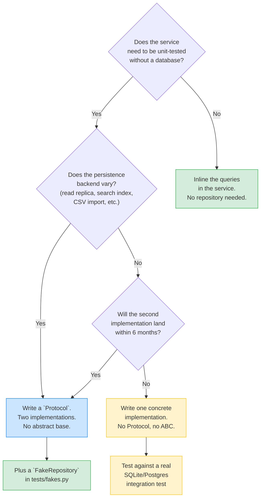
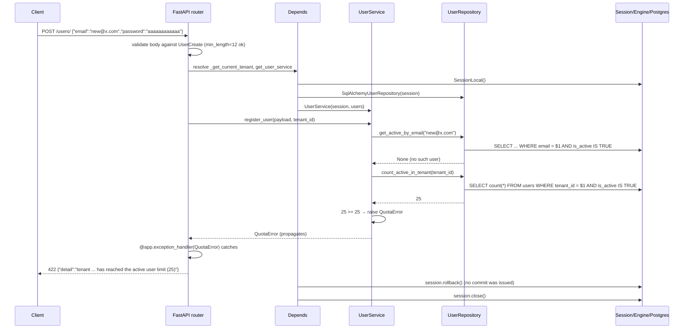
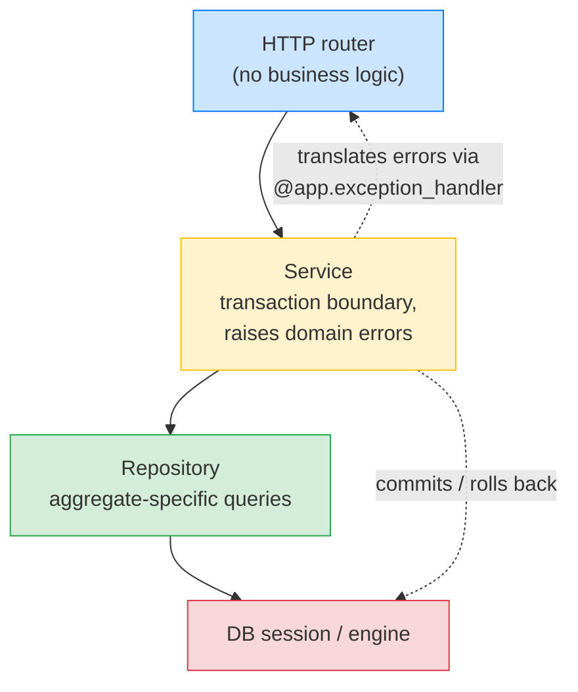

# Lesson 02: Service and Repository Patterns

*Adding the User aggregate to `Boardly`: a `UserService` that owns the transaction, a `SqlAlchemyUserRepository` that hides queries, a `UserRepository` Protocol that defines the contract, and a `FakeUserRepository` unit test that exercises the rules without a database.*

**This is the canonical lesson for the `Repository pattern`.**

Other lessons that mention "repository" link back here instead of re-explaining. If you are reading this lesson out of order, you have skipped the layered layout from [[Layered-FastAPI-Apps]] — go back and read it first; the folder paths in this lesson (`boardly/services/`, `boardly/repositories/`, `boardly/services/protocols.py`) will not make sense otherwise. Take your time. Read every line. Run the test. **This is how you learn.**


#architecture #repository #ddd #canonical

## Learning Objectives

By the end of this lesson you will be able to:

1. **Define what a service does and what a repository does** in one sentence each, and list three things each must *not* do.
2. **Write a service that owns the transaction boundary** and raises domain errors (`ConflictError`, `NotFoundError`, `QuotaError`) instead of `HTTPException`.
3. **Write a repository that hides query details** and exposes aggregate-level operations (`get_active_by_email`, `count_active_in_tenant`, `add`).
4. **Define the repository contract as a `typing.Protocol`** so the service depends on the abstraction, not the SQLAlchemy implementation.
5. **Write a `FakeUserRepository` unit test** that exercises the "no duplicate email" and "active-user quota" rules without touching a database, in single-digit milliseconds.
6. **Decide, for a given slice of an app, whether to introduce a repository layer** — and defend the decision with the four criteria.
7. **Explain why `AbstractUserRepository(UserRepository)` with one implementation is a smell**, and what to do instead.

## Prerequisites

Before starting, you need:

- **The layered `Boardly` from Lesson 01.** Re-read [[Layered-FastAPI-Apps]] if the six-folder layout, the `get_session` dependency, or the `DomainError` hierarchy is fuzzy.
- **SQLAlchemy sessions and queries** — [[07-SQLAlchemy/05-Session-and-Transaction-Management]] for `Session`, `flush`, `commit`, `rollback`; [[07-SQLAlchemy/06-Querying-with-select]] for `select()`, `where()`, `scalar()`.
- **Python Protocols** — [[01-Python-Foundations/Classes-Protocols-Structural-Typing]] for `typing.Protocol`, structural subtyping, runtime-checkable protocols.
- **Dependency injection** — [[03-FastAPI-Core/Dependency-Injection]] for `Annotated[T, Depends(...)]`, per-request caching, and `dependency_overrides`.
- **About an hour and a half.** This lesson's code is concentrated — three new files plus a test — but the explanation is long. Read slowly.

**The most common gap: `Protocol` vs. `ABC`.**

Both define an interface, but they enforce it differently. `abc.ABC` is *nominal*: a class must inherit from the ABC explicitly. `typing.Protocol` is *structural*: any class with the right methods satisfies it, no inheritance needed. We use `Protocol` here because test fakes (`FakeUserRepository`) should not have to inherit from anything — they just need to look like a repository. Read the prerequisite lesson if the distinction is not yet second nature.


## Think Like a Senior Architect

Before the code, the mental model. Read this section slowly — every architectural mistake in this lesson's family (the `AbstractRepository(Repository)` smell, the generic CRUD repository, the per-table repository) reduces to one of the three questions below answered badly.

### The reframe: every abstraction is a contract, and every contract is a liability until proven otherwise

A senior architect reading a codebase does not ask "is this well-designed?" — that question is meaningless. They ask "what does this abstraction cost, and what does it buy?" The Repository pattern's contract is *you will get an aggregate-level, collection-like API over the persistence layer.* The price of that contract has four parts:

1. **An indirection.** Every call site that goes `router → service → repository → session` has three hops where one (router → session) would suffice. Tracebacks grow a frame. The indirection is worth it when it is doing real work — hiding a query, isolating a test, drawing a team boundary — and dead weight when it is not.
2. **A class.** A repository class has a constructor, methods, a `__init__` signature, and a maintenance surface that grows with every method you add. Each method is a place a bug can hide (the missing `select_from(User)` clause, the `is_(True)` vs `== True` distinction, the missing `WHERE tenant_id` filter).
3. **A protocol.** The `Protocol` in `services/protocols.py` is the contract the service depends on. If the protocol drifts from the implementation — the fake implements `get_active_by_email` with the `is_active` filter but the production implementation forgets it — the test passes and the production bug ships (see "When This Breaks" below).
4. **A boundary.** A repository is a persistence boundary. That boundary is also a deployment boundary — two services that share a repository cannot ship independently (see "Production Reality" below).

The cost is real and paid on every request. The benefit must outweigh the cost — and the benefit has exactly four shapes that earn their keep.

### The three questions on the sticky note

For every class, function, or layer you are about to introduce, ask:

1. **What does this abstraction cost?** (Indirection frames, classes to maintain, a protocol that can drift, a deployment coupling.)
2. **What does it buy me that inline code cannot?** (Test isolation, persistence-agnosticism, team boundary, performance boundary — the four classes below.)
3. **If I delete this abstraction tomorrow, what breaks?** (If the answer is "the test fakes break and nothing else," the abstraction is doing test-isolation work — that's enough, but be honest that it's the *only* work it's doing.)

If all three answers are weak, the abstraction is dead weight. Delete it and use the ORM directly in the service. There is no shame in a one-folder app — there is shame in a six-folder app where every folder is a single class.

### The four classes of abstraction payoff

The Repository pattern (and the Service pattern over it) earns its keep in exactly four cases. Anything else is ceremony:

| Payoff class | What it buys | When it pays off | When it does not |
|---|---|---|---|
| **Test isolation** | Business rules run without a database, in single-digit milliseconds | Aggregate has non-trivial business rules (quota, uniqueness, soft-delete) that you want to unit-test exhaustively | Aggregate is pure CRUD; the only "rule" is "save what the client sent" |
| **Persistence-agnosticism** | A second persistence backend (a read replica, a search index, a CSV import path) can be plugged in without touching the service | You genuinely have (or will, within 6 months, have) a second backend | One backend, one schema, one read path |
| **Team boundary** | Two teams can evolve the persistence layer independently; merge conflicts on the repository file become rare | Aggregate is owned by a different team than the service that consumes it | Same team owns the router, the service, and the repository |
| **Performance boundary** | A query can be replaced with a stored procedure, a materialized view, or hand-rolled SQL without changing callers | A query has measured performance targets the ORM cannot meet | No measured performance problem |

The Boardly `UserRepository` in this lesson pays off in the *test isolation* row only. That is enough. It does not need to also pay off in the other three rows — and pretending it does is what produces the cargo-cult shapes below.

### The `AbstractRepository(Repository)` smell, revisited

Mistake 4 below is the `AbstractUserRepository(UserRepository)` shape with exactly one implementation. The smell is not the abstract base class itself — Python's `abc.ABC` is a perfectly fine tool. The smell is the *evidence* the abstract base provides: someone in the codebase believed a second implementation was coming, and built the abstraction for it. The second implementation never arrived, and the abstract base is now dead weight that adds an import, a class, and a maintenance surface for zero payoff.

The senior architect's diagnostic for this smell:



The four paths:

- **Inline the queries** — for an aggregate with no business rules (pure CRUD), the repository is dead weight. The service calls the session directly.
- **One concrete implementation** — the common case. The Boardly `UserRepository` for most of this lesson is one concrete class with no `Protocol` and no abstract base. The integration test against SQLite catches the production query bugs the unit test cannot.
- **Protocol + fake** — the case this lesson actually teaches. The `Protocol` is the contract; the `FakeUserRepository` is the in-memory test double. The Protocol is not there for persistence-agnosticism; it is there for test-isolation. That's the honest reason.
- **Protocol + two implementations** — rare. Only when the persistence backend genuinely varies. If you have one Postgres and one Elasticsearch backing the same aggregate, the Protocol pays off; otherwise it doesn't.

**The `AbstractRepository(Repository)` shape is always wrong.**

The shape `AbstractUserRepository(UserRepository)` with one impl has the same name twice. The abstract base and the protocol are doing the same job — declaring the contract — and the abstract base is the weaker tool (nominal, requires inheritance, mypy cannot structurally match a fake). If you find yourself with `AbstractXxxRepository` *and* `XxxRepository` in the same file, delete the abstract base; the Protocol is enough. The abstract base is justified only when it provides shared implementation to multiple subclasses — and even then, composition (a mixin or a helper function) is usually cleaner.


### The senior question for every line of the layering

When you finish a `boardly/services/` and `boardly/repositories/` folder, walk through every file and ask, for each line: *if I deleted this line, what breaks?* If the answer is "the test fake breaks and nothing else," the line is doing test-isolation work — keep it. If the answer is "nothing breaks," the line is ceremony — delete it. If the answer is "production breaks," the line is doing real work — keep it and add a comment explaining why.

This is the same question, applied line by line, that you applied folder by folder at the architecture level. The mental model scales.

## The Problem

Two of the most copied patterns in FastAPI tutorials — "wrap every SQLAlchemy query in a `Repository`" and "put a `Service` class around every router" — are routinely applied where they add ceremony without value, and omitted where they would prevent real bugs. This lesson gives you the criteria to decide, with a complete example that fits inside the layered layout from Lesson 01.

The example is the User aggregate for `Boardly`. A user registers, logs in (in Section 11), updates their profile, and is bounded by a tenant quota: no more than 25 active users per tenant. The rules:

- A duplicate email is rejected with `ConflictError`.
- A tenant at the active-user limit is rejected with `QuotaError`.
- A missing user is rejected with `NotFoundError`.
- The password is hashed before storage (Section 11 covers the parameters; we use bcrypt with a sane default).
- The transaction is owned by the service. The repository never commits.

These rules are real — they appear in every multi-tenant SaaS — and they are exactly the kind of rule you want to unit-test without a database, because the database is slow and the rules are pure logic. The repository pattern is what makes that test isolation possible.

**Note — Historical context — the repository pattern is from 2003**

Martin Fowler's *Patterns of Enterprise Application Architecture* (2003) catalogued the Repository as a way to "mediate between the domain and data mapping layers using a collection-like interface for accessing domain objects." Eric Evans's *Domain-Driven Design* (2003, same year) gave repositories their modern shape: one repository per *aggregate*, not per table. The pattern predates SQLAlchemy 2.x, FastAPI, and Python 3 — but its motivation (test isolation, persistence agnosticism, aggregate boundaries) is the same in 2026 as it was in 2003.


## The Code

We add three files to the layout from Lesson 01: `boardly/services/protocols.py`, `boardly/services/user_service.py`, `boardly/repositories/user_repository.py`, plus `tests/fakes.py` and `tests/test_user_service.py`. We also extend `boardly/services/dependencies.py` with a `get_user_service` provider and add `boardly/routers/user_routes.py`.

### `boardly/services/protocols.py`: the contracts

```python
# boardly/services/protocols.py
"""Protocols (structural interfaces) for services and repositories.

The service depends on the protocols, not on the SQLAlchemy implementations.
A test fake that satisfies the protocol can be substituted in unit tests
without a database. See tests/fakes.py.
"""
from __future__ import annotations

from typing import Protocol
from uuid import UUID

from boardly.models.user import User


class UserRepository(Protocol):
 """Persistence boundary for the user aggregate.

 The service depends on this Protocol, not on SqlAlchemyUserRepository.
 Any class with these methods satisfies the contract — no inheritance
 needed. See PEP 544 for the structural-typing rules.
 """

 def get(self, user_id: UUID) -> User | None:
 """Return the user with this id, or None."""
 ...

 def get_active_by_email(self, email: str) -> User | None:
 """Return the active user with this email, or None.

 'Active' means is_active=True. Soft-deleted users are not returned.
 """
 ...

 def add(self, user: User) -> None:
 """Schedule the user for insertion. Does not commit."""
 ...

 def count_active_in_tenant(self, tenant_id: UUID) -> int:
 """Number of active users in the tenant. Used by quota checks."""
 ...
```

### `boardly/repositories/user_repository.py`: the SQLAlchemy implementation

```python
# boardly/repositories/user_repository.py
"""SQLAlchemy implementation of the UserRepository protocol."""
from __future__ import annotations

from uuid import UUID

from sqlalchemy import func, select
from sqlalchemy.orm import Session

from boardly.models.user import User


class SqlAlchemyUserRepository:
 """The production implementation of UserRepository.

 Note what is hidden: the select statements, the .scalar() calls, the
 is_(True) instead of == True (which would emit a linter warning and a
 different SQL operator). The service does not know any of that.

 The class does NOT inherit from the Protocol. Structural typing means
 it doesn't need to. mypy verifies the contract statically.
 """

 def __init__(self, session: Session) -> None:
 self._session = session

 def get(self, user_id: UUID) -> User | None:
 return self._session.get(User, user_id)

 def get_active_by_email(self, email: str) -> User | None:
 stmt = select(User).where(
 User.email == email,
 User.is_active.is_(True),
 )
 return self._session.scalar(stmt)

 def add(self, user: User) -> None:
 self._session.add(user)

 def count_active_in_tenant(self, tenant_id: UUID) -> int:
 stmt = (
 select(func.count())
 .select_from(User)
 .where(
 User.tenant_id == tenant_id,
 User.is_active.is_(True),
 )
 )
 return int(self._session.scalar(stmt) or 0)
```

**Warning — The `User` model needs a `tenant_id` column for this lesson.**

The `User` model from Lesson 01 did not have `tenant_id`. Add it now:
```python
tenant_id: Mapped[UUID] = mapped_column(
ForeignKey("tenants.id", ondelete="CASCADE"),
index=True,
nullable=False,
)
```
And run an Alembic migration. For the lesson, you can also use a non-FK
`UUID` column with no `tenants` table yet — that keeps the example
runnable without a tenant aggregate. We assume the column exists.


### `boardly/services/user_service.py`: the business rule owner

```python
# boardly/services/user_service.py
"""UserService — business rules for the user aggregate. Owns the transaction."""
from __future__ import annotations

from uuid import UUID, uuid4

from sqlalchemy.orm import Session

from boardly.core.exceptions import ConflictError, NotFoundError, QuotaError
from boardly.models.user import User
from boardly.schemas.user import UserCreate, UserUpdate
from boardly.services.protocols import UserRepository

ACTIVE_USERS_PER_TENANT_LIMIT = 25


class UserService:
 """Business rules for the user aggregate.

 The service depends on the UserRepository *protocol*, not on
 SqlAlchemyUserRepository. In tests, a FakeUserRepository can be
 substituted. In production, FastAPI's get_user_service wires
 SqlAlchemyUserRepository.
 """

 def __init__(self, session: Session, users: UserRepository) -> None:
 self._session = session
 self._users = users

 def register_user(self, data: UserCreate, tenant_id: UUID) -> User:
 # 1. No duplicate email among active users.
 existing = self._users.get_active_by_email(data.email)
 if existing is not None:
 raise ConflictError(f"{data.email} is already registered")

 # 2. Tenant has not exceeded the active-user quota.
 active_count = self._users.count_active_in_tenant(tenant_id)
 if active_count >= ACTIVE_USERS_PER_TENANT_LIMIT:
 raise QuotaError(
 f"tenant {tenant_id} has reached the active user limit "
 f"({ACTIVE_USERS_PER_TENANT_LIMIT})"
 )

 # 3. Construct the User ORM object. hashed_password is set by the
 # service — never by the client. See [[Domain-vs-HTTP-Concerns]].
 user = User(
 id=uuid4(),
 email=data.email,
 hashed_password=_hash_password(data.password),
 display_name="",
 tenant_id=tenant_id,
 )
 self._users.add(user)
 self._session.flush() # surface UNIQUE / FK / CHECK errors now
 return user

 def update_profile(self, user_id: UUID, data: UserUpdate) -> User:
 user = self._users.get(user_id)
 if user is None:
 raise NotFoundError(f"user {user_id} not found")

 if data.email is not None and data.email != user.email:
 conflict = self._users.get_active_by_email(data.email)
 if conflict is not None and conflict.id != user.id:
 raise ConflictError(f"{data.email} is taken")
 user.email = data.email

 if data.password is not None:
 user.hashed_password = _hash_password(data.password)

 if data.display_name is not None:
 user.display_name = data.display_name

 self._session.flush()
 return user

 def deactivate_user(self, user_id: UUID) -> User:
 user = self._users.get(user_id)
 if user is None:
 raise NotFoundError(f"user {user_id} not found")
 if not user.is_active:
 raise ConflictError(f"user {user_id} is already inactive")
 user.is_active = False
 self._session.flush()
 return user


def _hash_password(plain: str) -> str:
 """Hash a plaintext password with bcrypt.

 See [[11-Authentication-and-Security/Password-Hashing]] for the
 full treatment of cost factor, salt, and timing-safe comparison.
 """
 import bcrypt

 return bcrypt.hashpw(plain.encode("utf-8"), bcrypt.gensalt()).decode("utf-8")
```

### `boardly/services/dependencies.py`: extended

```python
# boardly/services/dependencies.py
"""FastAPI dependency providers. Composes session + repository + service."""
from typing import Annotated

from fastapi import Depends
from sqlalchemy.orm import Session

from boardly.core.db import get_session
from boardly.repositories.user_repository import SqlAlchemyUserRepository
from boardly.services.project_service import ProjectService
from boardly.services.protocols import UserRepository
from boardly.services.user_service import UserService


def get_user_repository(
 session: Annotated[Session, Depends(get_session)],
) -> UserRepository:
 return SqlAlchemyUserRepository(session)


def get_user_service(
 session: Annotated[Session, Depends(get_session)],
 users: Annotated[UserRepository, Depends(get_user_repository)],
) -> UserService:
 # Both `session` and `users` come from the same request-scoped session:
 # FastAPI caches the get_session result for a single request, so both
 # depend on the same Session instance.
 return UserService(session, users)


def get_project_service(
 session: Annotated[Session, Depends(get_session)],
) -> ProjectService:
 return ProjectService(session)
```

### `boardly/routers/user_routes.py`

```python
# boardly/routers/user_routes.py
"""User routes. Parse request -> call service -> map response."""
from typing import Annotated
from uuid import UUID

from fastapi import APIRouter, Depends, status
from pydantic import BaseModel

from boardly.schemas.user import UserCreate, UserRead, UserUpdate
from boardly.services.dependencies import get_user_service
from boardly.services.user_service import UserService

router = APIRouter(prefix="/users", tags=["users"])


class TenantRef(BaseModel):
 """The tenant context for this request. Real wiring in Section 11."""
 id: UUID


def _get_current_tenant() -> TenantRef:
 return TenantRef(id=UUID("00000000-0000-0000-0000-000000000001"))


@router.post("/", response_model=UserRead, status_code=status.HTTP_201_CREATED)
async def register_user(
 payload: UserCreate,
 tenant: Annotated[TenantRef, Depends(_get_current_tenant)] = ...,
 service: Annotated[UserService, Depends(get_user_service)] = ...,
) -> UserRead:
 user = service.register_user(payload, tenant.id)
 return UserRead.model_validate(user)


@router.patch("/me", response_model=UserRead)
async def update_self(
 payload: UserUpdate,
 service: Annotated[UserService, Depends(get_user_service)] = ...,
) -> UserRead:
 # In a real app, user_id comes from the auth context. Stub for now.
 from uuid import UUID as _UUID
 user = service.update_profile(_UUID("00000000-0000-0000-0000-000000000001"), payload)
 return UserRead.model_validate(user)
```

### `tests/fakes.py`: the in-memory repository

```python
# tests/fakes.py
"""In-memory fakes that satisfy the protocols in boardly/services/protocols.py.

These are *not* test doubles in the mocking sense — they are real, working
implementations that simply use a dict instead of a database. The same
service code runs against them as against the real SqlAlchemyUserRepository.
"""
from __future__ import annotations

from dataclasses import dataclass, field
from uuid import UUID

from boardly.models.user import User


@dataclass
class FakeUserRepository:
 """In-memory implementation of the UserRepository protocol.

 The dataclass is for ergonomic construction in tests; the methods are
 the contract. The class does not inherit from the Protocol — structural
 typing means it doesn't need to.
 """

 users: dict[UUID, User] = field(default_factory=dict)

 def get(self, user_id: UUID) -> User | None:
 return self.users.get(user_id)

 def get_active_by_email(self, email: str) -> User | None:
 for u in self.users.values():
 if u.email == email and u.is_active:
 return u
 return None

 def add(self, user: User) -> None:
 self.users[user.id] = user

 def count_active_in_tenant(self, tenant_id: UUID) -> int:
 return sum(
 1
 for u in self.users.values()
 if u.tenant_id == tenant_id and u.is_active
 )


@dataclass
class FakeSession:
 """Minimal session stand-in: flush, commit, and rollback are no-ops.

 The service calls session.flush() to surface constraint errors. In a
 unit test, there are no constraints to surface — the fake repository
 enforces whatever rules it wants by hand.
 """

 def flush(self) -> None: ...
 def commit(self) -> None: ...
 def rollback(self) -> None: ...
 def close(self) -> None: ...
```

### `tests/test_user_service.py`: the unit tests

```python
# tests/test_user_service.py
"""Unit tests for UserService. No database. Single-digit milliseconds."""
from __future__ import annotations

from uuid import uuid4

import pytest

from boardly.core.exceptions import ConflictError, QuotaError
from boardly.models.user import User
from boardly.schemas.user import UserCreate
from boardly.services.user_service import (
 ACTIVE_USERS_PER_TENANT_LIMIT,
 UserService,
)
from tests.fakes import FakeSession, FakeUserRepository


def _make_user(email: str, tenant_id, *, active: bool = True) -> User:
 """Helper: build a User with an id, matching the production default."""
 user = User(
 email=email,
 hashed_password="fakehash",
 display_name="",
 tenant_id=tenant_id,
 is_active=active,
 )
 user.id = uuid4()
 return user


def test_register_user_blocks_when_quota_full():
 """A 26th active user in a tenant is rejected with QuotaError."""
 tenant = uuid4()
 repo = FakeUserRepository()
 for i in range(ACTIVE_USERS_PER_TENANT_LIMIT):
 repo.add(_make_user(f"u{i}@x.com", tenant))

 service = UserService(FakeSession(), repo)

 with pytest.raises(QuotaError) as exc_info:
 service.register_user(
 UserCreate(email="new@x.com", password="a" * 12),
 tenant,
 )
 assert "active user limit" in str(exc_info.value)


def test_register_user_blocks_duplicate_email():
 """A duplicate email among active users is rejected with ConflictError."""
 tenant = uuid4()
 repo = FakeUserRepository()
 repo.add(_make_user("dup@x.com", tenant))

 service = UserService(FakeSession(), repo)

 with pytest.raises(ConflictError) as exc_info:
 service.register_user(
 UserCreate(email="dup@x.com", password="a" * 12),
 tenant,
 )
 assert "already registered" in str(exc_info.value)


def test_register_user_allows_inactive_duplicate_email():
 """An *inactive* user with the same email does not block registration.

 This is the soft-delete property: a user who deleted their account
 should be able to re-register with the same email.
 """
 tenant = uuid4()
 repo = FakeUserRepository()
 repo.add(_make_user("recycled@x.com", tenant, active=False))

 service = UserService(FakeSession(), repo)
 user = service.register_user(
 UserCreate(email="recycled@x.com", password="a" * 12),
 tenant,
 )
 assert user.email == "recycled@x.com"
 assert user.is_active is True


def test_update_profile_blocks_email_taken_by_other_user():
 tenant = uuid4()
 repo = FakeUserRepository()
 a = _make_user("a@x.com", tenant)
 b = _make_user("b@x.com", tenant)
 repo.add(a)
 repo.add(b)

 service = UserService(FakeSession(), repo)
 with pytest.raises(ConflictError):
 service.update_profile(a.id, UserUpdate(email="b@x.com"))


def test_register_user_succeeds_under_quota():
 """Sanity check: the happy path works."""
 tenant = uuid4()
 repo = FakeUserRepository()
 service = UserService(FakeSession(), repo)

 user = service.register_user(
 UserCreate(email="happy@x.com", password="a" * 12),
 tenant,
 )
 assert user.email == "happy@x.com"
 assert user.tenant_id == tenant
 assert user.hashed_password != "a" * 12 # password was hashed
```

That's the whole lesson. Six files, one test file. We'll explain every meaningful line next — not just *what it does* but *what Python / SQLAlchemy / FastAPI does internally* when that line runs.

## Line-by-Line Deep Dive

This section is the heart of the lesson. Read it twice. Don't skip.

### 1. `services/protocols.py`: the contract

```python
from typing import Protocol
from uuid import UUID
from boardly.models.user import User


class UserRepository(Protocol):
 def get(self, user_id: UUID) -> User | None: ...
 def get_active_by_email(self, email: str) -> User | None: ...
 def add(self, user: User) -> None: ...
 def count_active_in_tenant(self, tenant_id: UUID) -> int: ...
```

**What it does:** Defines the `UserRepository` protocol — a structural interface that any class with these four methods satisfies.

**Why a `Protocol` and not an `ABC`?** Because the protocol is the *contract* the service depends on. The contract should not force the implementer (real or fake) to inherit from anything — that adds an import, a class-hierarchy coupling, and the illusion that inheritance is the only way to satisfy the contract. `Protocol` is structural: it asks the question "does the object have these methods with these signatures?" at static type-check time, not at runtime. `FakeUserRepository` in `tests/fakes.py` does not inherit from `UserRepository` — it just has the right methods. mypy verifies the match statically.

**PEP 544 — the Protocol PEP**

`typing.Protocol` was introduced in PEP 544 (Python 3.8, December 2019). It is the standard-library way to do structural subtyping ("duck typing, but verified statically"). It is the modern replacement for `abc.ABC` in most interface contexts. See <https://peps.python.org/pep-0544/>.


**What happens inside a `Protocol` check at type-check time**

When mypy or Pyright sees `users: UserRepository` in `UserService.__init__`, it does *structural* matching at type-check time, not at runtime. The matching algorithm walks the protocol's declared methods (`get`, `get_active_by_email`, `add`, `count_active_in_tenant`) and checks, for each, that the argument class has a method with the same name and a compatible signature. No `isinstance` call is emitted; no `__subclasshook__` runs at runtime. The `@runtime_checkable` decorator on a `Protocol` turns it into a *shallow* runtime check — `isinstance(obj, UserRepository)` returns `True` if the object has the *names* (any signature), not the *signatures* — which makes it unsafe for real type checks. The senior engineer's rule: use `Protocol` for *static* type-checking; never `isinstance` against it. The runtime check, if you genuinely need one, is `hasattr(obj, "get") and hasattr(obj, "add")` — explicit, no surprises.


**Why `...` (Ellipsis) as the method body?** Because the protocol body is a *signature declaration*, not an implementation. The `...` is Python's "no-op" — it can be `pass` instead. Convention in protocol files is `...` because it's shorter and signals "this is intentionally empty". You can also put a docstring above the `...`, which we did.

**Why import `User` from `boardly.models.user`?** Because the protocol's return types must be concrete enough to be useful. The `User` ORM model is the type the repository returns; the protocol declares that. This import is *allowed* by the layering rule: `services/` may import from `models/`.

**Student asks: if the protocol imports `User`, doesn't that couple the protocol to SQLAlchemy?**

Subtly, yes — the return type is `User`, which is a SQLAlchemy ORM class. A second implementation that does not use SQLAlchemy cannot satisfy the protocol if its return type is, say, a dataclass. This is the smell of "the interface mirrors the only implementation" covered in [[When-Abstraction-Is-Worth-It]]. The fix, if you genuinely have a second persistence backend, is to return a *domain* object (a pure-Python `User` dataclass) from the protocol and have both the SQLAlchemy implementation and the fake translate to it. We don't do that here because we don't have a second backend — the protocol's purpose is test isolation, not persistence-agnosticism.


### 2. `repositories/user_repository.py`: the SQLAlchemy implementation

```python
class SqlAlchemyUserRepository:
 def __init__(self, session: Session) -> None:
 self._session = session

 def get(self, user_id: UUID) -> User | None:
 return self._session.get(User, user_id)
```

**What it does:** The constructor stores the session. `get(user_id)` returns the `User` with that primary key, or `None`.

**Why `self._session.get(User, user_id)` and not `session.scalar(select(User).where(User.id == user_id))`?** Because `Session.get` is the primary-key lookup API, and it uses the identity map: if the same `User` instance was loaded earlier in this session (perhaps via a relationship), `get` returns the in-memory object without a database round-trip. The `select` form would always issue a `SELECT`, even when the row is already in memory. For primary-key lookups, `get` is the right tool.

```python
 def get_active_by_email(self, email: str) -> User | None:
 stmt = select(User).where(
 User.email == email,
 User.is_active.is_(True),
 )
 return self._session.scalar(stmt)
```

**What it does:** Returns the active user with this email, or `None`.

**Why `User.is_active.is_(True)` and not `User.is_active == True`?** Because SQLAlchemy overloads `==` for column expressions, but `User.is_active == True` would emit a `=` operator in SQL — which works on most databases but is not portable to `NULL`-aware comparisons. `is_(True)` emits `IS true` in modern SQL dialects, which is the correct form for a nullable boolean column. PEP 8 also warns against `== True` in Python generally; the SQLAlchemy method sidesteps both issues.

**Why `self._session.scalar(stmt)` and not `self._session.execute(stmt).scalar()`?** Because `Session.scalar` is the convenience method (since SQLAlchemy 1.4 / 2.x) that returns a single scalar from a `select` in one call. The `execute().scalar()` form is more verbose and equivalent. We use the short form.

**What happens inside `session.scalar(stmt)` when `autoflush=True` (the default)**

Before issuing the `SELECT`, SQLAlchemy's `Session` checks whether its unit of work has pending `INSERT`s, `UPDATE`s, or `DELETE`s targeting the *same table* the `SELECT` reads. If so, it calls `self.flush()` first, so the in-process changes are visible to the query. The trap: a service that does `repo.add(user); repo.get_active_by_email(user.email)` — a common "I just registered, do I exist?" pattern — will surface the `IntegrityError` at the `get_active_by_email` call, not at the `add` call. The `add` only stages the object in the unit of work; the `SELECT` triggers the `flush` that surfaces the constraint error. The traceback points at the `SELECT`, but the bug is in the `add` (or in the duplicate that the `add` was supposed to catch). Disable autoflush per-session (`sessionmaker(autoflush=False)`) when you need the `SELECT` to honour exactly the *committed* state — useful in tests, dangerous in production code that relies on autoflush to keep sessions coherent. See [[07-SQLAlchemy/05-Session-and-Transaction-Management]] for the autoflush trap in the canonical Session lesson.


```python
 def count_active_in_tenant(self, tenant_id: UUID) -> int:
 stmt = (
 select(func.count())
 .select_from(User)
 .where(
 User.tenant_id == tenant_id,
 User.is_active.is_(True),
 )
 )
 return int(self._session.scalar(stmt) or 0)
```

**What it does:** Counts active users in a tenant. Returns an `int`.

**Why the `select_from(User)`?** Because `select(func.count())` without a `select_from` would count nothing (the count has no table to count over). The `select_from(User)` tells SQLAlchemy the table we are counting rows of. Without it, the SQL would be `SELECT count(*) FROM ;` — invalid.

**Why `int(... or 0)`?** Because `self._session.scalar(stmt)` returns `None` if the query produced no rows (e.g. when the table is empty and `count(*)` returns `0` in some dialects but `None` in others). The `or 0` coerces `None` to `0`; the `int(...)` coerces the result to a Python `int` (some dialects return `Decimal`). Defensive.

**Think like a senior engineer: trust the spec, defend against the implementation.**

The `int(self._session.scalar(stmt) or 0)` looks paranoid — `SELECT count(*)` in PostgreSQL 17 always returns a `bigint`, never `NULL`. The senior engineer writes it anyway, for three reasons that have nothing to do with PostgreSQL 17. (1) The code is dialect-agnostic — the same repository class might be pointed at SQLite for an integration test (where `count(*)` returns a Python `int` via `sqlite3`), at CockroachDB in a multi-region pilot (where some `psycopg2` versions return `Decimal` for `bigint`), or at a read replica whose driver version the team does not control. The `int(...)` coerces all of them to a Python `int`; the `or 0` coerces `None` to `0` if a driver ever returns it. (2) The defense is free — one `or` operator and one `int()` call, no extra query, no extra abstraction. (3) The defense survives a schema change — if a future migration converts the query to `SELECT sum(is_active::int) FROM users WHERE ...` (a different aggregation that *can* return `NULL` when no rows match), the `or 0` is the difference between a `TypeError: int() argument must be a string ... not 'NoneType'` 500 and a clean `0`. The principle, generalised: trust the SQL spec for what it guarantees, defend against the driver implementation for what it might do, and against future schema changes for what they might break. The cost is one operator; the value is code that survives a migration you have not planned yet.


**Tip — The repository does not call `session.commit()`.**

This is the single most important rule of the repository pattern: the repository receives the session in its constructor and uses it, but it does not commit. The service owns the transaction. If the repository committed, a service that called two repositories (e.g. `users.add(user); audit_logs.add(entry)`) would commit half-way through, breaking atomicity.


### 3. `services/user_service.py`: the business rule owner

```python
ACTIVE_USERS_PER_TENANT_LIMIT = 25
```

**What it does:** Declares a module-level constant for the quota.

**Why module-level and not a class attribute?** Because the test imports it (`from boardly.services.user_service import ACTIVE_USERS_PER_TENANT_LIMIT`) to set up the fixture. A class attribute would require `UserService.ACTIVE_USERS_PER_TENANT_LIMIT` — workable but uglier. The constant is part of the service's contract; exposing it at module level is honest.

```python
class UserService:
 def __init__(self, session: Session, users: UserRepository) -> None:
 self._session = session
 self._users = users
```

**What it does:** Constructs the service with a session and a user repository.

**Why both `session` and `users`?** The repository already has the session. But the service needs to call `session.flush()` after `repo.add(user)` — and reaching into `self._users._session` would access a private attribute of the repository (the smell noted in the existing version of this lesson). The clean fix is to pass both explicitly. FastAPI's per-request dependency cache means both come from the same `Session` instance — there is one transaction, not two.

```python
 def register_user(self, data: UserCreate, tenant_id: UUID) -> User:
 existing = self._users.get_active_by_email(data.email)
 if existing is not None:
 raise ConflictError(f"{data.email} is already registered")

 active_count = self._users.count_active_in_tenant(tenant_id)
 if active_count >= ACTIVE_USERS_PER_TENANT_LIMIT:
 raise QuotaError(...)

 user = User(
 id=uuid4(),
 email=data.email,
 hashed_password=_hash_password(data.password),
 display_name="",
 tenant_id=tenant_id,
 )
 self._users.add(user)
 self._session.flush()
 return user
```

**What it does:** Registers a new user. Checks the duplicate-email rule, checks the quota rule, hashes the password, adds the user, flushes the session.

**Why check the email rule before the quota rule?** Because the email rule is per-user (a single lookup) and the quota rule is per-tenant (a count). The per-user rule is cheaper. Order the cheapest checks first so the most common rejections (duplicate email is more common than quota exceeded) return the most specific error code.

**Why `self._session.flush()` and not `self._session.commit()`?** Because the commit is owned by the request-scoped `get_session` dependency's `finally` block. The service flushes to surface constraint errors (`UNIQUE`, `FOREIGN KEY`, `CHECK`) at this point in the request — so the service can catch them, translate to a domain error, and the request returns a `409` instead of a `500`. See [[Domain-vs-HTTP-Concerns]] for the global handler that translates `IntegrityError` escapes.

**Student asks: if two concurrent requests both pass the email check, won't the `UNIQUE` constraint fire on flush?**

Yes — this is exactly the race the `UNIQUE` constraint exists to catch. The service's `get_active_by_email` lookup is a *non-locking* `SELECT`; it returns "no user" to both requests. Both services then call `add(user)` and `flush()`. Postgres's `UNIQUE` index on `users(email)` raises `IntegrityError` on whichever flush lands second. The service catches it (via the global `IntegrityError` handler in `main.py` — see [[Domain-vs-HTTP-Concerns]]) and translates it to `ConflictError` -> `409`. The lesson here is: the email check is a *fast-path* rejection for the common case; the `UNIQUE` constraint is the *correct* rejection for the concurrent case. You need both. If you only had the `UNIQUE` constraint, every duplicate-email registration would pay a flush + rollback + exception round-trip (~10 ms instead of ~1 ms). If you only had the email check, two concurrent requests would both succeed and you'd have a corrupt state. The pair is the production pattern.


**Warning — When this breaks: 26 active users in a 25-limit tenant, no `IntegrityError` in the logs.**

**Symptom.** A tenant's `count_active_in_tenant` query returns 24. Two concurrent `register_user` calls for the same tenant both see 24, both compute `24 >= 25` as `False`, both pass the quota check, both `INSERT` a new user with a distinct email. Final state: 26 active users in a 25-limit tenant. The `users(email)` `UNIQUE` constraint does *not* catch this — the two new users have different emails. There is no `CHECK` constraint on the count across rows (a `CHECK` is row-level, not tenant-aggregate-level). The over-quota state is silent: no error in the logs, no `IntegrityError`, just two `201 Created` responses and 26 rows in `users` for a tenant that should have at most 25.
**Diagnosis.** Open `boardly/services/user_service.py` and look at `register_user`. The `count_active_in_tenant` call is a `SELECT count(*)` with no `FOR UPDATE` — it is a non-locking read. Two concurrent transactions both read 24, both pass the check, both `INSERT`. This is the classic *write-skew* anomaly: two transactions each read a count, both decide "OK to add", both add — the count exceeds the limit. `READ COMMITTED` permits write skew; `REPEATABLE READ` in Postgres also permits it (snapshot isolation does not prevent write skew; only `SERIALIZABLE` does, via SSI). The fix is not at the row level (you cannot put a `CHECK` on a count across rows). The fix is to serialise the per-tenant quota decision.
**Fix.** Two options, in order of preference. (1) Atomic `UPDATE` on a per-tenant quota row: a `tenant_quotas` table with `(tenant_id, active_user_limit, active_user_count)`, incremented atomically: `UPDATE tenant_quotas SET active_user_count = active_user_count + 1 WHERE tenant_id = $1 AND active_user_count < active_user_limit RETURNING active_user_count`. If `RETURNING` returns a row, the increment succeeded and the user is admitted; if no row, the quota is exhausted. The atomic `UPDATE` serialises per-tenant registrations on the quota row; cross-tenant parallelism is preserved; the precondition `active_user_count < active_user_limit` is the check and the write in one statement. (2) `SELECT ... FOR UPDATE` on the quota row before the count check — Session B blocks until Session A commits, then sees the updated count and refuses. Option (1) is the cleanest (one statement, deadlock-immune, no Python between read and write); option (2) is right when the count is part of a larger read-modify-write that needs Python logic. The integration test reproduces the race with two threads and asserts the second call raises `QuotaError`. See [[06-SQL-Fundamentals/Transactions-Isolation-Locks]] for the atomic `UPDATE` and `FOR UPDATE` primitives.


**Why does the service construct the `User`?** Because the `UserCreate` DTO does not have `id`, `hashed_password`, or `tenant_id` — and it should not (those are server-generated). The service is the layer where the DTO's "what the client sent" becomes the ORM object's "what we persist". The router never constructs `User`; the repository never constructs `User` (it just persists whatever the service gives it). The construction is the service's responsibility.

**Warning — The pattern: domain errors, never HTTP exceptions.**

`raise ConflictError(...)` is the rule, not `raise HTTPException(409, ...)`. If the service raises `HTTPException`, the service depends on `fastapi` — and the service is no longer callable from a CLI or a worker. The router (or the global handler in `main.py`) translates domain errors to HTTP responses. See Lesson 03.


### 4. `services/dependencies.py`: the wiring

```python
def get_user_repository(
 session: Annotated[Session, Depends(get_session)],
) -> UserRepository:
 return SqlAlchemyUserRepository(session)


def get_user_service(
 session: Annotated[Session, Depends(get_session)],
 users: Annotated[UserRepository, Depends(get_user_repository)],
) -> UserService:
 return UserService(session, users)
```

**What it does:** Declares two FastAPI dependencies. `get_user_repository` constructs a `SqlAlchemyUserRepository` from a session. `get_user_service` constructs a `UserService` from a session and a repository.

**Why nest the dependencies?** Because FastAPI's DI cache means `get_session` is called *once per request*, and the same `Session` instance is passed to both `get_user_repository` and `get_user_service`. The repository holds a reference to the session; the service holds a reference to the same session. One transaction, two holders. See [[03-FastAPI-Core/Dependency-Injection]] for the cache rule.

**Why return `UserRepository` (the protocol) and not `SqlAlchemyUserRepository` (the implementation)?** Because the type annotation is the contract the router sees. The router does not know the implementation is SQLAlchemy; it just knows the service takes a `UserRepository`. In tests, `app.dependency_overrides[get_user_repository] = lambda: FakeUserRepository()` swaps the implementation without touching the router or the service. This is the dependency-inversion payoff — the service depends on an abstraction the test controls.

**What happens inside `app.dependency_overrides[get_user_repository]`**

FastAPI stores `dependency_overrides` as a plain `dict` on the `FastAPI` instance, keyed by the *original dependency callable* (the function object itself, not its name). When the request-resolve phase encounters `Annotated[UserRepository, Depends(get_user_repository)]`, FastAPI first checks `app.dependency_overrides.get(get_user_repository)`; if found, the override (a callable returning the value) is called instead of the original. The override's return value is then cached for the request scope — so a second `Depends(get_user_repository)` in the same request gets the same fake instance. Two consequences for test authors. (1) The override must be a *callable*, not a value — a common bug is `app.dependency_overrides[get_user_repository] = FakeUserRepository()` (stores the instance; FastAPI tries to *call* the instance, which has no `__call__`, and raises `TypeError`). The right form is `lambda: fake` (a callable that returns the instance) or `FakeUserRepository` (the class itself, which is callable and returns an instance). (2) Clearing `app.dependency_overrides` after the test (or using a `try/finally`) is mandatory — the dict outlives the test function and a stale override leaks into the next test, producing the "this test passed yesterday and fails today" pattern that disappears when run in isolation. The `TestClient` fixture in `tests/conftest.py` is the right place to set up and tear down.


**Danger — How an attacker thinks: the `BOARDLY_DEMO_MODE` flag that disables persistence.**

The `app.dependency_overrides[get_session] = lambda: FakeSession()` pattern is a test-time seam — it swaps the real session (which commits to the database) for a fake (whose `commit` is a no-op) so the integration test runs without a database. The pattern is correct in tests. The danger is when a developer, building a "demo mode" for a sales call, adds the override to `boardly/main.py` itself, gated by an environment variable: `if os.getenv("BOARDLY_DEMO_MODE") == "1": app.dependency_overrides[get_session] = lambda: FakeSession()`. The override is in-process with the ASGI worker; the worker serves traffic with the `FakeSession`. If `BOARDLY_DEMO_MODE=1` is set in the production environment by accident (a misconfigured `.env`, a leaked secret, a CI pipeline that copies the demo `.env` to production, a debugging session that forgot to unset the flag), the worker accepts `POST /users/` requests, the service runs `register_user`, the `FakeSession.flush` is a no-op, the `FakeSession.commit` is a no-op, the router returns `201 Created`, and the user is told they registered — but no row was ever written to `users`. The attacker (or the legitimate user) cannot log in afterwards (the email is not in the database); the support team sees a flood of "I registered but cannot log in" tickets; the database is empty; the application logs are clean. The diagnosis is brutal because the failure mode does not look like a bug — the app responds correctly to every request, just nothing persists. The defence is structural: (1) never set `app.dependency_overrides` outside of test code — enforce with a CI grep `rg "dependency_overrides" boardly/` that returns nothing (the override belongs in `tests/`, not `boardly/`); (2) demo mode, if needed, should construct a fresh `FastAPI()` instance with the overrides, not mutate the production app; (3) the production app's `get_session` dependency should fail loudly when the database is unreachable (a `ConnectionRefusedError` at startup, not a silent no-op), so a misconfigured deployment fails the health-check at the load balancer before it serves traffic. The `BOARDLY_DEMO_MODE` flag, if it exists at all, should be checked at startup and refuse to start in production (`if BOARDLY_DEMO_MODE and ENV == "prod": raise RuntimeError(...)`).


### 5. `routers/user_routes.py`: parse, dispatch, map

```python
@router.post("/", response_model=UserRead, status_code=status.HTTP_201_CREATED)
async def register_user(
 payload: UserCreate,
 tenant: Annotated[TenantRef, Depends(_get_current_tenant)] = ...,
 service: Annotated[UserService, Depends(get_user_service)] = ...,
) -> UserRead:
 user = service.register_user(payload, tenant.id)
 return UserRead.model_validate(user)
```

**What it does:** A `POST /users/` route that takes a `UserCreate` body, calls the service, and returns a `UserRead` mapped from the result.

**Why no `try/except`?** Because the global exception handlers in `main.py` (installed in Lesson 01) translate `ConflictError` to `409`, `QuotaError` to `422`, `NotFoundError` to `404`. The router does not need to know which service calls raise which errors. If you find yourself writing `try: ...; except SomeDomainError: raise HTTPException(...)` in every route, install a global handler instead. (The pattern is the topic of Lesson 03.)

**Why `= ...` for the dependency parameters?** The `Annotated[T, Depends(...)]` form tells FastAPI to resolve the dependency. The `= ...` (Ellipsis) is the default value that signals "this parameter is required, but the value is provided by the dependency, not the client". You can also write `= Depends(...)` directly, but the `Annotated` form is the modern, IDE-friendly form (FastAPI 0.95+).

### 6. `tests/fakes.py`: the in-memory repository

```python
@dataclass
class FakeUserRepository:
 users: dict[UUID, User] = field(default_factory=dict)

 def get(self, user_id: UUID) -> User | None:
 return self.users.get(user_id)

 def get_active_by_email(self, email: str) -> User | None:
 for u in self.users.values():
 if u.email == email and u.is_active:
 return u
 return None
 ...
```

**What it does:** A dataclass with a dict of users. The four methods of the `UserRepository` protocol, implemented in pure Python.

**Why a dataclass?** Because the dataclass gives us a free `__init__` and a free `__repr__`, both useful in tests. The `users: dict[UUID, User] = field(default_factory=dict)` declaration makes the dict start empty by default. Without `field(default_factory=dict)`, the dict would be a class attribute shared across all instances — the classic Python mutable-default bug.

**Why not `unittest.mock.Mock`?** Because mocks answer "what was called" but not "what should happen". A fake repository answers both. The fake is a working implementation; the test asserts behavior, not call patterns. When the production repository's query changes (e.g. adds an `is_active` filter), the fake changes in lockstep, and the test keeps testing real behavior. With a `Mock`, the test would still pass when the production query changed, because the mock doesn't care about the query's correctness.

```python
@dataclass
class FakeSession:
 def flush(self) -> None: ...
 def commit(self) -> None: ...
 def rollback(self) -> None: ...
 def close(self) -> None: ...
```

**What it does:** A session-shaped no-op. The service calls `session.flush()` after `repo.add(user)`; the fake session's `flush` is a no-op because the fake repository already stored the user in the dict.

**Why is `FakeSession` separate from `FakeUserRepository`?** Because the service takes both. The test could use a `MagicMock` for the session, but a real `FakeSession` with explicit no-op methods is clearer in tracebacks ("`FakeSession.commit` was called" vs. "`MagicMock.commit` was called"). The shape also documents the surface the service touches on the session: `flush`, `commit`, `rollback`, `close`. Anything else the service calls would fail loudly.

### 7. `tests/test_user_service.py`: the unit tests

```python
def test_register_user_blocks_when_quota_full():
 tenant = uuid4()
 repo = FakeUserRepository()
 for i in range(ACTIVE_USERS_PER_TENANT_LIMIT):
 repo.add(_make_user(f"u{i}@x.com", tenant))

 service = UserService(FakeSession(), repo)

 with pytest.raises(QuotaError) as exc_info:
 service.register_user(
 UserCreate(email="new@x.com", password="a" * 12),
 tenant,
 )
 assert "active user limit" in str(exc_info.value)
```

**What it does:** Sets up a tenant at the active-user limit, then calls `register_user`. Asserts that `QuotaError` is raised.

**Why construct `ACTIVE_USERS_PER_TENANT_LIMIT` (25) users?** Because the quota rule is `active_count >= 25`. With 24 users, the rule does not fire. With 25, it does. The test exercises the boundary.

**Why `"a" * 12` for the password?** Because `UserCreate.password` has `min_length=12` (see `schemas/user.py`). `"a" * 12` is the minimum valid password. Using `"password"` would fail the DTO validation.

**Why `assert "active user limit" in str(exc_info.value)`?** Because the `QuotaError` message says "tenant ... has reached the active user limit (25)". The substring assertion is robust against minor message edits; an exact-equality assertion would break every time someone rephrased the message.

**Example — Real-world analogy**

Think of the fake repository as a flight simulator. The pilot (the service) uses the same controls (the protocol methods) whether they are in a real cockpit or a simulator. The simulator can simulate engine failures, low fuel, and bad weather (the quota rule, the duplicate-email rule) without putting a real plane at risk. The pilot's training transfers to the real cockpit because the controls are identical.


### 8. The dependency-override integration test

The unit tests above call the service directly. To prove the dependency-inversion wiring works end-to-end, you can also write an integration test that uses FastAPI's `TestClient` with `dependency_overrides`:

```python
# tests/test_user_routes.py
from fastapi.testclient import TestClient

from boardly.core.db import get_session
from boardly.main import app
from boardly.services.dependencies import get_user_repository
from tests.fakes import FakeSession, FakeUserRepository


def test_register_endpoint_uses_fake_repo():
 fake = FakeUserRepository()
 # Two overrides, not one. `get_user_repository` swaps the repo for the
 # fake; `get_session` swaps the real session (whose post-yield `commit()`
 # would need a DB) for a FakeSession whose `flush`/`commit` are no-ops.
 # Without the `get_session` override, FastAPI would still call the real
 # `get_session`, which commits on success and would fail without a DB.
 app.dependency_overrides[get_user_repository] = lambda: fake
 app.dependency_overrides[get_session] = lambda: FakeSession()
 try:
 client = TestClient(app)
 response = client.post("/users/", json={
 "email": "via-http@x.com",
 "password": "a" * 12,
 })
 assert response.status_code == 201
 assert response.json()["email"] == "via-http@x.com"
 # Prove the fake repository was actually used, not bypassed:
 assert len(fake.users) == 1
 finally:
 app.dependency_overrides.clear()
```

This is the integration version of the unit test. The same `FakeUserRepository` is used; the same service code runs; but the test goes through FastAPI's HTTP layer. Two dependency overrides are wired: `get_user_repository` returns the fake, and `get_session` returns a `FakeSession` whose `flush` and `commit` are no-ops (so the request-scoped `get_session` from [[Layered-FastAPI-Apps]] does not try to commit against a real DB). With both swapped, the entire stack (router -> service -> repository) runs against the fake — no database, no fixtures, milliseconds.

## Execution Trace

A `POST /users/` that tries to register the 26th user in a tenant at the limit:





**The arrows show the *call* direction (downward) and the *commit / error* direction (dotted, upward).**

The router never touches the session. The repository never commits. The service is the only place that decides "this work succeeded — commit it" or "this raised — roll back."


Trace the unit-test version of the same call: same steps 1-2-4-6-8-9, but the repository returns canned values (`None` for the email lookup, `25` for the count) and the session is a `FakeSession`. The service is the same code in both. **This is the moment the abstraction pays for itself.**

## Common Mistakes

### Mistake 1: Generic CRUD repository

```python
# WRONG
from typing import Generic, TypeVar
T = TypeVar("T")

class Repository(Generic[T]):
 def get(self, id) -> T | None: ...
 def list(self) -> list[T]: ...
 def add(self, t: T) -> None: ...
 def delete(self, id) -> None: ...
```

This is the "data access object" anti-pattern. It exposes CRUD verbs instead of domain operations, hides nothing, and forces every service to spell out its queries anyway. Replace with aggregate-specific methods like `get_active_by_email`, `count_active_in_tenant`.

### Mistake 2: Repository commits

```python
# WRONG
class SqlAlchemyUserRepository:
 def add(self, user):
 self._session.add(user)
 self._session.commit() # WRONG
```

The repository must not commit. Transactions are owned by the service because they cross repository boundaries — a `register_user` operation might add a `User` and an `AuditLog` entry through two repositories; they must commit together.

**Production reality: the `expire_on_commit` cascade from a repository that commits.**

The "repository commits" mistake is taught as an atomicity bug (a half-committed `register_user` if the second repository call fails). The production consequence is also an *N+1 query* cascade. SQLAlchemy 2.1.5's `Session.commit()` does two things: emits `COMMIT` to the database, and (with `expire_on_commit=True`, the default) marks every loaded ORM object as "expired" — the next attribute access triggers a re-fetch from the database. A repository that calls `session.commit()` after `session.add(user)` thus expires the `user` object the service just constructed. The service returns the `user`; the router's `UserRead.model_validate(user)` accesses `user.email`, `user.id`, `user.tenant_id` — each access is a re-fetch (SQLAlchemy 2.x batches them into one `SELECT` per object, but the round-trip is still there). For a service that adds 10 users in a loop and commits each, the response serialisation triggers 10 re-fetches — the N+1 the repository pattern was supposed to prevent. The diagnosis in production: the APM trace shows a `SELECT users WHERE id = $1` immediately after every `INSERT users`, with the same `id` — the symptom of an expired-then-re-accessed object. The fix is the architectural rule (the repository never commits — let the request-scoped session commit at the end, so the in-request attribute accesses happen *before* the commit and `expire_on_commit` is irrelevant for them). The fallback: `expire_on_commit=False` on the sessionmaker for paths where the response serialises ORM objects after a commit (see [[07-SQLAlchemy/05-Session-and-Transaction-Management]] for the trade-off — `False` reads stale data if another transaction modified the row between commit and access). The grep `rg "\.commit\(\)" boardly/repositories/` should return nothing; the grep `rg "expire_on_commit" boardly/core/db.py` should return the explicit setting (not the default).


### Mistake 3: Repository returns DTOs

```python
# WRONG
class SqlAlchemyUserRepository:
 def get(self, id) -> UserRead: # Pydantic DTO
 ...
```

Repositories return ORM or domain objects. DTOs are an HTTP concern and belong at the router. Mixing them in the repository couples the persistence layer to Pydantic and forces every caller to update when the DTO shape changes.

### Mistake 4: `AbstractUserRepository(UserRepository)` with one impl

```python
# WRONG
from abc import ABC, abstractmethod

class AbstractUserRepository(ABC):
 @abstractmethod
 def get(self, id): ...
 @abstractmethod
 def add(self, user): ...

class UserRepository(AbstractUserRepository): # the only implementation
 def __init__(self, session): self._session = session
 def get(self, id): return self._session.get(User, id)
 def add(self, user): self._session.add(user)
```

This is the cargo-cult shape: an abstract base for one concrete class. The abstract base adds an import and a class hierarchy and buys nothing. Either write the `Protocol` *and use it for test fakes*, or skip the abstraction. See [[When-Abstraction-Is-Worth-It]] for the full diagnosis.

### Mistake 5: Service depends on the implementation, not the protocol

```python
# WRONG
class UserService:
 def __init__(self, session: Session, users: SqlAlchemyUserRepository): ...
```

Now the service cannot be unit-tested with a fake — it imports the SQLAlchemy implementation. Depend on `UserRepository` (the protocol) so a fake can be substituted. The dependency-injection override in tests replaces `get_user_repository` with `lambda: FakeUserRepository()`.

### Mistake 6: One repository per table

A `User` has a `notes` relationship, so people write `UserRepository` and `NoteRepository`. Then `register_user` needs to also create a welcome `Note`, so the `UserService` calls both. The aggregate boundary is wrong: a `Note` is part of the `User` aggregate (created and accessed through the user). One `UserRepository` with `add_note`, `get_notes` methods. Revisit aggregate boundaries before adding a repository per table.

**When does one-repository-per-table actually win?**

Three narrow cases. (1) The two tables belong to *different aggregates* — `User` and `AuditLog` are separate aggregates because their lifecycles are independent (an audit log entry outlives the user it references), so `AuditLogRepository` is correct. The test is "do they share a transaction?" — if yes, same aggregate; if no, separate repositories. (2) The two tables belong to *different bounded contexts* — a `billing.Invoice` and a `crm.Contact` both live in the same Postgres database but are owned by different teams; separate repositories enforce the team boundary. (3) The second table is a *lookup table* (read-only reference data like `countries`, `currencies`) — a `CountryRepository.get(iso_code)` is fine because the table has no aggregate behaviour. The wrong cases are: `User` + `UserProfile` (same aggregate, one repository); `Order` + `OrderLine` (same aggregate, one repository); `Project` + `ProjectMember` (same aggregate, one repository). When in doubt, ask "if I delete the parent, should the child cascade?" — if yes, same aggregate.


**Spot the bug — why does this test pass even when the production query is broken?**

```python
def test_count_active_in_tenant():
repo = FakeUserRepository()
repo.add(_make_user("u@x.com", uuid4()))
service = UserService(FakeSession(), repo)
# ... call something that uses count_active_in_tenant ...
```
Answer: the fake's `count_active_in_tenant` returns `1` correctly, but the production `SqlAlchemyUserRepository.count_active_in_tenant` could have a bug (e.g. missing `select_from(User)` clause) and this test would still pass — because the test never exercises the production repository. The unit test verifies *business rules*, not SQL correctness. The SQL correctness needs an integration test against a real database (see [[12-Testing-and-Quality/Testing-Database-Logic]]).


## Engineering Trade-Offs

### Protocol vs. ABC

`typing.Protocol` (used here) is structural — `FakeUserRepository` does not need to inherit anything to satisfy `UserRepository`. `abc.ABC` is nominal — the fake must inherit from the ABC. Structural is better for test doubles; nominal is better if you want a base class to provide shared helpers. Use Protocol unless you have a concrete shared-implementation reason for ABC.

### Synchronous vs. asynchronous repositories

The async translation is mechanical: `Session` -> `AsyncSession`, `self._session.scalar(stmt)` -> `await self._session.scalar(stmt)`. The interface changes return types to `Awaitable[T]`. The service becomes `async def`. The shape of the layers does not change. See [[07-SQLAlchemy/07-Async-SQLAlchemy]].

### Repository vs. service-function-with-inline-queries

A reasonable alternative shape is: no repository classes, services are functions, queries are inline. For small apps this is the better choice — fewer files, less indirection. The repository pattern earns its keep at the point where you would otherwise be passing `Session` into pure functions and duplicating queries. There is no bright line; [[When-Abstraction-Is-Worth-It]] gives the decision criteria.

**Think like a senior engineer: the question is not "repository or inline?" but "where does the test-isolation boundary live?"**

The repository-vs-inline-queries debate is often framed as elegance vs. pragmatism. The senior engineer's reframe: the decision is about *where the test seam sits*, not about the layering's aesthetics. A pure-CRUD aggregate with no business rules has no test-isolation need — inline queries in the service function, tested against a real SQLite, are honest. An aggregate with non-trivial business rules (the quota, the soft-delete, the email recycling) needs a test seam — and the seam is either "the service depends on a `Protocol` the test fakes" (the repository pattern) or "the service is a pure function the test calls with a real SQLite session" (the inline pattern). Both are valid seams; the choice is which one the team will maintain. The repository pattern's seam is more code (a `Protocol`, a fake, a real implementation) but a faster test (in-memory, microseconds). The inline pattern's seam is less code (just the service function) but a slower test (real SQLite, milliseconds). The senior question: *is the business rule complex enough that we will write 20+ unit tests against it?* If yes, the repository pattern's upfront cost is amortised across 20 fast tests; the inline pattern's per-test SQLite cost dominates the suite. If no (1-2 happy-path tests), the inline pattern is honest — the repository pattern's upfront cost is dead weight. The four-classes-of-payoff table at the top of this lesson is the same decision, restated: test-isolation payoff materialises only when there are non-trivial rules AND enough tests to amortise the abstraction.


### Unit-of-Work vs. request-scoped session

The example uses a request-scoped session via FastAPI's `get_session`. The Unit-of-Work pattern wraps a session and a set of repositories in one object:

```python
class SqlAlchemyUnitOfWork:
 def __init__(self, session_factory):
 self._session_factory = session_factory

 def __enter__(self):
 self._session = self._session_factory()
 self.users = SqlAlchemyUserRepository(self._session)
 self.projects = SqlAlchemyProjectRepository(self._session)
 return self

 def __exit__(self, *exc):
 if exc[0]:
 self._session.rollback()
 else:
 self._session.commit()
 self._session.close()
```

Use this when one business operation needs to span multiple repositories with an explicit commit. The request-scoped session already does this implicitly; the UoW makes the boundary explicit and is testable without HTTP. See [[When-Abstraction-Is-Worth-It]].

**Student asks: doesn't the request-scoped session already give me a transaction? Why add a UoW on top?**

Yes — every request gets one session, one transaction, one commit-or-rollback. The UoW is not *necessary* for transactional correctness; it is necessary for two narrower cases. (a) A single business operation that spans multiple HTTP requests (e.g. a long-running batch import that opens a fresh transaction per row batch) — the UoW lets you commit-and-reopen mid-operation, which a request-scoped session cannot do because the request owns the commit. (b) A service invoked from a non-HTTP context (a CLI command, a Celery worker) — there is no request, so `get_session` does not fire; the UoW is the session provider. For a pure HTTP app where every business operation is one request, the UoW adds an object you don't need; the request-scoped session already does the right thing. The rule: reach for UoW when the unit of work is *not* the request.


### `extra="forbid"` vs. `extra="ignore"` on the DTO

This belongs to Lesson 03, but the repository test surfaces it: `UserCreate(email="new@x.com", password="a" * 12, is_admin=True)` — what happens? With the default `extra="ignore"`, the `is_admin` field is silently dropped. With `extra="forbid"`, Pydantic raises a `ValidationError`. Lesson 03 makes the case for `"forbid"` on internal/admin APIs and the default on public APIs.

## When This Breaks: A Senior Engineer's Debugging Guide

The Common Mistakes section catalogued the smells; this section catalogues the *production failures* those smells produce when they meet traffic. Each is presented as symptom → diagnosis → fix, the way an on-call engineer sees them at 3 a.m.

### Failure 1: The cross-repository commit boundary violation

**Warning — When this breaks: a half-committed `register_user` operation**

**Symptom.** A user registers; the `users` row exists; the audit-log entry does not. Production logs show a successful `COMMIT` after `users.add(user)`, then an `IntegrityError` or a `500` mid-operation. The user can log in but the security team has no audit record of the registration.
**Diagnosis.** Open `boardly/repositories/user_repository.py` and `boardly/repositories/audit_log_repository.py` and grep for `session.commit()`. The repository is committing. The service flow was `users.add(user); audit_logs.add(entry); session.flush()`, but the repository's `add` method commits — so the first `add` commits the user, the second `add` runs in a *new* transaction that raises (perhaps on a constraint), and the user is committed without the audit log. The half-committed state is exactly what the repository-never-commits rule was designed to prevent.
**Fix.** Remove every `session.commit()` and `session.rollback()` from the repository layer. The repository receives the session, stages mutations in the unit of work, and returns; the service (or the request-scoped `get_session` dependency in `core/db.py`) commits. Add a CI grep that fails the build if `repositories/` contains `\.commit\(` or `\.rollback\(`. The grep is the structural enforcement of the rule — code review alone cannot catch every drift.


### Failure 2: The `AbstractRepository(Repository)` codebase

**Warning — When this breaks: every repository change touches four files**

**Symptom.** A new field is added to the `User` model. The senior engineer estimates "10 minutes to add `display_name` to the API." Three hours later, the PR touches `boardly/repositories/abstract_user_repository.py`, `boardly/repositories/user_repository.py`, `boardly/services/protocols.py`, `boardly/services/user_service.py`, and `boardly/repositories/factories.py`. The same one-line change repeated four times. Code review is mostly "did you update all the copies in sync?"
**Diagnosis.** Count the abstract base classes in `boardly/repositories/`. If `AbstractXxxRepository` exists for each aggregate, and each has exactly one implementation (`XxxRepository(AbstractXxxRepository)`), the codebase has the cargo-cult shape. The abstract base is doing no work — it is a copy of the protocol, which is a copy of the implementation's signature, which is the only place the contract is actually defined.
**Fix.** Delete every `AbstractXxxRepository`. Replace with the `Protocol` (or, if there is genuinely one implementation and no fake, with no abstraction at all — inline the queries in the service). The protocol is the contract; the implementation is the implementation; the abstract base is a middle layer that does no work. The grep: `rg "class Abstract.*Repository" boardly/repositories/` should return nothing.


### Failure 3: The fake-repository drift

**Warning — When this breaks: unit tests pass, integration tests fail, production loses data**

**Symptom.** CI is green for weeks. Then a production incident: two users registered with the same email in the same tenant. The unit test `test_register_user_blocks_duplicate_email` still passes. The integration test, run ad-hoc against staging, fails. The discrepancy is silent — the team trusts the unit tests.
**Diagnosis.** Open `boardly/repositories/user_repository.py` and check `get_active_by_email`. The query is `select(User).where(User.email == email)` — the `is_active` filter is missing. Now open `tests/fakes.py` and check `FakeUserRepository.get_active_by_email`: `for u in self.users.values(): if u.email == email and u.is_active: return u` — the fake *does* filter by `is_active`. The fake is correct; the production implementation is wrong. The unit test runs against the fake, so it cannot catch the production bug. The integration test runs against the real implementation, so it does. The team trusted the wrong test.
**Fix.** Two layers. (1) Add an integration test (`tests/test_user_repository_integration.py`) that runs `get_active_by_email` against a real SQLite/Postgres database with both an active and an inactive user; assert only the active one is returned. Run it on every PR. (2) Add a contract test that parameterises the same scenarios across *both* the fake and the real implementation (parameterise the test by the repository under test). The fake and the real implementation must agree on every behaviour; if they disagree, the fake is wrong or the real is wrong — either way, the test catches it. See [[12-Testing-and-Quality/Testing-Database-Logic]].


### Failure 4: The `DetachedInstanceError` after the test session closes

**Warning — When this breaks: `DetachedInstanceError` in the test teardown**

**Symptom.** A unit test calls `service.register_user(...)`, captures the returned `user` object, asserts on `user.email`, and passes. The next line — `assert user.id is not None` — raises `DetachedInstanceError: Instance <User at 0x...> is not bound to a Session; attribute 'id' is not available`. The first attribute access worked; the second one didn't.
**Diagnosis.** The test used a real SQLAlchemy `Session` (not the `FakeSession` from this lesson) with `expire_on_commit=True` (the SQLAlchemy default). The first attribute access (`user.email`) worked because the attribute was loaded into the instance's `__dict__` before the session closed. The second attribute access (`user.id`) triggered a *lazy refresh* — SQLAlchemy tried to query the session for the current value, but the session was closed. The object is now *detached* from the session.
**Fix.** Two paths. (1) Use `expire_on_commit=False` in the `sessionmaker` for the test (and for the production `get_session` dependency — see [[07-SQLAlchemy/05-Session-and-Transaction-Management]] for the trade-off). (2) If you must read attributes after the session closes, capture them *before* the session closes: `email = user.email; user_id = user.id; session.close(); assert email == "..."` — the local variables hold the loaded values; the detached `user` object is not accessed. The first path is the cleaner production fix; the second is the test-only escape hatch.


### Failure 5: The "service raises `HTTPException`" trap

**Warning — When this breaks: the service cannot be called from a worker or CLI**

**Symptom.** The `UserService.register_user` works fine when called from the FastAPI router. The team adds a Celery worker that calls the same service for a batch import. The worker crashes at startup with `ImportError: No module named 'fastapi'` — or, more subtly, the worker runs but raises `HTTPException` objects that the worker has no way to translate (it's not in an HTTP context). The same service code now has two callers with different exception-handling needs.
**Diagnosis.** Grep `boardly/services/` for `from fastapi import` or `HTTPException`. The service has leaked the HTTP framework downward into the business-logic layer. The service raises `HTTPException(409, ...)` instead of `ConflictError(...)` — works for the router (FastAPI's built-in handler catches and translates), does not work for the worker (no HTTP context, the `HTTPException` is just a `ValueError` subclass with no special handling).
**Fix.** Services raise domain errors (`DomainError` subclasses — `ConflictError`, `NotFoundError`, `QuotaError` — see `core/exceptions.py`). The router (or the global exception handler in `main.py`) translates `DomainError` to HTTP responses. The worker translates `DomainError` to job-failure records. Both callers see the same business-logic surface; neither depends on the other's framework. The grep `rg "from fastapi" boardly/services/` should return nothing. See [[Domain-vs-HTTP-Concerns]] for the global-handler pattern.


## How an Attacker Thinks

A senior security engineer reading your repository layer looks for three things attackers love: *over-permissive read models*, *unfiltered cross-tenant queries*, and *HTTP surfaces inside the business layer*.

**Danger — How an attacker thinks: the `UserRead` returned from the service**

The service returns the `User` ORM object; the router maps it to `UserRead` via `UserRead.model_validate(user)`. If `UserRead` has a `hashed_password` field — because the developer copy-pasted from `User` and forgot to exclude it — the response body to `GET /users/me` includes `"hashed_password": "$2b$12$..."`. The hash is now in the browser's network tab, in the CDN's cache log, in the client's HTTP client library, and in any browser extension that intercepted the response. The hash is offline-crackable (bcrypt is slow but a GPU farm still cracks an 8-character password in hours, not years). The defense is structural: `UserRead` is a separate Pydantic model that *explicitly* lists the fields the client may see — never `model_config = ConfigDict(from_attributes=True)` on a class that mirrors `User` without an explicit field list. The grep: `rg "hashed_password" boardly/schemas/` should return only the `UserInternal` schema (admin-only, never returned to a non-admin route). See [[11-Authentication-and-Security/Password-Hashing]] for the bcrypt cost-factor discussion and [[Domain-vs-HTTP-Concerns]] for the read-model separation.


**Danger — How an attacker thinks: cross-tenant queries via the repository**

The `UserRepository.count_active_in_tenant(tenant_id)` query filters by `tenant_id`. The `UserRepository.get_active_by_email(email)` query *does not*. An attacker who controls the `email` parameter can probe for accounts in other tenants — the response `409 ConflictError "email already registered"` for `attacker@victim-tenant.com` is a confirmation that an account with that email exists in *some* tenant, even if the attacker is registering in their own tenant. The information leak is the existence of an account, not the password — but account existence is the first step in an account-takeover chain (the attacker now knows which email to phish). The defence is to filter every repository query by the requesting tenant's ID, passed down from the auth context (not the request body). The senior question for every repository method: *if the caller controls every parameter, which filters am I relying on the caller to set?* — those are exactly the filters an attacker will omit. See [[17-Advanced-Architecture/Multi-Tenancy]] for the tenant-context dependency that injects the tenant ID into every repository constructor.


**Danger — How an attacker thinks: the lazy-loaded relationship as a data-exfiltration channel**

The `User` model has a `notes: list[Note] = relationship(back_populates="user", lazy="select")` relationship — the default lazy-loading strategy. The service's `update_profile` returns a `User` with no `notes` access in the happy path. The router's `UserRead.model_validate(user)` does not access `notes`. But the response serialization *might* — if `UserRead` ever includes a `notes: list[NoteRead]` field, the Pydantic validation triggers a lazy load *after* the service has returned, in the response serialization layer. That lazy load hits the database, and if the session is closed (the request-scoped session ends at the response boundary), it raises `DetachedInstanceError` — or, with `lazy="raise_on_sql"`, a `MissingGreenlet`. The attack vector is subtler: if `UserRead.notes` is included and a row-level-security policy is misconfigured (e.g. it filters `notes` by the *requesting* user's tenant, but the requesting user is an admin who can read across tenants), the lazy load reads notes the attacker did not create. The defence: define a read-model (`UserRead` with *only* the fields the route is allowed to return); load relationships eagerly in the repository (`selectinload(User.notes)`); never let Pydantic's serialization trigger a database query. See [[07-SQLAlchemy/05-Session-and-Transaction-Management]] for `lazy="raise_on_sql"` and [[08-PostgreSQL/Roles-Permissions-Security]] for the RLS pattern.


**Danger — How an attacker thinks: the service that raises `HTTPException` with `str(e)`**

A service that raises `HTTPException(500, str(e))` on unexpected exceptions is leaking the HTTP layer downward — but the *security* consequence is information disclosure. The `HTTPException(500, str(e))` pattern puts the exception's `__str__` into the response body. A `ForeignKeyViolation` from a malformed payload produces `"foreign key constraint failed: users_tenant_id_fkey"` — which tells the attacker the table name (`users`), the constraint name (`users_tenant_id_fkey`), and the column (`tenant_id`). The next probe is `"tenant_id": <other-tenant-id>` to map the foreign-key graph. The defence: services raise domain errors with *safe* messages; the global handler translates to a generic 500 with a correlation ID; the detailed error is logged server-side with the correlation ID so the engineer can correlate without exposing internals. The grep: `rg "HTTPException.*str\(.*\)" boardly/` should return nothing.


## Production Reality

The Repository pattern is taught as a code-shape decision; in production it is also an *organisation-shape* and a *deployment-shape* decision. The four points below are what changes when the lesson's six-file example meets a 50-engineer organisation and a 200-route API.

**Production reality: Conway's Law and the repository-per-aggregate boundary**

"Organisations which design systems are constrained to produce designs which are copies of the communication structures of these organisations." (Conway, 1968.) The repository-per-aggregate boundary in this lesson (`UserRepository`, `ProjectRepository`, `AuditLogRepository`) is also, in a 50-engineer org, a *team-per-aggregate* boundary. Two teams that share a repository file have merge conflicts on the file; the team that lands first wins, the team that lands second rebases. The repository boundary is the merge-conflict boundary. If your org chart has a User team and a Project team, the repository files should mirror that — `UserRepository` lives in `boardly/repositories/user_repository.py` owned by the User team, `ProjectRepository` lives in `boardly/repositories/project_repository.py` owned by the Project team. Cross-team repository PRs are reviewed by both teams; same-team repository PRs are reviewed by one. The architectural principle (one repository per aggregate) is also the organisational principle (one team per aggregate). Violating either produces the same failure mode: a 5000-line `UserRepository` that 12 engineers touch in parallel and that no single team owns.


**Production reality: deployment coupling through shared repositories**

Two services that share a repository file are also coupled at deploy time. The `boardly-web` service (a FastAPI app) and the `boardly-worker` service (a Celery worker) both import `boardly.repositories.user_repository`. A schema change to the `users` table that requires a query change in the repository must deploy the web service and the worker simultaneously — or the worker runs the old query against the new schema and crashes. The fix is one of: (1) ship both services from the same deploy unit (a single Docker image, two processes — the simplest, and what Boardly does); (2) extract the repository into a shared library (`boardly-shared` PyPI package, versioned) and accept the upgrade-coordination tax; (3) split the aggregate across services and accept eventual consistency (the worker has its own `UserProjection` repository reading from a separate `users_projection` table populated by a CDC stream). Option (1) is the right answer for most mid-size apps; option (3) is the right answer for very large organisations. See [[16-Deployment-and-DevOps/Migration-Ordering-and-Rollback]] for the deploy pipeline that gets the simultaneous deploy right.


**Production reality: the monolith that cannot be extracted**

The Repository pattern is often sold as "you can swap the persistence layer later." In practice, the swap rarely happens, and when it does, it is painful — because the repository abstraction leaks. The leak is the return type: `UserRepository.get(user_id) -> User` returns a SQLAlchemy ORM object. Every caller that touches `user.notes` (a lazy-loaded relationship) is now coupled to SQLAlchemy's lazy loading, even though the caller "uses the abstraction." When the second persistence backend (a read replica, an Elasticsearch index, a CSV import path) is added, the new `ElasticsearchUserRepository.get` returns a `User` — but `User.notes` triggers an Elasticsearch query, not a SQL lazy load, and the performance profile is wildly different. The caller never knew it was coupled. The honest answer is: the repository abstraction is test-isolation, not persistence-agnosticism. If you genuinely need to swap persistence backends, the abstraction must return a *domain* object (a pure-Python `User` dataclass with no relationships), and both the SQL and Elasticsearch implementations translate to it. The translation cost is paid on every call, and it is the price of real persistence-agnosticism. Most apps do not need it. The ones that do, do — and they pay it.


**Production reality: the microservice that cannot be debugged**

The flip side of "split the aggregate across services" (the eventual-consistency option above) is the debugging hell it creates. A `register_user` flow in a microservice architecture goes: `boardly-web` writes the user, publishes a `UserRegistered` event to Kafka, `boardly-billing` consumes the event and creates a billing record, `boardly-notification` consumes the event and sends a welcome email. If the welcome email never arrives, where is the bug? The web service's logs show "user created, event published." The billing service's logs show "event consumed, billing record created." The notification service's logs show... nothing. Did the event not arrive? Did the consumer crash? Is there a lag? The debugging tool is *distributed tracing* — a correlation ID propagated from the HTTP request through the event publish, through the consumer's processing, into the notification service's SMTP call. Without the trace, the bug is "the email didn't arrive, we don't know why." With the trace, the bug is "the consumer's `process_user_registered` raised `ConnectionError` on the SMTP call at 14:23:01, retried three times, and dead-lettered the event." The architectural decision to split the aggregate across services is also the decision to invest in distributed tracing and the outbox pattern (a `boardly.outbox` table written in the *same transaction* as the user, with a separate worker that publishes the rows to Kafka — so the event-publish is atomic with the database write). The repo pattern in a monolith does not need either; the event-driven microservice does. See [[13-Performance-and-Observability/OpenTelemetry-Tracing]] for the trace-propagation pattern and [[14-Caching-and-Background-Processing/Background-Tasks-vs-Workers]] for the outbox pattern.


## Exercises

**Tip — The 20-minute rule**

If you're stuck on an exercise for more than 20 minutes, re-read the relevant section above, then move on and come back. Learning isn't linear.


**Exercise 1 — Add the email-recycling test.** The lesson includes `test_register_user_allows_inactive_duplicate_email`. Add a similar test for `update_profile`: if a user changes their email to one that belongs to an *inactive* user, the update should succeed. Implement the rule in `UserService.update_profile`.

**Exercise 2 — Add a `NoteRepository`.** Add `NoteRepository` and `NoteService` to the example. `NoteService.create_note(user_id, text)` should raise `NotFoundError` if the user does not exist. Test it with a `FakeNoteRepository` and a `FakeUserRepository`. (Hint: the service depends on *both* repositories.)

**Exercise 3 — Centralise the exception translation.** Replace the `try/except` blocks (none in this lesson's router, but if you added them) with a single `@app.exception_handler(DomainError)` that maps `DomainError` subclasses to status codes via a class-to-status dict. Compare the readability. (The pattern is in Lesson 03.)

**Exercise 4 — Convert to async.** Replace `Session` with `AsyncSession`, make all repository methods `async`, make the service methods `async`, and update the fakes to have `async` methods. Run the unit tests. Time the suite before and after. Expected: all tests still pass — the `FakeUserRepository` satisfies the `Protocol` either way (structural typing does not care whether the methods are sync or async, only that the signatures match). The suite time grows modestly (a few hundred microseconds per test) because each `await` adds event-loop overhead on top of the in-memory dict operations; the SQLite-backed integration tests gain comparatively little because their per-call cost is dominated by SQLite, not by the event loop.

**Exercise 5 — The fake-repository drift test.** Add a deliberate bug to `SqlAlchemyUserRepository.get_active_by_email` (e.g. drop the `is_active` filter). Re-run the unit tests — they still pass (they use the fake). Now write an integration test against a real SQLite database that catches the bug. This exercise demonstrates the gap between unit and integration tests.

## Verification

```bash
# unit tests — should be fast (under 1 second)
uv run pytest tests/test_user_service.py -q
# expected: 5 passed in 0.0Xs

# integration — exercises real SQLite or Postgres
uv run pytest tests/test_user_routes.py -q
# expected: passed, slower (single-digit seconds)

# Verify the dependency override in a test:
# in tests/conftest.py:
# app.dependency_overrides[get_user_repository] = lambda: FakeUserRepository()
# The integration test should now also pass without a real database.
```

If the unit tests take more than a second, something is wrong — perhaps the `bcrypt.gensalt()` call is being invoked even when the test should not reach the `_hash_password` branch. (It isn't, in our tests, but it's a thing to check.)

## Previously Learned Here

These concepts were taught in earlier lessons. We link back instead of re-explaining:

- **Repository pattern** — this lesson. The canonical lesson for the concept (see `first_taught_in` in the frontmatter and [[00-Start-Here/Concept-Registry]]). Reused in [[When-Abstraction-Is-Worth-It]], [[07-SQLAlchemy/08-Advanced-ORM]], and [[18-Portfolio-Projects/01-ForgeTrack-Manufacturing-Operations]].
- **Session / AsyncSession** — [[07-SQLAlchemy/05-Session-and-Transaction-Management]]. Used here as the constructor argument to `SqlAlchemyUserRepository`. New detail: the repository receives, but does not own, the session — the service does.
- **Dependency injection** — [[03-FastAPI-Core/Dependency-Injection]]. Used here to wire `get_session` -> `get_user_repository` -> `get_user_service`. New detail: FastAPI's per-request dependency cache means both dependencies receive the same `Session` instance.
- **DeclarativeBase / Mapped** — [[07-SQLAlchemy/03-Declarative-Base-and-Mapped]]. Used here as the type the repository returns. New detail: repositories return ORM objects, not DTOs.
- **Exceptions (Python)** — [[01-Python-Foundations/Exceptions-Done-Right]]. Used here to design a `DomainError` hierarchy. New detail: the hierarchy is the contract between service and router; routers translate, they do not invent.
- **Classes / Protocols / Structural typing** — [[01-Python-Foundations/Classes-Protocols-Structural-Typing]]. Used here to declare `UserRepository` as a Protocol, satisfied structurally by `SqlAlchemyUserRepository` and `FakeUserRepository`.
- **Transactions (SQL)** — [[06-SQL-Fundamentals/Transactions-Isolation-Locks]]. New detail here: the service owns the transaction boundary because a single business operation (`register_user`) may span two repositories (`users.add(user)` + `audit_logs.add(entry)`) and must commit atomically. The repository never commits — that rule is the architectural expression of the `BEGIN`/`COMMIT`/`ROLLBACK` primitives taught in the canonical SQL lesson. Lesson 03 of that section covers the isolation-level choices that affect what a service sees when it re-reads after a flush.

## What's Next

In [[Domain-vs-HTTP-Concerns]] we tighten the `schemas/` folder. We separate write DTOs from read DTOs per role (self-service vs. admin), install a `@app.exception_handler(DomainError)` that translates the domain hierarchy into precise HTTP responses, and prove that over-posting `is_admin` and reading `hashed_password` both fail. By the end of Lesson 03, the security boundary between "what the client sends" and "what the client sees" is structural, not behavioural.

## Sources

- **Martin Fowler — Repository** — <https://martinfowler.com/eaaCatalog/repository.html> — accessed 2026-10-19 — the original catalog description of the pattern, including the "acts like a collection" framing.
- **Martin Fowler — Service Layer** — <https://martinfowler.com/eaaCatalog/serviceLayer.html> — accessed 2026-10-19 — the corresponding catalog entry for the service pattern, defining "transaction script" and "domain model" alternatives.
- **Eric Evans — Domain-Driven Design, Chapter 6 ("Aggregates")** — Addison-Wesley, 2003 — accessed via printed text — the canonical source for the aggregate concept that determines repository boundaries.
- **SQLAlchemy 2.x — ORM Querying** — <https://docs.sqlalchemy.org/en/20/orm/queryguide/> — accessed 2026-10-19 — the primitives (`select`, `where`, `scalar`) that the repository encapsulates.
- **PEP 544 — Protocols: Structural subtyping** — <https://peps.python.org/pep-0544/> — accessed 2026-10-19 — the `Protocol` type used for `UserRepository`.
- **FastAPI — Dependency Injection** — <https://fastapi.tiangolo.com/tutorial/dependencies/> — accessed 2026-10-19 — the `Depends()` primitive and the per-request caching rule that lets us pass the same session to two dependencies.

## What We Learned

Let's recap. In this lesson you:

- **Wrote a `UserService`** that owns the transaction boundary, raises domain errors (`ConflictError`, `QuotaError`, `NotFoundError`), and never imports `fastapi`.
- **Wrote a `SqlAlchemyUserRepository`** that hides query details and exposes aggregate-level operations (`get`, `get_active_by_email`, `add`, `count_active_in_tenant`).
- **Declared the repository contract as a `typing.Protocol`** so the service depends on the abstraction, not the SQLAlchemy implementation.
- **Wrote a `FakeUserRepository`** in-memory test double that satisfies the protocol structurally — no inheritance, no mocking framework.
- **Ran a unit test** that exercised the quota rule and the duplicate-email rule in single-digit milliseconds, with no database.
- **Hit the six classic repository mistakes** — generic CRUD, repository commits, repository returns DTOs, `AbstractUserRepository` with one impl, service depends on the implementation, one repository per table.
- **Internalised the senior architect's mental model** — every abstraction is a contract with a four-part cost (indirection, class, protocol drift, deployment coupling); the four classes of payoff (test isolation, persistence-agnosticism, team boundary, performance boundary); and the `AbstractRepository(Repository)` smell as evidence of a second implementation that never arrived.
- **Saw what happens inside three primitives** — the `Protocol` static check at type-check time (no `isinstance` at runtime; `@runtime_checkable` is shallow), the `Session.scalar()` autoflush trap (the `IntegrityError` surfaces at the `SELECT`, not the `add`), and the `app.dependency_overrides` dict keyed on the function object (must be a callable, not an instance; must be cleared in `try/finally`).
- **Worked through five production failures** — the cross-repository commit boundary violation, the `AbstractRepository` codebase that touches four files per change, the fake-repository drift that ships a production bug past CI, the `DetachedInstanceError` after `expire_on_commit=True`, and the "service raises `HTTPException`" trap that breaks the worker and leaks constraint names.
- **Studied four attacker vectors** — the `UserRead` that includes `hashed_password`, the cross-tenant probe via `get_active_by_email` (no `tenant_id` filter), the lazy-loaded relationship as a data-exfiltration channel through Pydantic serialization, and the `HTTPException(500, str(e))` that leaks table and constraint names.
- **Felt the production realities** — Conway's Law (one repository per aggregate = one team per aggregate), deployment coupling through shared repositories, the monolith that cannot be extracted (the abstraction leaks via the ORM return type), and the microservice that cannot be debugged (the outbox pattern and distributed tracing are mandatory once you split an aggregate across services).

Here's the mental model to walk away with: *a service owns the business rules and the transaction; a repository owns the persistence boundary. The contract between them is a `Protocol` — not an `ABC`, not a mock. The fake repository is a real working implementation; it just uses a dict instead of a database. The same service code runs against the fake in tests and against the SQLAlchemy implementation in production. That is the dependency-inversion payoff, and it is the only reason the repository pattern earns its keep.*

---

> A note from your teacher
You just built the canonical pattern of this section. The repository pattern is the most over-applied and under-applied technique in the FastAPI ecosystem — over-applied as a CRUD wrapper that hides nothing, under-applied as a test-isolation boundary that lets business rules run without a database. The lesson you just read gives you the criteria to do both correctly. See you in Lesson 03.


---

**Tags:** #architecture #repository #ddd #canonical #review
**Previous:** [[Layered-FastAPI-Apps]]
**Next:** [[Domain-vs-HTTP-Concerns]] →
