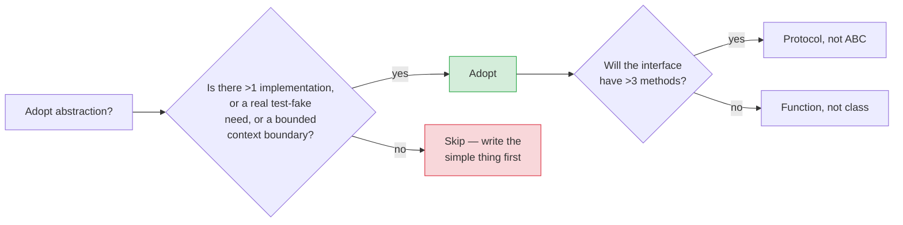
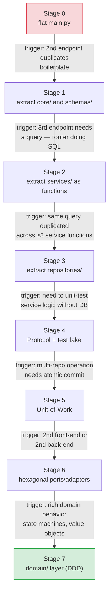
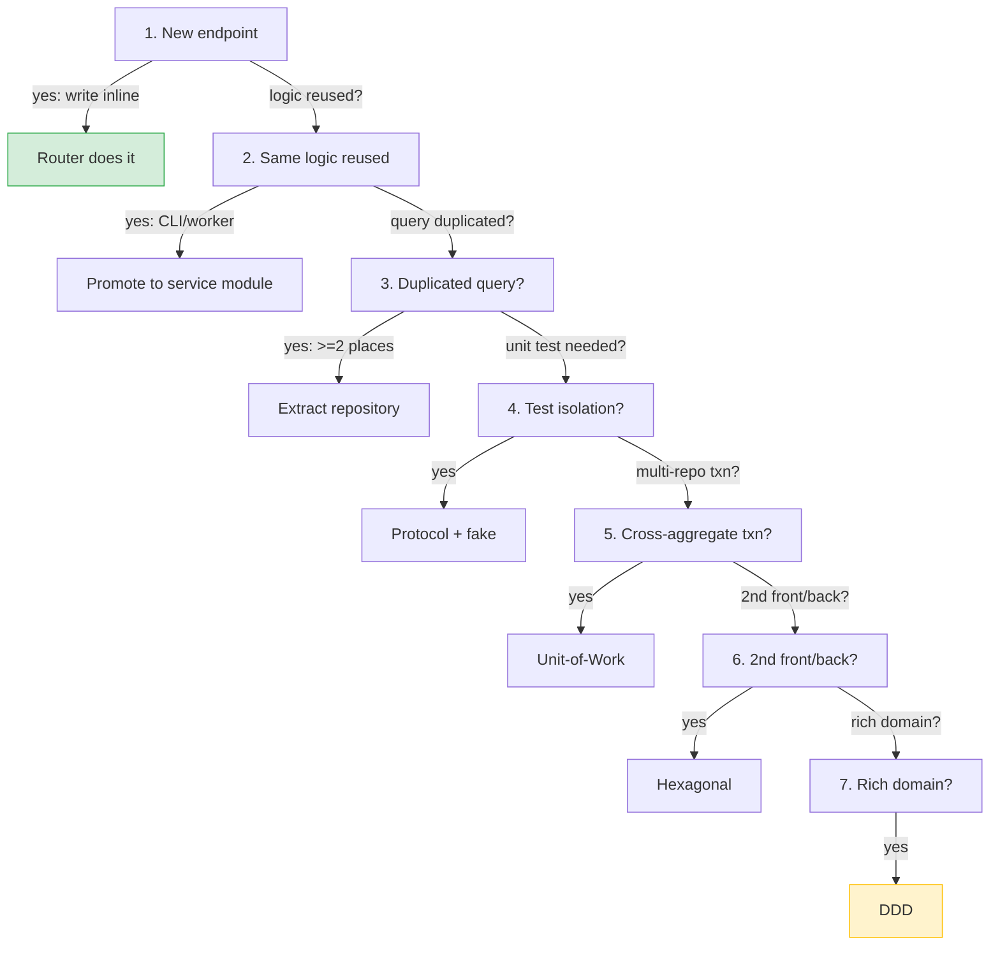

# Lesson 04: When Abstraction Is Worth It

*The decision framework behind [[Engineering-Decision-Log|D-005]]. When to adopt a service, a repository, a Unit-of-Work, an interface, a domain layer. When to skip them. The `AbstractUserRepository(UserRepository)` smell. A staged refactoring trajectory from flat `main.py` to layered app. Clean / hexagonal / DDD at a conceptual level.*

**Welcome to the judgment lesson.**

The repository pattern, the service pattern, the unit-of-work, abstract base classes, dependency inversion, hexagonal architecture, clean architecture, DDD — every one of these is a real technique that becomes cargo cult when applied without need. This lesson gives you explicit criteria for when each abstraction pays off, the smell that signals you adopted one too early, and the trajectory an app takes from flat to layered as it grows. **This is the lesson that keeps the other three honest.**


#architecture #patterns #refactoring

## Learning Objectives

By the end of this lesson you will be able to:

1. **List explicit criteria for adopting each abstraction** — service, repository, unit-of-work, abstract interface, dependency inversion — and a *trigger* for each that must fire before you adopt it.
2. **Identify the `AbstractUserRepository(UserRepository)` smell** and explain why it is anti-value.
3. **Sketch a refactoring trajectory** from a flat `main.py` to a layered app, naming the trigger that causes each move.
4. **Recognise clean / hexagonal / DDD at a conceptual level** and state the trigger for adopting each.
5. **Defend a "no, we don't need that here" decision** to a senior reviewer.
6. **Audit an existing project** for unfounded abstractions and plan their removal.

## Prerequisites

Before starting, you need:

- **The layered `Boardly` from Lessons 01–03.** This lesson audits that layout.
- **Python Protocols** — [[01-Python-Foundations/Classes-Protocols-Structural-Typing]]. The `Protocol` vs. `ABC` decision depends on this foundation.
- **Project layout and imports** — [[01-Python-Foundations/Project-Layout-and-Imports]]. The trajectory in this lesson moves files across folders; you need to be comfortable with relative and absolute imports.
- **About an hour.** This lesson is shorter on code than Lessons 01–03 and longer on judgment. Read slowly.

**The most common gap: YAGNI as a principle, not a mood.**

"You Aren't Gonna Need It" is not "I don't feel like adding this." It's a principle: an abstraction earns its keep when there is a real second implementation or a real test-fake need. A speculative future ("we might swap to Mongo") is not a trigger. Read Fowler's Yagni bliki (<https://martinfowler.com/bliki/Yagni.html>) if the distinction is not yet second nature.


## The Problem

Every abstraction has a **cost** (extra files, indirection, mapping code, cognitive load) and a **payoff** (swappability, testability, boundary clarity). The decision is a function of those two:

**Why not just abstract everything up front, since "more layers = more flex"?** Because every layer is a place where a future reader has to ask "what does this actually do?" before they can change it. A `ProjectRepository` Protocol wrapping a single `SqlAlchemyProjectRepository` is one indirection between the router and the SQL — the reader must open two files to follow one call. The abstraction pays its keep when (a) a second real implementation exists (a `FakeProjectRepository` for tests, a `RedisProjectRepository` for caching), or (b) a boundary is genuinely needed (a network seam, a slow DB behind a faster cache). Without those, the abstraction is dead weight — and worse, it is *misleading* weight: a router calling `ProjectRepository.create` looks like it could be swapped, but if there is only one implementation, the swap is fiction.

**Why does this lesson have no new code?** Because the audit is the lesson. Lessons 01–03 of this section built the concrete `Boardly` architecture — `core/db.py`, `repositories/project_repo.py`, `services/project_service.py`, `routers/project_routes.py`. The right thing to do at the end of the section is *not* to add another layer; it is to walk the existing layers and ask: which of these would I undo if I were starting over, and which were the cheapest decisions I ever made? The audit produces no new files. It produces a list of judgment calls you can defend.



Two rules of thumb:

1. **An interface earns its keep when there is a real second implementation.** A test fake counts if you actually use it. A future "maybe we swap to Mongo" does not.
2. **A class earns its keep when it carries state across method calls.** A `UserService` carries the session; a `hash_password` function does not. If you have a stateless "service" with one method, it is a function.

**When does a test-fake count as the "real second implementation"?** When you actually write and use it. A fake that exists only in the spec ("we will need a `FakeProjectRepository` for the tests we will write") is still speculative — it is the same YAGNI violation as a future-DB-swap that has not happened. A fake that you wrote last sprint, that runs in your `pytest` suite, that lets you test the service without a live Postgres — that fake is real. It is the second implementation that justifies the abstraction. If the abstraction has only one implementation and zero test-fakes, it is dead weight.

The [[Engineering-Decision-Log|D-005]] decision made the vault's position: the repository pattern is opt-in. This lesson is the decision framework behind that stance.

**Note — Historical context — the layering debate**

The "premature abstraction" debate is older than FastAPI. The phrase "You Aren't Gonna Need It" was Kent Beck's, codified in *Extreme Programming Explained* (1999). The counter-phrase "premature concrete" — that inlining when an abstraction is coming costs you refactoring pain — comes from Mark Seemann's blog (2011). Both are right; the asymmetry is that premature abstraction is *ongoing* (you pay its cost forever) and premature concrete is *one-off* (you pay its cost when the trigger fires and you refactor). Prefer premature concrete — the cost is paid once and the refactoring is mechanical.


## The Code

This lesson has no new code — it audits the code from Lessons 01–03. We will refer to those lessons' files. What this lesson adds is the **decision criteria** and the **refactoring trajectory**: a stage-by-stage progression from a flat `main.py` to the layered layout, with the trigger for each move named explicitly.

## Line-by-Line Deep Dive

This section is the heart of the lesson. Read it twice. Don't skip.

### 1. The five abstractions and their criteria

#### 1.1 Service (class or module of functions)

- **What it is:** A layer between routers and repositories/queries that owns business rules and transaction boundaries.
- **Adopt when:** Any of (a) business logic exceeds ~10 lines per endpoint, (b) the same logic must run from HTTP, CLI, and worker, (c) you have ≥3 endpoints sharing validation/orchestration logic, (d) you need to test the logic without an HTTP client.
- **Skip when:** The endpoint is `select(User).where(...) -> return`. There is no business rule. The router can call the query directly.
- **Smell:** A `UserServices` class with one `register` method. Make it a function `register_user(session, data)` until the second method appears.

The service in `Boardly` (`UserService` in Lesson 02) carries state (the session and the repository) across four methods (`register_user`, `update_profile`, `deactivate_user`, `admin_update_user`). It earns its class-ness. A `hash_password(plain)` function with no state is a function, not a class — and the lesson's code keeps it as a function (`_hash_password`).

#### 1.2 Repository (class hiding queries behind an aggregate-level API)

- **What it is:** A boundary object that exposes operations like `get_active_by_email`, not raw queries.
- **Adopt when:** Any of (a) the same query appears in ≥3 endpoints and you want to change it once, (b) you need to unit-test the service without a database, (c) bounded contexts need a hard boundary against cross-context table access, (d) you are evaluating a second persistence backend.
- **Skip when:** The slice has 1-2 queries that are stable. Inlining `session.scalar(select(User).where(...))` in the service is clearer.
- **Smell:** `UserRepository` with `get`, `add`, `delete`, `list` — generic CRUD. This is a DAO, not a repository. See [[Service-and-Repository-Patterns]].

The repository in `Boardly` (`SqlAlchemyUserRepository` in Lesson 02) is justified by criterion (b): the unit test `test_user_service.py` uses `FakeUserRepository` and runs in single-digit milliseconds without a database. If we did not have that test, the repository would be unjustified — the four methods would be inlined in `UserService` as direct session calls.

#### 1.3 Unit-of-Work (UoW): a context manager bundling session + repositories

- **What it is:** An object that, on `__enter__`, creates a session and instantiates all the repositories for a business operation. On `__exit__`, it commits (no exception) or rolls back (exception).
- **Adopt when:** A single business operation needs to span multiple repositories with a single commit point, *and* you need to test that operation without a database session at all.
- **Skip when:** You have a request-scoped session via `get_session`. The UoW is the explicit-boundary version of what the request-scoped session already does.
- **Smell:** A UoW with one repository. Use the request-scoped session and skip the UoW.

`Boardly` does not have a UoW. The reason: every business operation in `Boardly` so far touches one repository (`UserService` -> `UserRepository`, `ProjectService` -> `ProjectRepository`). A UoW would bundle one repository — ceremony without value. The trigger for adopting one is a `place_order` operation that needs to write to `Orders` and `Invoices` in one transaction; `Boardly` doesn't have that. (See Stage 5 below for what it would look like.)

#### 1.4 Abstract interface / base class

- **What it is:** A `Protocol` or `ABC` that names the contract of a service or repository.
- **Adopt when:** The service or repository has, or will have within the next iteration, ≥2 implementations. (A test fake counts as a second implementation if the test is real.)
- **Skip when:** There is exactly one implementation and no test fake. The "interface" is then a renaming of the concrete class.
- **Smell:** `AbstractUserRepository(UserRepository)` where `UserRepository` is the only concrete impl and `AbstractUserRepository` is never inherited by anything else. (Yes, this exact shape exists in published tutorials. It is cargo cult.)

The `UserRepository` Protocol in `Boardly` (Lesson 02) is justified by the test fake — `FakeUserRepository` satisfies it structurally. If we did not have the test fake, the Protocol would be unjustified; we would just have `UserService` take a `SqlAlchemyUserRepository` directly.

#### 1.5 Dependency inversion (depending on the interface, not the implementation)

- **What it is:** The service declares `def __init__(self, users: UserRepository)` where `UserRepository` is the protocol, not the SQLAlchemy class.
- **Adopt when:** You have an interface (criterion 4 met) and you want tests to swap implementations.
- **Skip when:** No interface. Depending on the concrete `SqlAlchemyUserRepository` directly is fine for a slice that will only ever have one implementation.
- **Smell:** DI ceremony in a slice that has no test fakes. The test that "exercises" the abstraction by passing the same concrete class the production code uses is not testing the abstraction — it is testing the implementation through an indirection.

The DI wiring in `Boardly` (`get_user_service` in `boardly/services/dependencies.py`) is justified by the test fake. The `dependency_overrides` mechanism lets a test swap `get_user_repository` for `lambda: FakeUserRepository()` — and the same service code runs. Without the test fake, the DI would be ceremony: the service would take a `SqlAlchemyUserRepository` and tests would just construct the same thing.

### 2. The `AbstractUserRepository(UserRepository)` smell, dissected

```python
# WRONG — cargo cult
from abc import ABC, abstractmethod

class AbstractUserRepository(ABC):
 @abstractmethod
 def get(self, id) -> User | None: ...
 @abstractmethod
 def add(self, user: User) -> None: ...

class UserRepository(AbstractUserRepository): # the only implementation
 def __init__(self, session): self._session = session
 def get(self, id) -> User | None: return self._session.get(User, id)
 def add(self, user: User) -> None: self._session.add(user)
```

What this buys you:

- **Nothing.** There is no second implementation. There is no test fake. The "abstract" base is a class with one subclass. It exists because someone read a tutorial that said "always depend on abstractions".

What this costs you:

- One extra file (`abstract_user_repository.py`).
- One extra class to maintain. Every new repository method needs to be added to *two* classes.
- The illusion of swappability. New developers will believe they can swap the implementation, try it, and discover that the abstract base was written by copying the concrete class — so it bakes in SQLAlchemy-shaped method signatures (`User | None` return type) and is useless for a non-SQL implementation.

**Warning — The shape of an unfounded abstraction.**

The signature `def get(self, id) -> User | None` returns `User`, the SQLAlchemy ORM class. A second implementation that does not use SQLAlchemy cannot satisfy the contract if its return type is, say, a dataclass. The "abstract" interface bakes in the only implementation's choices. This is the smell of "the interface mirrors the only implementation."


The fix: if you genuinely need a second implementation, write the `Protocol` *after* writing the second implementation, and let the protocol be the smallest common surface. If you only have one implementation, write the concrete class and stop.

### 3. Clean / Hexagonal / DDD at a conceptual level

Three architectural styles, in order of weight:

#### 3.1 Clean Architecture (Robert C. Martin)

- **Concept:** Layers arranged by the dependency rule (dependencies point inward). Outer layers (web, db) depend on inner layers (entities, use cases). Inner layers know nothing about outer layers.
- **Adopt when:** Your app has both rich business rules *and* a real chance of swapping either the web framework or the persistence layer. (Most FastAPI apps satisfy neither.)
- **Cost:** Mapping code between layers. An entity in `domain/`, an ORM model in `models/`, a DTO in `schemas/`, and the service translates between all three at every boundary.
- **Smell:** A `domain/User` class that has the same fields as `models/user.py:User` and `schemas/user.py:UserRead`. The duplication is the cost of the architecture; only pay it when the layers genuinely differ.

`Boardly` as written adopts *one* rule from Clean Architecture: "dependencies point inward" (see [[Layered-FastAPI-Apps]]). It does *not* adopt the per-layer DTO duplication. The `domain/` folder does not exist in `Boardly` — the ORM model *is* the domain object, because the business rules are not rich enough to deserve a separate class. If `Boardly` grew a state machine on `Project` (`created -> paid -> shipped -> cancelled`), the trigger would fire; until then, skip.

#### 3.2 Hexagonal Architecture (Ports and Adapters, Alistair Cockburn)

- **Concept:** The application core has "ports" (interfaces) and "adapters" (implementations). HTTP is an adapter. The database is an adapter. The core knows only the ports.
- **Adopt when:** You have multiple *kinds* of front-end (HTTP, CLI, gRPC, message consumer) and multiple *kinds* of back-end (Postgres, Redis, third-party HTTP). The ports and adapters are the natural shape.
- **Cost:** A port for everything that could be swapped. If you have one front-end and one back-end, hexagonal is a verbose description of a layered app.
- **Smell:** An `EmailSenderPort` with one `SmtpEmailSender` adapter that has no test fake. The interface exists for symmetry, not because there is a second adapter.

`Boardly` as written does not adopt hexagonal. There is one front-end (FastAPI) and one back-end (PostgreSQL via SQLAlchemy). The trigger for adopting hexagonal would be: a CLI command that runs the same `register_user` service, or a Redis cache in front of the user repository. When the trigger fires, the existing `UserRepository` Protocol *is* the port; the `SqlAlchemyUserRepository` *is* the adapter; a `CliAdapter` or `RedisCachedUserRepository` would be the second adapter. The infrastructure is in place; the trigger has not fired.

#### 3.3 Domain-Driven Design (Eric Evans)

- **Concept:** A vocabulary for modeling complex business domains: entities, value objects, aggregates, repositories, bounded contexts, ubiquitous language.
- **Adopt when:** The business domain is complex enough that getting the model wrong is expensive (insurance, billing, manufacturing operations). The modeling discipline pays for itself by surfacing business rules that would otherwise hide in code.
- **Cost:** Modeling sessions with domain experts. A `domain/` layer of value objects. Aggregate boundaries that constrain how repositories are shaped.
- **Smell:** A `domain/` layer with `User`, `Note`, `Tag` classes that mirror the ORM models and have no behavior. DDD without behavior is just an extra mapping step.

`Boardly` as written does not adopt DDD. The `User` aggregate is one entity with no value objects; the `Project` aggregate is one entity with no value objects. The triggers for adopting DDD would be: a `Money` value object with currency, a `ProjectStatus` state machine, an `Order` aggregate that bundles `OrderLine` items. None of those exist in `Boardly` as written. The vault's portfolio projects [[18-Portfolio-Projects/01-ForgeTrack-Manufacturing-Operations]] and [[18-Portfolio-Projects/02-Multi-Tenant-Billing-SaaS]] are written at the weight where DDD pays off.

**The vault's stance (summary)**

- **Clean Architecture:** adopt the dependency rule (dependencies point inward) from day one — see [[Layered-FastAPI-Apps]]. Skip the per-layer DTO duplication until you have evidence it pays off.
- **Hexagonal:** adopt when you have ≥2 front-ends or ≥2 back-ends. The vault's portfolio projects [[18-Portfolio-Projects/04-Async-Document-Processing]] and [[18-Portfolio-Projects/06-RealTime-Collaboration-Notifications]] reach this weight.
- **DDD:** adopt when modeling a portfolio project's domain — [[18-Portfolio-Projects/01-ForgeTrack-Manufacturing-Operations]] and [[18-Portfolio-Projects/02-Multi-Tenant-Billing-SaaS]] use DDD modeling deliberately.


### 4. A refactoring trajectory: from flat `main.py` to layered

A small app grows from flat to layered. Each step has a *trigger* — a concrete change in the project that justifies the move. No step is taken without a trigger.



#### Stage 0: flat `main.py`

```python
# main.py — 60 lines, one file
from fastapi import FastAPI, HTTPException
from sqlalchemy import create_engine, select
from sqlalchemy.orm import Session, DeclarativeBase, Mapped, mapped_column
from pydantic import BaseModel

engine = create_engine("postgresql+psycopg://localhost/boardly")

class Base(DeclarativeBase): pass

class User(Base):
 __tablename__ = "users"
 id: Mapped[int] = mapped_column(primary_key=True)
 email: Mapped[str] = mapped_column(unique=True)

app = FastAPI()

class UserCreate(BaseModel):
 email: str

class UserRead(BaseModel):
 id: int
 email: str
 class Config: from_attributes = True

@app.post("/users", response_model=UserRead)
def create_user(body: UserCreate):
 with Session(engine) as session:
 if session.scalar(select(User).where(User.email == body.email)):
 raise HTTPException(409, "exists")
 user = User(email=body.email)
 session.add(user)
 session.commit()
 session.refresh(user)
 return user
```

**Trigger for next stage:** A second endpoint (`GET /users/{id}`) duplicates the `Session(engine)` boilerplate and the ORM-to-DTO mapping. The file is now ~120 lines. Time to split.

#### Stage 1: extract `core/` and `schemas/`

Move `Base` to `app/models/base.py`. Move `User` to `app/models/user.py`. Move the DTOs to `app/schemas/user.py`. Move the engine to `app/core/db.py` with a `get_session` dependency. `main.py` shrinks to ~20 lines of router code.

**Trigger:** A third endpoint needs a query. Writing the query inline in the router starts to feel wrong because the router is doing SQL. Time to introduce a service.

#### Stage 2: extract `services/`

Move the email-duplicate check and the `User(email=...)` construction into `app/services/user_service.py`. The router shrinks to parse -> call service -> map response.

```python
# app/routers/user_routes.py
@router.post("/users", response_model=UserRead, status_code=201)
def create_user(body: UserCreate, session: Session = Depends(get_session)):
 user = user_service.create_user(session, body)
 return UserRead.model_validate(user)
```

```python
# app/services/user_service.py — module of functions, no class yet
def create_user(session: Session, data: UserCreate) -> User:
 if session.scalar(select(User).where(User.email == data.email)):
 raise ConflictError(f"{data.email} exists")
 user = User(email=data.email)
 session.add(user)
 session.flush()
 return user
```

The service is a **module of functions** at this stage. No class. No `UserService`. The trigger for promoting to a class is "needs to carry state" — e.g. the session, when the same service will be constructed in three places (router, CLI, worker). Until then, a module of functions is the simpler shape.

**Tip — The trigger for promoting functions to a class is state, not "feels more enterprise".**

A `UserService` class with `def __init__(self, session)` and `def register_user(self, data)` carries the session as state. That earns the class. A `UserService` class with `@staticmethod register_user(session, data)` doesn't carry state — it's just a function with extra ceremony. Use a module of functions until the state-bearing constructor appears.


**Trigger:** The duplicate-email check is now duplicated across `create_user` and `update_user`. The `select(User).where(...)` query is duplicated across three service functions. You are about to change the query (e.g. add `is_active` filter) and would have to change it in three places. Time to introduce a repository.

#### Stage 3: extract `repositories/`

```python
# app/repositories/user_repository.py
class SqlAlchemyUserRepository:
 def __init__(self, session: Session) -> None:
 self._session = session

 def get(self, user_id: int) -> User | None:
 return self._session.get(User, user_id)

 def get_active_by_email(self, email: str) -> User | None:
 return self._session.scalar(
 select(User).where(User.email == email, User.is_active.is_(True))
 )

 def add(self, user: User) -> None:
 self._session.add(user)
```

The service now takes a `UserRepository` argument. The router injects `SqlAlchemyUserRepository(session)`.

**Trigger:** You need to unit-test the service logic (the "no duplicate email" rule, the "active users per tenant" quota) without spinning up a database. The repository interface exists; the test fake follows.

#### Stage 4: introduce the protocol and test fake

```python
# app/services/protocols.py
from typing import Protocol

class UserRepository(Protocol):
 def get(self, user_id: int) -> User | None: ...
 def get_active_by_email(self, email: str) -> User | None: ...
 def add(self, user: User) -> None: ...
```

```python
# tests/fakes.py
@dataclass
class FakeUserRepository:
 users: dict[int, User] = field(default_factory=dict)

 def get(self, user_id): return self.users.get(user_id)
 def get_active_by_email(self, email):
 return next(
 (u for u in self.users.values() if u.email == email and u.is_active),
 None,
 )
 def add(self, user): self.users[user.id] = user
```

```python
# tests/test_user_service.py
def test_create_user_rejects_duplicate_email():
 repo = FakeUserRepository()
 existing = User(email="dup@x.com"); existing.id = 1; existing.is_active = True
 repo.add(existing)

 service = UserService(FakeSession(), repo)
 with pytest.raises(ConflictError):
 service.create_user(UserCreate(email="dup@x.com"))
```

The service is now tested without a database. **This is the moment the abstraction pays for itself.**

**The repository pattern's justification.**

If you have a test fake that exercises the service logic in milliseconds, the repository pattern has paid for itself. If you have the repository but no fake (or the fake is never run in a test), the repository is unfounded — inline its queries back into the service and delete the class.


**Trigger:** You start writing `OrderService` and `BillingService` and you notice they need to commit together (place an order and write an invoice in one transaction). The request-scoped session no longer covers the boundary you need. Time to consider a UoW.

#### Stage 5: Unit-of-Work for cross-aggregate transactions

```python
# app/services/unit_of_work.py
class SqlAlchemyUnitOfWork:
 def __init__(self, session_factory):
 self._session_factory = session_factory

 def __enter__(self):
 self._session = self._session_factory()
 self.users = SqlAlchemyUserRepository(self._session)
 self.orders = SqlAlchemyOrderRepository(self._session)
 self.invoices = SqlAlchemyInvoiceRepository(self._session)
 return self

 def __exit__(self, *exc):
 if exc[0]:
 self._session.rollback()
 else:
 self._session.commit()
 self._session.close()
```

```python
# in the order placement service
def place_order(data, uow: UnitOfWork = Depends(get_uow)):
 with uow:
 order = uow.orders.add(Order(...))
 uow.invoices.add(Invoice(order_id=order.id, ...))
 # commit happens on __exit__
```

The UoW makes the transaction boundary explicit. The service can use a `FakeUnitOfWork` in tests — `with fake_uow: ...` runs the same code without a database.

**Trigger for hexagonal / clean architecture beyond this:** the app needs a non-HTTP front-end (a CLI command that runs the same `place_order` service) or a second back-end (Redis cache in front of Postgres). Now ports and adapters earn their keep. Until then, layered is enough.

#### Stage 6 (optional): domain layer

When business rules exceed what ORM models comfortably express (e.g. an `Order` with a state machine: `created -> paid -> shipped -> cancelled`), promote a `domain/` folder with pure-Python objects:

```python
# app/domain/order.py
class OrderState:
 CREATED = "created"
 PAID = "paid"
 SHIPPED = "shipped"
 CANCELLED = "cancelled"

class Order:
 def __init__(self, id, state=OrderState.CREATED): ...
 def pay(self):
 if self.state != OrderState.CREATED:
 raise InvalidTransition(f"cannot pay from {self.state}")
 self.state = OrderState.PAID
 def ship(self): ...
 def cancel(self): ...
```

The service translates between `domain.Order` and `models.Order` (the ORM model). DTOs map to `domain.Order`, not to `models.Order`. This is the gateway to DDD; only pay it when the domain genuinely has behavior the ORM cannot express cleanly.

### 5. The audit: which abstractions should `Boardly` keep?

Applying the criteria to `Boardly` as built across Lessons 01–03:

| Abstraction | Adopted in `Boardly`? | Justified by | Verdict |
|---|---|---|---|
| Six-folder layout | Yes | Three vertical slices + multi-developer project | Keep |
| `DomainError` hierarchy | Yes | Four domain errors + global handlers + MRO fallback | Keep |
| `UserService` (class) | Yes | Carries session + repo across 4 methods | Keep |
| `SqlAlchemyUserRepository` | Yes | Test fake in `tests/test_user_service.py` | Keep (justified by the fake) |
| `UserRepository` Protocol | Yes | Same test fake (structural) | Keep |
| `ProjectService` + `SqlAlchemyProjectRepository` | Yes (Lesson 01) | Symmetry with User slice; the project queries are duplicated across `list_projects`, `get_project`, `update_project` | Keep, but watch — if `Project` never gains a test fake, the repository is unjustified; inline it |
| Unit-of-Work | No | No multi-repo operation needs atomic commit | Skip until trigger |
| Hexagonal ports | No | One front-end, one back-end | Skip until trigger |
| `domain/` folder (DDD) | No | No state machines, no value objects | Skip until trigger |
| `AdminUserUpdate` / `AdminUserRead` DTOs | Yes | Security property (admin-only fields) | Keep |

**Spot the unfounded abstraction in your own project.**

Audit your current project. For each abstraction you have adopted, write a one-sentence answer to "what second implementation or test fake uses this?" If the answer is "none", flag the abstraction for removal in the next refactor. A clean removal: inline the abstraction's calls back into the caller, delete the abstract class and the concrete class wrapper, verify the test suite still passes.


## Execution Trace

The decision sequence at a project planning meeting:

1. **New endpoint:** "Do we have a service for this slice?" -> No -> write the endpoint inline in the router.
2. **Same logic reused:** "Will this run from a CLI or worker too?" -> Yes -> promote the inline code to a service module.
3. **Duplicated queries:** "Will the query change in ≥2 places?" -> Yes -> extract a repository.
4. **Test isolation needed:** "Do I want to test the service without a DB?" -> Yes -> write a `Protocol` and a fake.
5. **Cross-aggregate transaction:** "Does this operation span >1 repository and need atomic commit?" -> Yes -> introduce a UoW.
6. **Second front-end/back-end:** "Is there a non-HTTP caller or a non-SQL backend?" -> Yes -> ports and adapters (hexagonal).
7. **Rich domain behavior:** "Does the entity have a state machine or invariants the ORM cannot express?" -> Yes -> `domain/` layer (DDD).

Each gate is a separate decision. Skipping a gate is fine; jumping a gate without the trigger is the cargo cult.



## Common Mistakes

### Mistake 1: Adopting all five abstractions on day one

The first commit has `core/`, `routers/`, `services/`, `repositories/`, `domain/`, `ports/`, `adapters/`, and a UoW. The app has one endpoint. Each abstraction has one implementation. The team is maintaining eleven files for one endpoint.

**Fix:** start at Stage 0 (flat `main.py`) and only move to the next stage when its trigger fires.

### Mistake 2: Test fake that is never run

You write `FakeUserRepository` because the tutorial said to, then never write a service test that uses it. The fake rots; the abstraction it justifies is unfounded.

**Fix:** delete the fake. If no service test exists, the repository abstraction is unjustified; inline the queries back into the service.

### Mistake 3: Interface that mirrors the only implementation

```python
class AbstractUserRepository:
 def get(self, id: int) -> User | None: ... # returns User; assumes SQLAlchemy
 def add(self, user: User) -> None: ...
```

The "abstract" interface bakes in SQLAlchemy's `User` type. A second implementation that does not use SQLAlchemy cannot satisfy it. The interface is a renaming of the concrete class.

**Fix:** write the second implementation first, *then* extract the protocol from the common surface.

### Mistake 4: Adopting DDD for a CRUD app

```python
# app/domain/user.py
class User:
 def __init__(self, id, email): self.id = id; self.email = email
```

A `domain.User` with no methods is just a second copy of `models.User`. The DDD value is in *behavior*, not in duplication.

**Fix:** skip the domain layer until the entity has behavior (state machine, multi-field invariants, calculated properties that are not just column reads).

### Mistake 5: "We might need to swap to Mongo"

A speculative persistence-backend swap is not a trigger. It is a speculation. The repository pattern does not even make the swap trivial — the second backend's query semantics differ enough that the repository's method signatures need to change. Adopt the abstraction when the swap is on the roadmap with a date.

### Mistake 6: Inheriting from ABC when Protocol would do

```python
class AbstractUserRepository(ABC): # nominal
 @abstractmethod
 def get(self, id): ...

class FakeUserRepository(AbstractUserRepository): # forced to inherit
 def get(self, id): ...
```

The fake is forced to inherit from the ABC, which adds an import and a class-hierarchy coupling. With `Protocol`, the fake is structural — it just needs the right methods.

**Fix:** prefer `Protocol` unless you have a concrete shared-implementation reason for `ABC` (e.g. mixin methods).

**Spot the smell — what's wrong with this service?**

```python
class UserService:
@staticmethod
def register_user(session: Session, data: UserCreate) -> User:
if session.scalar(select(User).where(User.email == data.email)):
raise ConflictError("exists")
user = User(email=data.email)
session.add(user)
session.flush()
return user
```
Answer: the class has only `@staticmethod`s. It carries no state. It's a function with extra ceremony. Use a module of functions until the state-bearing constructor appears.


## Engineering Trade-Offs

### Premature abstraction vs. premature concrete

There are two failure modes:

- **Premature abstraction:** You adopt a pattern without a trigger. You pay its cost forever, with no payoff.
- **Premature concrete:** You inline when an abstraction is coming. You pay refactoring cost when the trigger fires and you have to extract.

The asymmetry: extracting is mechanical and guided by tests; the cost of premature abstraction is ongoing and harder to see. Prefer premature concrete. The vault's default style (router + service function with inline queries) is deliberately concrete.

### Protocol vs. ABC: performance and ergonomics

Protocols are zero-runtime-cost (they are structural; no `isinstance` check unless you opt in with `@runtime_checkable`). ABCs have a metaclass; `isinstance` checks run. For interface contracts, Protocol is the better default. For base classes that provide shared helpers (e.g. a `BaseRepository` with a `session` property and shared `get`/`add` methods), ABC is the right tool — the inheritance is real.

### The cost of mapping code

Clean architecture has mapping code between `domain/`, `models/`, and `schemas/`. Three types for one entity is the cost. It is justified when the three shapes diverge (rich domain, soft-deleted ORM column, narrowed DTO). It is unjustified when the three are identical — and they usually are identical in CRUD apps. The smell test: if you can write `domain_to_orm(d: UserDomain) -> UserORM` as `UserORM(**d.model_dump())`, you do not need the domain layer.

### When the abstraction *must* be adopted even if there is one implementation

Security. If a security property depends on the abstraction boundary — e.g. "no code outside the `BillingRepository` may read the `billing_transactions` table" — adopt the repository even without a second implementation, because the boundary is the security control. The audit answer becomes "the boundary is the second implementation". This is rare; document it explicitly when you do it.

**When would you NOT reach for the full five-layer architecture even after a trigger has fired?**

Two cases. (1) The trigger fired for one layer — say, a second storage backend for read-only analytics — but the other four abstractions (Domain, Protocol, Unit-of-Work, services-as-classes) have no trigger. Adopt just the one abstraction the trigger demanded; resist the "since we're refactoring anyway" urge to add the other four. The "while I'm in there" cost is real, and the four untriggered abstractions become dead weight. (2) The trigger fired in a part of the codebase that's about to be deprecated — adopting the abstraction now locks in a layer you'll throw away in six months. Wait for the deprecation to land, then decide. The rule of thumb: adopt the abstraction the moment the trigger fires, not earlier, not for unrelated abstractions, not for code on a deprecation path.


### The mapping-code smell test

If your `domain/User` and your `models/User` and your `schemas/UserRead` have the same field names and types, you have three copies of one type. The mapping code between them is dead weight. Consolidate to one type (probably the ORM model) and accept the layering trade-off. The moment the three shapes diverge — a soft-deleted column on the ORM model that DTOs should not expose, a `Money` value object on the domain model that the ORM cannot express — the duplication becomes justified.

## Exercises

**Tip — The 20-minute rule**

If you're stuck on an exercise for more than 20 minutes, re-read the relevant section above, then move on and come back. Learning isn't linear.


**Exercise 1 — Audit an open-source FastAPI project.** Find a popular FastAPI project on GitHub. List every abstraction (every `Abstract*` class, every `Protocol`, every interface). For each, answer "what second implementation uses this?". Flag the unfounded ones in a code-review comment (or just in your notes).

**Exercise 2 — Inline the `ProjectRepository`.** Take the example app from Lessons 01–03. Find the smallest feature slice where you can argue *for* removing the repository layer (i.e. inline its queries back into the service). Make the change. Re-run the tests. Report what broke and what got simpler. (Hint: `ProjectRepository` has no test fake in this section's lessons. If the trigger has not fired, inline it.)

**Exercise 3 — Adopt a UoW.** Add a `BillingService` that needs to write to `Invoice` and `Payment` repositories in one transaction. The request-scoped session doesn't cover it. Write `SqlAlchemyUnitOfWork` and a `FakeUnitOfWork`. Test that a failed payment rolls back the invoice.

**Exercise 4 — Adopt a domain layer.** Add a `ProjectStatus` state machine: `active -> archived -> deleted`, with no transition backwards. Promote `domain/project.py` with a `Project` class that has `archive()` and `delete()` methods. Translate between `domain.Project` and `models.Project` in `ProjectService`. Measure the additional lines of mapping code.

**Exercise 5 — Write a position paper.** Write a 500-word position paper defending or attacking the statement "Every FastAPI app should start with a flat `main.py`, not a layered layout." Use the triggers in this lesson as evidence. Be specific about which triggers you would accept and which you would reject.

## Verification

```bash
# Audit your own project:
# For every Abstract class or Protocol, find at least one *other* implementation
# that is used in production or tests. If none exists, plan its removal.

# Count the lines of mapping code per entity:
wc -l boardly/models/*.py boardly/schemas/*.py boardly/services/*.py
# If boardly/services/*.py has a "domain_to_orm" function that is just
# `UserORM(**d.model_dump())`, you don't need the domain layer — plan removal.

# Run the test suite and check that the repository fakes are actually exercised:
uv run pytest tests/test_*_service.py -q --co
# Every test in these files should use a fake repository. If a test uses
# a real SqlAlchemy session, the repository abstraction is not buying that test.

# Count files per abstraction:
find boardly -name "*.py" | xargs grep -l "Protocol\|ABC\|abstractmethod" 2>/dev/null
# For each file, find at least one other implementation. If you can't, the
# file is unfounded — plan its removal.
```

If the audit reveals an unfounded abstraction, the removal is mechanical: inline the abstraction's calls back into the caller, delete the abstract class, run the tests, fix the import errors. The tests should still pass — if they break, the abstraction was load-bearing (and you have a reason to keep it after all).

## Previously Learned Here

These concepts were taught in earlier lessons. We link back instead of re-explaining:

- **Repository pattern** — [[Service-and-Repository-Patterns]]. The criteria in this lesson narrow the repository's adoption beyond the canonical lesson's stance; this is the decision framework behind [[Engineering-Decision-Log]] D-005.
- **Type hints** — [[01-Python-Foundations/Type-Hints-and-Annotations]]. Used here in the form of `Protocol` from PEP 544.
- **Classes / Protocols / Structural typing** — [[01-Python-Foundations/Classes-Protocols-Structural-Typing]]. The `Protocol` vs. `ABC` decision in this lesson depends on that foundation.
- **Project layout and imports** — [[01-Python-Foundations/Project-Layout-and-Imports]]. The trajectory in this lesson moves files across folders; you need to be comfortable with relative and absolute imports.
- **DomainError hierarchy** — [[Domain-vs-HTTP-Concerns]]. The exception translation pattern is reused; this lesson audits when the hierarchy's complexity is justified.
- **Transactions (SQL)** — [[06-SQL-Fundamentals/Transactions-Isolation-Locks]]. New detail here: the trigger for adopting a Unit-of-Work is "this business operation spans more than one repository and needs atomic commit" — i.e. the multi-repo `BEGIN`/`COMMIT` boundary that the request-scoped session no longer covers. The UoW is the architectural expression of the cross-aggregate transaction; the canonical SQL lesson is where the underlying `BEGIN`/`COMMIT`/`ROLLBACK` primitives and isolation-level choices are first taught. Stage 5 of this lesson's trajectory is the canonical UoW adoption point.

## What's Next

- **Section 06** — [[06-SQL-Fundamentals/00-SQL-MOC]]. You will learn SQL from the database's perspective, separate from SQLAlchemy.
- **Section 07** — [[07-SQLAlchemy/00-SQLAlchemy-MOC]]. Goes deeper into the ORM (`Session` internals, `select()` advanced patterns, async).
- **Section 09** — [[09-Alembic-Migrations/00-Alembic-MOC]]. Covers schema evolution; the layered layout you built in this section survives a deploy that ships new schema.
- **Section 11** — [[11-Authentication-and-Security/OAuth2-JWT-Access-Refresh]]. Replaces the `_get_current_user` stub with real JWT auth, on top of the `DomainError` hierarchy you have in place.
- **Section 12** — [[12-Testing-and-Quality/Testing-Database-Logic]]. Formalises the fake-repository test pattern from Lesson 02 and adds integration tests with real SQLite.

The layout you have built is the foundation every later section assumes. If you are unsure whether to keep an abstraction from this section, the audit checklist in Lesson 04 (this lesson) is the test.

## Sources

- **Robert C. Martin — The Clean Architecture** — <https://blog.cleancoder.com/uncle-bob/2012/08/13/the-clean-architecture.html> — accessed 2026-10-19 — the dependency rule and the criteria for layer separation.
- **Alistair Cockburn — Hexagonal Architecture** — <https://alistair.cockburn.us/hexagonal-architecture/> — accessed 2026-10-19 — ports and adapters as the conceptual frame for hexagonal.
- **Eric Evans — Domain-Driven Design, Chapters 1, 4, 6** — Addison-Wesley, 2003 — accessed via printed text — the canonical source for aggregates, repositories, and bounded contexts.
- **Martin Fowler — "Yagni"** — <https://martinfowler.com/bliki/Yagni.html> — accessed 2026-10-19 — the "you aren't gonna need it" framing that underlies the vault's opt-in stance.
- **Martin Fowler — Repository** — <https://martinfowler.com/eaaCatalog/repository.html> — accessed 2026-10-19 — the pattern's original definition, with the "acts like a collection" framing that the criteria narrow.
- **PEP 544 — Protocols: Structural subtyping** — <https://peps.python.org/pep-0544/> — accessed 2026-10-19 — the `Protocol` type preferred over `ABC` for interface contracts here.
- **Mark Seemann — Refactoring from Aggregate Services** — <https://blog.ploeh.dk/2011/12/22/RefactoringfromAggregateServicestoAnonymous/> — accessed 2026-10-19 — an example trajectory from concrete to layered that informed the staged trajectory in this lesson.

## What We Learned

Let's recap. In this lesson you:

- **Listed explicit criteria for adopting each abstraction** — service, repository, unit-of-work, abstract interface, dependency inversion — with a trigger for each.
- **Identified the `AbstractUserRepository(UserRepository)` smell** and explained why it is anti-value (no second implementation, no test fake, bakes in the concrete class's choices).
- **Sketched a seven-stage refactoring trajectory** from flat `main.py` to layered to hexagonal to DDD, naming the trigger that causes each move.
- **Recognised clean / hexagonal / DDD at a conceptual level** and stated the trigger for adopting each (rich domain behavior, second front-end/back-end, complex business modeling).
- **Audited `Boardly`** against the criteria: the layout, the `DomainError` hierarchy, `UserService`, and the repository + Protocol are justified by the test fake; the UoW, hexagonal, and DDD layers are skipped until their triggers fire.
- **Defended a "no, we don't need that here" decision** with the audit checklist: for every abstraction, "what second implementation uses this?" — and the mechanical removal procedure when the answer is "none".

Here's the mental model to walk away with: *every abstraction has a cost and a payoff. An interface earns its keep when there is a real second implementation — a test fake counts. A class earns its keep when it carries state. A repository earns its keep when a service test runs without a database. A unit-of-work earns its keep when a multi-repo operation needs atomic commit. Hexagonal earns its keep when there is a second front-end or back-end. DDD earns its keep when the domain has behavior the ORM cannot express. Skip every abstraction whose trigger has not fired; the cost of premature concrete is paid once, the cost of premature abstraction is paid forever.*

## Resume-Worthy Payoff

The audit criteria in this lesson are conceptual — they tell you *when* an abstraction is worth it. The vault's portfolio projects are where you see the criteria *fire* and pay off at resume weight. [[18-Portfolio-Projects/01-ForgeTrack-Manufacturing-Operations]] is the canonical artifact: its `WorkOrder` aggregate carries a state machine (`created -> in_progress -> quality_check -> completed -> cancelled`) the ORM cannot express cleanly, so it adopts a `domain/` layer (Stage 6 of the trajectory). It uses a `WorkOrderRepository` Protocol with two implementations — the SQLAlchemy production repository and the `FakeWorkOrderRepository` used by the unit tests that drive the state machine without a database (Stage 4). It introduces a `CompleteWorkOrderUoW` that spans the `WorkOrder` and `Inventory` repositories to atomically complete an order and decrement stock (Stage 5). Every trigger in the audit checklist fires for ForgeTrack; the lesson's audit is the conceptual frame, the portfolio project is the application. Read this lesson's criteria first, then go read the ForgeTrack artifact to see the criteria applied at the weight a hiring manager will recognise.

---

> A note from your teacher
You just finished the architecture section. The layout you have built across these four lessons is the layout every later section in the vault assumes — and the audit checklist in this lesson is the test you'll come back to when you wonder "did I overdo it?" The answer is almost always "yes, a little" — and the fix is mechanical: inline the unfounded abstraction, delete the class, run the tests. The skeleton stays the same. See you in Section 06.


---

**Tags:** #architecture #patterns #refactoring #review
**Previous:** [[Domain-vs-HTTP-Concerns]]
**Next:** [[06-SQL-Fundamentals/00-SQL-MOC]] →
