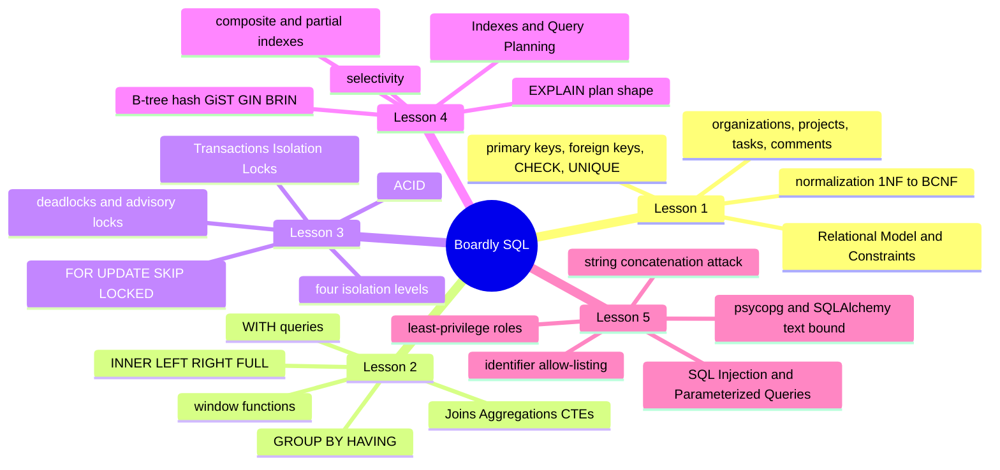
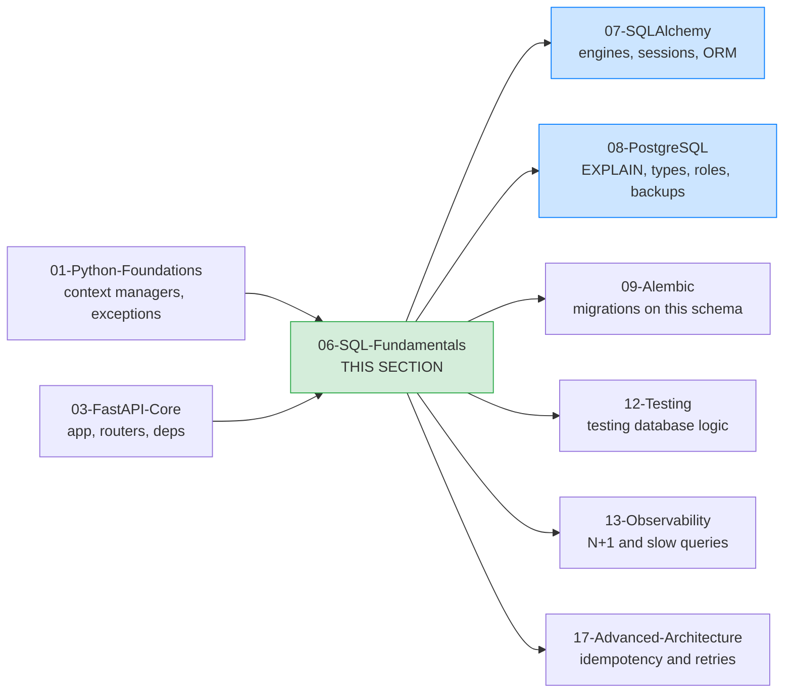

# SQL Fundamentals: Map of Content

**Bookmark this page.**

This is the **home base** for Section 06 — SQL Fundamentals. Every lesson in this folder, every concept, every reference back to the rest of the vault — all reachable from here. When you get lost, come back to the MOC.


Hello, friend. Pull up a chair.

You have built the Boardly API in Section 03. You have a `FastAPI()` instance, routers, dependencies, middleware, and exception handlers. The one thing every endpoint shares is that it talks to a database — and you have been faking that database with an in-memory `storage.py`. In this section we make the database real.

For the next five lessons, we drop down to **raw SQL against PostgreSQL**. No ORM. No SQLAlchemy. No Pydantic models hydrating off the wire. Just `psql` and `psycopg` and the actual SQL the database sees. This is the layer under every ORM, every migration, every dashboard. If you cannot read the SQL your ORM emits, you cannot debug the slow query that shows up at 3 a.m. on a Tuesday in production.

The dialect is **PostgreSQL 17** — the canonical learner version for this section, verified current as of October 2026. The concepts (relational model, joins, transactions, isolation, indexes, injection defense) transfer to any ANSI-SQL database with minor syntax deltas.

**You're in the right place.**

If you have used an ORM and want to actually *understand* what it emits — the joins, the transactions, the locks, the indexes, the parameter binding — this section was written for you. We'll go slow. We'll explain every line of every SQL statement. You will build a real schema and the queries that run against it.


---

## The Boardly Progression



Five lessons. One growing schema (organizations → projects → tasks → comments). By Lesson 5 you will be able to look at any ORM-emitted SQL and know exactly which of these five lessons' concepts it is exercising — and what to do when the query is wrong, slow, unsafe, or racing.

---

## Lessons in Order

| # | Lesson | What you add to `Boardly` | Time |
|---|--------|---------------------------|------|
| 1 | [[Relational-Model-and-Constraints]] | The Boardly schema — `organizations`, `projects`, `tasks`, `comments` — with primary keys (natural vs surrogate), foreign keys, `UNIQUE`, `CHECK`, `NOT NULL`, and a Mermaid ER diagram | 60–90 min |
| 2 | [[Joins-Aggregations-CTEs]] | Realistic reporting SQL on the Boardly schema — `INNER`/`LEFT`/`RIGHT`/`FULL` joins, `GROUP BY`/`HAVING`, `DISTINCT`, correlated vs non-correlated subqueries, CTEs with `WITH`, window functions (`ROW_NUMBER`, `RANK`, `LAG`, `SUM() OVER`) | 75–100 min |
| 3 | [[Transactions-Isolation-Locks]] | **Canonical for `Transactions (SQL)`.** ACID, the four isolation levels with concrete anomalies (dirty read, non-repeatable read, phantom, serialization anomaly), `FOR UPDATE`/`FOR SHARE`/`SKIP LOCKED`, deadlocks, advisory locks; a concurrent inventory-update lost-update example fixed with `SELECT ... FOR UPDATE` | 90–120 min |
| 4 | [[Indexes-and-Query-Planning]] | B-tree, hash, GiST, GIN, BRIN at a conceptual level; composite indexes and column order; partial indexes; expression indexes; when an index is *not* used; `EXPLAIN` (without `ANALYZE`); cardinality and selectivity; a slow query and the index that fixes it | 75–100 min |
| 5 | [[SQL-Injection-and-Parameterized-Queries]] | **Canonical for `SQL injection`.** The vulnerable string-concatenation pattern, second-order injection, parameterized queries with `psycopg` and SQLAlchemy `text()`, identifier allow-listing vs value binding, defense in depth (least-privilege DB roles); vulnerable code → exploit → fixed code | 75–100 min |

**Tip — How to read this section**

Read the lessons **in order**. Each lesson builds on the schema and the queries introduced earlier. Lesson 1 defines the Boardly schema; Lessons 2 through 5 query and mutate it. If you skip ahead, you will be missing the table definitions and the FK relationships that the later queries join across.

Each lesson follows the same shape: **Learning Objectives → Prerequisites → The Problem → The Code → Line-by-Line Deep Dive → Execution Trace → Common Mistakes → Engineering Trade-Offs → Exercises → Verification → Previously Learned Here → What's Next → Sources → What We Learned**. Open the lesson in one pane and `psql` (or your SQL client of choice) in another. Type every SQL statement yourself. Don't copy-paste. Typing is what makes it stick.


---

## How This Section Fits in the Vault



Section 06 is the conceptual bedrock for every data-heavy section that follows:

- **Section 07 (SQLAlchemy)** — the ORM emits the SQL you write here by hand. When Lesson 7.05 explains `Session.commit()` flushes and `expire_on_commit`, it links back to Lesson 3 here for transaction semantics. When Lesson 7.06 covers `select(User).where(...)`, it links back to Lesson 5 for the security boundary between bound parameters and identifiers.
- **Section 08 (PostgreSQL)** — the deep dive on `EXPLAIN (ANALYZE)`, JSONB types, roles and permissions, BRIN/GIN index families, and WAL-based backups. Lesson 4 here previews `EXPLAIN` without `ANALYZE`; Lesson 8.01 takes the runtime-cost material deeper.
- **Section 09 (Alembic)** — migrations are SQL with extra ceremony. Lesson 1's constraints become Alembic's `op.create_table(..., check_constraint=...)`.
- **Section 12 (Testing)** — testing database logic depends on transactions (Lesson 3) for test isolation.
- **Section 13 (Observability)** — N+1 queries are a join problem (Lesson 2) and an index problem (Lesson 4).
- **Section 17 (Advanced Architecture)** — idempotency and retries require understanding serialization failures (Lesson 3) and parameter binding (Lesson 5).

---

## Concepts First Taught Here

Two recurring concepts are taught for the first time in this section. They each have a canonical lesson:

- **`Transactions (SQL)`** — first taught in [[Transactions-Isolation-Locks]]. ACID, isolation levels, row locks, advisory locks, deadlock retry.
- **`SQL injection`** — first taught in [[SQL-Injection-and-Parameterized-Queries]]. The vulnerable concatenation pattern, parameterized queries, defense in depth.

If a later section (SQLAlchemy, Auth, Testing, Advanced Architecture) touches one of these, it links back here instead of re-explaining. That's the rule from [[00-Start-Here/Concept-Registry]].

---

## Concepts Reused Here (not re-explained)

These were taught in earlier sections. We link back instead of repeating:

- `Annotated` — [[01-Python-Foundations/Type-Hints-and-Annotations]] (used in Lesson 5's Python type hints).
- `BaseModel` — [[04-Pydantic/BaseModel-and-Validation]] (used in Lesson 5 to validate input before SQL).
- `Pydantic Settings` — [[04-Pydantic/Pydantic-Settings]] (used in Lesson 5's `Settings.database_url`).
- `FastAPI lifespan` — [[03-FastAPI-Core/Application-and-Lifespan]] (Lesson 5 mentions in passing that the engine outlives any single request).
- `ASGI` — [[02-Web-and-HTTP/ASGI-Starlette-Uvicorn]] (the runtime that hosts the API whose queries we're writing).
- `Iterators / Generators / Context Managers` — [[01-Python-Foundations/Iterators-Generators-Context-Managers]] (Lesson 3 uses `BEGIN/COMMIT` as a context manager; Lesson 5 uses `with conn.cursor() as cur:`).
- `Exceptions (Python)` — [[01-Python-Foundations/Exceptions-Done-Right]] (Lessons 3 and 5 catch and translate database errors).

---

## Reading Paths

Not everyone has eight hours in one block. Pick a path:

### The Fast Path (3 hours)

Just want to ship a parameterized, transaction-safe query today? Read Lessons 1, 3, 5 in that order. You'll have a schema, the transaction primitives you need for any read-modify-write, and the injection defense that every code reviewer will ask about. Come back for 2 and 4 when you need reporting and performance.

### The Thorough Path (6–8 hours)

Linear. The lessons deliberately build on each other: Lesson 1's schema is the substrate Lesson 2's joins cross; Lesson 2's reporting queries are the workload Lesson 4 indexes; Lesson 3's transactions are the safety boundary Lesson 5's parameter binding lives inside. Skip none of it.

**Example — Which path are you on?**

Open a daily note and write down: which path, when you'll study each lesson, and a target completion date. Committing to a schedule beats willpower every time.


---

## How to Run the SQL

Every snippet in this section runs against a real PostgreSQL 17 instance. The fastest way to reproduce locally:

```bash
# Spin up a throwaway Postgres 17 in Docker
docker run --rm -d --name pg-academy \
 -e POSTGRES_PASSWORD=academy -e POSTGRES_DB=boardly \
 -p 5432:5432 postgres:17

# Connect with psql
docker exec -it pg-academy psql -U postgres -d boardly
```

For Python examples (Lessons 3 and 5), the dependency line is:

```bash
uv add "psycopg[binary]" sqlalchemy
```

**Warning — Version pinning matters.**

This section targets PostgreSQL 17.x. The features used — `GENERATED ALWAYS AS IDENTITY`, `jsonb`, `WITH ... MATERIALIZED`, `FOR UPDATE SKIP LOCKED`, `EXPLAIN (SUMMARY)`, SSI for `SERIALIZABLE` — have all been stable for several major versions, but the canonical citations and behavior notes are validated against PostgreSQL 17 documentation (October 2026). If you are on PostgreSQL 16 LTS, every example in this section still works; the relevant behavioral notes (snapshot isolation in `REPEATABLE READ`, SSI in `SERIALIZABLE`) are identical. If you are on PostgreSQL 14 or older, the CTE-inlining change (Postgres 12) and `SKIP LOCKED` (Postgres 9.5) are both present — but some `EXPLAIN` plan shapes have evolved.


---

## Verified Versions (October 2026)

This section targets the following versions, all verified current as of 2026-10-19:

| Package | Version | Notes |
|---------|---------|-------|
| PostgreSQL | 17.x | Canonical learner version. PostgreSQL 16 LTS also works for every example. |
| psql CLI | bundled with PostgreSQL 17 | Used for every interactive session. |
| Python | 3.12 | The canonical learner version (3.13 also works). |
| `psycopg` | 3.x | The modern PostgreSQL driver for Python (replaces `psycopg2`). |
| `asyncpg` | latest | Used in Section 07's async lessons; mentioned here for context. |
| SQLAlchemy | 2.1.5 | Used in Lesson 5's `text()` bound-parameter example. |
| `uv` | 0.13.1 | The modern Python package runner. |

**Why `psycopg` (3.x) and not `psycopg2`?**

`psycopg2` is the legacy driver — still works, still in production everywhere, but `psycopg` (3.x, the same project's rewrite) is the active development line. It has a cleaner API, native async (`psycopg.AsyncConnection`), better prepared-statement handling, and the same `%s`/`%(name)s` placeholder syntax you already know. New code in 2026 should reach for `psycopg` 3.x. Lesson 5 uses it for every Python example.


---

## Reference Links

- PostgreSQL 17 documentation — <https://www.postgresql.org/docs/17/> — verified 2026-10-19.
- PostgreSQL 17 release notes — <https://www.postgresql.org/docs/17/release-17.html> — verified 2026-10-19.
- PostgreSQL 17 "Transaction Isolation" — <https://www.postgresql.org/docs/17/transaction-iso.html> — verified 2026-10-19.
- PostgreSQL 17 "Explicit Locking" — <https://www.postgresql.org/docs/17/explicit-locking.html> — verified 2026-10-19.
- PostgreSQL 17 "Using EXPLAIN" — <https://www.postgresql.org/docs/17/using-explain.html> — verified 2026-10-19.
- psycopg 3 documentation — <https://www.psycopg.org/psycopg3/docs/> — verified 2026-10-19.
- SQLAlchemy 2.x `text()` — <https://docs.sqlalchemy.org/en/20/core/sqlelement.html#sqlalchemy.sql.expression.text> — verified 2026-10-19.
- OWASP SQL Injection Prevention Cheat Sheet — <https://cheatsheetseries.owasp.org/cheatsheets/SQL_Injection_Prevention_Cheat_Sheet.html> — verified 2026-10-19.
- See [[21-Reference-Library/Source-Register]] for the full source list with dates accessed.

---

**Your map is ready.**

Five lessons, one growing `Boardly` schema, all reachable from this page. Pick a starting point and go. We'll see you on the other side.


---

**Tags:** #moc #sql #postgresql #index #home
**Previous:** [[05-Project-Architecture/Service-and-Repository-Patterns]]
**Start:** [[Relational-Model-and-Constraints]] →
