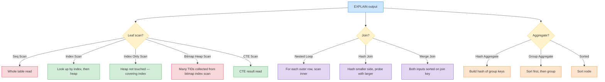
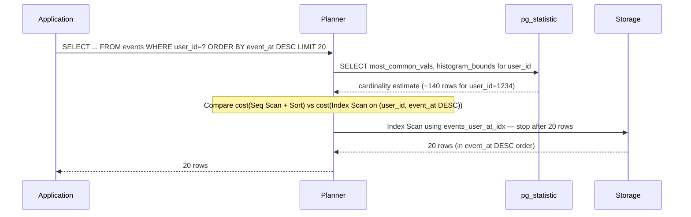

# Lesson 04: Indexes and Query Planning

*B-tree, hash, GiST, GIN, BRIN at a conceptual level. Composite indexes and column order. Partial and expression indexes. When an index is not used. `EXPLAIN` (without `ANALYZE` first to teach the plan shape). Cardinality and selectivity. A slow query and the index that fixes it.*

**You're in Lesson 04 of Section 06.**

An index is a data structure that lets the database find rows without scanning the whole table. The difference between a Seq Scan and an Index Scan on a million-row table is the difference between a query that runs in 5 ms and one that runs in 5 s — multiplied by every request. Most production performance problems are missing or misused indexes, and most missing indexes are missing because the engineer wrote the query *before* thinking about the index. This lesson teaches you to think about indexes *before* the query, and to read the planner's response *after*. The deeper `EXPLAIN (ANALYZE)` material is in [[08-PostgreSQL/EXPLAIN-ANALYZE-and-Query-Plans]]; this lesson previews it without the runtime-cost detail.


#sql #postgresql #indexes #performance

## Learning Objectives

By the end of this lesson you will be able to:

1. **Explain at a conceptual level** how B-tree, hash, GiST, GIN, BRIN, and SP-GiST indexes work and pick the right one.
2. **Choose composite-index column orderings** to match your queries' predicates and sort — and predict when a composite index will *not* help a query.
3. **Use partial and expression indexes** to keep indexes small and effective.
4. **Use covering indexes** (`INCLUDE`) to make Index Only Scan possible.
5. **Recognize the eight common reasons an index isn't being used.**
6. **Read a basic `EXPLAIN` plan shape** (without `ANALYZE`) and predict whether the query will be fast.
7. **Diagnose selectivity** — know when an index is the right choice and when a Seq Scan is genuinely cheaper.

## Prerequisites

- **The Boardly schema from Lesson 1** and **the queries from Lesson 2**. This lesson indexes those tables and queries.
- **The transactions lesson (Lesson 3)** — [[Transactions-Isolation-Locks]]. Row locks are taken on index entries when an index is used; the lock shape depends on the plan.
- **A running PostgreSQL 17 instance** with the Boardly schema and seed data from Lesson 2.
- **About 75 minutes of focused time.** Have `psql` open and be ready to run `EXPLAIN` after every index you add.

**The most common gap: "the ORM will pick the right index."**

It won't. The ORM emits SQL; the planner picks the index based on the SQL *and on statistics*. If your statistics are stale or your predicate's leading column isn't the index's leading column, you get a Seq Scan and a 40-second query. No ORM saves you from this. Reading `EXPLAIN` is a skill every backend engineer needs.


## The Problem

You ship a feature: "show me a user's activity feed — the most recent 20 events for this user, paginated." The query is:

```sql
SELECT id, kind, payload, event_at
FROM events
WHERE user_id = ?
ORDER BY event_at DESC
LIMIT 20;
```

The table has 10 million rows. Without an index, this query is a Seq Scan: read every page of the table, sort the matching rows, return 20. On a 10M-row table, that's a few seconds per request. Under load, your connection pool fills and the API times out.

You add an index. The query drops to 5 ms. The dashboard works. The lesson is: *the index decision is the only thing that changes between "fine" and "page-load error" on hot read paths.*

**Why not just add `LIMIT 20` and call it done?** Because `LIMIT` does not change the work the planner has to do before applying the limit. A Seq Scan with `LIMIT 20` on a 10M-row table still reads pages in random order until it has accumulated 20 matching rows — for a predicate that matches one in a million rows, that is still the whole table. The index changes the *access path*: it lets the planner jump straight to the matching rows and stop. `LIMIT` is a row-count cap; the index is a navigation shortcut. You need the index for the shortcut; `LIMIT` is then free.

**Why does the planner sometimes refuse to use an index you wrote?** Three classic reasons: (1) the table is small enough that a Seq Scan is cheaper (the index random-IO cost dwarfs the savings); (2) the query predicate does not match the indexed expression (e.g., `WHERE LOWER(email) = ?` requires an index on `LOWER(email)`, not on `email`); (3) the planner's statistics are stale or out-of-step with the data distribution, so the estimated cost of the index path is wrong. We will hit each of these in the deep dive.

But which index? And why does the planner sometimes refuse to use the one you wrote? We'll build the events table next and watch the planner choose.

**Note — Historical context — Postgres' index families**

Postgres started (in 1995, as Postgres95) with B-tree and hash indexes. GiST (Generalized Search Tree) was added in 1999 as a framework for *spatial* and *custom* indexes — full-text via `tsvector`, range types, exclusion constraints. GIN (Generalized Inverted Index) followed in 2006, optimized for *containment* queries (arrays, JSONB, full-text). BRIN (Block Range Index) was added in 9.5 (2016) for *huge, naturally-sorted* tables — time-series, log tables. SP-GiST (Space-Partitioned GiST) appeared in 8.4 for *non-balanced* data (IP routing trees, phone area codes). The lesson: each index family solves one class of query pattern. Pick by pattern, not by familiarity.


## The Code: Slow Query

We'll build the events table and reproduce the slow query:

```sql
-- A 1M-row events table.
CREATE TABLE events (
 id bigint GENERATED ALWAYS AS IDENTITY PRIMARY KEY,
 user_id bigint NOT NULL,
 event_at timestamptz NOT NULL,
 kind text NOT NULL CHECK (kind IN ('click','view','purchase','signup')),
 payload jsonb NOT NULL DEFAULT '{}'
);

INSERT INTO events (user_id, event_at, kind, payload)
SELECT i,
 now() - (random() * interval '90 days'),
 (ARRAY['click','view','purchase','signup'])[1 + floor(random() * 4)::int],
 jsonb_build_object('path', '/page/' || (random() * 100)::int)
FROM generate_series(1, 1000000) AS i;
```

Now the slow query, with no index on `user_id`:

```sql
EXPLAIN
SELECT id, kind, payload, event_at
FROM events
WHERE user_id = 1234
ORDER BY event_at DESC
LIMIT 20;
```

The `EXPLAIN` output (the actual plan):

```
 Limit (cost=29358.32..29358.37 rows=20 width=82)
 -> Sort (cost=29358.32..29709.07 rows=140299 width=82)
 Sort Key: event_at DESC
 -> Gather (cost=1000.00..24438.71 rows=140299 width=82)
 Workers Planned: 2
 -> Parallel Seq Scan on events (cost=0.00..23035.81 rows=58458 width=82)
 Filter: (user_id = 1234)
```

Read bottom-up: the planner chose a **Parallel Seq Scan** (it scanned the whole table in parallel with 2 workers), filtered to rows where `user_id = 1234`, then **Sort**ed the matches by `event_at DESC`, then took the top 20 with a **Limit**. The cost `29358.32..29358.37` is the planner's *estimate* of the cumulative cost range — it has no units; it's a relative number for plan comparison. The number to watch is `rows=140299` — the planner estimates 140k matching rows, which is *way* more than the 20 you want.

## The Code: Fixed With a Composite Index

```sql
CREATE INDEX events_user_at_idx ON events (user_id, event_at DESC);
ANALYZE events;

EXPLAIN
SELECT id, kind, payload, event_at
FROM events
WHERE user_id = 1234
ORDER BY event_at DESC
LIMIT 20;
```

New plan:

```
 Limit (cost=0.42..2.13 rows=20 width=82)
 -> Index Scan using events_user_at_idx on events (cost=0.42..12.05 rows=113 width=82)
 Index Cond: (user_id = 1234)
```

The Seq Scan + Sort + Limit is gone. The planner now does an **Index Scan using events_user_at_idx** — it walks the B-tree for `user_id = 1234`, in `event_at DESC` order (which the index pre-sorts), and stops after 20 rows. Cost dropped from ~29,000 to ~2. That's roughly a 15,000× improvement on the planner's estimate; in practice you'd time it with `EXPLAIN (ANALYZE)` and see milliseconds, not seconds.

## Line-by-Line Deep Dive

This section is the heart of the lesson. Read it twice. Don't skip.

### Index types at a conceptual level

| Type | Good for | Bad for |
|------|----------|---------|
| **B-tree** (default) | Equality `=`, range `<`, `>`, `BETWEEN`, `IN`, prefix `LIKE 'abc%'`, `IS NULL`, `ORDER BY` | Suffix `LIKE '%abc'`, full-text without GIN, JSONB containment |
| **Hash** | Equality only; smaller than B-tree | ranges, sorts, cannot back a `UNIQUE` constraint declared in `CREATE TABLE` (use `CREATE UNIQUE INDEX ... USING HASH` for a manual unique hash index), not crash-safe pre-Pg 10 (now fine) |
| **GiST** | geometric, range types, full-text (via `tsvector`), exclusion constraints | Equality on scalars (B-tree is better) |
| **GIN** | JSONB containment, arrays, full-text (`tsvector`), trigram | Range/sort (use GiST); updates are more expensive |
| **BRIN** | huge, naturally-sorted tables (time-series) with low write churn | Everything else; loses badly on random data |
| **SP-GiST** | Non-balanced data (phone area codes, IP trees) | Balanced data |

The defaults you'll actually reach for in the Boardly schema:

```sql
CREATE INDEX ON tasks (project_id); -- B-tree
CREATE INDEX ON tasks (project_id, position); -- B-tree composite
CREATE INDEX ON projects (created_at DESC) WHERE deleted_at IS NULL; -- partial B-tree
CREATE INDEX ON events USING GIN (payload); -- JSONB containment
CREATE INDEX ON events USING GIN (to_tsvector('english', payload->>'path')); -- full-text
CREATE INDEX ON events USING BRIN (event_at); -- time-series
```

### `CREATE INDEX events_user_at_idx ON events (user_id, event_at DESC)`: composite B-tree

```sql
CREATE INDEX events_user_at_idx ON events (user_id, event_at DESC);
```

**What it does:** Creates a B-tree index named `events_user_at_idx` on the `events` table. The index is keyed by `(user_id ASC, event_at DESC)`. (The default direction is `ASC`; we specify `DESC` on the second column to match our query's `ORDER BY`.)

A B-tree composite index is sorted by the first column, then within each first-column value by the second column, and so on. The index serves:

- `WHERE user_id = ?` — yes, prefix match.
- `WHERE user_id = ? AND event_at > ?` — yes, both predicates applied.
- `WHERE user_id = ? AND event_at > ? ORDER BY event_at DESC` — yes, prefix and sort both served.
- `WHERE event_at > ?` alone — **no** (no leading prefix on `user_id`).
- `WHERE event_id = ? AND user_id = ?` — yes, the planner can use the index for both predicates (column order in the *query* doesn't matter; column order in the *index* does).

**Rule of thumb: equality columns first, then range, then sort.** Equality columns can be in any order among themselves; sort order matters per-column (you can mix `ASC`/`DESC` with `NULLS FIRST`/`LAST`).

**Student asks: Why `DESC` on `event_at`?**

Because our query is `ORDER BY event_at DESC`. A B-tree index can be scanned in either direction — `DESC` indexes don't have to be declared `DESC`. But if your query mixes `ORDER BY a ASC, b DESC`, you need an index where `a` is `ASC` and `b` is `DESC` (or vice versa). For a single column, `ASC` and `DESC` indexes serve either sort direction — but the planner can pick the more efficient scan direction. The `DESC` declaration here is a small optimization that signals intent and helps the planner.


### Partial indexes

```sql
CREATE INDEX orders_pending_idx
 ON orders (placed_at)
 WHERE status = 'pending';
```

**What it does:** A `WHERE` clause on `CREATE INDEX` restricts which rows are indexed. Two benefits: smaller on disk, and a more accurate selectivity estimate for queries that match the predicate.

The index is used only by queries whose `WHERE` clause *implies* the index's predicate. This index therefore serves:

```sql
SELECT * FROM orders WHERE status='pending' AND placed_at < now() - interval '1 hour';
-- Uses the index — the predicate implies status='pending'.
```

But not this:

```sql
SELECT * FROM orders WHERE placed_at < now() - interval '1 hour';
-- Does NOT use the partial index — status filter missing.
```

The most common pattern in real codebases: soft-deleted columns. Index only the live rows.

```sql
CREATE UNIQUE INDEX accounts_email_active_uniq
 ON accounts (email)
 WHERE deleted_at IS NULL;
-- Allows re-registration of a previously-deleted email.
```

This pattern was already used in Lesson 1's `projects` table for the partial `UNIQUE (organization_id, name) WHERE deleted_at IS NULL` constraint.

**Production reality: partial-index predicate drift after a status-enum refactor.**

A partial index's `WHERE` predicate is frozen at `CREATE INDEX` time; it does not auto-update when the application's query mix changes. If `projects.status` grows a new `'suspended'` value (added to the `CHECK` constraint via a migration) but the partial index `WHERE status IN ('active','archived')` is not updated, every query filtering on `status = 'suspended'` falls back to a Seq Scan — silently. The symptom is "we shipped the suspended-status feature and the projects dashboard got slow for one tenant." The discipline is to treat the partial-index predicate as code that must move with the status-enum definition: any migration that adds a status value must also audit and update the partial indexes. Cross-link to [[06-SQL-Fundamentals/Relational-Model-and-Constraints]] for the `CHECK`-vs-`ENUM` decision (an `ENUM` change forces a rewrite of dependent indexes; a `CHECK` does not, which is why `CHECK` is the more migration-friendly choice for evolving status sets).


### Expression indexes

Index a function of a column. Useful when the query always applies the function:

```sql
CREATE INDEX users_email_lower_idx ON users (LOWER(email));

SELECT * FROM users WHERE LOWER(email) = 'alice@example.com'; -- uses index
SELECT * FROM users WHERE email = 'Alice@Example.com'; -- does NOT use index
```

The query predicate must match the indexed expression *exactly* — `LOWER(email) = ?`, not `email ILIKE ?`. If you write `WHERE email = 'Alice@Example.com'`, the planner has no reason to consult an index on `LOWER(email)`. This is a frequent source of "I added an index and nothing happened" — the query and the index don't agree.

**Warning — Debugging: the case-sensitivity mismatch symptom ("I added an index and nothing happened").**

The most common "the index is there but `EXPLAIN` shows a Seq Scan" failure with expression indexes is a predicate-vs-expression mismatch: the query says `WHERE email = 'Alice@Example.com'` (no function) and the index is on `LOWER(email)`. The planner cannot rewrite the predicate to match the indexed expression — that is the engineer's job. The symptom is `EXPLAIN` showing Seq Scan even with the expression index present, and `pg_stat_user_indexes.idx_scan = 0` for that index across the whole query mix. The fix is to align the predicate to the indexed expression: `WHERE LOWER(email) = LOWER(?)`. The deeper discipline is to grep for both spellings of the column in the application code before declaring an expression index "unused" — a single call site that forgets the `LOWER()` wrapper is enough to make the index dead weight for that path. Cross-link to [[06-SQL-Fundamentals/SQL-Injection-and-Parameterized-Queries]] for the `ILIKE`-vs-`=` boundary that also affects which index a search endpoint uses.


### Covering indexes (`INCLUDE`)

Add non-key columns to the index so the planner can satisfy the query from the index alone (Index Only Scan):

```sql
CREATE INDEX events_user_at_cover_idx
 ON events (user_id, event_at DESC)
 INCLUDE (kind, payload);

EXPLAIN
SELECT kind, payload, event_at
FROM events
WHERE user_id = 1234
ORDER BY event_at DESC
LIMIT 20;
-- Index Only Scan using events_user_at_cover_idx
```

`INCLUDE` columns are not part of the sort key, so they don't help with `WHERE`/`ORDER BY` on those columns. They make Index Only Scan possible by providing all the columns the query needs *from the index itself*, without touching the heap (the table data).

**Warning — Index Only Scan requires visibility map.**

Postgres can only do an Index Only Scan if it knows every row in the page is visible to every transaction (no in-progress updates). The visibility map is maintained by `VACUUM`. If your table hasn't been vacuumed recently, Index Only Scan degrades to an Index Scan (heap fetches per row to check visibility). Autovacuum usually keeps this fresh, but right after a large `UPDATE`, you may need to `VACUUM` manually.


**Production reality: the visibility-map cliff after a bulk `UPDATE`.**

The visibility map is rebuilt by `VACUUM`, not by `ANALYZE`. After `UPDATE accounts SET last_seen_at = now()` touches every row in a 10M-row table, every page's visibility bit is cleared; Index Only Scan degrades to Index Scan with one heap fetch per row until autovacuum reprocesses the table. The symptom is "the dashboard query that was 2 ms yesterday is 80 ms today, and `EXPLAIN` still says `Index Only Scan` but the `Heap Fetches:` line reads `10000000`." The fix is `VACUUM accounts;` (not `ANALYZE` — that refreshes statistics, not the visibility map), or waiting for autovacuum — and sizing the autovacuum cost-delay parameters so a full-table `UPDATE` triggers immediate cleanup rather than the next autovacuum cycle. The deeper buffer-analysis material is in [[08-PostgreSQL/EXPLAIN-ANALYZE-and-Query-Plans]].


### `EXPLAIN` without `ANALYZE`: the plan shape

`EXPLAIN` shows the planner's intended execution tree and cost estimates, *without running the query*. It's fast (milliseconds) and tells you the plan shape. Read it bottom-up.

**Tip — `EXPLAIN` vs `EXPLAIN (ANALYZE)` vs `EXPLAIN (ANALYZE, BUFFERS)`.**

- `EXPLAIN` — the plan the planner *intends* to run, with cost estimates. Fast (milliseconds). Use this when you want to know *what the planner picked*.
- `EXPLAIN (ANALYZE)` — actually runs the query and prints real row counts and timings next to each node. Slower (the query runs to completion). Use this when you want to know *whether the plan was right*.
- `EXPLAIN (ANALYZE, BUFFERS)` — adds buffer-hit counts (how many pages came from cache vs disk). The deepest introspection.
The deeper material on `EXPLAIN (ANALYZE)` — JSON plan format, buffer analysis, the timing overhead, the `SETTINGS` option — is in [[08-PostgreSQL/EXPLAIN-ANALYZE-and-Query-Plans]]. For Lesson 4, the plan-shape reading is enough.


```sql
EXPLAIN
SELECT c.email, COUNT(o.id)
FROM customers c
LEFT JOIN orders o ON o.customer_id = c.id
GROUP BY c.email;
```

```
 HashAggregate (cost=63.45..65.45 rows=200 width=40)
 -> Hash Join (cost=4.50..60.45 rows=300 width=40)
 Hash Cond: (o.customer_id = c.id)
 -> Seq Scan on orders o (cost=0.00..30.40 rows=2040 width=12)
 -> Hash (cost=3.00..3.00 rows=200 width=36)
 -> Seq Scan on customers c (cost=0.00..3.00 rows=200 width=36)
```

Reading: the planner chose a **Hash Join** because both inputs are scanned and one side (customers) fits in memory; the join then groups with a **Hash Aggregate**. The `cost=X..Y rows=N width=W` line is the planner's estimate of the *cumulative* cost range and the number of rows it expects at that node. Numbers are *estimates*, not measurements — for real numbers, run `EXPLAIN (ANALYZE)` (Lesson 8.01).

Plan-shape cheat sheet:



### Cardinality and selectivity

The planner's statistics are *sampled*: PostgreSQL stores **most-common values** (MCV) and a **histogram of bounds** for each column, plus **distinct-value estimates**. These are refreshed by `ANALYZE` (autovacuum runs it automatically; you can run it manually: `ANALYZE events;`).

You can inspect what the planner sees:

```sql
-- Most common values and their frequencies for the kind column.
SELECT attname, most_common_vals, most_common_freqs
FROM pg_stats
WHERE tablename = 'events' AND attname = 'kind';

-- Histogram bounds — the bucket edges the planner uses to estimate ranges.
SELECT attname, histogram_bounds
FROM pg_stats
WHERE tablename = 'events' AND attname = 'user_id';
```

**Selectivity** is the fraction of rows a predicate retains. `WHERE id = 5` on a unique ID is highly selective (≈1/N); `WHERE deleted_at IS NULL` on a mostly-live table is low-selective. The planner uses indexes when selectivity crosses a cost threshold (roughly: "index scan beats seq scan" — usually a few percent of the table).

**Example — A concrete selectivity miscalculation.**

You have a `tasks` table with 1M rows. The `status` column has values `'todo'`, `'doing'`, `'done'`, `'cancelled'`. You bulk-inserted 900,000 rows with `status='done'` yesterday, but autovacuum hasn't caught up. The planner's MCV still shows roughly even distribution (25% per value). A query `WHERE status = 'done'` would return 90% of rows — and the planner, thinking it's 25%, picks an Index Scan that turns into a 900,000-row heap fetch. The fix is `ANALYZE tasks;` — the planner refreshes and chooses a Seq Scan (which is correct for a 90%-selectivity predicate).


If a query's actual selectivity differs wildly from the estimate — e.g. "status='paid'" matches 95% of rows but the planner thinks it matches 5% — it will pick an Index Scan that turns into a 5-million-row heap fetch. **The fix is almost always `ANALYZE`**, occasionally `ALTER TABLE ... ALTER COLUMN ... SET STATISTICS 1000` (more detailed histogram).

### When an index is *not* used

Diagnose in this order:

1. **Statistics stale.** `ANALYZE` the table; the planner may be using a cardinality estimate from before bulk inserts.
2. **Selectivity too low.** If the planner estimates the predicate matches, say, 30% of a 10M-row table, it'll Seq Scan because index-then-heap-fetch is slower than a sequential read. Either the estimate is wrong (see #1) or you genuinely need a different index.
3. **Wrong column order in a composite.** The query's leading column isn't the index's leading column. `WHERE event_at > ?` does not use `(user_id, event_at)` because `event_at` is the second column.
4. **Type mismatch.** `WHERE string_col = 42` with implicit casts may disable the index. Use the right type or an expression index.
5. **`LIKE '%suffix'`.** Suffix matching can't use a B-tree. Use a reverse-string expression index (`CREATE INDEX ON t (REVERSE(text_col))` and `WHERE REVERSE(text_col) LIKE REVERSE('suffix') || '%'`) or a trigram (`pg_trgm`) GIN index.
6. **`OR` clauses** that span multiple indexes may force a Seq Scan. Sometimes `UNION` of two queries is faster.
7. **Planner cost constants** (`random_page_cost`, `seq_page_cost`) may be misconfigured for your storage (NVMe is much closer to `random_page_cost = 1.1` than the default `4.0`).
8. **Index is invalid or `VACUUM` hasn't cleaned enough dead tuples** for Index Only Scan to be safe.

**Warning — Debugging: the "fast query that suddenly became slow" post-bulk-load symptom.**

The single most common cause of a sudden Seq-Scan regression is stale statistics after a bulk `INSERT` or `DELETE`. Autovacuum's analyze threshold is based on a percentage of rows changed (`autovacuum_analyze_scale_factor = 0.1` by default, meaning 10% of the table); a bulk load of 5x the table size does not trigger an immediate `ANALYZE` — it schedules one for the next autovacuum cycle, which can be minutes to hours away. The query that was 5 ms at 1M rows is now 5 s at 5M rows with the planner still estimating 1M. The fix is `ANALYZE events;` after every bulk load — bake it into the ETL job or the migration's `upgrade()` / `downgrade()` path. If the regression is intermittent and not tied to a load event, suspect `autovacuum_analyze_scale_factor` being too loose for the table's churn rate; tighten it per-table with `ALTER TABLE events SET (autovacuum_analyze_scale_factor = 0.02)`. Cross-link to point #1 above and to [[13-Performance-and-Observability/N-plus-1-and-Slow-Queries]] for the broader slow-query diagnosis workflow.


### `CONCURRENTLY`: production-safe index creation

```sql
-- Production: doesn't block writes, takes longer, can fail leaving an invalid index.
CREATE INDEX CONCURRENTLY events_user_at_idx ON events (user_id, event_at DESC);

-- Maintenance window: blocks writes, fast, atomic.
CREATE INDEX events_user_at_idx ON events (user_id, event_at DESC);
```

`CONCURRENTLY` takes and releases short locks on the table in two passes, allowing writes to continue. It can fail (if a deadlock or unique-violation happens mid-build) and leave an *invalid* index — check `pg_index.indisvalid` before relying on it. Drop invalid indexes and retry.

**Production reality: the `CREATE INDEX CONCURRENTLY` failure that leaves an invalid index.**

`CREATE INDEX CONCURRENTLY` runs in two passes with short table locks; if a deadlock or a unique-violation happens mid-build, the build aborts and leaves the index with `indisvalid = false` in `pg_index`. The index is built on disk (it occupies space) but the planner silently ignores it — `EXPLAIN` will still show a Seq Scan even though the index exists. The migration tool reports success because the `CREATE INDEX` statement itself returned without error (the failure is in the validation pass, which is a separate transaction). The fix is to always check `SELECT indexrelname, indisvalid FROM pg_index i JOIN pg_class c ON c.oid = i.indexrelid WHERE c.relname = '...'` after a concurrent build, and to `DROP INDEX` the invalid entry and retry. Alembic and other migration tools that wrap `CONCURRENTLY` should fail the migration on `indisvalid = f`, but not all do — audit your migration output for the `indisvalid` column, not just the `CREATE INDEX` return code. The deeper material on index lifecycle is in [[08-PostgreSQL/Indexes-Composite-and-Specialized]].


### Index maintenance and audit

Two `psql` queries you should run on every database you inherit:

```sql
-- Which indexes are actually being used? idx_scan = 0 means dead weight.
SELECT schemaname, relname, indexrelname, idx_scan, idx_tup_read, idx_tup_fetch,
 pg_size_pretty(pg_relation_size(indexrelid)) AS size
FROM pg_stat_user_indexes
ORDER BY pg_relation_size(indexrelid) DESC;

-- Which indexes are bloated (need REINDEX)?
SELECT schemaname, relname, indexrelname, pg_size_pretty(pg_relation_size(indexrelid)) AS size
FROM pg_stat_user_indexes
WHERE idx_scan = 0
 AND schemaname = 'public'
ORDER BY pg_relation_size(indexrelid) DESC;
```

`idx_scan = 0` on a large index is a candidate for drop — but only after you've confirmed no scheduled report or background job runs that query. Some indexes serve rare-but-critical queries (the year-end financial report) and `idx_scan = 0` for 11 months of the year is normal. Correlate with the application's actual query mix before dropping.

`REINDEX` rebuilds a bloated index. On Postgres 17, `REINDEX INDEX CONCURRENTLY events_user_at_idx` does it without blocking writes. Index bloat comes from heavy `UPDATE`/`DELETE` patterns that leave dead entries in the index; `VACUUM` reclaims the heap but doesn't always shrink the index.

**Danger — How an attacker thinks: index bloat as a denial-of-service primitive.**

An attacker who can flood a hot table with small `UPDATE`s (each touching an indexed column) can bloat the indexes faster than autovacuum can reclaim them. Postgres' HOT (heap-only tuple) updates bypass index updates only when no indexed column changes; the moment an indexed column is touched, every index on the table gets a new entry pointing at the new tuple — and the old entry becomes dead space until `VACUUM` reclaims it. An attacker who can sustain 1000 trivial `UPDATE account SET last_seen_at = now() WHERE id = ?` per second against an account table with 4 indexes generates 4000 dead index entries per second; the index files grow, the cache-miss rate climbs, and the read query that was 5 ms becomes 500 ms within an hour. The defenses are: rate-limit writes per-tenant at the API layer (not the DB); monitor index bloat with `pgstattuple`'s `pgstatindex()` on a schedule; `REINDEX INDEX CONCURRENTLY` on a maintenance window when `avg_leaf_density` drops below 50%; and avoid indexing high-churn columns (`last_seen_at`, `updated_at`) unless a query genuinely needs the index. Cross-link to [[06-SQL-Fundamentals/Transactions-Isolation-Locks]] for the write-amplification consequence of `FOR UPDATE` on hot rows, and to [[13-Performance-and-Observability/N-plus-1-and-Slow-Queries]] for the slow-query diagnosis path.


## Execution Trace



## Common Mistakes

**Warning — Indexing every column individually.**

A separate index on `a` and one on `b` does not combine into a composite — the planner can use both via BitmapAnd, but it's slower than one composite `(a, b)`. Audit with `pg_stat_user_indexes.idx_scan = 0` and drop unused indexes.


```sql
-- WRONG: two single-column indexes for a query that filters on both columns
CREATE INDEX events_user_idx ON events(user_id);
CREATE INDEX events_at_idx   ON events(event_at);
-- Symptom: EXPLAIN shows a BitmapAnd of two Bitmap Index Scans; cost is higher
-- than one composite scan, and the planner may fall back to a Seq Scan.

-- RIGHT: one composite index, equality first, range second
CREATE INDEX events_user_at_idx ON events(user_id, event_at DESC);
-- Now WHERE user_id = 1234 ORDER BY event_at DESC LIMIT 20 hits Index Scan Backward.
```

**Warning — Putting range columns before equality columns.**

`(created_at, user_id)` does not help `WHERE user_id = ? AND created_at > ?`. Order matters: equality first, range second.


```sql
-- WRONG: range column first; the index can't be used for user_id equality
CREATE INDEX events_at_user_idx ON events(event_at, user_id);
-- Symptom: WHERE user_id = 1234 AND event_at > now() - interval '1 day' does
-- a Seq Scan because the leading range column can't be probed for equality.

-- RIGHT: equality column first, range column second
CREATE INDEX events_user_at_idx ON events(user_id, event_at DESC);
-- The leading user_id supports equality; the trailing event_at supports the range.
```

**Warning — Adding `*` to the SELECT and expecting Index Only Scan.**

Index Only Scan needs every column in the projection to be in the index (or be `INCLUDE`d). `SELECT *` almost never qualifies.


**Warning — Forgetting to `ANALYZE` after a bulk load.**

The planner's stats are stale until autovacuum catches up; force `ANALYZE` after `COPY`/large inserts. A "fast query that suddenly became slow" right after a data load is almost always stale stats.


**Warning — Leaving indexes `VALIDATE`-pending.**

`CREATE INDEX CONCURRENTLY` returns before validation completes; check `pg_index.indisvalid` before relying on it.


**Warning — Indexing a column the query never uses as a leading column.**

Indexes that aren't used cost writes. Audit with `pg_stat_user_indexes.idx_scan = 0`.


**Warning — Using `LIKE '%foo%'` and expecting an index.**

Use `pg_trgm` + GIN, or restructure the data (a `tags` table or a `tsvector`).


## Engineering Trade-Offs

### Number of indexes vs write throughput

Every index is another structure to update on every insert/update/delete. A write-heavy table with 6 indexes can be 4× slower than the same table with 2. Drop indexes you don't use; the `idx_scan` column in `pg_stat_user_indexes` is your audit log.

### Covering vs minimal indexes

A covering index serves more queries Index-Only, but is larger. A minimal index serves fewer queries but uses less RAM and is cheaper to maintain. The covering pattern wins when the projected columns are small and read frequency is high.

### Partial vs full indexes

Partial indexes are smaller and more selective — but only help queries whose `WHERE` clause implies the index predicate. If the application's query drifts outside the predicate, the index becomes dead weight.

### `CONCURRENTLY` vs immediate `CREATE INDEX`

`CONCURRENTLY` doesn't block writes but takes longer and can fail leaving an invalid index. Production: always `CONCURRENTLY`. Migrations in a maintenance window: plain `CREATE INDEX` is fine.

**When would you NOT reach for an index?**

Three cases. (1) Small tables — anything under a few thousand rows is scanned in memory in milliseconds; an index adds maintenance cost for no benefit. The `pg_class.reltuples` count is your hint. (2) Write-heavy tables where the query is rare — if the planner uses the index once a week and the table has 100 inserts per second, the index costs more in write latency than it saves in read latency. Audit with `pg_stat_user_indexes.idx_scan` — if it's near zero over a representative week, drop the index. (3) Tables where the access pattern is "scan and aggregate" (analytics dashboards) — a Seq Scan that touches 50% of the table is cheaper than an Index Scan that does random IO for 50% of the rows. The B-tree wins on point lookups and selective ranges; it loses on bulk scans. If your access pattern is bulk scan, the right answer is a BRIN index or a materialized view, not a B-tree.


### Index-only coverage of `ORDER BY ... LIMIT n`

This is one of the most impactful index designs in OLTP. If the index provides the sort order, the planner can stop after `n` rows — a "top-N" plan that's almost free. The `(user_id, event_at DESC)` index on `events` is exactly this pattern for "show a user's most recent 20 events."

**Spot the bug — why is this query still slow despite the index?**

```sql
CREATE INDEX events_user_at_idx ON events (user_id, event_at DESC);
EXPLAIN SELECT * FROM events WHERE event_at > now() - interval '1 day' AND user_id = 1234;
-- Seq Scan on events  (cost=0.00..4321.00 rows=...)
```
The index's leading column is `user_id`, so the planner *can* use it for `user_id = 1234` (clause order in `WHERE` does not matter to the planner — only the leading column of the index matters). If `EXPLAIN` shows a Seq Scan despite the index, the most likely cause is stale statistics: run `ANALYZE events;` so the planner's cardinality estimate matches reality. The next suspect is a type mismatch on `event_at` (e.g., the column is `text` and `now() - interval '1 day'` is `timestamptz`); confirm the column type with `\d+ events`. If the planner *did* pick the index but the query is still slow, the likely cause is that user 1234 has so many events that walking all of them and filtering `event_at` is itself expensive — the fix is `INCLUDE (event_at)` to enable an Index-Only Scan, or to tighten the predicate.


## Practical Application: A Realistic Dashboard Index

You ship the events feed feature. The dashboard query (from Lesson 2's exercise 5) needs:

```sql
SELECT kind, event_at
FROM events
WHERE user_id = 1234
 AND event_at > now() - interval '7 days'
 AND kind IN ('click','view','purchase')
ORDER BY event_at DESC
LIMIT 10;
```

The index:

```sql
CREATE INDEX events_user_recent_idx
 ON events (user_id, event_at DESC)
 INCLUDE (kind)
 WHERE kind IN ('click','view','purchase');
```

The query predicate **exactly** matches the index's predicate and key. This is the discipline: design the index for the query, not the other way around. The partial predicate keeps the index small (only 3 of 4 event kinds are indexed); the `INCLUDE (kind)` lets the planner do an Index Only Scan; the `(user_id, event_at DESC)` sort key serves the `ORDER BY ... LIMIT 10` as a top-N plan.

**Danger — How an attacker thinks: the `INCLUDE` column that leaks a secret.**

`INCLUDE` columns are stored in the index file in plaintext — identical to heap columns, just in a different on-disk structure. An `INCLUDE (password_hash)` on a covering index creates a second copy of the hash on disk, readable by any role with `SELECT` on the table (index reads are implicit in table `SELECT`). The leak surface widens: a SQL-injection bug that returns rows from the index (via Index Only Scan) now leaks the hash without ever touching the heap, and a logical-backup tool (`pg_dump`) includes the index data. The defense is structural: never `INCLUDE` a sensitive column; if a covering index is needed for a hot read path, project only non-sensitive columns and let the planner do a regular Index Scan with a heap fetch for the sensitive column. Layer column-level privileges on top: `GRANT SELECT (id, email, role) ON users TO boardly_read` so the `password_hash` column is unreadable even with table-level `SELECT`. Cross-link to [[08-PostgreSQL/Roles-Permissions-Security]] for the column-level `GRANT` pattern and to [[06-SQL-Fundamentals/SQL-Injection-and-Parameterized-Queries]] for the injection-leak pathway that `INCLUDE` widens.


```sql
EXPLAIN
SELECT kind, event_at
FROM events
WHERE user_id = 1234
 AND event_at > now() - interval '7 days'
 AND kind IN ('click','view','purchase')
ORDER BY event_at DESC
LIMIT 10;
-- Limit (cost=0.42..0.55 rows=10 width=...)
-- -> Index Only Scan using events_user_recent_idx on events
-- Index Cond: (user_id = 1234 AND event_at > ... AND ...)
-- Filter: (kind = ANY ('{click,view,purchase}'::text[]))
```

## Exercises

**Tip — The 20-minute rule.**

If you're stuck on an exercise for more than 20 minutes, re-read the relevant section above, then move on and come back.


**Exercise 1 — Measure the difference.** Create the `events` table with 1M rows. Run a `WHERE user_id = ?` query with and without an index on `user_id`. Measure with `EXPLAIN (ANALYZE)` and observe the difference. (Note: `EXPLAIN (ANALYZE)` actually runs the query; it's covered in Lesson 8.01, but using it for measurement here is fine.)

**Exercise 2 — Design a composite.** Design a composite index for `WHERE status='pending' AND customer_id=? ORDER BY created_at DESC LIMIT 20`. Justify the column order. Then verify it produces an Index Scan, not a Sort+Seq Scan, with `EXPLAIN`.

**Exercise 3 — Partial covering index.** Build the partial covering index from the Practical Application section. Demonstrate the difference in `EXPLAIN` between the partial covering index and a full covering index on `(user_id, event_at DESC) INCLUDE (kind)`.

**Exercise 4 — The suffix-LIKE trap.** Create a `users` table with 1M rows and an email column. Try `WHERE email LIKE '%@example.com'` with a B-tree index on `email`. Confirm the planner does a Seq Scan. Add a `pg_trgm` GIN index (`CREATE EXTENSION pg_trgm; CREATE INDEX ON users USING GIN (email gin_trgm_ops);`) and re-run — confirm the planner now uses the index.

**Exercise 5 — Spot the bug.** This query is slow, even after an index on `(user_id, event_at)` is added. Why?

```sql
SELECT * FROM events WHERE event_at > now() - interval '1 day' AND user_id = 1234;
```

(Answer: the index `(user_id, event_at)` *should* serve this query — both predicates can be applied via the index. The likely culprit is stale stats or a leading-column mismatch. Confirm with `EXPLAIN`.)

**Exercise 6 — Audit dead-weight indexes with `pg_stat_user_indexes`.** Connect to the `boardly` database and run the index-usage audit query from the Index maintenance section. Identify any index with `idx_scan = 0` over your test window. For each candidate, cross-reference with the application's query mix before deciding to drop — remember that some indexes serve rare-but-critical queries (the year-end report). Verify the audit returns rows: `psql -d boardly -c "SELECT schemaname, relname, indexrelname, idx_scan, idx_tup_read, pg_size_pretty(pg_relation_size(indexrelid)) AS size FROM pg_stat_user_indexes WHERE schemaname = 'public' ORDER BY idx_scan ASC, pg_relation_size(indexrelid) DESC;"` — confirm the `events_user_at_idx` row shows `idx_scan > 0` (you have been using it in the exercises above).

**Exercise 7 — Reproduce the `CREATE INDEX CONCURRENTLY` invalid-index failure.** Create a `test_concur` table with duplicate values: `CREATE TABLE test_concur (id int, email text); INSERT INTO test_concur VALUES (1, 'a@b.co'), (2, 'a@b.co');`. Attempt a concurrent unique index: `CREATE UNIQUE INDEX CONCURRENTLY test_concur_email_idx ON test_concur (email);`. The build aborts with `ERROR: could not create unique index "test_concur_email_idx"`. Inspect the resulting index state and confirm it is invalid: `psql -d boardly -c "SELECT indexrelname, indisvalid, indisready FROM pg_index i JOIN pg_class c ON c.oid = i.indexrelid WHERE c.relname = 'test_concur_email_idx';"` — expected output shows `indisvalid = f` (the index exists on disk but the planner will not use it). Clean up: `DROP INDEX test_concur_email_idx; DROP TABLE test_concur;`. This is the exact failure mode to watch for in production migrations that wrap `CONCURRENTLY`.

**Exercise 8 — Diagnose stale statistics after a bulk load.** In `psql`, insert 5M additional rows into `events`: `INSERT INTO events (user_id, event_at, kind, payload) SELECT i, now() - (random() * interval '90 days'), 'click', '{}' FROM generate_series(1, 5000000) AS i;`. Do not run `ANALYZE`. Run `EXPLAIN SELECT id FROM events WHERE user_id = 1234;` and note the estimated `rows=` (it will still reflect the pre-load row count). Run `ANALYZE events;` and re-EXPLAIN. Verify the estimate updates: `psql -d boardly -c "EXPLAIN SELECT id FROM events WHERE user_id = 1234;" | grep rows` — the `rows=` value should jump by roughly 6x (1M to 6M) after `ANALYZE`. This is the "fast query that suddenly became slow" symptom in one reproducible step.

**Exercise 9 — Prove the partial-index predicate implication requirement.** Create a partial index on `events`: `CREATE INDEX events_click_idx ON events (user_id) WHERE kind = 'click'; ANALYZE events;`. Run three queries with `EXPLAIN` and predict which uses the partial index: (a) `WHERE kind = 'click' AND user_id = 1234`, (b) `WHERE kind = 'click'`, (c) `WHERE user_id = 1234`. The partial index serves (a) and (b) because their predicates *imply* `kind = 'click'`; (c) does not imply the predicate, so it falls back to a Seq Scan or another index. Verify: `psql -d boardly -c "EXPLAIN SELECT * FROM events WHERE kind='click' AND user_id=1234;" | grep -E 'Index Scan|Seq Scan'` shows `Index Scan using events_click_idx`; `psql -d boardly -c "EXPLAIN SELECT * FROM events WHERE user_id=1234;" | grep -E 'Index Scan|Seq Scan'` does not reference `events_click_idx`. This is the implication rule that makes partial indexes selective — and the trap that makes them dead weight when the query mix drifts.

**Exercise 10 — Measure Index Only Scan degradation after a partial `UPDATE`.** Build the covering index from the Verification section: `CREATE INDEX events_cover_idx ON events (user_id, event_at DESC) INCLUDE (kind, payload); ANALYZE events;`. Run `EXPLAIN (ANALYZE) SELECT kind, payload, event_at FROM events WHERE user_id = 1234 ORDER BY event_at DESC LIMIT 100;` and confirm `Heap Fetches: 0`. Then dirty the visibility map: `UPDATE events SET payload = payload WHERE user_id = 1234;` (touches every row for that user). Re-run the `EXPLAIN (ANALYZE)` and observe the `Heap Fetches:` count climb. Run `VACUUM events;` and re-EXPLAIN — `Heap Fetches` drops back to 0. Verify: `psql -d boardly -c "EXPLAIN (ANALYZE) SELECT kind, payload, event_at FROM events WHERE user_id = 1234 ORDER BY event_at DESC LIMIT 100;" | grep -i 'Heap Fetches'` — the count is `0` before the UPDATE, `> 0` after, and `0` again after `VACUUM`. This is the visibility-map cliff from the production callout above, reproduced end-to-end.

**Exercise 11 — Audit index bloat with `pgstattuple`.** Install the standard `pgstattuple` extension: `CREATE EXTENSION IF NOT EXISTS pgstattuple;`. Run `SELECT * FROM pgstatindex('events_user_at_idx');` and note the `avg_leaf_density` (a fresh B-tree is around 90% dense). Generate index bloat with a write-amplification workload: `UPDATE events SET payload = payload WHERE user_id = 1234;` repeated 20 times (each UPDATE creates dead index entries because `payload` is in the covering index). Re-run `SELECT avg_leaf_density FROM pgstatindex('events_user_at_idx');` and observe the density drop below 50%. Reclaim with `REINDEX INDEX CONCURRENTLY events_user_at_idx;` and confirm `avg_leaf_density` returns to around 90%. Verify: `psql -d boardly -c "SELECT avg_leaf_density FROM pgstatindex('events_user_at_idx');"` — the value drops after the workload and recovers after `REINDEX`. This is the index-bloat DoS pathway from the attacker callout above, measured directly.

## Verification

**Read EXPLAIN output bottom-up.**

PostgreSQL plans are trees. The outermost node (top of output, last to execute) is the root; the innermost node (bottom of output, first to execute) is the leaf. Cost numbers are cumulative — the planner's relative-cost estimate, not milliseconds. Compare two plans by their total cost (the second number on the root node), then by their node shapes. The five shapes you must recognise by sight are below; run each command against the `events` table you built in this lesson and confirm the output matches.


### Step 1: Confirm the slow plan (no useful index)

```sql
-- Run BEFORE creating the composite index (or after dropping it).
EXPLAIN
SELECT id, kind, payload, event_at
FROM events
WHERE user_id = 1234
ORDER BY event_at DESC
LIMIT 20;
```

Expected (no useful index):

```
 Limit  (cost=29358.32..29358.37 rows=20 width=82)
   ->  Sort  (cost=29358.32..29709.07 rows=140299 width=82)
         Sort Key: event_at DESC
         ->  Gather  (cost=1000.00..24438.71 rows=140299 width=82)
               Workers Planned: 2
               ->  Parallel Seq Scan on events  (cost=0.00..23035.81 rows=58458 width=82)
                     Filter: (user_id = 1234)
```

Read bottom-up: a **Parallel Seq scan** with 2 workers scans the whole table, filters rows where `user_id = 1234` (~58k rows per worker, ~140k total), then a **Sort** reorders them by `event_at DESC`, and a **Limit** keeps the top 20. The cost `29358.32..29358.37` is high — the planner estimates scanning the whole table.

### Step 2: Confirm the fast plan (composite index in place)

```sql
-- Run AFTER: CREATE INDEX events_user_at_idx ON events (user_id, event_at DESC); ANALYZE events;
EXPLAIN
SELECT id, kind, payload, event_at
FROM events
WHERE user_id = 1234
ORDER BY event_at DESC
LIMIT 20;
```

Expected (with the composite index):

```
 Limit  (cost=0.42..2.13 rows=20 width=82)
   ->  Index Scan using events_user_at_idx on events  (cost=0.42..12.05 rows=113 width=82)
         Index Cond: (user_id = 1234)
```

Cost dropped from ~29,000 to ~2 — roughly a 15,000× improvement on the planner's estimate. The Sort node is gone because the index pre-sorts by `event_at DESC`. The Limit node can stop after 20 index entries — a top-N plan.

### Step 3: Confirm Index Only Scan (covering index with `INCLUDE`)

```sql
CREATE INDEX events_user_recent_cover_idx
  ON events (user_id, event_at DESC)
  INCLUDE (kind, payload);
ANALYZE events;

EXPLAIN
SELECT kind, payload, event_at
FROM events
WHERE user_id = 1234
ORDER BY event_at DESC
LIMIT 20;
```

Expected:

```
 Limit  (cost=0.42..1.84 rows=20 width=72)
   ->  Index Only Scan using events_user_recent_cover_idx on events  (cost=0.42..3.45 rows=113 width=72)
         Index Cond: (user_id = 1234)
         Heap Fetches: 0
```

The key marker is **Index Only Scan** (no heap fetches when the visibility map is up to date). If you see `Heap Fetches: 0`, the planner is serving the entire query from the index alone — the fastest possible shape for a point lookup.

### Step 4: Confirm the partial-index predicate matches

```sql
CREATE INDEX events_active_idx ON events (user_id, event_at DESC)
  WHERE kind IN ('click','view','purchase');
ANALYZE events;

EXPLAIN
SELECT kind, event_at
FROM events
WHERE user_id = 1234
  AND kind IN ('click','view','purchase')
ORDER BY event_at DESC
LIMIT 10;
```

Expected:

```
 Limit  (cost=0.42..0.55 rows=10 width=...)
   ->  Index Scan using events_active_idx on events  (cost=0.42..0.55 rows=10 width=...)
         Index Cond: (user_id = 1234)
```

If the predicate does NOT match (drop `kind IN (...)` from the query), you will see a Seq Scan instead — the partial index can only serve queries whose `WHERE` clause implies the index's predicate.

### Step 5: Diagnose stale statistics

```sql
-- Disable autovacuum temporarily, delete most rows, then EXPLAIN BEFORE ANALYZE.
SET autovacuum = off;
DELETE FROM events WHERE id <= 999000;
-- Do NOT run ANALYZE yet.

EXPLAIN
SELECT id FROM events WHERE user_id = 1234;
```

Expected (stale stats — planner still thinks the table has ~1M rows):

```
 Index Scan using events_user_at_idx on events  (cost=0.42..8.12 rows=58458 width=4)
   Index Cond: (user_id = 1234)
```

Note the estimated `rows=58458` — the planner still believes the table is huge. Then run `ANALYZE events;` and re-EXPLAIN:

Expected (fresh stats — table actually has 1000 rows):

```
 Index Scan using events_user_at_idx on events  (cost=0.42..4.27 rows=10 width=4)
   Index Cond: (user_id = 1234)
```

The `rows` estimate dropped from 58458 to 10 — the planner now sees the real table size. If you ever see a "fast query that suddenly became slow" right after a bulk load or delete, stale statistics are the first thing to suspect.

### Step 6: Confirm the index is valid and audit usage

```sql
-- List indexes on a table with sizes and usage counts.
SELECT schemaname, relname, indexrelname, idx_scan, idx_tup_read, idx_tup_fetch
FROM pg_stat_user_indexes
WHERE relname = 'events'
ORDER BY idx_scan DESC;

-- Confirm an index is valid and ready for use (esp. after CREATE INDEX CONCURRENTLY).
SELECT indexrelname, indisvalid, indisready
FROM pg_index i
JOIN pg_class c ON c.oid = i.indexrelid
WHERE c.relname = 'events_user_at_idx';
```

Expected for the validity check (after a fully-built `CREATE INDEX CONCURRENTLY`):

```
 indexrelname    | indisvalid | indisready
-----------------+------------+-----------
 events_user_at_idx | t          | t
```

If `indisvalid = f`, the index is still being built (or the concurrent build failed) — the planner will not use it. If `idx_scan = 0` in `pg_stat_user_indexes` after a week of production traffic, the index is dead weight — drop it.

## Previously Learned Here

This lesson has no canonical concept to register. But it previews forward to several:

- **`Transactions (SQL)`** — [[06-SQL-Fundamentals/Transactions-Isolation-Locks]] (Lesson 3). Row locks are taken on index entries when an index is used; the lock shape depends on the plan chosen here. Lesson 3's `SELECT ... FOR UPDATE` uses the index on `(project_id)` to find rows to lock.
- **`SQL injection`** — [[06-SQL-Fundamentals/SQL-Injection-and-Parameterized-Queries]] (Lesson 5). A bound parameter is what makes the planner *reuse the same plan* across requests — which is what makes an index useful at all.

Concepts from earlier sections reused here:

- **`FastAPI lifespan`** — [[03-FastAPI-Core/Application-and-Lifespan]]. The engine that owns the connection outlives any single query. This lesson is the per-query performance layer.
- **Python exceptions** — [[01-Python-Foundations/Exceptions-Done-Right]]. The "stale statistics" diagnosis is the same root-cause-analysis skill applied to query plans.

## What's Next

In [[SQL-Injection-and-Parameterized-Queries]] we defend the queries you've learned to write. You'll:

- See the vulnerable string-concatenation pattern in real code.
- Reproduce a SQL injection attack against a vulnerable endpoint.
- Build the fixed endpoint with `psycopg` 3.x's `%s` and `%(name)s` placeholders.
- Build the same fixed endpoint with SQLAlchemy `text()` and `:name` bound parameters.
- Allow-list identifiers (column/table names) safely vs binding values.
- Apply defense in depth — least-privilege DB roles — so an injection that does slip through can't `DROP TABLE`.

By the end of Lesson 5, you'll know why **`f"SELECT ... WHERE x = '{val}'"` is a vulnerability regardless of what `val` contains**, and what to do instead.

For the deeper `EXPLAIN (ANALYZE)` material — actual row counts, buffer hits, timing, JSON plan format — continue to [[08-PostgreSQL/EXPLAIN-ANALYZE-and-Query-Plans]] in Section 08.

## Sources

- **PostgreSQL 17 — "Indexes"** — <https://www.postgresql.org/docs/17/indexes.html> — accessed 2026-10-19 — conceptual overview, index types, when each is used.
- **PostgreSQL 17 — "Index Types"** — <https://www.postgresql.org/docs/17/indexes-types.html> — accessed 2026-10-19 — B-tree, hash, GiST, GIN, BRIN, SP-GiST semantics.
- **PostgreSQL 17 — "Multicolumn Indexes"** — <https://www.postgresql.org/docs/17/indexes-multicolumn.html> — accessed 2026-10-19 — column ordering rules and prefix-matching behavior.
- **PostgreSQL 17 — "Partial Indexes"** — <https://www.postgresql.org/docs/17/indexes-partial.html> — accessed 2026-10-19 — `WHERE` on `CREATE INDEX` and the predicate-matching requirement.
- **PostgreSQL 17 — "Index-Only Scans and Covering Indexes"** — <https://www.postgresql.org/docs/17/indexes-index-only-scans.html> — accessed 2026-10-19 — `INCLUDE` columns, visibility-map requirements for Index Only Scan.
- **PostgreSQL 17 — "Using EXPLAIN"** — <https://www.postgresql.org/docs/17/using-explain.html> — accessed 2026-10-19 — plan-node vocabulary and cost estimates referenced here.

## What We Learned

Let's recap. In this lesson you:

- **Learned the six index families** (B-tree, hash, GiST, GIN, BRIN, SP-GiST) and when to reach for each — B-tree for the 90% case, GIN for JSONB/arrays/full-text, BRIN for huge naturally-sorted tables.
- **Designed a composite B-tree index** `(user_id, event_at DESC)` for a "show me a user's most recent 20 events" query, and explained why equality columns come first.
- **Used partial indexes** (`WHERE deleted_at IS NULL`) to keep indexes small and selective, including the partial-covering pattern for the dashboard query.
- **Used expression indexes** (`LOWER(email)`) for case-insensitive lookups, and noted the predicate-must-match-expression requirement.
- **Used `INCLUDE` to make Index Only Scan possible**, avoiding heap fetches for hot read paths.
- **Read a basic `EXPLAIN` plan** — Seq Scan vs Index Scan vs Index Only Scan vs Bitmap Heap Scan; Hash Join vs Nested Loop vs Merge Join; Hash Aggregate vs Group Aggregate. Read plans bottom-up.
- **Diagnosed the eight reasons an index isn't used** — stale stats, low selectivity, wrong column order, type mismatch, suffix `LIKE`, `OR` clauses, misconfigured cost constants, invalid index.
- **Previewed `EXPLAIN (ANALYZE)`** for runtime-cost measurement, with the full material in [[08-PostgreSQL/EXPLAIN-ANALYZE-and-Query-Plans]].

Here's the mental model to walk away with: *an index is a trade. You pay writes (one more structure to update) and disk (one more copy of the data) for read speed. Design the index for the query, not the other way around — equality first, range second, sort last. Use partial indexes for soft-delete. Use covering indexes for hot read paths. Run `ANALYZE` after bulk loads. And never trust the planner's choice blindly — `EXPLAIN` it.*

---

> A note from your teacher
You just learned the lesson that distinguishes a backend engineer who can ship from one who can debug. Sit with that. The default Postgres install gives you a B-tree on every primary key and no other index — and the planner will then Seq Scan every hot query you write until you add the indexes the queries need. Every production database you ever touch has a `pg_stat_user_indexes` audit log that says which indexes are used and which are dead weight — read it. We're going to defend these queries against injection next, but the index discipline you learned today stays the same. See you in Lesson 05.


---

**Tags:** #sql #postgresql #indexes #performance #review
**Previous:** [[Transactions-Isolation-Locks]]
**Next:** [[SQL-Injection-and-Parameterized-Queries]] →
