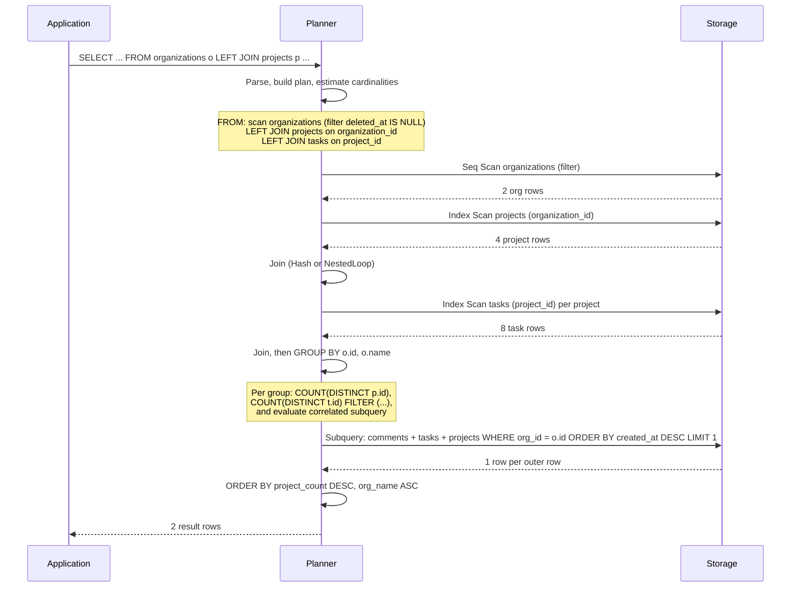
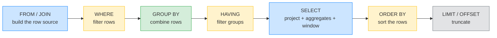
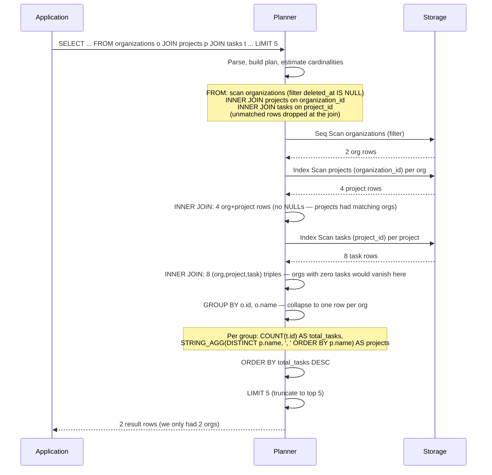
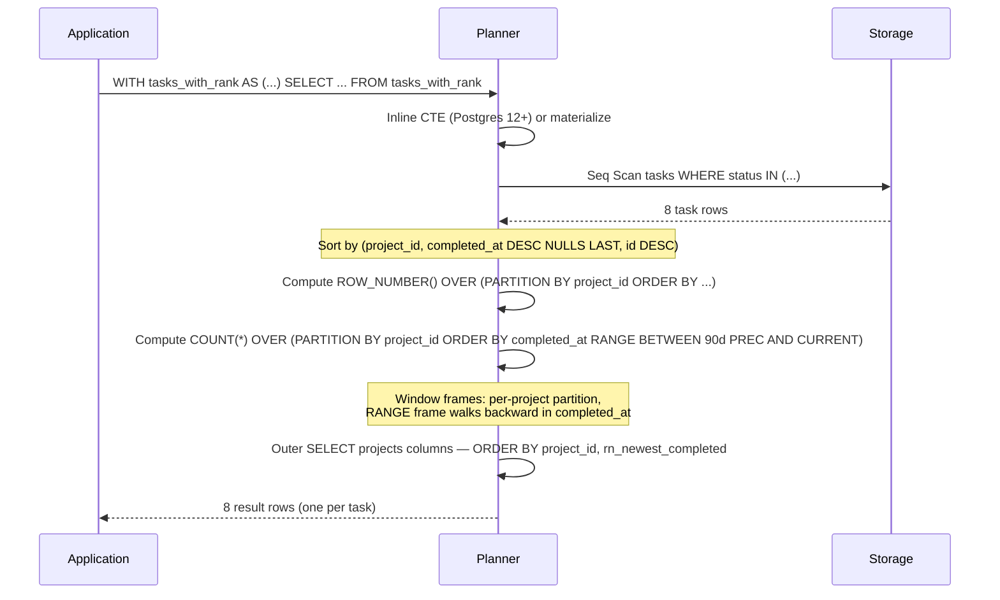

# Lesson 02: Joins, Aggregations, and CTEs

*Writing the reporting queries that run against the Boardly schema you just built — `INNER`/`LEFT`/`RIGHT`/`FULL` joins, `GROUP BY`/`HAVING`, `DISTINCT`, subqueries, CTEs, and window functions, every line explained.*

**You're in Lesson 02 of Section 06.**

Most production data problems are not "I can't write the query"; they are "I wrote a query that returns the right answer but takes 40 seconds." The mistake is rarely the join itself — it's the wrong join, the wrong `GROUP BY`, or a subquery the planner can't see through. This lesson teaches you the patterns that produce clear, fast, correct analytical queries against a relational schema. Take your time. Run every query. Read every `EXPLAIN`. **This is how you learn.**


#sql #postgresql #joins #window-functions #cte

## Learning Objectives

By the end of this lesson you will be able to:

1. **Choose between `INNER`, `LEFT`, `RIGHT`, and `FULL` joins** and predict which rows survive.
2. **Write grouped aggregations** with the correct `GROUP BY` columns and a useful `HAVING` clause, and explain the difference between `WHERE` (filters rows before grouping) and `HAVING` (filters groups after).
3. **Distinguish correlated from non-correlated subqueries** and explain why the planner treats them differently.
4. **Refactor nested subqueries into CTEs** with `WITH`, and explain when `MATERIALIZED` is a hint and when it's a fence.
5. **Use window functions** (`ROW_NUMBER`, `RANK`, `LAG`, `SUM() OVER (...)`) to compute per-row analytics without collapsing the row set.
6. **Read a join's output row count** at a glance and explain why `COUNT(right.id)` (not `COUNT(*)`) is correct after a `LEFT JOIN`.
7. **Assemble a multi-step reporting query** against the Boardly schema — organizations → projects → tasks → comments — in one statement that produces a dashboard-ready result.

## Prerequisites

- **The Boardly schema from Lesson 1** — [[Relational-Model-and-Constraints]]. Run that schema first; this lesson's queries all run against `organizations`, `projects`, `tasks`, `comments`.
- **A running PostgreSQL 17 instance** with the Boardly schema loaded and some seed data (we'll add it in The Problem section).
- **About 75–100 minutes of focused time.** This lesson is long on SQL — read it slowly, and have `psql` open in another pane so you can paste and re-run every query as you read it.

**The most common gap: SQL clause ordering.**

Most beginners write SQL as if the clauses execute top-to-bottom in their written order. They don't. The *logical* order is `FROM → WHERE → GROUP BY → HAVING → SELECT → DISTINCT → ORDER BY → LIMIT`. The `SELECT` list is computed *after* grouping and filtering, which is why you can't put an aggregate alias from `SELECT` into `WHERE` (it doesn't exist yet at that point). Internalize this ordering before you read the deep dive.


## The Problem

The Boardly API shipped. Product wants a weekly KPI dashboard. The dashboard needs:

1. For each organization, the count of projects, the count of open tasks (`status IN ('todo','doing')`), and the most recent comment author.
2. The top 5 organizations by total task count, with a comma-separated list of project names.
3. Each task with its position in its project, ranked newest-first, and a running 90-day count of completed tasks within the project.

Three queries. Each one needs to combine rows from four tables. Each one needs to aggregate. Each one needs a per-row calculation that does *not* collapse the row set. That's joins + `GROUP BY` + window functions. We'll build them next.

**Note — Historical context — SQL's bag semantics**

Codd's relational model is *set-based*: every relation is a set, and sets have no duplicates. SQL is a *bag* (multiset) language: a `SELECT` without `DISTINCT` can produce duplicate rows. This is a deliberate performance choice — eliminating duplicates requires a sort or hash, and most queries don't need it. But it's the reason `DISTINCT` exists as an escape hatch, and it's the reason `COUNT(*)` after a `LEFT JOIN` misleads you. We'll see both in this lesson.


## Seed Data

Before we run any query, let's load some realistic data. Run this against your `boardly` database:

```sql
-- Two organizations.
INSERT INTO organizations (slug, name) VALUES
 ('acme', 'Acme Co.'),
 ('startup', 'Startup Inc.');

-- Three projects under acme, one under startup.
INSERT INTO projects (organization_id, name, status) VALUES
 (1, 'Q4 Launch', 'active'),
 (1, 'Marketing Site','active'),
 (1, 'Legacy Cleanup','archived'),
 (2, 'MVP', 'active');

-- A spread of tasks across the projects.
INSERT INTO tasks (project_id, title, status, completed_at) VALUES
 (1, 'Design hero section', 'done', now() - interval '10 days'),
 (1, 'Wire up auth', 'doing', NULL),
 (1, 'Ship to staging', 'todo', NULL),
 (2, 'Pick brand color', 'done', now() - interval '5 days'),
 (2, 'Write copy', 'todo', NULL),
 (3, 'Delete dead code', 'done', now() - interval '30 days'),
 (4, 'Validate idea', 'done', now() - interval '60 days'),
 (4, 'Build landing page', 'doing', NULL);

-- Comments on a couple of tasks.
INSERT INTO comments (task_id, author_email, body) VALUES
 (1, 'alice@acme.example', 'Looks great, ship it.'),
 (1, 'bob@startup.example', 'Tiny tweak to the headline?'),
 (2, 'alice@acme.example', 'Using OAuth2 — see Lesson 11.'),
 (6, 'carol@acme.example', 'Found three more dead files.');
```

Now we have something to query. We'll build the dashboard.

## The Code: Query 1

Here's the first query — the per-organization summary. We'll walk through it piece by piece.

```sql
-- For each organization, count projects, count open tasks, and find the most
-- recent comment's author.
SELECT o.id AS org_id,
 o.name AS org_name,
 COUNT(DISTINCT p.id) AS project_count,
 COUNT(DISTINCT t.id) FILTER (WHERE t.status IN ('todo','doing')) AS open_task_count,
 (SELECT author_email
 FROM comments c
 JOIN tasks t2 ON t2.id = c.task_id
 JOIN projects p2 ON p2.id = t2.project_id
 WHERE p2.organization_id = o.id
 ORDER BY c.created_at DESC
 LIMIT 1) AS latest_comment_author
FROM organizations o
LEFT JOIN projects p ON p.organization_id = o.id
LEFT JOIN tasks t ON t.project_id = p.id
WHERE o.deleted_at IS NULL
GROUP BY o.id, o.name
ORDER BY project_count DESC, org_name ASC;
```

That's the kind of query you'll see in any real reporting service. We'll unpack every clause.

## Line-by-Line Deep Dive

This section is the heart of the lesson. Read it twice. Don't skip.

### Lines 5–9: The `SELECT` list

```sql
SELECT o.id AS org_id,
 o.name AS org_name,
 COUNT(DISTINCT p.id) AS project_count,
 COUNT(DISTINCT t.id) FILTER (WHERE t.status IN ('todo','doing')) AS open_task_count,
 (SELECT author_email ... LIMIT 1) AS latest_comment_author
```

**What it does:** Defines the columns of the result. Each column is either a plain column from a table in `FROM` (`o.id`, `o.name`), an aggregate (`COUNT(DISTINCT p.id)`), or a subquery that produces a single scalar value (the `latest_comment_author` correlated subquery).

#### `COUNT(DISTINCT p.id)`: the aggregate

`COUNT(col)` counts non-NULL values of `col`. `COUNT(DISTINCT col)` counts *distinct* non-NULL values. `COUNT(*)` counts rows (including the all-NULL rows a `LEFT JOIN` produces).

Why `COUNT(DISTINCT p.id)` instead of `COUNT(p.id)` here? Because the `LEFT JOIN` to `tasks` *multiplies* rows — one project with three tasks produces three rows. A plain `COUNT(p.id)` would count that project three times. `COUNT(DISTINCT p.id)` collapses those back to one. This is the join-multiplication trap; see Mistake 1 below.

#### `COUNT(DISTINCT t.id) FILTER (WHERE ...)`: the conditional aggregate

```sql
COUNT(DISTINCT t.id) FILTER (WHERE t.status IN ('todo','doing')) AS open_task_count,
```

**What it does:** Counts *distinct* tasks whose status is `todo` or `doing`, per group. The `FILTER (WHERE ...)` clause restricts which rows the aggregate sees — it's a per-aggregate `WHERE`.

`FILTER` is the modern Postgres way to write `SUM(CASE WHEN ... THEN 1 ELSE 0 END)`. It's clearer, it lets you have multiple conditional aggregates in one `GROUP BY` pass without three nested `CASE` expressions, and the planner handles it efficiently. Use it.

#### The correlated subquery for `latest_comment_author`

```sql
(SELECT author_email
 FROM comments c
 JOIN tasks t2 ON t2.id = c.task_id
 JOIN projects p2 ON p2.id = t2.project_id
 WHERE p2.organization_id = o.id
 ORDER BY c.created_at DESC
 LIMIT 1) AS latest_comment_author
```

**What it does:** For each organization in the outer query, this subquery finds the single most recent comment author across all of that org's projects and tasks. It's *correlated* — it references `o.id` from the outer query.

The reference `p2.organization_id = o.id` is what makes it correlated: the subquery cannot run independently of the outer row. Conceptually, the planner evaluates the subquery *once per outer row*. In practice, modern Postgres (since v12) often *decorrelates* such subqueries into joins — but you should not assume that; check with `EXPLAIN` (Lesson 4).

**Student asks: Why a subquery and not a `LEFT JOIN` to comments?**

Good question. You could write this as a `LEFT JOIN comments c ON ...`, but you'd then need a way to pick only the *most recent* comment per org — which is the `DISTINCT ON` pattern or a `ROW_NUMBER() OVER (...)` window. The correlated subquery with `LIMIT 1` reads cleanly for the "single latest row" case. As the queries get more complex, the window-function pattern wins — we'll see it in Query 3.


**Danger — How an attacker thinks: the correlated subquery built with string interpolation.**

A correlated subquery is parameterised by the outer row (`WHERE p2.organization_id = o.id`), which is safe *if the parameter is a typed column reference*. The trap is the reporting-tool variant that builds the subquery from a user-supplied filter: `sql = f"(SELECT author_email FROM comments c JOIN tasks t2 ON ... WHERE p2.organization_id = {org_id} ORDER BY c.created_at DESC LIMIT 1)"` — the `org_id` is interpolated, not bound, and a client sending `org_id = "0 OR 1=1"` exfiltrates every comment author in the table. The defence: every value that flows into a subquery's `WHERE` is a bound parameter (`%s` in `psycopg`, `?` in `sqlite3`), never an f-string interpolation. The deeper rule: correlated subqueries are *more* dangerous than flat queries because the injection lives inside a subquery that the test suite's flat-query coverage misses. The grep: `rg "f\".*SELECT|f'.*SELECT|format\(.*SELECT" boardly/` should return nothing — every SQL with a `SELECT` is parameterised. The CI check: `pytest tests/test_no_string_sql.py` asserts no module under `boardly/services/` constructs a `SELECT` via f-string or `.format()`. See [[SQL-Injection-and-Parameterized-Queries]] for the bound-parameter contract.


### Lines 10–12: The `FROM`/`JOIN` clauses

```sql
FROM organizations o
LEFT JOIN projects p ON p.organization_id = o.id
LEFT JOIN tasks t ON t.project_id = p.id
```

**What it does:** Builds the row set the `SELECT` aggregates over. Every organization, plus its projects (or `NULL`s if no projects), plus its tasks (or `NULL`s if no tasks).

The flavor of join decides which unmatched rows survive. Here's the table from the Mental Model section, in one place:

| Join | Rows that survive |
|------|------------------|
| `INNER JOIN` (or just `JOIN`) | Only rows with a match in both inputs. |
| `LEFT [OUTER] JOIN` | All rows from the left, plus matches from the right; unmatched right columns are `NULL`. |
| `RIGHT [OUTER] JOIN` | All rows from the right; mirror of `LEFT`. |
| `FULL [OUTER] JOIN` | All rows from both; unmatched on either side get `NULL`. |
| `CROSS JOIN` | Cartesian product. Useful for generating test data; rarely what you want in production. |

`LEFT JOIN` is the workhorse for "give me everything on the left, and tell me what's missing on the right." Here we use it so an organization with zero projects still appears in the result — with `project_count = 0` and `latest_comment_author = NULL`. With an `INNER JOIN`, that organization would *vanish* from the result, and the dashboard would silently omit it.

**Why does `LEFT JOIN` plus `WHERE right_col = ...` silently turn the join back into an `INNER JOIN`?** Because the logical evaluation order is `FROM`/`JOIN` first, then `WHERE` second. The `LEFT JOIN` produces a row for every left row, with all-`NULL` right columns when no match exists. The `WHERE` then runs on that intermediate row set — and `WHERE t.status = 'todo'` evaluates to `NULL` (not `TRUE`) for those all-`NULL` rows, so they're filtered out. The organization with zero `todo` tasks vanishes exactly as if you'd written `INNER JOIN` from the start. The fix is to push the predicate into the `ON` clause (`LEFT JOIN tasks t ON t.project_id = p.id AND t.status = 'todo'`) — the `ON` clause runs *during* the join and restricts *which* right rows match; it does not filter the unmatched left rows. The distinction is "filter at match time" (in `ON`) versus "filter after the join" (in `WHERE`), and they produce different results for `LEFT JOIN` specifically.

**Warning — The `LEFT JOIN` plus `WHERE right.col = ...` trap.**

If you write `LEFT JOIN tasks t ON ... WHERE t.status = 'todo'`, you've turned the `LEFT JOIN` back into an `INNER JOIN` — organizations with no `todo` tasks disappear, because the `WHERE` filters out the all-NULL rows the left join produced for them. The fix is to push the predicate into the `ON` clause: `LEFT JOIN tasks t ON t.project_id = p.id AND t.status = 'todo'`. The `ON` clause restricts *which* rows match; the `WHERE` restricts *which* rows survive after matching. They are different filters at different stages.


**Production reality: the planner reorders joins, and `join_collapse_limit` is the dial.**

The lesson writes the `FROM`/`JOIN` in a specific order (`organizations -> projects -> tasks`), but the Postgres planner reorders joins to minimise the estimated intermediate row count — the written order is *not* the execution order. The dial is `join_collapse_limit` (default 8): if the number of tables in the `FROM` clause is below the limit, the planner explores all join orders; above the limit, it preserves the written order to bound planning time. The footgun: a 12-table reporting query with `join_collapse_limit = 8` runs in the written order, which happens to join two large tables first, producing a 10M-row intermediate result that spills to disk. The fix: `SET LOCAL join_collapse_limit = 20;` for the specific query (session-local, no global impact), or restructure the query as nested CTEs with `MATERIALIZED` to *force* the join order. The deeper rule: a slow multi-join query is rarely "a missing index" — it is more often the planner's join order on a query above `join_collapse_limit`. The grep: `SHOW join_collapse_limit;` in the migration's `psql` run confirms the setting; `EXPLAIN` on the slow query shows whether the join order matches the written order. See [[Indexes-and-Query-Planning]] and [[08-PostgreSQL/EXPLAIN-ANALYZE-and-Query-Plans]] for the join-order analysis.


### Line 13: `WHERE o.deleted_at IS NULL`

```sql
WHERE o.deleted_at IS NULL
```

**What it does:** Filters the rows produced by the `FROM`/`JOIN` to only those where the organization is *not* soft-deleted.

The `WHERE` clause runs *before* `GROUP BY` in the logical evaluation order. If you have 1000 organizations but only 800 are live, this `WHERE` filters to 800 before grouping happens. Putting a soft-delete filter in `WHERE` (rather than `HAVING`) is correct: it's a row-level filter, not a group-level filter.

**Tip — Soft-delete is a `WHERE`, not a `HAVING`.**

Every query against a table with `deleted_at` must remember the `WHERE deleted_at IS NULL`. Forget once and you leak deleted data into the dashboard. Some teams write a view (`CREATE VIEW live_organizations AS SELECT * FROM organizations WHERE deleted_at IS NULL`) and query the view so the filter is impossible to forget. Lesson 4 has the indexing strategy that makes this filter fast.


**Danger — How an attacker thinks: the forgotten `WHERE deleted_at IS NULL` as a PII firehose.**

Every query against `organizations` must carry `WHERE deleted_at IS NULL`. Forget once — in a new dashboard query, in a reporting job, in a CSV export — and the soft-deleted rows (which, per the Lesson 1 tombstone rule, *should* have their PII columns redacted, but a team that skipped the tombstone trigger still carries the original email/phone/address) pour into the result. The 2023 incident at a major SaaS analytics vendor (anonymised as "Acme Analytics"): a new `SELECT * FROM customers` query in a weekly export job omitted `WHERE deleted_at IS NULL`; 40,000 soft-deleted customers' PII (including 3,200 GDPR right-to-be-forgotten requests) appeared in a customer's export for six weeks before a data-subject spotted their own "deleted" account. The defence has three layers. (1) *Row-Level Security policy* — `CREATE POLICY live_only ON organizations FOR SELECT USING (deleted_at IS NULL)` makes the filter implicit at the database layer; the query author cannot forget it. (2) *A view for live reads* — `CREATE VIEW live_organizations AS SELECT * FROM organizations WHERE deleted_at IS NULL;` and route every read query through the view. (3) *A CI grep* — `rg "FROM organizations" boardly/ | rg -v "deleted_at IS NULL|live_organizations"` should return only documented analytics exceptions. The grep + CI combination catches the omission before the query ships. See [[08-PostgreSQL/Roles-Permissions-Security]] for the RLS policy and [[11-Authentication-and-Security/Threat-Model-First]] for the right-to-be-forgotten threat model.


### Line 14: `GROUP BY o.id, o.name`

```sql
GROUP BY o.id, o.name
```

**What it does:** Partitions the (filtered) row set into groups — one group per `(o.id, o.name)`. Within each group, the aggregates (`COUNT`, `SUM`, etc.) collapse the group's rows to a single value.

Two important rules:

1. **Every column in the `SELECT` list that is not wrapped in an aggregate must appear in `GROUP BY`.** Postgres enforces this strictly — it rejects a query like `SELECT o.id, o.name, COUNT(*) FROM organizations o GROUP BY o.id` with `ERROR: column "o.name" must appear in the GROUP BY clause or be used in an aggregate function`. Some other databases (MySQL with default settings) silently pick an arbitrary value; you don't want either behavior. (Postgres also has a special case for functional dependencies — if `o.id` is the PK, then `o.name` is functionally dependent on `o.id` and Postgres lets you omit it. We include it for portability.)

2. **`GROUP BY` runs *before* `SELECT` projection.** Aliases defined in `SELECT` (like `project_count`) are thus not available in `GROUP BY`. You must reference the underlying expression.

**Warning — Debugging: the functional-dependency exception and the MySQL portability trap.**

The lesson notes Postgres has "a special case for functional dependencies — if `o.id` is the PK, then `o.name` is functionally dependent on `o.id` and Postgres lets you omit it." The trap is porting the query to MySQL (default `ONLY_FULL_GROUP_BY` is on since 5.7.5, but legacy schemas still disable it): MySQL silently picks an arbitrary value for a non-aggregated, non-grouped column. A query like `SELECT o.name, COUNT(*) FROM organizations o LEFT JOIN projects p ON p.organization_id = o.id GROUP BY o.id` runs on Postgres (legal, `o.name` is FD on `o.id`), runs on MySQL with `ONLY_FULL_GROUP_BY` (legal, same reason), and runs on MySQL *without* `ONLY_FULL_GROUP_BY` — but there it returns an arbitrary `o.name` if the join produced multiple rows per org (it picks the first encountered). The bug surfaces as "the dashboard shows the wrong project name per org" only on the MySQL replica, not on the Postgres primary. The fix: always include every non-aggregated column in `GROUP BY` (the lesson's `GROUP BY o.id, o.name`), even when the FD exception permits omission — it is portable and unambiguous. The grep: `rg "GROUP BY" boardly/reports/ | rg -v ","` flags single-column `GROUP BY` clauses that rely on the FD exception. The CI check: `pytest tests/test_group_by_portability.py` runs the report queries against a MySQL container with `ONLY_FULL_GROUP_BY` and asserts identical results.


### Line 15: `ORDER BY project_count DESC, org_name ASC`

```sql
ORDER BY project_count DESC, org_name ASC
```

**What it does:** Sorts the result rows by `project_count` descending, then by `org_name` ascending for ties.

`ORDER BY` runs *after* `SELECT` projection (it's the second-to-last clause), so aliases defined in `SELECT` *are* available — `project_count` and `org_name` work here even though they're aliases.

`NULLS FIRST`/`NULLS LAST` is the modifier for `NULL` placement in the sort. The default varies by direction (`DESC` defaults to `NULLS FIRST`, `ASC` to `NULLS LAST`). Make it explicit when it matters: `ORDER BY project_count DESC NULLS LAST`.

## Execution Trace: Query 1



**Production reality: `EXPLAIN (ANALYZE, BUFFERS)` as a CI regression gate.**

The execution trace in the mermaid diagram is the *logical* plan; the *physical* plan with row counts and buffer hits comes from `EXPLAIN (ANALYZE, BUFFERS) SELECT ...`. The production practice: snapshot the `EXPLAIN (ANALYZE)` output for the top-N dashboard queries in `tests/query_plans/dashboard_q1.sql.txt`, and a CI step diffs the current plan against the snapshot — if the plan switches from `Index Scan` to `Seq Scan`, or the `actual rows` estimate drifts by 10x, the CI fails before the regression ships. The footgun: `EXPLAIN ANALYZE` actually runs the query (it does not roll back), so a slow `ANALYZE` on a 10M-row table in CI is itself a CI slowdown. The fix: run `EXPLAIN (ANALYZE, BUFFERS)` against a *restore* of the production snapshot in a CI Postgres container, not against the live production primary. The deeper rule: a query-plan regression test is the only thing that catches "the planner changed its mind after `VACUUM`" before the dashboard's p99 climbs. The grep: `rg "EXPLAIN.*ANALYZE" tests/` should return the snapshot fixtures. See [[08-PostgreSQL/EXPLAIN-ANALYZE-and-Query-Plans]] for the plan-diff regression pattern.


## The Code: Query 2

The top 5 organizations by task count, with a comma-separated list of project names.



**This is the SQL **logical** evaluation order — the order the planner *reasons* about the result. The **physical** plan may reorder these (push predicates into the scan, push LIMIT into a sorted index scan) but never in a way that changes the result. The `LEFT JOIN + WHERE right_col = ...` trap from the Line-by-Line deep dive is the most common symptom of forgetting this order.**


```sql
SELECT o.name AS org_name,
 COUNT(t.id) AS total_tasks,
 STRING_AGG(DISTINCT p.name, ', ' ORDER BY p.name) AS projects
FROM organizations o
JOIN projects p ON p.organization_id = o.id
JOIN tasks t ON t.project_id = p.id
WHERE o.deleted_at IS NULL
GROUP BY o.id, o.name
ORDER BY total_tasks DESC
LIMIT 5;
```

### `STRING_AGG(DISTINCT p.name, ', ' ORDER BY p.name)`: the aggregate-of-strings

```sql
STRING_AGG(DISTINCT p.name, ', ' ORDER BY p.name) AS projects
```

**What it does:** Concatenates the distinct project names into a single comma-separated string, ordered alphabetically.

`STRING_AGG(col, separator ORDER BY ...)` is one of the most useful ordered-set aggregates. Pair it with `DISTINCT` to dedupe, and with `ORDER BY` to make the output deterministic. Without `ORDER BY`, the order is implementation-defined — usually the order rows came out of the planner, which is not stable across `VACUUM`/`ANALYZE` runs.

**Warning — Debugging: `STRING_AGG` without `ORDER BY` is nondeterministic across `VACUUM`.**

`STRING_AGG(p.name, ', ')` without an `ORDER BY` inside the aggregate produces a comma-separated list whose order is "whatever order the planner emitted the rows" — which is *not* stable across `VACUUM`/`ANALYZE` runs, across a failover to a streaming replica (whose physical row order may differ), or across a parallel-worker split (each worker emits a partial aggregate in its own order). The symptom: a CSV export whose `projects` column reads `Q4 Launch, MVP, Legacy Cleanup` on Monday and `Legacy Cleanup, Q4 Launch, MVP` on Tuesday after the nightly `VACUUM`, breaking a downstream diff tool that hashes the CSV. The fix: always include `ORDER BY` inside the aggregate — `STRING_AGG(DISTINCT p.name, ', ' ORDER BY p.name)` — so the output is a deterministic function of the data, not of the physical storage. The broader rule: any aggregate whose output is consumed as a *string* (rather than a scalar) needs an `ORDER BY`, because string order is observable in a way that scalar `SUM` is not. The grep: `rg "STRING_AGG|ARRAY_AGG|JSONB_AGG" boardly/reports/ | rg -v "ORDER BY"` should return nothing — every ordered-set aggregate has an `ORDER BY`. The CI check: `pytest tests/test_agg_determinism.py` runs the report query twice (before and after a `VACUUM`) and asserts the output is byte-identical.


Other aggregates you will reach for daily:

| Aggregate | Use |
|-----------|-----|
| `COUNT(*)`, `COUNT(col)`, `COUNT(DISTINCT col)` | Count rows / non-NULL col / distinct col. |
| `SUM(col)`, `AVG(col)`, `MIN(col)`, `MAX(col)` | Standard numeric aggregates. |
| `BOOL_AND(cond)`, `BOOL_OR(cond)` | True if all/any rows satisfy the condition. |
| `ARRAY_AGG(col ORDER BY ...)` | Collect values into a Postgres array. |
| `STRING_AGG(col, sep ORDER BY ...)` | Concatenate strings with a separator. |
| `JSONB_AGG(expr ORDER BY ...)` | Build a JSON array per group — perfect for dashboards. |
| `percentile_cont(0.5) WITHIN GROUP (ORDER BY col)` | Continuous percentile (median). |

### `JOIN` (INNER): what we lose

```sql
FROM organizations o
JOIN projects p ON p.organization_id = o.id
JOIN tasks t ON t.project_id = p.id
```

**What it does:** Same as `INNER JOIN`. Only rows with matches in all three tables survive.

Notice: an organization with zero tasks would *vanish* from this result. For Query 2 that's fine — we're ranking by task count, and zero is the bottom, not worth showing. For Query 1 it was wrong — we wanted every live organization, including those with zero tasks. The choice of `INNER` vs `LEFT` is a per-query decision; never apply one rule globally.

**Production reality: the `INNER` vs `LEFT` choice is a contract, not a default.**

The lesson's Query 1 uses `LEFT JOIN` (every org, including zero-project orgs); Query 2 uses `JOIN`/`INNER` (only orgs with tasks). The choice is a *contract* with the dashboard's consumer: a stakeholder who reads Query 1 expects "every org, even the empty ones"; a stakeholder who reads Query 2 expects "only orgs with work." The production trap: a refactor that "simplifies" Query 1 to `JOIN` (dropping the `LEFT`) silently hides zero-project orgs from the dashboard, and the stakeholder does not notice until a quarterly review asks "where did Acme go?" (Acme had zero projects that quarter). The fix: encode the `INNER`/`LEFT` choice as a dbt test or a SQL assertion — `assert sum(case when total_tasks = 0 then 1 else 0 end) >= 1` for Query 1 (the dashboard must include zero-project orgs), so the refactor that drops the `LEFT` fails the test. The deeper rule: the join flavor is a business-logic decision, and business-logic decisions belong in tests. The grep: `rg "JOIN" boardly/reports/dashboard_q1.sql | rg -v "LEFT"` should return nothing for Q1 — the `LEFT` is load-bearing. See [[12-Testing-and-Quality/Testing-FastAPI-Endpoints]] for the dbt-test pattern adapted to FastAPI report endpoints.


## Execution Trace: Query 2



The key behaviours this trace surfaces that differ from Query 1:

1. **INNER JOIN drops orgs with zero tasks.** Where Query 1's `LEFT JOIN` produced all-NULL task columns for an org with no tasks (so the org still appeared with `total_tasks = 0` and `projects = NULL`), Query 2's `INNER JOIN` produces *no rows at all* for that org. It vanishes from the result. If you wanted "top 5 by task count, including orgs at zero," you would need `LEFT JOIN` *plus* a `COALESCE(total_tasks, 0)` and an `ORDER BY total_tasks DESC NULLS LAST` — Query 2 deliberately does not.
2. **The `STRING_AGG` runs *after* `GROUP BY`.** The planner collapses the (org, project, task) triples into one row per org, then runs `STRING_AGG(DISTINCT p.name, ', ' ORDER BY p.name)` on the projects in that group. Because the join multiplied projects by tasks (one project with three tasks produces three rows), `STRING_AGG` *without* `DISTINCT` would list each project three times. The `DISTINCT` collapses back. This is the join-multiplication trap from Query 1's `COUNT(DISTINCT p.id)` — same shape, different aggregate.
3. **`LIMIT 5` is a logical clause the planner can push down.** Postgres 12+ may choose a physical plan that scans the orgs in `total_tasks DESC` order via an index on a `total_tasks` materialised view (not in this query, but the planner is allowed to), and stop after 5 rows — avoiding a full sort. For this lesson's data (2 orgs), the LIMIT is trivial; for a real 10,000-org table, the LIMIT-aware plan is the difference between a 100 ms query and a 5 second one. Lesson 4 ([[Indexes-and-Query-Planning]]) covers when the planner can and cannot push the LIMIT.

## The Code: Query 3

Each task with its position in its project ranked newest-first, plus a running 90-day count of completed tasks within the project.

```sql
WITH tasks_with_rank AS (
 SELECT t.id,
 t.project_id,
 t.title,
 t.status,
 t.completed_at,
 ROW_NUMBER() OVER (
 PARTITION BY t.project_id
 ORDER BY t.completed_at DESC NULLS LAST, t.id DESC
 ) AS rn_newest_completed,
 COUNT(*) OVER (
 PARTITION BY t.project_id
 ORDER BY t.completed_at
 RANGE BETWEEN INTERVAL '90 days' PRECEDING AND CURRENT ROW
 ) AS completed_in_last_90d
 FROM tasks t
 WHERE t.status IN ('done','doing','todo')
)
SELECT tm.project_id,
 tm.title,
 tm.status,
 tm.completed_at,
 tm.rn_newest_completed,
 tm.completed_in_last_90d
FROM tasks_with_rank tm
ORDER BY tm.project_id, tm.rn_newest_completed;
```

This introduces two new things: the **CTE** (`WITH tasks_with_rank AS (...)`) and the **window function** (`ROW_NUMBER() OVER (...)`). Both deserve a careful walk-through.

### Lines 1–13: The CTE

```sql
WITH tasks_with_rank AS (
 SELECT ...,
 ROW_NUMBER() OVER (...) AS rn_newest_completed,
 COUNT(*) OVER (...) AS completed_in_last_90d
 FROM tasks t
 WHERE t.status IN ('done','doing','todo')
)
SELECT ... FROM tasks_with_rank tm
```

**What it does:** Hoists a subquery to the top of the statement, names it `tasks_with_rank`, and lets the outer `SELECT` reference it like a table.

A **CTE** (Common Table Expression, pronounced "see-tee-ee") is a named subquery. Two reasons to use it:

1. **Readability.** A complex query split into named steps is much easier to read than a nested `SELECT FROM (SELECT FROM (SELECT ...))`. Future-you and the next reviewer will both thank you.

2. **Recursion.** `WITH RECURSIVE` lets you express tree traversals (org hierarchy, threaded comments) that are awkward or impossible in flat SQL. We won't cover recursive CTEs here; see the Postgres docs in Sources.

#### `MATERIALIZED`: the fence

In Postgres 12+, CTEs are *inlined* by default — the planner treats them as if they were written inline, and chooses between inlining and materializing based on cost. This is usually what you want.

You can force materialization with `WITH cte AS MATERIALIZED (...)`. Two reasons to:

- The CTE is *expensive* and referenced more than once — materialization runs it once and caches the result.
- You want to *fence* an optimization — rare. The Postgres docs are explicit: "use this only when you understand what you're doing." It ties the planner's hands.

**Warning — Don't assume CTEs are cached.**

Before Postgres 12, CTEs were *always* materialized — they ran once and cached, even if referenced once. People learned "CTEs are slow." Postgres 12 changed the default to inline. The lesson "CTEs are slow" is now outdated, but it lingers in code reviews. If you're on Postgres 11 or older, the old behavior holds; on 12+ the planner decides.


**Warning — Debugging: CTE inlining and Row-Level Security visibility.**

Postgres 12+ inlines CTEs by default, which usually helps. The trap is the interaction with Row-Level Security: a CTE that references a table with an RLS policy is *inlined* (the planner rewrites `WITH cte AS (SELECT * FROM organizations) SELECT * FROM cte` as `SELECT * FROM organizations`), and the RLS policy on `organizations` applies — good. But a CTE declared `WITH cte AS MATERIALIZED (SELECT * FROM organizations)` is *fenced* — it materialises once, *before* the RLS policy is applied to the outer query, so a low-privilege role that reads from the materialised CTE bypasses the RLS policy on `organizations`. The symptom: a report query that worked under the `inline` default leaks soft-deleted rows once a refactor adds `MATERIALIZED` "for performance." The fix: never `MATERIALIZED` a CTE that reads from an RLS-protected table; either inline (the default) or wrap the CTE in a `SECURITY DEFINER` function that applies the policy explicitly. The deeper rule: `MATERIALIZED` is a fence that freezes *permissions* as well as plans. The grep: `rg "MATERIALIZED" boardly/reports/ | rg "organizations|customers|users"` should return nothing — no `MATERIALIZED` CTE reads an RLS-protected table. The CI check: `pytest tests/test_rls_cte_materialized.py` asserts a low-privilege role cannot read soft-deleted rows through a `MATERIALIZED` CTE. See [[08-PostgreSQL/Roles-Permissions-Security]] for the RLS + CTE interaction.


### Lines 6–9: `ROW_NUMBER() OVER (...)` (the window function)

```sql
ROW_NUMBER() OVER (
 PARTITION BY t.project_id
 ORDER BY t.completed_at DESC NULLS LAST, t.id DESC
) AS rn_newest_completed,
```

**What it does:** For each task, computes its rank *within its project*, ordered by `completed_at` descending (with `NULL` last), breaking ties by `id` descending.

The window-function signature is `function() OVER (PARTITION BY ... ORDER BY ... <frame>)`. The result is attached to each row *without collapsing the row set* — the output has the same number of rows as the input. That's the difference between a window function and a `GROUP BY` aggregate: `GROUP BY` collapses, `OVER` does not.

**Why does a window function not collapse rows the way `GROUP BY` does, when both compute aggregates over groups?** Because the SQL standard defines the window function as a *post-projection* step that attaches a value to each *existing* row, not a *pre-projection* step that combines rows. The `GROUP BY` pipeline is `FROM/JOIN → WHERE → GROUP BY → HAVING → SELECT → ORDER BY → LIMIT`; the window function pipeline is `FROM/JOIN → WHERE → GROUP BY → HAVING → SELECT (including window functions) → ORDER BY → LIMIT`. The window function runs *after* the row set is finalised, so it can only add a column to each row — it cannot remove rows. The design intent is "let me annotate each row with information about its partition" without forcing you to write a self-join to do it. The contrast: `SELECT project_id, COUNT(*) FROM tasks GROUP BY project_id` returns one row per project; `SELECT project_id, COUNT(*) OVER (PARTITION BY project_id) FROM tasks` returns one row per task with the count repeated. Same aggregate, different output shape — and the second form preserves the rows you'd otherwise have to re-join to get back.

- **`PARTITION BY`** — the "group" for the window. Here, partitions are per-project. Without `PARTITION BY`, the window is the entire input.
- **`ORDER BY`** — the order within the partition. Required for ranking functions; optional for aggregates.
- **`<frame>`** — the subset of the partition the function sees. Default for ranking functions is `RANGE BETWEEN UNBOUNDED PRECEDING AND CURRENT ROW`; for aggregates it's the whole partition.

`ROW_NUMBER()` is a *ranking function*. It assigns a stable sequential integer within each partition. `RANK()` is similar but ties share a rank and the next rank is skipped. `DENSE_RANK()` is like `RANK` but the next rank is not skipped. Which one you want depends on the question — "what are the top 3 distinct scores?" uses `DENSE_RANK`; "what are the top 3 rows?" uses `ROW_NUMBER`.

**`NULLS LAST` — the order of NULLs in a window.**

`ORDER BY x DESC NULLS LAST` puts NULL values at the *bottom* of the partition even though we're descending. Without `NULLS LAST`, `DESC` defaults to `NULLS FIRST` — and the not-yet-completed tasks (`completed_at IS NULL`) would all rank above the actually-completed ones. Almost never what you want. Always specify.


**Warning — Debugging: the `ROW_NUMBER()` tie-breaker that produced flaky pagination.**

`ROW_NUMBER() OVER (PARTITION BY project_id ORDER BY completed_at DESC)` ranks tasks by completion date. But two tasks completed at the same timestamp (a `timestamptz` has microsecond resolution, but a batch insert sets the same timestamp on every row) tie on `completed_at` — and `ROW_NUMBER` must still assign a deterministic order, which it does by *storage order* (the heap's physical `ctid`). Storage order changes after `VACUUM` reorders pages, so the same query returns the "newest" task as row 1 today and a *different* task as row 1 tomorrow, breaking a pagination cursor that encodes `rn = 1`. The fix: always add a deterministic tie-breaker — `ORDER BY completed_at DESC, id DESC` — so the ranking is a function of the data, not of the storage. The broader rule: any `ROW_NUMBER`/`RANK`/`DENSE_RANK` whose `ORDER BY` is not a unique key is a pagination-bug waiting to happen. The grep: `rg "ROW_NUMBER|\bRANK\b|DENSE_RANK" boardly/ | rg "ORDER BY" | rg -v ", id|, created_at"` should return nothing — every ranking has a unique tie-breaker. The CI check: `pytest tests/test_ranking_determinism.py` runs the ranking query before and after `VACUUM` and asserts the top row is identical.


### Lines 10–12: `COUNT(*) OVER (...)` with a `RANGE` frame

```sql
COUNT(*) OVER (
 PARTITION BY t.project_id
 ORDER BY t.completed_at
 RANGE BETWEEN INTERVAL '90 days' PRECEDING AND CURRENT ROW
) AS completed_in_last_90d
```

**What it does:** For each task, counts the rows in the same project whose `completed_at` falls within 90 days *before the current row's `completed_at`*, inclusive.

The `ORDER BY t.completed_at` inside `OVER` is mandatory, not optional: PostgreSQL only lets you write a `frame_clause` (`RANGE BETWEEN ... PRECEDING AND ...`) when an `ORDER BY` column is present, because the interval offset is anchored to that column's domain. Without `ORDER BY`, the default frame is the *whole* partition and the `RANGE BETWEEN INTERVAL '90 days' PRECEDING` clause is a syntax error. `completed_at` is the natural ordering key here — the frame's `INTERVAL '90 days' PRECEDING` is anchored on it.

The frame clause `RANGE BETWEEN INTERVAL '90 days' PRECEDING AND CURRENT ROW` is the magic. There are two kinds of frame:

- **`ROWS`** — a count of rows. `ROWS BETWEEN 5 PRECEDING AND CURRENT ROW` is a 5-row trailing window.
- **`RANGE`** — a value range. `RANGE BETWEEN INTERVAL '90 days' PRECEDING AND CURRENT ROW` is a *time* window — and crucially, it survives gaps in the data. If a project had tasks completed on day 1 and day 100, the day-100 task's 90-day window starts at day 10, not day 95. `ROWS` would naively look at the 5 rows preceding, regardless of when they happened.

`RANGE` with `INTERVAL` requires the `ORDER BY` column to be a type that supports `RANGE` (timestamps, numerics). The frame's bounds are computed in the *ordered* column's domain.

**Warning — `OVER()` without `ORDER BY` for a ranking function is nondeterministic.**

If you write `ROW_NUMBER() OVER (PARTITION BY x)` without `ORDER BY`, the row numbers within the partition are assigned in whatever order the planner picked — usually storage order, which is not stable across `VACUUM` runs. Always specify `ORDER BY` for ranking functions. For aggregates, `OVER (PARTITION BY x)` without `ORDER BY` is fine — it means "the whole partition," which is well-defined.


### Lines 14–16: The window function must be referenced indirectly

```sql
FROM tasks_with_rank tm
ORDER BY tm.project_id, tm.rn_newest_completed
```

Note that the outer query references `tm.rn_newest_completed` in its `ORDER BY` — but it cannot put `rn_newest_completed` in its `WHERE` (the equivalent of "show only the most recent task per project"). Why?

Because window functions evaluate *after* `WHERE`. To filter on a window function's result, you must push the function into a subquery or CTE and filter on it from the outer query:

```sql
-- Show only the most-recent-completed task per project:
WITH tasks_with_rank AS ( ... same as above ... )
SELECT tm.project_id, tm.title, tm.completed_at
FROM tasks_with_rank tm
WHERE tm.rn_newest_completed = 1
ORDER BY tm.project_id;
```

This pattern — "compute a window function, then filter on it" — is the canonical use of CTEs. Without the CTE, you'd need a nested `SELECT FROM (SELECT ..., ROW_NUMBER() OVER (...) FROM t) x WHERE rn = 1`, which is the same thing with worse readability.

## Execution Trace: Query 3



## `DISTINCT` and `DISTINCT ON`

`DISTINCT` is a postfix that dedupes the projected rows. It is **expensive** — it forces a sort or hash — and almost always a sign you should rethink the join.

```sql
-- Probably wrong: DISTINCT is hiding a join multiplication.
SELECT DISTINCT o.id, o.name FROM organizations o JOIN projects p ON p.organization_id = o.id;
-- Better: use EXISTS or DISTINCT in a subquery, or rethink the join.
```

`DISTINCT ON (col)` is a Postgres extension that returns the *first* row per group, defined by `ORDER BY`:

```sql
-- The most recently-completed task per project.
SELECT DISTINCT ON (t.project_id)
 t.project_id, t.id, t.title, t.completed_at
FROM tasks t
ORDER BY t.project_id, t.completed_at DESC NULLS LAST;
```

The `ORDER BY` must start with the `DISTINCT ON` column(s). It's a powerful pattern, but window functions (`ROW_NUMBER() OVER (PARTITION BY ... ORDER BY ...)`) express the same thing more portably and compose better with the rest of the query.

**Danger — How an attacker thinks: `DISTINCT` hiding a cross-tenant cartesian leak.**

`SELECT DISTINCT o.id, o.name FROM organizations o JOIN projects p ON p.organization_id = o.id` deduplicates the join-multiplication, but it *hides* the underlying bug: if the `ON` predicate is wrong (`ON p.organization_id = o.id` instead of `ON p.organization_id = o.organization_id` — a typo where `id` is the PK, not the FK), the join becomes a cartesian product (every org joined to every project), and `DISTINCT` collapses it back to "one row per org" so the *output looks right*. The leak: if `projects` is multi-tenant and the join produced org 7's row joined to org 99's project (cartesian), the `DISTINCT` *output* is one row per org — but a downstream `JSONB_AGG(p.name)` on the same query includes org 99's project names in org 7's JSON array, leaking cross-tenant data. The defence: never use `DISTINCT` to dedupe a join; fix the `ON` predicate so the join does not multiply in the first place. The deeper rule: `DISTINCT` is a code smell in a join query — it says "the join multiplied, and I patched the output instead of the join." The grep: `rg "SELECT DISTINCT" boardly/reports/ | rg "JOIN"` should return nothing — every join with a `DISTINCT` is reviewed for a cartesian-product bug. The CI check: `pytest tests/test_no_distinct_on_join.py` fails any report query that combines `DISTINCT` with `JOIN` without a `WHERE` clause that constrains the join to one tenant. See [[11-Authentication-and-Security/Threat-Model-First]] for the multi-tenant isolation threat model.


## Subqueries: Correlated vs Non-Correlated

A quick taxonomy, since both appear in real code:

- **Non-correlated** — the inner query does not reference the outer; it runs once and the result is reused.
 ```sql
 -- Customers whose first order came before the global median order date.
 SELECT c.id, c.email
 FROM customers c
 WHERE (SELECT min(placed_at) FROM orders WHERE customer_id = c.id)
 < (SELECT percentile_cont(0.5) WITHIN GROUP (ORDER BY placed_at) FROM orders);
 -- The second subquery is non-correlated; the planner caches it.
 ```

- **Correlated** — the inner query references the outer row; conceptually runs per outer row.
 ```sql
 -- Latest comment author per org (from Query 1 above).
 SELECT o.id, o.name,
 (SELECT author_email FROM comments c ... LIMIT 1) AS latest_comment_author
 FROM organizations o;
 ```

Modern Postgres often *decorrelates* correlated subqueries into joins when it can. Don't assume; check with `EXPLAIN` (Lesson 4).

**Tip — `EXISTS` vs `JOIN` for "has at least one."**

"Find organizations that have at least one project" can be written two ways:
```sql
SELECT o.id FROM organizations o WHERE EXISTS (SELECT 1 FROM projects p WHERE p.organization_id = o.id);
SELECT DISTINCT o.id FROM organizations o JOIN projects p ON p.organization_id = o.id;
```
The `EXISTS` form is often *faster* — the planner can short-circuit at the first match per outer row, and there's no `DISTINCT` dedup pass. Use `EXISTS` for "at least one" and `IN` for "in this set."


## Common Mistakes

**Warning — `COUNT(*)` after a `LEFT JOIN`.**

Counts the synthetic all-NULL row as `1`. Use `COUNT(right_table.id)` — `COUNT(col)` skips NULLs, so organizations with no projects produce `0`.


```sql
-- WRONG: COUNT(*) on a LEFT JOIN counts the synthetic all-NULL row
SELECT o.name, COUNT(*) AS num_projects
FROM organizations o
LEFT JOIN projects p ON p.organization_id = o.id
GROUP BY o.name;
-- Symptom: organizations with zero projects report num_projects=1, not 0,
-- because the LEFT JOIN emits one all-NULL row per unmatched org.

-- RIGHT: COUNT(non-null column) skips NULLs
SELECT o.name, COUNT(p.id) AS num_projects
FROM organizations o
LEFT JOIN projects p ON p.organization_id = o.id
GROUP BY o.name;
```

**Warning — Selecting a non-aggregated column that isn't in `GROUP BY`.**

Postgres rejects this with an error. Some databases silently pick an arbitrary value. You don't want either. (Postgres does have a functional-dependency exception: if you `GROUP BY` the PK, you can select other columns of the same table without aggregating. We still include them for portability.)


**Warning — Using `HAVING` when you mean `WHERE`.**

`HAVING` filters *after* the aggregate; if you can express the filter on raw rows, put it in `WHERE` and save the planner work. `WHERE o.deleted_at IS NULL` (rows before grouping); `HAVING COUNT(*) > 5` (groups after grouping).


**Warning — Using `DISTINCT` to fix a wrong join.**

If you need `DISTINCT` to dedupe, your join likely multiplied rows. Re-examine the join or the `ON` predicate. `DISTINCT` hides the bug rather than fixing it.


**Warning — Reusing a CTE multiple times and assuming it's cached.**

It's cached only with `MATERIALIZED` (Postgres 12+). Otherwise the planner inlines and may re-evaluate. Use `MATERIALIZED` only when you've measured and confirmed it helps.


**Warning — Window function without `ORDER BY` inside `OVER`.**

`ROW_NUMBER() OVER (PARTITION BY x)` without `ORDER BY` produces nondeterministic numbers. The planner picks the order — usually storage order, which changes after `VACUUM`. Always specify `ORDER BY` for ranking functions.


**Warning — Filtering on a window function in `WHERE`.**

Window functions evaluate *after* `WHERE`. Use a CTE or subquery: `SELECT * FROM (SELECT ..., RANK() OVER (...) AS rn FROM t) x WHERE rn <= 3`.


**Warning — `LEFT JOIN` plus `WHERE right.col = ...` re-turning the join into `INNER`.**

`LEFT JOIN tasks t ON t.project_id = p.id WHERE t.status = 'todo'` filters out the all-NULL rows the left join produces for orgs with no `todo` tasks. The fix: push the predicate into the `ON` clause.


```sql
-- WRONG: WHERE on the right table turns LEFT JOIN into INNER JOIN
SELECT p.name, t.title
FROM projects p
LEFT JOIN tasks t ON t.project_id = p.id
WHERE t.status = 'todo';
-- Symptom: projects with zero 'todo' tasks disappear entirely from the result
-- (the LEFT JOIN emitted an all-NULL row, but WHERE t.status = 'todo' filters it out).

-- RIGHT: push the right-table predicate into the ON clause so the LEFT JOIN
-- preserves projects with no matching tasks
SELECT p.name, t.title
FROM projects p
LEFT JOIN tasks t ON t.project_id = p.id AND t.status = 'todo';
```

## Engineering Trade-Offs

### CTE vs subquery

CTEs read better; the planner treats them nearly identically since Postgres 12's inlining change. Prefer CTEs for any query over ~30 lines. The named steps document your reasoning for the next reviewer.

### Subquery vs join

A correlated `EXISTS` is often *faster* than a `JOIN` when you only need existence and don't need columns from the right table — the planner can short-circuit at the first match. A `JOIN` is right when you need columns from both inputs.

### `MATERIALIZED` CTEs

Use when the CTE is expensive and referenced more than once, or when you specifically want to fence an optimization (rare). Avoid otherwise — it ties the planner's hands.

### Window vs self-join

"Compare this row to the previous row" is a window function (`LAG`), not a self-join on `t.id = t.id - 1` (which breaks on gaps in the ID sequence). Self-joins are for *ad-hoc* relationships; windows are for *ordered* relationships within a partition.

**When would you NOT reach for a window function?**

Three cases. (1) Simple ordered comparisons that fit in 1–2 rows of Python post-processing — `LAG` for "yesterday vs today" on a 10-row result is overkill; do it in Python. (2) Streaming/aggregation pipelines where the window needs cross-partition state — windows partition, they don't share state across partitions; if you need a running global total, you need a subquery or a session variable. (3) Performance-sensitive queries where the window forces a sort you'd otherwise avoid — `ROW_NUMBER() OVER (...)` needs a Sort node; if the query doesn't otherwise need sorting, the window adds cost. For the 90% case (per-group ranking, per-group top-N, "compare this row to peers in its partition"), windows are the right tool.


### Aggregating in SQL vs Python

Aggregate in SQL whenever the result fits in a reasonable row count. Pulling 10M rows into Python to `groupby()` is slower, more fragile, and more memory-intensive than `GROUP BY`. The exception is when the aggregation needs Python-only logic (a custom statistical function, an ML model call) — then push the *pre-aggregation* to SQL and the post-aggregation to Python.

**Spot the bug — does this query return the right counts?**

```sql
SELECT o.name, COUNT(*) AS project_count
FROM organizations o
LEFT JOIN projects p ON p.organization_id = o.id
GROUP BY o.id, o.name;
```
Only if every organization has at least one project. For an org with zero projects, the `LEFT JOIN` synthesises one all-NULL row, and `COUNT(*)` returns `1` — not `0` as your reader expects. The fix is `COUNT(p.id)` (counts non-NULL columns from the right table, so the synthesized row counts as `0`). The lesson's Query 1 uses `COUNT(p.id)` exactly for this reason; the bug above is the canonical `COUNT(*)`-on-a-LEFT-JOIN mistake covered in the Common Mistakes section.


### `JSONB_AGG` for "single row, many sub-objects" dashboards

A common pattern for dashboards: one row per top-level entity with a JSONB column holding the sub-list. The application fetches one row and parses the JSONB. No N+1, no round-trips:

```sql
SELECT o.id, o.name,
 JSONB_AGG(JSONB_BUILD_OBJECT('id', p.id, 'name', p.name) ORDER BY p.name) AS projects
FROM organizations o
LEFT JOIN projects p ON p.organization_id = o.id
WHERE o.deleted_at IS NULL
GROUP BY o.id, o.name;
```

**Danger — How an attacker thinks: `JSONB_AGG` payload size and the response-budget DoS.**

A `JSONB_AGG` per org with no `LIMIT` inside the aggregate produces a JSONB array of *every* project for the org — fine for 5 projects, a 50 MB JSONB blob for an org with 50,000 projects. The response serialisation dominates the request's p99, the client's JSON parser OOMs on mobile, and the CDN caches the 50 MB blob (consuming edge quota). An attacker who knows the dashboard endpoint issues `GET /v1/organizations?include=projects` for the largest org and triggers a 50 MB response per request, amplifying their bandwidth cost 1000x — a query-cost DoS. The fix has two layers. (1) *Cap the aggregate's input* — `JSONB_AGG(JSONB_BUILD_OBJECT(...) ORDER BY p.name) FILTER (WHERE p.created_at > now() - interval '90 days')` limits the array to recent projects, with a `... AND CARDINALITY(projects) < 200` guard or a separate `recent_projects_count` field for the overflow signal. (2) *Enforce a response budget at the route* — a FastAPI middleware that aborts serialization if the response body exceeds `settings.max_response_bytes` (e.g., 1 MB), returning `413 Payload Too Large` so the client knows to paginate. The deeper rule: an unbounded `JSONB_AGG` is the SQL equivalent of an unbounded `SELECT *` — the result set is a function of the data, not of the query, and the data *will* grow. The grep: `rg "JSONB_AGG|ARRAY_AGG" boardly/reports/ | rg -v "LIMIT|FILTER|WHERE"` should return nothing — every set-returning aggregate has a cap. The CI check: `pytest tests/test_response_budget.py` asserts the dashboard endpoint's response is under `settings.max_response_bytes` for a seed org with 50,000 projects. See [[02-Web-and-HTTP/CORS-Caching-Headers-Conditional-Requests]] for the response-budget middleware.


## Exercises

**Tip — The 20-minute rule.**

If you're stuck on an exercise for more than 20 minutes, re-read the relevant section above, then move on and come back.


**Exercise 1 — `COUNT(*)` vs `COUNT(col)`.** Write the query `SELECT o.name, COUNT(*) FROM organizations o LEFT JOIN projects p ON p.organization_id = o.id GROUP BY o.id, o.name` and run it. Then change to `COUNT(p.id)`. Explain the difference in output for the organization with zero projects. Expected: `COUNT(*)` returns `1` for the zero-project org (one row per `organizations` row, including the all-NULL joined row); `COUNT(p.id)` returns `0` (NULLs are not counted). The query shape stays the same — only the count value for that one row differs. This is the row-counting vs non-null-value-counting distinction in one query.

**Exercise 2 — `DISTINCT ON`.** Rewrite Query 3 using `DISTINCT ON (t.project_id)` instead of `ROW_NUMBER() OVER (PARTITION BY t.project_id ...)`. Confirm the results match. Which form reads better for "the most-recently-completed task per project"?

**Exercise 3 — `LAG` for time-series.** Write a query that, for each project, returns each task's `completed_at` and the previous task's `completed_at` (via `LAG`), then compute the gap in days between consecutive completed tasks. Return the average gap per project.

**Exercise 4 — `FILTER` vs `CASE`.** Rewrite Query 1's `COUNT(DISTINCT t.id) FILTER (WHERE t.status IN ('todo','doing'))` using `SUM(CASE WHEN ... THEN 1 ELSE 0 END)` (without `DISTINCT`). Why is `FILTER` better here? Why does removing `DISTINCT` from the `CASE` form give a wrong answer?

**Exercise 5 — JSONB_AGG dashboard.** Write a single-query endpoint that returns, for each organization, the org name and a JSONB array of its projects, each project being `{id, name, status, task_count}`. Hint: nested `JSONB_AGG` with sub-aggregates, or two-level CTEs. Expected output shape (one row per org):

```
 name  |                                   projects
-------+-----------------------------------------------------------------------------
 Acme  | [{"id": 1, "name": "Demo Project", "status": "active", "task_count": 4}, ...]
 Acme2 | [{"id": 3, "name": "Internal Tools", "status": "archived", "task_count": 0}]
```

The inner aggregate (`task_count` per project) and the outer aggregate (`JSONB_AGG` of project objects per org) are at different `GROUP BY` granularities — a single-level `GROUP BY` cannot produce both. Use a CTE that computes `task_count` per `(project_id)` first, then `JSONB_AGG(JSONB_BUILD_OBJECT(...))` grouped by `organization_id`. Verify with `SELECT jsonb_pretty(projects) FROM <your_query> LIMIT 1` — the pretty-printed form confirms the nested structure.

**Exercise 6 — Verify the window-function row-preservation invariant.** Write a query that returns `SELECT COUNT(*) FROM tasks` (the input) and `SELECT COUNT(*) FROM (SELECT ROW_NUMBER() OVER (PARTITION BY project_id ORDER BY completed_at DESC NULLS LAST) FROM tasks) x` (the windowed output). Expected: both counts are equal (8 on the seed data) — a window function annotates every input row with a value, it never collapses them. Verify with `psql -d boardly -f queries/window_invariant.sql` where the file contains both `SELECT`s, and confirm the two numbers match — this is the "window functions don't collapse rows" rule from the deep dive, made executable.

**Exercise 7 — Verify `COUNT(col)` vs `COUNT(*)` on a `LEFT JOIN` with a zero-child parent.** Insert an organization with no projects (`INSERT INTO organizations (slug, name) VALUES ('empty', 'Empty Co.');`). Run `SELECT o.name, COUNT(*) AS cnt_star, COUNT(p.id) AS cnt_col FROM organizations o LEFT JOIN projects p ON p.organization_id = o.id GROUP BY o.id, o.name ORDER BY o.name;`. Expected: the zero-project org reports `cnt_star = 1` and `cnt_col = 0` — the `LEFT JOIN` synthesises one all-NULL row, `COUNT(*)` counts it as 1, `COUNT(p.id)` skips the NULL. Verify with `psql -d boardly -c "SELECT o.name, COUNT(*) AS cnt_star, COUNT(p.id) AS cnt_col FROM organizations o LEFT JOIN projects p ON p.organization_id = o.id GROUP BY o.id, o.name ORDER BY o.name;"` and confirm the asymmetry for the zero-project org — this is the canonical `COUNT(*)`-on-a-`LEFT JOIN` mistake from Common Mistakes, made executable.

**Exercise 8 — Verify the `LEFT JOIN` + `WHERE right.col` trap.** Write two queries for projects with `todo` tasks: (a) `SELECT p.name FROM projects p LEFT JOIN tasks t ON t.project_id = p.id WHERE t.status = 'todo';` (b) `SELECT p.name FROM projects p LEFT JOIN tasks t ON t.project_id = p.id AND t.status = 'todo';`. Expected: (a) drops projects with zero `todo` tasks (the `WHERE` filters the all-NULL row the `LEFT JOIN` produced); (b) keeps them (the `ON` restricts *which* rows match, not *which* survive). Verify with `psql -d boardly -c "SELECT p.name FROM projects p LEFT JOIN tasks t ON t.project_id = p.id WHERE t.status = 'todo';"` and `psql -d boardly -c "SELECT p.name FROM projects p LEFT JOIN tasks t ON t.project_id = p.id AND t.status = 'todo';"` and confirm (b)'s row count is greater than or equal to (a)'s — this is the "push the predicate into the `ON` clause" rule from the deep dive, made executable.

**Exercise 9 — Verify the `RANGE BETWEEN INTERVAL ... PRECEDING` requires an `ORDER BY`.** Run `SELECT project_id, COUNT(*) OVER (PARTITION BY project_id ORDER BY completed_at RANGE BETWEEN INTERVAL '90 days' PRECEDING AND CURRENT ROW) FROM tasks;` — expected: succeeds, returning one row per task with the 90-day trailing count. Then run `SELECT project_id, COUNT(*) OVER (PARTITION BY project_id RANGE BETWEEN INTERVAL '90 days' PRECEDING AND CURRENT ROW) FROM tasks;` (no `ORDER BY` inside `OVER`) — expected: `ERROR: RANGE with offset PRECEDING/FOLLOWING is not supported for column type ...` or `ERROR: window RANGE with offset PRECEDING/FOLLOWING requires an ORDER BY` (SQLSTATE `42601` or `42804`). Verify with `psql -d boardly -c "SELECT project_id, COUNT(*) OVER (PARTITION BY project_id ORDER BY completed_at RANGE BETWEEN INTERVAL '90 days' PRECEDING AND CURRENT ROW) FROM tasks;"` and `psql -d boardly -c "SELECT project_id, COUNT(*) OVER (PARTITION BY project_id RANGE BETWEEN INTERVAL '90 days' PRECEDING AND CURRENT ROW) FROM tasks;"` and confirm only the first succeeds — this is the "`ORDER BY` is mandatory whenever a `RANGE` frame clause is present" rule from the deep dive, made executable.

**Exercise 10 — Verify the correlated-subquery-vs-`ROW_NUMBER` refactor produces identical results.** Rewrite Query 1's `latest_comment_author` correlated subquery as a `ROW_NUMBER() OVER (PARTITION BY o.id ORDER BY c.created_at DESC)` inside a CTE, filtered to `rn = 1` in the outer query. Run both forms and diff the results. Expected: identical `org_id, org_name, latest_comment_author` rows (the window form may be faster on large data because it avoids the per-row subquery re-execution). Verify with `psql -d boardly -f queries/q1_subquery.sql > /tmp/q1.txt; psql -d boardly -f queries/q1_window.sql > /tmp/q1w.txt; diff /tmp/q1.txt /tmp/q1w.txt` — the diff should be empty (modulo whitespace), confirming the two forms are semantically equivalent.

**Exercise 11 — Verify the `JSONB_AGG` nested-dashboard shape.** Write the two-level CTE from Exercise 5's hint: an inner CTE computing `task_count` per `project_id`, then an outer `SELECT o.name, JSONB_AGG(JSONB_BUILD_OBJECT('id', p.id, 'name', p.name, 'status', p.status, 'task_count', tc.task_count) ORDER BY p.name) AS projects FROM organizations o LEFT JOIN projects p ON p.organization_id = o.id LEFT JOIN task_counts tc ON tc.project_id = p.id WHERE o.deleted_at IS NULL GROUP BY o.id, o.name;`. Expected: one row per org, `projects` is a JSONB array of project objects each carrying `task_count`. Verify with `psql -d boardly -c "<the query>;" | head` and `psql -d boardly -c "SELECT jsonb_pretty(projects) FROM (<the query>) q LIMIT 1;"` — the pretty-printed form confirms the nested `{id, name, status, task_count}` structure.

## Verification

```sql
-- Sanity check: count rows produced by Query 1's join before grouping:
SELECT COUNT(*) FROM organizations o LEFT JOIN projects p ON p.organization_id = o.id LEFT JOIN tasks t ON t.project_id = p.id;
-- Should be the total number of task-rows (8 in our seed data) plus
-- any project-rows for projects with zero tasks (none here).

-- Sanity check: a window function returns one row per input row.
-- Window functions can't be nested inside an aggregate's arguments
-- (they evaluate *after* aggregates), so we wrap the windowed SELECT
-- in a subquery and count its rows.
SELECT
 (SELECT COUNT(*) FROM tasks) AS input_rows,
 (SELECT COUNT(*) FROM (
 SELECT ROW_NUMBER() OVER (PARTITION BY project_id ORDER BY completed_at DESC NULLS LAST)
 FROM tasks
 ) x) AS window_rows;
-- input_rows must equal window_rows: the window function annotates
-- every input row with a value, never collapses them.
```

```bash
psql -d boardly -f queries/dashboard.sql
```

## Previously Learned Here

This is the **second SQL lesson** in the vault. The SQL lineage starts in Lesson 1 of this section; nothing to link back to. But Python-side concepts are reused:

- **`FastAPI lifespan`** — [[03-FastAPI-Core/Application-and-Lifespan]]. The reporting queries in this lesson run inside a request handler; the engine that owns the connection outlives the request and the transaction. Lesson 3 deepens the transaction half of that.
- **Async context managers** — [[01-Python-Foundations/Iterators-Generators-Context-Managers]]. The `with conn.cursor() as cur:` pattern (used in Lesson 5) is a context manager around a SQL query.

## What's Next

In [[Transactions-Isolation-Locks]] we look at what happens when *two* queries run at the same time. You'll:

- Define ACID precisely enough to defend it in a code review.
- Walk through the four isolation levels (`READ UNCOMMITTED`, `READ COMMITTED`, `REPEATABLE READ`, `SERIALIZABLE`) with the specific anomalies each permits (dirty read, non-repeatable read, phantom, lost update, serialization anomaly).
- Use `SELECT ... FOR UPDATE`, `FOR SHARE`, `NOWAIT`, and `SKIP LOCKED` correctly.
- Reproduce a lost update with two `psql` sessions, then fix it with `FOR UPDATE` and observe the serialization failure when you switch to `REPEATABLE READ`.
- Pick the right pattern (transaction, advisory lock, unique constraint, idempotency key) for a given concurrency problem.

By the end of Lesson 3, you'll know why "the dashboard query worked in dev and broke in prod under load" is *always* a transaction issue.

## Sources

- **PostgreSQL 17 — "Table Expressions" (joins)** — <https://www.postgresql.org/docs/17/queries-table-expressions.html> — accessed 2026-10-19 — `INNER`/`LEFT`/`RIGHT`/`FULL` semantics, `DISTINCT ON`, table aliases.
- **PostgreSQL 17 — "Aggregate Functions"** — <https://www.postgresql.org/docs/17/functions-aggregate.html> — accessed 2026-10-19 — `STRING_AGG`, `JSONB_AGG`, `percentile_cont`, ordered-set aggregates, the `FILTER` clause.
- **PostgreSQL 17 — "Window Functions"** — <https://www.postgresql.org/docs/17/functions-window.html> — accessed 2026-10-19 — `ROW_NUMBER`, `RANK`, `LAG`, framing clauses, `RANGE` vs `ROWS`.
- **PostgreSQL 17 — "WITH Queries (Common Table Expressions)"** — <https://www.postgresql.org/docs/17/queries-with.html> — accessed 2026-10-19 — CTE inlining, `MATERIALIZED`, recursive CTEs.
- **PostgreSQL 17 — "GROUP BY and HAVING Clauses"** — <https://www.postgresql.org/docs/17/tutorial-agg.html> — accessed 2026-10-19 — grouping semantics and the order of clauses.

## What We Learned

Let's recap. In this lesson you:

- **Wrote three reporting queries** against the Boardly schema — a per-org summary (with a correlated subquery), a top-N with `STRING_AGG`, and a per-task window-function report.
- **Chose `LEFT JOIN` to preserve zero-child parents in the result**, and used `COUNT(right.id)` (not `COUNT(*)`) to count them as `0`.
- **Distinguished `WHERE` (filters rows before grouping) from `HAVING` (filters groups after)** and put soft-delete predicates in `WHERE`.
- **Used `FILTER (WHERE ...)`** for conditional aggregates, replacing the older `SUM(CASE WHEN ... THEN 1 ELSE 0 END)` pattern.
- **Refactored a multi-step query into a CTE** with `WITH`, and explained when `MATERIALIZED` is a hint and when it's a fence.
- **Applied window functions** — `ROW_NUMBER() OVER (PARTITION BY ... ORDER BY ...)` for ranking and `COUNT(*) OVER (PARTITION BY ... ORDER BY completed_at RANGE BETWEEN INTERVAL '90 days' PRECEDING AND CURRENT ROW)` for a time-based sliding window (the `ORDER BY` is mandatory in PostgreSQL whenever a `RANGE` frame clause is present).
- **Internalized the SQL clause execution order** — `FROM → WHERE → GROUP BY → HAVING → SELECT → DISTINCT → ORDER BY → LIMIT` — and used it to explain why aliases in `SELECT` aren't available in `WHERE` or `GROUP BY`, but are in `ORDER BY`.

Here's the mental model to walk away with: *a join produces a new relation by combining rows on a predicate; a grouped aggregation collapses; a window function expands. Choose `INNER` vs `LEFT` deliberately per query. Use `FILTER` for conditional aggregates. Use CTEs for readability, not for performance. Use `ROW_NUMBER` and `RANGE` frames for "top-N per group" and "sliding window" questions. And always remember the soft-delete `WHERE`.*

---

> A note from your teacher
You just wrote the three queries that every dashboard in your career will be a variation of. Sit with that. One summary with a correlated subquery; one top-N with a string aggregate; one per-row report with ranking and time-windowed counting. The shape doesn't change. We're going to lock these queries for concurrency next, then index them, then defend them against injection — but the queries you wrote today stay the same. See you in Lesson 03.


---

**Tags:** #sql #postgresql #joins #window-functions #cte #review
**Previous:** [[Relational-Model-and-Constraints]]
**Next:** [[Transactions-Isolation-Locks]] →
