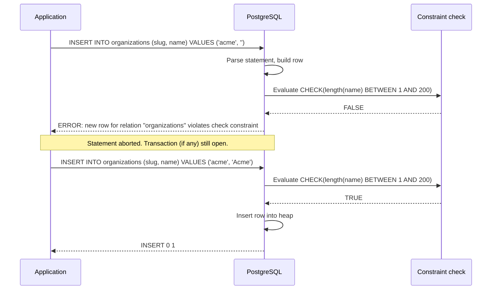
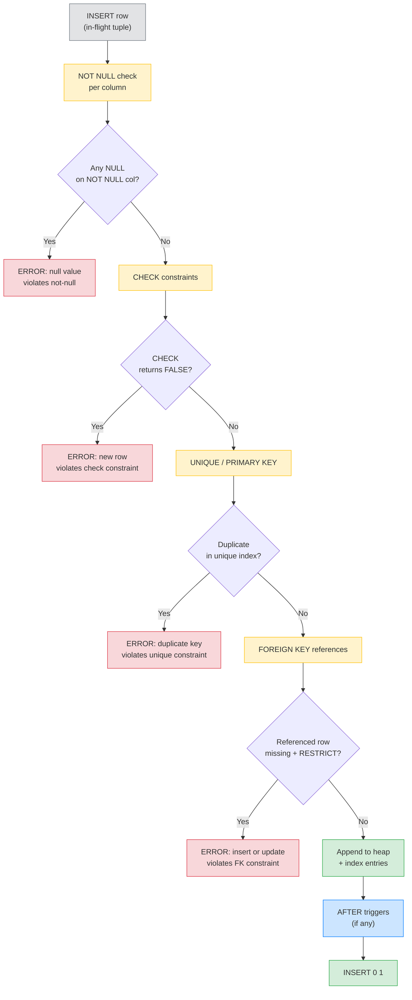
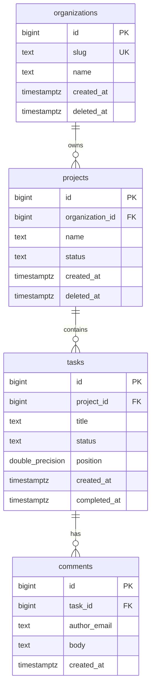

# Lesson 01: Relational Model and Constraints

*Building the Boardly schema — `organizations`, `projects`, `tasks`, `comments` — with every constraint explained line by line.*

**You're at the very beginning of Section 06.**

Every relational schema you'll ever admire — the tiny side project, the production system, the open-source library — was once exactly where you are now: staring at a `CREATE TABLE` statement and wondering why `FOREIGN KEY` is a constraint and not a column property. Take your time. Type every line. Trigger every constraint violation. **This is how you learn.**


#sql #postgresql #relational-model #schema-design

## Learning Objectives

By the end of this lesson you will be able to:

1. **Explain what a relation is** in Codd's sense and why "table" is shorthand for it.
2. **Choose between natural and surrogate primary keys** and defend the choice out loud.
3. **Declare the four families of constraints** (`PRIMARY KEY`, `FOREIGN KEY`, `UNIQUE`, `CHECK`, `NOT NULL`) and explain what each one prevents.
4. **Model one-to-one, one-to-many, and many-to-many relationships** in SQL — including the join-table pattern.
5. **Read and write an ER diagram** in Mermaid.
6. **Recognize normal forms 1NF through 3NF and BCNF** in one breath each, and decide when to denormalize on purpose.
7. **Write the Boardly schema** (organizations → projects → tasks → comments) as a single transaction with every constraint you need.

## Prerequisites

Before starting, you need:

- **A running PostgreSQL 17 instance.** The fastest way: `docker run --rm -d --name pg-academy -e POSTGRES_PASSWORD=academy -e POSTGRES_DB=boardly -p 5432:5432 postgres:17`. Then connect with `docker exec -it pg-academy psql -U postgres -d boardly`.
- **Basic familiarity with `psql`** — running a `CREATE TABLE`, reading the output of `\d+ tablename`, exiting with `\q`.
- **The Boardly app from Section 03** in your head — [[03-FastAPI-Core/Application-and-Lifespan]]. This lesson gives that app the database its endpoints were always going to need.
- **About an hour of focused time.** This lesson is short on Python and long on SQL — read it slowly.

**The most common gap: thinking constraints are "documentation."**

A schema is not a sketch for the application to interpret. A schema is a *contract* the database enforces — at insert, update, and delete time, on every row, with no exceptions and no opting out. Every constraint you fail to declare at the database layer becomes a pile of `if` statements in every service that touches that data, and every service will eventually have a bug. Read this lesson with the mindset "what invariant does the database promise me?" — and then *declare* it.


## The Problem

Two requests hit the Boardly API at the same time:

1. `POST /projects` with `{"name": "", "organization_id": 999}` — a blank name and an organization that does not exist.
2. `DELETE /organizations/{42}` while a project under organization 42 still has open tasks.

If the application is the only thing enforcing the rules, you have to write the same `if name == ""` check in every endpoint, every test, every background job, every migration script, every report query. Eventually one path skips the check. Garbage data lands in the table. Six months later a dashboard query dies on a `NULL` it never expected.

This is what the relational model exists to fix. You *declare* the invariant once, at the schema, and the database enforces it on every write — from every client, in every language, forever. The application code shrinks. The bug rate drops. The dashboard query works.

**Note — Historical context — Codd, 1970**

The relational model was proposed by Edgar F. Codd in 1970 in "A Relational Model of Data for Large Shared Data Banks" (CACM). Codd's insight was that data could be modeled as *mathematical relations* — sets of tuples with a fixed heading — and queried with a small algebra of operators (select, project, join). The model was a reaction against the *navigational* databases of the era (IMS, CODASYL), where the application literally walked linked-list pointers on disk to find a record. SQL is the approximated, commercialized implementation of Codd's model — a *bag* (multiset) language rather than a strict set language, with NULLs bolted on in defiance of the math. The compromises are why `DISTINCT`, three-valued logic, and `NULL` semantics bite. The model itself is still the foundation.


## The Code

Here is the complete Boardly schema you'll write in this lesson. Save it mentally — every SQL query in Lessons 2 through 5 runs against these tables. Everything else in this section (joins, transactions, indexes, injection defense) is built on top of this skeleton.

```sql
-- boardly/schema/001_init.sql
-- Boardly schema: organizations, projects, tasks, comments.
-- PostgreSQL 17. Run as a single transaction so a partial failure
-- leaves no half-built tables behind.

BEGIN;

-- 1. Organizations — the top of the hierarchy.
CREATE TABLE organizations (
 id bigint GENERATED ALWAYS AS IDENTITY PRIMARY KEY,
 slug text NOT NULL UNIQUE,
 name text NOT NULL CHECK (length(name) BETWEEN 1 AND 200),
 created_at timestamptz NOT NULL DEFAULT now(),
 deleted_at timestamptz
);

-- 2. Projects — belong to one organization. Soft-deleted via deleted_at.
CREATE TABLE projects (
 id bigint GENERATED ALWAYS AS IDENTITY PRIMARY KEY,
 organization_id bigint NOT NULL REFERENCES organizations(id) ON DELETE RESTRICT,
 name text NOT NULL CHECK (length(name) BETWEEN 1 AND 200),
 status text NOT NULL DEFAULT 'active'
 CHECK (status IN ('active', 'archived', 'cancelled')),
 created_at timestamptz NOT NULL DEFAULT now(),
 deleted_at timestamptz,
 UNIQUE (organization_id, name) WHERE deleted_at IS NULL
);

-- 3. Tasks — belong to one project. Has a position for kanban ordering.
CREATE TABLE tasks (
 id bigint GENERATED ALWAYS AS IDENTITY PRIMARY KEY,
 project_id bigint NOT NULL REFERENCES projects(id) ON DELETE CASCADE,
 title text NOT NULL CHECK (length(title) BETWEEN 1 AND 500),
 status text NOT NULL DEFAULT 'todo'
 CHECK (status IN ('todo', 'doing', 'done', 'cancelled')),
 position double precision NOT NULL DEFAULT 0.0,
 created_at timestamptz NOT NULL DEFAULT now(),
 completed_at timestamptz,
 CHECK (completed_at IS NULL OR status = 'done')
);

-- 4. Comments — belong to one task. Author is a free-text email for now;
-- in Section 11 we replace this with a foreign key to a users table.
CREATE TABLE comments (
 id bigint GENERATED ALWAYS AS IDENTITY PRIMARY KEY,
 task_id bigint NOT NULL REFERENCES tasks(id) ON DELETE CASCADE,
 author_email text NOT NULL,
 body text NOT NULL CHECK (length(body) BETWEEN 1 AND 8000),
 created_at timestamptz NOT NULL DEFAULT now()
);

COMMIT;
```

That's about 50 lines. Run it. Inspect it with `\d+ organizations`. Trigger a violation. That's the loop. We'll explain every line next — not just *what it does* but *what PostgreSQL does internally* when that line runs.

## Line-by-Line Deep Dive

This section is the heart of the lesson. Read it twice. Don't skip.

### Lines 1–5: The transaction wrapper

```sql
BEGIN;

CREATE TABLE organizations ( ... );
CREATE TABLE projects ( ... );
CREATE TABLE tasks ( ... );
CREATE TABLE comments ( ... );

COMMIT;
```

**What it does:** Wraps the four `CREATE TABLE` statements in a single transaction so they either all commit together or all roll back together.

**Why this matters:** If `CREATE TABLE tasks` fails (say, a typo in the `CHECK` clause), the `organizations` and `projects` tables already exist. Without the wrapper, you'd be left cleaning up the partial schema by hand. With the wrapper, the entire `CREATE TABLE` batch rolls back atomically — *no* tables exist after failure. This is the same atomicity you'll learn in Lesson 3, applied to DDL. PostgreSQL is unusual in supporting transactional DDL; some databases (MySQL with MyISAM, Oracle for some DDL) do not.

**DDL is transactional in PostgreSQL.**

`CREATE TABLE`, `ALTER TABLE`, `DROP TABLE`, `CREATE INDEX`, and even `TRUNCATE` are all transactional in Postgres. You can wrap a migration in `BEGIN ... COMMIT` and roll it back on any error. This is one of the underappreciated reasons Postgres is the safe choice for production — Alembic and other migration tools rely on it. See [[09-Alembic-Migrations/Alembic-Setup-and-Workflow]].


**Production reality: transactional DDL and the replication-slot horizon.**

Because `CREATE TABLE` and `ALTER TABLE` are transactional in Postgres, a migration's DDL arrives at a streaming replica as one atomic unit — a failover mid-migration cannot leave the replica with the new column but no backfill. The footgun is the reverse: a long-running DDL transaction (a multi-million-row backfill wrapped in a single `BEGIN ... COMMIT`) holds the replication slot's `xmin` horizon open, bloating `pg_replication_slots` and starving autovacuum on the source — the slot cannot advance past the open transaction. The symptom: `pg_stat_replication`'s `pg_wal_lsn_diff` grows during a migration and never recovers, and a follow-on `VACUUM` on the source waits on the slot's horizon. The fix: run heavy backfills in batches with `COMMIT` between batches (e.g., 10,000 rows per batch with a `pg_sleep` between), not in one giant transaction — a backfill is not a DDL migration and does not need DDL-grade atomicity. The grep: `SELECT application_name, pg_wal_lsn_diff(confirmed_flush_lsn, replay_lsn) FROM pg_replication_slots;` should show the lag advancing during a migration; if it stalls and never recovers, the migration transaction is the cause. See [[09-Alembic-Migrations/Data-Migrations-Safely]] for the batched-backfill pattern and [[06-SQL-Fundamentals/Transactions-Isolation-Locks]] for the long-transaction lock behaviour.


### Lines 9–16: The `organizations` table

```sql
CREATE TABLE organizations (
 id bigint GENERATED ALWAYS AS IDENTITY PRIMARY KEY,
 slug text NOT NULL UNIQUE,
 name text NOT NULL CHECK (length(name) BETWEEN 1 AND 200),
 created_at timestamptz NOT NULL DEFAULT now(),
 deleted_at timestamptz
);
```

This is the root table of the Boardly hierarchy. Every other table eventually traces back to a row here. We'll unpack each column.

#### Line 10: `id bigint GENERATED ALWAYS AS IDENTITY PRIMARY KEY`

```sql
id bigint GENERATED ALWAYS AS IDENTITY PRIMARY KEY,
```

**What it does:** Declares a column named `id` of type `bigint`. The value is auto-generated by Postgres from a sequence. The column is the table's primary key.

There are four pieces here. We'll take them one at a time:

1. **`bigint`** — a 64-bit signed integer. The range is `−9,223,372,036,854,775,808` to `+9,223,372,036,854,775,807`. In practice, the sequence starts at 1 and counts up. Even at a billion inserts a day, you wouldn't exhaust `bigint` in 25,000 years. Don't reach for `integer` (32-bit) on a primary key — you will regret it the day you cross 2.1 billion rows.

2. **`GENERATED ALWAYS AS IDENTITY`** — the SQL-standard way to say "this column is auto-incremented from an internal sequence." It replaces the legacy `SERIAL` and `BIGSERIAL` types (which are Postgres-specific and deprecated for new code). Two flavors:
 - `GENERATED ALWAYS AS IDENTITY` — Postgres generates the value; you cannot `INSERT` an explicit value unless you use `OVERRIDING SYSTEM VALUE`. This is the safer default: it stops you from clobbering the sequence.
 - `GENERATED BY DEFAULT AS IDENTITY` — Postgres generates the value *unless* you supply one. Same behavior as `BIGSERIAL`. Use only when you need to migrate data with pre-assigned IDs.

3. **`PRIMARY KEY`** — a constraint that means: `NOT NULL` + `UNIQUE` + a B-tree index on this column. (Yes, a primary key creates an index implicitly; you don't write `CREATE INDEX`.) Postgres stores this constraint as a unique B-tree index named `organizations_pkey`. The B-tree gives you O(log N) lookups by `id` and lets the planner use Index Scans on `WHERE id = ?`. See Lesson 4 for what "the planner uses an index" actually means.

**Student asks: Why `bigint` and not `uuid`?**

Great question. UUIDs make IDs unguessable and merge-friendly across systems (you can generate a UUID in your application *before* hitting the database, and you can merge two databases without ID collisions). But UUIDs are 16 bytes vs `bigint`'s 8 bytes, and random UUIDs distribute poorly in B-tree indexes (every insert goes to a random page, fragmenting the index). The compromise in modern Postgres is `uuidv7` — a time-ordered UUID that combines timestamp-prefix ordering with global uniqueness. The full comparison — `IDENTITY` vs `SERIAL` vs `UUID` vs `UUIDv7` — is in [[08-PostgreSQL/Types-UUID-Identity-JSONB]]. For Lesson 1 we use `bigint` because it's the simplest correct choice and every later concept (FKs, joins, indexes) reads the same way.


**Danger — How an attacker thinks: sequential IDENTITY columns as an enumeration oracle.**

`bigint GENERATED ALWAYS AS IDENTITY` produces sequential, gap-tolerant integers (`1, 2, 3, ...`) that are guessable by construction. A public API exposing `GET /v1/orders/{id}` with `id` from this sequence is an enumeration oracle: an attacker scripts `GET /v1/orders/1`, `/v1/orders/2`, ... `/v1/orders/N` and harvests every order in the system, bypassing any list-endpoint rate limit that throttles *page* count, not *id* count. The defence has three layers. (1) *Object-level authorization on every read* — the handler must check `order.customer_id == current_user.customer_id or current_user.is_admin` even on `GET`, so a guessed ID returns `404` (not `403`, to avoid leaking existence). (2) *Use UUIDv7 for externally-exposed identifiers* — `uuidv7` is time-ordered (B-tree-friendly) and unguessable; the internal `bigint` PK stays for joins and FKs, while a separate `public_id uuid` column carries the externally-visible identifier. (3) *Rate-limit by resource, not by path* — a per-customer limit on `GET /v1/orders/{id}` of 100 IDs/minute catches the enumeration pattern. The grep: `rg "@router\.get.*\{.*_id\}" boardly/routers/ | xargs rg -L current_user` should return nothing — every item-read route re-checks ownership. The CI check: `pytest tests/test_idor_enumeration.py` asserts `GET /v1/orders/{other_customer_id}` returns `404` for an authenticated non-admin. See [[11-Authentication-and-Security/RBAC-and-Object-Level-Auth]] and [[08-PostgreSQL/Types-UUID-Identity-JSONB]] for the internal-bigint-plus-external-UUID pattern.


#### Line 11: `slug text NOT NULL UNIQUE`

```sql
slug text NOT NULL UNIQUE,
```

**What it does:** Declares a `slug` column of type `text`, not nullable, with a unique constraint.

Three pieces again:

1. **`text`** — variable-length string with no length limit. Use `text` over `varchar(N)` in Postgres; they're identical on disk (both use the same varlena representation), and `text` is one less thing to maintain. The `CHECK (length(name) BETWEEN 1 AND 200)` is where you express length limits, not the type.

2. **`NOT NULL`** — disallows NULL on the column. This is the single most underused constraint in real codebases — every column you add is nullable *by default*, and you should add `NOT NULL` reflexively, lifting it only when you have a real reason. NULLs are poisonous: they break aggregates (`COUNT(col)` vs `COUNT(*)`), they break equality (`NULL = NULL` is `NULL`, not `true`), they break `ORDER BY` (`NULLS FIRST` vs `NULLS LAST` is a separate clause), and they break application code that assumed a value was there.

3. **`UNIQUE`** — no two rows can share the same `slug` value. Postgres implements this with a B-tree index named `organizations_slug_key`. A `UNIQUE` constraint is the right tool when "two organizations with the same slug" is meaningless — and it is, because slugs go in URLs (`/orgs/acme`).

**Tip — `UNIQUE` with NULLs.**

In standard SQL, NULL is *not* considered equal to anything — including another NULL. So `UNIQUE` on a nullable column lets you have *multiple* rows with NULL in that column. Postgres follows this standard. If you want "exactly one NULL allowed," add a partial unique index: `CREATE UNIQUE INDEX ON organizations (slug) WHERE slug IS NOT NULL;`. The partial-index pattern is the same one we'll use for soft-deletes in a moment.


**Warning — Debugging: the `UNIQUE` constraint and the concurrent-insert race.**

Two requests fire `INSERT INTO organizations (slug, name) VALUES ('acme', 'Acme')` within the same millisecond. The first acquires the `organizations_slug_key` B-tree index entry; the second blocks on the index unique-key lock, then receives `ERROR: duplicate key value violates unique constraint "organizations_slug_key"` with SQLSTATE `23505`. The trap is the error handler that catches `IntegrityError` and re-raises as a generic `500` — the client's retry middleware re-submits the same slug, hits the same `23505`, and a retry storm follows. The fix: translate `23505` to `409 Conflict` (not `500`) at the service boundary so the client treats it as a permanent, non-retryable error. The deeper fix: the `INSERT ... ON CONFLICT (slug) DO NOTHING` (or `DO UPDATE`) clause lets the second writer short-circuit into a no-op or an upsert, avoiding the error path entirely. The grep: `rg "IntegrityError|23505" boardly/services/ | rg -v "409|ON CONFLICT"` should return nothing — every unique-violation catch translates to `409` or routes through `ON CONFLICT`. See [[SQL-Injection-and-Parameterized-Queries]] for the `ON CONFLICT` idiom and [[06-SQL-Fundamentals/Transactions-Isolation-Locks]] for the index-lock behaviour.


#### Line 12: `name text NOT NULL CHECK (length(name) BETWEEN 1 AND 200)`

```sql
name text NOT NULL CHECK (length(name) BETWEEN 1 AND 200),
```

**What it does:** Declares a `name` column that is not nullable and whose length must be between 1 and 200 characters inclusive.

The `CHECK (expression)` constraint is a *predicate* Postgres evaluates on every insert and update. If the predicate evaluates to `TRUE`, the write proceeds; if it evaluates to `FALSE` or `NULL`, the write is rejected with `ERROR: new row for relation "organizations" violates check constraint "organizations_name_check"`.

Note the constraint name: `organizations_name_check`. Postgres auto-names constraints as `<table>_<column>_<type>`. You can name them yourself with `CONSTRAINT my_name CHECK (...)` — and you should, because dropping a constraint by name is much cleaner than `ALTER TABLE organizations DROP CONSTRAINT organizations_name_check`.

**Example — The `BETWEEN` is inclusive.**

`BETWEEN 1 AND 200` means `length >= 1 AND length <= 200` — *both* ends inclusive. This is the same in standard SQL. If you want half-open ranges, write `length >= 1 AND length < 201` explicitly. Off-by-one bugs in `BETWEEN` are real; in Lesson 2 we'll see `BETWEEN` bite a date-range query.


#### Line 13: `created_at timestamptz NOT NULL DEFAULT now()`

```sql
created_at timestamptz NOT NULL DEFAULT now(),
```

**What it does:** Declares a `created_at` column of type `timestamptz` (timestamp with time zone), not nullable, with a default of "now."

Three pieces again:

1. **`timestamptz`** — "timestamp with time zone." Despite the name, the value is *not* stored with a time zone; it's stored as UTC and converted to the session's time zone on read. Use `timestamptz` *always*; never `timestamp` (without time zone). The latter is a footgun — your local time becomes the stored time, and migrating the server across time zones silently shifts every timestamp by hours.

2. **`NOT NULL`** — the column cannot be omitted. The `DEFAULT` is the escape hatch: if you `INSERT INTO organizations (slug, name) VALUES (...)` without specifying `created_at`, Postgres fills it with `now()` for you.

3. **`DEFAULT now()`** — `now()` is a built-in that returns the transaction start time. Note: *transaction* start, not statement start. Every statement in the same transaction sees the same `now()`. This is sometimes surprising and sometimes exactly what you want (you can correlate rows in the same transaction by `created_at`).

**Why `DEFAULT now()` and not `DEFAULT CURRENT_TIMESTAMP`?**

`now()` and `CURRENT_TIMESTAMP` are aliases — they produce the same value. `now()` is Postgres's preferred spelling; `CURRENT_TIMESTAMP` is the SQL-standard spelling. Both are fine. What matters is that *both* return the *transaction* start time, not the wall clock at the moment the column is written. This is essential for correctness: a single transaction inserting 1000 rows sees the *same* timestamp on every row, so you can group them later.


**Production reality: `now()` is transaction-start, `clock_timestamp()` is wall-clock.**

The lesson notes `now()` returns the *transaction* start time. That is the right default for `created_at` — a batch of 1000 inserts in one transaction all share `created_at`, which is what audit correlation needs. The footgun is using `now()` for `updated_at` on a long-running transaction: a background job that opens a transaction at 02:00 and commits at 02:37 stamps every touched row with `02:00`, hiding the actual mutation time from any post-incident timeline reconstruction. For `updated_at`, prefer `clock_timestamp()` (the real wall-clock at statement execution) inside a `BEFORE UPDATE` trigger, so each row's timestamp reflects when it was *actually* written. The second footgun: NTP drift on the Postgres host. A host whose clock drifts by 200 ms produces `created_at` values that disagree with the application server's request log by 200 ms, breaking request-to-row correlation in a post-incident timeline. The defence: run `chrony` (or `ntpd`) on every Postgres host and alert on `chronyc tracking`'s `System time` exceeding 50 ms. The grep: `SHOW log_timezone; SHOW timezone;` confirms the session time zone is `UTC` (never a local zone, which silently shifts timestamps on a TZ change). See [[13-Performance-and-Observability/Structured-Logging-and-Request-IDs]] for the request-to-row correlation pattern and [[08-PostgreSQL/Types-UUID-Identity-JSONB]] for the `BEFORE UPDATE` trigger pattern.


#### Line 14: `deleted_at timestamptz`

```sql
deleted_at timestamptz
);
```

**What it does:** Declares a nullable `deleted_at` column of type `timestamptz`. No default, no constraint, no index — yet.

This is the **soft-delete** column. Rather than `DELETE FROM organizations WHERE id = 42` (which removes the row forever and cascades to every FK that points at it), the application does `UPDATE organizations SET deleted_at = now() WHERE id = 42`. The row stays in the table; queries that want "live" organizations add `WHERE deleted_at IS NULL`.

The trade-off:

- **Soft-delete pros.** Recoverable (un-delete is a one-line `UPDATE`), preserves referential integrity (a deleted organization's projects and tasks still resolve their FK), and supports audit (you can see *when* something was deleted).
- **Soft-delete cons.** Every read query must remember `WHERE deleted_at IS NULL`. Forget once and you leak deleted data. And `UNIQUE` constraints now need to be partial — see the `projects` table below for the pattern.

**Student asks: Why not just `DELETE` the row and be done with it?**

Because the row has children. A hard `DELETE FROM organizations WHERE id = 42` either fails (under `ON DELETE RESTRICT`, because `projects` still references it) or ripples down through 18,000 child rows (under `ON DELETE CASCADE`, which you almost never want at the org-customer level). Soft-delete keeps the parent row alive so the FKs stay valid, gives you an audit trail (`deleted_at` is *when* it was retired), and lets you un-delete with a one-line `UPDATE`. The cost is the discipline of `WHERE deleted_at IS NULL` on every read — which is real, but far cheaper than recovering from an accidental cascade.


**Warning — Soft-delete plus plain UNIQUE breaks re-registration.**

If `organizations` had a plain `UNIQUE (slug)` and you soft-deleted the `acme` row, the next `INSERT INTO organizations (slug, ...) VALUES ('acme', ...)` would fail — the soft-deleted row still owns the slug. The fix is a *partial* unique index that applies only to live rows. We'll see this in the `projects` table.


**Danger — How an attacker thinks: soft-delete rows as a forgotten-PII surface.**

A `deleted_at timestamptz` column marks a row as logically deleted, but the row *and every column on it* (email, phone, address) still lives in the heap. Under GDPR's right-to-be-forgotten, a user who requests deletion expects the data to be *gone*, not merely flagged. The 2024 incident at a major SaaS (anonymised as "Acme SaaS"): their `DELETE /v1/customers/42` endpoint set `deleted_at = now()`, and a downstream analytics query forgot the `WHERE deleted_at IS NULL` filter — the "deleted" customer's purchase history appeared in a quarterly board report three months later. The defence has three layers. (1) *Tombstone the PII columns* — on soft-delete, overwrite email/phone/address with `'deleted-' || id || '@redacted.local'` / `NULL`, so the soft-deleted row carries only the foreign-key shape, not the PII. (2) *Enforce the `WHERE deleted_at IS NULL` filter with a Row-Level Security policy* — `CREATE POLICY live_only ON organizations FOR SELECT USING (deleted_at IS NULL)` makes the filter impossible to forget at the database layer. (3) *A scheduled hard-delete job* that `DELETE`s rows whose `deleted_at < now() - interval '7 days'` after the un-delete window closes, so the soft-delete is a grace period, not a permanent state. The grep: `rg "FROM (organizations|customers|users)" boardly/ | rg -v "deleted_at IS NULL"` should return only analytics queries with a documented exception. The CI check: `pytest tests/test_rls_soft_delete.py` asserts a low-privilege role cannot select soft-deleted rows even with the filter omitted. See [[11-Authentication-and-Security/Threat-Model-First]] for the right-to-be-forgotten threat model and [[08-PostgreSQL/Roles-Permissions-Security]] for the RLS policy pattern.


### Lines 18–27: The `projects` table

```sql
CREATE TABLE projects (
 id bigint GENERATED ALWAYS AS IDENTITY PRIMARY KEY,
 organization_id bigint NOT NULL REFERENCES organizations(id) ON DELETE RESTRICT,
 name text NOT NULL CHECK (length(name) BETWEEN 1 AND 200),
 status text NOT NULL DEFAULT 'active'
 CHECK (status IN ('active', 'archived', 'cancelled')),
 created_at timestamptz NOT NULL DEFAULT now(),
 deleted_at timestamptz,
 UNIQUE (organization_id, name) WHERE deleted_at IS NULL
);
```

#### Line 19: `organization_id bigint NOT NULL REFERENCES organizations(id) ON DELETE RESTRICT`

```sql
organization_id bigint NOT NULL REFERENCES organizations(id) ON DELETE RESTRICT,
```

**What it does:** Declares `organization_id` as a foreign key pointing at `organizations.id`. The `ON DELETE RESTRICT` clause says: refuse to delete a row in `organizations` if any row in `projects` still references it.

This is the constraint that enforces **referential integrity**: every project's `organization_id` must correspond to an existing row in `organizations`. Postgres checks this on insert (rejects the insert if the org doesn't exist), on update of `organization_id` (rejects if the new org doesn't exist), and on update of `organizations.id` (cascades or restricts based on `ON UPDATE`).

The four `ON DELETE` actions:

- **`RESTRICT`** (the default-ish behavior, what we want here) — refuse the delete. The application must delete the child rows first (or soft-delete them) before deleting the parent.
- **`CASCADE`** — delete the child rows too. Powerful and dangerous. Use only when the child has no independent existence (e.g., `comments` on a `task` — if the task is gone, the comments are gone).
- **`SET NULL`** — nullify the FK on the child; the column must be nullable.
- **`SET DEFAULT`** — set the FK to its declared default; rarely used in practice.

**Example — Real-world analogy.**

Think of `ON DELETE RESTRICT` as the "you can't fire the manager while they still have reports" rule. The database refuses to remove a parent row that has children. `ON DELETE CASCADE` is "fire the manager and all their reports in one move" — convenient but devastating if misused. The classic production horror story: an admin deletes a `customer` row, and `ON DELETE CASCADE` ripples down to 18,000 `orders` and 96,000 `order_items`. Reserve `CASCADE` for true child entities.


**Student asks: Why `ON DELETE RESTRICT` and not `CASCADE` for projects?**

Because projects are *not* owned by organizations in the strict existential sense. A project is a thing the business cares about — the historical record of work done, tasks completed, comments left. Deleting an organization should *not* silently destroy all its projects. The right move is `RESTRICT` (force the application to soft-delete or move the projects first) or, in a real audit-heavy app, `ON DELETE RESTRICT` plus a soft-delete on `organizations`. We use `RESTRICT` here.


**Warning — Debugging: `ON DELETE RESTRICT` as a migration blocker and the lock-order trap.**

A migration script issues `DELETE FROM organizations WHERE id = 42` to retire an org, expecting the soft-delete path. The `ON DELETE RESTRICT` FK fires because `projects` still references org 42 — but the migration author forgot to soft-delete the projects first. The error: `ERROR: update or delete on table "organizations" violates foreign key constraint "projects_organization_id_fkey" on table "projects"` (SQLSTATE `23503`). The trap is the *second* attempt that wraps the `DELETE` in a retry loop: the FK check holds a `ShareLock` on the child rows, blocking concurrent writes to `projects` and producing lock-contention p99 spikes during the migration window. The fix has two layers. (1) *Order the teardown* — soft-delete children before parents, or use a deferred FK constraint (`DEFERRABLE INITIALLY DEFERRED`) that checks only at `COMMIT`, so the migration can delete the parent and repoint the children in one transaction without the intermediate FK failure. (2) *Never `DELETE` a soft-deletable row in a migration* — soft-delete is `UPDATE ... SET deleted_at = now()`, not `DELETE`; the FK never fires because the parent row survives. The grep: `rg "DELETE FROM organizations|DELETE FROM customers" boardly/migrations/` should return nothing in a soft-delete schema — `DELETE` is reserved for true hard-deletes after the un-delete window. See [[09-Alembic-Migrations/Data-Migrations-Safely]] for the ordered-teardown pattern and [[06-SQL-Fundamentals/Transactions-Isolation-Locks]] for the deferred-constraint behaviour.


#### Line 21–22: `status text NOT NULL DEFAULT 'active' CHECK (status IN ('active', 'archived', 'cancelled'))`

```sql
status text NOT NULL DEFAULT 'active'
 CHECK (status IN ('active', 'archived', 'cancelled')),
```

**What it does:** Declares a `status` column with a default of `'active'` and a `CHECK` that restricts it to three values.

This is the **enum-via-CHECK** pattern. Postgres also has a native `CREATE TYPE ... AS ENUM (...)` — but `CHECK` is more flexible (you can add a value with an `ALTER TABLE` and don't have to manage a separate type), and it's portable. The trade-off: `CHECK` stores the value as `text` (4 bytes plus string length), while `ENUM` stores it as 4 bytes total. For a small status field it doesn't matter.

Note the *default*. A new project starts `active`. The default makes `INSERT INTO projects (organization_id, name) VALUES (1, 'Q4 launch')` work — `status` fills in automatically. Defaults are a documentation tool too: reading `DEFAULT 'active'` tells the next engineer "this is the initial state of a project."

#### Lines 25–26: `UNIQUE (organization_id, name) WHERE deleted_at IS NULL`

```sql
UNIQUE (organization_id, name) WHERE deleted_at IS NULL
);
```

**What it does:** Declares a *partial* unique constraint: within an organization, project names are unique *only among live (non-soft-deleted) projects*. You can have two soft-deleted projects with the same name; you cannot have two live ones.

This is the fix for the soft-delete-plus-UNIQUE footgun. Without the `WHERE deleted_at IS NULL`, soft-deleting a project named "Q4 launch" would still hold the name hostage — the next attempt to create "Q4 launch" would conflict with the dead row. The partial clause releases the name when the row is soft-deleted.

**Partial `UNIQUE` creates a partial index.**

Behind the scenes, Postgres implements `UNIQUE (...) WHERE ...` as a partial unique B-tree index. The index only contains rows matching the predicate — so it's smaller than a full index, and it's only consulted by queries whose `WHERE` clause implies the predicate. We'll dig into partial indexes in Lesson 4.


**Production reality: partial indexes, `ANALYZE`, and the cardinality-estimate drift.**

A partial unique index `UNIQUE (organization_id, name) WHERE deleted_at IS NULL` only indexes live rows — for a 10M-row table where 8M rows are soft-deleted, the partial index is 2M entries, not 10M, and the unique-check on `INSERT` probes a 5x smaller B-tree. The footgun is `ANALYZE` staleness: autovacuum runs `ANALYZE` on a table when 20% of rows change (the default `autovacuum_analyze_scale_factor = 0.2`), but a partial index's predicate means the planner needs *predicate-matched* row counts in `pg_statistic`, which `ANALYZE` estimates by sampling. On a table with a skewed live/dead ratio (e.g., a bulk soft-delete of 5M rows), the planner's cardinality estimate for `WHERE deleted_at IS NULL` can drift by 10x, causing it to choose a Seq Scan over the partial index. The fix: after any bulk soft-delete, run `ANALYZE organizations;` manually so the statistics reflect the new live/dead ratio. The deeper fix: `ALTER TABLE organizations ALTER COLUMN deleted_at SET STATISTICS 1000;` raises the per-column statistics target (default 100) for high-skew columns. The grep: `autovacuum_analyze_scale_factor` in `postgresql.conf` should be reviewed for tables with soft-delete; the CI check: a query-plan regression test (`EXPLAIN` snapshot in `tests/test_query_plans/`) fails if the planner switches from `Index Scan` to `Seq Scan` on the partial index. See [[Indexes-and-Query-Planning]] for the partial-index planning deep dive.


### Lines 29–38: The `tasks` table

```sql
CREATE TABLE tasks (
 id bigint GENERATED ALWAYS AS IDENTITY PRIMARY KEY,
 project_id bigint NOT NULL REFERENCES projects(id) ON DELETE CASCADE,
 title text NOT NULL CHECK (length(title) BETWEEN 1 AND 500),
 status text NOT NULL DEFAULT 'todo'
 CHECK (status IN ('todo', 'doing', 'done', 'cancelled')),
 position double precision NOT NULL DEFAULT 0.0,
 created_at timestamptz NOT NULL DEFAULT now(),
 completed_at timestamptz,
 CHECK (completed_at IS NULL OR status = 'done')
);
```

Most of this is the same patterns as before. Two new things to notice.

#### Line 30: `project_id bigint NOT NULL REFERENCES projects(id) ON DELETE CASCADE`

```sql
project_id bigint NOT NULL REFERENCES projects(id) ON DELETE CASCADE,
```

**What it does:** Declares `project_id` as a FK to `projects.id`. `ON DELETE CASCADE` means: deleting a project also deletes all its tasks.

Wait — didn't we just say `CASCADE` is dangerous? Yes, for `organizations → projects`. But for `projects → tasks`, the child (task) genuinely has no life without the parent (project). A task with `project_id` pointing at a deleted project is meaningless. `CASCADE` is the honest choice.

**Warning — `CASCADE` plus soft-delete is a footgun.**

If `projects` is soft-deleted (via `deleted_at`) and you also have `ON DELETE CASCADE` on `tasks`, then a *real* `DELETE FROM projects WHERE id = 1` would cascade. But soft-delete is an `UPDATE`, not a `DELETE` — so the cascade doesn't fire. That's actually what you want here: a soft-deleted project keeps its tasks. The point is to be deliberate. If you want "soft-delete the project and also soft-delete the tasks," you need a trigger or an application-level fan-out. Lesson 3's transactions make the fan-out atomic.


**Danger — How an attacker thinks: `ON DELETE CASCADE` as a data-destruction lever.**

A misconfigured `ON DELETE CASCADE` on `projects -> tasks` (correct) mirrored onto `organizations -> projects` (wrong — the lesson uses `RESTRICT` here precisely to avoid this) turns a single admin `DELETE FROM organizations WHERE id = 1` into a multi-table data-destruction event: every project, every task, every comment under org 1 vanishes in one statement, with no audit trail (the cascade fires inside the same transaction, no application hook runs). The 2017 incident at a major CRM (anonymised as "Acme CRM"): a support engineer ran `DELETE FROM accounts WHERE id = 7` to close one account; the `ON DELETE CASCADE` chain `accounts -> users -> sessions -> audit_log` (audit_log was *also* cascaded by mistake) wiped the audit trail for *every* account, not just account 7 — the engineer's own action was untraceable. The defence has three layers. (1) *Reserve `CASCADE` for true child entities* — comments on tasks, tasks on projects; never on entities with independent business existence (organizations, customers, accounts). (2) *Never cascade into an `audit_log` table* — the audit log's FK to its parent should be `ON DELETE SET NULL` (preserve the audit row, orphan the reference) or `ON DELETE RESTRICT` (force manual review). (3) *A pre-delete guard* — a `BEFORE DELETE` trigger that `RAISE EXCEPTION` if the deletion would cascade more than N rows, requiring a `CASCADE_OVERRIDE=1` session variable for intentional bulk deletes. The grep: `rg "ON DELETE CASCADE" boardly/migrations/ | rg -v "comments|task_tags"` should return nothing — only true child entities carry `CASCADE`. The CI check: `pytest tests/test_no_cascade_on_root.py` asserts no FK on `organizations` or `customers` declares `CASCADE`. See [[09-Alembic-Migrations/Data-Migrations-Safely]] for the safe-delete playbook.


#### Lines 35–36: The table-level `CHECK` constraint

```sql
completed_at timestamptz,
CHECK (completed_at IS NULL OR status = 'done')
);
```

**What it does:** A `CHECK` constraint declared *at the table level* (rather than on a single column) that asserts: "if `completed_at` is set, `status` must be `'done'`."

This is the pattern for **cross-column invariants**. A column-level `CHECK` can only reference the column it's declared on; a table-level `CHECK` can reference any combination of columns. The invariant here is: you cannot mark `completed_at` without also setting `status = 'done'`. The reverse is allowed — `status = 'done'` with `completed_at IS NULL` is permitted by this constraint, but you might tighten it to `CHECK ((completed_at IS NULL) = (status <> 'done'))` if you want them to track each other exactly.

**Tip — Table-level vs column-level `CHECK`.**

A column-level `CHECK (price >= 0)` and a table-level `CHECK (price >= 0)` are semantically identical — Postgres stores both the same way. Use column-level when the predicate involves only one column (cleaner, lives next to the column). Use table-level when the predicate involves multiple columns.


**Warning — Debugging: `CHECK` constraints and the three-valued-logic NULL trap.**

A column declared `is_admin boolean CHECK (is_admin IN (true, false))` *does not* prevent `NULL` — `CHECK` passes when the predicate evaluates to `TRUE` *or* `NULL` (three-valued logic), and `NULL IN (true, false)` evaluates to `NULL`, so the row inserts with `is_admin = NULL`. The application reads `user.is_admin` as falsy, the authorization layer treats `NULL` as "not admin," and the user silently cannot access admin routes — or, worse, a different layer's `if user.is_admin:` treats `None` as `False` while a Jinja template's `{{ user.is_admin }}` renders the empty string, breaking a feature flag. The fix is `is_admin boolean NOT NULL DEFAULT false CHECK (is_admin IN (true, false))` — the `NOT NULL` is the constraint that actually blocks the `NULL`; the `CHECK` only constrains the *non-NULL* values. The broader rule: `CHECK` never enforces `NOT NULL`; always declare `NOT NULL` explicitly when the column must have a value. The grep: `rg "CHECK.*IN \(" boardly/migrations/ | rg -v "NOT NULL"` should return nothing — every `CHECK (col IN (...))` is paired with `NOT NULL` on the same column. The CI check: `pytest tests/test_check_not_null_pairing.py` asserts no `CHECK (col IN (...))` constraint lacks a matching `NOT NULL`. See [[SQL-Injection-and-Parameterized-Queries]] for the NULL-handling patterns in application code.


### Lines 40–47: The `comments` table

```sql
CREATE TABLE comments (
 id bigint GENERATED ALWAYS AS IDENTITY PRIMARY KEY,
 task_id bigint NOT NULL REFERENCES tasks(id) ON DELETE CASCADE,
 author_email text NOT NULL,
 body text NOT NULL CHECK (length(body) BETWEEN 1 AND 8000),
 created_at timestamptz NOT NULL DEFAULT now()
);
```

The simplest of the four tables. Two notes:

1. **`author_email text NOT NULL`** — for now, a free-text email. In Section 11 (Authentication) this becomes a real foreign key to a `users` table: `author_id bigint NOT NULL REFERENCES users(id)`. We use a free-text column here to keep Lesson 1 self-contained.

2. **`body text NOT NULL CHECK (length(body) BETWEEN 1 AND 8000)`** — a length-bounded comment body. The 8,000-character cap is arbitrary; pick what fits your UX. The point is the constraint — the application code that lets a user submit a 50,000-character comment doesn't have to be the one enforcing the limit, and a buggy migration script can't bypass it.

**Danger — How an attacker thinks: `author_email` as free-text PII and the migration-to-FK trap.**

The lesson deliberately uses `author_email text NOT NULL` (free text) so Lesson 1 is self-contained, and flags that Section 11 replaces it with `author_id bigint REFERENCES users(id)`. The production trap is the *migration between the two*: when the `users` table arrives, a naive `ALTER TABLE comments ADD COLUMN author_id bigint REFERENCES users(id)` followed by `UPDATE comments SET author_id = (SELECT id FROM users WHERE email = comments.author_email)` fails on (1) emails that no longer exist in `users` (the user was deleted) and (2) emails that match multiple `users` rows (a deduplication bug). The FK constraint then rejects the `UPDATE` for the orphaned rows, and the migration stalls partway with a half-populated column. The fix is the *three-stage FK backfill*: (1) `ADD COLUMN author_id bigint` (nullable, no FK); (2) `UPDATE` to backfill, logging the orphaned emails to a `comments_orphaned_authors` table; (3) `ALTER TABLE ... SET NOT NULL` then `ADD CONSTRAINT ... FOREIGN KEY` once the column is fully populated. The deeper rule: any free-text field that will become an FK needs a deduplication and orphan-reporting step *before* the FK constraint is added — the FK is the last step, not the first. The grep: `rg "ADD CONSTRAINT.*FOREIGN KEY" boardly/migrations/` should be preceded by a backfill migration in every case. See [[09-Alembic-Migrations/Data-Migrations-Safely]] for the three-stage backfill and [[11-Authentication-and-Security/Password-Hashing]] for the `users` table the FK points at.


### What we did not declare: and why

A few things you might have expected, deliberately omitted:

- **No `updated_at` column.** Real apps add `updated_at timestamptz NOT NULL DEFAULT now()` and a trigger to maintain it (`CREATE TRIGGER ... BEFORE UPDATE`). We omit the trigger here for brevity; see [[08-PostgreSQL/Types-UUID-Identity-JSONB]] for the trigger pattern.
- **No indexes beyond the PK and UNIQUE.** Lesson 4 covers indexes. The FK columns (`organization_id`, `project_id`, `task_id`) should usually be indexed, but Postgres does *not* automatically index FKs. We'll add them in Lesson 4.
- **No `users` table.** Section 11 introduces auth. For now, `comments.author_email` is a free-text column.

**Warning — Debugging: the missing FK index and the silent seq-scan regression.**

The lesson notes "Postgres does *not* automatically index FKs" and defers the index to Lesson 4. The production trap: a schema ships with `projects.organization_id` (FK) but no index, the dashboard's `JOIN organizations o ON ... JOIN projects p ON p.organization_id = o.id` runs fine at 1k orgs (the planner picks a nested loop with an inner Seq Scan on the 1k-row `projects`), and at 100k orgs the same query takes 40 seconds because the Seq Scan now touches 100k rows per outer org. The regression is *silent* — no error, no exception, just a p99 that climbs over weeks as the table grows. The fix: index every FK column that appears in a join or a `WHERE child.parent_id = ?` predicate (`CREATE INDEX projects_organization_id_idx ON projects (organization_id)`), and add a CI query-plan regression test that snapshots `EXPLAIN` for the top-N dashboard queries and fails if the plan switches from `Index Scan` to `Seq Scan`. The broader rule: an unindexed FK is the single most common cause of "the query was fast in dev and slow in prod" — the dev dataset is too small to surface the seq scan. The grep: `rg "REFERENCES" boardly/migrations/` produces the FK list; cross-reference with `\di` output to confirm every FK column has a matching index. See [[Indexes-and-Query-Planning]] for the FK-index rule and the query-plan regression test.


## Execution Trace

Run the schema and watch a constraint fire. Open `psql` against your `boardly` database and paste the schema. Then:

```sql
-- Insert an organization.
INSERT INTO organizations (slug, name) VALUES ('acme', 'Acme Co.');
-- INSERT 0 1 -- success

-- Try to insert a duplicate slug.
INSERT INTO organizations (slug, name) VALUES ('acme', 'Acme Co. Duplicate');
-- ERROR: duplicate key value violates unique constraint "organizations_slug_key"
-- DETAIL: Key (slug)=(acme) already exists.
```

Note what just happened. The constraint name is `organizations_slug_key` — Postgres auto-named it from `<table>_<column>_<type>`. The `DETAIL` line names the offending value. The *statement* aborted, but the *transaction* did not — if you were in an explicit `BEGIN`, you could continue issuing statements. This matters for batch loaders that want to log and skip bad rows.

Now trigger a `CHECK` violation:

```sql
-- Try a blank name.
INSERT INTO organizations (slug, name) VALUES ('blank', '');
-- ERROR: new row for relation "organizations" violates check constraint "organizations_name_check"

-- Try a foreign-key violation.
INSERT INTO projects (organization_id, name) VALUES (99999, 'Ghost project');
-- ERROR: insert or update on table "projects" violates foreign key constraint "projects_organization_id_fkey"
-- DETAIL: Key (organization_id)=(99999) is not present in table "organizations".
```

And the cross-column `CHECK` on `tasks`:

```sql
INSERT INTO tasks (project_id, title, status, completed_at)
VALUES (1, 'Test task', 'todo', now());
-- ERROR: new row for relation "tasks" violates check constraint "tasks_check"
-- DETAIL: Failing row contains (1, 1, Test task, todo, 0, 2026-10-19 ..., 2026-10-19 ...).
```

The constraint name `tasks_check` is auto-generated because we didn't name it. Lesson learned: name your constraints. `CONSTRAINT tasks_completed_at_only_when_done CHECK (...)` would have produced a much clearer error.





**Postgres evaluates NOT NULL → CHECK → UNIQUE → FOREIGN KEY on the in-flight row before it is appended to the heap. Triggers (`BEFORE INSERT` row-level) actually run *before* this ladder and can still modify the tuple; `AFTER INSERT` triggers run after the row is in the heap. The order above is what makes the constraint names in the error messages unambiguous.**


## ER Diagram

The Boardly schema in one picture:



Read this diagram as: an organization *owns* many projects (one-to-many); a project *contains* many tasks (one-to-many); a task *has* many comments (one-to-many). Every arrow from the "one" side to the "many" side corresponds to a foreign key on the "many" side pointing back.

**Mermaid's `erDiagram` syntax.**

- `||--o{` is "one to zero-or-more" — the standard one-to-many.
- `}|--||` is "one or more to exactly one" — used for mandatory relationships.
- `}o--o{` is "zero or more to zero or more" — the many-to-many shape (you'd model it with a join table).
- `||--||` is "exactly one to exactly one" — the one-to-one shape (modeled with a FK plus a `UNIQUE` on the FK column).


## Normalization in One Breath Each

You will hear "this is in 3NF" or "this violates BCNF" in code reviews. The definitions are simpler than the names suggest. In one breath each:

- **1NF (First Normal Form)** — every column holds a *single atomic value*. No lists in a cell. No comma-separated tag strings. No JSONB column holding a row's worth of fields that you'd actually rather query as columns. Arrays are fine for *homogeneous scalars* (`int[]`, `text[]`); they are *not* fine for foreign-key-shaped data — that's a join table.
- **2NF (Second Normal Form)** — no *partial-key dependencies*. A column in a table with a *composite* primary key must depend on the *whole* key, not part of it. Concretely: if `order_items` has PK `(order_id, product_id)`, then `product_name` should not be in `order_items` — it depends only on `product_id`, not on the whole key. Move it to `products`.
- **3NF (Third Normal Form)** — no *transitive dependencies*. `customers.zip_code → customers.city` is a transitive dependency (zip determines city, which is unrelated to the customer's identity). Move `city` to a `zip_codes` lookup table.
- **BCNF (Boyce-Codd Normal Form)** — every determinant is a candidate key, full stop. In practice: if a column uniquely determines another column, it should be a candidate key. BCNF is the strict form of 3NF; most schemas that hit 3NF also hit BCNF.

If you violate BCNF in practice (sometimes you have to, for performance), write a comment in the migration explaining why. Future-you will need that comment.

**Tip — Denormalization is a *choice*, not a failure.**

Start normalized. Denormalize only after measuring the cost of the joins, and only with a strategy to keep the duplicated data consistent (triggers, application-level writes, or a background reconciliation job). The most common deliberate denormalization in the Boardly schema would be `comments.author_email` — we're snapshotting the author's email at comment time so that renaming the author doesn't rewrite history. Pick one, document it, and move on.


## Common Mistakes

**Warning — Defaulting to `NULL`.**

Every column you add is nullable by default. Add `NOT NULL` reflexively; lift it only when you have a real reason. NULLs are poisonous — they break aggregates, equality, `ORDER BY`, and application code that assumed a value was there. The single most underused constraint in real codebases.


```sql
-- WRONG: nullable column where a value is always required
ALTER TABLE projects ADD COLUMN slug text;

-- Symptom: rows with slug IS NULL slip in; downstream UNIQUE constraint
-- can't be added without backfilling the NULLs first.

-- RIGHT: NOT NULL up front
ALTER TABLE projects ADD COLUMN slug text NOT NULL;
```

**Warning — Using `ON DELETE CASCADE` everywhere.**

It feels clean until an admin deletes a `customer` and 18,000 `orders` vanish. Reserve `CASCADE` for true child entities (comments on tasks; tasks on projects). Use `RESTRICT` for everything where the child has independent existence (projects under organizations).


**Warning — Forgetting the join table for many-to-many.**

Modeling many-to-many with a comma-separated string column ("`tag1,tag2,tag3`") makes 1NF cry and your queries 10× slower. Always use a join table with two FKs.


```sql
-- WRONG: comma-separated tags violate 1NF and kill query performance
ALTER TABLE tasks ADD COLUMN tags text;  -- 'urgent,billing,qa'
SELECT * FROM tasks WHERE tags LIKE '%billing%';  -- full table scan, false positives

-- Symptom: cannot index for membership; cannot enforce FK integrity;
-- 'billing-urgent' substring matches break the search.

-- RIGHT: a join table with two FKs
CREATE TABLE task_tags (
    task_id bigint NOT NULL REFERENCES tasks(id) ON DELETE CASCADE,
    tag_id bigint NOT NULL REFERENCES tags(id) ON DELETE CASCADE,
    PRIMARY KEY (task_id, tag_id)
);
SELECT t.* FROM tasks t JOIN task_tags tt ON tt.task_id = t.id
WHERE tt.tag_id = <billing_tag_id>;
```

**Warning — Composite PKs that include mutable data.**

A PK on `(tenant_id, email)` is fine; a PK on `(tenant_id, email, status)` is asking for pain because updates to `status` cascade to every FK referencing the table. Default to single-column surrogate PKs unless there is a real data-model reason.


**Warning — Soft delete without a partial unique index.**

`email UNIQUE` plus a `deleted_at` column means a re-registration after soft-delete fails the unique constraint. Fix: `CREATE UNIQUE INDEX ON accounts (email) WHERE deleted_at IS NULL;` — see [[08-PostgreSQL/Indexes-Composite-and-Specialized]].


```sql
-- WRONG: a plain UNIQUE constraint blocks re-registration after soft-delete
CREATE TABLE accounts (
    id bigint GENERATED ALWAYS AS IDENTITY PRIMARY KEY,
    email text NOT NULL UNIQUE,           -- blocks soft-deleted re-registrations
    deleted_at timestamptz
);

-- Symptom: INSERT INTO accounts(email) VALUES ('ada@example.com') on a soft-deleted
-- row raises duplicate_key_value even though the email is logically free.

-- RIGHT: a partial UNIQUE index that filters out soft-deleted rows
CREATE UNIQUE INDEX accounts_email_active_idx
    ON accounts (email) WHERE deleted_at IS NULL;
```

**Warning — Treating `SERIAL`/`BIGSERIAL` as a hint.**

`SERIAL` is a sequence-backed integer — concurrent inserts will skip values, and the sequence is not transactional (a rolled-back insert still consumes a value). Don't use it for gap-free invoice numbers; use a separate counter table locked with `SELECT ... FOR UPDATE` (Lesson 3). For new code, prefer `GENERATED ALWAYS AS IDENTITY` over `SERIAL`.


## Engineering Trade-Offs

### Surrogate vs natural primary keys

Surrogate keys (`bigint GENERATED ALWAYS AS IDENTITY`, or UUIDs) are the modern default. They're opaque, immutable, single-column, and never collide across systems. Use natural keys only when the value is genuinely immutable (ISO country codes, currency codes, well-defined SKU schemes) and short enough to be a useful index. The Boardly schema uses surrogate keys throughout — `organizations.slug` is a *unique* business identifier, but the PK is `id`.

### UUID vs `bigint` surrogate

UUIDs make IDs unguessable and merge-friendly; they're larger (16 bytes vs 8) and random UUIDs hurt B-tree index locality. The compromise in modern Postgres is `uuidv7` — a time-ordered UUID that combines timestamp ordering with global uniqueness. See [[08-PostgreSQL/Types-UUID-Identity-JSONB]] for the v7 / sorted-UUID mitigation.

### Composite vs single-column FK

Composite FKs to composite PKs are real and correct, but they make every ORM and every migration harder. Default to single-column surrogate PKs unless there is a real data-model reason (e.g., a pure join table whose PK is `(left_id, right_id)` — that's the right design).

### Denormalization

Start normalized. Denormalize only after measuring the cost of the joins, and only with a strategy to keep the duplicated data consistent. The `comments.author_email` column in this lesson's schema is the deliberate denormalization we made — the alternative is an immutable `users_history` table tracking email-at-time-of-comment, which is heavier than Boardly needs.

### `CHECK` vs `ENUM`

`CHECK (status IN ('a', 'b', 'c'))` is portable and easy to extend (`ALTER TABLE ... DROP CONSTRAINT ... ; ALTER TABLE ... ADD CONSTRAINT ... CHECK (status IN ('a','b','c','d'))`). `CREATE TYPE status AS ENUM ('a','b','c')` is more space-efficient (4 bytes vs text length) but adding a value requires `ALTER TYPE status ADD VALUE 'd'` (which can't run in a transaction in some Postgres versions) and removing a value is awkward. Pick `CHECK` for volatile sets, `ENUM` for stable ones.

## Exercises

**Tip — The 20-minute rule.**

If you're stuck on an exercise for more than 20 minutes, re-read the relevant section above, then move on and come back. Learning isn't linear.


**Exercise 1 — Add a `CHECK` constraint.** Add a `CHECK` to `organizations` requiring `length(slug) BETWEEN 2 AND 40`. Test it with a 1-character insert and a 50-character insert. Note that you'll need to drop and re-create the constraint if one already exists. Expected: both inserts fail with `ERROR: new row for relation "organizations" violates check constraint "organizations_slug_check"` (constraint name auto-derived from `table_column_check` unless you renamed it via `CONSTRAINT name CHECK (...)`). The SQLSTATE is `23514` (`check_violation`); query `pg_constraint` to confirm the constraint landed as `contype='c'` on the `organizations` table.

**Exercise 2 — Trigger a `CASCADE`.** Insert an organization, a project under it, and a task under the project. Then `DELETE FROM organizations WHERE id = <that org>`. What error do you get, and why? Now `DELETE FROM projects WHERE id = <that project>` — what happens to the task?

**Exercise 3 — Convert `comments` to a many-to-many with a join table.** Suppose comments can mention multiple tasks (a "@task 12 and @task 18" mention). Design a `comment_mentions` join table. What changes in `comments`? What do you lose if you remove the `task_id` FK from `comments`?

**Exercise 4 — Spot the BCNF violation.** A legacy `users` table has columns `home_zip`, `home_city`, `home_state`. Identify the BCNF violation, propose a normalized schema, and then defend the case for *not* normalizing in a read-heavy analytics workload.

**Exercise 5 — Soft-delete and re-create.** Insert `('acme', 'Acme Co.')`. Soft-delete it. Try to insert `('acme', 'Acme Co. Reloaded')` — it should succeed because of the partial unique index on `slug` (you'll need to convert `UNIQUE` on `slug` to a partial `UNIQUE ... WHERE deleted_at IS NULL` for this to work). Verify the re-insert succeeds, then un-delete the original and observe the conflict.

**Exercise 6 — Verify the partial-`UNIQUE` re-registration contract.** Insert `('acme', 'Acme Co.')` into `organizations`, soft-delete it (`UPDATE organizations SET deleted_at = now() WHERE slug = 'acme'`), then insert `('acme', 'Acme Reloaded')` — it must succeed because the partial unique index releases the slug for re-use. Verify with `psql -d boardly -c "SELECT slug, name, deleted_at IS NOT NULL AS soft_deleted FROM organizations WHERE slug='acme' ORDER BY id;"` — expect two rows, one soft-deleted and one live, both sharing `slug='acme'`. The SQLSTATE of the re-insert on a *plain* (non-partial) `UNIQUE (slug)` would be `23505` (`unique_violation`); the partial index's absence from the soft-deleted row is what makes the second insert succeed.

**Exercise 7 — Verify the `CHECK`-plus-`NOT NULL` pairing blocks `NULL`.** Create `t7 (flag boolean CHECK (flag IN (true, false)))` (no `NOT NULL`) and `t7b (flag boolean NOT NULL CHECK (flag IN (true, false)))`. Insert `NULL` into both. Expected: `t7` accepts `NULL` (the `CHECK` passes on three-valued logic because `NULL IN (true, false)` is `NULL`, not `FALSE`); `t7b` rejects with `ERROR: null value in column "flag" of relation "t7b" violates not-null constraint` (SQLSTATE `23502`). Verify with `psql -d boardly -c "INSERT INTO t7 (flag) VALUES (NULL); INSERT INTO t7b (flag) VALUES (NULL);"` and confirm only the second statement errors — this is the `CHECK`-never-enforces-`NOT NULL` rule from the deep dive, made executable.

**Exercise 8 — Verify constraint introspection via `pg_constraint`.** After running the Boardly schema, write a query that lists every constraint on `organizations` and `projects` with its `contype` (`p`=PK, `f`=FK, `u`=unique, `c`=check) and its `condeferrable` flag. Expected: `organizations_pkey` is `p` and not deferrable; `projects_organization_id_fkey` is `f` and not deferrable (until you `ALTER TABLE ... ALTER CONSTRAINT ... DEFERRABLE INITIALLY DEFERRED`). Verify with `psql -d boardly -c "SELECT conrelid::regclass AS tbl, conname, contype, condeferrable FROM pg_constraint WHERE conrelid::regclass::text IN ('organizations','projects') ORDER BY 1,3,2;"` and confirm the count and types match the lesson's Verification block — the `pg_constraint` catalog is the source of truth for what the schema actually enforces, not the migration source.

**Exercise 9 — Verify `ON DELETE CASCADE` vs `RESTRICT` end-to-end.** Seed `organizations -> projects -> tasks -> comments` (one row each, linked), then attempt `DELETE FROM organizations WHERE id = <org>` — expected: `ERROR: update or delete on table "organizations" violates foreign key constraint "projects_organization_id_fkey"` (SQLSTATE `23503`, because `projects.organization_id` is `ON DELETE RESTRICT`). Then `DELETE FROM projects WHERE id = <project>` — expected: `DELETE 1` *and* the task and its comments are gone (cascaded through `tasks.project_id ON DELETE CASCADE` and `comments.task_id ON DELETE CASCADE`). Verify with `psql -d boardly -c "DELETE FROM organizations WHERE id = <org>; DELETE FROM projects WHERE id = <project>; SELECT COUNT(*) AS tasks_left FROM tasks WHERE project_id = <project>;"` — the last query must return `0`, proving the cascade chain reached `tasks` (and `comments`) without an explicit `DELETE` on those tables.

**Exercise 10 — Verify the deferred-FK pattern unblocks ordered teardown.** Convert `projects.organization_id` to `DEFERRABLE INITIALLY DEFERRED` (`ALTER TABLE projects ALTER CONSTRAINT projects_organization_id_fkey DEFERRABLE INITIALLY DEFERRED`). Inside a `BEGIN; SET CONSTRAINTS ALL DEFERRED; DELETE FROM organizations WHERE id = <org>; UPDATE projects SET organization_id = <new_org> WHERE organization_id = <old_org>; COMMIT;` — the intermediate state (projects pointing at a deleted org) is allowed because the FK check is deferred to `COMMIT`. Verify with `psql -d boardly -c "BEGIN; SET CONSTRAINTS ALL DEFERRED; DELETE FROM organizations WHERE id = 1; UPDATE projects SET organization_id = 2 WHERE organization_id = 1; COMMIT;"` — the `COMMIT` succeeds. Without `DEFERRABLE`, the `DELETE` would error mid-transaction with SQLSTATE `23000`/`23503` — this is the ordered-teardown pattern from the deep dive's RESTRICT-migration callout, made executable.

**Exercise 11 — Verify the soft-delete tombstone (PII redaction) pattern.** Implement a `BEFORE UPDATE` trigger on `organizations` that, when `NEW.deleted_at IS NOT NULL AND OLD.deleted_at IS NULL`, overwrites `NEW.slug` with `'deleted-' || OLD.id` and `NEW.name` with `'[redacted]'` (tombstoning the PII columns at soft-delete time). Seed `('acme', 'Acme Co.')`, soft-delete it, then `SELECT slug, name, deleted_at FROM organizations WHERE id = <id>;` — expected: `slug = 'deleted-1'`, `name = '[redacted]'`, `deleted_at` set. The original `acme` slug is now free for re-registration *and* the PII is gone from the heap (the right-to-be-forgotten defence from the deep dive). Verify with `psql -d boardly -c "UPDATE organizations SET deleted_at = now() WHERE slug='acme'; SELECT slug, name, deleted_at FROM organizations WHERE slug LIKE 'deleted-%';"` — expect one row with the tombstoned slug and redacted name, confirming the trigger fired *before* the row hit the heap.

## Verification

```sql
-- List every constraint on the Boardly schema:
SELECT conrelid::regclass AS table_name, conname, contype
FROM pg_constraint
WHERE conrelid::regclass::text IN
 ('organizations','projects','tasks','comments')
ORDER BY conrelid::regclass::text, contype, conname;

-- Expected (abbreviated):
-- organizations | organizations_pkey | p (primary key)
-- organizations | organizations_slug_key | u (unique)
-- organizations | organizations_name_check | c (check)
-- projects | projects_pkey | p
-- projects | projects_organization_id_fkey | f (foreign key)
-- projects | projects_name_check | c
-- projects | projects_status_check | c
-- projects | projects_organization_id_name_key| u (partial unique)
-- tasks | tasks_pkey | p
-- tasks | tasks_project_id_fkey | f
-- tasks | tasks_check | c (table-level)
-- comments | comments_pkey | p
-- comments | comments_task_id_fkey | f
-- comments | comments_body_check | c
```

```bash
# Inspect one table's structure:
psql -d boardly -c '\d+ organizations'
```

## Previously Learned Here

This is the **first SQL lesson** in the vault — there's nothing to link back to in the SQL lineage. But several Python-side concepts from earlier sections are reused:

- **`FastAPI lifespan`** — [[03-FastAPI-Core/Application-and-Lifespan]]. The schema lives in a database whose engine outlives any single request. Lesson 3 explains how the *transaction* scope (one BEGIN...COMMIT) relates to the *request* scope and the *engine* scope.
- **Async context managers** — [[01-Python-Foundations/Iterators-Generators-Context-Managers]]. The `with conn.cursor() as cur:` pattern in Lesson 5 is the same context-manager idea applied to a database cursor.
- **Python exceptions** — [[01-Python-Foundations/Exceptions-Done-Right]]. Lesson 3 catches and translates database errors (`OperationalError`, `IntegrityError`); Lesson 5 catches `unique_violation` and translates it into HTTP 409.
- **`Annotated`** — [[01-Python-Foundations/Type-Hints-and-Annotations]]. Used in Lesson 5's Python type hints.
- **`BaseModel`** — [[04-Pydantic/BaseModel-and-Validation]]. Used in Lesson 5 to validate input before SQL.

## What's Next

In [[Joins-Aggregations-CTEs]] we write the reporting queries that run *against* the Boardly schema you just built. You'll:

- Join `organizations → projects → tasks → comments` to compute "for each organization, the number of open tasks and the most recent comment author."
- Aggregate with `GROUP BY` and `HAVING`, distinguishing `WHERE` (filters rows before grouping) from `HAVING` (filters groups after).
- Use `LEFT JOIN` to keep organizations with zero projects in the result, and `COUNT(tasks.id)` (not `COUNT(*)`) to count them as `0`.
- Refactor nested subqueries into CTEs with `WITH`, and learn when `MATERIALIZED` is a hint and when it's a fence.
- Apply window functions (`ROW_NUMBER`, `RANK`, `LAG`, `SUM() OVER (...)`) to compute per-row analytics without collapsing the result set.

By the end of Lesson 2, you'll be able to read any reporting query at a glance, and you'll have the patterns you need to ship a real dashboard against the Boardly schema.

## Sources

- **PostgreSQL 17 — "Constraints"** — <https://www.postgresql.org/docs/17/ddl-constraints.html> — accessed 2026-10-19 — authoritative reference for `CHECK`, `UNIQUE`, `PRIMARY KEY`, `FOREIGN KEY` syntax and semantics, including `ON DELETE` actions.
- **PostgreSQL 17 — "Data Types"** — <https://www.postgresql.org/docs/17/datatype.html> — accessed 2026-10-19 — type domains referenced throughout (`bigint`, `text`, `timestamptz`, `double precision`).
- **PostgreSQL 17 — "Table Management"** — <https://www.postgresql.org/docs/17/sql-createtable.html> — accessed 2026-10-19 — `GENERATED ALWAYS AS IDENTITY` semantics and the legacy `SERIAL` comparison.
- **Codd, E.F. — "A Relational Model of Data for Large Shared Data Banks" (1970, CACM)** — original paper — accessed 2026-10-19 — the conceptual source for relations, normalization, and the set-based model SQL approximates.
- **Date, C.J. — "An Introduction to Database Systems" (8th ed.)** — book — accessed 2026-10-19 — reference for 1NF/2NF/3NF/BCNF definitions used in this lesson's summary.

## What We Learned

Let's recap. In this lesson you:

- **Built the Boardly schema** — `organizations`, `projects`, `tasks`, `comments` — as a single transactional DDL batch, with primary keys, foreign keys, `CHECK`, `UNIQUE`, and `NOT NULL` constraints declared at the right level.
- **Chose surrogate `bigint GENERATED ALWAYS AS IDENTITY` primary keys** and explained why over `SERIAL` (legacy, deprecated for new code) and UUID (heavier, fragmentation-prone; revisit in Section 08).
- **Modeled one-to-many relationships** with `ON DELETE RESTRICT` (organizations → projects, where children have independent existence) and `ON DELETE CASCADE` (projects → tasks, where children are owned).
- **Wrote cross-column `CHECK` constraints** at the table level (the `completed_at`/`status` invariant on `tasks`).
- **Used partial `UNIQUE` constraints** to make soft-delete plus uniqueness coexist (`UNIQUE (organization_id, name) WHERE deleted_at IS NULL`).
- **Recognized the four normal forms** (1NF, 2NF, 3NF, BCNF) in one breath each, and decided when denormalization is a deliberate choice rather than a failure.
- **Triggered and read constraint-violation errors** — statement aborted, transaction still open; the constraint name in the error tells you exactly which invariant tripped.

Here's the mental model to walk away with: *a schema is a contract. The database enforces it on every write, from every client, in every language, forever. Declare every invariant you care about; lift `NOT NULL` only when you have a real reason; reserve `CASCADE` for true child entities; pick surrogate keys by default and document every denormalization. The Boardly schema you wrote today is the substrate every query in Lessons 2 through 5 runs against.*

**Where this pays off in your portfolio.**

See [[18-Portfolio-Projects/01-ForgeTrack-Manufacturing-Operations]] for a real Boardly-style schema that uses all these constraints — surrogate `bigint` PKs, `ON DELETE` actions chosen per relationship, table-level `CHECK` invariants on state-machine columns, partial `UNIQUE` indexes coexisting with soft-delete, and `GENERATED ALWAYS AS IDENTITY` over `SERIAL`. The ForgeTrack portfolio project is the schema-heavy artifact your future hiring manager will ask you to walk through in a system-design interview — every constraint decision from this lesson reappears there at manufacturing-operations scale (work-order state machines, inventory lock rows, multi-tenant `organization_id` on every table). Read the schema design there after Lesson 5; you'll see the constraints you wrote here applied to a schema four times the size.


---

> A note from your teacher
You just built the skeleton of every SQL query you'll write for the rest of this section. Sit with that. Fifty lines of `CREATE TABLE`, and your Postgres database now refuses blank names, refuses orphan projects, refuses double-booked slugs, refuses timestamps without their matching status. The application code shrinks; the bug rate drops; the dashboard query works. We're going to query this schema next, then lock it for concurrency, then index it, then defend it against injection — but the schema you wrote today stays the same. See you in Lesson 02.


---

**Tags:** #sql #postgresql #relational-model #schema-design #review
**Previous:** [[00-SQL-MOC]]
**Next:** [[Joins-Aggregations-CTEs]] →
