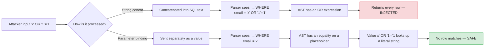
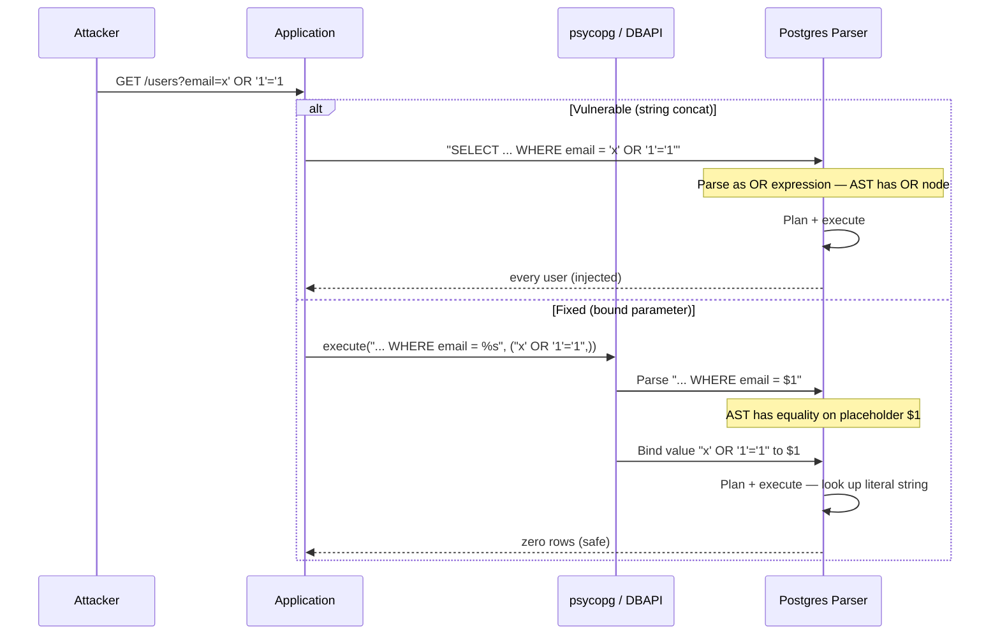

# Lesson 05: SQL Injection and Parameterized Queries

*The canonical lesson for `SQL injection` — the vulnerable string-concatenation pattern, second-order injection, parameterized queries with `psycopg` 3.x and SQLAlchemy `text()`, identifier allow-listing vs value binding, defense in depth with least-privilege DB roles. Vulnerable code → exploit → fixed code, every line explained.*

**You're in Lesson 05 of Section 06 — and this is a canonical lesson.**

SQL injection is the single most reproduced critical vulnerability in the history of web applications. It is also the easiest to prevent: **never interpolate untrusted input into a SQL string.** The pattern is so old, the fix is so simple, and engineers still ship it — usually because the ORM makes raw SQL easy and the parameter-binding API slightly less so. This is the canonical lesson for `SQL injection`; it gets reused by Section 07's `select()` lesson, by Section 08's roles-and-permissions lesson, and by Section 11's OWASP lesson. Do not skim it.


If you read nothing else here, read this: **`f"SELECT * FROM users WHERE email = '{email}'"` is a vulnerability regardless of what `email` contains.** Even if you "trust" the caller. Even if "it's an internal tool." Bind the parameter.

#sql #postgresql #security #defense-in-depth #canonical

## Learning Objectives

By the end of this lesson you will be able to:

1. **Recognize the vulnerable string-concatenation pattern** in any code review, in any of its forms (`+`, `%`, `.format()`, f-strings).
2. **Construct parameterized queries** with both `psycopg` 3.x (DBAPI) and SQLAlchemy `text()` bound parameters.
3. **Identify second-order injection vectors** and defend against them.
4. **Apply defense in depth** — parameter binding + input validation + least-privilege DB roles + query logging.
5. **Explain why allow-listing identifiers (column/table names) is different from binding *values***, and implement both safely.
6. **Write a parametrized test** that proves the endpoint is injection-safe and fails if anyone reintroduces concatenation.

## Prerequisites

- **The Boardly schema from Lesson 1** — [[Relational-Model-and-Constraints]]. This lesson adds a `users` table and a vulnerable `/users` endpoint.
- **The transactions lesson (Lesson 3)** — [[Transactions-Isolation-Locks]]. Bound parameters and `FOR UPDATE` compose safely.
- **`psycopg` 3.x** installed: `uv add "psycopg[binary]"`.
- **SQLAlchemy 2.1.x** installed if you want the `text()` examples: `uv add sqlalchemy`.
- **About 75 minutes of focused time.** Have `psql` and your Python editor open side by side.

**The most common gap: "the ORM is safe by default."**

ORM-emitted queries are bound — true. ORM `text()` queries are bound *when you pass parameters to `execute()`* — also true. But `text()` *without* `bindparams` and with manual concatenation is identical to raw psycopg concatenation — the ORM adds no protection here. The safety boundary is *parameter binding*, not *ORM usage*. This lesson makes that boundary explicit.


## The Problem

The Boardly API has an admin endpoint that lists users with optional filters:

```python
# VULNERABLE — demonstration only. Never write this in production.
@app.get("/users")
def users(email: str | None = None):
 with psycopg.connect("dbname=boardly") as conn:
 with conn.cursor() as cur:
 if email:
 cur.execute(f"SELECT id, email, role FROM users WHERE email = '{email}'")
 else:
 cur.execute("SELECT id, email, role FROM users")
 return cur.fetchall()
```

Attacker calls:

```
GET /users?email=x' OR '1'='1
```

The server concatenates and runs:

```sql
SELECT id, email, role FROM users WHERE email = 'x' OR '1'='1'
```

That returns every user in the table — including admins. Worse:

```
GET /users?email=';
```

The server concatenates:

```sql
SELECT id, email, role FROM users WHERE email = '';'
```

That's a syntax error — but the attacker refines the payload to `'; DROP TABLE users; --`, and now:

```sql
SELECT id, email, role FROM users WHERE email = ''; DROP TABLE users; --'
```

The `;` terminates the `SELECT`, `DROP TABLE users` runs, and `--` comments out the trailing `'`. The users table is gone.

**Note — Historical context — the SQL-injection tax**

SQL injection has been on the OWASP Top 10 since the list began (2003). It's currently A03:2021. Despite being trivial to prevent, it remains in the top three because: (a) raw SQL is sometimes the only path (ORMs can't express every query), (b) junior engineers reach for the simplest concatenation pattern first, (c) existing codebases have it baked in, (d) "internal tools" exempt themselves from the discipline. Every year, public data breaches trace back to a single `f"SELECT ... WHERE x = '{request.args['x']}'"`. The defense — parameter binding — was standardized in SQL-92 (1992). The pattern is older than most engineers using it.


## The Code: Setup

The `users` table:

```sql
-- Add to the Boardly schema.
CREATE TABLE users (
 id bigint GENERATED ALWAYS AS IDENTITY PRIMARY KEY,
 email text NOT NULL UNIQUE,
 role text NOT NULL DEFAULT 'member' CHECK (role IN ('member','admin'))
);

INSERT INTO users (email, role) VALUES
 ('alice@example.com', 'member'),
 ('bob@example.com', 'admin');
```

## The Code: Vulnerable

Here's the vulnerable handler again, in full:

```python
# VULNERABLE — demonstration only. Do not ship this.
from fastapi import FastAPI
import psycopg

app = FastAPI()

@app.get("/users")
def users(email: str | None = None):
 with psycopg.connect("dbname=boardly") as conn:
 with conn.cursor() as cur:
 if email:
 cur.execute(f"SELECT id, email, role FROM users WHERE email = '{email}'")
 else:
 cur.execute("SELECT id, email, role FROM users")
 return cur.fetchall()
```

The exploit:

```bash
curl 'http://localhost:8000/users?email=x%27%20OR%20%271%27%3D%271'
# Returns every user, including admins.
```

(URL-encoded: `%27` = `'`, `%20` = ` `, `%3D` = `=`. Decoded: `x' OR '1'='1`.)

## The Code: Fixed

The fix is one character class away — replace the f-string interpolation with a parameter placeholder:

```python
# FIXED — parameter binding.
from fastapi import FastAPI
import psycopg

app = FastAPI()

@app.get("/users")
def users(email: str | None = None):
 with psycopg.connect("dbname=boardly") as conn:
 with conn.cursor() as cur:
 if email:
 cur.execute(
 "SELECT id, email, role FROM users WHERE email = %s",
 (email,),
 )
 else:
 cur.execute("SELECT id, email, role FROM users")
 return cur.fetchall()
```

The same attacker payload now safely looks up a row whose email is literally `x' OR '1'='1` — there is none, returns an empty list. No injection. No admin leak.

## Line-by-Line Deep Dive

This section is the heart of the lesson. Read it twice. Don't skip.

### The mental model: parse vs bind

A SQL statement is parsed into an abstract syntax tree (AST) by the database's parser, then planned, then executed. **Parameters** are values that are inserted into the AST *after* parsing — they cannot change the structure of the query, only the data.

A value `'alice@example.com'` bound as a parameter is treated by the database as a string literal that happens to contain `alice@example.com` — even if that string is `'; DROP TABLE users; --`. The string never reaches the parser; it's a value, not syntax.

When you build SQL by **string concatenation**, you bypass that boundary: the untrusted input is parsed *as SQL syntax*. That's the entire vulnerability.



### The vulnerable pattern: line by line

```python
cur.execute(f"SELECT id, email, role FROM users WHERE email = '{email}'")
```

**What it does:** Builds a SQL string by interpolating the `email` variable into the string, then asks the cursor to execute the resulting text.

**Why it's vulnerable:** The `email` variable is treated as *syntax*. The parser sees the final concatenated text, not a placeholder. If `email` is `x' OR '1'='1`, the parser sees:

```sql
SELECT id, email, role FROM users WHERE email = 'x' OR '1'='1'
```

…which is a valid SQL statement whose AST contains an `OR` expression. The `'1'='1'` is always true, so every row matches.

The four equivalent vulnerable forms:

```python
cur.execute("SELECT ... WHERE email = '" + email + "'") # concatenation
cur.execute("SELECT ... WHERE email = '%s'" % email) # % formatting
cur.execute("SELECT ... WHERE email = '{email}'".format(email=email)) # .format()
cur.execute(f"SELECT ... WHERE email = '{email}'") # f-string
```

All four are the same vulnerability, in different syntactic dresses. **None of them is acceptable.**

**Why are all four forms the same vulnerability, and why doesn't Python's f-string or `.format()` mechanism save us?** Because the vulnerability is not in the *formatting* mechanism — it's in the *concatenation step*. The moment your code constructs the final string by combining a SQL template with a runtime value *before* the cursor sees it, the parser receives one finished string and parses it as syntax. The Python f-string `f"... WHERE email = '{email}'"` produces the same final string as `" ... '" + email + "'"` — the only difference is which Python-side spell built it. The DBAPI cursor's `execute()` takes the already-built string and passes it to the parser verbatim; there's no "post-processing" step that can rescue the value out of the syntax. The defense is structural: don't build the final string in Python at all. Send the *template* (`WHERE email = %s`) and the *value* (`email`) as separate arguments so the DBAPI can keep them separate all the way to the wire. The defense is "never concatenate," not "concatenate more carefully."

**Danger — How an attacker thinks: the `UNION SELECT` extraction pattern.**

Once an attacker confirms a `WHERE email = '...'` is injectable (via the `OR '1'='1` boolean test), the next step is column enumeration: `?email=x' ORDER BY 1--`, `?email=x' ORDER BY 2--`, ... until the `ORDER BY` errors out at the column count. Then `?email=x' UNION SELECT id, email, password_hash FROM users--` appends a synthetic row whose cells come from a table the attacker chooses. The vulnerable `SELECT id, email, role FROM users WHERE email = '...'` returns its three columns plus three attacker-chosen columns; the API renders all of them, leaking the `password_hash`. The defense is parameter binding (the `UNION` payload becomes a literal string lookup that matches nothing), but the deeper defense is projection discipline: never `SELECT *` in an endpoint that handles untrusted input — the fewer columns you project, the smaller the leak surface even if a binding bug slips through. Cross-link to [[06-SQL-Fundamentals/Joins-Aggregations-CTEs]] for the projection-vs-filter discipline and to [[06-SQL-Fundamentals/Indexes-and-Query-Planning]] for the covering-index `INCLUDE` leak that compounds this pathway.


**Student asks: What if I escape the single quotes manually?**

Don't. The history of manual escaping is the history of new injection classes — double-encoded payloads, Unicode normalization, alternate escape syntaxes (`\` vs `''`), comments-and-quotes interactions. The defense is parameter binding, which makes the value-vs-syntax boundary explicit at the protocol level. Manual escaping is an arms race you will lose.


### The fixed pattern: `psycopg` 3.x with `%s`

```python
cur.execute(
 "SELECT id, email, role FROM users WHERE email = %s",
 (email,),
)
```

**What it does:** Sends a SQL string with a `%s` placeholder to psycopg, along with a tuple of values. psycopg passes the value to PostgreSQL *as an out-of-band parameter* via the binary extended protocol — the value never appears in the SQL text.

Three things to know:

1. **`%s` is a placeholder, not a string format specifier.** Despite the `%` character, psycopg's `%s` has nothing to do with Python's `%`-formatting. The string `"WHERE email = %s"` is sent to psycopg verbatim — psycopg parses it, identifies the `%s` placeholder, and asks PostgreSQL to bind a value there. The value goes over the wire as a typed parameter, never as part of the SQL text.

2. **The second argument is a tuple.** `(email,)` is a one-element tuple (note the trailing comma). For multiple parameters, `cur.execute("... WHERE a = %s AND b = %s", (a, b))` — and the order of values must match the order of placeholders.

3. **psycopg 3.x also supports named placeholders:**
 ```python
 cur.execute(
 "SELECT id FROM users WHERE email = %(email)s AND active = %(active)s",
 {"email": email, "active": True},
 )
 ```
 The `%(name)s` form is clearer for queries with many parameters — you don't have to maintain the order.

**What `%s` *doesn't* do.**

It doesn't escape quotes. It doesn't validate the input. It does something better: it makes the input a *value*, not *syntax*. The value `'; DROP TABLE users; --` becomes a string literal whose contents happen to be `'; DROP TABLE users; --`. No parsing, no execution, no escape arms race. The DBAPI's extended protocol is the safety boundary.


**Why is `%s` chosen as the placeholder token if it conflicts visually with Python's `%`-formatting?** Because psycopg 2.x (the predecessor to psycopg 3.x) was written before the `%`-formatting deprecation, and its API was modeled on Python's older DBAPI specification (PEP 249), which mandates `%s`-style placeholders for maximum cross-driver portability. Changing the token in 3.x would have broken every existing psycopg 2.x codebase migrating to 3.x, so the convention stuck. The visual collision with `%`-formatting is a documented source of bugs — reviewers see `cur.execute("... = %s" % email)` and have to read carefully to confirm it's *not* the same as `cur.execute("... = %s", (email,))`. The mitigation the team uses: configure ruff to flag any `cur.execute(... % ...)` form; the only acceptable spelling is `cur.execute(template, (values,))` with a comma between template and values.

**Warning — Debugging: the `%s` vs `%`-formatting visual collision in code review.**

The single most common reviewer-missed injection in `psycopg` code is `cur.execute("SELECT ... WHERE email = '%s'" % email)` — note the `%` *outside* the string, applying Python's `%`-formatting to the template *before* `execute()` sees it. The visual difference from the safe `cur.execute("SELECT ... WHERE email = %s", (email,))` is one character (the `%` outside vs the comma). The reviewer's eye reads both as "`%s` placeholder, safe" because the `%s` is inside the string in both cases. The mitigation the team uses: configure `ruff` (or `flake8-sql`) to flag any `cur.execute(... % ...)` form — the only acceptable spelling is `cur.execute(template, (values,))` with a comma between template and values. Run `uv run ruff check src/` in pre-commit to enforce it. The discipline is structural: the comma is the safety boundary, not the `%s`.


### The fixed pattern: SQLAlchemy `text()` with `:name`

```python
from sqlalchemy import text
from sqlalchemy.orm import Session

def find_user(session: Session, email: str):
 stmt = text("SELECT id, email, role FROM users WHERE email = :email")
 return session.execute(stmt, {"email": email}).all()
```

**What it does:** Same boundary, different syntax. SQLAlchemy's `text()` accepts `:name` placeholders. The bound values are passed to the underlying DBAPI (psycopg in our case) as a dict — `{"email": email}` — so the safety boundary is identical.

The `:name` form composes better with dynamic query building (below). The `%s`/`%(name)s` form is the raw-DBAPI form. Both are safe; pick the one that fits the rest of your stack.

**Warning — `text()` *without* `bindparams()` or `execute(stmt, params)` is just a string.**

`session.execute(text("SELECT * FROM users WHERE email = '" + email + "'"))` — even though it's wrapped in `text()` — is fully vulnerable. `text()` is a SQL string wrapper; it adds no safety boundary by itself. The safety comes from the *parameter-passing* step (`execute(stmt, params)` or `stmt.bindparams(...)`).


### The ORM-native pattern: `select()`

The ORM's typed `select()` is harder to misuse for injection — every column reference is a Python attribute, every literal becomes a bound parameter automatically:

```python
from sqlalchemy import select
from sqlalchemy.orm import Session
from .models import User

def find_user(session: Session, email: str):
 stmt = select(User.id, User.email, User.role).where(User.email == email)
 return session.execute(stmt).all()
```

`User.email == email` becomes a bound parameter at execution. The Python expression `User.email == email` produces an `BinaryExpression` object whose SQL rendering emits `users.email = :email_1` and binds `email` to the placeholder. You literally cannot write an injection in this form — the only way to inject syntax is to drop down to `text()` with manual concatenation.

Section 07 ([[07-SQLAlchemy/06-Querying-with-select]]) covers the ORM's `select()` in depth. For Lesson 5, the point is: *prefer the ORM form when you can; treat `text()` with the same care as raw SQL when you must.*

### Second-order injection: the data-as-syntax trap

The malicious payload is stored in the database by a *benign* pathway (e.g., a profile field that went through `INSERT ... VALUES (%s, ...)` — properly bound) and then read back and concatenated into a later query. Your input validation on the insert doesn't help; the value was already in the database as *data*, and your later code treats it as *syntax*.

**Student asks: I bound the value on INSERT. Why isn't it "safe" when I read it back?**

Because binding is a property of the *executing query*, not of the value. The INSERT sent the string `admin'--` to Postgres as a typed value; Postgres stored those six characters verbatim. The `SELECT` you run later reads back the same six characters. If your code then concatenates those six characters into a new SQL template, the parser sees `WHERE actor = 'admin'--'` — the embedded quote ends the string literal early and the `--` becomes a SQL comment. Storage does not "sanitize" data; only the *next* query's binding step protects against the next parse. Treat every value you read from the database with the same distrust as a value you read from the wire — bind it again.


Example: a user registers with username `admin'--`. The username is stored safely via parameter binding:

```python
cur.execute("INSERT INTO users (email, role) VALUES (%s, %s)", ("admin'--", "member"))
# Stored safely. The "'" in the email is a value, not syntax.
```

Later, an admin-facing script builds a report query by string-concatenating the stored email:

```python
# VULNERABLE — second-order.
rows = cur.execute(f"SELECT * FROM audit_log WHERE actor = '{email}'")
```

The query reads `... WHERE actor = 'admin'--'` and silently drops everything after the `'--`. The defense is identical: **bind the parameter.**

```python
# FIXED — second-order defense.
rows = cur.execute("SELECT * FROM audit_log WHERE actor = %s", (email,))
```

The takeaway: *any* time you put untrusted input into a SQL string, regardless of where that input came from (HTTP request, database, environment variable, config file), you bind it. Storage in the database does not sanitize a value for later concatenation.

**Why does parameterized insert not "sanitize" the value for later concatenation?** Because the safety boundary is the binding step *at the moment of the executing query*, not a property of the value itself. When you `INSERT INTO users (email) VALUES (%s)` with `"admin'--"`, psycopg sends the *string* `"admin'--"` to Postgres as a typed value. Postgres stores those six characters in the column. The value in the database is the literal character sequence `a`, `d`, `m`, `i`, `n`, `'`, `-`, `-` — not some "sanitized" or "escaped" form. When you later read that value back from the database with `SELECT email FROM users WHERE id = 42`, what you get back in Python is the same six-character string, untouched. If you then concatenate *that* string into another SQL query, the parser sees `WHERE actor = 'admin'--'` — the quote inside the value ends the string literal early, and the `--` becomes a SQL comment that drops the rest. The defense is to bind *that* query's parameter too; the value's history of being safely stored doesn't matter to the parser of the next query.

**Warning — Debugging: detecting second-order injection via query-log anomalies.**

Second-order injection is invisible to the input-validation layer (the value was safely bound on the way in) and to the access log (the value reads as a normal stored string). The detection pathway is the query log: in staging with `log_statement = 'all'` and `log_parameter_max_length = -1`, grep the log for any `WHERE` clause whose bound parameter contains a single quote, a `--`, or a `;` — those are values that *might* be concatenated downstream. The deeper discipline is to audit every `text()` call site (not just every endpoint) for the `execute(stmt, params)` pattern: `rg "text\(f['\"]" src/` flags any f-string inside a `text()` wrapper, which is the second-order injection signature. The symptom in production is "the audit-log report for one specific user always returns fewer rows than expected" — the `'--` in their stored username is silently truncating the `WHERE` clause of the report query. Treat any "consistently short result for one user" report as a potential second-order injection until proven otherwise. Cross-link to [[13-Performance-and-Observability/N-plus-1-and-Slow-Queries]] for the slow-query-tracing tooling that surfaces these anomalies in production.


### Allow-listing identifiers (column/table names)

You cannot bind a column or table name as a parameter — those are parsed *as identifiers*, not values. If you must accept user input as an identifier (sort field, table to report on), **allow-list it**:

```python
ALLOWED_SORT_COLUMNS = {"created_at", "name", "email"}

def list_users(session, sort_col: str, sort_dir: str):
 if sort_col not in ALLOWED_SORT_COLUMNS:
 raise ValueError(f"bad sort column: {sort_col!r}")
 direction = "ASC" if sort_dir.upper() == "ASC" else "DESC"
 stmt = text(f"SELECT id, email FROM users ORDER BY {sort_col} {direction}")
 return session.execute(stmt).all()
```

The f-string here is **safe** because `sort_col` is from a fixed allow-list (membership checked before use) and `direction` is reduced to a two-value choice (the `if/else` makes it impossible for `sort_dir` to inject anything).

The same string-concatenation pattern with `sort_col = request.args['sort']` (no allow-list check) would be a vulnerability — `?sort=email; DROP TABLE users--` would execute the DROP.

**Why can't column or table names be bound as parameters?** Because the SQL parser's two-phase structure treats *identifiers* (column names, table names, function names) and *values* (literals) as different syntactic categories. The extended-protocol binding mechanism operates on the value category — you bind a typed parameter where a literal would appear (`WHERE email = $1`). An identifier (`ORDER BY $1`, `SELECT $1 FROM ...`) cannot be a bound parameter because the parser must resolve the identifier to a real column at *plan time*, before any value is bound. The placeholder is a runtime substitution; the identifier is a compile-time symbol. Postgres does not let you bind identifiers because the binding step happens after the AST is built and the column references are resolved. The defense for identifier-shaped user input is therefore *not* binding — it's allow-listing against a known set of real column names and rejecting anything outside the set. The trade-off is flexibility: you cannot let users supply arbitrary identifiers; you can only let them *choose* among identifiers you declared.

**Warning — Allow-list the *value*, reduce the *direction*.**

A common mistake: allow-list the sort column but accept the direction as raw text. `?sort=email ASC, password_hash ASC--` survives a `sort_col` allow-list check if direction is concatenated raw. The fix: reduce direction to a two-value choice (`ASC` or `DESC`) with an explicit `if/else`, never a string-passed-through.


**When would you accept the cost of an allow-list over a free-form sort?**

Almost always for sort fields — the operational surface is small (you sort by maybe a dozen columns), and rejecting an unknown column with a 400 response is the correct UX. The case for free-form identifiers is rare: a generic report-builder tool that lets the user pick *any* column from a discovered schema is one (look at PostgREST or Hasura), and the defense there is metadata-driven — the schema itself is the allow-list, and you reject any identifier not present in `information_schema.columns`. The point: never use a user-supplied string as an identifier without first intersecting it with a known-good set. If your allow-list is "the columns of this table," that's fine — derive it from the schema, don't hardcode it for arbitrary input.


**Warning — Debugging: allow-list drift after a schema change.**

The allow-list is a hardcoded set of identifier strings; it does not auto-update when the schema evolves. A migration that adds `users.password_changed_at` for a "force password reset" feature does not add that column to `ALLOWED_SORT_COLUMNS` — but the new dashboard engineer who writes `?sort=password_changed_at` gets a 400 and a bug ticket, and the next engineer's "fix" is to add the column to the allow-list without checking whether it should be sortable (it shouldn't — sorting by `password_changed_at` leaks which users recently reset their passwords). The symptom is "the sort feature is broken for the new column" or, worse, "the sort feature works for a column it shouldn't." The discipline is to derive the allow-list from the schema (intersect `information_schema.columns` with a manually-curated "sortable" subset) rather than hardcoding it — and to require a security review for any allow-list addition. Cross-link to [[04-Pydantic/BaseModel-and-Validation]] for the input-validation layer that rejects unknown sort values before they reach the allow-list check.


### Defense in depth

The single defense (parameter binding) is necessary but not sufficient. Defense in depth layers five barriers, so an injection that defeats one is contained by the next:

1. **Bind every value.** The non-negotiable baseline. `%s` (psycopg) or `:name` (SQLAlchemy `text()`).
2. **Validate input.** Catch garbage *before* it touches the database. Pydantic models (see [[04-Pydantic/BaseModel-and-Validation]]) are the right tool — type, length, pattern, semantic checks. Reject early.
3. **Least-privilege DB roles.** The application's connection role should not own the schema, should not be a `SUPERUSER`, and should have only the privileges it needs. A read-only report service connects with a role that has `SELECT` on the analytics views and nothing else — so even if a query bug introduces an injection, the worst case is reading the wrong rows, not `DROP TABLE`. See [[08-PostgreSQL/Roles-Permissions-Security]].
4. **Log parameter-bound queries.** Use `log_statement = 'ddl'` or `'all'` for staging, `pg_stat_statements` for production sampling. Confirm bindings are happening.
5. **Web Application Firewall (WAF) is not a defense.** SQL injection at the HTTP layer is trivially obfuscatable. The defense is in your code. A WAF catches noise; it does not catch a targeted injection.

**Danger — How an attacker thinks: blind and time-based injection.**

When the vulnerable endpoint doesn't return rows directly (a login endpoint that returns only `200`/`401`), the attacker pivots to boolean- and time-based extraction. `?email=x' OR (SELECT 1 FROM users WHERE role='admin' AND email LIKE 'a%')='1'--` returns `200` if the subquery is true, `401` otherwise — leaking one bit per request. `?id=1 OR pg_sleep(5)--` leaks one bit per request via response timing — 5-second delay = true, sub-second = false. The extraction rate is slow (one bit per request, one character per 8 requests, ~256 requests per 32-char hash) but deterministic and undetectable by access-log review (each request looks like a normal login attempt). The defense is parameter binding (the `pg_sleep` payload becomes a literal integer lookup), plus response-time normalization (constant-time login comparison so the timing channel is closed at the application layer even for non-injection logic bugs), plus rate-limiting per-IP and per-account on the auth endpoint. Cross-link to [[11-Authentication-and-Security/RBAC-and-Object-Level-Auth]] for the authorization-layer defense that bounds the blast radius of any leak.


**Production reality: `pg_stat_statements` as a parameter-binding audit.**

The `pg_stat_statements` extension records normalized query text (literals replaced by `$1`, `$2`) keyed by a stable `queryid`. A parameter-bound query shows up as one `queryid` with increasing `calls`; a string-concatenated query shows up as many distinct `queryids` (one per literal value). Audit in production with `SELECT queryid, calls, query FROM pg_stat_statements WHERE query LIKE '%users%' ORDER BY calls DESC` — if the same logical query has hundreds of distinct `queryids`, the code is concatenating, not binding, and the `query` text will show literal values where `$1` should be. This is also a plan-cache diagnostic: bound queries reuse one plan (one `queryid`); concatenated queries force a plan per call. Enable with `CREATE EXTENSION pg_stat_statements;` and `shared_preload_libraries = 'pg_stat_statements'` in `postgresql.conf` (requires restart). Cross-link to [[08-PostgreSQL/EXPLAIN-ANALYZE-and-Query-Plans]] for the plan-cache diagnostic.


### What parameter binding does NOT prevent

Be honest about the boundary:

- **Logic bugs.** `WHERE active = TRUE` is parameter-safe; if the API only returns active users, that's still a logic bug, not injection.
- **Privilege escalation via your own application logic.** Transactions don't enforce authorization; your code does. (See [[11-Authentication-and-Security/RBAC-and-Object-Level-Auth]].)
- **Denial of service via a parameter that triggers a Seq Scan on a 1B-row table.** Bind it (Lesson 5) *and* index it (Lesson 4).
- **Authorization bypass via IDOR.** `WHERE project_id = %s` with the bound `?id=42` is safe from injection; it is not safe from a user reading another user's project. That's an authorization bug, not an injection bug.

**Production reality: `log_parameter_max_length` for staging binding verification.**

The `log_statement = 'all'` setting logs every statement, but the bound parameters are truncated to `log_parameter_max_length` bytes (default 0 = no logging of parameters at all in the basic log line). In staging, set `log_parameter_max_length = -1` (log full parameters) and `log_statement = 'all'` to capture the actual bound values — confirming the `%s` placeholder received the literal `x' OR '1'='1` string and not a parsed fragment. In production, keep `log_parameter_max_length = 0` (no parameter logging) to avoid writing PII and secrets to the log; use `pg_stat_statements` for the binding audit instead (it stores normalized text, not literals). The trade-off: staging logs everything (full parameters, for debugging and binding verification); production logs nothing user-visible (just normalized shapes, for plan-cache and volume analysis). The setting is per-cluster in `postgresql.conf` and requires reload (`SELECT pg_reload_conf();`) to apply.


## Execution Trace



The boundary is the DBAPI's extended protocol. The placeholder `$1` is parsed once; the value is bound after parsing. The value's content has no syntactic effect — it's a string.

## Practical Application: A Search Endpoint

A search endpoint that takes a partial email match, a role filter, and a sort column:

```python
from fastapi import FastAPI, Depends
from pydantic import BaseModel, Field
from sqlalchemy import text
from sqlalchemy.orm import Session

class SearchRequest(BaseModel):
 email_fragment: str | None = Field(None, max_length=200)
 role: str | None = Field(None, pattern="^(member|admin)$")

ALLOWED_SORT = {"email", "id"}

@app.get("/users/search")
def search(
 email_fragment: str | None = None,
 role: str | None = None,
 sort: str = "email",
 session: Session = Depends(get_session),
):
 if sort not in ALLOWED_SORT:
 return {"error": "bad sort"}, 400

 clauses = []
 params: dict[str, object] = {}
 if email_fragment is not None:
 clauses.append("email ILIKE :frag")
 params["frag"] = f"%{email_fragment}%"
 if role is not None:
 clauses.append("role = :role")
 params["role"] = role
 where = (" WHERE " + " AND ".join(clauses)) if clauses else ""

 # sort is allow-listed, so f-string interpolation is safe here.
 stmt = text(f"SELECT id, email, role FROM users{where} ORDER BY {sort} ASC LIMIT 100")
 return session.execute(stmt, params).all()
```

Three defenses are in play:

1. **Every value** (`email_fragment`, `role`) is bound as `:frag` and `:role`. The `ILIKE :frag` parameter is the `%{email_fragment}%` string — bound, not concatenated into SQL.
2. **The `sort` parameter is allow-listed** against a constant set — the only f-string interpolation is for an identifier that came from a fixed set.
3. **Pydantic validates and limits input** (`max_length=200`, `pattern="^(member|admin)$"`) before it reaches the database layer.

The `f"%{email_fragment}%"` line often confuses reviewers — *isn't that an f-string in SQL?* No: the f-string produces a Python string (e.g., `%alice%`), which is then *bound* as the value of the `:frag` placeholder. The binding step is what makes it safe; the f-string is a Python-side string manipulation, not a SQL-side concatenation.

**Tip — Test the boundary, not the input.**

A common mistake is testing "does my endpoint accept valid emails" — that's an input test. The security test is "does my endpoint return non-matching rows for an injection payload." Add a parametrized test (below) that proves the boundary.


## Proving the Fix With a Test

```python
import pytest

@pytest.mark.parametrize("payload", [
 "x' OR '1'='1",
 "'; DROP TABLE users; --",
 "' UNION SELECT NULL, version(), NULL --",
 "alice@example.com", # the legitimate case
])
def test_users_endpoint_is_injection_safe(client, payload):
 resp = client.get("/users", params={"email": payload})
 assert resp.status_code == 200
 rows = resp.json()
 # An injection that returns every row would have > 1 result for a bogus email.
 if payload == "alice@example.com":
 assert len(rows) == 1
 else:
 assert rows == []
```

If the endpoint is ever "fixed" by reintroducing concatenation, this test fails on the next CI run. That's the discipline — *every* endpoint that accepts input that ends up in SQL gets this test.

## Common Mistakes

**Warning — `f"SELECT ... WHERE x = '{val}'"` — even for "trusted" inputs.**

Internal admin tools, test fixtures, dev scripts — all of them. Bind the parameter. "Trusted" is a category error; the *value* may be trusted, but the *future maintainer* of the code may not be.


```python
# WRONG: f-string interpolation into the SQL text
cur.execute(f"SELECT id, email FROM users WHERE email = '{email}';")
# Symptom: email = "x' OR '1'='1" returns every user row.
# The string is built before the driver sees it; the planner cannot
# distinguish data from code.

# RIGHT: bind the parameter; the driver sends data separately from the query
cur.execute("SELECT id, email FROM users WHERE email = %s;", (email,))
```

**Warning — `"SELECT ... " + val` — same vulnerability, slightly worse style.**

If you find a `+` in a `cur.execute(...)` call, treat it as a bug until proven otherwise.


**Warning — `"SELECT ...".format(x=val)` — same vulnerability, Python-flavored.**

`.format()` is string formatting, not parameter binding. Same for `%`-formatting and f-strings.


**Warning — `sqlalchemy.text(...).bindparams(x=val)` forgotten.**

`text()` without bound parameters is just a string. Use the `text("... :x ...")` plus `execute(stmt, {"x": val})` pattern or `bindparams()`.


**Warning — Allow-listing a `sort` column but accepting the direction raw.**

`?sort=email ASC, password_hash ASC--` survives a `sort_col` allow-list. Reduce `direction` to a two-value choice.


```sql
-- WRONG: only the column is allow-listed; the direction is concatenated raw
sort_col = allow_list.get(request.args.get("sort"), "id")
direction = request.args.get("dir", "ASC")        # <-- attacker-controlled
sql = f"SELECT id, email FROM users ORDER BY {sort_col} {direction};"
cur.execute(sql)
-- Symptom: ?dir=ASC, password_hash ASC-- appends an extra column to ORDER BY
-- and the trailing -- comments out the rest of the query. The bound-parameter
-- model can't help here because direction is an identifier, not a value.

-- RIGHT: bind the column to an allow-list AND reduce direction to a 2-value set
sort_col = allow_list.get(request.args.get("sort"), "id")
direction = "ASC" if request.args.get("dir", "asc").upper() == "ASC" else "DESC"
sql = f"SELECT id, email FROM users ORDER BY {sort_col} {direction};"
cur.execute(sql)
```

**Warning — Using `ILIKE :frag` with `f"%{frag}%"` and assuming it's safe.**

The f-string interpolation is on the Python side; the resulting string is still bound as a parameter to `ILIKE :frag`. **That's safe** — but easy to misread. Add a test that confirms `frag = "%' OR '1'='1"` returns no rows.


**Warning — Assuming the ORM is "safe by default."**

ORM-emitted queries are bound. ORM `text()` queries are bound when you call `execute(stmt, params)`. But `text()` *without* `bindparams` and with manual concatenation is identical to raw psycopg concatenation — the ORM adds no protection here.


**Warning — Trusting "sanitized" input from a library.**

`bleach.clean` is for HTML, not SQL. Use parameter binding. Don't outsource SQL safety to an HTML sanitizer.


## Engineering Trade-Offs

### ORM `select()` vs `text()`

The ORM's typed `select()` is harder to misuse for injection — every column reference is a Python attribute, every literal becomes a bound parameter automatically. `text()` is for queries the ORM can't express. When you reach for `text()`, treat it with the same care as raw SQL. The trade-off: ORM-typed queries are safer but less expressive; raw SQL is more expressive but requires discipline.

### Dynamic SQL builders vs hand-written SQL

A query builder (e.g., SQLAlchemy Core, pypika) lets you compose predicates programmatically and emits bound parameters. For dynamic filtering with N optional clauses, this is the right tool. Hand-concatenated `WHERE 1=1 AND ... AND ...` works too — *as long as every value is bound.* The `WHERE 1=1` trick (start with a tautology so every subsequent clause can be `AND ...`) is fine; the trap is concatenating *values*, not *clauses*.

### Stored procedures as an injection defense

A stored procedure with bound parameters is safe. A stored procedure that concatenates parameters into dynamic SQL inside its body is not. Don't outsource the responsibility to PL/pgSQL. The same boundary — parse vs bind — applies inside the procedure.

**When would you NOT reach for parameterized queries?**

There are two narrow cases. (1) DDL statements with identifiers — `CREATE TABLE`, `ALTER TABLE ... ADD COLUMN` — cannot take bound parameters for the identifiers (table/column names), because the parser resolves those at plan time. You must construct the DDL text with allow-listed identifiers (no value interpolation; the value-vs-identifier split still applies). (2) Ad-hoc DBA queries typed at a `psql` prompt by an operator — `SELECT * FROM users WHERE email = 'ada@b.co'` is fine when the operator is the only person typing and there is no untrusted input. The moment code constructs the query, you bind. The two cases above are exceptions, not the rule; production application code always binds.


### `executemany` vs loops of `execute`

`executemany` is faster and uses one prepared statement plan. Both are equally safe (parameters are bound). Use `executemany` for bulk inserts.

### Prepared statements vs parameter binding

Postgres prepared statements cache the plan. The first call plans; subsequent calls reuse the plan and bind new values. Parameterized queries use the *extended protocol*, which is prepared statements under the hood. Plan caching has a trade-off: a cached plan may be wrong if data distribution shifts (`generic_plans` vs `custom_plans`); see [[08-PostgreSQL/EXPLAIN-ANALYZE-and-Query-Plans]].

**Spot the bug — does this code have an injection?**

```python
stmt = text("SELECT id, email FROM users WHERE email = :email")
rows = session.execute(stmt, {"email": email}).all()
```
No — this is the canonical safe form. `:email` is a SQLAlchemy `text()` placeholder, the value is passed via the `params` dict in `execute()`, and the underlying DBAPI binds it via the extended protocol. The reviewer's instinct should be: "any `text()` call without a comma between template and params is suspect; this one has the comma, so it's safe." The bug to watch for is `text("... WHERE email = '" + email + "'")` — the `text()` wrapper provides *zero* safety; only `execute(stmt, params)` does.


## Exercises

**Tip — The 20-minute rule.**

If you're stuck on an exercise for more than 20 minutes, re-read the relevant section above, then move on and come back.


**Exercise 1 — The vulnerable and fixed functions.** Write the vulnerable and fixed `find_user` functions. Call both with `email = "x' OR '1'='1"`. Observe the difference in returned rows — the vulnerable form returns every user; the fixed form returns zero rows.

**Exercise 2 — Second-order injection.** Insert a username `admin'--` via a parameter-bound insert. Write a vulnerable `text()`-concatenated query that reads back the username. Demonstrate the attack — the query reads `WHERE actor = 'admin'--'` and silently drops the rest. Then fix it.

**Exercise 3 — Allow-list with a twist.** Add a `?fields=id,email` parameter to the search endpoint that lets the user choose which columns to return. Allow-list `fields` against `{id, email, role}`. Demonstrate that `?fields=id,email,role,password_hash` is rejected. Add a test for both the rejection and the legitimate multi-field case.

**Exercise 4 — The Pydantic-validated endpoint.** Build the `/users/search` endpoint from the Practical Application section. Add a test that proves `email_fragment = "%' OR '1'='1"` returns no rows. Add a test that proves `role = "admin' OR '1'='1"` is rejected by Pydantic's `pattern` validator before reaching the database.

**Exercise 5 — Least-privilege role design.** Design a `boardly_read` role that has `SELECT` on `users`, `projects`, `tasks`, `comments` but no `INSERT`/`UPDATE`/`DELETE` and no `DROP`. Connect the search endpoint with this role. Demonstrate that an injection that slips through (pretend `email_fragment` got concatenated by accident) cannot `DROP TABLE users` — Postgres refuses with a permission error.

**Exercise 6 — Prove `%s` is a placeholder, not a format specifier.** Write a one-liner that uses `psycopg` 3.x to execute `SELECT %s` with the value `"'; DROP TABLE users; --"` and prints the returned row. Confirm the output is the literal string (one row, one column), not a syntax error and not an empty table. Verify with: `uv run python -c "import psycopg; conn = psycopg.connect('dbname=boardly'); cur = conn.cursor(); cur.execute('SELECT %s', (\"'; DROP TABLE users; --\",)); print(cur.fetchone())"` — expected output `("'; DROP TABLE users; --",)`. This is the parse-vs-bind boundary in one executable line: the value never reaches the parser.

**Exercise 7 — Reproduce a `UNION`-based extraction against a vulnerable endpoint.** Build the vulnerable `/users/search` endpoint from the Practical Application section but with the `email_fragment` concatenated raw into `ILIKE '%{email_fragment}%'` (no binding). Send `?email_fragment=x' UNION SELECT id, email, 'placeholder' FROM users--` and confirm the response includes rows whose third column reads `placeholder` (the attacker-chosen literal, proving the `UNION` landed). Then fix the endpoint with `:frag` binding (`ILIKE :frag` with `params["frag"] = f"%{email_fragment}%"`) and confirm the same payload returns an empty list. Verify with: `uv run python scripts/repro_union_injection.py` — the script asserts the vulnerable response `len(rows) > 0` and the fixed response `rows == []`. This is the `UNION` extraction pathway from the attacker callout above, end-to-end.

**Exercise 8 — Reproduce a time-based blind injection and confirm the fix closes the timing channel.** Build a vulnerable endpoint `GET /items?id=<int>` that concatenates `id` into `WHERE id = {id}`. Send `?id=1 OR pg_sleep(3)--` and measure the response time (expect ~3 seconds). Fix the endpoint with `WHERE id = %s` binding and re-send the same payload — confirm the response is sub-second and returns no row (the payload `1 OR pg_sleep(3)--` is not a valid integer and is rejected by Pydantic, or if passed as a string, looks up the literal string). Verify with: `uv run python scripts/repro_time_based_injection.py` — the script asserts the vulnerable response takes `> 2.5` seconds and the fixed response takes `< 0.5` seconds. This is the blind-extraction pathway from the attacker callout, with the timing channel closed by binding.

**Exercise 9 — Audit parameter binding with `pg_stat_statements`.** Enable the extension: `CREATE EXTENSION IF NOT EXISTS pg_stat_statements;` (requires `shared_preload_libraries = 'pg_stat_statements'` in `postgresql.conf`, then restart). Run the fixed `/users` endpoint with several different `email` values (10 distinct addresses). Query the extension and confirm the parameterized query reuses one `queryid` across all 10 calls: `psql -d boardly -c "SELECT queryid, calls, left(query, 80) FROM pg_stat_statements WHERE query LIKE '%SELECT id, email, role FROM users WHERE email =%' ORDER BY calls DESC;"` — expected output shows one `queryid` row with `calls = 10` and the `query` column shows `WHERE email = $1` (normalized, not the literal values). Repeat with the vulnerable (concatenated) endpoint and confirm many distinct `queryid` rows appear, one per literal value — this is the binding audit from the production callout above.

**Exercise 10 — Test the allow-list rejection and the direction-reduction fix.** Build the `/users/search` endpoint with `?sort=` allow-listed against `{email, id}` and `?dir=` reduced to `ASC`/`DESC` via `if/else`. Add a parametrized test that confirms `?sort=email; DROP TABLE users--` returns a 400 (rejected by the allow-list) and `?dir=ASC, password_hash ASC--` reduces to `ASC` (the injection payload is dropped by the `if/else`). Verify with: `uv run pytest tests/test_sort_allowlist.py -k "reject_malicious_sort or reduce_malicious_dir"` — both tests pass. This is the allow-list + direction-reduction pattern from the Common Mistakes section, locked in by a regression test.

**Exercise 11 — Verify least-privilege role bounds the blast radius.** Create the `boardly_read` role with only `SELECT` on `users`: `CREATE ROLE boardly_read LOGIN PASSWORD 'readpass'; GRANT SELECT ON users TO boardly_read;`. Connect as `boardly_read` and attempt `DROP TABLE users;` — confirm it fails with `ERROR: must be owner of table users` or `permission denied for table users`. Attempt `INSERT INTO users (email, role) VALUES ('mallory@b.co', 'admin');` — confirm `permission denied for table users`. Attempt `DELETE FROM users WHERE id = 1;` — confirm `permission denied`. Verify with: `psql -U boardly_read -d boardly -c "DROP TABLE users;" 2>&1 | grep -iE "permission|owner"` — the output contains an error message (the injection is contained at the database layer even if a binding bug slips through). This is the defense-in-depth layer #3 from the lesson, demonstrated end-to-end.

## Verification

```bash
# Confirm psycopg is binding (logs in staging with log_statement='all'):
uv run python -c "
import psycopg
with psycopg.connect('dbname=boardly', autocommit=True) as conn:
 with conn.cursor() as cur:
 cur.execute('SELECT %s', ('x\\' OR \\'1\\'=\\'1',))
 print(cur.fetchall())
"
# Expected: [('x\' OR \'1\'=\'1',)] — one row, the literal string.
```

```bash
# Add the parametrized test from the lesson and run it.
uv run pytest -q tests/test_users_endpoint.py
```

```sql
-- Verify least-privilege role setup:
CREATE ROLE boardly_read LOGIN PASSWORD 'readpass';
GRANT SELECT ON users, projects, tasks, comments TO boardly_read;
-- Connect as boardly_read and try a DROP:
-- psql -U boardly_read -d boardly -c "DROP TABLE users;"
-- Expected: ERROR: must be owner of table users
```

## Previously Learned Here

This is the **canonical lesson for `SQL injection`**. Later lessons reuse this concept without re-explaining:

- **[[07-SQLAlchemy/06-Querying-with-select]]** — the ORM-native `select()` API auto-binds every literal and removes the temptation to write `text()` for ordinary queries. The lesson links back here for the security boundary discussion.
- **[[08-PostgreSQL/Roles-Permissions-Security]]** — the least-privilege role design that bounds the blast radius of any injection that does slip through.
- **[[11-Authentication-and-Security/OWASP-API-Top-10]]** — injection is A03:2021 in OWASP's list; this lesson is the concrete technical content for that category.

When those lessons touch injection security, they link back here.

Concepts from earlier sections reused here:

- **`Annotated`** — [[01-Python-Foundations/Type-Hints-and-Annotations]]. Used in the FastAPI endpoint signatures (`email: Annotated[str | None, Query()]`).
- **`BaseModel`** — [[04-Pydantic/BaseModel-and-Validation]]. The `SearchRequest` model with `Field(max_length=200, pattern="...")` is the input-validation layer of defense in depth.
- **`Pydantic Settings`** — [[04-Pydantic/Pydantic-Settings]]. The `Settings.database_url` that the application reads to construct the connection string (never the request URL, which would itself be an injection vector).
- **Python exceptions** — [[01-Python-Foundations/Exceptions-Done-Right]]. The `ValueError(f"bad sort column: {sort_col!r}")` for the allow-list rejection is the same "reject early, fail loudly" pattern from Phase 1.
- **`FastAPI lifespan`** — [[03-FastAPI-Core/Application-and-Lifespan]]. The engine (which owns the connection pool) outlives any single request. Lesson 5 is the per-request safety layer under that.

## What's Next

This is the **last lesson in Section 06**. The next section in the vault — [[07-SQLAlchemy/01-Foundations-and-Architecture]] — takes the SQL you've written here and lifts it into Python's typed ORM layer:

- **Lesson 7.01** — Foundations and Architecture: SQLAlchemy's layers (Core, ORM, dialects, DBAPI).
- **Lesson 7.02** — Engines, Connections, Pools: how the engine from Lesson 5's `psycopg.connect()` becomes a pooled SQLAlchemy engine.
- **Lesson 7.03** — Declarative Base and Mapped: how the `users` table from this lesson becomes a `class User(Base):` with `mapped_column` attributes.
- **Lesson 7.05** — Session and Transaction Management: how Lesson 3's `BEGIN/COMMIT` becomes `session.commit()` — and the retry path for `40001`.
- **Lesson 7.06** — Querying with `select()`: how Lesson 2's joins, aggregations, CTEs, and window functions translate to typed ORM expressions — and where you'll still need `text()` for the queries the ORM can't express.

By the end of Section 07, you'll see the same SQL you wrote here, emitted by an ORM, with types, autocomplete, and the same parameter-binding safety boundary this lesson established.

For the deeper roles-and-permissions material — `CREATE ROLE`, `GRANT`, `REVOKE`, RLS (row-level security), the `boardly_read` role pattern — continue to [[08-PostgreSQL/Roles-Permissions-Security]] in Section 08.

## Sources

- **OWASP — "SQL Injection"** — <https://owasp.org/www-community/attacks/SQL_Injection> — accessed 2026-10-19 — the canonical reference for injection patterns, attack payloads, and defense catalog.
- **OWASP — "SQL Injection Prevention Cheat Sheet"** — <https://cheatsheetseries.owasp.org/cheatsheets/SQL_Injection_Prevention_Cheat_Sheet.html> — accessed 2026-10-19 — the defense-in-depth checklist, including the allow-list-vs-bind distinction.
- **OWASP — "API Top 10 (2021)" — A03:2021 Injection** — <https://owasp.org/API-Security/editions/2021/en/0xa3-2021-injection/> — accessed 2026-10-19 — A03 in the OWASP API Top 10 covers SQL injection in the API security context.
- **psycopg 3 — "Server-side binding"** — <https://www.psycopg.org/psycopg3/docs/advanced/adaptive.html#server-side-binding> — accessed 2026-10-19 — placeholder syntax and the extended-protocol mechanics.
- **psycopg 3 — "Basic module usage"** — <https://www.psycopg.org/psycopg3/docs/basic.html> — accessed 2026-10-19 — `%s` and `%(name)s` placeholder syntax.
- **SQLAlchemy 2.x — `text()` and bound parameters** — <https://docs.sqlalchemy.org/en/20/core/sqlelement.html#sqlalchemy.sql.expression.text> — accessed 2026-10-19 — `:name` placeholder syntax, `bindparams`, and the relationship to DBAPI parameter passing.
- **PostgreSQL 17 — "Server Configuration: log_statement"** — <https://www.postgresql.org/docs/17/runtime-config-logging.html> — accessed 2026-10-19 — staging-side observability for parameter-binding verification.
- **Halfond, Viegas, Orso — "A Classification of SQL-Injection Attacks and Countermeasures" (2006)** — paper — accessed 2026-10-19 — source of the second-order injection taxonomy referenced in this lesson.

## What We Learned

Let's recap. In this lesson you:

- **Internalized the parse-vs-bind boundary** — a SQL statement is parsed into an AST; parameters are inserted *after* parsing, so they cannot change the query's structure, only its data.
- **Recognized the four vulnerable forms** — `+`, `%`-formatting, `.format()`, f-strings — and replaced each with parameter binding.
- **Wrote parameterized queries with `psycopg` 3.x** using both `%s` (positional) and `%(name)s` (named) placeholders.
- **Wrote parameterized queries with SQLAlchemy `text()`** using `:name` placeholders and the `execute(stmt, params)` pattern, and noted the ORM's `select()` form is even harder to misuse.
- **Defended against second-order injection** — values stored in the database are still data; binding still works; storage does not sanitize.
- **Allow-listed identifiers** (sort columns, table names) against fixed sets, and reduced directions to two-value choices.
- **Applied defense in depth** — bind values, validate input (Pydantic), grant least-privilege DB roles, log queries, and didn't trust a WAF to substitute for the boundary.
- **Wrote a parametrized test** that proves the endpoint is injection-safe and fails if anyone reintroduces concatenation.

Here's the mental model to walk away with: *a SQL injection is a parsing failure. The database parses what you concatenate; it binds what you parameterize. The boundary is the DBAPI's extended protocol — the placeholder is parsed once, the value is bound after. Never put untrusted input into a SQL string, regardless of where it came from. Allow-list identifiers; bind values. Validate input early with Pydantic. Grant the application role only the privileges it needs. And test the boundary, not the input — a parametrized test that proves "injection payload returns no rows" is the regression net for the next maintainer.*

---

> A note from your teacher
You just learned the lesson that has cost industry more money than every other vulnerability class combined. Sit with that. SQL injection is older than the web. The defense was standardized in 1992. Every major language has had parameter binding since the 2000s. And every year, a public breach traces back to a single f-string in a single admin endpoint. The discipline is small — never concatenate, always bind, allow-list identifiers, test the boundary — and the impact is large. We're going to lift this SQL into the ORM next (Section 07), then into PostgreSQL's roles and permissions (Section 08), then into the full auth-and-security section (Section 11). But the boundary you learned today stays the same. See you in Section 07.


---

**Tags:** #sql #postgresql #security #defense-in-depth #canonical #review
**Previous:** [[Indexes-and-Query-Planning]]
**Next:** [[07-SQLAlchemy/01-Foundations-and-Architecture]] →
