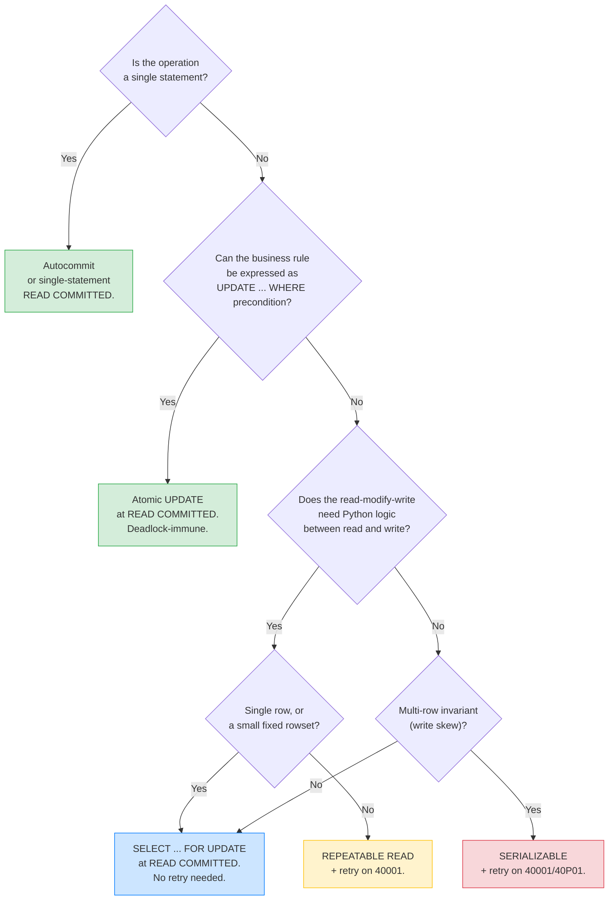
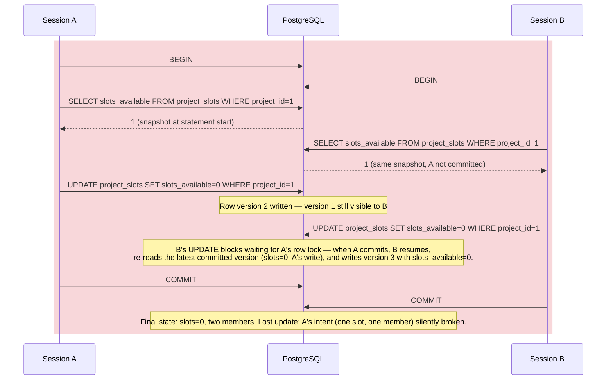
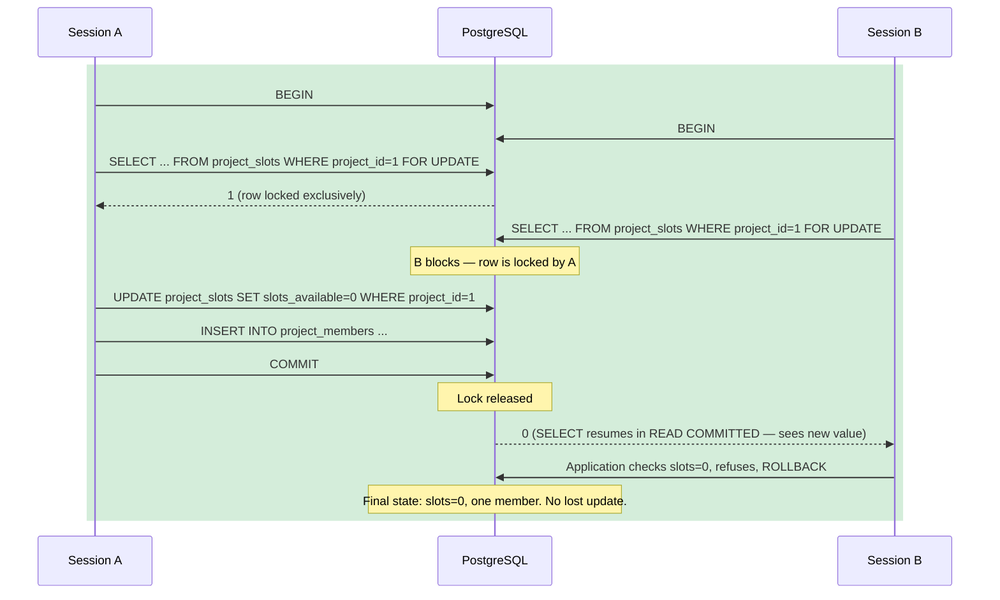
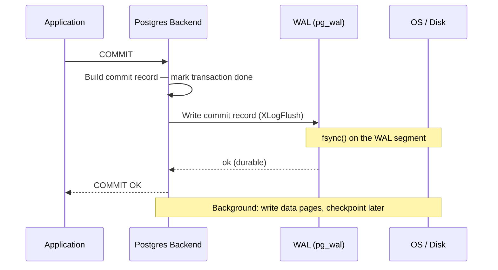

# Lesson 03: Transactions, Isolation, and Locks

*The canonical lesson for `Transactions (SQL)` — ACID, the four isolation levels with concrete anomalies, row locks (`FOR UPDATE`, `FOR SHARE`, `SKIP LOCKED`), deadlocks, advisory locks. A concurrent inventory-update lost-update example, fixed with `SELECT ... FOR UPDATE`.*

**You're in Lesson 03 of Section 06 — and this is a canonical lesson.**

The "M" in ACID is the part engineers get wrong repeatedly. Two requests update the same row at the same time; one of them silently wins and the other silently loses; the product loses money and nobody notices for a week. Every database gives you the tools to make this safe, but the default isolation level in most stacks is `READ COMMITTED` — exactly the level that allows lost updates between a `SELECT` and a following `UPDATE`. This is the canonical lesson for `Transactions (SQL)`; it gets reused by Section 07's session-management lesson, by Section 08's query-plan lesson, and by Section 17's idempotency lesson. Do not skim it.


#sql #postgresql #transactions #concurrency #canonical

## Learning Objectives

By the end of this lesson you will be able to:

1. **Define each letter of ACID** precisely enough to defend it in a code review.
2. **Explain the four SQL isolation levels** and the specific anomalies each permits (dirty read, non-repeatable read, phantom, lost update, serialization anomaly).
3. **Predict when PostgreSQL will use a snapshot vs when it will wait on a lock**, and explain why writers don't block readers in MVCC.
4. **Use `SELECT ... FOR UPDATE` / `FOR SHARE` correctly**, including `NOWAIT` and `SKIP LOCKED` modifiers.
5. **Diagnose a deadlock** from a server log and explain why retrying is safe.
6. **Pick the right concurrency primitive** (transaction, advisory lock, unique constraint, idempotency key) for a given concurrency problem.
7. **Reproduce a lost update** with two `psql` sessions and fix it with both `SELECT ... FOR UPDATE` and `REPEATABLE READ` + retry.

## Prerequisites

- **The Boardly schema from Lesson 1** — [[Relational-Model-and-Constraints]]. This lesson adds an `inventory`-style table to demonstrate a lost update.
- **The reporting queries from Lesson 2** — [[Joins-Aggregations-CTEs]]. Lesson 2's queries were read-only; Lesson 3 makes them concurrent.
- **Two `psql` sessions side by side.** The whole lesson depends on being able to open two transactions simultaneously. Run `docker exec -it pg-academy psql -U postgres -d boardly` in two terminal panes.
- **About 90 minutes of focused time.** This is the densest lesson in the section; budget accordingly.

**The most common gap: "transactions are just BEGIN/COMMIT."**

Most engineers think of a transaction as a `BEGIN ... COMMIT` wrapper — a way to make a batch of statements atomic. That's the A in ACID (atomicity). But the *interesting* parts of a transaction are the I (isolation) and the D (durability) — what *other* transactions see while yours is open, and what survives a crash. The wrapper is one line; the isolation semantics are a whole lesson.


## Think Like a Senior Database Engineer

Before the schema, the mental model. Read this section slowly — every transaction-related incident in production reduces to one of the three questions below answered badly, and every isolation-level "tuning" decision that backfires reduces to ignoring one of them.

### The reframe: an isolation level is a trade-off, not a setting

A senior database engineer reading a query plan or a transaction block does not ask "what isolation level should I use?" — that question treats the level as a knob to be turned until the bug goes away. They ask "what invariant am I protecting, what is the contention pattern, and who pays the retry cost?" The isolation level is the *output* of that analysis, not the *input*.

The three forces in tension:

1. **Correctness.** What invariant must hold after the transaction? (No lost update? No write skew? No phantom? The cheapest primitive that protects the invariant is the right one — `FOR UPDATE` is cheaper than `SERIALIZABLE`+retry for a single-row invariant; `SERIALIZABLE` is the only thing that protects a multi-row invariant like "at least one doctor on call" from write skew.)
2. **Throughput.** How many concurrent writers per second, and on how many distinct rows? (A single hot row at `FOR UPDATE` serialises to `1 / transaction_duration` writers per second; 1000 writers on 1000 distinct rows at `READ COMMITTED` parallelise near-linearly. The contention pattern picks the primitive.)
3. **Retry surface area.** Who implements the retry loop — this transaction's code, or every caller? (`REPEATABLE READ`+retry is fine if the retry lives in one `session_scope` wrapper; `SERIALIZABLE` is a tax on every caller, which is why it is rare in OLTP.)

The default `READ COMMITTED` is right for 95% of OLTP precisely because it makes *no* correctness promise about read-then-write (so you must protect those with `FOR UPDATE` or an atomic `UPDATE`) and imposes *no* retry surface area on the caller (so every route does not need a retry wrapper). The 5% of transactions that need stronger isolation are the ones that need a *per-transaction* decision, not a global default change.

### The three questions on the sticky note

For every transaction you are about to write, ask:

1. **What invariant am I protecting?** (Lost update on a single row? Write skew across rows? Phantom in a count? Each maps to a different primitive — `FOR UPDATE`, `SERIALIZABLE`, `REPEATABLE READ`+retry respectively.)
2. **What is the contention pattern?** (Single hot row? Many writers on distinct rows? Read-heavy with occasional writes? The pattern picks the primitive — `FOR UPDATE` serialises; atomic `UPDATE` parallelises; `SKIP LOCKED` work-steals.)
3. **Who pays the retry cost — me or my caller?** (If me, `REPEATABLE READ`+retry is fine. If my caller is a browser, retry is a UX problem — switch to `FOR UPDATE` and accept the lock wait.)

If you cannot answer all three, you are not ready to pick the isolation level. The default `READ COMMITTED` with an atomic `UPDATE` is the right answer until you can.

### The five positions on the dial

The senior engineer's reading of the concurrency-primitive spectrum is not "stronger is safer" — it is "each position on the dial buys a specific invariant at a specific cost." The five positions:

| Position | Buys | Cost | Retry? |
|---|---|---|---|
| **Autocommit** (no `BEGIN`) | One-statement atomicity | None | None |
| **`READ COMMITTED` + atomic `UPDATE ... WHERE precondition`** | No lost update on a single row | One statement | None |
| **`READ COMMITTED` + `SELECT ... FOR UPDATE`** | Read-modify-write with stable read | A row lock for the transaction duration | None |
| **`REPEATABLE READ` + retry on `40001`** | Stable snapshot; no phantoms; no lost updates | Retry loop in every caller that writes | Yes — caller must catch `40001` |
| **`SERIALIZABLE` + retry on `40001`/`40P01`** | No write skew; full serial-equivalence | SSI overhead (10–20% under heavy contention); retry loop everywhere | Yes — every caller |

The dial is not "more is safer." It is "each step buys a stronger invariant and adds a cost — lock wait, retry surface area, or SSI overhead." Pick the cheapest position that protects your invariant.

### The decision tree



Walk the tree from the top. The first question that returns a primitive is the one you use. The default — `READ COMMITTED` + atomic `UPDATE` — is the answer for the majority of OLTP writes. `FOR UPDATE` is the answer for the read-modify-write with Python logic. `REPEATABLE READ`+retry and `SERIALIZABLE`+retry are the answers for the rare cases where the cheaper primitives cannot express the invariant. The senior engineer reaches for them last, not first.

## The Problem

The Boardly API has a new feature: a per-project "available slots" counter, decremented each time a user joins a project. Two users click "Join" on the same project at the same millisecond. The naive code is:

```python
# VULNERABLE — classic read-then-write lost update.
def join_project(conn, project_id: int, user_email: str):
 with conn.cursor() as cur:
 cur.execute("SELECT slots_available FROM project_slots WHERE project_id = %s",
 (project_id,))
 slots = cur.fetchone()[0]
 if slots <= 0:
 raise ValueError("no slots")
 cur.execute("UPDATE project_slots SET slots_available = %s WHERE project_id = %s",
 (slots - 1, project_id))
 cur.execute("INSERT INTO project_members (project_id, user_email) VALUES (%s, %s)",
 (project_id, user_email))
```

Two requests fire at the same time. Both run `SELECT`, both see `slots = 1`, both run `UPDATE slots = 0`, both insert a member. Final result: `slots_available = 0`, but two members in a one-slot project. The lost update is silent — no error, no warning, just bad data.

This is the *exact* failure mode the relational model's transaction primitives exist to prevent. We'll build the schema, reproduce the bug, and fix it three ways.

**Note — Historical context — Berenson et al., 1995**

The SQL standard defines four isolation levels with a list of "anomalies" each is supposed to permit. Berenson et al.'s 1995 SIGMOD paper "A Critique of ANSI SQL Isolation Levels" showed that the standard's definitions were ambiguous and that several databases (including the SQL Server of the day) implemented them differently from what the prose suggested. The paper introduced *snapshot isolation* (what Postgres implements as `REPEATABLE READ`) and named *write skew* — an anomaly that snapshot isolation does not prevent and that requires `SERIALIZABLE` for. Postgres' `SERIALIZABLE` since 9.1 uses SSI (Serializable Snapshot Isolation) from Cahill et al. (2008) to detect serialization anomalies at commit time. The upshot: the four levels are not what the standard prose suggests; they're what Postgres implements, which is more conservative and better.


## The Code

The lesson has one schema and four transaction variants (the vulnerable baseline plus three fixes). Each is presented as a subsection with its code and the line-by-line commentary inline; the cross-cutting Line-by-Line Deep Dive that follows walks through the concepts (the four isolation levels, the four row-lock flavors, the deadlock rule) that apply to all of them.

### Schema

Add the `project_slots` and `project_members` tables to the Boardly schema:

```sql
-- Extend the Boardly schema with project slots and members.
BEGIN;

CREATE TABLE project_slots (
 project_id bigint PRIMARY KEY REFERENCES projects(id) ON DELETE CASCADE,
 slots_available integer NOT NULL CHECK (slots_available >= 0)
);

CREATE TABLE project_members (
 project_id bigint NOT NULL REFERENCES projects(id) ON DELETE CASCADE,
 user_email text NOT NULL,
 joined_at timestamptz NOT NULL DEFAULT now(),
 PRIMARY KEY (project_id, user_email)
);

-- Seed one project with exactly one slot.
INSERT INTO project_slots (project_id, slots_available) VALUES (1, 1);

COMMIT;
```

Now we have a setup that can lose an update. Two terminals, two transactions, two `UPDATE`s that race.

### Vulnerable (Read-Then-Write at `READ COMMITTED`)

Run this in two `psql` sessions, interleaving as shown:

```sql
-- Session A -- Session B
BEGIN; BEGIN;
SELECT slots_available SELECT slots_available
 FROM project_slots WHERE project_id = 1; FROM project_slots WHERE project_id = 1;
-- returns 1 -- returns 1

UPDATE project_slots SET slots_available = 0
 WHERE project_id = 1;
 UPDATE project_slots SET slots_available = 0
 WHERE project_id = 1;
INSERT INTO project_members (project_id, user_email) INSERT INTO project_members (project_id, user_email)
 VALUES (1, 'alice@example.com'); VALUES (1, 'bob@example.com');

COMMIT; COMMIT;
```

After both commit:

```sql
SELECT slots_available FROM project_slots WHERE project_id = 1; -- 0
SELECT count(*) FROM project_members WHERE project_id = 1; -- 2
```

The project had one slot. Two members joined. The lost update is silent.

#### Why `READ COMMITTED` permits this

`READ COMMITTED` is the Postgres default. Each statement in the transaction gets a *fresh* snapshot of committed data — so the `SELECT slots_available` in Session B sees `slots = 1` even after Session A's `UPDATE` would have set it to 0 *if* Session A had committed before the `SELECT`. (In our interleaving, A hasn't committed yet, so the snapshot still sees `slots = 1`.) The `UPDATE` then writes `slots = 0` regardless — Session B never re-reads the value between its `SELECT` and its `UPDATE`. Session A's write to `slots` is *lost*.



This is the canonical lost update. Under PostgreSQL's default `READ COMMITTED` isolation, B's `UPDATE` *blocks* on the row lock that A's still-uncommitted `UPDATE` holds; when A `COMMIT`s, B's `UPDATE` resumes and re-reads the latest committed row version (now A's write, `slots_available=0`). B then writes row version 3 with `slots_available=0` on top of A's write — but B's `SELECT` (which fed B's application logic) ran *before* A committed and saw `slots_available=1`, which is why B decided to admit a second member. On B's `COMMIT`, A's write of version 2 (`slots_available=0`) is already superseded by B's write of version 3 — A's update is silently lost. The final row state has `slots_available=0` (which both sessions "wanted"), but *two* `project_members` rows were inserted (one per session) because both sessions saw `1` in their snapshot and decided to admit a member. The invariant "one slot = one member" is broken. Three fixes follow.

### Fix 1: `SELECT ... FOR UPDATE`

```sql
-- Session A -- Session B
BEGIN; BEGIN;
SELECT slots_available SELECT slots_available
 FROM project_slots FROM project_slots
 WHERE project_id = 1 WHERE project_id = 1
 FOR UPDATE; FOR UPDATE;
-- returns 1, row locked -- BLOCKS waiting for A
 (waits until A commits or rolls back)

UPDATE project_slots SET slots_available = 0
 WHERE project_id = 1;
INSERT INTO project_members (project_id, user_email)
 VALUES (1, 'alice@example.com');

COMMIT; -- A's COMMIT releases the lock;
 -- B's SELECT resumes, sees slots=0
 -- B's application now sees 0,
 -- raises "no slots", rolls back
 ROLLBACK;
```

The `FOR UPDATE` clause acquires an *exclusive* row lock on the rows returned by the `SELECT`. Other transactions trying to `FOR UPDATE` the same row, or to `UPDATE`/`DELETE` it, must wait until the lock is released (at `COMMIT` or `ROLLBACK`). Session A wins; Session B sees `slots = 0` when its `SELECT` resumes and the application code refuses to decrement further.



### Fix 2: Atomic `UPDATE`

The lock is sometimes overkill. If you can express the entire business rule in a single `UPDATE`, you don't need the lock — the `UPDATE` itself is atomic at the row level:

```sql
-- Session A -- Session B
BEGIN; BEGIN;
UPDATE project_slots UPDATE project_slots
 SET slots_available = slots_available - 1 SET slots_available = slots_available - 1
 WHERE project_id = 1 WHERE project_id = 1
 AND slots_available > 0; AND slots_available > 0;
-- 1 row updated -- waits for A's row lock
INSERT INTO project_members (project_id, user_email) (after A commits)
 VALUES (1, 'alice@example.com'); -- 0 rows updated
COMMIT; -- application sees 0 rows,
 -- raises "no slots", ROLLBACK
```

The `WHERE ... AND slots_available > 0` is the precondition; the `UPDATE` is the action. Both are atomic at the row level. Session B's `UPDATE` blocks on Session A's row lock, but when it resumes it sees `slots_available = 0` and matches zero rows. The application inspects `rowcount` and refuses.

This is the cleanest pattern when you can express the business rule in a single statement. The `SELECT ... FOR UPDATE` pattern is needed when you need to *read* the row, compute in Python, and then write — and the computation can't be expressed in SQL.

**Tip — Prefer the atomic `UPDATE` when you can.**

The atomic `UPDATE` is one statement, requires no explicit lock, and is naturally deadlock-immune (one row, one transaction, no ordering issue). Reach for `SELECT ... FOR UPDATE` only when the read-modify-write genuinely needs Python logic between the read and the write.


### Fix 3: `REPEATABLE READ` + Retry

If you cannot express the rule in one statement and you don't want an explicit lock, switch the isolation level to `REPEATABLE READ` (snapshot isolation in Postgres) and retry on serialization failure:

```sql
-- Both sessions:
SET default_transaction_isolation = 'repeatable read';
BEGIN;
SELECT slots_available FROM project_slots WHERE project_id = 1;
-- ... application logic ...
UPDATE project_slots SET slots_available = slots_available - 1
 WHERE project_id = 1 AND slots_available > 0;
COMMIT;
```

If both transactions are concurrent, the *second* transaction's `UPDATE` blocks on the first's row lock. When the first `COMMIT`s, the second's `UPDATE` fails with:

```
ERROR: could not serialize access due to concurrent update
```

The transaction is aborted — the `COMMIT` never runs. The application catches this error (SQLSTATE `40001` for serialization failure, `40P01` for deadlock) and retries the whole transaction from a new snapshot. The retry path is *required* — without it, your code fails in production the moment concurrency spikes.

**Warning — `REPEATABLE READ` without retry is broken.**

Switching to `REPEATABLE READ` is only safe if your application code has a retry loop around `40001`/`40P01` errors. Without retry, your code fails in production the moment concurrency spikes. The explicit `SELECT ... FOR UPDATE` is usually *clearer* than asking every caller to implement retry. Use `REPEATABLE READ` only when you understand and can implement the retry path.


## Line-by-Line Deep Dive

This section is the heart of the lesson. Read it twice. Don't skip.

### Lines 1–11 of the schema: `project_slots` and `project_members`

```sql
CREATE TABLE project_slots (
 project_id bigint PRIMARY KEY REFERENCES projects(id) ON DELETE CASCADE,
 slots_available integer NOT NULL CHECK (slots_available >= 0)
);
```

**What it does:** Declares a `project_slots` table whose primary key is the `project_id`. One row per project. `slots_available` cannot be negative (the `CHECK`).

Note: the PK *is* `project_id` — no separate `id` column. This is the "natural key" pattern from Lesson 1, applied where the natural key (the project's ID) is genuinely unique and immutable. The one-to-one relationship (one slots row per project) is modeled by making the FK a primary key.

**Think like a senior engineer: the `CHECK` constraint is the last line of defense, not the first.**

The `CHECK (slots_available >= 0)` constraint will reject any `UPDATE` that tries to set `slots_available` below zero. The senior engineer treats this as the *third* layer of defense, not the first. **Layer 1 — the application check.** The service's `if slots <= 0: raise ValueError("no slots")` produces the clearest error to the user (a `409 Conflict` with a meaningful message, not a `500` with a constraint name). **Layer 2 — the atomic `UPDATE ... WHERE slots_available > 0` precondition.** The check and the write happen in one statement, eliminating the race between the read and the write. **Layer 3 — the `CHECK` constraint.** If layers 1 and 2 both fail (a bug in the service, a race the atomic `UPDATE` did not cover, a manual `psql` update by an on-call engineer), the database itself refuses the negative value. The error is ugly (a `500` with `CheckViolationDetail` in the Postgres log) but the data is correct — `slots_available` never goes negative. The senior principle, generalised: every invariant should be defended at *three* layers (application logic, atomic SQL operation, database constraint), with each layer catching what the layer above missed. A single layer is a single point of failure; the database constraint is the layer that survives every bug above it. The corollary: a `CHECK` constraint that is *redundant* with the application logic is not dead weight — it is the defense-in-depth that catches the bug when the application logic drifts.


```sql
CREATE TABLE project_members (
 project_id bigint NOT NULL REFERENCES projects(id) ON DELETE CASCADE,
 user_email text NOT NULL,
 joined_at timestamptz NOT NULL DEFAULT now(),
 PRIMARY KEY (project_id, user_email)
);
```

**What it does:** Declares a `project_members` table whose composite PK is `(project_id, user_email)`. A user can join a project exactly once — enforced by the composite `PRIMARY KEY`, which is also a `UNIQUE` constraint.

The composite PK is the right design here: the *identity* of a membership row is "(this user, in this project)." There's no business meaning to a separate surrogate `id`. Lesson 1 noted that composite PKs are right for pure join tables; this is a near-join table (with one extra column, `joined_at`).

### `BEGIN` and `COMMIT`: the transaction wrapper

```sql
BEGIN;
-- statements
COMMIT;
```

**What it does:** `BEGIN` (or its SQL-standard spelling `BEGIN TRANSACTION` or `START TRANSACTION`) opens a transaction block. All subsequent statements execute inside the transaction. `COMMIT` makes the changes durable; `ROLLBACK` discards them.

If you don't issue `BEGIN`, Postgres runs in *autocommit* mode — every statement is its own transaction, immediately committed. Autocommit is convenient and dangerous: it means a multi-statement business rule (decrement slot, insert member) is not atomic. Two `UPDATE`s in autocommit mode are two transactions; if the second fails, the first is already committed and your data is half-written.

**Why does Postgres default to autocommit when the safe pattern is to wrap related statements in `BEGIN`/`COMMIT`?** Because the database cannot know which statements are *related* — that is a property of your business rule, not of the SQL itself. The database sees two `UPDATE`s; whether they're one logical unit or two independent maintenance commands is something only the application knows. Autocommit is the safe *default for the unaware* — a quick `psql -c "UPDATE users SET last_login = now() WHERE id = 1"` does the right thing and doesn't leave an open transaction waiting for a `COMMIT` that never comes (which would lock rows and bloat the table until the session disconnects). The trade-off is that *multi-statement atomicity* requires the application to opt in with `BEGIN`. The lesson's pattern — `BEGIN; SELECT FOR UPDATE; UPDATE; INSERT; COMMIT;` — is exactly that opt-in, and the discipline of always wrapping related mutations in a transaction block is the discipline the default forces you to learn.

**What happens inside `BEGIN`**

Postgres does *not* acquire a snapshot at `BEGIN` — it acquires the snapshot lazily, at the first statement that needs one (the first `SELECT`, `INSERT`, `UPDATE`, `DELETE`, etc.). The transaction is assigned a *virtual* transaction ID (`virtualxid`, format `5/N`) immediately; the *real* transaction ID (`xid`, format `N`) is assigned only when the transaction first modifies a row (or when `pg_current_xact_id()` is called explicitly). The snapshot, once taken, records the `xmin` (the lowest `xid` still in flight at snapshot time — anything below it is "committed before the snapshot") and `xmax` (the highest `xid` known to be in flight — anything above it is "started after the snapshot, invisible"). Each row carries its own `xmin` (the `xid` of the transaction that inserted it) and `xmax` (the `xid` of the transaction that deleted it, or null if not deleted). Visibility checks compare the row's `xmin`/`xmax` against the snapshot's `xmin`/`xmax` and the `pg_xact` status array. The senior engineer's reading of "the snapshot" is: a list of in-flight transactions at the moment the snapshot was taken, used to decide "was this row's inserter committed before I started?" The lazy snapshot is also why a `BEGIN; SELECT ...; COMMIT;` block that never reads anything never holds a snapshot, never blocks `VACUUM`, and never pins the `xmin` horizon — a useful property for short idle transactions.


### `SET default_transaction_isolation`: the dial

```sql
SET default_transaction_isolation = 'repeatable read';
```

**What it does:** Sets the default isolation level for new transactions in the current session. (Existing transactions are unaffected.)

The four isolation levels, with what Postgres actually does:

| Level | Permits | Postgres behavior |
|-------|---------|-------------------|
| `READ UNCOMMITTED` | (SQL standard: dirty reads) | **Postgres treats as `READ COMMITTED`.** Dirty reads are not implemented. |
| `READ COMMITTED` (default) | non-repeatable reads, phantoms, lost updates under read-then-write | Each statement gets a fresh snapshot. |
| `REPEATABLE READ` | (SQL standard: phantoms; Postgres: *also* prevents phantoms and lost updates — snapshot isolation) | Whole transaction uses one snapshot from the first statement. Write conflicts abort the second committer. |
| `SERIALIZABLE` | serialization anomalies (handled by retry) | SSI detects non-serializable schedules at commit time. |

**Postgres `REPEATABLE READ` is stronger than the SQL standard.**

The SQL standard says `REPEATABLE READ` permits phantoms (a query re-run returns different rows because another transaction inserted new ones). Postgres' `REPEATABLE READ` does *not* permit phantoms — it uses snapshot isolation, which freezes the set of visible rows at transaction start. Postgres' `REPEATABLE READ` is thus closer to what the standard calls "snapshot isolation" — a stricter level. The standard's `REPEATABLE READ` name is kept for SQL-spec compatibility, but the behavior is stronger.


**Student asks: Why is `READ COMMITTED` the default if it allows lost updates?**

Because most transactions are short, single-statement, and don't conflict — `READ COMMITTED` is right for 95% of OLTP workloads, and it doesn't impose retry discipline on the caller. The 5% of transactions that *do* conflict need a *per-transaction* decision, not a global default. Switching the global default to `REPEATABLE READ` would force every caller to implement retry loops even when not needed. The cleaner pattern is: leave the default `READ COMMITTED`, and either use explicit `SELECT ... FOR UPDATE` or atomic `UPDATE ... WHERE` for the specific read-modify-write patterns that need it.


### The four anomalies: concrete examples

Name them with concrete examples, because the abstract names don't stick:

1. **Dirty read** — Transaction A reads uncommitted changes from transaction B. Postgres *never* permits this, even at `READ UNCOMMITTED`.

2. **Non-repeatable read** — A reads `slots = 1`; B commits `slots = 0`; A reads `slots` again and sees `0`. Permitted in `READ COMMITTED`. Prevented by `REPEATABLE READ` (A re-reads from its original snapshot; sees `1` both times).

3. **Phantom** — A runs `SELECT count(*) FROM project_members WHERE project_id = 1`; returns 0. B inserts a member and commits. A re-runs the query; returns 1. Permitted by SQL-standard `REPEATABLE READ`; *not* permitted in Postgres' `REPEATABLE READ` (snapshot isolation freezes the visible set).

4. **Lost update** — A reads `slots = 1`, B reads `slots = 1`, A writes `slots = 0`, B writes `slots = 0`. Final: `slots = 0`, but two members were "accepted." Permitted in `READ COMMITTED`. Prevented by `REPEATABLE READ` (the second `UPDATE` aborts with `ERROR: could not serialize access due to concurrent update`) and by `SELECT ... FOR UPDATE`.

5. **Serialization anomaly** — Two transactions each produce results that are correct alone but together are not equivalent to any serial execution. The classic example is *write skew*: A reads a counter, B reads the same counter, both decide "it's safe to decrement," both write. Each transaction alone is fine; together they over-decrement. Prevented only by `SERIALIZABLE` (SSI).

**When would you NOT reach for `SERIALIZABLE` despite wanting its guarantees?**

Three cases. (1) Workloads with high contention on a small hot rowset — `SERIALIZABLE` aborts and retries so frequently that throughput collapses; the right answer there is a single-writer queue (or `SKIP LOCKED`) at `READ COMMITTED`, not stronger isolation. (2) Long-running transactions (seconds, not milliseconds) — `SIRead` locks pile up, the SSI conflict graph grows, and the abort rate climbs nonlinearly. (3) Read-mostly reporting queries — those don't write, so they can't write-skew; `REPEATABLE READ` (or even `READ COMMITTED` with `READ ONLY`) is enough. The rule: `SERIALIZABLE` only for short read-modify-write transactions that need the strongest guarantee; `READ COMMITTED` + explicit `FOR UPDATE` for everything else.


### `SELECT ... FOR UPDATE` and friends

The four row-locking flavors, in increasing strength:

```sql
SELECT ... FROM t WHERE ... FOR UPDATE; -- strongest
SELECT ... FROM t WHERE ... FOR NO KEY UPDATE; -- weaker; allows FOR KEY SHARE
SELECT ... FROM t WHERE ... FOR SHARE; -- shared; blocks UPDATE/DELETE
SELECT ... FROM t WHERE ... FOR KEY SHARE; -- weakest; blocks DELETE and FOR UPDATE
```

- **`FOR UPDATE`** — exclusive lock; blocks other `FOR UPDATE`, `UPDATE`, `DELETE`. Used when you intend to modify the rows.
- **`FOR NO KEY UPDATE`** — slightly weaker; allows concurrent `FOR KEY SHARE`. (Used internally by some FK checks.)
- **`FOR SHARE`** — shared lock; blocks `UPDATE`/`DELETE` but allows other `FOR SHARE`. Used when you read a row and want to ensure it's not modified before you commit, but you don't intend to modify it yourself.
- **`FOR KEY SHARE`** — weakest; blocks `DELETE` and `SELECT ... FOR UPDATE`, but allows plain `UPDATE` of non-key columns.

**Why are there four flavors and not just one (`FOR UPDATE`)?** Because the lock matrix is asymmetric: a transaction that reads a row to *verify a foreign key* needs to block `DELETE` (so the parent row doesn't disappear before the child commits) but does *not* need to block plain `UPDATE`s that change only non-key columns. Forcing every read-side lock to be `FOR UPDATE` would make a parent-row insert serialise against *every* child transaction that reads the parent — a contention bottleneck for any one-to-many relationship with frequent child inserts. The four flavors let the database enforce the minimum-strength lock the operation needs: FK validation uses `FOR KEY SHARE` (allows updates of non-key columns), an explicit read-with-intent-to-modify uses `FOR UPDATE` (blocks everything), and the in-between forms cover the cases in between. The trade-off is operator complexity — you have to know which one your query needs — but the throughput win on hot parent rows is worth it.

**What happens inside `SELECT ... FOR UPDATE`**

Postgres acquires a row lock by writing the locking transaction's `xid` into the `xmax` system column of the tuple — yes, even for a `SELECT`, not just an `UPDATE`. The lock is a "multi-exclusive" lock on the tuple, and the mechanism is the same as a delete: the tuple's `xmax` is set to the locker's `xid`, with the *infomask* bits recording "this is a lock, not a delete" so subsequent readers do not see the row as deleted. The lock manager (`lock.c`, `proc.c`) maintains a per-tuple wait queue; concurrent lockers queue and are woken in FIFO order, with the exception of `SKIP LOCKED` (which skips the queue and returns the row as not-locked-but-skipped) and `NOWAIT` (which fails immediately with `ERROR: could not obtain lock on row in relation "..."`). The lock is released at `COMMIT`/`ROLLBACK` (or at `PREPARE TRANSACTION` for two-phase commit, which keeps the lock alive across a server restart). The cost of a row lock is not the lock itself — it is the wait: each blocked transaction holds its own snapshot, which prevents `VACUUM` from reclaiming dead tuples that fall in the blocked transaction's visibility window. The senior engineer's rule: the row lock is cheap; the *wait* behind it is what bloats the table. See "Production Reality" below for the bloat consequences.


Modifiers:

- **`NOWAIT`** — fail immediately instead of waiting: `SELECT ... FOR UPDATE NOWAIT`. Returns `ERROR: could not obtain lock on row in relation "t"`.
- **`SKIP LOCKED`** — skip the locked rows: `SELECT ... FOR UPDATE SKIP LOCKED`. Perfect for queue-style work stealing.
- **`OF table_name`** — lock rows from a specific table when joining multiple.

### The job-queue pattern with `SKIP LOCKED`

A common pattern is a job queue: N workers each pop the next 10 pending jobs. Without `SKIP LOCKED`, the workers serialize; with it, they parallelize:

```sql
-- Pop the next 10 unprocessed jobs without blocking other workers.
SELECT id, payload
FROM job_queue
WHERE status = 'pending'
ORDER BY created_at
LIMIT 10
FOR UPDATE SKIP LOCKED;
```

Each worker grabs a *different* 10 jobs — locked rows are skipped, not waited on. The application then `UPDATE`s each job's `status` to `'running'` and `COMMIT`s.

**Tip — `SKIP LOCKED` is the building block of every Postgres-backed queue.**

A surprising number of production job-queue systems (including parts of Celery, RQ, and many in-house schedulers) are just `SELECT ... FOR UPDATE SKIP LOCKED` over a `jobs` table. The pattern is older than `SKIP LOCKED` itself (the older way was `NOWAIT` and a retry loop), but `SKIP LOCKED` makes it clean. The full job-queue design (crash recovery, dead-letter, retries) is in [[14-Caching-and-Background-Processing/Background-Tasks-vs-Workers]].


**Warning — When this breaks: the stuck job queue after a worker hangs mid-job.**

**Symptom.** A job-queue worker pops 10 jobs with `SELECT ... FOR UPDATE SKIP LOCKED`, processes the first 3, and hangs — the C extension it called deadlocks in a way that doesn't kill the process but leaves it wedged, or the worker makes an HTTP call to a slow downstream service that hangs without a timeout. The remaining 7 jobs are still locked — the lock is held by the worker's transaction, which is still open (the worker is still alive, just not making progress). The next worker, dispatched to process the same queue, sees the 7 locked jobs and skips them (`SKIP LOCKED`); the jobs appear "stuck in pending" forever. The diagnosis in production: `SELECT pid, state, query, xact_start, NOW() - xact_start AS duration FROM pg_stat_activity WHERE state = 'idle in transaction';` shows the hung worker's connection, with `xact_start` from hours ago and `state = 'idle in transaction'`; the `pg_locks` table shows row locks on the 7 stuck jobs held by that connection.
**Diagnosis.** The `FOR UPDATE SKIP LOCKED` lock is held until the transaction ends (`COMMIT` or `ROLLBACK`). A worker that hangs without ending the transaction leaves the lock held. The Postgres server does not detect the hang (the connection is still open, the worker is still alive); the connection pool does not reclaim the connection (the worker hasn't returned it). The jobs stay locked until the hung worker is killed (the OS closes the TCP socket, the server aborts the transaction, the locks release) or until `idle_in_transaction_session_timeout` fires (Postgres aborts the transaction after the configured timeout).
**Fix.** Three layers. (1) Wrap the job-processing in a transaction scope that rolls back on *any* exception — `with session.begin(): ...` in SQLAlchemy 2.x, or `try: ...; except: ROLLBACK; raise` in raw SQL. The `with session.begin():` block calls `ROLLBACK` on `__exit__` if an exception propagates, which closes the transaction and releases the locks. This handles the "exception" case but not the "hang" case (a hang doesn't raise an exception). (2) Set `idle_in_transaction_session_timeout` per-connection (60 seconds for OLTP workers, 300 seconds for batch workers) so Postgres aborts the hung transaction automatically after the configured timeout — the row locks release, the stuck jobs become poppable by the next worker. This is the safety net for the "hang" case. (3) Set a timeout on every external call the worker makes (the `httpx` client's `timeout=10`, the database's `statement_timeout=30s`) so the worker cannot hang indefinitely — the timeout raises an exception, which triggers layer (1)'s rollback. The combination: transaction scope (handles exceptions), `idle_in_transaction_session_timeout` (handles hangs), and call timeouts (turns hangs into exceptions). All three are needed; any one alone leaves a failure mode open. See [[14-Caching-and-Background-Processing/Background-Tasks-vs-Workers]] for the full job-queue crash-recovery pattern.


### Deadlocks

A and B each hold a lock the other wants. Postgres' deadlock detector (default `deadlock_timeout = 1s`) wakes up, picks a victim, aborts one transaction with `ERROR: deadlock detected`. The application must retry.

```sql
-- Transaction A
BEGIN;
UPDATE accounts SET balance = balance - 10 WHERE id = 1; -- locks id=1
UPDATE accounts SET balance = balance + 10 WHERE id = 2; -- waits for B

-- Transaction B (interleaved)
BEGIN;
UPDATE accounts SET balance = balance - 5 WHERE id = 2; -- locks id=2
UPDATE accounts SET balance = balance + 5 WHERE id = 1; -- waits for A
-- Deadlock. One aborts with: ERROR: deadlock detected
```

The classic fix: **acquire locks in a consistent order**. Always lock `min(id), max(id)` or sort by primary key before issuing `UPDATE`s on multiple rows in a transaction. If A and B both lock in ascending ID order, the deadlock cannot happen — A locks `id=1` first; B's `UPDATE id=1` waits, then A locks `id=2`, then A commits, then B proceeds.

**Why does Postgres' deadlock detector wait 1 second by default before aborting?** Because the wait-and-detect cycle is cheaper than preventing deadlocks proactively. The detector sleeps for `deadlock_timeout` (default 1 second), then runs the wait-for graph cycle check on the lock table. If a transaction has been waiting longer than the timeout, the graph is searched for cycles; if a cycle is found, one transaction is aborted. The 1-second sleep is a hysteresis: most "waiting" transactions are not actually deadlocked, just queued behind legitimate work; waking up the deadlock detector for every wait would waste CPU on graph cycles that almost never exist. The trade-off is that real deadlocks take at least 1 second to resolve (a latency blip for the victim's caller); the alternative — lock-timeout-based prevention — would force every application to set lock timeouts everywhere, which is more configuration surface than most deployments want. The 1-second default can be tuned (`deadlock_timeout = 200ms` for latency-sensitive deployments) but rarely needs to be.

**What happens inside the deadlock detector**

The deadlock detector is a *lazy* algorithm. Each backend, when it discovers it must wait for a lock, sets a 1-second timer (the `deadlock_timeout` configured above) and sleeps. On wake-up, it walks the lock table (`pg_locks`) and builds the wait-for graph: each backend is a node; each "I am waiting for transaction X" is a directed edge from "me" to "X." It then runs a depth-first cycle search starting from itself; if a cycle is found, the victim is the transaction in the cycle that has done the *least* work (measured in shared-buffer modifications), with ties broken by the transaction's `pid` ordering (matching the `**Q**` callout below). The victim is woken and aborts with `ERROR: deadlock detected`. The 1-second delay is hysteresis: most waits are not deadlocks; the cost of searching the graph for every wait would dominate. The detector runs *only* when a wait exceeds the timeout. The senior engineer's reading: a "deadlock detected" error in your logs is also a "the deadlock detector woke up after 1 second, ran the cycle search, and chose your transaction as the victim" — the 1-second delay is a *minimum* latency floor on every deadlock, not a bug.


**Student asks: which transaction does Postgres pick as the deadlock victim? Can I rely on it being deterministic?**

You cannot. Postgres picks the victim as the transaction that has done the *least* work (measured in shared-buffer modifications), with ties broken by the transaction's internal `pid` ordering. The rationale is "abort whichever transaction is cheapest to retry" — a transaction that has only run one `UPDATE` is cheaper to roll back and re-run than one that has run fifty. Two consequences. (1) **Do not write code that depends on which side wins** — e.g. "if my transaction aborts, the other side must have finished first, so I'll skip my update" is a bug; after the abort you must re-read state and decide again, because the surviving transaction may also have aborted later for an unrelated reason. (2) **The victim selection is non-deterministic across runs** because `pid` ordering depends on connection-pool dispatch. A test that asserts "A wins, B is the victim" will pass today and fail tomorrow when the pool hands out connections in a different order. The fix: write your tests to assert the *post-state* (only one `UPDATE` applied), not the *victim identity*.


**Warning — Catching `OperationalError` and silently retrying a write is a footgun.**

A retry is only safe if the transaction is *idempotent*. If you're decrementing `balance`, a naive retry decrements twice. Either retry only on serialization errors (SQLSTATE `40001`/`40P01`) and re-fetch the row, or design the operation to be idempotent. Lesson 17 ([[17-Advanced-Architecture/Idempotency-and-Retries]]) covers the full retry-pattern design.


### Advisory locks

Application-defined locks that don't touch any row. Two flavors:

```sql
-- Transaction-level (released at COMMIT/ROLLBACK)
SELECT pg_advisory_xact_lock(7); -- blocks if another tx holds lock 7

-- Session-level (released at session end or explicit unlock)
SELECT pg_advisory_lock(7);
SELECT pg_advisory_unlock(7);

-- Try-lock variants return bool, do not block (note: pg_try_advisory_lock, not pg_advisory_try_lock)
SELECT pg_try_advisory_lock(7);
```

Use cases: a single-writer cron guard, "exactly one migration runner," a per-tenant rate-limiter gate, an idempotency lock keyed by an external request ID.

```sql
-- Exactly one worker runs the nightly reconciliation.
BEGIN;
SELECT pg_advisory_xact_lock(hashtext('nightly-reconciliation'));
-- ... do work ...
COMMIT; -- releases the lock
```

The first worker to grab the lock runs; concurrent workers either skip or wait. No app-level lock table needed. Trade-off: advisory locks are invisible to introspection tooling and the application must release them correctly (use transaction-scoped variants to avoid leaks).

**Why use `hashtext(...)` for an advisory lock key when the function accepts an `int` directly?** Because most application-level lock names are strings ("nightly-reconciliation", "tenant-42-migration", "payment-processor-1") and the advisory lock API takes only a 64-bit `bigint`. Hashing the string to a bigint (`hashtext("nightly-reconciliation")`) gives you a stable, collision-resistant mapping from any string to a lock key, with the trade-off that two different strings can hash to the same `int` (an `int4` hash like `hashtext` has ~4 billion slots, so collisions are rare but possible). For lock keys, the worst case of a collision is *cooperative* — two unrelated named locks serialize against each other, which is a throughput bug, not a correctness bug. The right mitigation is to use the two-int form (`pg_advisory_xact_lock(int, int)` — two int32 halves combine into a 64-bit key, vs. `hashtext`'s 32-bit space) and split a 64-bit hash into two int32 halves for a much larger key space; for the simple "one named global lock" case, `hashtext` is good enough.

**Danger — How an attacker thinks: the advisory-lock key as a denial-of-service primitive.**

The `pg_advisory_xact_lock(hashtext(user_input))` pattern lets the application derive a lock key from arbitrary user input. The senior security engineer's reading: if the attacker controls the input to `hashtext`, the attacker controls the lock key — and `hashtext` is a 32-bit hash with ~4 billion slots, which means a determined attacker can find a collision against any target lock key with ~65,000 candidate inputs (a birthday attack against the 32-bit space, feasible in minutes with direct SQL access or in hours via the application's API by observing which inputs cause blocking). The attack: the application uses `pg_advisory_xact_lock(hashtext(tenant_id))` to serialise per-tenant work, and a critical system lock uses `pg_advisory_xact_lock(hashtext('nightly-reconciliation'))`. The attacker finds a `tenant_id` value whose `hashtext` collides with `hashtext('nightly-reconciliation')` — call it the collision tenant. The attacker then issues requests that trigger the per-tenant lock for the collision tenant; each request holds the lock for the duration of its transaction; the nightly-reconciliation worker, scheduled to run at 02:00, blocks on the lock the attacker is holding; the reconciliation never runs; the morning report is missing data. The blast radius is proportional to how long the attacker can keep the lock held (the request timeout is the upper bound). The defence is structural: never let user input become an advisory-lock key directly. Derive lock keys from system constants (`pg_advisory_xact_lock(7)` for the nightly reconciliation — a hardcoded `int` with no user input), or HMAC the user input with a server secret (`pg_advisory_xact_lock(hashtext(hmac_sha256(server_secret, tenant_id)))`) so the attacker cannot predict the lock key for a given input. The two-int form (`pg_advisory_xact_lock(int4, int4)` — two int32 halves combine into a 64-bit key) raises the collision space from ~4 billion to ~10^19, which makes birthday attacks infeasible but does not change the structural rule: user input does not become a lock key without a server-side secret. The grep `rg "pg_advisory.*hashtext" boardly/` should return only system-constant inputs, not user-controlled ones.


### What an isolation level does not prevent

Switching to `SERIALIZABLE` does not free you from the application logic for:

- **Logic bugs.** `WHERE active = TRUE` is parameter-safe; if the API only returns active users, that's a logic bug, not a transaction bug.
- **Privilege escalation via your own application logic.** Transactions don't enforce authorization.
- **Denial of service via a parameter that triggers a Seq Scan on a 1B-row table.** Bind the parameter (Lesson 5) *and* index the column (Lesson 4).

## Execution Trace: COMMIT and Durability

When you issue `COMMIT`, here's what happens internally:



The synchronous `fsync` on the WAL is what gives you *durability* — the D in ACID. Without it, a crash between "COMMIT OK" to the client and the actual write to disk would mean a transaction the application believes committed is gone. Postgres writes the WAL record (which says "transaction N committed") *before* replying to the client; the data pages themselves are written later by the background writer and the periodic `CHECKPOINT`.

**`synchronous_commit` — the durability dial.**

`synchronous_commit = on` (the default) means "fsync the WAL before replying COMMIT OK." `synchronous_commit = off` means "reply COMMIT OK before fsync" — faster, but a crash within ~50ms of commit can lose the transaction. Production systems rarely turn this off for transactional writes; some analytics workloads and bulk loads do. `synchronous_commit = remote_write`/`remote_flush` is for synchronous replication — see [[08-PostgreSQL/Backups-and-Recovery]].


**Production reality: `synchronous_commit` is a per-transaction setting, not a global default.**

The `synchronous_commit = on` default is right for almost all OLTP writes — a payment, a password change, a registration: the user expects the commit to survive a crash. The production question is not "should `synchronous_commit` be on or off?" but "which transactions can afford to lose a commit?" The answer is almost always "none of the user-facing ones" — but the exceptions are real: a metric increment (a `cdn_logins_total` counter) is replayable from the application log if lost; a session-state update (a `last_seen` timestamp) is overwritten on the next request if lost; a background-worker heartbeat is idempotent if lost. For these, `SET LOCAL synchronous_commit = off` inside the transaction batches the commit with the next group commit (Postgres's `wal_writer_delay = 200ms` groups up to 200ms of commits into one `fsync`), and the throughput on the WAL rises from ~1000 commits/sec (per `fsync`) to ~10000 commits/sec (per group commit). The setting is per-transaction (`SET LOCAL` inside `BEGIN`) so a single connection can serve both durable and non-durable writes; the global default stays `on` so the durable writes do not accidentally get the non-durable behaviour. The failure mode to avoid: setting `synchronous_commit = off` globally (in `postgresql.conf` or `ALTER DATABASE ... SET`) — every write, including the password change, becomes non-durable; a crash within 200ms loses the user's password change; the user cannot log in afterwards; the support ticket is "I changed my password but the new one does not work." The per-transaction setting is the discipline; the global default is the safety net. See [[08-PostgreSQL/Backups-and-Recovery]] for the replication consequences (`synchronous_commit = remote_flush` for synchronous replicas, where the durability point moves from the local WAL to the replica's WAL).


**What happens inside `COMMIT`**

Postgres commits a transaction in five steps. (1) Acquire `XidGenLock` (a lightweight LWLock) to assign (or read) the transaction's `xid` — this is the moment the transaction becomes "real" in the system catalog. (2) Write the commit record to the WAL buffer via `XLogInsert` — the record says "transaction N committed at LSN L." (3) Call `XLogFlush` to `fsync` the WAL buffer up to LSN L to the on-disk WAL segment (this is the *durability* point — the line that `synchronous_commit=on` makes synchronous). (4) Mark the transaction's status bit in `pg_xact` (the commit-status file, 2 bits per transaction, 8192 bytes per page × 4 transactions per byte = ~32,768 transactions per page) — from "in progress" to "committed." (5) Reply `COMMIT OK` to the client. The data pages themselves are written later by the background writer and the periodic `CHECKPOINT`. The senior engineer's reading: `COMMIT OK` to the client means "the WAL is on disk"; it does *not* mean "the data pages are on disk." A crash between `COMMIT OK` and the next checkpoint is recovered by replaying the WAL on startup — which is why the WAL is the source of truth, not the data files. The corollary: the WAL's grow-only append model is what makes durability cheap. Overwriting data pages would require fsync-per-data-page; appending to the WAL requires one fsync per commit, batched across transactions by the WAL's sequential layout. The 50-millisecond write cost is amortised across every concurrent committer.


## Common Mistakes

**Warning — Reading a value, computing in Python, then updating without a lock.**

This is the textbook lost update. Either use `FOR UPDATE`, do an atomic `UPDATE ... WHERE x > 0`, or use `REPEATABLE READ` and retry.


```sql
-- WRONG: read-then-write without a lock; lost update on concurrent sessions
BEGIN;
SELECT slots_available FROM project_slots WHERE project_id = 1;
-- Python computes new_slots = slots_available - 1 (e.g. 1 -> 0)
UPDATE project_slots SET slots_available = 0 WHERE project_id = 1;
COMMIT;
-- Symptom: two concurrent sessions both read slots=1, both write slots=0,
-- both INSERT a project_members row -- two members for one slot. The lost
-- update is silent at the DB layer; the invariant "one slot = one member"
-- is broken only at the application layer.

-- RIGHT: lock the row for the duration of the read-modify-write
BEGIN;
SELECT slots_available FROM project_slots WHERE project_id = 1 FOR UPDATE;
-- Python computes new_slots = slots_available - 1
UPDATE project_slots SET slots_available = 0 WHERE project_id = 1;
COMMIT;
```

**Warning — Long-running transactions in a request handler.**

Each open transaction holds snapshot, prevents `VACUUM` from reclaiming dead tuples, and bloats the table. The 30-second request timeout is *not* a transaction budget; aim for transactions to last milliseconds. If you need to do work that takes seconds, do it *outside* the transaction — see the checkout pattern below.


**Warning — Catching `OperationalError` and silently retrying a write.**

A retry is only safe if the transaction is *idempotent*. If you're decrementing `balance`, a naive retry decrements twice. Either retry only on serialization errors (`SQLSTATE 40001`/`40P01`) and re-fetch the row, or design the operation to be idempotent.


```sql
-- WRONG: blind retry of a non-idempotent write can double-spend
BEGIN;
UPDATE accounts SET balance = balance - 100 WHERE id = 1;
-- network blip, client retries the whole transaction
COMMIT;  -- may or may not have happened server-side
-- retry path runs the UPDATE again, balance is now down by 200

-- RIGHT: only retry on serialization-failure SQLSTATE, and re-read inside
-- the new transaction so the balance reflects the prior commit
-- (pseudo-code; SQLSTATE check belongs in the Python except block)
BEGIN;
SELECT balance FROM accounts WHERE id = 1;  -- re-fetch fresh value
UPDATE accounts SET balance = balance - 100 WHERE id = 1;
COMMIT;
-- On SQLSTATE 40001/40P01: ROLLBACK, back off, retry the whole block.
```

**Warning — Holding locks across network calls.**

Once you `FOR UPDATE` a row, every other writer blocks. If you then make an HTTP call before `COMMIT`, you've turned a millisecond lock into a 3-second lock. Don't. The realistic pattern is: lock, modify, commit, *then* do the network call.


**Warning — Using `SERIALIZABLE` without a retry loop.**

Without retry on `40001`, your code will fail in production the moment concurrency spikes. `SERIALIZABLE` *requires* retry discipline from every caller.


```sql
-- WRONG: SERIALIZABLE without retry — fails on the first conflict, surfaces to user
SET transaction_isolation = 'serializable';
BEGIN;
SELECT slots_available FROM project_slots WHERE project_id = 1;
UPDATE project_slots SET slots_available = slots_available - 1 WHERE project_id = 1;  -- blocks, then ERROR: could not serialize access due to concurrent update
COMMIT;  -- never reached; the transaction is already aborted at the UPDATE
-- Symptom: intermittent 500s under load; the user-visible error is not actionable.

-- RIGHT: SERIALIZABLE with bounded retry on SQLSTATE 40001/40P01
-- (Python loop with exponential backoff; pseudo-code below)
-- for attempt in range(5):
--     with engine.begin() as conn:
--         conn.exec_driver_sql("SET transaction_isolation = 'serializable'")
--         row = conn.execute(text("SELECT slots_available FROM project_slots WHERE project_id = 1")).first()
--         new_slots = row[0] - 1
--         conn.execute(text("UPDATE project_slots SET slots_available = :s WHERE project_id = 1"), {"s": new_slots})
--         return  -- committed; we're done
--     # except OperationalError as e: if e.orig.sqlstate in ('40001', '40P01'): continue; else raise
```

**Warning — Forgetting that `SELECT ... FOR UPDATE` on no rows locks nothing.**

If you intend to insert a row that must be unique per some key, use a partial unique index or `INSERT ... ON CONFLICT`, not `SELECT ... FOR UPDATE` followed by an `INSERT`. Lesson 5 covers `ON CONFLICT` for the upsert pattern.


```sql
-- WRONG: SELECT ... FOR UPDATE then INSERT — races on the "no row yet" case
BEGIN;
SELECT id FROM project_slots WHERE project_id = 999 FOR UPDATE;  -- returns 0 rows; no lock taken
-- session B runs the same SELECT; also gets 0 rows, no lock
INSERT INTO project_slots (project_id, slots_available) VALUES (999, 1);  -- both sessions insert
COMMIT;  -- duplicate row created; the FOR UPDATE locked nothing because there was no row
-- Symptom: a unique constraint violation if you're lucky; a duplicate row if you're not.

-- RIGHT: use ON CONFLICT (or a partial UNIQUE index + INSERT ... ON CONFLICT)
INSERT INTO project_slots (project_id, slots_available)
VALUES (999, 1)
ON CONFLICT (project_id) DO UPDATE SET slots_available = project_slots.slots_available - 1;
-- The unique constraint on project_id is the actual lock; ON CONFLICT serializes the inserts.
```

## Engineering Trade-Offs

### `READ COMMITTED` vs `REPEATABLE READ`

`READ COMMITTED` is the Postgres default and the right default for OLTP — most request-handler transactions are short, single-statement-ish, and don't conflict. `REPEATABLE READ` (snapshot isolation) prevents lost updates *and* phantoms in Postgres — but requires retry logic. Switch per-transaction, not globally, when you have a specific read-modify-write pattern.

### `SERIALIZABLE` vs explicit locks

`SERIALIZABLE` is more declarative and avoids lock-ordering bugs; it pushes retry responsibility onto every caller. Explicit `FOR UPDATE` is more verbose and local; lock ordering is your problem. In practice, financial code mixes both: `SERIALIZABLE` for the read path, `FOR UPDATE` for the row-modifying path. The overhead of SSI in Postgres 17 is moderate (10–20% under heavy contention) — acceptable for correctness-critical paths, expensive for high-throughput hot rows.

### Advisory lock vs row in a `locks` table

Advisory locks are faster and don't bloat your tables, but they're invisible to introspection tooling and the application must release them correctly (use transaction-scoped variants). Use a real `locks` table only when you need persistence across server restarts.

### `ON CONFLICT DO NOTHING` vs `SELECT ... FOR UPDATE` then `INSERT`

The `ON CONFLICT` path is one statement, deadlock-immune, and atomic. It is almost always the right answer for "insert if missing" patterns. `FOR UPDATE` is for read-modify-write on *existing* rows.

### Atomic `UPDATE` vs `SELECT FOR UPDATE`

If the business rule can be expressed as `UPDATE ... WHERE precondition`, prefer it — one statement, no lock ceremony, deadlock-immune. Reach for `FOR UPDATE` only when the read-modify-write genuinely needs Python logic between the read and the write.

**Warning — When this breaks: the partial-rowcount of a multi-row atomic `UPDATE`.**

**Symptom.** The application runs `UPDATE project_slots SET slots_available = slots_available - 1 WHERE project_id IN (1, 2, 3) AND slots_available > 0` expecting to decrement 3 projects. The `rowcount` is 2 (only 2 of the 3 projects had slots). The application code does `assert result.rowcount == 3` and raises an `AssertionError`; the transaction is rolled back; the 2 successful decrements are undone; the user sees a `500`. The on-call engineer sees the alert, investigates, and finds that project 3 had `slots_available = 0` (it was already exhausted) — the partial-rowcount is *correct behaviour* (the precondition `slots_available > 0` filtered out project 3), not a bug.
**Diagnosis.** An atomic `UPDATE` succeeds or fails *per row*, not per statement. The `WHERE` clause is applied to each row independently; some rows match (and are updated), others don't (and are skipped). The `rowcount` is the number of rows that matched. The application code that asserts `rowcount == expected_count` is treating the atomic `UPDATE` as if it were all-or-nothing — it is not.
**Fix.** Two patterns. (1) The per-row decision: `UPDATE ... RETURNING project_id` returns the IDs of the decremented projects; the application compares the returned set against the requested set and reports "projects 1 and 2 decremented; project 3 was already exhausted" to the user. (2) The all-or-nothing decision: if the business rule is "decrement all or none", wrap the `UPDATE` in a `REPEATABLE READ` transaction and `SELECT` the counts *before* the `UPDATE` to verify all 3 are > 0; the `SELECT` + `UPDATE` pair is a read-modify-write that needs `FOR UPDATE` or `REPEATABLE READ` + retry to be race-safe. The senior question for every multi-row atomic `UPDATE`: *is the application's `rowcount` check `== expected` or `>= 1` or `== 0`?* — the answer picks the pattern. A `== expected` check is a bug if any row can legitimately fail the precondition.


**Spot the bug — does this transaction fix the lost update?**

```sql
BEGIN;
SELECT slots_available FROM project_slots WHERE project_id = 1;
-- Python computes new_slots = slots_available - 1
UPDATE project_slots SET slots_available = new_slots WHERE project_id = 1;
COMMIT;
```
No. The `SELECT` is a plain read — no `FOR UPDATE`, no row lock. Two concurrent sessions can both read `slots_available = 1`, both compute `0`, both write `0`, and both `COMMIT`. The fix is `SELECT ... FOR UPDATE` so session B's read blocks until session A commits — or, better, the atomic `UPDATE project_slots SET slots_available = slots_available - 1 WHERE project_id = 1 AND slots_available > 0`, which folds the precondition into the write and returns 0 affected rows if the slot is gone.


### When you write `BEGIN` by hand vs when you let the ORM drive it

This lesson is the SQL-Fundamentals section, so every transaction is hand-written `BEGIN; ...; COMMIT;`. In a real `Boardly` deployment, the SQLAlchemy `Session` does this for you — `session.commit()` is the SQLAlchemy surface for `COMMIT`, and the `Session` opens the transaction lazily on first query. The choice between hand-written SQL and ORM-driven is the most-missed "when to use what" for transactions, so we treat it as a decision.

**The three forms, side by side.** The same lost-update fix, written three ways:

```sql
-- Form A — raw SQL with BEGIN/COMMIT (this lesson's form)
BEGIN;
SELECT slots_available FROM project_slots WHERE project_id = 1 FOR UPDATE;
-- Python computes new_slots = slots_available - 1
UPDATE project_slots SET slots_available = $1 WHERE project_id = 1;
COMMIT;
```

```python
# Form B — SQLAlchemy Session.commit() (the canonical ORM form)
from sqlalchemy.orm import Session

with Session(engine) as session, session.begin():
    row = session.scalars(
        select(ProjectSlot).where(ProjectSlot.project_id == 1).with_for_update()
    ).one()
    row.slots_available -= 1
    session.commit()  # ← ORM drives BEGIN ... COMMIT
```

```python
# Form C — session_scope context manager (the wrappers-of-the-world form)
from contextlib import contextmanager

@contextmanager
def session_scope(engine):
    session = Session(engine)
    try:
        yield session
        session.commit()       # explicit commit on the happy path
    except Exception:
        session.rollback()     # explicit rollback on the unhappy path
        raise
    finally:
        session.close()

# Usage
with session_scope(engine) as session:
    row = session.scalars(
        select(ProjectSlot).where(ProjectSlot.project_id == 1).with_for_update()
    ).one()
    row.slots_available -= 1
    # commit happens at the `with` exit
```

All three forms produce the same `BEGIN ... SELECT FOR UPDATE ... UPDATE ... COMMIT` sequence on the wire. The difference is **who owns the transaction boundary** and **how retry / rollback / connection-pool return is handled**.

**The decision table:**

| Need | Reach for | Why |
|---|---|---|
| Teaching / learning transactions (this lesson) | Raw SQL with `BEGIN`/`COMMIT` in `psql` | Forces you to see the transaction boundary; you can't `commit()` accidentally |
| Production application code with SQLAlchemy | `Session.commit()` inside `session.begin()` (Form B) | The ORM owns the BEGIN/COMMIT, the connection-pool return, and the rollback-on-exception; one less thing to forget |
| A team that wants one place to log every commit / retry on serialization failure | `session_scope` context manager (Form C) | The wrapper is the single place to add logging, retry, and metrics — the route code is unchanged |
| A one-off script that talks to Postgres directly (no SQLAlchemy) | Raw SQL with `psycopg` or `asyncpg` (Form A) | No ORM dependency; the script is small enough that hand-written transaction boundaries are honest |
| A migration that must run before the app starts | Raw SQL via `psql` or `alembic` (Form A) | Migrations should not run through the ORM — the ORM's models may not match the schema being migrated |

**The rule of thumb.**

**In production application code, let the ORM drive the transaction (`session.commit()` inside `session.begin()`). Write raw `BEGIN`/`COMMIT` only in migrations, one-off scripts, and teaching material. Wrap the `Session` in a `session_scope` context manager only when you have a cross-cutting concern to apply to every transaction (logging, retry-on-serialization-failure, metrics).** Three forms, three questions: "is this application code?", "is this a migration / script?", "do I have a cross-cutting concern to apply?" — and the answer picks the form.


**Why does this lesson use raw SQL if the ORM form is the right answer for production?**

Because the lesson is teaching what a transaction *is*, not how to use the ORM. When you write `BEGIN; SELECT ... FOR UPDATE; UPDATE; COMMIT;` by hand in `psql`, you see the transaction boundary explicitly. When you call `session.commit()` in SQLAlchemy, the boundary is hidden — the ORM opens `BEGIN` lazily on first query and `COMMIT`s at the `commit()` call, but you don't see the `BEGIN` print statement. For learning, raw SQL is honest. For production, the ORM form is the right answer because forgetting `COMMIT` (or forgetting `ROLLBACK` on exception) is a real bug class that the ORM's `with session.begin()` eliminates. The canonical sequel is [[07-SQLAlchemy/05-Session-and-Transaction-Management]].


**Warning — Don't mix raw `BEGIN` and `session.commit()` in the same transaction.**

The classic bug: a route opens a `Session`, runs a `session.execute(text("BEGIN"))`, then calls `session.commit()` — and the commit is a no-op because the session *already* opened `BEGIN` lazily. Or the reverse: a route calls `session.execute(text("BEGIN"))` *before* any other query, then runs queries, then calls `session.commit()` — and the commit closes the *session's* implicit transaction, but the *raw* `BEGIN` is still open, leaving the connection in a half-state. The rule: pick one form per transaction. If you're using the ORM, let `session.begin()` own the `BEGIN`. If you're using raw SQL, don't use the ORM for that transaction.


**The retry-on-serialization-failure concern is where Form C earns its keep.**

Form A (raw SQL) handles retry by writing a `for attempt in range(3): try: BEGIN; ...; COMMIT; except SerializationFailure: ROLLBACK; continue` loop by hand — verbose, easy to forget, easy to get wrong (e.g., retrying without re-issuing the `SELECT FOR UPDATE`). Form B (`session.commit()`) handles retry the same way — you write the loop in application code. Form C (`session_scope`) is the only form where the retry logic lives in *one* place (the wrapper), so every transaction in the application gets retry for free. If your app has 30 transaction-bearing routes and 3 of them need retry-on-serialization-failure, Form C is the right answer — push the retry into the wrapper and the 30 routes become 30 simple `with session_scope(engine) as session: ...` blocks. The canonical retry pattern is taught in [[07-SQLAlchemy/05-Session-and-Transaction-Management]].


**Tip — The `with session.begin():` form is the Form B answer to Form C's retry concern.**

SQLAlchemy 2.x's `with session.begin():` block (used in Form B above) is itself a context manager — it opens the transaction on `__enter__` and commits/rolls back on `__exit__`. Form B already has the "single place for commit-on-success and rollback-on-failure" property that Form C is sold on. The reason to add Form C *on top of* Form B is when you need to apply a *cross-cutting concern the Session doesn't know about* — e.g., retry-on-serialization-failure (the Session won't retry; it just raises), or per-transaction metrics, or per-transaction request-id propagation to the database's `application_name` setting. If you don't have such a concern, Form B alone is enough.


**Note — Where this connects to the rest of the vault.**

The full SQLAlchemy form (Form B) is taught in [[07-SQLAlchemy/05-Session-and-Transaction-Management]] — including the `Session.begin()` / `Session.commit()` / `Session.rollback()` API, `expire_on_commit`, `flush` vs `commit`, and the retry-on-serialization-failure pattern. The async variant (`AsyncSession`) is taught in [[07-SQLAlchemy/07-Async-SQLAlchemy]] and uses the same surface. This lesson's raw-SQL forms are the substrate those lessons build on — the ORM is a convenience over the same `BEGIN`/`COMMIT` primitives.


## A Realistic Pattern: Checkout With External Side-Effect

A checkout flow that decrements inventory *and* charges a card. The two operations must be atomic in spirit — but the card charge is a network call and you can't hold a database transaction open across it. The realistic pattern:

1. `BEGIN; SELECT ... FOR UPDATE` the inventory row.
2. Decrement inventory; insert `order` with status `pending_payment`.
3. `COMMIT;`
4. Charge the card *outside* the transaction.
5. `BEGIN; UPDATE order SET status = 'paid';` If the charge failed, restore inventory. `COMMIT;`

The `FOR UPDATE` in step 1 prevents two concurrent checkouts from both seeing "1 in stock." The separation of step 4 from the database transaction prevents long-running locks and deadlocks with the payment processor. The pattern generalizes: *do the database work atomically, do the side-effect outside the transaction, reconcile on failure*.

## When This Breaks: A Senior Engineer's Debugging Guide

The Common Mistakes section catalogued the patterns to avoid; this section catalogues the *production failures* that surface when those patterns meet traffic. Each is presented as symptom → diagnosis → fix, the way an on-call engineer sees them at 3 a.m.

### Failure 1: `ERROR: deadlock detected`

**Warning — When this breaks: intermittent `500` errors under concurrent multi-row writes**

**Symptom.** Production logs show `psycopg.errors.DeadlockDetected: deadlock detected` (SQLSTATE `40P01`) on a small fraction of `POST /transfer` requests. The user-facing error is "Internal Server Error" because the route handler does not catch `40P01` specifically. The post-state is correct (no double-spend) because the victim transaction was rolled back — but the user's request failed and they retried.
**Diagnosis.** Open the Postgres log at the timestamp of the deadlock. The log line above the `deadlock detected` line is a `CONTEXT: while waiting for transaction ...` line that names the row the victim was waiting on, and the `PROCESS: ...` line names the other transaction in the cycle. Reproduce by looking at the two transactions' SQL — they almost always lock rows in opposite orders (A locks `account 1` then `account 2`; B locks `account 2` then `account 1`). The wait-for graph cycle is exactly the lock-acquisition order reversed.
**Fix.** Acquire locks in a consistent order. For multi-row transfers, sort the row IDs and lock in ascending order: `SELECT id FROM accounts WHERE id IN ($1, $2) ORDER BY id FOR UPDATE`. For two-phase updates across tables, document the lock order in the service and enforce it via a shared helper (`acquire_locks(session, sorted_ids)`). The fix is structural — every multi-row write in the codebase follows the same lock order. Add a CI test that reproduces the deadlock under concurrency (two threads, reversed orders) and asserts the fix works.


### Failure 2: `ERROR: could not serialize access due to concurrent update`

**Warning — When this breaks: intermittent `40001` serialization failures under load**

**Symptom.** Production logs show `psycopg.errors.SerializationFailure: could not serialize access due to concurrent update` (SQLSTATE `40001`) on `REPEATABLE READ` or `SERIALIZABLE` transactions. The route handler does not catch `40001`, so the user sees a `500`. The error rate climbs with concurrency — at low load it never fires, at high load it fires on 5% of requests.
**Diagnosis.** The `REPEATABLE READ` snapshot was taken before the conflicting transaction committed; the `UPDATE` cannot be applied against the new committed version without violating the snapshot. Postgres aborts the second committer rather than silently losing the update. The error rate climbing with concurrency is the SSI conflict graph approaching a clique — every concurrent transaction aborts.
**Fix.** A bounded retry loop with exponential backoff. Catch `40001` (and `40P01` for deadlock) in the `session_scope` wrapper (see "When you write `BEGIN` by hand" above — the Form C wrapper), roll back, sleep for `2 ** attempt * 10ms` (with jitter to avoid thundering herd), and retry the whole transaction. Re-fetch the row inside the new transaction — the snapshot was taken on retry, so the value reflects the prior commit. Cap at 3–5 attempts; surface the error to the caller if all attempts fail (the system is overloaded, not the user's fault). The retry loop is the *mandatory* cost of `REPEATABLE READ` and `SERIALIZABLE`. See [[17-Advanced-Architecture/Idempotency-and-Retries]] for the full pattern.


### Failure 3: The silent lost update

**Warning — When this breaks: two members in a one-slot project; no error in the logs**

**Symptom.** A production incident: two users joined a one-slot project. Both received a `201 Created` response. The logs show no errors. The `project_slots` table shows `slots_available = 0`, but `project_members` shows two rows for the project. The invariant "one slot = one member" is broken silently.
**Diagnosis.** Grep the route handler for `SELECT ... FOR UPDATE` or `UPDATE ... WHERE precondition` on the `project_slots` table. Neither is present — the handler does `SELECT slots_available; check in Python; UPDATE slots_available = slots - 1; INSERT project_members`. Two concurrent requests both read `slots = 1`, both pass the Python check, both `UPDATE` to `0`, both `INSERT`. No error because nothing in the database layer rejected the second `UPDATE` — the read-then-write happened at the application layer, where there is no atomicity check.
**Fix.** Three options, in order of preference. (1) Atomic `UPDATE project_slots SET slots_available = slots_available - 1 WHERE project_id = $1 AND slots_available > 0` — check `rowcount`; if 0, refuse. One statement, deadlock-immune, no Python between read and write. (2) `SELECT ... FOR UPDATE` on the slot row before the `UPDATE` — Session B blocks until Session A commits, then sees `slots = 0` and refuses. (3) `REPEATABLE READ` + retry — the second `UPDATE` aborts with `40001`; retry. Option (1) is the right answer for this exact pattern; option (2) is the right answer when the Python computation between read and write cannot be expressed in SQL; option (3) is the right answer only when you cannot restructure the read-modify-write as a single statement.


### Failure 4: `idle in transaction` blocking `VACUUM`

**Warning — When this breaks: table bloat grows; queries slow; autovacuum logs "stopping due to xid horizon"**

**Symptom.** The `users` table grows from 10 GB to 50 GB over a week, even though row churn is modest. `SELECT * FROM pg_stat_user_tables WHERE relname = 'users'` shows `n_dead_tup` in the hundreds of millions and `last_autovacuum` from a week ago. The autovacuum log shows `automatic vacuum of "users": ... stopping due to xid horizon`. Queries against `users` are slower than they were last week — the planner picks `Seq Scan` more often.
**Diagnosis.** `SELECT pid, state, xact_start, query FROM pg_stat_activity WHERE state = 'idle in transaction';` returns one or more rows with `xact_start` from hours ago. A connection in the pool opened a transaction, ran a `SELECT`, and then sat idle — the application made an HTTP call (or waited on a lock, or just leaked the session) without committing. That open transaction's `xmin` is the *oldest* `xmin` in the system, and `VACUUM` cannot reclaim any dead tuple whose `xmax` is greater than that `xmin` — because the idle transaction might still read it. The table bloats until the transaction commits or the connection dies.
**Fix.** Set `idle_in_transaction_session_timeout` (default `0` = off) per-connection via `connect_args={"server_settings": {"idle_in_transaction_session_timeout": "60000"}}` (60 seconds). Any transaction idle for more than 60 seconds is aborted automatically — Postgres sends the connection a `SIGINT`-equivalent and rolls back. The connection pool returns the connection to the pool in a clean state. The 60-second value is generous for OLTP (most request transactions finish in milliseconds); for batch jobs that legitimately sit in a transaction for minutes, raise it per-connection. The grep: `rg "idle in transaction" var/log/postgres/` should be empty in steady state; if it isn't, you have a leak.


### Failure 5: `ON CONFLICT DO UPDATE` returning 0 rows on a partial index

**Warning — When this breaks: a soft-deleted user's email cannot be re-registered**

**Symptom.** A user deletes their account (soft-delete: `is_active = False`); they re-register with the same email; the `INSERT ... ON CONFLICT (email) DO UPDATE` returns "0 rows affected" or behaves as if no conflict occurred — but the registration succeeds in creating a *duplicate* email row, breaking the soft-delete invariant. Or: the `ON CONFLICT` always fires the `DO NOTHING` path and never the `DO UPDATE` path, even when there is a real conflict.
**Diagnosis.** Check the unique index on `users(email)`. If it is a partial index (`CREATE UNIQUE INDEX users_email_active_unique ON users(email) WHERE is_active = TRUE`), the `ON CONFLICT (email)` clause without `WHERE` does not match the partial index — Postgres cannot infer which partial index to use as the arbiter. The `INSERT` runs against the table, finds no conflict against the partial index (because the soft-deleted user's row is excluded by the predicate), and inserts a duplicate. The error is silent: the `ON CONFLICT` clause is *present* in the SQL but *not enforced* because no matching unique index exists.
**Fix.** Two paths. (1) Add the partial-index predicate to the `ON CONFLICT` clause: `INSERT ... ON CONFLICT (email) WHERE is_active = TRUE DO UPDATE SET ...` — Postgres matches the partial index by both columns and predicate, and the upsert works. (2) Drop the partial index and use a regular unique index on `users(email)` *plus* a separate `is_active` column — the unique constraint fires on any duplicate email, and the application handles the soft-delete logic in the `DO UPDATE` branch (e.g. `DO UPDATE SET is_active = TRUE, hashed_password = EXCLUDED.hashed_password`). Option (1) is the right answer when you genuinely want the partial-index invariant (one active user per email, but unlimited soft-deleted rows); option (2) is the right answer when the partial-index predicate is more ceremony than the invariant needs.


## How an Attacker Thinks

A senior security engineer reading your transaction layer looks for four things attackers love: *read-then-write windows on monetary invariants*, *promotional quota races*, *phantom inserts on upsert paths*, and *timing side-channels on existence checks*.

**Danger — How an attacker thinks: TOCTOU on a balance transfer**

The classic time-of-check-to-time-of-use (TOCTOU) attack. The `POST /transfer` endpoint does `SELECT balance FROM accounts WHERE id = $1`, checks `balance >= amount` in Python, then `UPDATE accounts SET balance = balance - amount WHERE id = $1`. An attacker opens two browser tabs, both initiate a $100 transfer from an account with $100 balance. Both pass the Python check (both see `balance = 100`), both `UPDATE` to `0`, both succeed. Final balance: `-$100` (if no `CHECK (balance >= 0)` constraint) or the second `UPDATE` fails with `IntegrityError` (if there is — which surfaces as a `500` to the user and a duplicate error in the logs, but the *business* outcome is the attacker's first transfer succeeded at the expense of the legitimate user). The defense is `SELECT ... FOR UPDATE` on the account row before the Python check — Session B's `SELECT` blocks until Session A commits, then sees `balance = 0` and refuses. The better defense is `UPDATE accounts SET balance = balance - amount WHERE id = $1 AND balance >= amount` — one statement, atomic, no Python between read and write. The senior question for every monetary write: *is the check and the write in the same atomic statement?* If not, an attacker can race them.


**Danger — How an attacker thinks: the promotional-quota race**

A "first 100 signups get $10 credit" promotion. The handler does `SELECT count(*) FROM signups WHERE promo = 'first100'`, checks `count < 100` in Python, then `INSERT INTO signups (promo, user_id) VALUES ('first100', $user_id)`. An attacker fires 100 concurrent requests at the signup endpoint from 100 different accounts (or one account with 100 threads). All 100 see `count = 0`, all 100 pass the Python check, all 100 insert. Final count: 100 signups for $1000 of credit, where the promotion was supposed to be $100 total. The defense is the atomic `UPDATE` on a counter row: `UPDATE promo_quota SET claimed = claimed + 1 WHERE code = 'first100' AND claimed < 100 RETURNING claimed` — if `RETURNING` returns a row, the signup is valid; if it returns no row, the quota is exhausted. The counter row is the contention point; the atomic `UPDATE` is the lock. The senior question for every "first N" or "limited quantity" promotion: *is the check and the increment in the same atomic statement?* The race window is milliseconds; the attacker's tool is concurrency.


**Danger — How an attacker thinks: the phantom insert on the upsert path**

A coupon-redemption flow that uses `SELECT id FROM coupons WHERE code = $1 FOR UPDATE`; if no row, `INSERT INTO coupons (code, ...) VALUES ($1, ...)`. An attacker fires two concurrent redemption requests for the same coupon code that has not been created yet. Both `SELECT ... FOR UPDATE` return 0 rows (no row to lock — the `FOR UPDATE` on an empty result set locks nothing); both `INSERT` runs; both succeed. The attacker has now "redeemed" the coupon twice — or, if the coupon is for a one-time discount, has applied the discount to two separate orders. The defense is the unique constraint as the lock: `INSERT INTO coupons (code, ...) VALUES ($1, ...) ON CONFLICT (code) DO UPDATE SET redeemed_at = NOW() RETURNING id` — the unique constraint on `code` is the atomic check-and-insert; one of the two concurrent `INSERT`s wins, the other gets the `ON CONFLICT` path. The senior question for every "insert if missing" pattern: *is there a unique constraint that makes the check-and-insert atomic?* `SELECT ... FOR UPDATE` then `INSERT` is broken on the empty-set case; `ON CONFLICT` is the fix.


**Danger — How an attacker thinks: timing-based enumeration via lock waits**

A login endpoint that does `SELECT id FROM users WHERE email = $1 FOR UPDATE` before checking the password. An attacker submits login attempts for `existing@example.com` and `nonexistent@example.com`. The existing-email attempt blocks on the `FOR UPDATE` if another transaction is reading that row — say, a legitimate user's session refresh — for ~50ms. The nonexistent-email attempt returns immediately (no row to lock, no wait). The timing difference between "50ms response" and "5ms response" tells the attacker which emails exist in the database, without ever seeing a row. The defence is constant-time responses: run the *same* queries for existing and nonexistent accounts, then check the result and return the same response shape (and the same approximate latency) regardless. For login specifically, the canonical pattern is "always run the bcrypt comparison, even against a dummy hash for nonexistent accounts" — the bcrypt cost is the timing-equalising primitive. The senior question for every existence-check query: *does the response time depend on whether the row exists?* If yes, the timing channel leaks existence.


## Production Reality

The transaction primitives in this lesson are taught as code-shape decisions; in production they are also *scale* and *operation* decisions. The four points below are what changes when the lesson's two-session `psql` demo meets a 1000-connection production database with autovacuum, replication, and a 24/7 traffic profile.

**Production reality: MVCC bloat and the `xmin` horizon**

Postgres' MVCC model means `UPDATE` and `DELETE` do not modify rows in place — they create new row versions and mark old versions as dead. `VACUUM` reclaims the dead tuples. But `VACUUM` cannot reclaim a dead tuple if *any* open transaction's `xmin` is older than the tuple's `xmax` — because that transaction might still need to read the old version. The consequence: a single 60-minute transaction holds the entire system's `xmin` horizon at 60 minutes ago; every dead tuple created since then accumulates. A busy table with 10,000 updates per second accumulates 36 million dead tuples in 60 minutes — at ~200 bytes per tuple, that is ~7 GB of un-reclaimable dead tuples per hour the transaction stays open. A week of "60-minute transactions" (perhaps a long-running analytics query, or a stuck `idle in transaction` connection) produces 50 GB+ of table bloat. The diagnosis: `SELECT application_name, state, xact_start, NOW() - xact_start AS duration FROM pg_stat_activity WHERE state != 'idle';` — sort by `duration DESC`; the top row is your `xmin` holder. The fix: kill the long-running transaction (it will retry, hopefully with a tighter scope); set `idle_in_transaction_session_timeout` to prevent recurrence; run `VACUUM (VERBOSE, ANALYZE)` on the bloated table to reclaim the dead tuples *after* the holder is gone. See VACUUM and Bloat for the full bloat lifecycle.


**Production reality: `idle in transaction` killing `VACUUM`**

The most common cause of MVCC bloat in production is not a deliberate long-running query — it is a connection-pool leak. A request handler opens a transaction (via `get_session`), runs a `SELECT`, makes an HTTP call to a payment processor, the payment processor is slow (or down), and the request sits in `idle in transaction` for the duration of the HTTP timeout (often 30 seconds). The connection pool returns the connection only after the request ends; the connection still holds the open transaction; the `xmin` horizon is pinned. With 100 worker processes each opening one such transaction per minute, the steady-state `xmin` horizon is 30 seconds — modest, but enough to prevent `VACUUM` from reclaiming tuples in the busiest tables. The fix is the realistic checkout pattern from this lesson: *do the database work atomically, do the side-effect outside the transaction, reconcile on failure*. The `COMMIT` happens before the HTTP call to the payment processor; the `idle in transaction` window is milliseconds, not seconds. The fallback is `idle_in_transaction_session_timeout` per-connection (see Failure 4 above) — but the timeout is a safety net, not a substitute for the right pattern.


**Production reality: lock wait queues and the `1 / transaction_duration` throughput ceiling**

A row locked by `FOR UPDATE` serialises every other transaction that wants to lock the same row. The throughput ceiling on that row is `1 / transaction_duration` — if the transaction holds the lock for 10ms, the ceiling is 100 writes per second on that row, regardless of how many CPU cores or how fast the disk. A hot row (a counter, a quota, a "next ID" allocator) under `FOR UPDATE` is a single-writer bottleneck. Two mitigations. (1) *Shorten the transaction* — move every non-database step out of the transaction (HTTP calls, logging, metrics) so the lock is held only for the database work. (2) *Avoid the row lock* — use the atomic `UPDATE ... WHERE precondition` instead of `SELECT ... FOR UPDATE; UPDATE`, when the Python logic can be expressed in SQL; the atomic `UPDATE` still serialises on the row, but it does not hold the lock across the Python computation between read and write. A third option, for true hot-row contention: shard the counter (e.g. `counter_shards` table with `(counter_id, shard)` PK; each writer picks a random shard; the reader sums across shards) — the atomic `UPDATE` on a random shard parallelises across N shards. Note: Postgres does *not* do lock escalation (unlike some databases that escalate row locks to page/table locks at a threshold). The consequence is no "lock escalation surprise," but also no automatic relief — 10000 row locks on a `SELECT ... FOR UPDATE` is 10000 row locks, with the memory and CPU cost that implies.


**Production reality: the retry-storm under `SERIALIZABLE`**

SSI (Serializable Snapshot Isolation) aborts transactions whose commit would produce a non-serializable schedule. The abort rate climbs non-linearly as the conflict graph approaches a clique — every transaction's reads conflict with every other transaction's writes. The symptom: under modest concurrency (say 50 concurrent `SERIALIZABLE` transactions on a 10-row table), the abort rate is 5%; under heavy concurrency (200 concurrent transactions), the abort rate is 60% — and the retries *themselves* contribute to the load, aborting again, retrying again, in a feedback loop. The diagnosis: `SELECT xact_commit, xact_rollback FROM pg_stat_database WHERE datname = 'boardly';` — if `xact_rollback / (xact_commit + xact_rollback) > 0.05`, the SSI load is too high. The fix: drop to `READ COMMITTED` + `FOR UPDATE` for the hot transactions; keep `SERIALIZABLE` only for the cold ones (the ones with genuine multi-row invariants that cannot be expressed as a single atomic `UPDATE`). The retry-storm is why most OLTP deployments default to `READ COMMITTED` — `SERIALIZABLE` is correct, but the retry cost under contention is not. See [[13-Performance-and-Observability/N-plus-1-and-Slow-Queries]] for the monitoring pattern that catches the rollback rate before it becomes a storm.


## Exercises

**Tip — The 20-minute rule.**

If you're stuck on an exercise for more than 20 minutes, re-read the relevant section above, then move on and come back.


**Exercise 1 — Two sessions, dirty read impossible.** Open two `psql` sessions. In one, `BEGIN; UPDATE project_slots SET slots_available = 5 WHERE project_id = 1;` (don't commit). In the other, run `SELECT slots_available FROM project_slots WHERE project_id = 1;`. Note that the second session sees the *old* value (1), not the uncommitted 5. Explain why — and explain why even setting `SET default_transaction_isolation = 'read uncommitted'` does not change this.

**Exercise 2 — Reproduce the lost update, fix with `FOR UPDATE`.** Reproduce the lost update diagram in the lesson. Then re-run with `FOR UPDATE` and observe Session B blocking. Confirm the final state: `slots = 0`, one member, no silent loss.

**Exercise 3 — Switch to `REPEATABLE READ` and observe serialization failure.** Set `default_transaction_isolation = 'repeatable read'` in both sessions. Reproduce the lost-update pattern. The *second* to `COMMIT` should fail with `ERROR: could not serialize access due to concurrent update`. Catch it in Python and retry once; confirm the retry succeeds.

**Exercise 4 — Job queue with `SKIP LOCKED`.** Create a `job_queue` table with `id`, `status`, `payload`, `created_at`. Insert 100 rows of `status='pending'`. Open two `psql` sessions and pop batches of 10 with `SELECT ... FOR UPDATE SKIP LOCKED LIMIT 10` in each. Confirm no job is popped twice.

**Exercise 5 — Deadlock and the fix.** Reproduce the deadlock example (A locks id=1 then id=2; B locks id=2 then id=1). Observe the deadlock error. Then rewrite both transactions to acquire locks in ascending `id` order; confirm the deadlock does not occur.

## Verification

**Open two terminals, each running `psql`.**

A "two-session" verification needs two concurrent connections to the same database. The clean way is two terminal panes:

1. Open a terminal. Run `psql -d boardly`. This is **session A** — type your `BEGIN`, your `SELECT ... FOR UPDATE`, your `UPDATE`, your `COMMIT`/`ROLLBACK` here. Leave it running.
2. Open a *second* terminal (a new tab, a new window, or a `tmux` pane via `Ctrl-b c` or split with `Ctrl-b %`). Run `psql -d boardly` again. This is **session B** — type the conflicting statement here and watch it block (or fail with `NOWAIT`, or skip the row with `SKIP LOCKED`).
3. Keep both panes visible so you can interleave A and B statements in the order this lesson shows.

Do not background `psql` with `&` for this exercise — a backgrounded `psql` cannot prompt you interactively, and you need to type statements one at a time in each session. (The `psql ... &` pattern in the bash block below is for a single-shot smoke test only.)

If you do not have `tmux` installed, two terminal windows side by side work identically.


```sql
-- Inspect current isolation level.
SHOW transaction_isolation;

-- See what's locked (run from a third session, or after the test).
SELECT locktype, relation::regclass, virtualxid, pid, mode, granted
FROM pg_locks
WHERE pid <> pg_backend_pid()
ORDER BY granted, mode;

-- Block on a row to verify FOR UPDATE behavior.
-- Session 1: BEGIN; SELECT * FROM project_slots WHERE project_id=1 FOR UPDATE;
-- Session 2: SELECT * FROM project_slots WHERE project_id=1 FOR UPDATE NOWAIT;
-- Expected: ERROR: could not obtain lock on row in relation "project_slots"
```

```bash
# Quick single-shot concurrency smoke test (no interactive interleaving).
# This is NOT the way to verify the FOR UPDATE SKIP LOCKED exercises — for
# those, open two psql sessions as described in the **Note** callout above.
psql -d boardly -c "BEGIN; SELECT * FROM project_slots WHERE project_id=1 FOR UPDATE;" &
sleep 0.2
psql -d boardly -c "SELECT * FROM project_slots WHERE project_id=1 FOR UPDATE NOWAIT;"
wait
```

## Previously Learned Here

This is the **canonical lesson for `Transactions (SQL)`**. Later lessons reuse this concept without re-explaining:

- **[[07-SQLAlchemy/05-Session-and-Transaction-Management]]** — how SQLAlchemy `Session` wraps `BEGIN`/`COMMIT`/`ROLLBACK`, how the session's `expire_on_commit` interacts with isolation, and how to set isolation per session.
- **[[08-PostgreSQL/EXPLAIN-ANALYZE-and-Query-Plans]]** — when a plan shows a `Lock` node, this is the lesson that explains what kind and why.
- **[[17-Advanced-Architecture/Idempotency-and-Retries]]** — serialization-failure retry is the building block for any idempotent retry strategy.

When those lessons touch transaction semantics, they link back here.

Concepts from earlier sections are reused here without re-explanation:

- **`FastAPI lifespan`** — [[03-FastAPI-Core/Application-and-Lifespan]]. The engine that owns the connection outlives any single transaction. This lesson is the per-request, per-transaction layer under the lifespan.
- **Async context managers** — [[01-Python-Foundations/Iterators-Generators-Context-Managers]]. The `with transaction:` pattern (or `BEGIN/COMMIT` in `psql`) is a context manager.
- **Python exceptions** — [[01-Python-Foundations/Exceptions-Done-Right]]. Catching and translating `OperationalError` on `40001` is the same exception-handling pattern from Phase 1.

## What's Next

In [[Indexes-and-Query-Planning]] we make the queries fast — and the locks' shapes get cheaper. You'll:

- Learn B-tree, hash, GiST, GIN, BRIN at a conceptual level and pick the right one.
- Design composite indexes with the right column order ("equality columns first, then range, then sort").
- Use partial and expression indexes to keep indexes small and effective.
- Read a basic `EXPLAIN` plan shape (without `ANALYZE`) and predict whether a query will be fast.
- Diagnose the most common reasons an index isn't being used.

By the end of Lesson 4, you'll know why the locked row in this lesson's `FOR UPDATE` was found via an index scan and not a sequential scan — and what to do when the planner picks the wrong plan.

## Sources

- **PostgreSQL 17 — "Transaction Isolation"** — <https://www.postgresql.org/docs/17/transaction-iso.html> — accessed 2026-10-19 — definitive reference for the four isolation levels and the specific anomalies each prevents, with PostgreSQL-specific behavior notes (snapshot isolation in `REPEATABLE READ`, SSI in `SERIALIZABLE`).
- **PostgreSQL 17 — "Explicit Locking"** — <https://www.postgresql.org/docs/17/explicit-locking.html> — accessed 2026-10-19 — `FOR UPDATE`/`FOR SHARE` semantics, `SKIP LOCKED`/`NOWAIT`, advisory lock family.
- **PostgreSQL 17 — "Deadlocks"** — <https://www.postgresql.org/docs/17/transaction-iso.html#XACT-DEADLOCK-DETECTION> — accessed 2026-10-19 — `deadlock_timeout`, detection algorithm, victim selection.
- **PostgreSQL 17 — "Reliability and the Write-Ahead Log"** — <https://www.postgresql.org/docs/17/wal.html> — accessed 2026-10-19 — durability, `synchronous_commit`, `fsync`, checkpoints.
- **Berenson et al. — "A Critique of ANSI SQL Isolation Levels" (1995, SIGMOD)** — paper — accessed 2026-10-19 — source of the anomalies named here (snapshot isolation, write-skew); explains why SQL-standard isolation levels are insufficient and what Postgres actually implements.
- **Cahill et al. — "Serializable Isolation for Snapshot Databases" (2008, SIGMOD)** — paper — accessed 2026-10-19 — the SSI algorithm Postgres uses to implement `SERIALIZABLE` without two-phase locking.

## What We Learned

Let's recap. In this lesson you:

- **Defined ACID precisely** — Atomicity (all-or-nothing), Consistency (constraints hold after commit), Isolation (concurrent transactions behave as if in some order), Durability (`fsync` on WAL before COMMIT OK).
- **Walked through the four isolation levels** with the specific anomalies each permits, and noted that Postgres' `REPEATABLE READ` is stronger than the SQL standard's (snapshot isolation, no phantoms).
- **Reproduced a lost update** with two `psql` sessions at `READ COMMITTED`, then fixed it three ways: `SELECT ... FOR UPDATE`, atomic `UPDATE ... WHERE precondition`, and `REPEATABLE READ` with retry.
- **Used row-locking modifiers** — `FOR UPDATE`, `FOR SHARE`, `NOWAIT`, `SKIP LOCKED` — and built the job-queue pattern with `SKIP LOCKED`.
- **Diagnosed deadlocks** and learned the consistent-lock-order rule to prevent them.
- **Used advisory locks** for cross-resource coordination (`pg_advisory_xact_lock(hashtext(...))`).
- **Internalized the realistic checkout pattern** — atomic database work, external side-effects outside the transaction, reconciliation on failure.
- **Internalised the senior database engineer's mental model** — an isolation level is a trade-off between correctness, throughput, and retry surface area (not a setting); the three questions (what invariant, what contention, who retries); the five positions on the dial from autocommit to `SERIALIZABLE`+retry; and the decision tree that picks the cheapest primitive protecting the invariant.
- **Saw what happens inside four primitives** — `BEGIN` (lazy snapshot, `virtualxid`→`xid` transition, `xmin`/`xmax` columns), `SELECT ... FOR UPDATE` (writes the locker's `xid` into the tuple's `xmax` with infomask bits, the wait queue, the cost is the wait not the lock), the deadlock detector (lazy 1-second sleep then wait-for graph cycle search), and `COMMIT` (the 5-step path ending at `XLogFlush` `fsync` of the WAL, with `pg_xact` status bits and the WAL as the source of truth).
- **Worked through five production failures** — `deadlock detected` (lock ordering fix), `could not serialize access due to concurrent update` (retry loop with backoff), the silent lost update (atomic `UPDATE` preferred), `idle in transaction` blocking `VACUUM` (`idle_in_transaction_session_timeout` per-connection), and the `ON CONFLICT DO UPDATE` partial-index trap (align the `conflict_target` with the partial-index predicate).
- **Studied four attacker vectors** — TOCTOU on a balance transfer (atomic `UPDATE ... WHERE balance >= amount`), the promotional-quota race (atomic `UPDATE` on a counter row), the phantom insert on the upsert path (`ON CONFLICT` instead of `SELECT ... FOR UPDATE` then `INSERT`), and timing-based enumeration via lock waits (constant-time responses; bcrypt as the timing-equaliser for login).
- **Felt the production realities** — MVCC bloat and the `xmin` horizon (60-minute transaction → 50 GB of un-reclaimable dead tuples), `idle in transaction` killing `VACUUM` (the connection-pool leak pattern and the checkout-pattern fix), the `1 / transaction_duration` throughput ceiling on hot rows (and Postgres not doing lock escalation), and the retry-storm under `SERIALIZABLE` (rollback rate > 5% means drop to `READ COMMITTED` + `FOR UPDATE` for the hot path).

Here's the mental model to walk away with: *the default isolation level allows lost updates. Every read-then-write pattern in your code is a lost-update waiting to happen, unless you use an atomic `UPDATE`, an explicit `FOR UPDATE` lock, or `REPEATABLE READ`+retry. Transactions are short — milliseconds, not request-lifetime. Locks are not held across network calls. Advisory locks are the building block of "exactly one." And `SERIALIZABLE` is not free — it requires retry discipline from every caller.*

---

> A note from your teacher
You just learned the lesson that production teams pay six-figure consulting fees to learn the hard way. Sit with that. The default isolation level allows lost updates. The default Python driver opens transactions implicitly per statement. The default FastAPI handler holds a database connection for the whole request, not just the database part. Every default is a footgun until you understand it. We're going to make these queries fast next, then defend them against injection — but the transaction discipline you learned today stays the same. See you in Lesson 04.


---

**Tags:** #sql #postgresql #transactions #concurrency #canonical #review
**Previous:** [[Joins-Aggregations-CTEs]]
**Next:** [[Indexes-and-Query-Planning]] →
