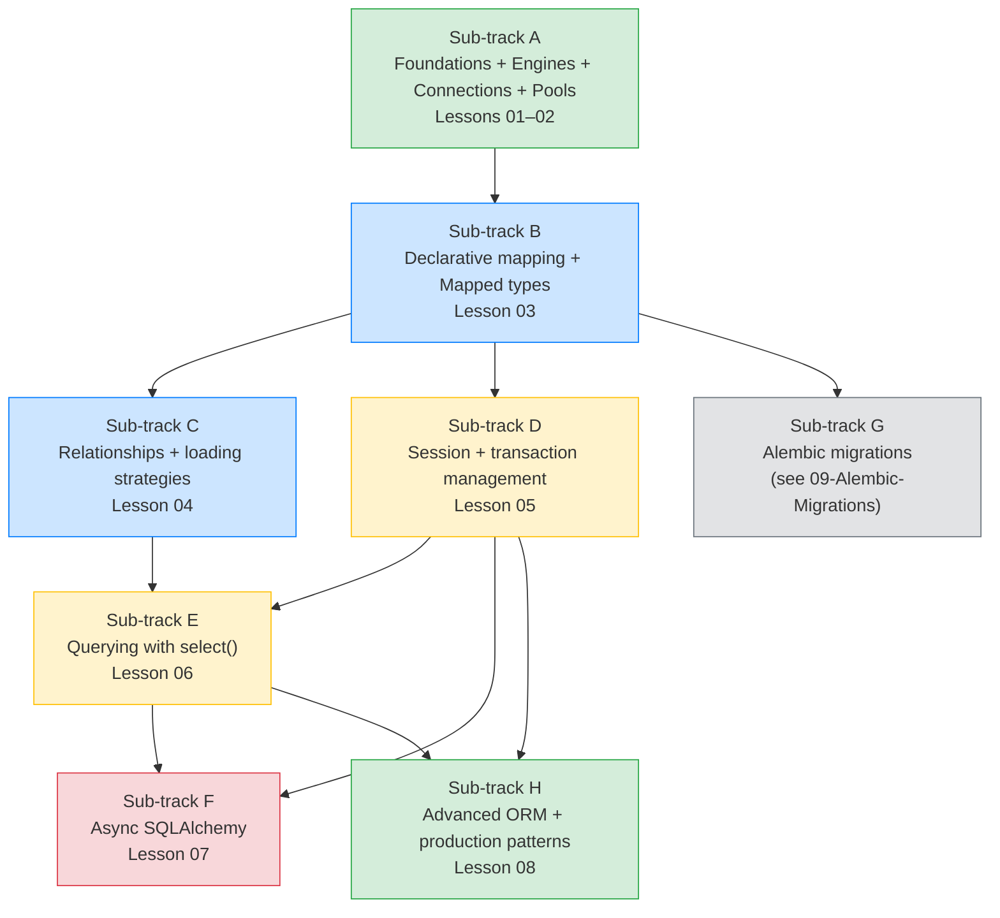

# SQLAlchemy A–Z: Section Map of Content

*The deepest single track in the course. Nine lessons, one growing application (`Boardly`), and an unflinching look at every layer of the most popular Python ORM. Pull up a chair.*

**Welcome to Section 07.**

Every Python service that touches a relational database either uses SQLAlchemy, replaces it with something thinner, or pretends it doesn't need an ORM until it does. This track takes you from "what is an Engine, actually" all the way to hybrid properties, association proxies, and the async `MissingGreenlet` trap. Read every line. Run the code. Break it on purpose. **This is how you learn SQLAlchemy.**

#sqlalchemy #orm #persistence #moc

## Why this track is the deepest

SQLAlchemy is **two tools wearing one hat**: a SQL expression library (Core) and an object-relational mapper (ORM). It sits between your Python code and your database; if you misunderstand it, every other backend topic — caching, async, observability, testing, multi-tenancy — gets harder. Most production "ORM is slow" complaints are not about the ORM at all. They are about engineers who never learned which layer they were touching.

Why do we spend nine lessons on a single library when the official tutorial fits in a blog post? Because the official tutorial teaches you how to *use* SQLAlchemy; this track teaches you what SQLAlchemy *does* when you call `session.commit()`. The gap between those two is exactly the gap between "works in the demo" and "does not corrupt data at 3am." If you want the demo, the official docs are excellent and we link to them in every lesson's Sources. If you want the production-grade mental model — the identity map, flush-vs-commit, the N+1 trap, the `MissingGreenlet` trap, the expand-contract migration dance — keep reading.

**Tip — Senior engineer — read this MOC top-down before opening any lesson.**

The lesson ordering is load-bearing, not stylistic: every concept a later lesson assumes is taught in an earlier one. If you jump to Lesson 07 (async) without Lessons 02 (engine/pool), 03 (declarative), 04 (relationships), and 05 (session/transaction) already internalised, the `MissingGreenlet` traceback will be incomprehensible — not because async is hard, but because the traceback assumes you already understand the sync identity map and the flush-vs-commit boundary. Read the "Decision context" and "Verified Oct 2026 versions" sections first; then read the lessons in order. The two minutes you "save" by skipping the MOC is the two hours you lose debugging a concept that was taught in a lesson you skipped.

**Student asks: Why does this track teach sync SQLAlchemy first and async only in Lesson 07?**

Because the async failure modes (`MissingGreenlet`, implicit-I/O, the "my code is `async def` so why is the event loop blocked?" trap) only make sense against the sync mental model. In sync SQLAlchemy, lazy loading is a function call that returns a value. In async SQLAlchemy, the same lazy load raises `MissingGreenlet` because there is no event loop to schedule the I/O on. If you have never seen the sync version issue a `SELECT`, the async error is incomprehensible. Lesson 07 presumes you already understand `Session`, `flush`, and the identity map from Lesson 05 — so we teach sync first (D-002).

The lessons below are sequenced so each layer is built before the next one is taken for granted. Sub-track **G — Alembic** lives in its own folder ([[09-Alembic-Migrations/00-Alembic-MOC]]) because schema evolution is its own discipline with its own failure modes (autogenerate blind spots, data backfills, deploy ordering).

**Danger — Attacker — the ORM is not a security blanket.**

"We use SQLAlchemy, so we are not vulnerable to SQL injection" is the single most dangerous sentence a backend engineer can say. The ORM protects you only inside its own query builder (`select()`, `where()`, `join()`); the moment you reach for `text()` — and you will, because not every query fits the ORM's vocabulary — you are back in the manual-parameterization business, and the database trusts whatever bytes you hand it. Lesson 05 dedicates a section ("How an Attacker Thinks") to the `text()`-with-f-strings vector, the user-supplied `ORDER BY` trap, and the "looks parameterized but isn't" table-name trap. Lesson 06 reinforces the bound-parameter discipline at the query layer. The defense-in-depth layer (least-privilege Postgres roles) is taught in [[08-PostgreSQL/Roles-Permissions-Security]]. Treat the ORM as a productivity layer, never as a security boundary — every `text()` without `bindparams()` is a vector, and every user-controlled identifier (table, column, `ORDER BY` clause) is a vector unless validated against an allowlist.

## How to read this track

1. **Skim every lesson's "The Problem" section first.** That tells you what problem the lesson is solving before you dive into the code.
2. **Read the lessons in order.** The track is engineered: a later lesson assumes a mental model from an earlier one. Lesson 04 (relationships) presumes you understand the session from Lesson 05 *conceptually* — but we still teach Lesson 05 in detail before Lesson 06 because querying without a session is meaningless.
3. **Run the code.** Every snippet is SQLAlchemy 2.1.x and runs against a real Postgres 17 (or SQLite) instance. We are not teaching toys. The `Boardly` application grows through all nine lessons; you should be able to run each lesson's script on its own.
4. **After Lesson 05, read [[12-Testing-and-Quality/Testing-Database-Logic]] in alternation.** Persistence logic that has not been tested against a real database is fiction.

**Tip — Debugging — use this MOC as the routing table when something fails in production.**

When a production traceback points at a SQLAlchemy concept, the routing rule is: match the concept to its canonical lesson, read that lesson's "When This Breaks" section, and only then read the rest. The mapping is: `DetachedInstanceError` / `PendingRollbackError` / pool-exhaustion `TimeoutError` → Lesson 05; `MissingGreenlet` → Lesson 07 (and back to Lesson 05 if the sync model is shaky); N+1 query explosions → Lesson 04; `IntegrityError`-on-autoflush → Lesson 05; wrong result shape from `select()` → Lesson 06; `version_id` conflict retries and `with_for_update` deadlocks → Lesson 08. Reading the wrong lesson first costs hours; reading the canonical one first costs minutes. Bookmark this MOC — it is the triage list you will reach for at 3am.

## Decision context (read first)

This track is governed by two engineering decisions you should internalize before Lesson 01:

**D-001 — Teach only SQLAlchemy 2.x typed ORM as the primary API.**

We use `DeclarativeBase`, `Mapped[T]`, `mapped_column()`, `select()`, and `Session`/`AsyncSession`. Legacy `Query` objects and `declarative_base()` appear **only** when explaining old code you might encounter in the wild. If you copy a Stack Overflow answer that uses `session.query(...)`, treat it as legacy and translate it.

**D-002 — Default to async SQLAlchemy in production, but teach sync first.**

We teach sessions, transactions, and queries with **sync** SQLAlchemy first (Lessons 02–06), then dedicate Lesson 07 to async. The async failure modes are subtler (the `MissingGreenlet` trap, the implicit-I/O trap) and the sync model is the right scaffold for understanding them. If you skip sync and go straight to `AsyncSession`, you will be productive for a week and confused for a year.

**Tip — Senior engineer — D-001 and D-002 are not stylistic; they are load-bearing.**

A senior engineer reviewing a `Boardly` PR should reject code that imports `from sqlalchemy.orm import declarative_base` (legacy 1.x factory) or writes `session.query(User).filter_by(...)`. Both signal that the author copied a Stack Overflow answer from before 2023 and never internalised D-001. Likewise, an `AsyncSession` introduced in a service whose author has not yet worked through the sync lessons is a code smell — not because async is wrong, but because the author will hit `MissingGreenlet` and not know why. Hold the line: 2.x typed ORM only, sync-first pedagogy, async only after the sync mental model is in place. These two decisions are why this track reads the way it does; do not unwind them in production code without an explicit architectural decision-record entry — and if you must unwind one, link to this MOC so the next reader sees the original contract you are diverging from.

## Verified Oct 2026 versions

This is what we wrote and tested every code sample against. If you are on different versions, the line-by-line still applies, but specific log lines or deprecation warnings may differ slightly.

| Package | Version | Notes |
|---|---|---|
| SQLAlchemy | 2.1.5 (or 2.0.55 LTS) | 2.1.x idioms throughout (`DeclarativeBase`, `Mapped`, `mapped_column`). 2.0.55 LTS is also acceptable. |
| asyncpg | latest | async Postgres driver for `postgresql+asyncpg://`. |
| psycopg | 3.x (latest) | sync Postgres driver for `postgresql+psycopg://`. (Psycopg 2 is end-of-life; do not start new projects with it.) |
| PostgreSQL | 17.x | All SQL examples verified against PG17. SQLite is fine for local dev — the dialect differences are flagged inline. |
| Python | 3.12 | We use `type X = ...` syntax, PEP 695 generics, and `from collections.abc import ...` imports. |

**Warning — Production — pin these versions in `pyproject.toml` and your Docker image; do not float.**

A SQLAlchemy point release has, in the past, changed default `executemany` semantics, deprecated `Query.get` (forcing the move to `Session.get`), and tightened the `MissingGreenlet` boundary so that code that "worked" in 2.0.36 raised in 2.0.37. Pinning the version in `pyproject.toml` (`sqlalchemy==2.1.5`, not `sqlalchemy>=2.1`) and rebuilding the Docker image from a fixed `python:3.12-slim` digest is what makes a 3am deploy reproducible. The "Verified Oct 2026 versions" table above is not aspirational — it is the contract every code sample in this track was tested against. When you upgrade, run the full lesson suite (`uv run python -m boardly.db`, then each lesson's smoke script) against your staging database before the production deploy. The `echo=True` log is your regression test; a diff in the SQL log between versions is the earliest signal that a behaviour has shifted under you.

## Sub-track map

## Lessons in reading order

### Sub-track A: Foundations, Engines, Connections, Pools

- **Lesson 01 — [[01-Foundations-and-Architecture]].** Core vs ORM, the unit-of-work pattern, the identity map (preview), declarative vs classical mapping, dialects and drivers, sync vs async (preview). Layered architecture diagram. *Sub-track letter: A.*
- **Lesson 02 — [[02-Engines-Connections-Pools]].** **Canonical lesson for `Engine (SQLAlchemy)` and `Connection pool (SQLAlchemy)`.** `create_engine()`, URL format, `pool_size`/`max_overflow`/`pool_timeout`/`pool_recycle`, `QueuePool` vs `NullPool`, Engine vs Connection, `engine.connect()` context manager, `pre_ping`, `echo=True`. A complete engine + connection + raw SQL query script for `Boardly`. *Sub-track letter: A.*

### Sub-track B: Declarative mapping and `Mapped` types

- **Lesson 03 — [[03-Declarative-Base-and-Mapped]].** **Canonical lesson for `DeclarativeBase` and `Mapped / mapped_column`.** What `Base.metadata` contains, the registry, `Mapped[T]` and `mapped_column()`, how Python type annotations drive column config, PKs, FKs, defaults, `server_default` vs Python default, indexes, unique constraints, naming conventions. Complete progression: define base → define `Boardly` models (`Organization`, `User`, `Project`) → inspect metadata → create engine → create session → insert → commit → query → explain each layer. *Sub-track letter: B.*

### Sub-track C: Relationships and loading strategies

- **Lesson 04 — [[04-Relationships-and-Loading-Strategies]].** `relationship()`, FK relationships, 1:N / N:1 / 1:1 / N:M, association tables and association objects, `back_populates`, bidirectional, cascade and orphan deletion, DB FK cascades vs ORM cascades. Loading: lazy (the N+1 trap), `selectinload`, `joinedload`, `subqueryload`, explicit joins. Identity map, expiration/refresh, detached objects, the implicit-I/O trap in async. Mermaid sequence of N+1 and the `selectinload` fix. *Sub-track letter: C.*

### Sub-track D: Session and transaction management

- **Lesson 05 — [[05-Session-and-Transaction-Management]].** **Canonical lesson for `Session / AsyncSession (SQLAlchemy)`.** `Session`, `sessionmaker`, context managers, `add`/`add_all`/`delete`/`flush`/`commit`/`rollback`/`refresh`/`execute`, identity map, autoflush, expiration, transaction boundaries, nested transactions and savepoints, `IntegrityError`, why sessions are not thread-safe and not task-safe, per-request session lifecycle, dependency cleanup with `yield`. The flush-vs-commit distinction (interview question). *Sub-track letter: D.*

### Sub-track E: Querying with `select()`

- **Lesson 06 — [[06-Querying-with-select]].** `select()`, `Session.execute()`, `Session.scalars()`, `scalar_one`/`scalar_one_or_none`/`one`/`all`, `where()`, boolean expressions, `order_by`, `limit`/`offset`, `join`/`outerjoin`, aggregation, `group_by`/`having`, subqueries and CTEs with `select(...).cte(...)`, correlated subqueries, window functions, bulk `insert`/`update`/`delete`, executing raw SQL safely with `text()` and bound params. Composable filters. Inspecting generated SQL. Mermaid of result-shape methods. *Sub-track letter: E.*

### Sub-track F: Async SQLAlchemy

- **Lesson 07 — [[07-Async-SQLAlchemy]].** `create_async_engine`, `async_sessionmaker`, `AsyncSession`, async context managers, awaiting DB ops, FastAPI async dependencies, async connection pool config, async transaction management, the implicit I/O trap (lazy loading in async throws `MissingGreenlet`), async test setup, choosing sync vs async (D-002). Why `async def` does not magically make blocking DB calls non-blocking. Mermaid comparison of sync thread-pool vs async event-loop. *Sub-track letter: F.*

### Sub-track G: Alembic migrations

Forwarded to [[09-Alembic-Migrations/00-Alembic-MOC]]. The track ends at Lesson 08 because schema evolution is its own discipline with its own failure modes (autogenerate blind spots, data backfills, deploy ordering). Read Lesson 03 first; then jump to the Alembic section.

### Sub-track H: Advanced ORM and production patterns

- **Lesson 08 — [[08-Advanced-ORM]].** Hybrid attributes, association proxies, custom types (`TypeDecorator`), SQL expressions and `hybrid_property`, events and hooks, ORM inspection (`inspect`), optimistic concurrency with `version_id`, row locking (`with_for_update`), bulk updates/deletes, multi-tenant isolation patterns, repository pattern placement (forward to [[05-Project-Architecture/Service-and-Repository-Patterns]]), testing persistence logic. *Sub-track letter: H.*

### Sub-track H+: Insert comparison (the "when to use what" lesson)

- **Lesson 09 — [[09-Add-vs-AddAll-vs-Bulk-Insert]].** The four insert APIs compared on a 1 000-row workload with timings: `session.add(obj)` (ORM-tracked, supports cascades + events + identity map, slow at scale), `session.add_all([objs])` (same unit-of-work path, just syntactic sugar — not a bulk API despite the name), `session.execute(insert(Model).values([...]))` (Core-level multi-row INSERT, bypasses the unit-of-work, 10–100x faster for thousands of rows), `session.bulk_insert_mappings(Model, [...])` (legacy bulk, even faster, even less ORM behaviour, no `RETURNING`). Decision tree, comparison table on six axes (code path / per-row Python cost / SQL emitted / network round-trips / identity map / ORM events / `RETURNING` / `version_id` / `__init__` validation / server-side defaults / best-for / worst-for), what you lose and what you keep when you switch from ORM path to Core path. *Sub-track letter: H+.*

**Danger — Attacker — bulk insert paths are where injection vectors hide when teams grow past the typed ORM.**

`session.add(obj)` and `session.execute(insert(Model).values([...]))` compile safely because every column value is a bound parameter and every identifier is a Python attribute, not an interpolated string. The vector appears the moment a team grows past the typed ORM and reaches for `session.execute(text(f"INSERT INTO {table} (...) VALUES (...)"))` to "save a round-trip" — at which point the table name and the column list are interpolated strings and only the `VALUES` are bound. Lesson 09 compares the four insert APIs on a "what you keep / what you lose" axis; one of the things you keep with the ORM path, and lose with raw `text()`, is the structural injection-resistance that comes from never interpolating identifiers. If you find yourself writing `text(f"INSERT INTO {table} ...")`, replace the f-string with an allowlist lookup on `table` (and on every column name). The bound parameter is the boundary for *values*; the allowlist is the boundary for *structure*. Both are non-negotiable, and the bulk-insert lesson is the lesson where that distinction is most often blurred by performance pressure.

## Canonical concepts first taught in this track

This section registers load-bearing concepts that get reused across the vault. Cross-references elsewhere link back here rather than re-explaining. See the full registry at [[00-Start-Here/Concept-Registry]].

- **`Engine (SQLAlchemy)`** — first taught in [[02-Engines-Connections-Pools]]. Reused in 03, 05, 07, [[09-Alembic-Migrations/Alembic-Setup-and-Workflow]].
- **`Connection pool (SQLAlchemy)`** — first taught in [[02-Engines-Connections-Pools]]. Reused in 07, [[08-PostgreSQL/Roles-Permissions-Security]], [[13-Performance-and-Observability/N-plus-1-and-Slow-Queries]], [[16-Deployment-and-DevOps/Migration-Ordering-and-Rollback]].
- **`DeclarativeBase`** — first taught in [[03-Declarative-Base-and-Mapped]]. Reused in 04, [[08-PostgreSQL/Types-UUID-Identity-JSONB]], [[09-Alembic-Migrations/Alembic-Setup-and-Workflow]], [[09-Alembic-Migrations/Autogenerate-and-Its-Limits]], [[12-Testing-and-Quality/Testing-Database-Logic]].
- **`Mapped / mapped_column`** — first taught in [[03-Declarative-Base-and-Mapped]]. Reused in 04, 06, 08, 09, [[08-PostgreSQL/Types-UUID-Identity-JSONB]], [[09-Alembic-Migrations/Alembic-Setup-and-Workflow]], [[09-Alembic-Migrations/Autogenerate-and-Its-Limits]].
- **`Session / AsyncSession (SQLAlchemy)`** — first taught in [[05-Session-and-Transaction-Management]]. Reused in 06, 07, 08, 09, [[09-Alembic-Migrations/Data-Migrations-Safely]], [[12-Testing-and-Quality/Testing-Database-Logic]], [[03-FastAPI-Core/Dependency-Injection]].

## Reused concepts (do not re-explain in these lessons)

These concepts are first taught elsewhere. The SQLAlchemy lessons link back instead of re-deriving.

- [[01-Python-Foundations/Type-Hints-and-Annotations|`Annotated`]] — used by `Mapped[T]` and FastAPI dependencies.
- [[01-Python-Foundations/Iterators-Generators-Context-Managers|Async context managers]] — the `async with` form is how `AsyncSession` is used.
- [[01-Python-Foundations/Exceptions-Done-Right|Python exceptions]] — `IntegrityError`, `NoResultFound`, `MissingGreenlet` all inherit from this baseline.
- [[06-SQL-Fundamentals/Transactions-Isolation-Locks|Transactions (SQL)]] — the database-level transaction model that the Session wraps.
- [[06-SQL-Fundamentals/SQL-Injection-and-Parameterized-Queries|SQL injection]] — bound parameters and `text()` are the ORM's defense.
- [[03-FastAPI-Core/Application-and-Lifespan|FastAPI lifespan]] — where the async engine is created (see Lesson 07).
- [[03-FastAPI-Core/Dependency-Injection|Dependency injection (FastAPI `Depends`)]] — how the session reaches route handlers (Lesson 07).

## The `Boardly` application across this track

You will build one growing application across all nine lessons. `Boardly` is a small project-management API: Organizations own Projects; Projects have Tasks; Tasks have Comments; Users belong to Organizations through Memberships. The data model is small enough to fit on one screen and rich enough to exercise every SQLAlchemy feature in the track.

| Lesson | `Boardly` artifact built |
|---|---|
| 01 | (conceptual — architecture only) |
| 02 | `boardly/db.py` — engine, URL parsing, pool config |
| 03 | `boardly/models.py` — `Base`, `Organization`, `User`, `Project` |
| 04 | `boardly/models.py` — adds `Task`, `Comment`, `Membership`, `back_populates`, loading strategies |
| 05 | `boardly/db.py` — `sessionmaker`, `get_session` context manager |
| 06 | `boardly/queries.py` — `select()` query helpers for `Boardly` |
| 07 | `boardly/db.py` — `create_async_engine`, `async_sessionmaker`, `AsyncSession`-based `get_db` dependency. (Lesson 07 renames the sync `db.py` from Lessons 02–06 to `boardly/db_sync.py` for backwards-compat; the new `boardly/db.py` is async. If you ran Lessons 02–06, move your old `db.py` aside before starting Lesson 07.) |
| 08 | `boardly/models.py` — `hybrid_property` for "is_overdue" on `Task`; association proxy for "member_names" on `Organization` |
| 09 | `boardly/inserts.py` — `session.add()` vs `add_all()` vs `session.execute(insert())` vs `bulk_insert_mappings()` benchmark harness for `Boardly` `Task` rows |

By the end of the track you will have a real, runnable `Boardly` persistence layer with sync and async engines, typed models, query helpers, an insert-comparison harness, and a FastAPI integration. Section 09 (Alembic) will then teach you to evolve the schema; Section 12 (Testing) will teach you to test it.

## Cross-references forward and outward

- [[09-Alembic-Migrations/00-Alembic-MOC]] — schema evolution. Read this **after** Lesson 03.
- [[12-Testing-and-Quality/Testing-Database-Logic]] — testing persistence. Read alongside Lessons 05 and 07.
- [[13-Performance-and-Observability/N-plus-1-and-Slow-Queries]] — production N+1 hunting. Read after Lesson 04.
- [[05-Project-Architecture/Service-and-Repository-Patterns]] — where the repository boundary sits. Forwarded to from Lesson 08.
- [[19-Interview-Preparation/SQLAlchemy-Sessions-Questions]] — interview drills for this track.
- [[03-FastAPI-Core/Dependency-Injection]] — the `get_db` dependency in Lesson 07 reuses this canonical.

## Reading pacing

This is **Phase 4** in the [[00-Start-Here/Complete-Learning-Roadmap]]. Recommended: **2–3 weeks**, with at least one end-to-end exercise (define models → run migrations → write queries → wire to FastAPI → write tests). Do not skim — the async lesson in particular will hurt you in production if its sync predecessors were skipped.

**Warning — This track is the longest in the course for a reason.**

Each lesson is 800–1200 lines because the alternative is hand-waving the parts that bite you in production. We will not skip the internal mechanics of `flush()`, the difference between `expire_on_commit` and `refresh_on_commit`, or why `selectinload` is the safest default eager loader. If you find yourself wanting a "quick ORM tutorial," come back when you have been bitten.

**Warning — Production — do not skip sync before async, even if your service ships async-only.**

A team that ships `AsyncSession` from day one — never having run the sync lessons — is the team that files a `MissingGreenlet` ticket at 3am and treats it as a "SQLAlchemy bug" rather than as the well-defined failure mode Lesson 07 teaches it to be. The economics are brutal: skipping the sync lessons saves one engineer-week of study and then costs the team one `DetachedInstanceError`-or-`MissingGreenlet` incident per quarter for the life of the service. The defensive move is structural: run the sync lessons against a local Postgres or SQLite, trace every `BEGIN` / `COMMIT` / `ROLLBACK` in the log, and only then graduate to `AsyncSession`. The async lesson (07) is short precisely because it builds on the sync model — you cannot build on what you have not built.

## What this track does **not** teach

- **Raw SQL literacy.** That is [[06-SQL-Fundamentals/00-SQL-MOC]]. The SQLAlchemy lessons assume you can read a `SELECT ... JOIN ... GROUP BY` and reason about `EXPLAIN ANALYZE` output.
- **PostgreSQL specifics beyond what SQLAlchemy exposes.** That is [[08-PostgreSQL/00-PostgreSQL-MOC]]. JSONB columns, partial indexes, exclusion constraints, and PG-specific functions live there.
- **Schema migrations.** That is [[09-Alembic-Migrations/00-Alembic-MOC]]. We will mention `Base.metadata.create_all(engine)` in Lesson 03 as a teaching scaffold, with a clear warning that it is **not** how production schemas evolve.
- **High-concurrency SQLAlchemy tuning at scale.** That is its own post-mortem genre and is referenced from [[13-Performance-and-Observability/00-Observability-MOC]].

**Tip — Debugging — the "What this track does **not** teach" list is the misrouting-prevention list.**

Half of the senior-engineer tickets filed against "the ORM" are misrouted: a query-plan regression that is actually a Postgres planner issue (this track links to [[08-PostgreSQL/EXPLAIN-ANALYZE-and-Query-Plans]], does not re-teach); a JSONB partial-index problem that is actually a Postgres schema issue ([[08-PostgreSQL/00-PostgreSQL-MOC]]); a deploy-ordering incident that is actually an Alembic migration issue ([[09-Alembic-Migrations/00-Alembic-MOC]]); a pool-tuning post-mortem that is actually a high-concurrency architecture issue ([[13-Performance-and-Observability/00-Observability-MOC]]). Before you file the bug against SQLAlchemy, verify the failure belongs to this track at all. The four bullets above are the explicit out-of-scope list; if the symptom matches one of them, route the ticket to that track, not this one — and link back here so the next reader sees the routing decision.

**Student asks: Why is `Base.metadata.create_all(engine)` treated as a teaching scaffold and not a production tool? It works, doesn't it?**

It works in the narrow sense that it creates the tables that are missing. But "create missing tables" is not schema evolution — it cannot add a column to an existing table, cannot rename a column, cannot migrate data, cannot roll back. `create_all` is the right tool for a fresh test database or a one-shot demo; it is the wrong tool for any database that has data you cannot afford to lose. Alembic (Sub-track G) is the production tool because it generates ordered, reversible migration scripts that evolve a schema *in place* — that is the only way schemas evolve in production. We show `create_all` in Lesson 03 so you understand what `Base.metadata` *is*; we ban it from production in the same paragraph.

**Student asks: The track summary says "five canonicals." But the Concept-Registry also lists `EXPLAIN ANALYZE`, `Event loop`, and `Coroutine` as canonicals used by this track. Why the discrepancy?**

Because those three are *first taught elsewhere* and only *reused* here. `EXPLAIN ANALYZE` is first taught in [[08-PostgreSQL/EXPLAIN-ANALYZE-and-Query-Plans]] — Lesson 06 of this track links back to it but does not re-teach it. `Event loop` and `Coroutine` are first taught in [[10-Async-Python/Event-Loop-and-Coroutines]] — Lesson 07 of this track (Async SQLAlchemy) builds on them but does not re-teach them. The "five canonicals" claim is about what this track *introduces*; the registry is about what this track *uses*. Both claims are true; they describe different scopes.

## What We Learned

- This is the deepest single track in the course — nine lessons, one growing `Boardly` application, every layer of SQLAlchemy 2.1.x covered.
- We teach **sync first, then async** (D-002). Skipping sync and jumping to `AsyncSession` is the most common cause of confusing production bugs.
- Five canonical concepts are registered to this track: `Engine`, `Connection pool`, `DeclarativeBase`, `Mapped / mapped_column`, and `Session / AsyncSession`. Each gets its own dedicated lesson.
- Sub-track G (Alembic) lives in its own folder because schema evolution is its own discipline.

---

**Tags:** #sqlalchemy #orm #persistence #moc #review
**Previous:** [[06-SQL-Fundamentals/00-SQL-MOC]]
**Next:** [[01-Foundations-and-Architecture]] →
