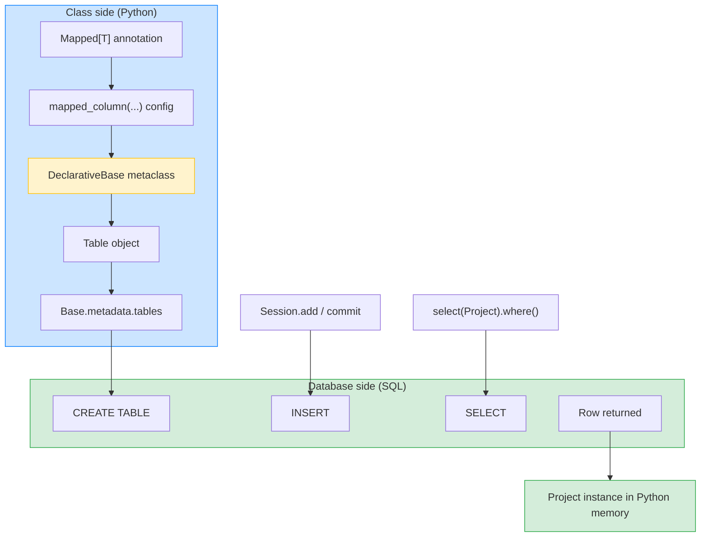

# Lesson 03: Declarative Base and Mapped

*The canonical lesson for the SQLAlchemy `DeclarativeBase` and for `Mapped / mapped_column`. We build `boardly/models.py` — the `Base` class, the first three `Boardly` models (`Organization`, `User`, `Project`), and the full progression from definition to insertion to query.*

**You've reached the centre of the section.**

Every Python class you write to map a database row inherits from `DeclarativeBase`. Every column you define is annotated with `Mapped[T]` and configured with `mapped_column(...)`. Get these two patterns right and 80% of SQLAlchemy feels natural; get them wrong and every later lesson becomes a guessing game. Take your time. Read the type annotations like they are documentation. **This is how you learn the 2.x ORM.**


#sqlalchemy #orm #declarative #mapped #canonical

## Learning Objectives

By the end of this lesson you will be able to:

1. **Define `class Base(DeclarativeBase): pass`** and explain what `Base.metadata` and `Base.registry` are and why every model inherits from `Base`.
2. **Annotate columns with `Mapped[T]`** — `Mapped[int]`, `Mapped[str]`, `Mapped[Optional[datetime]]`, `Mapped[bytes]` — and explain how SQLAlchemy maps Python types to SQL types.
3. **Configure columns with `mapped_column(...)`** — `primary_key`, `unique`, `index`, `nullable`, `default`, `server_default`, `ForeignKey`, `String(N)`, `Numeric(P, S)`, `JSONB`.
4. **Distinguish `default=` (Python-side) from `server_default=` (database-side)** and articulate when each is appropriate.
5. **Define foreign keys** with `ForeignKey("organizations.id")` and read the `"table.column"` reference syntax.
6. **Add indexes and unique constraints** with `index=True`, `unique=True`, and `UniqueConstraint(...)` at the table level.
7. **Inspect `Base.metadata.tables`** to see the `Table` and `Column` objects SQLAlchemy auto-generated from your annotations.
8. **Run the full progression** — define base → define models → inspect metadata → create engine → create session → insert → commit → query → close.
9. **Apply naming conventions** for constraints so Alembic generates deterministic migration names.

## Prerequisites

- **Lesson 02 — Engines, Connections, Pools.** You should have `boardly/db.py` working and the engine constructible. We will import `build_engine` from it.
- **Type hints and `Annotated`** — [[01-Python-Foundations/Type-Hints-and-Annotations]]. The 2.x ORM is built on annotations; `Mapped[T]` is a typing primitive. If you cannot read `name: Mapped[str] = mapped_column(String(255))` comfortably, review that lesson first.
- **Pydantic Settings** — [[04-Pydantic/Pydantic-Settings]]. We add a `Settings` class in this lesson; the basics of `BaseSettings` are taught there.
- **About 2 hours of focused time.** This is the longest lesson in the section because every `Mapped[T]` form and every `mapped_column` kwarg has a why. Read it slowly.

**The most common gap: thinking `Mapped[T]` is a generic like `list[T]`.**

It is not. `Mapped[T]` is a SQLAlchemy-specific marker that the `DeclarativeBase` metaclass looks for at class-creation time. It says "this attribute should be backed by a SQL column whose Python-side type is `T`". The `T` is the source of truth for the Python type; the SQL type is derived from `T` (or overridden in `mapped_column`).


## The Problem

You need to persist `Boardly` data. There are three entities to model first:

- **`Organization`** — a tenant. Has a slug (`boardly`, `acme`), a display name, and a created_at timestamp.
- **`User`** — a person. Has an email (unique across the whole table), a hashed password, a display name, and a created_at. Belongs to one organization as their "home" org (foreign key to `organizations.id`).
- **`Project`** — a project. Has a name, a slug (unique within its organization), an organization FK, an owner FK (to `users.id`), and timestamps.

You could write raw SQL `CREATE TABLE` statements and manage inserts by hand. But every later lesson (relationships, sessions, queries, async) assumes you have typed Python objects representing rows. The SQLAlchemy `DeclarativeBase` is what makes that possible. Today we define the three models and run the full progression.

## The Code

Here is the complete `boardly/models.py` you will write in this lesson. It is the second real source file of `Boardly`; every later lesson will import from it.

```python
# boardly/models.py
"""Boardly — ORM models for Organization, User, and Project.

Lesson 03: DeclarativeBase, Mapped[T], mapped_column, metadata inspection.

Run the integration smoke test:
 BOARDLY_DATABASE_URL=sqlite:///:memory: \\
 uv run python -m boardly.models
"""
from __future__ import annotations

import uuid
from datetime import datetime, timezone
from decimal import Decimal
from typing import Optional

from sqlalchemy import ForeignKey, Numeric, String, UniqueConstraint, func
from sqlalchemy.dialects.postgresql import JSONB
from sqlalchemy.orm import DeclarativeBase, Mapped, mapped_column
from sqlalchemy.types import TypeDecorator, Uuid


# ---------------------------------------------------------------------------
# 1. The declarative base — every model inherits from this.
# ---------------------------------------------------------------------------
class Base(DeclarativeBase):
 """Single source of truth for metadata and registry."""
 pass


# ---------------------------------------------------------------------------
# 2. The models.
# ---------------------------------------------------------------------------
class Organization(Base):
 __tablename__ = "organizations"
 __table_args__ = (
 UniqueConstraint("slug", name="uq_organizations_slug"),
 )

 id: Mapped[uuid.UUID] = mapped_column(
 Uuid(as_uuid=True), primary_key=True, default=uuid.uuid4,
 )
 slug: Mapped[str] = mapped_column(String(50), unique=True, index=True)
 display_name: Mapped[str] = mapped_column(String(255))
 created_at: Mapped[datetime] = mapped_column(
 default=lambda: datetime.now(timezone.utc),
 server_default=func.now(), # dialect-aware: now() on PG, CURRENT_TIMESTAMP on SQLite
 )


class User(Base):
 __tablename__ = "users"

 id: Mapped[uuid.UUID] = mapped_column(
 Uuid(as_uuid=True), primary_key=True, default=uuid.uuid4,
 )
 email: Mapped[str] = mapped_column(String(255), unique=True, index=True)
 hashed_password: Mapped[str] = mapped_column(String(255))
 display_name: Mapped[str] = mapped_column(String(255))
 home_org_id: Mapped[uuid.UUID] = mapped_column(
 ForeignKey("organizations.id", ondelete="RESTRICT"), index=True,
 )
 created_at: Mapped[datetime] = mapped_column(
 default=lambda: datetime.now(timezone.utc),
 server_default=func.now(),
 )


class Project(Base):
 __tablename__ = "projects"
 __table_args__ = (
 UniqueConstraint("organization_id", "slug", name="uq_projects_org_slug"),
 )

 id: Mapped[uuid.UUID] = mapped_column(
 Uuid(as_uuid=True), primary_key=True, default=uuid.uuid4,
 )
 organization_id: Mapped[uuid.UUID] = mapped_column(
 ForeignKey("organizations.id", ondelete="CASCADE"), index=True,
 )
 owner_id: Mapped[uuid.UUID] = mapped_column(
 ForeignKey("users.id", ondelete="SET NULL"), nullable=True, index=True,
 )
 name: Mapped[str] = mapped_column(String(255))
 slug: Mapped[str] = mapped_column(String(50), index=True)
 description: Mapped[Optional[str]] = mapped_column(String(2000), nullable=True)
 budget: Mapped[Optional[Decimal]] = mapped_column(
 Numeric(decimal_return_scale=2), nullable=True,
 )
 # JSONB column: free-form key/value bag for project settings, labels, integration metadata.
 # JSONB is Postgres-native (GIN-indexable, operator family ->, ->>, @>); on SQLite
 # the dialect compiles JSONB down to a plain JSON column so the smoke test still passes.
 meta: Mapped[dict] = mapped_column(JSONB, default=dict, nullable=True)
 created_at: Mapped[datetime] = mapped_column(
 default=lambda: datetime.now(timezone.utc),
 server_default=func.now(),
 )


# ---------------------------------------------------------------------------
# 3. The smoke test: define → inspect → create → insert → commit → query.
# ---------------------------------------------------------------------------
def main() -> None:
 from sqlalchemy import create_engine, select
 from sqlalchemy.orm import Session

 from boardly.db import get_default_url

 engine = create_engine(get_default_url(), echo=True)

 print("--- Base.metadata.tables ---")
 for table_name, table in Base.metadata.tables.items():
 print(f" {table_name}: cols={[c.name for c in table.columns]}")

 Base.metadata.create_all(engine)

 print("--- Inserting an Organization, a User, and a Project ---")
 org = Organization(id=uuid.uuid4(), slug="boardly", display_name="Boardly")
 user = User(
 id=uuid.uuid4(),
 email="ada@example.com",
 hashed_password="not-a-real-hash",
 display_name="Ada Lovelace",
 home_org_id=org.id, # org.id is already populated — we passed id= explicitly
 )
 project = Project(
 id=uuid.uuid4(),
 organization_id=org.id,
 owner_id=user.id,
 name="Q4 Launch",
 slug="q4-launch",
 description="Ship the public beta by year-end.",
 budget=Decimal("15000.00"),
 )

 with Session(engine) as session:
 session.add(org)
 session.add(user)
 session.add(project)
 session.commit()

 print("--- Querying back ---")
 with Session(engine) as session:
 loaded = session.execute(
 select(Project).where(Project.slug == "q4-launch")
 ).scalar_one()
 print(f" project = {loaded}")
 print(f" project.id = {loaded.id}")
 print(f" project.budget = {loaded.budget!r}")
 print(f" project.meta = {loaded.meta!r}")
 print(f" project.created_at = {loaded.created_at!r}")


if __name__ == "__main__":
 main()
```

That is 130 lines. Save it as `boardly/models.py` and run it. Then read the line-by-line below — there is a lot to explain because every `Mapped[T]` form and every `mapped_column` kwarg has a reason.

## Line-by-Line Deep Dive

This is the heart of the lesson. Read it twice. The `Mapped[T]` + `mapped_column(...)` pattern is the canonical 2.x way to define a column; the rest of the section assumes you know it cold.

### Lines 1–17: The module docstring and imports

```python
"""Boardly — ORM models for Organization, User, and Project.

Lesson 03: DeclarativeBase, Mapped[T], mapped_column, metadata inspection.

Run the integration smoke test:
 BOARDLY_DATABASE_URL=sqlite:///:memory: \\
 uv run python -m boardly.models
"""
from __future__ import annotations

import uuid
from datetime import datetime, timezone
from decimal import Decimal
from typing import Optional

from sqlalchemy import ForeignKey, Numeric, String, UniqueConstraint, func
from sqlalchemy.dialects.postgresql import JSONB
from sqlalchemy.orm import DeclarativeBase, Mapped, mapped_column
from sqlalchemy.types import TypeDecorator, Uuid
```

**What it does:** Pulls in the standard-library types we will use in annotations (`uuid`, `datetime`, `Decimal`, `Optional`) and the SQLAlchemy primitives we will use to define the models (`ForeignKey`, `String`, `UniqueConstraint`, `DeclarativeBase`, `Mapped`, `mapped_column`, `TypeDecorator`, `Uuid`).

**Why each:**

- `uuid` — we use UUIDs as primary keys instead of auto-increment integers. UUIDs are globally unique, so we can generate them client-side without a round-trip to the database. They are also opaque, which makes enumeration attacks on URLs harder. The trade-off is storage size (16 bytes vs 4 for INT) and index locality (UUIDv4 is random, so inserts fragment B-tree indexes). For `Boardly`'s scale this is fine; for higher scale we would use UUIDv7 (time-ordered, still sortable).
- `datetime, timezone` — the `created_at` column uses `datetime.now(timezone.utc)` as its Python default. We import `timezone` so we can explicitly say "UTC" instead of relying on the machine's local timezone.
- `Decimal` — the `budget` column uses `Decimal` instead of `float` to avoid floating-point rounding errors. Money is always `Decimal` (or integer cents); never `float`.
- `Optional` — used in `Mapped[Optional[str]]` to mark a column as nullable. (The 2.x ORM uses `Optional[T]` to derive `nullable=True`; `Mapped[T]` derives `nullable=False`.)
- `ForeignKey` — the ORM's reference to another table's primary key. `ForeignKey("organizations.id")` says "this column references `organizations.id`."
- `String` — a SQL `VARCHAR(N)`. The argument is the max length.
- `UniqueConstraint` — a table-level multi-column unique constraint. Used when uniqueness spans more than one column (e.g., `slug` is unique *within* an organization).
- `DeclarativeBase, Mapped, mapped_column` — the canonical 2.x trio. We covered these in Lesson 01; Lesson 03 is where we use them in earnest.
- `TypeDecorator, Uuid` — `Uuid` is SQLAlchemy 2.x's UUID column type (added in 2.0; before 2.0 you had to write your own `TypeDecorator`). We import `TypeDecorator` only so we can mention it in a sidebar; it is not used directly in this file.

**Tip — Why `from __future__ import annotations` matters here.**

With `from __future__ import annotations`, type annotations are strings until something resolves them. The `DeclarativeBase` metaclass resolves them at class-creation time, so this import does not break anything; it just lets us use forward references (e.g., `Mapped["Project"]` for a self-referencing relationship) without quoting. Lesson 04 covers forward references.


### Lines 23–25: The `Base` class

```python
class Base(DeclarativeBase):
 """Single source of truth for metadata and registry."""
 pass
```

**What it does:** Defines a class called `Base` that inherits from `DeclarativeBase`. The body is empty (just a docstring).

**Why this is the canonical form:** `DeclarativeBase` provides:

1. A `Base.metadata` — an instance of `MetaData`. Every model that inherits from `Base` registers its auto-generated `Table` on this `MetaData`. `Base.metadata.create_all(engine)` creates every table in one call. `Base.metadata.tables` is the dict-like view we inspect later.
2. A `Base.registry` — an instance of `registry`. The registry is the glue between your Python classes and the underlying `Table` objects. When the metaclass processes a class body, it builds a `Table`, attaches it to `Base.metadata`, and registers the class with `Base.registry` so that queries know which class to instantiate for each row.
3. **Class-body processing hooks.** When you write `id: Mapped[int] = mapped_column(primary_key=True)`, the metaclass intercepts the assignment and uses the type annotation to derive the SQL column type, then uses the `mapped_column(...)` arguments to refine it (primary key, etc.).

**Warning — Do not skip `class Base(DeclarativeBase): pass`.**

A common mistake is to define models without an explicit `Base`, e.g. by inheriting directly from `DeclarativeBase`. This works for one model but breaks the moment you have two — each model gets its own `MetaData` and `registry`, and `Base.metadata.create_all(engine)` no longer creates all your tables in one call. Always define a `Base` class and inherit from it.


**Student asks: can I share a `MetaData` between two `Base` classes?**

Yes, by passing `metadata=` and `registry=` to `DeclarativeBase` in your `class Base(DeclarativeBase)` definition. This is useful when you have two logical groups of models (e.g., a "core" group and a "reporting" group) and you want each to have its own `MetaData` for `create_all` purposes. For `Boardly`, one `Base` is enough.


### Lines 31–45: The `Organization` model

```python
class Organization(Base):
 __tablename__ = "organizations"
 __table_args__ = (
 UniqueConstraint("slug", name="uq_organizations_slug"),
 )

 id: Mapped[uuid.UUID] = mapped_column(
 Uuid(as_uuid=True), primary_key=True, default=uuid.uuid4,
 )
 slug: Mapped[str] = mapped_column(String(50), unique=True, index=True)
 display_name: Mapped[str] = mapped_column(String(255))
 created_at: Mapped[datetime] = mapped_column(
 default=lambda: datetime.now(timezone.utc),
 server_default=func.now(), # dialect-aware: now() on PG, CURRENT_TIMESTAMP on SQLite
 )
```

**What it does:** Defines an `Organization` model with four columns: a UUID primary key, a slug, a display name, and a created_at timestamp.

**Why each line:**

#### `__tablename__ = "organizations"`

The class attribute that tells SQLAlchemy what to name the underlying `Table`. Without it, SQLAlchemy would try to derive the name from the class name and, depending on configuration, might use `Organization` (capitalized) or `organization` (singular) — neither of which is what you want for a SQL table. Convention: pluralize. Always set `__tablename__` explicitly.

#### `__table_args__ = (UniqueConstraint("slug", name="uq_organizations_slug"),)`

A tuple of table-level constraints. `UniqueConstraint("slug", name="uq_organizations_slug")` adds a `UNIQUE` constraint on the `slug` column at the table level, with an explicit name. The name matters because Alembic will use it when generating migration scripts — a deterministic name keeps your migration history clean.

**Single-column `unique=True` vs `UniqueConstraint("slug", name=...)`.**

For a single column, both forms produce the same SQL `UNIQUE` constraint. The difference: `unique=True` on the column lets SQLAlchemy auto-name the constraint (`organizations_slug_key` is the default), which is fine but non-deterministic across databases. `UniqueConstraint(..., name="uq_...")` lets you control the name. We use `UniqueConstraint` everywhere because deterministic names make Alembic autogenerate output stable.


#### `id: Mapped[uuid.UUID] = mapped_column(Uuid(as_uuid=True), primary_key=True, default=uuid.uuid4)`

This is the most important pattern in the file. Breakdown:

- `id:` — the Python attribute name. `org.id` is how you read it; `organization.id` is the SQL column name.
- `Mapped[uuid.UUID]` — the type annotation. `Mapped[T]` tells the metaclass "this is a mapped attribute, with Python type `T`". The `T` (`uuid.UUID`) is the Python-side type. When you read `org.id`, you get a `uuid.UUID` instance, not a string.
- `mapped_column(...)` — the configuration.
 - `Uuid(as_uuid=True)` — the SQL column type. SQLAlchemy 2.x has a native `Uuid` type. `as_uuid=True` means "return Python `uuid.UUID` objects, not strings". (The default is `True`; we set it explicitly for documentation.)
 - `primary_key=True` — marks the column as the table's primary key. SQLAlchemy emits `PRIMARY KEY` in the `CREATE TABLE`.
 - `default=uuid.uuid4` — the Python-side (ORM-level) default for the `INSERT` statement. When SQLAlchemy flushes an `Organization` whose `id` was not set explicitly, it calls `uuid.uuid4()` and uses the result for the `INSERT`. After the flush, the in-memory instance is populated with the new UUID (the value is read back from the cursor, or fetched via `RETURNING` on Postgres).

**Warning — `default=` does NOT fire at instance-construction time.**

In SQLAlchemy 2.x, `default=callable` (passed to `mapped_column`) is the INSERT-time default, not a construction-time init default. If you write `org = Organization(slug="...")` without passing `id=`, then `org.id` is `None` until the next flush — the callable does not fire at `__init__` time. To use `org.id` as a foreign key in a related row that you construct *before* flushing, you have three options:
1. Pass `id=uuid.uuid4()` explicitly at construction (what the smoke test above does).
2. Call `session.flush()` after `session.add(org)` *before* constructing the related rows (the next flush will populate `org.id`).
3. Switch to `MappedAsDataclass` and use `default_factory=uuid.uuid4` on the column — the dataclass-style init default *does* fire at construction time, but requires opting into dataclass mapping for the whole `Base`.

Without one of these, the related row's FK column is `None` and the `INSERT` fails with `IntegrityError: NOT NULL constraint failed: projects.organization_id`. (Lesson 04 will show how `relationship()` lets SQLAlchemy wire up the FK automatically from the related-instance reference, so you do not need to populate `id` manually at all.)


Why does SQLAlchemy want a Python type annotation on every column? Because the `Mapped[T]` annotation is what SQLAlchemy reads at class-creation time to decide the column's SQL type, its nullability, and (when applicable) its ORM loader behavior. Without `Mapped[T]`, SQLAlchemy falls back to classical mapping (the old `Column(Integer)` style that pre-dates 2.0), which is more verbose and less type-safe — your IDE cannot autocomplete `org.idd` as a typo, mypy cannot catch `org.id + "not-a-uuid"`, and the column's nullability is invisible to the type system. So `Mapped[T]` is not boilerplate — it is the contract between your Python code and the database schema, and the metaclass is the notary that reads it.

#### `slug: Mapped[str] = mapped_column(String(50), unique=True, index=True)`

- `Mapped[str]` — Python-side type is `str`.
- `String(50)` — SQL-side type is `VARCHAR(50)`. The 50 is the max length; the database enforces it.
- `unique=True` — adds a unique constraint. Equivalent to `UniqueConstraint("slug", name=...)` but lets SQLAlchemy name it.
- `index=True` — creates a B-tree index on the column. Without it, `SELECT ... WHERE slug = ?` would do a sequential scan.

**Tip — When to index, when to unique-constrain, when to both.**

- `unique=True` automatically creates a unique B-tree index in most databases. You do not need both `unique=True` and `index=True` on the same column.
- `index=True` alone creates a non-unique index. Use it for columns you filter on (`WHERE col = ?`, `ORDER BY col`).
- For composite uniqueness (across two or more columns), use `UniqueConstraint("col1", "col2", name=...)` at the table level — single-column `unique=True` cannot express this.


#### `display_name: Mapped[str] = mapped_column(String(255))`

A plain non-nullable `VARCHAR(255)`. No index, no constraint. The simplest column form.

#### `created_at: Mapped[datetime] = mapped_column(default=lambda: datetime.now(timezone.utc), server_default=func.now())`

The most pedagogically dense line in the file. Two defaults:

- `default=lambda: datetime.now(timezone.utc)` — the **Python-side default**. When you instantiate `Organization()` without `created_at=...`, SQLAlchemy calls this lambda and sets `org.created_at` to the current UTC time. The lambda form is important: if you wrote `default=datetime.now(timezone.utc)`, the default would be evaluated once at class-creation time, and every `Organization` would get the same timestamp. The lambda (or a function reference) defers evaluation to instance-creation time.
- `server_default=func.now()` — the **database-side default**. `func.now()` is a SQLAlchemy `FunctionElement` (not a raw string), so the dialect compiles it to the correct syntax at `CREATE TABLE` time: `now()` on Postgres, `CURRENT_TIMESTAMP` on SQLite/MySQL/Oracle. The emitted Postgres SQL is:

 ```sql
 created_at TIMESTAMP DEFAULT now()
 ```

 This means: even if a row is inserted by a raw SQL `INSERT` that does not specify `created_at`, the database will fill it in. The Python `default=` does not help in that case — it only fires when the ORM constructs the instance.

**Warning — Do not pass `server_default="now()"` as a raw string.**

The string form compiles verbatim into the `CREATE TABLE`. That works on Postgres (which ships a `now()` function) but fails on SQLite with `sqlite3.OperationalError: no such function: now` — SQLite does not have a `now()` function; its date/time family is `date()`, `time()`, `datetime()`, `julianday()`, `strftime()`. The same model file is used for both the Postgres production path and the SQLite test path; passing `func.now()` instead of `"now()"` is what makes the smoke test (`sqlite:///:memory:`) pass. See **Mistake 6** below for the full failure mode.


**Why have both?**

Three scenarios:
1. **ORM insert** — Python `default=` fires, `created_at` is set on the instance, the ORM includes the column in the `INSERT`. The `server_default` is not used.
2. **Raw SQL `INSERT`** — the `server_default` fires, the column is filled by the database. The Python `default=` is irrelevant because no ORM object was constructed.
3. **`session.commit()` followed by `session.refresh(obj)` (with `server_default=`) — SQLAlchemy knows the column has a `server_default` and re-fetches it from the database after insert, so `obj.created_at` is populated even if the Python `default=` did not run.

The rule: use `default=` when you want the Python object to be self-contained (you can read `org.created_at` immediately after `Organization()` without a round-trip). Use `server_default=` when the database is the source of truth (other tools writing to the same table need a default too). Use both when you want both guarantees.


### Lines 48–62: The `User` model

```python
class User(Base):
 __tablename__ = "users"

 id: Mapped[uuid.UUID] = mapped_column(
 Uuid(as_uuid=True), primary_key=True, default=uuid.uuid4,
 )
 email: Mapped[str] = mapped_column(String(255), unique=True, index=True)
 hashed_password: Mapped[str] = mapped_column(String(255))
 display_name: Mapped[str] = mapped_column(String(255))
 home_org_id: Mapped[uuid.UUID] = mapped_column(
 ForeignKey("organizations.id", ondelete="RESTRICT"), index=True,
 )
 created_at: Mapped[datetime] = mapped_column(
 default=lambda: datetime.now(timezone.utc),
 server_default=func.now(),
 )
```

**What it does:** Defines the `User` model with a foreign key to `organizations.id`.

**Why the new patterns:**

#### `home_org_id: Mapped[uuid.UUID] = mapped_column(ForeignKey("organizations.id", ondelete="RESTRICT"), index=True)`

- The Python attribute is `home_org_id` (not `home_org`). The convention is: the FK column has a `_id` suffix; the relationship (added in Lesson 04) is named without the suffix. `user.home_org_id` is the UUID; `user.home_org` (Lesson 04) is the `Organization` object.
- `ForeignKey("organizations.id", ondelete="RESTRICT")` — declares this column is a foreign key to `organizations.id`. The `"table.column"` reference syntax is the only safe form; SQLAlchemy parses it at mapper-configuration time, so you can reference tables that are defined later in the file.
- `ondelete="RESTRICT"` — the database-level `ON DELETE` clause. `RESTRICT` means: if someone tries to delete the referenced `Organization` row while a `User` is still pointing at it, the database refuses with a foreign-key violation. This is the safest default for `Boardly` — you do not want to delete an organization and accidentally orphan all its users. (Other options: `CASCADE` — delete the children too; `SET NULL` — set the FK column to NULL on the children; `SET DEFAULT` — set it to the column's default. We cover the matrix in Lesson 04.)
- `index=True` — creates an index on the FK column. Most databases do not automatically index foreign keys; you must do it explicitly. Without an index, `DELETE FROM organizations WHERE id = ?` triggers a sequential scan on `users.home_org_id` to check the constraint, which is a production-bug-class slow query.

**Why do most databases not auto-index FKs?**

Indexes cost write performance and storage. Postgres in particular does not auto-index FKs because the database designer is presumed to know whether the index is needed. (For a column that is rarely filtered on, the index is wasted.) In practice, you almost always want to index your FKs, because the index is also used by `JOIN`s — and joins on FKs are the most common pattern in ORM codebases.


### Lines 65–86: The `Project` model

```python
class Project(Base):
 __tablename__ = "projects"
 __table_args__ = (
 UniqueConstraint("organization_id", "slug", name="uq_projects_org_slug"),
 )

 id: Mapped[uuid.UUID] = mapped_column(
 Uuid(as_uuid=True), primary_key=True, default=uuid.uuid4,
 )
 organization_id: Mapped[uuid.UUID] = mapped_column(
 ForeignKey("organizations.id", ondelete="CASCADE"), index=True,
 )
 owner_id: Mapped[uuid.UUID] = mapped_column(
 ForeignKey("users.id", ondelete="SET NULL"), nullable=True, index=True,
 )
 name: Mapped[str] = mapped_column(String(255))
 slug: Mapped[str] = mapped_column(String(50), index=True)
 description: Mapped[Optional[str]] = mapped_column(String(2000), nullable=True)
 budget: Mapped[Optional[Decimal]] = mapped_column(
 Numeric(decimal_return_scale=2), nullable=True,
 )
 # JSONB column: free-form key/value bag for project settings, labels, integration metadata.
 # JSONB is Postgres-native (GIN-indexable, operator family ->, ->>, @>); on SQLite
 # the dialect compiles JSONB down to a plain JSON column so the smoke test still passes.
 meta: Mapped[dict] = mapped_column(JSONB, default=dict, nullable=True)
 created_at: Mapped[datetime] = mapped_column(
 default=lambda: datetime.now(timezone.utc),
 server_default=func.now(),
 )
```

**What it does:** Defines the `Project` model with four notable patterns: composite unique constraint, nullable FK with `SET NULL`, an `Optional` annotation, and a JSONB column for free-form metadata.

**Why each new pattern:**

#### `UniqueConstraint("organization_id", "slug", name="uq_projects_org_slug")`

A **two-column** unique constraint: the `slug` is unique *within* an organization. Two projects in the same org cannot share a slug; two projects in different orgs can. Single-column `unique=True` cannot express this — it would make the slug globally unique. The `UniqueConstraint` at the table level is the right tool.

#### `owner_id: Mapped[uuid.UUID] = mapped_column(ForeignKey("users.id", ondelete="SET NULL"), nullable=True, index=True)`

Three new things:

- `ondelete="SET NULL"` — if the owner `User` is deleted, the project's `owner_id` becomes `NULL` rather than the project being deleted. Use `SET NULL` for "soft" relationships where the parent is optional.
- `nullable=True` — the column can be `NULL`. Required for `SET NULL` to work (you cannot set a non-nullable column to NULL).
- The annotation is `Mapped[uuid.UUID]` (not `Mapped[Optional[uuid.UUID]]`) even though the column is nullable. The 2.x rule: the annotation declares the Python type, and SQLAlchemy uses `nullable=True` in `mapped_column` to declare the SQL nullability. They are independent. (Some teams prefer to write `Mapped[Optional[uuid.UUID]]` to make the nullability visible in the annotation; both work — `Mapped[Optional[T]]` implies `nullable=True` unless you explicitly set `nullable=False` in `mapped_column`.)

**Tip — Read `Optional[T]` as a hint, not a requirement.**

The 2.x ORM uses `Optional[T]` to derive `nullable=True` if you do not pass `nullable=` explicitly. But the explicit `nullable=True` in `mapped_column` wins. Our convention: for FKs we set `nullable=` explicitly (because the answer is not always derivable from the annotation); for plain scalar columns we use `Optional[T]` to express nullability. Consistency is what matters; pick a convention and stick to it.


#### `description: Mapped[Optional[str]] = mapped_column(String(2000), nullable=True)`

The `Optional[str]` annotation expresses nullability in the type system. `nullable=True` is technically redundant (the `Optional` already implies it) but documents the intent. This is the canonical way to write "a long text field that may be NULL".

#### `budget: Mapped[Optional[Decimal]] = mapped_column(Numeric(decimal_return_scale=2), nullable=True)`

- `Mapped[Optional[Decimal]]` — the Python type is `Decimal | None`.
- `Numeric(decimal_return_scale=2)` — the SQL column type, with `decimal_return_scale=2`. When SQLAlchemy reads a `NUMERIC` from the database, it returns a `Decimal` normalized to 2 decimal places. Without this, you might get `Decimal('15000.0000000000')` instead of `Decimal('15000.00')` — the same value but with a noisy display scale. For money, you want the scale fixed.
- `nullable=True` — the column is nullable.
- The SQL column type is `NUMERIC` because we pass `Numeric(...)` explicitly. (Without an explicit type, SQLAlchemy derives `Numeric` from the `Decimal` annotation — but then `decimal_return_scale` would be silently dropped, because that kwarg belongs to the `Numeric` type, not to `mapped_column`. See **Mistake 6** below.)

**Warning — `decimal_return_scale` is a `Numeric` kwarg, not a `mapped_column` kwarg.**

The 2.x metaclass derives the SQL column type from the `Mapped[T]` annotation *before* it inspects the `mapped_column(...)` arguments. If you write `mapped_column(decimal_return_scale=2)` without an explicit `Numeric(...)` type, SQLAlchemy interprets `decimal_return_scale` as a dialect-prefixed kwarg (it looks for a dialect named `decimal`, does not find one, and emits `SAWarning: Can't validate argument 'decimal_return_scale'; can't locate any SQLAlchemy dialect named 'decimal'`) and silently drops it — the value reaches the column as whatever scale the driver returns (often 10 fractional digits on SQLite). The fix is to pass the kwarg on the type: `mapped_column(Numeric(decimal_return_scale=2), nullable=True)`. The same rule applies to other type-specific kwargs (e.g. `String`'s `length`, `Numeric`'s `precision`/`scale`, `DateTime`'s `timezone`) — pass them on the type, not on `mapped_column`.


#### `meta: Mapped[dict] = mapped_column(JSONB, default=dict, nullable=True)`

The new column for free-form, schemaless metadata: project settings, integration config, UI layout, labels — anything you want to attach to a `Project` without a migration each time the shape changes.

- `Mapped[dict]` — the Python type is `dict`. SQLAlchemy's `JSON`/`JSONB` types transparently (de)serialize Python dicts to/from the column.
- `JSONB` — the column type. `JSONB` is Postgres-native: a binary JSON representation with a GIN-indexable operator family (`->`, `->>`, `@>`, `?`, `?|`, `?&`). It is the right choice when you need to query into the JSON document (`SELECT * FROM projects WHERE meta @> '{"archived": true}'`).
- `default=dict` — the Python-side default. Each new `Project` gets a fresh empty dict rather than a shared reference (which would be a bug — all rows would alias the same dict and a write on one would appear on the others).
- `nullable=True` — a project may legitimately have no metadata.

**`JSONB` is Postgres-native; on SQLite it falls back to `JSON`.**

SQLAlchemy's `JSONB` inherits from the dialect-agnostic `JSON` type. When `Base.metadata.create_all(engine)` runs against the SQLite smoke-test engine, the dialect compiles `JSONB` to `JSON` (which SQLite stores as `TEXT`). The smoke test passes; the production Postgres path uses the real `JSONB` type with its GIN operators. The full JSONB operator family — `->`, `->>`, `@>`, `?`, jsonb_path_ops, GIN indexes — is the topic of [[08-PostgreSQL/Types-UUID-Identity-JSONB]].


**Student asks: why `JSONB` and not `JSON`?**

On Postgres, `JSON` stores the text representation verbatim and re-parses it on every read; `JSONB` stores a binary representation that is faster to read, indexable with GIN, and supports the `@>` / `?` containment operators. The cost is a slightly larger on-disk footprint and no preservation of key order / duplicate keys. For an application metadata column, `JSONB` is almost always the right choice; the only time `JSON` wins is when you need to ingest untrusted JSON verbatim (preserving whitespace and key order) for forensic reasons.


### Lines 92–105: Inspecting the metadata

```python
def main() -> None:
 from sqlalchemy import create_engine, select
 from sqlalchemy.orm import Session

 from boardly.db import get_default_url

 engine = create_engine(get_default_url(), echo=True)

 print("--- Base.metadata.tables ---")
 for table_name, table in Base.metadata.tables.items():
 print(f" {table_name}: cols={[c.name for c in table.columns]}")
```

**What it does:** Creates an engine from `boardly.db.get_default_url()`, then iterates over `Base.metadata.tables` and prints each table's column names.

**Why this matters:** `Base.metadata.tables` is a `dict` mapping table names to `Table` objects. It is the catalog the `DeclarativeBase` metaclass populated when your classes were defined. This inspection is the canonical way to verify "what did SQLAlchemy actually generate from my annotations?".

For our three models, the output looks like:

```
--- Base.metadata.tables ---
 organizations: cols=['id', 'slug', 'display_name', 'created_at']
 users: cols=['id', 'email', 'hashed_password', 'display_name', 'home_org_id', 'created_at']
 projects: cols=['id', 'organization_id', 'owner_id', 'name', 'slug', 'description', 'budget', 'created_at']
```

Each `Table` object has `.columns` (a list of `Column` objects), `.constraints` (a list of constraint objects), `.indexes` (a list of `Index` objects), and `.foreign_keys` (a list of `ForeignKey` objects). Explore them in a REPL — they are the in-memory representation of your schema.

### Lines 107–127: Creating the schema and inserting a row

```python
 Base.metadata.create_all(engine)

 print("--- Inserting an Organization, a User, and a Project ---")
 org = Organization(id=uuid.uuid4(), slug="boardly", display_name="Boardly")
 user = User(
 id=uuid.uuid4(),
 email="ada@example.com",
 hashed_password="not-a-real-hash",
 display_name="Ada Lovelace",
 home_org_id=org.id, # org.id is already populated — we passed id= explicitly
 )
 project = Project(
 id=uuid.uuid4(),
 organization_id=org.id,
 owner_id=user.id,
 name="Q4 Launch",
 slug="q4-launch",
 description="Ship the public beta by year-end.",
 budget=Decimal("15000.00"),
 )

 with Session(engine) as session:
 session.add(org)
 session.add(user)
 session.add(project)
 session.commit()
```

**What it does:** Creates all three tables via `Base.metadata.create_all(engine)`, then instantiates three model objects and inserts them in one transaction.

**Why this works without an explicit `flush`:**

- `Base.metadata.create_all(engine)` iterates over every `Table` in `Base.metadata.tables` and emits `CREATE TABLE` for each one. The order is topologically sorted by foreign-key dependency, so `organizations` is created before `users`, which is created before `projects`.
- `Organization(id=uuid.uuid4(), slug="boardly", display_name="Boardly")` calls the model's `__init__`. We pass `id=uuid.uuid4()` explicitly so that `org.id` is populated *immediately* — without it, `org.id` would be `None` until the next flush, because the model's `default=uuid.uuid4` fires at flush time, not at construction time (see the warning above). The same pattern applies to `User.id` and `Project.id`.
- `User(..., home_org_id=org.id)` uses `org.id` as the FK value. The `User` is not yet in the database, but `org.id` is a valid UUID we can already use as a foreign key because we set it explicitly at construction. (Note: when the `INSERT` is flushed, `organizations` is inserted first, then `users`, then `projects` — the topological sort again. The `created_at` Python default (the lambda) also fires at flush time, not at construction.)
- `session.add(org); session.add(user); session.add(project)` queues the three objects in the session's new-objects list. They are not flushed yet.
- `session.commit()` calls `session.flush()` (which builds and executes the three `INSERT`s, in dependency order), then `COMMIT` on the underlying transaction.

**The full Session API is in Lesson 05.**

We use `Session(engine)`, `session.add()`, and `session.commit()` here without deep explanation because the focus of this lesson is the model definition, not the session. Lesson 05 covers `Session`, `sessionmaker`, `flush` vs `commit`, `refresh`, `rollback`, nested transactions, and the full lifecycle. If you find yourself wanting more on sessions right now, jump to Lesson 05 and come back.


### Lines 129–137: Querying back

```python
 print("--- Querying back ---")
 with Session(engine) as session:
 loaded = session.execute(
 select(Project).where(Project.slug == "q4-launch")
 ).scalar_one()
 print(f" project = {loaded}")
 print(f" project.id = {loaded.id}")
 print(f" project.budget = {loaded.budget!r}")
 print(f" project.meta = {loaded.meta!r}")
 print(f" project.created_at = {loaded.created_at!r}")
```

**What it does:** Issues a `SELECT` against `projects` filtering by `slug`, fetches a single `Project` instance, and prints its attributes.

**Why these specific lines:**

- `select(Project)` — builds a `SELECT` statement that selects all columns of `Project`. The argument is the mapped class. (Lesson 06 covers `select(...)` in full.)
- `.where(Project.slug == "q4-launch")` — adds a `WHERE` clause. `Project.slug` is the column object; `==` is overloaded to build a SQL comparison, not a Python equality. (Without the overload, `Project.slug == "q4-launch"` would be a Python `False` because the column object is not equal to the string.)
- `session.execute(stmt)` — runs the query. Returns a `Result` object.
- `.scalar_one()` — fetches a single row, returns the first column, raises `NoResultFound` if zero rows or `MultipleResultsFound` if more than one. We cover the result-shape methods (`one`, `scalar_one`, `first`, `all`, `scalars()`) in Lesson 06.
- `loaded.budget` is a `Decimal` (because we annotated `Mapped[Optional[Decimal]]`), at scale 2: `Decimal('15000.00')`.
- `loaded.created_at` is a `datetime` (with timezone), populated from the `server_default` `func.now()` — SQLAlchemy re-fetched it after the insert because the column had a `server_default`.
- `loaded.meta` is a `dict` (because we annotated `Mapped[dict]`) — empty by default, round-tripped through SQLAlchemy's `JSON`/`JSONB` (de)serializer.

## Execution Trace

Run the smoke test:

```bash
BOARDLY_DATABASE_URL=sqlite:///:memory: uv run python -m boardly.models
```

Expected output (truncated for clarity):

```
--- Base.metadata.tables ---
 organizations: cols=['id', 'slug', 'display_name', 'created_at']
 users: cols=['id', 'email', 'hashed_password', 'display_name', 'home_org_id', 'created_at']
 projects: cols=['id', 'organization_id', 'owner_id', 'name', 'slug', 'description', 'budget', 'meta', 'created_at']
2026-10-19 ... INFO sqlalchemy.engine.Engine BEGIN (implicit)
2026-10-19 ... INFO sqlalchemy.engine.Engine CREATE TABLE organizations (...)
2026-10-19 ... INFO sqlalchemy.engine.Engine CREATE TABLE users (...)
2026-10-19 ... INFO sqlalchemy.engine.Engine CREATE TABLE projects (...)
2026-10-19 ... INFO sqlalchemy.engine.Engine COMMIT
--- Inserting an Organization, a User, and a Project ---
2026-10-19 ... INFO sqlalchemy.engine.Engine BEGIN (implicit)
2026-10-19 ... INFO sqlalchemy.engine.Engine INSERT INTO organizations (id, slug, display_name, created_at) VALUES (?, ?, ?, ?)
2026-10-19 ... INFO sqlalchemy.engine.Engine INSERT INTO users (id, email, hashed_password, display_name, home_org_id, created_at) VALUES (?, ?, ?, ?, ?, ?)
2026-10-19 ... INFO sqlalchemy.engine.Engine INSERT INTO projects (id, organization_id, owner_id, name, slug, description, budget, meta, created_at) VALUES (?, ?, ?, ?, ?, ?, ?, ?, ?)
2026-10-19 ... INFO sqlalchemy.engine.Engine COMMIT
--- Querying back ---
2026-10-19 ... INFO sqlalchemy.engine.Engine BEGIN (implicit)
2026-10-19 ... INFO sqlalchemy.engine.Engine SELECT projects.id, projects.organization_id, projects.owner_id, projects.name, projects.slug, projects.description, projects.budget, projects.meta, projects.created_at
FROM projects
WHERE projects.slug = ?
2026-10-19 ... INFO sqlalchemy.engine.Engine [cached since ... ago] ('q4-launch',)
 project = Project(id=..., organization_id=..., owner_id=..., name='Q4 Launch', slug='q4-launch', description='Ship the public beta by year-end.', budget=Decimal('15000.00'), meta={}, created_at=datetime.datetime(2026, 10, 19, ...))
 project.id = ...
 project.budget = Decimal('15000.00')
 project.meta = {}
 project.created_at = datetime.datetime(2026, 10, 19, ..., tzinfo=...)
```

What happened, in order:

1. The models were defined — the `DeclarativeBase` metaclass built three `Table` objects and registered them on `Base.metadata`.
2. `Base.metadata.tables` showed the catalog.
3. `Base.metadata.create_all(engine)` emitted `CREATE TABLE` for each, in dependency order.
4. `Organization(...)` was instantiated — `org.id` got a UUID from the explicit `id=uuid.uuid4()` argument. (The model's `default=uuid.uuid4` would have fired at flush time if `id` had been omitted — but the smoke test passes `id=` explicitly so the UUID is available immediately as a FK for the related `User` and `Project`.)
5. `User(...)` and `Project(...)` were instantiated — their `organization_id` and `owner_id` FKs used the UUIDs we already had.
6. `session.add(...)` queued them.
7. `session.commit()` flushed: three `INSERT`s in dependency order, then `COMMIT`.
8. `session.execute(select(Project).where(...))` issued a `SELECT` filtered by `slug`.
9. `.scalar_one()` returned the single matching `Project` instance.
10. The attributes were printed — note `budget` came back as a `Decimal` at scale 2, `meta` came back as an empty `dict` (the Python default `dict`), and `created_at` came back as a timezone-aware `datetime` (the database `func.now()`).



## The `Mapped[T]` Type Derivation Rules

SQLAlchemy derives the SQL column type from the Python annotation when you do not pass a type explicitly to `mapped_column`. Here is the table:

| Python annotation | SQL type (Postgres) | Notes |
|---|---|---|
| `Mapped[int]` | `INTEGER` | Standard 4-byte integer. |
| `Mapped[str]` (no length) | `TEXT` (Postgres) / `VARCHAR` (MySQL) | Postgres `TEXT` has no length limit. For `VARCHAR(N)`, pass `String(N)` to `mapped_column`. |
| `Mapped[bool]` | `BOOLEAN` | |
| `Mapped[float]` | `FLOAT` | For money, use `Decimal`, not `float`. |
| `Mapped[Decimal]` | `NUMERIC` | Use `mapped_column(Numeric(decimal_return_scale=N))` to fix the read scale; `decimal_return_scale` is a `Numeric` kwarg and is silently dropped if passed directly to `mapped_column`. |
| `Mapped[bytes]` | `BYTEA` (Postgres) / `BLOB` (SQLite) | |
| `Mapped[datetime]` | `TIMESTAMP` (without timezone) or `TIMESTAMP WITH TIME ZONE` | Use `DateTime(timezone=True)` for `TIMESTAMPTZ`. |
| `Mapped[date]` | `DATE` | |
| `Mapped[time]` | `TIME` | |
| `Mapped[uuid.UUID]` | `UUID` (Postgres has native) / `CHAR(32)` or `BINARY(16)` (others) | Use `Uuid(as_uuid=True)` to be explicit. |
| `Mapped[Optional[T]]` | Same as `T`, but `nullable=True` is implied | |
| `Mapped[dict]` / `Mapped[list]` | `JSONB` (Postgres) / `JSON` (SQLite, MySQL) | Use `from sqlalchemy.dialects.postgresql import JSONB` for the Postgres-native form. On SQLite it falls back to `JSON`. |
| `Mapped[list[...]]` | (relationships only, not columns) | See Lesson 04. |

**Tip — Override the derived type with `mapped_column(String(50), ...)`.**

If you write `name: Mapped[str] = mapped_column(String(50))`, SQLAlchemy uses `String(50)` (a `VARCHAR(50)`) instead of the derived `TEXT`. This is the standard way to ask for a length-bounded string on Postgres, where `TEXT` is unbounded.


**Student asks: why does `Mapped[str]` derive to `TEXT` on Postgres and not `VARCHAR(N)`?**

Because the Python `str` type carries no length information — SQLAlchemy cannot guess `N`. Postgres's `TEXT` is unbounded and has the same performance as `VARCHAR(N)` (Postgres does not pad `VARCHAR` to its declared length, so the storage layout is identical), so `TEXT` is a safe default. If you want the database to enforce a max length (emails, slugs), pass `String(N)` explicitly. Lesson 08.01 covers the Postgres `TEXT` vs `VARCHAR(N)` trade-off in detail.


## `default` vs `server_default`: The Full Picture

The most common source of bugs in 2.x ORM newcomers is the distinction between `default` and `server_default`. Settle it once and for all:

| Aspect | `default=...` | `server_default=...` |
|---|---|---|
| Where it runs | Python (in your process) | The database |
| When it fires | When the ORM constructs an instance (e.g., `User(email="...")`) | When the database executes the `INSERT` and the column is absent from the statement |
| Effect on the instance | The attribute is set immediately (`org.id` is populated before `flush`) | The attribute is `None` until the next `refresh()` or `expire()`-triggering read |
| Effect on raw SQL inserts | None (raw SQL bypasses the ORM) | The database fills the column |
| Effect on `Base.metadata.create_all` output | None (default is not part of the schema) | The `DEFAULT` clause is in the `CREATE TABLE` |
| Use case | UUIDs, computed Python values | Database functions (`now()`), generated columns |

When in doubt: use `server_default` for database-side defaults (timestamps via `func.now()`, defaults you want enforced for any client), use `default` for ORM-side defaults (UUIDs you want to know immediately, computed values from request context).

**Why we set both for `created_at`.**

`default=lambda: datetime.now(timezone.utc)` is the ORM default — when `Organization()` is constructed without `created_at`, this fires and the instance has a value immediately.
`server_default=func.now()` is the database default — when a row is inserted by any client (raw SQL, a different ORM, a migration backfill), the database fills the column from `now()` on Postgres or `CURRENT_TIMESTAMP` on SQLite.
Both: the ORM-insert path uses the Python default; the database-insert path uses the server default. Defense in depth.


**Student asks: what if `default` and `server_default` are set to *different* values?**

Then the ORM-inserted row carries the Python `default` value (and the `INSERT` statement includes that column, so the `server_default` does not fire), while a raw-SQL insert omits the column and the database fills it from `server_default`. The two values can drift. This is rarely what you want — pick a single source of truth per column. For `created_at` we set both to *the same logical value* (`datetime.now(timezone.utc)` on the Python side, `func.now()` on the database side) precisely to avoid drift; if you only ever insert via the ORM, `default=` alone is enough, and if you only ever insert via raw SQL, `server_default=` alone is enough. Setting both is the belt-and-suspenders form.


## Naming Conventions for Constraints

Constraint names matter because Alembic autogenerate names constraints in its migration scripts. If SQLAlchemy picks a non-deterministic name (e.g., `organizations_slug_key` vs `organizations_slug_unique` depending on the version), Alembic will generate migrations that diff in only the constraint name — noise that obscures real changes.

The fix: use a `MetaData` naming convention.

```python
from sqlalchemy import MetaData

NAMING_CONVENTION = {
 "ix": "ix_%(column_0_label)s",
 "uq": "uq_%(table_name)s_%(column_0_name)s",
 "ck": "ck_%(table_name)s_%(constraint_name)s",
 "fk": "fk_%(table_name)s_%(column_0_name)s_%(referred_table_name)s",
 "pk": "pk_%(table_name)s",
}

class Base(DeclarativeBase):
 metadata = MetaData(naming_convention=NAMING_CONVENTION)
```

With this convention, SQLAlchemy auto-names every constraint deterministically. You do not need to pass `name=...` to `UniqueConstraint` etc. — the convention does it for you. For `Boardly` we keep the explicit names for documentation, but in production the convention is the right pattern.

**Warning — Do not change the naming convention on a live database.**

If you adopt a naming convention after the schema exists, Alembic will see "every constraint has a new name" and generate a migration that drops and recreates every constraint. This is a multi-hour lock on a production database. Adopt a convention at project start, or migrate constraints deliberately one at a time.


## Common Mistakes

### Mistake 1: Forgetting the `Mapped[T]` annotation

```python
# WRONG
class User(Base):
 __tablename__ = "users"
 id = mapped_column(primary_key=True) # no annotation
 email = mapped_column(String(255))
```

**Symptom:** `sqlalchemy.exc.ArgumentError: Mapper Mapper[User->users] has no primary_key specified` or attributes that are not mapped at all.

**Why:** The 2.x `DeclarativeBase` metaclass uses the type annotation to discover which attributes are mapped columns. Without the annotation, `id` is just a `Column` configuration object that the metaclass does not see.

**Fix:** Always annotate.

```python
class User(Base):
 __tablename__ = "users"
 id: Mapped[int] = mapped_column(primary_key=True)
 email: Mapped[str] = mapped_column(String(255))
```

### Mistake 2: Using `default=datetime.now(timezone.utc)` (no lambda)

```python
# WRONG
created_at: Mapped[datetime] = mapped_column(
 default=datetime.now(timezone.utc), # evaluated once at class definition time
)
```

**Symptom:** Every row gets the same `created_at` — the timestamp of when the class was defined.

**Why:** `default=...` takes either a callable (a function or lambda) or a literal value. If you pass a `datetime` value (already evaluated), SQLAlchemy treats it as a constant default. Every instance gets the same value.

**Fix:** Pass a callable: `default=lambda: datetime.now(timezone.utc)` or `default=datetime.now` (without the call). The callable is invoked at instance-creation time.

### Mistake 3: Forgetting to index foreign keys

```python
# WRONG
home_org_id: Mapped[uuid.UUID] = mapped_column(
 ForeignKey("organizations.id", ondelete="RESTRICT"),
 # no index=True
)
```

**Symptom:** `DELETE FROM organizations WHERE id = ?` is slow because Postgres has to scan `users` to check the FK constraint. Slow deletes on the parent table.

**Why:** Postgres does not auto-index FKs. Without an index on `users.home_org_id`, the FK check is a sequential scan.

**Fix:** `index=True` on every FK column.

### Mistake 4: Using `float` for money

```python
# WRONG
budget: Mapped[float] = mapped_column(nullable=True)
```

**Symptom:** Money calculations drift: `0.1 + 0.2 = 0.30000000000000004`. Over thousands of transactions, your ledger is off by cents.

**Why:** `float` is IEEE 754 binary floating point — it cannot represent most decimal fractions exactly. Money is a decimal concept.

**Fix:** `Mapped[Decimal]` with `mapped_column(Numeric(decimal_return_scale=2))`. Or store integer cents (`Mapped[int]`) and divide by 100 in the application. Either works; never `float`.

### Mistake 5: Mixing `unique=True` and `UniqueConstraint` for the same column

```python
# WRONG (redundant)
class User(Base):
 __tablename__ = "users"
 __table_args__ = (UniqueConstraint("email", name="uq_users_email"),)
 email: Mapped[str] = mapped_column(String(255), unique=True)
```

**Symptom:** SQLAlchemy emits two `UNIQUE` constraints on the same column. Postgres will accept it (with a warning), but Alembic will see them as redundant and your migration history will be confusing.

**Why:** Both forms add a unique constraint. Use one or the other.

**Fix:** For single-column uniqueness, use `unique=True` (or `UniqueConstraint` with a name). For multi-column uniqueness, use `UniqueConstraint`.

### Mistake 6: Hardcoding Postgres-only `server_default` syntax

```python
# WRONG (Postgres-only; breaks the SQLite test path)
created_at: Mapped[datetime] = mapped_column(server_default="now()")
```

**Symptom:** The model works in production (Postgres) but the smoke test against SQLite (`BOARDLY_DATABASE_URL=sqlite:///:memory: uv run python -m boardly.models`) fails on the first `INSERT` with `sqlite3.OperationalError: no such function: now`.

**Why:** `now()` is Postgres syntax. SQLite does not ship a `now()` function — its date/time family is `date()`, `time()`, `datetime()`, `julianday()`, `strftime()`. Passing the literal string `"now()"` to `server_default` emits it verbatim into the `CREATE TABLE`, so each dialect sees a different (and possibly missing) function.

**Fix:** Use `sqlalchemy.func.now()` — the dialect-aware form. It compiles to `now()` on Postgres, `CURRENT_TIMESTAMP` on SQLite/MySQL/Oracle. This is what the canonical `boardly/models.py` uses:

```python
from sqlalchemy import func
created_at: Mapped[datetime] = mapped_column(server_default=func.now())
```

The lesson's own `TimestampMixin` (see the Engineering Trade-Offs section) follows the same idiom. Never hardcode dialect-specific SQL in `server_default`; pass it through `func.*` so SQLAlchemy compiles the correct syntax per dialect. The same rule applies to other server-side defaults: `func.now()`, `func.current_timestamp()`, `func.gen_random_uuid()` (Postgres 13+), `func.max()` — never the raw string.

**Tip — If you must run the same model against both Postgres and SQLite...**

The smoke test in this lesson (`sqlite:///:memory:`) is the *teaching* path; production tests should run against the same database as production. But there are legitimate reasons to support both (e.g., a library that ships to teams using either). `func.now()` is the form that makes both paths work. `JSONB` is the same — it falls back to `JSON` on SQLite. The general rule: prefer `func.*` and dialect-aware types over raw strings and Postgres-only types.


## Engineering Trade-Offs

### UUIDs vs auto-increment integer PKs

`Boardly` uses UUIDs. The trade-offs:

- **UUIDs (UUIDv4):** globally unique, can be generated client-side, opaque (no enumeration). Cost: 16 bytes vs 4 for INT; random so inserts fragment B-tree indexes.
- **UUIDv7:** time-ordered UUIDs (new in 2024). Combine the global-uniqueness of UUIDv4 with the index locality of auto-increment. SQLAlchemy 2.1 supports them via `Uuid(native_uuid=True)` on Postgres.
- **Auto-increment INT:** smallest, fastest, index-friendly. Cost: predictable (URLs can be enumerated), per-table (no global uniqueness).

For most B2B SaaS apps, UUIDv7 is the modern default. For `Boardly` we use UUIDv4 for simplicity; an exercise at the end asks you to switch to UUIDv7.

### `String(N)` vs `Text`

On Postgres, `VARCHAR(N)` and `TEXT` have the same performance characteristics — Postgres does not pad `VARCHAR` to the declared length. The difference is purely the length check at insert time. Use `String(N)` when you want the database to enforce a max length (emails, slugs); use `Text` (or just `Mapped[str]` without `String`) for free-form text where the length is naturally bounded by the application.

### Inheriting from `Base` vs from a mixin

When two models share columns (e.g., `id` and `created_at`), you can either repeat the columns in each model, or factor them into a mixin:

```python
class TimestampMixin:
 created_at: Mapped[datetime] = mapped_column(
 default=lambda: datetime.now(timezone.utc),
 server_default=func.now(),
 )
 updated_at: Mapped[datetime] = mapped_column(
 default=lambda: datetime.now(timezone.utc),
 server_default=func.now(),
 onupdate=lambda: datetime.now(timezone.utc),
 )

class Project(TimestampMixin, Base):
 __tablename__ = "projects"
 id: Mapped[uuid.UUID] = mapped_column(Uuid(as_uuid=True), primary_key=True, default=uuid.uuid4)
 # ... other columns
```

The mixin is a Python class with annotated attributes. When `Project` inherits from it, the `DeclarativeBase` metaclass picks up the mixin's annotations as if they were defined on `Project`. This is the 2.x idiom for shared column groups.

**Tip — Use mixins for `id`, `created_at`, `updated_at`, and tenant columns.**

In multi-tenant apps, every model has a `tenant_id` column. Define it in a `TenantMixin` and inherit. We will do this in Lesson 08 when we discuss multi-tenant isolation patterns.


## Exercises

**Tip — The 20-minute rule**

If you are stuck on an exercise for more than 20 minutes, re-read the relevant section above, then move on and come back.


**Exercise 1 — Run the smoke test.** Save the script above as `boardly/models.py`, ensure `boardly/db.py` is in place, and run `BOARDLY_DATABASE_URL=sqlite:///:memory: uv run python -m boardly.models`. Confirm the output matches the trace.

**Exercise 2 — Add a `Membership` model.** Add a model with `__tablename__ = "memberships"`, an `id` UUID PK, `user_id` FK to `users.id` (ondelete `CASCADE`, indexed), `organization_id` FK to `organizations.id` (ondelete `CASCADE`, indexed), a `role` `String(20)` column, and a `created_at`. Re-run the smoke test and confirm `memberships` appears in `Base.metadata.tables`.

**Exercise 3 — Verify the unique constraint.** In the smoke test, insert a second `Project` with `slug="q4-launch"` and the same `organization_id`. Catch the `IntegrityError` and print its message. Confirm the constraint name (`uq_projects_org_slug`) appears.

**Exercise 4 — Switch to UUIDv7.** Replace `default=uuid.uuid4` with `default=lambda: uuid.uuid7()` (Python 3.14+ has `uuid.uuid7`; for 3.12 you need `uuid-utils` or `uuid6`). Confirm the smoke test still passes. Then insert 100 rows in a loop and observe the IDs are time-ordered (lexicographically sortable).

**Exercise 5 — Add a naming convention.** Add the `NAMING_CONVENTION` to `Base` (see the section above). Remove the explicit `name=...` from the `UniqueConstraint` definitions. Re-run and confirm Alembic-style names are generated (you can inspect `Base.metadata.tables["projects"].constraints`).

**Exercise 6 — Test `default` vs `server_default`.** Insert an `Organization` via raw SQL `INSERT INTO organizations (id, slug, display_name) VALUES (?, ?, ?)` (omitting `created_at`). Then query it back. What is `created_at`? (Answer: the database `server_default` `func.now()` filled it in.) Now construct one via the ORM with `Organization(slug="x", display_name="Y")` and omit `created_at`. What is `org.created_at` immediately after construction, before flush? (Answer: `None` — the Python `default` lambda fires at flush time, not at construction. After `session.add(org); session.flush()`, `org.created_at` is populated with `datetime.now(timezone.utc)` from the callable.)

**Exercise 7 — Inspect the Table object.** In a REPL:

```python
from boardly.models import Base
table = Base.metadata.tables["projects"]
print(table.columns.keys())
print([c.foreign_keys for c in table.columns])
print(table.constraints)
print(table.indexes)
```

Read the output. This is the in-memory representation of your schema.

## Verification

Run the smoke test:

```bash
BOARDLY_DATABASE_URL=sqlite:///:memory: uv run python -m boardly.models
```

Expected output (truncated):

```
--- Base.metadata.tables ---
 organizations: cols=['id', 'slug', 'display_name', 'created_at']
 users: cols=['id', 'email', 'hashed_password', 'display_name', 'home_org_id', 'created_at']
 projects: cols=['id', 'organization_id', 'owner_id', 'name', 'slug', 'description', 'budget', 'meta', 'created_at']
[... CREATE TABLE statements ...]
--- Inserting an Organization, a User, and a Project ---
[... INSERT statements ...]
--- Querying back ---
 project = Project(id=..., name='Q4 Launch', slug='q4-launch', description='Ship the public beta by year-end.', budget=Decimal('15000.00'), meta={}, created_at=...)
 project.budget = Decimal('15000.00')
 project.meta = {}
 project.created_at = datetime.datetime(2026, 10, 19, ..., tzinfo=...)
```

If you see the project printed with `budget=Decimal('15000.00')` (scale 2), `meta={}` (an empty dict, the Python default), and `created_at=...tzinfo=...` (timezone-aware, the database `func.now()`), you have successfully:

- Defined a `DeclarativeBase` subclass and three models.
- Annotated every column with `Mapped[T]` and configured each with `mapped_column(...)`.
- Set up Python defaults (`uuid.uuid4`, `datetime.now(timezone.utc)`, `dict`) and database defaults (`server_default=func.now()`).
- Added a JSONB column (`meta`) that compiles to `JSONB` on Postgres and `JSON` on SQLite.
- Defined foreign keys with `ondelete` clauses and indexed them.
- Used a two-column `UniqueConstraint` for `slug`-within-`organization`.
- Created the schema and inserted three related rows in one transaction.
- Queried the project back and verified the Python types of the attributes.

## Previously Learned Here

These concepts were taught in earlier lessons. We link back instead of re-explaining:

- **Engines, connections, pools** — [[02-Engines-Connections-Pools]]. We imported `build_engine` and `get_default_url` from `boardly.db`. The engine and its pool are the foundation of every model operation.
- **Type hints and `Annotated`** — [[01-Python-Foundations/Type-Hints-and-Annotations]]. `Mapped[T]` is a typing primitive; the `T` is the source of truth for the Python-side type.
- **Foundations and architecture** — [[01-Foundations-and-Architecture]]. The `DeclarativeBase` metaclass builds the `Table` object on `Base.metadata`; the `registry` maps the class to that table. The whole mechanism is the "ORM" layer of the layer cake.
- **Pydantic Settings** — [[04-Pydantic/Pydantic-Settings]]. We use `os.environ.get` in `boardly.db` for simplicity; the lesson points to Pydantic Settings as the production upgrade.
- **Relational model** — [[06-SQL-Fundamentals/Relational-Model-and-Constraints]]. The `Mapped[T]` and `mapped_column(...)` syntax maps directly to `CREATE TABLE` constraints (PK, FK, UNIQUE, INDEX, NOT NULL).

## What's Next

In [[04-Relationships-and-Loading-Strategies]] we add `relationship()` to the models and traverse them. You will:

- Define `organization: Mapped["Organization"] = relationship(back_populates="projects")` on `Project`.
- Define `projects: Mapped[list["Project"]] = relationship(back_populates="organization")` on `Organization`.
- Distinguish 1:N, N:1, 1:1, N:M and write each one correctly.
- Add an association table for the `User` <-> `Organization` membership (or an association object, depending on whether the relationship has data of its own).
- Hit the N+1 trap and fix it with `selectinload`, `joinedload`, and `subqueryload`.
- See a Mermaid sequence diagram of the N+1 problem and the `selectinload` fix.

By the end of Lesson 04, `Boardly` will have a complete data model with traversable relationships, and you will know why "lazy loading" is a four-letter word in async code (Lesson 07).

## Sources

- **SQLAlchemy 2.x — DeclarativeBase** — <https://docs.sqlalchemy.org/en/21/orm/declarative_configurations.html> — accessed 2026-10-19 — the canonical `class Base(DeclarativeBase)` form.
- **SQLAlchemy 2.x — `Mapped` and `mapped_column`** — <https://docs.sqlalchemy.org/en/21/orm/declarative_tables.html#using-annotated-relationship-declarative-mapping-declarativebase> — accessed 2026-10-19 — type-annotation-driven column config.
- **SQLAlchemy 2.x — `mapped_column` API** — <https://docs.sqlalchemy.org/en/21/orm/mapping_api.html#sqlalchemy.orm.mapped_column> — accessed 2026-10-19 — full kwarg list.
- **SQLAlchemy 2.x — Defaults** — <https://docs.sqlalchemy.org/en/21/core/defaults.html> — accessed 2026-10-19 — `default` vs `server_default` vs `default_factory`.
- **SQLAlchemy 2.x — Naming conventions** — <https://docs.sqlalchemy.org/en/21/core/constraints.html#constraint-naming-conventions> — accessed 2026-10-19 — `naming_convention` for deterministic Alembic output.
- **SQLAlchemy 2.x — UUID type** — <https://docs.sqlalchemy.org/en/21/core/type_basics.html#sqlalchemy.types.Uuid> — accessed 2026-10-19 — the native `Uuid` column type added in 2.0.
- **PostgreSQL — `NUMERIC`** — <https://www.postgresql.org/docs/17/datatype-numeric.html> — accessed 2026-10-19 — the canonical money type.
- **PostgreSQL — `UUID`** — <https://www.postgresql.org/docs/17/datatype-uuid.html> — accessed 2026-10-19 — Postgres's native UUID type.

## What We Learned

Let's recap. In this lesson you:

- **Defined `class Base(DeclarativeBase): pass`** and explained what `Base.metadata` and `Base.registry` are. The metadata is the catalog of `Table` objects; the registry is the bridge between classes and tables.
- **Annotated every column with `Mapped[T]`** and learned that the `T` is the source of truth for the Python type, with the SQL type derived from it.
- **Configured columns with `mapped_column(...)`** for `primary_key`, `unique`, `index`, `nullable`, `default`, `server_default`, `ForeignKey`, `String(N)`, `Numeric(P, S)`, `JSONB`.
- **Distinguished `default=` (Python-side) from `server_default=` (database-side)** and articulated when each is appropriate: `default` for ORM-side construction, `server_default` for database-side enforcement.
- **Defined foreign keys** with `ondelete` clauses (`RESTRICT`, `CASCADE`, `SET NULL`) and learned the matrix for choosing the right action per relationship.
- **Added indexes** on FK columns because Postgres does not auto-index them, and learned why the absence is a production-bug-class slow query.
- **Inspected `Base.metadata.tables`** to see the `Table` and `Column` objects SQLAlchemy auto-generated.
- **Ran the full progression** — define → inspect → create → insert → commit → query — and saw the SQL for each step in the engine's `echo` log.
- **Adopted naming conventions** for constraints so Alembic generates deterministic migration names.
- **Added a JSONB column** (`meta`) to `Project` and learned that `func.now()` (not the raw string `"now()"`) is the dialect-aware form that compiles to `now()` on Postgres and `CURRENT_TIMESTAMP` on SQLite. The JSONB operator family — `->`, `->>`, `@>`, `?`, GIN indexes — is the topic of [[08-PostgreSQL/Types-UUID-Identity-JSONB]].

Here's the mental model to walk away with: *a SQLAlchemy model is a Python class whose annotated attributes the `DeclarativeBase` metaclass translates into `Column` objects on an auto-generated `Table`. The annotation is the source of truth for the Python type; `mapped_column(...)` refines the SQL type and adds constraints. `default` is for ORM-side construction; `server_default` is for database-side enforcement. Index your foreign keys. Never use `float` for money. The catalog of all your `Table` objects is `Base.metadata.tables`; the bridge to your classes is `Base.registry`. Get these patterns right and the rest of the section is straightforward.*

---

> A note from your teacher
You just defined the data layer of `Boardly`. Three models, one transaction, one query. The pattern you used today — `Mapped[T] = mapped_column(...)` — is the pattern every SQLAlchemy model you ever write will use. Lesson 04 adds relationships; Lesson 05 opens sessions; Lesson 06 queries them; Lesson 07 makes everything async; Lesson 08 adds the advanced patterns. The model you wrote today stays the same — it is the foundation around which the rest of the section revolves. See you in Lesson 04.


---

**Tags:** #sqlalchemy #orm #declarative #mapped #canonical #review
**Previous:** [[02-Engines-Connections-Pools]]
**Next:** [[04-Relationships-and-Loading-Strategies]] →
