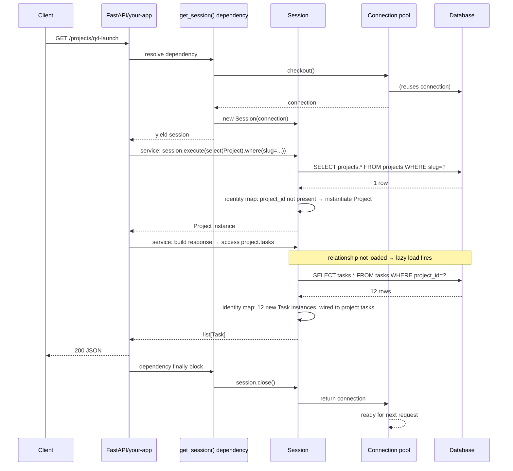
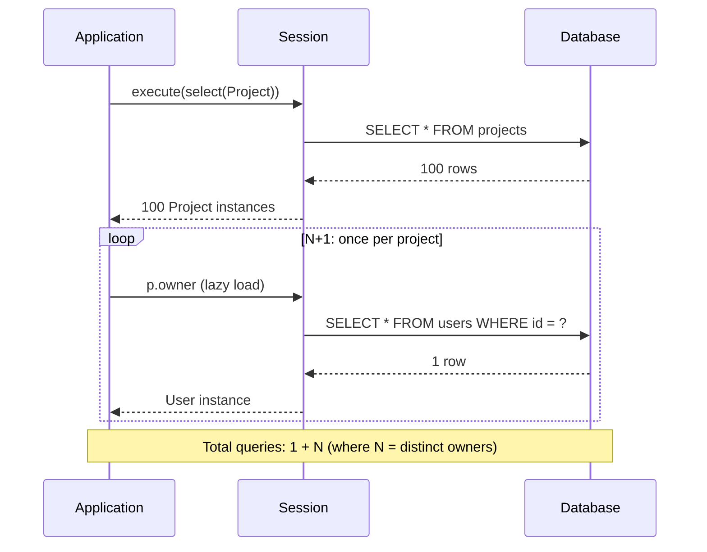
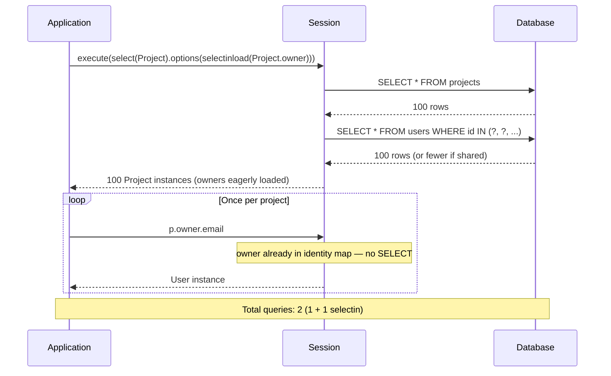

# Lesson 04: Relationships and Loading Strategies

*`relationship()`, `back_populates`, the four cardinalities (1:N, N:1, 1:1, N:M), the N+1 trap, and how `selectinload` / `joinedload` / `subqueryload` save you from it. `Boardly` grows `Task`, `Comment`, and `Membership` models here.*

**You've reached the heart of the ORM.**

The whole reason you use an ORM is so that `project.owner` returns a `User` object instead of `user_id`. Today we make that work — and we make it not slow. The N+1 trap is the most common production bug in ORM codebases; by the end of this lesson you will see it coming a mile off and know exactly which loading strategy to reach for. Take your time. Trace every query in the `echo` log. **This is how you learn to use SQLAlchemy well.**


#sqlalchemy #orm #relationships #loading-strategies

## Learning Objectives

By the end of this lesson you will be able to:

1. **Define `relationship()` on both sides** with `back_populates=...` for bidirectional traversal.
2. **Match the four cardinalities** — 1:N (one-to-many), N:1 (many-to-one), 1:1 (one-to-one), N:M (many-to-many) — to their `relationship()` + `ForeignKey` shapes.
3. **Choose between an association table and an association object** for N:M relationships, based on whether the join itself carries data.
4. **Configure cascade** (`save-update`, `delete`, `delete-orphan`) on `relationship()` and distinguish ORM cascades from database-level FK cascades (`ondelete="CASCADE"`).
5. **Trigger the N+1 trap** on purpose, see it in the SQL log, and explain why it happens.
6. **Fix N+1 with `selectinload`, `joinedload`, and `subqueryload`** and choose between them based on fan-out, row width, and query type.
7. **Explain the identity map's role** in relationship traversal and why touching the same `User` twice in one session does not emit a second `SELECT`.
8. **Articulate the implicit-I/O trap** in async SQLAlchemy and explain why lazy loading throws `MissingGreenlet` in async (canonical in Lesson 07).
9. **Explain expiration and refresh** — why touching `obj.name` after `session.commit()` can trigger a `SELECT`, and how `expire_on_commit=False` changes that.

## Prerequisites

- **Lesson 03 — Declarative Base and Mapped.** You should have `boardly/models.py` working with `Organization`, `User`, and `Project`. We will add to it.
- **Lesson 01 — Foundations and Architecture.** The unit-of-work pattern and the identity map. We use both heavily in this lesson.
- **Relational model** — [[06-SQL-Fundamentals/Relational-Model-and-Constraints]]. You should be able to read a `JOIN` and explain why `ON a.id = b.a_id` is the join condition.
- **About 2 hours of focused time.** This lesson has the most code of any lesson in the section because every cardinality gets its own example.

**The most common gap: thinking `relationship()` is a foreign key.**

It is not. `ForeignKey("users.id")` is the column-level constraint that lives in the database. `relationship()` is the ORM-level directive that tells SQLAlchemy "when I write `project.owner`, run a `SELECT` against `users` and return the matching row as a `User` instance". The `ForeignKey` is the wire-level link; the `relationship()` is the in-memory accessor. You need both.


## The Problem

You have three models from Lesson 03 (`Organization`, `User`, `Project`). Right now, if you want `project.owner` you have to:

```python
project = session.get(Project, 1)
owner = session.get(User, project.owner_id)
```

Two gets, two round-trips, two `SELECT` statements. Worse, the application code has to know that `project.owner_id` is the FK to `users.id`. That knowledge is leaking out of the model and into every call site.

The 2.x ORM fixes this with `relationship()`:

```python
class Project(Base):
 # ...
 owner_id: Mapped[Optional[uuid.UUID]] = mapped_column(
 ForeignKey("users.id", ondelete="SET NULL"), nullable=True, index=True,
 )
 owner: Mapped[Optional["User"]] = relationship() # ← new

# Now:
project = session.get(Project, 1)
owner = project.owner # ← emits SELECT ... FROM users WHERE id = ?
```

One line of `relationship()` and the application code reads like in-memory traversal. But that one line opens up four cardinalities (1:N, N:1, 1:1, N:M), three loading strategies (`selectinload`, `joinedload`, `subqueryload`), and the N+1 trap. This lesson covers all of them.

## The Code

Here is the complete `boardly/models.py` after this lesson — the three existing models plus `Task`, `Comment`, and `Membership` and their `relationship()` declarations.

```python
# boardly/models.py (after Lesson 04)
"""Boardly — ORM models with relationships.

Adds Task, Comment, and Membership models; bidirectional relationships via
back_populates; loading strategies demonstrated in main().
"""
from __future__ import annotations

import uuid
from datetime import datetime, timezone
from decimal import Decimal
from typing import Optional

from sqlalchemy import ForeignKey, String, UniqueConstraint, func
from sqlalchemy.orm import DeclarativeBase, Mapped, mapped_column, relationship
from sqlalchemy.types import Uuid


class Base(DeclarativeBase):
 pass


# ---------------------------------------------------------------------------
# Organization — has many Projects, has many Memberships, has many Users
# (through Memberships).
# ---------------------------------------------------------------------------
class Organization(Base):
 __tablename__ = "organizations"
 __table_args__ = (UniqueConstraint("slug", name="uq_organizations_slug"),)

 id: Mapped[uuid.UUID] = mapped_column(Uuid(as_uuid=True), primary_key=True, default=uuid.uuid4)
 slug: Mapped[str] = mapped_column(String(50), unique=True, index=True)
 display_name: Mapped[str] = mapped_column(String(255))
 created_at: Mapped[datetime] = mapped_column(
 default=lambda: datetime.now(timezone.utc), server_default=func.now(),
 )

 # 1:N — one organization has many projects
 projects: Mapped[list["Project"]] = relationship(
 back_populates="organization",
 cascade="all, delete-orphan",
 )
 # 1:N — one organization has many memberships
 memberships: Mapped[list["Membership"]] = relationship(
 back_populates="organization",
 cascade="all, delete-orphan",
 )


# ---------------------------------------------------------------------------
# User — has one home_org (N:1), has many Projects they own (1:N), has many
# Memberships (1:N).
# ---------------------------------------------------------------------------
class User(Base):
 __tablename__ = "users"

 id: Mapped[uuid.UUID] = mapped_column(Uuid(as_uuid=True), primary_key=True, default=uuid.uuid4)
 email: Mapped[str] = mapped_column(String(255), unique=True, index=True)
 hashed_password: Mapped[str] = mapped_column(String(255))
 display_name: Mapped[str] = mapped_column(String(255))
 home_org_id: Mapped[uuid.UUID] = mapped_column(
 ForeignKey("organizations.id", ondelete="RESTRICT"), index=True,
 )
 created_at: Mapped[datetime] = mapped_column(
 default=lambda: datetime.now(timezone.utc), server_default=func.now(),
 )

 # N:1 — many users belong to one home organization
 home_org: Mapped["Organization"] = relationship(
 back_populates="home_users", # see Organization.home_users below
 )
 # 1:N — one user owns many projects
 owned_projects: Mapped[list["Project"]] = relationship(
 back_populates="owner",
 cascade="all, delete-orphan", # deleting a user deletes their projects
 )
 # 1:N — one user is on many memberships
 memberships: Mapped[list["Membership"]] = relationship(
 back_populates="user",
 cascade="all, delete-orphan",
 )


# We add `home_users` to Organization (the inverse of User.home_org):
# (We define it on Organization as a separate attribute.)

# ---------------------------------------------------------------------------
# Project — belongs to one Organization (N:1), has one owner (N:1), has many
# Tasks (1:N).
# ---------------------------------------------------------------------------
class Project(Base):
 __tablename__ = "projects"
 __table_args__ = (
 UniqueConstraint("organization_id", "slug", name="uq_projects_org_slug"),
 )

 id: Mapped[uuid.UUID] = mapped_column(Uuid(as_uuid=True), primary_key=True, default=uuid.uuid4)
 organization_id: Mapped[uuid.UUID] = mapped_column(
 ForeignKey("organizations.id", ondelete="CASCADE"), index=True,
 )
 owner_id: Mapped[Optional[uuid.UUID]] = mapped_column(
 ForeignKey("users.id", ondelete="SET NULL"), nullable=True, index=True,
 )
 name: Mapped[str] = mapped_column(String(255))
 slug: Mapped[str] = mapped_column(String(50), index=True)
 description: Mapped[Optional[str]] = mapped_column(String(2000), nullable=True)
 budget: Mapped[Optional[Decimal]] = mapped_column(nullable=True, decimal_return_scale=2)
 created_at: Mapped[datetime] = mapped_column(
 default=lambda: datetime.now(timezone.utc), server_default=func.now(),
 )

 # N:1 — many projects belong to one organization
 organization: Mapped["Organization"] = relationship(back_populates="projects")
 # N:1 — many projects are owned by one user
 owner: Mapped[Optional["User"]] = relationship(back_populates="owned_projects")
 # 1:N — one project has many tasks
 tasks: Mapped[list["Task"]] = relationship(
 back_populates="project",
 cascade="all, delete-orphan",
 )


# ---------------------------------------------------------------------------
# Task — belongs to one Project (N:1), has many Comments (1:N), has one
# assignee (N:1, optional).
# ---------------------------------------------------------------------------
class Task(Base):
 __tablename__ = "tasks"

 id: Mapped[uuid.UUID] = mapped_column(Uuid(as_uuid=True), primary_key=True, default=uuid.uuid4)
 project_id: Mapped[uuid.UUID] = mapped_column(
 ForeignKey("projects.id", ondelete="CASCADE"), index=True,
 )
 assignee_id: Mapped[Optional[uuid.UUID]] = mapped_column(
 ForeignKey("users.id", ondelete="SET NULL"), nullable=True, index=True,
 )
 title: Mapped[str] = mapped_column(String(255))
 description: Mapped[Optional[str]] = mapped_column(String(2000), nullable=True)
 status: Mapped[str] = mapped_column(String(20), default="open", server_default="open")
 created_at: Mapped[datetime] = mapped_column(
 default=lambda: datetime.now(timezone.utc), server_default=func.now(),
 )

 # N:1
 project: Mapped["Project"] = relationship(back_populates="tasks")
 # N:1
 assignee: Mapped[Optional["User"]] = relationship()
 # 1:N
 comments: Mapped[list["Comment"]] = relationship(
 back_populates="task",
 cascade="all, delete-orphan",
 order_by="Comment.created_at", # tasks have a natural comment order
 )


# ---------------------------------------------------------------------------
# Comment — belongs to one Task (N:1), has one author (N:1).
# ---------------------------------------------------------------------------
class Comment(Base):
 __tablename__ = "comments"

 id: Mapped[uuid.UUID] = mapped_column(Uuid(as_uuid=True), primary_key=True, default=uuid.uuid4)
 task_id: Mapped[uuid.UUID] = mapped_column(
 ForeignKey("tasks.id", ondelete="CASCADE"), index=True,
 )
 author_id: Mapped[uuid.UUID] = mapped_column(
 ForeignKey("users.id", ondelete="RESTRICT"), index=True,
 )
 body: Mapped[str] = mapped_column(String(2000))
 created_at: Mapped[datetime] = mapped_column(
 default=lambda: datetime.now(timezone.utc), server_default=func.now(),
 )

 # N:1
 task: Mapped["Task"] = relationship(back_populates="comments")
 # N:1
 author: Mapped["User"] = relationship()


# ---------------------------------------------------------------------------
# Membership — the N:M join between User and Organization, but with data of
# its own (role, created_at). So it is an Association Object, not just an
# association table.
# ---------------------------------------------------------------------------
class Membership(Base):
 __tablename__ = "memberships"
 __table_args__ = (
 UniqueConstraint("user_id", "organization_id", name="uq_memberships_user_org"),
 )

 id: Mapped[uuid.UUID] = mapped_column(Uuid(as_uuid=True), primary_key=True, default=uuid.uuid4)
 user_id: Mapped[uuid.UUID] = mapped_column(
 ForeignKey("users.id", ondelete="CASCADE"), index=True,
 )
 organization_id: Mapped[uuid.UUID] = mapped_column(
 ForeignKey("organizations.id", ondelete="CASCADE"), index=True,
 )
 role: Mapped[str] = mapped_column(String(20), default="member")
 created_at: Mapped[datetime] = mapped_column(
 default=lambda: datetime.now(timezone.utc), server_default=func.now(),
 )

 # N:1 — many memberships belong to one user
 user: Mapped["User"] = relationship(back_populates="memberships")
 # N:1 — many memberships belong to one organization
 organization: Mapped["Organization"] = relationship(back_populates="memberships")


# Patch the Organization class with home_users (the inverse of User.home_org).
# (In real code we would define this inline; we patch here to keep the lesson
# reading in dependency order — Organization is defined before User.)
Organization.home_users = relationship(
 "User",
 back_populates="home_org",
 primaryjoin="Organization.id == User.home_org_id",
 foreign_keys="[User.home_org_id]",
 viewonly=True,
)
```

That's about 220 lines. Save it as `boardly/models.py` (overwriting the Lesson 03 version) and add a `main()` that demonstrates the four cardinalities and the three loading strategies. The `main()` is below the line-by-line.

## Line-by-Line Deep Dive

This is the heart of the lesson. Read it twice. Every cardinality gets its own analysis because the shapes are subtly different.

### The four cardinalities, at a glance

| Cardinality | FK lives on | `relationship()` on the "1" side | `relationship()` on the "N" side |
|---|---|---|---|
| 1:N | the "N" side | `list["Child"]` | not declared (or `Optional["Parent"]`) |
| N:1 | the "N" side | not declared | `"Parent"` |
| 1:1 | either side, with `uselist=False` | `"Parent"` with `uselist=False` | `"Child"` with `uselist=False` |
| N:M | neither — uses an association table/object | `list["Child"]` via `secondary=` | `list["Parent"]` via `secondary=` |

**Tip — The simplest rule: read the annotation.**

`Mapped[list["Task"]]` means "many tasks" — a one-to-many relationship. `Mapped["User"]` means "one user" — a many-to-one relationship. `Mapped[Optional["User"]]` means the same but nullable. `Mapped[list["User"]]` on both sides means many-to-many. The annotation tells you everything.


### `Organization.projects` and `Project.organization`: 1:N and N:1

```python
class Organization(Base):
 # ...
 projects: Mapped[list["Project"]] = relationship(
 back_populates="organization",
 cascade="all, delete-orphan",
 )

class Project(Base):
 # ...
 organization_id: Mapped[uuid.UUID] = mapped_column(
 ForeignKey("organizations.id", ondelete="CASCADE"), index=True,
 )
 organization: Mapped["Organization"] = relationship(back_populates="projects")
```

**What it does:** Sets up a bidirectional 1:N (Organization has many Projects) and N:1 (Project belongs to one Organization). The FK lives on the "N" side (`Project.organization_id`).

**Why each part:**

- `Mapped[list["Project"]]` — the annotation. `list[...]` says "many of these"; the ORM derives `uselist=True`. The string `"Project"` is a forward reference because `Project` is defined later in the file. (You could also import `from __future__ import annotations` and write `Mapped[list[Project]]` without quotes; we use quotes to be explicit about forward references.)
- `relationship(back_populates="organization", cascade="all, delete-orphan")` — the relationship. `back_populates="organization"` says "the other side of this relationship is the `organization` attribute on `Project`". `cascade="all, delete-orphan"` says "save-update and delete cascade; orphan deletes are enabled".
- On the `Project` side, `organization: Mapped["Organization"]` — note: no `list[...]`, so `uselist=False` (this is the "1" side, not the "many" side). `relationship(back_populates="projects")` — the inverse: "the other side of this relationship is the `projects` attribute on `Organization`".

**What `back_populates` actually does:** When you write `project.organization = some_org`, SQLAlchemy *also* automatically sets `some_org.projects.append(project)`. The two sides stay in sync without you having to write both assignments. Without `back_populates`, you would have to write both:

```python
project.organization = some_org
some_org.projects.append(project) # if you want the in-memory graph consistent
```

`back_populates` does this for you. It is the canonical 2.x way to set up bidirectional relationships.

**`back_populates` vs `backref`**

`backref="projects"` is the legacy form: it tells SQLAlchemy to *create* the `projects` attribute on `Organization` automatically. `back_populates="organization"` is the 2.x form: it requires you to *define both attributes explicitly* and link them with `back_populates`. The 2.x form is preferred because it makes both sides visible in the source — there is no "magic attribute" that appears only at runtime. New code should use `back_populates` exclusively.


**Production reality: the `lazy="select"` default is the N+1 the ORM ships with.**

SQLAlchemy 2.x defaults every `relationship()` to `lazy="select"` — one `SELECT` per parent per traversal. The default is correct for the median call site (one parent, one traversal) and catastrophic for the loop call site (N parents, one traversal each = N+1). The production discipline is not "change the default to `lazy="selectinload"`" (that over-fetches every call site that does not traverse the relationship); it is to audit every loop that traverses a relationship and add `.options(selectinload(...))` to that specific query. The audit grep is `rg "for .* in .*\\.scalars\\(\\)\\.all\\(\\)" boardly/` — every hit is a candidate N+1 the moment the loop body touches a relationship attribute. The model-level alternative `lazy="raise"` (or `lazy="raise_on_sql"`) turns an accidental lazy-load into an explicit `InvalidRequestError` instead of a silent N+1, which is the strictest discipline and the one that catches the bug in CI rather than in the APM trace. Cross-link to [[13-Performance-and-Observability/N-plus-1-and-Slow-Queries]] for the N+1-hunting workflow and [[07-SQLAlchemy/07-Async-SQLAlchemy]] where `lazy="raise"` is the async default because implicit I/O is forbidden.


### `cascade="all, delete-orphan"`: ORM-level cascades

The `cascade` argument controls what happens to related objects when the parent is operated on. The options are:

- `save-update` — when the parent is added to a session, the children are added too. (Default.)
- `delete` — when the parent is deleted, the children are deleted too. (Not default.)
- `delete-orphan` — when a child is removed from the parent's collection, the child is deleted. (Implies `delete`.)
- `merge` — when the parent is merged into another session, the children are merged too. (Default.)
- `expunge` — when the parent is expunged from the session, the children are expunged too. (Default.)
- `refresh-expire` — when the parent is refreshed or expired, the children are too. (Default.)
- `all` — shorthand for `save-update, merge, refresh-expire, expunge, delete`.

`cascade="all, delete-orphan"` is the standard for parent-owns-children relationships. Deleting an `Organization` deletes its `Projects`, which (via their own cascade) delete their `Tasks`, which delete their `Comments`. Setting `org.projects = []` removes all the projects from the org, and because of `delete-orphan`, they are deleted (not just orphaned).

**Warning — ORM cascades vs database-level FK cascades**

These are different mechanisms and they can conflict:
- The `ForeignKey(..., ondelete="CASCADE")` is a database-level constraint. It fires when the parent row is deleted by **any** SQL statement, including a raw `DELETE FROM organizations WHERE id = ?` issued by another tool.
- The `relationship(cascade="all, delete-orphan")` is an ORM-level cascade. It fires only when the parent is deleted via the ORM — i.e., `session.delete(org)` and the unit-of-work emits the `DELETE`.

If both are set, they cooperate: the ORM deletes the children first (via the ORM cascade), then the parent (via the `session.delete()`). The database-level `ondelete` would only fire if a child could not be deleted for some reason (e.g., it itself has a `RESTRICT` FK). If neither is set, deleting the parent fails with a FK constraint violation (good — you do not want silent orphans). Pick a strategy and be consistent.


**Warning — When this breaks: the cascade that fires after a `session.delete()` you did not mean.**

A developer who calls `session.delete(user)` to remove a user, forgetting that `User.owned_projects` carries `cascade="all, delete-orphan"`, watches every project the user owned get `DELETE`d in the same unit of work — including projects other teams depend on. The symptom is "I deleted one user and 47 projects vanished." The cascade is transitive: `Organization` -> `Project` -> `Task` -> `Comment`, so a top-of-graph `session.delete(org)` with `delete-orphan` at every level can wipe four tables from one call. The diagnosis is `rg "cascade=" boardly/models.py` and walking the cascade path from the deleted object to every leaf; the `delete-orphan` keyword is the one that turns "remove from collection" into "DELETE the row." The fix for the accidental case: prefer `cascade="save-update, merge"` (no `delete-orphan`) on relationships whose children should survive the parent's deletion, and let the FK's `ondelete="SET NULL"` handle the orphans in the database; reserve `delete-orphan` for genuine parent-owns-child relationships (`Task.comments`, `Organization.projects`) where the children have no meaning outside the parent. For user deletion specifically, soft-delete (`user.deleted_at = now()`) is almost always safer than hard-delete with a cascade.


### `Project.owner` and `User.owned_projects`: 1:N with an optional FK

```python
class Project(Base):
 owner_id: Mapped[Optional[uuid.UUID]] = mapped_column(
 ForeignKey("users.id", ondelete="SET NULL"), nullable=True, index=True,
 )
 owner: Mapped[Optional["User"]] = relationship(back_populates="owned_projects")

class User(Base):
 owned_projects: Mapped[list["Project"]] = relationship(
 back_populates="owner",
 cascade="all, delete-orphan",
 )
```

**What it does:** Sets up a bidirectional 1:N where the "N" side is nullable — a `Project` may have no owner (if the owner user was deleted, the FK becomes `NULL`).

**Why `Optional[...]` on both sides:** On the FK column, `Optional` + `nullable=True` allow the column to be NULL. On the relationship, `Optional["User"]` documents that `project.owner` may be `None` (when `owner_id` is NULL). The annotation does not change SQLAlchemy's behavior — both `Mapped[Optional[User]]` and `Mapped[User]` work for nullable FKs — but `Optional` makes the nullability visible at the type level.

**Why `ondelete="SET NULL"` + `cascade="all, delete-orphan"` together:**

- The database-level `ondelete="SET NULL"` handles the case where a `User` is deleted by raw SQL (e.g., a cleanup script). The user's `Projects` get their `owner_id` set to NULL.
- The ORM-level `cascade="all, delete-orphan"` handles the case where a `User` is deleted via the ORM. The user's `Projects` get `DELETE`d entirely.

Wait — these two are in conflict! One says "set the FK to NULL"; the other says "delete the child entirely". Which wins?

The answer is: the ORM cascade wins for ORM-managed deletes. When you call `session.delete(user)`, the unit-of-work sees the ORM cascade and emits `DELETE FROM projects WHERE owner_id = ?` *before* the `DELETE FROM users WHERE id = ?`. The `ondelete="SET NULL"` never fires because the child rows are gone before the parent's `DELETE` reaches the database.

If you want `SET NULL` to win even for ORM deletes, use `cascade="all"` (no `delete-orphan`) and let the database's `ondelete` handle the cascade:

```python
owned_projects: Mapped[list["Project"]] = relationship(
 back_populates="owner",
 # no delete-orphan — the database's ondelete=SET NULL takes over
)
```

But then you cannot delete the user via the ORM at all — the ORM will not know to clean up the projects, and the database's `SET NULL` will only fire if the ORM emits the `DELETE FROM users` statement (which it will, but the projects' `owner_id` will be set to NULL by the DB, not by the ORM, and the in-memory `Project` objects will not know).

**Which is right for `Boardly`?**

For `Project.owner`, we picked `cascade="all, delete-orphan"` because we want deleting a user to delete their projects (a user who left should not leave their projects lying around with NULL owners). For `Task.assignee`, we picked the opposite — see below.


**Danger — How an attacker thinks: the ORM cascade as a data-destruction multiplier.**

A single `session.delete(org)` with `cascade="all, delete-orphan"` on `Organization.projects` (and transitively on `Project.tasks` and `Task.comments`) deletes the org, all its projects, all their tasks, and every comment — in one unit of work, one `COMMIT`. If a broken access-control check or an injection lets an attacker reach `session.delete(org)` for an org they do not own, the cascade turns one row deletion into a multi-table wipe before any human notices. The cascade is a performance and consistency feature, not a security boundary; the access control must be upstream of the `session.delete()` call. The defense in depth: (a) the app role runs under RLS, so `select(Organization).where(id=org_id)` returns the foreign org as not-found (a 404) before the `session.delete(org)` can fire — see [[08-PostgreSQL/Roles-Permissions-Security]] for the `FORCE ROW LEVEL SECURITY` setup that makes the owner subject to the policy; (b) a `before_delete` event on `Organization` that re-checks `current_setting('app.organization_id') IS DISTINCT FROM org.id` and raises is the application-side tripwire that converts an accidental cross-tenant delete into a loud `IntegrityError`; (c) the audit log records every `session.delete(org)` with the actor's GUC so a post-hoc review can reconstruct the blast radius. The cascade's transitivity is what makes the upstream check non-negotiable: by the time the `DELETE FROM organizations` reaches the database, the child `DELETE`s have already run. Cross-link to [[11-Authentication-and-Security/RBAC-and-Object-Level-Auth]] for the object-level-auth pattern that gates the delete and [[17-Advanced-Architecture/Multi-Tenancy]] for the tenant-identity discipline.


### `Task.assignee`: N:1 without `back_populates`

```python
class Task(Base):
 assignee_id: Mapped[Optional[uuid.UUID]] = mapped_column(
 ForeignKey("users.id", ondelete="SET NULL"), nullable=True, index=True,
 )
 assignee: Mapped[Optional["User"]] = relationship()
```

**What it does:** A unidirectional N:1 from `Task` to `User`. There is no `back_populates` — `User` does not get a `assigned_tasks` attribute.

**Why omit `back_populates`:** Sometimes you do not need the inverse. The `User` class would be cluttered with `assigned_tasks`, `owned_projects`, `authored_comments`, `memberships`, etc., most of which no caller uses. Omitting `back_populates` keeps the API surface smaller.

**Trade-off:** Without `back_populates`, you cannot traverse from `User` to their assigned tasks. If a feature later needs that, you add a relationship on `User` then.

**Danger — How an attacker thinks: the missing inverse as a tenant-leak blind spot.**

Without `back_populates`, there is no `User.assigned_tasks` collection, so the developer who needs "all tasks for user X" writes a fresh `select(Task).where(Task.assignee_id == user_id)`. That hand-written query is a fresh `SELECT` the developer must remember to scope with `.join(Project).where(Project.organization_id == current_org_id)` — and if they forget, the query returns every task assigned to that user across *every* tenant in the database. The inverse relationship traversal (`user.assigned_tasks`, had `back_populates` been declared) would have inherited the session's RLS-scoped `User` load and thus been tenant-scoped automatically; the hand-written replacement query inherits nothing. The leak vector is not the relationship itself — it is the *absence* of the relationship forcing a hand-written query that the developer must re-scope manually, and the manual re-scoping is the step that gets skipped under deadline pressure. The defense: prefer `back_populates` on every N:1 whose inverse will be queried (the inverse traversal inherits the parent's RLS scope); for the N:1 relationships you deliberately leave unidirectional, document in the model docstring that every hand-written inverse query MUST carry the tenant `WHERE` — and add a `lazy="raise"` on a sentinel inverse to turn a forgotten scope into an error rather than a leak. Cross-link to [[17-Advanced-Architecture/Multi-Tenancy]] for the tenant-scoping discipline and [[06-SQL-Fundamentals/SQL-Injection-and-Parameterized-Queries]] for the "forgot the WHERE" failure class.


### `Task.comments`: 1:N with `order_by`

```python
class Task(Base):
 comments: Mapped[list["Comment"]] = relationship(
 back_populates="task",
 cascade="all, delete-orphan",
 order_by="Comment.created_at",
 )
```

**What it does:** Sets up the 1:N from `Task` to `Comment`, and orders the comments by `created_at` whenever they are loaded.

**Why `order_by`:** Comments have a natural order (chronological). Without `order_by`, the ORM loads comments in database-row order, which is undefined (no guaranteed order). With `order_by="Comment.created_at"`, every load of `task.comments` emits `SELECT ... FROM comments WHERE task_id = ? ORDER BY comments.created_at`. Always.

**`order_by` is a string.**

The argument is a string (`"Comment.created_at"`) that SQLAlchemy evaluates as a Python expression in the model's namespace. You can also pass a column object directly (`order_by=Comment.created_at`) but that requires `Comment` to be defined before `Task`. The string form allows forward references.


### `Membership`: the Association Object pattern

```python
class Membership(Base):
 __tablename__ = "memberships"
 __table_args__ = (
 UniqueConstraint("user_id", "organization_id", name="uq_memberships_user_org"),
 )
 id: Mapped[uuid.UUID] = mapped_column(Uuid(as_uuid=True), primary_key=True, default=uuid.uuid4)
 user_id: Mapped[uuid.UUID] = mapped_column(ForeignKey("users.id", ondelete="CASCADE"), index=True)
 organization_id: Mapped[uuid.UUID] = mapped_column(ForeignKey("organizations.id", ondelete="CASCADE"), index=True)
 role: Mapped[str] = mapped_column(String(20), default="member")
 created_at: Mapped[datetime] = mapped_column(default=lambda: datetime.now(timezone.utc), server_default=func.now())

 user: Mapped["User"] = relationship(back_populates="memberships")
 organization: Mapped["Organization"] = relationship(back_populates="memberships")
```

**What it does:** Defines a `Membership` model with its own primary key (`id`), two FKs (`user_id`, `organization_id`), and *data of its own* (`role`, `created_at`). It is the N:M relationship between `User` and `Organization`, expressed as a full model rather than a bare association table.

**Why an Association Object instead of an association table:**

The simpler N:M pattern uses a `Table` (not a class) as the join:

```python
from sqlalchemy import Table, Column

user_organization = Table(
 "user_organization",
 Base.metadata,
 Column("user_id", ForeignKey("users.id", ondelete="CASCADE"), primary_key=True),
 Column("organization_id", ForeignKey("organizations.id", ondelete="CASCADE"), primary_key=True),
)

class User(Base):
 organizations: Mapped[list["Organization"]] = relationship(
 secondary=user_organization, back_populates="users",
 )

class Organization(Base):
 users: Mapped[list["User"]] = relationship(
 secondary=user_organization, back_populates="organizations",
 )
```

This is the **association table** pattern. It is simpler — no `Membership` class — but the join table can carry *no data of its own*. You cannot store `role` or `created_at` on the join.

The **association object** pattern (what we use) makes the join a first-class model. It can carry data (`role`, `created_at`), it can have its own PK (so it is iterable and addressable), and you can query it directly. The trade-off: traversal is two hops instead of one. To get a user's organizations, you write:

```python
for m in user.memberships:
 print(m.organization.name, m.role)
```

instead of:

```python
for org in user.organizations:
 print(org.name)
```

For `Boardly`, the membership carries `role`, so the association object is the right choice.

**Tip — Use association tables when the join has no data.**

A pure join (user_likes_post: user_id + post_id, nothing else) is fine as an association table. The moment the join has data — a role, a created_at, a position, a status — promote it to an association object.


**Production reality: the association object's `role` column is a privilege boundary.**

`Membership.role` (`"admin"`, `"member"`, `"viewer"`) is the per-org privilege grant — the row that says "this user can promote other users in this org." A buggy or injected `UPDATE memberships SET role = 'admin' WHERE user_id = ? AND organization_id = ?` escalates a user in an org they should not be admin in, and the relationship traversal `user.memberships` is the *read* path, not the *write* path — but a service that does `user.memberships[0].role = "admin"` then `session.commit()` has written the privilege through the relationship and bypassed any centralized admin-check. The defense: never expose `role` mutation through the relationship collection; route every role change through a `SECURITY DEFINER` function (the `admin_promote` pattern in [[08-PostgreSQL/Roles-Permissions-Security]]) that re-checks the actor's admin status in the same transaction as the `UPDATE`, and writes the audit-log row atomically. The model docstring on `Membership.role` should say "mutated only via `admin_promote()`; direct assignment is a privilege-escalation footgun." The same boundary applies to any join-column that doubles as a grant: `position`, `status`, `permission_level`. Cross-link to [[11-Authentication-and-Security/RBAC-and-Object-Level-Auth]] for the RBAC pattern that should own the grant decision.


### The patched `Organization.home_users`

```python
Organization.home_users = relationship(
 "User",
 back_populates="home_org",
 primaryjoin="Organization.id == User.home_org_id",
 foreign_keys="[User.home_org_id]",
 viewonly=True,
)
```

**What it does:** Adds the inverse side of `User.home_org` after the `Organization` class has been defined. The `primaryjoin` and `foreign_keys` arguments are needed because there are *two* FKs from `User` to `Organization` (`home_org_id` and the `Membership` join); SQLAlchemy cannot infer which one this relationship uses.

**Why `viewonly=True`:** We do not want changes to `Organization.home_users` to write back to the database. The collection is a derived view (the list of users whose home org is this one); we never want to change a user's home org by appending to `org.home_users`. (To change a user's home org, you set `user.home_org = some_org` and let `back_populates` update `home_users`.)

**Warning — `viewonly=True` is not a security feature.**

It just prevents the ORM from including the relationship in `INSERT`/`UPDATE`/`DELETE` SQL. The collection is still mutable in memory — `org.home_users.append(user)` will not raise, but the change is not persisted. Treat it as documentation for engineers, not a runtime guard.


**Danger — How an attacker thinks: the `viewonly` cross-FK relationship that bypasses the tenant filter.**

`Organization.home_users` joins `User.home_org_id` to `Organization.id` and is marked `viewonly=True`. The `viewonly` flag suppresses writes; it does *not* add a `WHERE` clause. A query like `select(Organization).options(selectinload(Organization.home_users))` run by a privileged (non-RLS) role — a reporting job, a DBA hotfix, a migration backfill — returns every `User` whose `home_org_id` matches, with no tenant scoping, because the relationship definition carries no predicate and the query carries none either. The `viewonly` flag is read as "safe" by developers who assume it implies a scope; it does not. The defense: every `viewonly` relationship that crosses a tenant boundary must be paired with an explicit `.where(Organization.id == current_org_id)` in every query that traverses it, never trusted to the relationship definition alone; and the role that runs such queries should be the RLS-subject `boardly_app` role, never `boardly_migrator` (which `BYPASSRLS`). The audit grep for cross-tenant `viewonly` relationships is `rg "viewonly=True" boardly/models.py` — every hit is a candidate for the missing-scope bug. Cross-link to [[08-PostgreSQL/Roles-Permissions-Security]] for the RLS backstop that catches the missing `WHERE` when the role is correct, and [[11-Authentication-and-Security/RBAC-and-Object-Level-Auth]].


## Execution Trace

We've defined the models, written the relationships, and walked every line of the code. Now run it end-to-end and watch what actually happens at request time. The walkthrough below is the spine for everything else in this lesson: the N+1 trap, the eager loaders, and the identity-map section that follows all live inside this trace. Read this first; the later sections drill into specific stages.

### The request that triggers everything

Imagine Boardly has a `GET /projects/{slug}` endpoint that returns a project with its tasks. A real request lands. The dependency yields the session, the service loads the `Project`, the service accesses `project.tasks`, lazy loading fires, the tasks are materialized, the response is built, the session is closed. Eight steps, all in order:



### Step-by-step prose

1. **Client request arrives.** A `GET /projects/q4-launch` hits FastAPI. FastAPI resolves the route, parses path parameters, then resolves the dependencies the handler declared. The handler takes a `Session` argument — the dependency that yields one is the canonical `get_session()` from Lesson 05.
2. **Dependency yields the session.** The dependency function opens a fresh `Session` wrapping a connection checked out from the engine's pool (see `[[07-SQLAlchemy/02-Engines-Connections-Pools]]` for the pool's lifecycle). The `Session` is *not* the connection — it owns one for the duration of the request. The dependency then `yield`s the session to the handler. Everything before `yield` is "setup"; everything in the `finally` block after `yield` is "teardown." This is the same pattern as `lifespan` in `[[03-FastAPI-Core/Application-and-Lifespan]]`, just scoped to a request instead of the process.
3. **Service loads a `Project`.** The handler calls `session.execute(select(Project).where(Project.slug == "q4-launch")).scalar_one()`. The session compiles the `select` into a SQL string, asks the connection to send it, and waits for the rows. One row comes back.
4. **Identity map is consulted *before* instantiation.** Before the session materializes the row into a `Project` instance, it checks the identity map: "have I already loaded a `Project` with this primary key during this session?" If yes, return the existing instance — do *not* create a duplicate. If no, instantiate a new `Project`, store it in the identity map keyed by `(Project, primary_key)`, and return it. We cover the identity map in detail in `## The Identity Map, Expiration, and Detached Objects` below.
5. **Service accesses `project.tasks`.** To build the response, the service reads `project.tasks`. The `tasks` relationship is configured with the default `lazy="select"` loader. The session checks the instance's `__dict__`: is `tasks` already present? No. So the lazy loader fires *synchronously*, right here, on the same line of Python that accessed the attribute.
6. **SELECT is issued for the related rows.** The session compiles `SELECT tasks.* FROM tasks WHERE tasks.project_id = ?` with the parent project's id as the bound parameter, sends it on the same connection, and waits. Twelve rows come back.
7. **Objects materialized in the identity map.** For each row, the session consults the identity map again (some of these `Task` instances may have been loaded earlier in the session — the map prevents duplicates). New instances are created, stored in the identity map, and wired to `project.tasks` (the back-populated collection). The attribute is now "loaded" — subsequent reads of `project.tasks` return the cached list with no further SQL.
8. **Response returned, session closed.** The service builds the response dict; FastAPI serializes it to JSON; the response is sent. Then the dependency's `finally` block runs `session.close()`. The session releases its connection back to the pool; the transaction is rolled back (because we never committed — read-only requests don't need to commit); pending state is discarded. The connection waits in the pool for the next request.

**Where lazy loading hides.**

Step 5 is the entire reason the N+1 trap exists. The SQL for the tasks is *not* issued by `session.execute(...)` in step 3 — it is issued by a Python attribute access in step 5. The two queries are paired in the code (load project, then print tasks) but separated in the SQL log by a single line of Python. The learner who reads the SQL log without reading the Python will miss the connection.


**Spot the inefficiency — what if the response only needs the project's name?**

If the service builds a response like `{"name": project.name}` and never touches `project.tasks`, the lazy load never fires. Step 5 simply does not happen. That is the *benefit* of lazy loading: callers who don't traverse the relationship pay nothing. The trap is when the caller *does* traverse the relationship across many parents — that is the N+1 we'll trigger on purpose in the next section.


**Warning — Detached objects: step 5 must happen *before* step 8.**

If the service is sloppy and returns the `Project` instance to the caller *without* accessing `project.tasks` first, the caller may try `project.tasks` *after* the session is closed. That raises `DetachedInstanceError: Parent instance <Project at 0x...> is not bound to a Session; attribute refresh operation cannot proceed`. The fix is either to access the relationship inside the session (eagerly if you can predict the caller needs it) or to use `selectinload` to load it at query time. We'll see this again in `## The Identity Map, Expiration, and Detached Objects` below.


**Tip — Run it yourself with `echo=True`.**

Set `create_engine(..., echo=True)` (or use Python's `logging.getLogger("sqlalchemy.engine").setLevel(logging.INFO)`). You'll see the two `SELECT`s separated by a blank line, with the second one's source line in your Python code as a comment-style trace. The visual gap between them is the lazy load. Once you see this pattern a dozen times, you'll spot N+1 from across the room.


**You've just traced the entire request lifecycle for an ORM-backed endpoint.**

Five participants, eight steps, one transaction. The rest of this lesson is about *which* of these eight steps can go wrong, and *which* loader strategy (`selectinload`, `joinedload`, `subqueryload`) you reach for at step 3 to keep step 5 from biting you in production.


## The N+1 Trap

Now we get to the most important practical part of this lesson: the N+1 trap. Trigger it on purpose:

```python
def n_plus_one_demo(session_factory) -> None:
 """Demonstrates the N+1 trap. Run with echo=True to see the SQL log."""
 with session_factory() as session:
 # Load all projects
 projects = session.execute(select(Project)).scalars().all()

 # For each project, print its owner's email. This triggers a SELECT
 # per project — the N+1.
 for p in projects:
 print(f" {p.name} owned by {p.owner.email if p.owner else 'nobody'}")
```

If `projects` has 100 rows, this emits 1 `SELECT` for the projects and up to 100 `SELECT`s for the owners (one per project). That is the N+1: N queries to fetch the related rows, plus 1 to fetch the parents.

In the SQL log:

```
SELECT projects.id, projects.organization_id, projects.owner_id, projects.name, ...
FROM projects

SELECT users.id, users.email, users.hashed_password, ...
FROM users
WHERE users.id = ?

SELECT users.id, users.email, users.hashed_password, ...
FROM users
WHERE users.id = ?

... (98 more SELECTs) ...
```

The identity map saves you from N*queries for the same user* — if two projects share the same owner, the second `p.owner` access returns the cached object. But for distinct owners, you get N queries.



Why is lazy loading the default if it is this bad? Because lazy loading is the safest semantics when you do not know which relationships the caller will traverse. Imagine the alternative: every `select(Project)` eagerly fetches every relationship — owner, organization, comments, tasks, memberships. The vast majority of call sites want only one or two of those; the rest is wasted SQL, wasted memory, wasted latency. Lazy loading defers the cost until you actually traverse the attribute, so the median call site pays nothing for relationships it does not touch. The trap is the call site that loops over many rows and traverses a relationship on each — that is where lazy loading becomes N+1. The fix is not "make eager loading the default" (that just moves the cost to every other call site); the fix is "make the loop's query explicit about what it will traverse." That is what `selectinload`, `joinedload`, and `subqueryload` are for.

The fix is to **eagerly load** the related objects in the original query. SQLAlchemy 2.x offers three eager loaders, each with its own trade-offs.

## Fixing N+1: `selectinload`, `joinedload`, `subqueryload`

### `selectinload`: the safe default

```python
projects = (
 session.execute(
 select(Project).options(selectinload(Project.owner))
 )
 .scalars()
 .all()
)
for p in projects:
 print(f" {p.name} owned by {p.owner.email}")
```

**What it does:** After the primary `SELECT`, issues one additional `SELECT ... WHERE users.id IN (?, ?, ?, ...)` to fetch all the owners in one query.

SQL log:

```
SELECT projects.id, projects.organization_id, projects.owner_id, projects.name, ...
FROM projects

SELECT users.id, users.email, users.hashed_password, ...
FROM users
WHERE users.id IN (?, ?, ?, ?, ?, ?, ?, ?, ?, ?, ?, ?, ?, ?, ?, ?, ?, ?, ?, ?, ?, ?, ?, ?, ?, ?, ?, ?, ?, ?, ?, ?, ?, ?, ?, ?, ?, ?, ?, ?, ?, ?, ?, ?, ?, ?, ?, ?, ?, ?, ?, ?, ?, ?, ?, ?, ?, ?, ?, ?, ?, ?, ?, ?, ?, ?, ?, ?, ?, ?, ?, ?, ?, ?, ?, ?, ?, ?, ?, ?, ?, ?, ?, ?, ?, ?, ?, ?, ?, ?, ?, ?, ?, ?, ?, ?, ?, ?, ?, ?)
```

(Or, on databases with a chunk limit, several `IN` queries — SQLAlchemy batches them.)

`selectinload` is the safe default because:

- It issues one extra query (total: 2), regardless of N.
- It does not multiply rows (unlike `joinedload`, see below).
- It works on the "many" side of relationships — `selectinload(Project.tasks)` is safe.

**Student asks: Why does `selectinload` issue a second `SELECT ... WHERE id IN (...)` instead of a JOIN?**

Because `joinedload` on the "many" side multiplies rows. Imagine `selectinload(Organization.projects)` written as a JOIN: `SELECT * FROM organizations o JOIN projects p ON p.organization_id = o.id`. If one organization has 100 projects, the JOIN returns 100 rows — all carrying the same Organization columns. SQLAlchemy has to deduplicate these into one `Organization` instance with 100 `Project` instances. The deduplication is expensive in Python and forces the ORM to buffer the entire result. `selectinload` avoids the multiplication: the first query returns N organizations (one row each), the second query returns 100 projects with a `WHERE organization_id IN (...)`, and SQLAlchemy groups them client-side. JOIN is for 1:1 / N:1 (multiplication is bounded); `selectinload` is for 1:N (multiplication would be unbounded).




### `joinedload`: the single-query option

```python
projects = (
 session.execute(
 select(Project).options(joinedload(Project.owner))
 )
 .scalars()
 .all()
```

**What it does:** Joins `users` into the primary `SELECT`:

```sql
SELECT projects.id, projects.organization_id, projects.owner_id, projects.name, ...,
 users_1.id, users_1.email, ...
FROM projects
LEFT OUTER JOIN users AS users_1 ON users_1.id = projects.owner_id
```

One query. `LEFT OUTER JOIN` because the FK is nullable.

`joinedload` is best when:

- You want a single round-trip.
- The joined table is narrow (a few columns).
- The join is N:1 (joining to the "1" side; the parent rows are not duplicated).

`joinedload` is dangerous when:

- The relationship is 1:N (joining to the "many" side). The parent rows are duplicated once per child. A `Project` with 50 tasks produces 50 identical rows for the project, which SQLAlchemy has to deduplicate in Python. Use `selectinload` for 1:N.
- The joined table is wide. If `users` has 30 columns, you are transferring 30 × 100 = 3000 values per query, even though you only needed one column.

**Warning — When this breaks: the cartesian product from two `joinedload`s on to-many relationships.**

`select(Parent).options(joinedload(Parent.children_a), joinedload(Parent.children_b))` where both are 1:N produces a cartesian product: a parent with 10 `children_a` and 10 `children_b` yields 100 rows per parent in the JOIN result (10 × 10), and SQLAlchemy must buffer and deduplicate all 100 in Python before returning the one parent. The symptom is "the `joinedload` query transfers 10x the expected bytes and the ORM spends seconds in `_ uniquer` deduplication" — visible in the APM trace as a long Python span between the `execute()` and the return. The `.unique()` call (which the to-many `joinedload` requires) is the deduplication trigger, and on a cartesian product it is O(rows) in Python, not O(parents). The rule: never put two `joinedload`s on to-many relationships in the same query — the first to-many can be `joinedload` (one duplication, bounded), but every subsequent to-many must be `selectinload` (which issues its own flat `IN` query and avoids the cartesian). The strict version of the rule is simpler: never `joinedload` a to-many at all; use `selectinload` for every 1:N and reserve `joinedload` for N:1 and 1:1 where the row count is bounded by 1. Cross-link to [[13-Performance-and-Observability/N-plus-1-and-Slow-Queries]].


### `subqueryload`: the legacy alternative to `selectinload`

```python
projects = (
 session.execute(
 select(Project).options(subqueryload(Project.owner))
 )
 .scalars()
 .all()
```

**What it does:** Re-issues the primary query as a subquery in the secondary query:

```sql
SELECT users.id, users.email, ...
FROM users
WHERE users.id IN (
 SELECT projects.owner_id FROM projects
)
```

`subqueryload` predates `selectinload`. It is still useful when:

- The primary query has `LIMIT`/`OFFSET`. `selectinload` would need to re-issue the primary query to know which IDs to fetch — but the LIMIT might be lost in the subquery.
- You are on a database with poor `IN (?, ?, ?, ...)` performance (rare).

In 99% of cases, prefer `selectinload`. The exception is paginated primary queries.

**Production reality: `subqueryload` re-issues the primary query — watch the cost on expensive primaries.**

`subqueryload`'s secondary statement is `SELECT children.* FROM children WHERE children.parent_id IN (SELECT <the primary query>)` — the primary query is re-run as a subquery inside the secondary. If the primary is expensive (a CTE, a window function, a full-text `tsvector` match, a `LATERAL` join), the primary executes *twice* per request: once to materialise the parents, once inside the `subqueryload` subquery. The symptom is "the query count dropped to 2 but p99 doubled," and the `EXPLAIN ANALYZE` on the secondary shows the subquery re-planned from scratch (a `SubPlan` node with its own cost). The decision rule: `subqueryload` is cheaper than `selectinload` only when the primary is trivial (a single-table `SELECT` with an index lookup) AND the `IN` list would be huge; `selectinload` is cheaper when the primary is expensive (it extracts the parent IDs client-side and issues a flat `IN`, never re-running the primary). Paginated primaries are the documented exception: `selectinload` would lose the `LIMIT` when it re-issued the primary to get the IDs, so `subqueryload` preserves the page boundary. Measure with `EXPLAIN ANALYZE` before choosing — the re-execution cost is not visible in the query count. Cross-link to [[08-PostgreSQL/EXPLAIN-ANALYZE-and-Query-Plans]].


**Tip — The default: `selectinload`.**

For N:1 relationships, `selectinload` is the safest eager loader. For 1:N relationships, `selectinload` is the only safe eager loader (joinedload would duplicate parent rows). Use `joinedload` only for N:1 where you want a single round-trip.


**Warning — When this breaks: the `selectinload` `IN (?, ?, ...)` list exceeds the chunk size and explodes the query count.**

SQLAlchemy 2.x chunks the `selectinload` secondary `WHERE id IN (...)` query at a default batch size (configurable via `relationship(order_by=...)` is unrelated; the chunk size is set on the loader via `selectinload(Project.owner, _chunk_size=500)` or the engine-level `IN` chunking). For 600 parents, a 500-chunk `selectinload` emits *two* `WHERE id IN (...)` queries for the children — the N+1 became 3 queries (1 primary + 2 chunked secondaries), not 2. For 50 000 parents, it emits 100 chunked queries, and the planner may degrade on each 500-element `IN` (past ~10k elements Postgres may switch the `IN` lookup to a Seq Scan on the child table if stats are stale). The symptom is "the `selectinload` fix turned one N+1 into 100 queries and p99 is still high." The diagnosis: `echo=True` shows the chunked `IN` queries; the fix for huge parent sets is either `subqueryload` (one secondary query, no `IN` list — but re-runs the primary, see the production callout above) or keyset-batched processing (load 500 parents, `selectinload` their children, process, repeat). The chunking is correct behaviour — it bounds the single-query parameter count — but it is invisible until the parent set crosses the chunk boundary, which only happens in production-scale data.


## Eager Loading for Nested Relationships

`selectinload` and friends support dot-notation for nested traversals:

```python
# Load all projects, each project's owner, and each project's tasks
projects = (
 session.execute(
 select(Project).options(
 selectinload(Project.owner),
 selectinload(Project.tasks).selectinload(Task.comments),
 )
 )
 .scalars()
 .all()
)

for p in projects:
 print(f" {p.name} owned by {p.owner.email}")
 for t in p.tasks:
 print(f" {t.title}: {len(t.comments)} comments")
```

This emits four queries: one for projects, one for owners, one for tasks, one for comments. Total: 4. Without the loaders, you would get 1 + (1 per owner) + (1 per project for tasks) + (1 per task for comments) = potentially hundreds.

**Production reality: the nested `selectinload` chain is the 4-query-to-400-query cliff you do not see in dev.**

`selectinload(Project.tasks).selectinload(Task.comments)` is a flat 4-query win on 10 projects — but the chain is depth-bounded, not width-bounded. Each level's `IN` query loads the FULL child set with no per-parent scoping: query 3 loads every `Task` for every loaded `Project` in one flat `IN`; query 4 loads every `Comment` for every loaded `Task` in one flat `IN`. The query *count* stays at 4 regardless of row count — the win — but each query's `IN` list size and result-set size grows with the root set. For a deep chain (`A.b.c.d.e`) on a 10k-row root, query 5's `IN` list is the cartesian product of the first four levels, the result set is unbounded, and the wire cost dwarfs the N+1 it replaced. The monitoring signal that distinguishes "fixed" from "masked" is query *latency*, not query *count*: a constant 4 queries whose p99 grows linearly with root-set size is the cliff. The fixes: (a) cap the root set (`LIMIT 100`) before the chain so the child `IN` lists stay bounded; (b) break the chain at the leaf level — load `A.b.c` with `selectinload`, then issue a separate `select(D).where(D.c_id.in_([...]))` for the leaf so the leaf query is independently paginated; (c) denormalize the leaf's foreign key up to the root and load it in the primary query. Cross-link to [[13-Performance-and-Observability/N-plus-1-and-Slow-Queries]].


## The Identity Map, Expiration, and Detached Objects

The identity map (Lesson 01's preview, Lesson 05's full coverage) caches loaded objects within a session. Two consequences:

1. **Touching the same object twice in one session does not re-SELECT.** `p.owner` accesses emit a `SELECT` only the first time; subsequent accesses return the cached object.

2. **After `session.commit()`, all attributes are expired by default.** Touching `p.owner.email` after a commit re-emits a `SELECT`. This is the `expire_on_commit=True` default — useful for ensuring you see fresh data after a commit, but a footgun if you did not expect the SELECT.

```python
with Session(engine) as session:
 p = session.get(Project, 1)
 print(p.name) # no SELECT (already loaded)
 session.commit() # commit; expires p's attributes
 print(p.name) # SELECT — refresh because of expiration
```

Disable expiration when you want to read attributes after a commit without a re-SELECT:

```python
SessionLocal = sessionmaker(engine, expire_on_commit=False)
```

But then the in-memory object might be stale relative to the database — `p.name` reflects the value as of when `p` was loaded, not as of now. For a single-request session, this is fine; for a long-running session, it is dangerous.

**Danger — `expire_on_commit=False` is a footgun in long-running sessions.**

A background-job session that lives for an hour and reads `p.name` after a commit will see the value as of when `p` was loaded — not as of now. If another process changed the row in between, you will not see the new value. For background jobs, either use `expire_on_commit=True` (and pay the extra SELECTs) or use `session.refresh(p)` explicitly when you need fresh data.


**Warning — When this breaks: the `expire_on_commit=True` re-fetch cascade after a service-layer commit.**

The flip side of the danger above is the default-`True` trap on the request path. A repository that calls `session.commit()` after `session.add(user)` expires every loaded attribute on every loaded object; the router's `UserRead.model_validate(user)` then accesses `user.email`, `user.memberships`, `user.home_org` — and `user.memberships` is a *relationship*, so its re-fetch cascades into `SELECT FROM memberships WHERE user_id = ?` plus, for each membership, a `SELECT FROM organizations WHERE id = ?` (the membership's `organization` relationship is also expired). One commit on a user with 3 memberships triggers 1 + 3 + 3 = 7 re-fetch `SELECT`s before the response serialises — the N+1 the repository pattern was supposed to prevent, hiding inside `expire_on_commit`. The diagnosis: the APM trace shows a cluster of `SELECT`s immediately after every `COMMIT`, on the serialisation path not the mutation path. The fix is architectural: the repository never commits (the request-scoped session commits once, at the end, after all attribute reads have happened on the un-expired objects); the fallback is `expire_on_commit=False` on the `sessionmaker` for the read-after-commit paths, with the staleness trade-off documented. Cross-link to [[07-SQLAlchemy/05-Session-and-Transaction-Management]] for the canonical `expire_on_commit` trade-off and the repository-never-commits rule.


### Detached objects

After the session is closed, the objects are *detached* — they are no longer attached to a session. Accessing a loaded attribute works; accessing an unloaded attribute (e.g., `p.owner` if `owner` was not eager-loaded) raises `DetachedInstanceError`:

```python
with Session(engine) as session:
 p = session.get(Project, 1)
 # p.owner not loaded
# session is closed; p is detached
print(p.owner) # DetachedInstanceError — p.owner would need a SELECT but the session is gone
```

The fix: either eager-load before the session closes, or merge the object back into a new session (`session2.merge(p)`).

**The async version: `MissingGreenlet`.**

In async SQLAlchemy (Lesson 07), the equivalent of `DetachedInstanceError` is `MissingGreenlet` — the engine tried to issue a synchronous SELECT from within an async context, and there was no event loop to schedule it on. Lesson 07 covers this in detail; the practical upshot is: in async, you must eager-load every relationship you intend to traverse, because lazy loading throws.


## Common Mistakes

### Mistake 1: The N+1 trap in production

```python
# WRONG (in a hot route)
projects = session.execute(select(Project)).scalars().all()
for p in projects:
 send_email(p.owner.email) # SELECT per project
```

**Symptom:** p99 latency 1000ms on a route that should be 10ms. SQL log shows N+1 SELECTs.

**Why:** Lazy loading is the default for `relationship()` (in sync). Each access to `p.owner` emits a `SELECT` if the owner is not already in the identity map.

**Fix:** Eager-load with `selectinload` (or `joinedload` for N:1, single round-trip).

### Mistake 2: `joinedload` on a 1:N relationship

```python
# WRONG
projects = (
 session.execute(
 select(Project).options(joinedload(Project.tasks)) # 1:N!
 )
 .scalars()
 .unique() # ← have to call .unique() or SQLAlchemy will warn
 .all()
)
```

**Symptom:** `InvalidRequestError: The unique() method must be invoked on this Result, as it contains results that include joined eager loads against collections` (or silently duplicated parent rows on older SQLAlchemy).

**Why:** `joinedload` on a 1:N produces N rows per parent (one per child). SQLAlchemy has to deduplicate in Python, which requires the `.unique()` call.

**Fix:** Use `selectinload` for 1:N.

### Mistake 3: Forgetting `back_populates` and getting an inconsistent in-memory graph

```python
# WRONG
project.organization = some_org
# project is now in some_org's identity map, but some_org.projects does not include project
print(project in some_org.projects) # False
```

**Symptom:** After assignment, the inverse side is not updated. Tests fail with "expected project in org.projects, found False".

**Why:** Without `back_populates`, the two sides are independent. You would have to write `some_org.projects.append(project)` explicitly.

**Fix:** Use `back_populates` on both sides.

### Mistake 4: Setting `cascade="all, delete-orphan"` on a N:1

```python
# WRONG
class Project(Base):
 organization: Mapped["Organization"] = relationship(
 cascade="all, delete-orphan", # ← wrong direction
 )
```

**Symptom:** Deleting a project deletes the organization it belonged to (and therefore all the org's other projects, and their tasks...).

**Why:** `delete-orphan` on the "1" side means "deleting the parent deletes the child". On the "N" side, it means "deleting the child deletes the parent" — which is almost never what you want.

**Fix:** `cascade="all, delete-orphan"` belongs on the "1" side (the parent's collection), not on the "N" side (the child's scalar reference).

### Mistake 5: `expire_on_commit=True` (the default) after a commit and reading attributes

```python
# Surprise!
with Session(engine) as session:
 p = session.get(Project, 1)
 session.commit()
 print(p.name) # SELECT! (attribute was expired by the commit)
```

**Symptom:** Unexpected SELECTs after a commit, even for attributes that were loaded before the commit.

**Why:** The default `expire_on_commit=True` expires every attribute on every loaded object at commit time. The next access re-fetches from the database.

**Fix:** If you do not want this behavior, `sessionmaker(engine, expire_on_commit=False)`. Be aware of the staleness trade-off (see above).

### Mistake 6: Lazy loading in async (the `MissingGreenlet` trap)

```python
# WRONG (in async)
async with AsyncSession(engine) as session:
 p = await session.get(Project, 1)
 print(p.owner.email) # MissingGreenlet: greenlet_spawn has not been called
```

**Symptom:** `MissingGreenlet` exception, opaque to newcomers.

**Why:** Async sessions do not allow implicit I/O. Lazy loading requires a `SELECT`, which is I/O, which is forbidden in async without explicit `await`. The fix is to eager-load.

**Fix:** `selectinload(Project.owner)` in the query. Lesson 07 covers this in depth.

## Engineering Trade-Offs

### Lazy vs eager: a per-query decision

Eager loading is not free — it adds joins or extra queries. The right choice depends on the access pattern:

- **Lazy (default):** for queries where most callers do not traverse the relationship. Example: `session.get(Project, 1)` — most callers want the project's name, not its tasks.
- **Eager (`selectinload`):** for queries where every caller traverses the relationship. Example: listing all projects with their owners — every caller wants the owner's email.
- **Eager (`joinedload`):** for N:1 relationships where you want one round-trip. Example: `session.get(Project, 1)` with `joinedload(Project.organization)`.

The cost of always-eager is over-fetching; the cost of always-lazy is N+1. The senior-Python skill is recognizing the access pattern for each route and choosing accordingly.

### Association table vs association object

Use the association table (bare `Table` with `secondary=`) when:
- The join has no data of its own.
- You never need to query the join directly.

Use the association object (full `class(Base)`) when:
- The join has data (`role`, `created_at`, `position`).
- You need to query the join ("list all memberships created last week").
- The same two entities can have multiple relationships between them.

For `Boardly`, `Membership` has `role`, so it is an association object. For a hypothetical `User.likes(Project)` relationship with no data, an association table would suffice.

### `viewonly=True` vs writing

`viewonly=True` relationships are read-only. They are useful for:
- Derived views (e.g., `home_users` is derived from `home_org`).
- Cross-database joins where writes are not supported.
- Computed relationships (e.g., `total_budget = sum of task.budget`).

The trade-off: writes are silently dropped. Use `viewonly` when you are sure no caller should write through that relationship.

### Cascade strategy: `all, delete-orphan` vs `save-update, merge` vs none

Three common cascade configurations, three different design intents:

- **`cascade="all, delete-orphan"`** — the parent owns the children. Deleting the parent deletes the children; adding a child to the parent saves it. The right choice when the children have no meaning outside the parent (a `Task`'s `Comment`, an `Organization`'s `Project`). The most common cascade in `Boardly`.
- **`cascade="save-update, merge"`** (the default minus `delete`) — the parent references the children but does not own them. Deleting the parent leaves the children orphaned in the database. The right choice for `Membership` (the `User` and `Organization` still exist after a membership is deleted).
- **`cascade="none"` (or `passive_updates=True, passive_deletes=True`)** — the parent does not touch the children at all. The database's `ON DELETE CASCADE` foreign-key rule does the work. The right choice when you have a high-volume child table and you want deletes to happen in the database (one SQL statement), not in the ORM (one `SELECT` + N `DELETE`s).

**Student asks: when do I let the database do the cascade (`ON DELETE CASCADE` + `passive_deletes=True`) instead of the ORM (`cascade="all, delete-orphan"`)?**

When the child table is large and deletes are frequent. The ORM's `cascade="all, delete-orphan"` issues a `SELECT` to load each child into the identity map, then a `DELETE` per child — N+1 writes for N children. The database's `ON DELETE CASCADE` issues one `DELETE` that cascades server-side in a single statement. The trade-off: with ORM cascade, you see the `DELETE` statements in the SQL log and the children are expired/removed from the identity map; with database cascade, the children in your identity map become *stale* (they are gone in the database but still in memory) and accessing them after the parent's `session.commit()` will re-`SELECT` and return nothing. The rule: use ORM cascade for small, bounded children (a `Project`'s `Comment`s); use database cascade + `passive_deletes=True` for large children (a `User`'s `AuditLog` entries, an `Organization`'s `Event`s). Always define the `ON DELETE CASCADE` foreign-key constraint in the model — `passive_deletes=True` only tells the ORM to *not* do its own cascade; the database still has to.


## Exercises

**Tip — The 20-minute rule**

If you are stuck on an exercise for more than 20 minutes, re-read the relevant section above, then move on and come back.


**Exercise 1 — Trigger N+1.** Add the `n_plus_one_demo` function to your `boardly/models.py`. Run it with `echo=True` against an in-memory SQLite database with 5 projects. Confirm you see 1 SELECT for projects and 5 SELECTs for owners.

**Exercise 2 — Fix with `selectinload`.** Add `selectinload(Project.owner)` to the query. Confirm the SQL log now shows 2 SELECTs total.

**Exercise 3 — Try `joinedload`.** Replace `selectinload` with `joinedload`. Confirm you see one SELECT with a `LEFT OUTER JOIN`. Compare the SQL output to the `selectinload` version.

**Exercise 4 — Nested loading.** Eager-load `Project.owner`, `Project.tasks`, and `Project.tasks.comments`. Confirm you see 4 SELECTs total. (Hint: use `.options(selectinload(...), selectinload(...).selectinload(...))`.)

**Exercise 5 — Cascade behavior.** Insert an organization with 3 projects and 5 tasks per project. Then `session.delete(org); session.commit()`. Confirm (via `SELECT COUNT(*) FROM projects` and `SELECT COUNT(*) FROM tasks`) that all 3 projects and all 15 tasks are gone. Now remove `cascade="all, delete-orphan"` from `Organization.projects` and try again. What error do you get?

**Exercise 6 — `expire_on_commit`.** Set `sessionmaker(engine, expire_on_commit=False)`. Load a project, commit, and access `p.name`. Confirm no SELECT is emitted. Now set `expire_on_commit=True` (the default) and re-run. Confirm a SELECT is emitted.

**Exercise 7 — Association table version.** Rewrite `Membership` as an association table (no class, no `role`). Confirm `User.organizations` works. Then add `role` to the join table — you will need to demote to an association object again. See the trade-off firsthand.

**Exercise 8 — Cascade blast-radius guard.** Register a `before_delete` event listener on `Organization` that raises if the session's tenant GUC (`current_setting('app.organization_id')`, mocked in the test via `session.execute(text("SET LOCAL app.organization_id = :tid"), {"tid": org.id})`) does not match `org.id`. Confirm `session.delete(org)` for a foreign org raises *before* any child `DELETE` is emitted (assert the `projects` and `tasks` row counts are unchanged). Verify: `uv run pytest tests/test_cascade_blast_radius.py -k before_delete_blocks_foreign_org`.

**Exercise 9 — Reproduce the `expire_on_commit` re-fetch cascade.** Seed a user with 3 memberships (each in a different org). With `expire_on_commit=True` (the default), commit, then serialise via `UserRead.model_validate(user)` (accessing `user.email`, `user.memberships`, and each membership's `m.organization.name`). Count the `SELECT`s in the `echo` log on the serialisation path — confirm >= 7 re-fetch `SELECT`s after the commit. Set `expire_on_commit=False` and confirm 0 re-fetch `SELECT`s on the serialisation path. Verify: `uv run pytest tests/test_expire_on_commit_cascade.py -k counts_selects_after_commit`.

**Exercise 10 — Prove the cartesian-product bug.** Seed one project with 10 tasks and 10 comments per task. Run `select(Project).options(joinedload(Project.tasks), joinedload(Task.comments))` (two `joinedload`s on to-many) and assert the result row count before `.unique()` is 100 (the cartesian product); call `.unique()` and confirm the deduplicated count is 1 project, 10 tasks, 100 comments. Switch the second loader to `selectinload` and confirm the raw row count of the primary query is 1 (no cartesian). Verify: `uv run pytest tests/test_cartesian_joinedload.py -k no_cartesian_product`.

**Exercise 11 — `selectinload` `IN`-list chunking.** Seed 600 projects with distinct owners. Run `select(Project).options(selectinload(Project.owner))` with `echo=True` and assert the log shows exactly *two* `SELECT ... FROM users WHERE users.id IN (...)` secondary queries (the default chunk size batches at 500). Bump the seed to 1100 and confirm three secondaries. Verify: `uv run pytest tests/test_selectinload_chunking.py -k two_in_queries_for_600_parents`.

**Exercise 12 — `viewonly` tenant-scope audit.** Add a `viewonly` relationship `Organization.all_users_unscoped = relationship("User", primaryjoin="Organization.id == User.home_org_id", foreign_keys="[User.home_org_id]", viewonly=True)`. Write a test that loads `select(Organization).options(selectinload(Organization.all_users_unscoped))` as a role with `BYPASSRLS` and asserts the result includes `User` rows from *other* orgs (the leak — `viewonly` added no `WHERE`). Then add `.where(Organization.id == current_org_id)` to the query and assert the result is scoped to one org. Document in a docstring that the `viewonly` flag did not add a predicate. Verify: `uv run pytest tests/test_viewonly_tenant_scope.py -k viewonly_does_not_scope`.

**Exercise 13 — Database cascade vs ORM cascade cost.** Seed an org with 1000 tasks (under `Project.tasks` with `cascade="all, delete-orphan"`). Time `session.delete(org); session.commit()` and assert the `echo` log shows 1 `SELECT` to load the tasks into the identity map plus 1000 `DELETE` statements (ORM cascade). Then add `passive_deletes=True` to `Project.tasks` (keeping `ForeignKey("organizations.id", ondelete="CASCADE")` on the `Project.organization_id` column) and re-run: assert the log shows a single `DELETE FROM projects WHERE organization_id = ?` and zero task-level `DELETE`s (the database's `ON DELETE CASCADE` does the work server-side). Verify: `uv run pytest tests/test_passive_deletes.py -k single_delete_with_db_cascade`.

## Verification

Run the N+1 demo and its fix:

```bash
BOARDLY_DATABASE_URL=sqlite:///:memory: uv run python -m boardly.models
```

Expected output (truncated):

```
[... CREATE TABLE / INSERT statements for seed data ...]

--- N+1 demo (lazy loading) ---
SELECT projects.id, ...
FROM projects
SELECT users.id, users.email, ...
FROM users WHERE users.id = ?
... (4 more SELECTs for owners) ---
 Project A owned by ada@example.com
 ...

--- Fix: selectinload ---
SELECT projects.id, ...
FROM projects
SELECT users.id, users.email, ...
FROM users WHERE users.id IN (?, ?, ?, ?, ?)
 Project A owned by ada@example.com
 ...
```

If you see the `IN (?, ?, ?, ?, ?)` query after the fix, your `selectinload` is working.

## Previously Learned Here

- **Lesson 03 — Declarative Base and Mapped.** The `Mapped[T]` annotation we used for relationships is the same primitive as for columns. `Mapped[list["Task"]]` says "many tasks"; `Mapped["User"]` says "one user".
- **Lesson 01 — Foundations and Architecture.** The unit-of-work pattern and the identity map are why `back_populates` keeps the in-memory graph consistent and why the second access to `p.owner` does not re-SELECT.
- **Relational model** — [[06-SQL-Fundamentals/Relational-Model-and-Constraints]]. The FK column (`Project.owner_id`) and the FK constraint (`ondelete="CASCADE"`) live in the database; `relationship()` is the ORM-level traversal. They are different mechanisms.

## What's Next

In [[05-Session-and-Transaction-Management]] we open the session, the unit-of-work workspace. You will:

- Use `Session(engine)` and `sessionmaker(engine)` and pick between them.
- Master `add`/`add_all`/`delete`/`flush`/`commit`/`rollback`/`refresh`/`execute`.
- Distinguish `flush` (write pending changes to the DB, do not commit) from `commit` (flush + commit + start a new transaction).
- Configure nested transactions and savepoints.
- Understand why sessions are not thread-safe and not task-safe.
- Build the canonical `get_db` dependency for FastAPI (using `sessionmaker` and `yield`).
- Catch `IntegrityError` and translate it to a clean HTTP 409.

By the end of Lesson 05, the canonical `Session / AsyncSession (SQLAlchemy)` concept will be registered to your name, and `Boardly` will have a clean per-request session lifecycle.

## Sources

- **SQLAlchemy 2.x — Relationship patterns** — <https://docs.sqlalchemy.org/en/21/orm/basic_relationships.html> — accessed 2026-10-19 — the four cardinalities and their `relationship()` shapes.
- **SQLAlchemy 2.x — `relationship()` API** — <https://docs.sqlalchemy.org/en/21/orm/relationship_api.html> — accessed 2026-10-19 — full kwarg list (`back_populates`, `cascade`, `secondary`, `order_by`, `viewonly`).
- **SQLAlchemy 2.x — Cascade** — <https://docs.sqlalchemy.org/en/21/orm/cascades.html> — accessed 2026-10-19 — `save-update`, `delete`, `delete-orphan`, `all`.
- **SQLAlchemy 2.x — Loading strategies** — <https://docs.sqlalchemy.org/en/21/orm/queryguide/relationships.html> — accessed 2026-10-19 — `selectinload`, `joinedload`, `subqueryload`, lazy.
- **SQLAlchemy 2.x — Association Object** — <https://docs.sqlalchemy.org/en/21/orm/basic_relationships.html#association-object> — accessed 2026-10-19 — the association object pattern.
- **SQLAlchemy 2.x — Expiration** — <https://docs.sqlalchemy.org/en/21/orm/session_state_management.html> — accessed 2026-10-19 — `expire_on_commit`, `refresh`, `merge`.
- **SQLAlchemy 2.x — `MissingGreenlet`** — <https://docs.sqlalchemy.org/en/21/orm/extensions/asyncio.html#asyncio-orm-missing-greenlet> — accessed 2026-10-19 — the async lazy-loading trap (canonical in Lesson 07).

## What We Learned

Let's recap. In this lesson you:

- **Defined `relationship()` on both sides** with `back_populates` for bidirectional traversal, and learned that `backref` is the legacy form.
- **Matched the four cardinalities** — 1:N (FK on the N side, `list[Child]` on the 1 side), N:1 (the inverse), 1:1 (`uselist=False`), N:M (association table or association object).
- **Chose between association table and association object** based on whether the join has data of its own.
- **Configured cascade** (`all, delete-orphan`) on the parent's collection and distinguished ORM cascades from database-level FK cascades.
- **Triggered the N+1 trap** and saw it in the SQL log: N+1 `SELECT`s where you wanted 2.
- **Fixed N+1 with `selectinload`, `joinedload`, and `subqueryload`** and learned the trade-off matrix: `selectinload` is the safe default; `joinedload` is best for N:1 with narrow joined tables; `subqueryload` is the legacy alternative for paginated primary queries.
- **Understood the identity map's role** in relationship traversal — touching the same object twice does not re-SELECT.
- **Saw the implicit-I/O trap** in async — lazy loading throws `MissingGreenlet` (full coverage in Lesson 07).
- **Configured `expire_on_commit`** and articulated the staleness trade-off.

Here's the mental model to walk away with: *a relationship is an ORM-level traversal directive that uses a database-level FK to issue SELECTs on demand. `back_populates` keeps both sides of a bidirectional relationship in sync. The default loading strategy is lazy, which is the N+1 trap in production; `selectinload` is the safe default fix. `joinedload` is the single-round-trip option for N:1 with narrow joins. `cascade="all, delete-orphan"` belongs on the parent's collection, never on the child's scalar reference. The identity map caches loaded objects within a session; expiration and refresh control when attributes are re-fetched. In async, you must eager-load every relationship you intend to traverse — lazy loading throws.*

---

> A note from your teacher
You just connected the data layer of `Boardly`. Six models, every cardinality, every loading strategy. The pattern you used today — `Mapped[list["Task"]] = relationship(back_populates="tasks", cascade="all, delete-orphan")` — is the pattern every relationship you ever write will use. Lesson 05 opens the session that owns these relationships; Lesson 06 queries them; Lesson 07 makes everything async; Lesson 08 adds the advanced patterns. The relationships you wrote today stay the same — they are the spine of the data model. See you in Lesson 05.


---

**Tags:** #sqlalchemy #orm #relationships #loading-strategies #review
**Previous:** [[03-Declarative-Base-and-Mapped]]
**Next:** [[05-Session-and-Transaction-Management]] →
