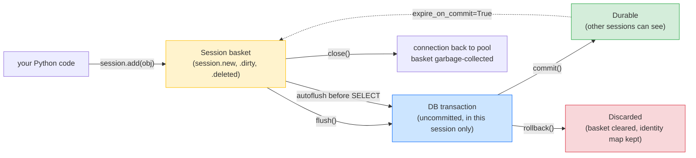
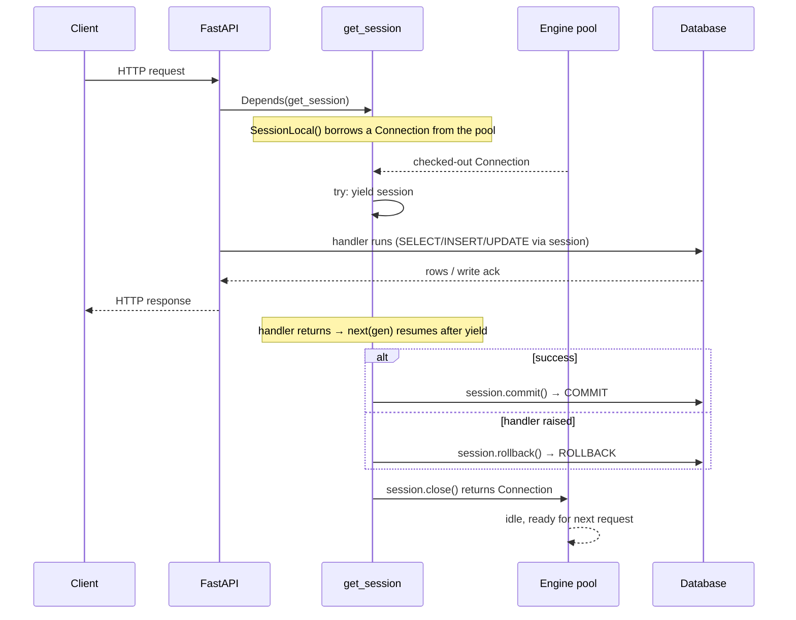
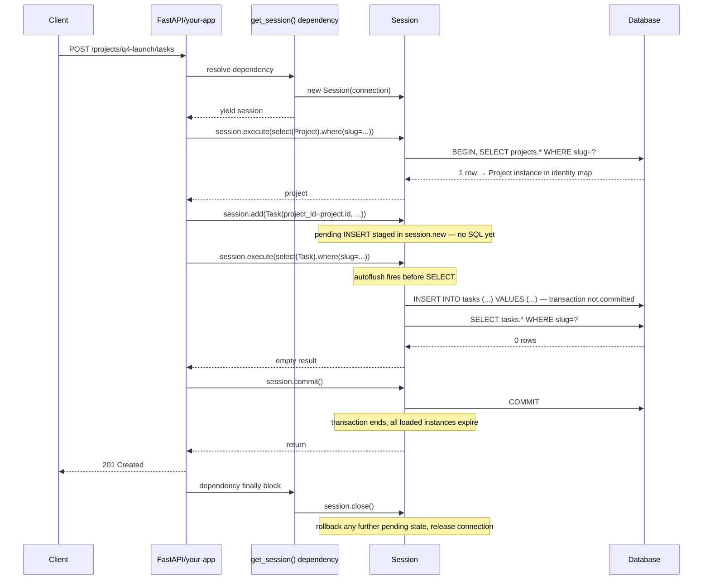
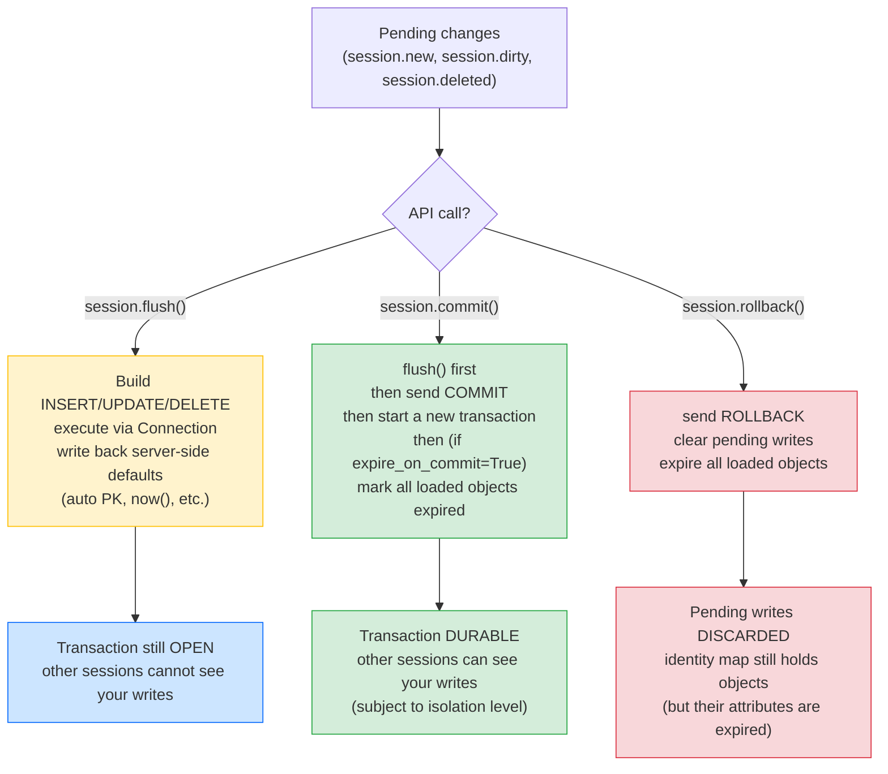
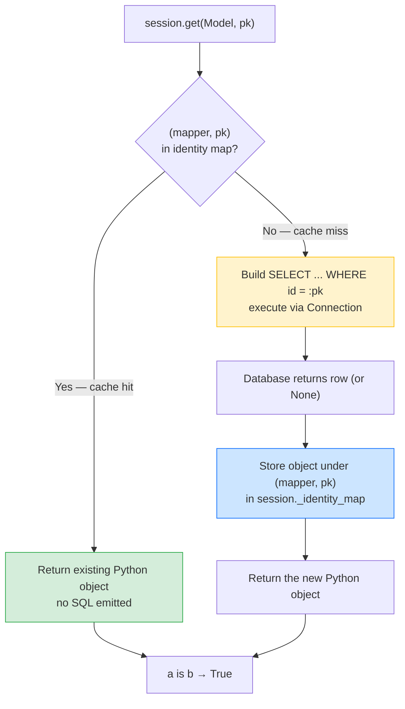

# Lesson 05: Session and Transaction Management

*The canonical lesson for the SQLAlchemy `Session / AsyncSession`. The unit-of-work workspace, the identity map in full, `flush` vs `commit` (the interview question), nested transactions, savepoints, the per-request session lifecycle, and the `get_db` dependency for FastAPI.*

**You've reached the load-bearing layer.**

The session is the SQLAlchemy concept that every later lesson assumes. Get it wrong and you get mysterious data corruption, `IntegrityError`s that should not be there, and "object already in another session" errors at 3am. Get it right and the rest of the ORM feels cooperative. Take your time. Trace every `BEGIN` / `COMMIT` / `ROLLBACK` in the log. **This is the layer where production bugs live or die.**


#sqlalchemy #orm #session #transactions #canonical

## Learning Objectives

By the end of this lesson you will be able to:

1. **Construct a `Session`** with `Session(engine)` and a `sessionmaker(engine)` factory, and articulate when to use which.
2. **Use the session's mutation API** — `add`, `add_all`, `delete`, `merge`, `expire`, `refresh`, `expunge` — and articulate the difference between in-memory state changes and database writes.
3. **Distinguish `flush` from `commit`** (the canonical interview question): `flush` writes pending changes to the database (within the same transaction); `commit` flushes and finalizes the transaction and starts a new one.
4. **Explain the identity map** in full and predict when `session.get(User, 42)` will issue a `SELECT` and when it will return the cached object.
5. **Configure autoflush and expire_on_commit** and articulate the trade-offs of each.
6. **Open a nested transaction** with `session.begin_nested()` and explain how savepoints work in Postgres vs SQLite.
7. **Catch and translate `IntegrityError`** into a clean HTTP 409 in a FastAPI handler.
8. **Articulate why sessions are not thread-safe and not task-safe** and build a per-request session factory.
9. **Build the `get_session` dependency** for FastAPI using `yield` (a canonical pattern reused across the vault).
10. **Plan the per-request session lifecycle** — open at request start, commit on success, rollback on exception, close at request end.

## Prerequisites

- **Lesson 02 — Engines, Connections, Pools.** The session borrows connections from the engine; you must understand the engine and the pool first.
- **Lesson 03 — Declarative Base and Mapped.** The session operates on instances of your mapped classes; you must understand what a mapped instance is.
- **Lesson 04 — Relationships and Loading Strategies.** The session's identity map and expiration interact with relationships in subtle ways; you must have seen the N+1 trap.
- **Transactions** — [[06-SQL-Fundamentals/Transactions-Isolation-Locks]]. The session is a wrapper around a database transaction. You must understand `BEGIN`/`COMMIT`/`ROLLBACK` and isolation levels.
- **FastAPI Dependency Injection** — [[03-FastAPI-Core/Dependency-Injection]]. The `get_session` dependency uses `yield` and Depends; the canonical pattern is taught there.
- **About 2 hours of focused time.** This lesson has the most conceptual density of any lesson in the section because the session is the most-overloaded object in SQLAlchemy.

**The most common gap: thinking the session is the engine.**

It is not. The engine is a process-level singleton that owns the connection pool. The session is a per-request (or per-operation) workspace that borrows a connection from the engine, holds an identity map, and wraps a transaction. There is one engine per process; there are many sessions per process.


## Think Like a Senior Database Engineer

Before any code, internalize the mental model. The rest of this lesson is footnotes on it.

Don't think of a `Session` as "a database connection." It is not. The engine is the connection pool; the session is an **in-memory unit of work** — a basket of pending changes that you will flush to the database in one atomic transaction. The senior engineer's question, every time they look at a session, is always the same two:

1. **What is in the basket right now?** — which objects in `session.new` are queued for `INSERT`, which in `session.dirty` for `UPDATE`, which in `session.deleted` for `DELETE`? If you don't know, you don't know your session.
2. **When does the basket flush?** — explicitly via `session.flush()`; implicitly via autoflush before a `SELECT`; or implicitly at the start of `session.commit()`. If you don't know which of these three triggered the `INSERT` you just saw in the SQL log, you don't know your session.

Every bug in this lesson — `DetachedInstanceError`, the silent rollback, the cross-request corruption, the `IntegrityError` that should not be there, the connection leak — is a case where the engineer lost track of one of these two answers. The unit-of-work pattern is a contract: the session holds the basket, the database holds the truth, and `flush` / `commit` / `rollback` are the only three operations that move state between the two. Treat them with the same reverence a systems engineer treats `fsync`.



The yellow node is the basket — the in-memory pending state. The blue node is the uncommitted DB transaction — writes that are *in* Postgres but *invisible* to other sessions. The green node is the durable state — what other sessions can see, subject to isolation level. The red node is what `rollback()` does: discard the writes, keep the objects. The dashed edge is `expire_on_commit=True`: after `COMMIT`, every loaded attribute is marked expired and silently walks back into the basket (the next access re-fetches). If you read this diagram and cannot say which arrow your last line of code followed, stop and trace it.

**Tip — The two questions, on a sticky note.**

1. What's in the basket right now?
2. When does the basket flush?
If a colleague asks "why is this object not in the database yet," your first instinct is to answer both questions for their session. If you can't, you've found the bug.


**A session is not a connection, and a connection is not a transaction.**

Three layers, three lifetimes. The engine (and its pool) lives for the process; the session lives for a request (or a script invocation); the transaction lives for the duration between `BEGIN` and `COMMIT`/`ROLLBACK`. A session *borrows* a connection from the pool, holds it for the duration of the unit of work, and *returns* it on `close()`. The connection outlives the session; the session outlives the transaction. Mixing these lifetimes up is the root cause of about half of the connection-pool exhaustion incidents and about half of the "object already in another session" incidents in a typical production deployment. When in doubt, draw the three boxes on a whiteboard; the bug is in a box that should not have crossed into another.


## The Problem

Your `Boardly` FastAPI service has a `POST /projects` handler. It needs to:

1. Validate the request body (a Pydantic schema).
2. Open a transaction.
3. Insert a `Project` row.
4. Insert a `Membership` row (the creator becomes a member).
5. Commit — both rows atomically, or neither.
6. Return the new project's data.
7. On any error, rollback and return a 4xx/5xx.

The session is the SQLAlchemy object that owns this lifecycle. It tracks the new objects (`Project`, `Membership`), the new transaction, and the failure mode. Without a session, you would be back to Lesson 02's `engine.connect()` + raw SQL — fine for a one-off but unworkable for a service.

## The Code

Here is the complete `boardly/db.py` after this lesson — the engine factory (from Lesson 02) plus the session factory and the `get_session` FastAPI dependency.

```python
# boardly/db.py
"""Boardly — database engine, session factory, and FastAPI dependency.

Lesson 05: sessionmaker, get_session yield dependency, transaction lifecycle.
"""
from __future__ import annotations

import os
from collections.abc import Iterator
from contextlib import contextmanager

from sqlalchemy import create_engine
from sqlalchemy.engine import Engine
from sqlalchemy.exc import SQLAlchemyError
from sqlalchemy.orm import Session, sessionmaker
from sqlalchemy.pool import NullPool, QueuePool

from boardly.settings import get_settings


# ---------------------------------------------------------------------------
# Engine (from Lesson 02, lightly refactored).
# ---------------------------------------------------------------------------
def build_engine(url: str, *, echo: bool = False, serverless: bool = False,
 pool_size: int = 5, max_overflow: int = 10, pool_recycle: int = 1800,
 pre_ping: bool = True) -> Engine:
 if serverless:
 return create_engine(url, echo=echo, poolclass=NullPool, pool_pre_ping=pre_ping)
 return create_engine(
 url, echo=echo, poolclass=QueuePool,
 pool_size=pool_size, max_overflow=max_overflow,
 pool_recycle=pool_recycle, pool_pre_ping=pre_ping,
 )


# ---------------------------------------------------------------------------
# The session factory — a process-level singleton, like the engine.
# ---------------------------------------------------------------------------
_settings = get_settings()
engine = build_engine(_settings.database_url, echo=_settings.database_echo)
SessionLocal = sessionmaker(bind=engine, expire_on_commit=False, autoflush=True)


# ---------------------------------------------------------------------------
# The two ways to use a session in Boardly:
# (a) A context manager for scripts and background jobs.
# (b) A FastAPI yield dependency for request handlers.
# ---------------------------------------------------------------------------
@contextmanager
def session_scope() -> Iterator[Session]:
 """Open a session, commit on success, rollback on exception, close always.

 Use in scripts and background jobs where you want transactional safety
 without writing the try/except/finally yourself.
 """
 session = SessionLocal()
 try:
 yield session
 session.commit()
 except SQLAlchemyError:
 session.rollback()
 raise
 except Exception:
 session.rollback()
 raise
 finally:
 session.close()


def get_session() -> Iterator[Session]:
 """FastAPI dependency: yield a per-request session.

 Usage in a router:
 @router.post("/projects")
 def create_project(payload: ProjectCreate, session: Session = Depends(get_session)):
 ...

 FastAPI calls the dependency once per request, yields the session,
 and runs the code after yield when the handler returns (or raises).
 """
 session = SessionLocal()
 try:
 yield session
 session.commit()
 except Exception:
 session.rollback()
 raise
 finally:
 session.close()


def get_default_url() -> str:
 return os.environ.get("BOARDLY_DATABASE_URL", "sqlite:///boardly.db")


def main() -> None:
 """Smoke test: open a session, run a SELECT, close. Verify no leaks."""
 with session_scope() as session:
 from sqlalchemy import text
 result = session.execute(text("SELECT 1 AS one")).first()
 print(f"smoke_test: row = {result}")
 print(f"pool status after close: {engine.pool.status()}")


if __name__ == "__main__":
 main()
```

That's 75 lines. Save it as `boardly/db.py` (overwriting the Lesson 02 version) and run it. Then read the line-by-line below — the session API is the most overloaded in SQLAlchemy.

**Tip — Senior engineer — the pre-merge checklist for `boardly/db.py`.**

Before this file merges, verify five things by hand: (a) the engine is constructed exactly once, at module scope — never inside a function or a route; (b) `SessionLocal` is constructed exactly once, also at module scope, and is the *only* call site that builds a `sessionmaker`; (c) every `SessionLocal()` call site is wrapped in either `session_scope()` or `get_session()` — a bare `session = SessionLocal()` in a handler is a leak waiting to ship; (d) the dependency's `finally: session.close()` runs on every path — including `KeyboardInterrupt` and `asyncio.CancelledError`; (e) `pool_pre_ping=True` and `pool_recycle` are set, not left at the SQLAlchemy defaults (Lesson 02 explains why). If any of these is "no", block the merge. The cost of a leaky `db.py` is a 3am `TimeoutError: QueuePool limit ... reached` ticket that looks like a Postgres outage but is a one-line Python bug.


## Line-by-Line Deep Dive

This is the heart of the lesson. Read it twice. Every line about the session has a why.

### Lines 1–17: The module docstring and imports

```python
"""Boardly — database engine, session factory, and FastAPI dependency.

Lesson 05: sessionmaker, get_session yield dependency, transaction lifecycle.
"""
from __future__ import annotations

import os
from collections.abc import Iterator
from contextlib import contextmanager

from sqlalchemy import create_engine
from sqlalchemy.engine import Engine
from sqlalchemy.exc import SQLAlchemyError
from sqlalchemy.orm import Session, sessionmaker
from sqlalchemy.pool import NullPool, QueuePool

from boardly.settings import get_settings
```

**What it does:** Pulls in the standard-library types (`os`, `Iterator`, `contextmanager`) and the SQLAlchemy primitives (`create_engine`, `Engine`, `SQLAlchemyError`, `Session`, `sessionmaker`, `NullPool`, `QueuePool`).

**Why each:**

- `Iterator` from `collections.abc` — used to annotate the return type of `session_scope` and `get_session`. Both are generator functions (they `yield`), so their return type is `Iterator[Session]`. (In 3.12 you could use `typing.Iterator`; `collections.abc` is preferred because it is the actual type, not a typing alias.)
- `contextmanager` — the standard-library decorator that turns a `def` with a `yield` into a context manager. We use it for `session_scope` — the script/background-job entry point.
- `SQLAlchemyError` — the base class of every SQLAlchemy exception. We catch it specifically in `session_scope` to roll back on DB errors without affecting other exception types. (Catching `Exception` would also work but is too broad — see Lesson 01 on exceptions.)
- `Session` — the class. The workspace object. Canonical in this lesson.
- `sessionmaker` — the factory class. Configured once at process start; produces `Session` instances on demand.
- `from boardly.settings import get_settings` — `Boardly` settings module. Defines a `Settings` class with `database_url`, `database_echo`, etc., loaded from environment variables via Pydantic `BaseSettings`. (Covered in [[04-Pydantic/Pydantic-Settings]].)

**Tip — Why not import the `Settings` class directly?**

`get_settings()` returns a singleton (typically cached with `@lru_cache` on the function or via `Settings()` at module level). Importing the singleton-creator function (not the class) lets test code replace the settings via `app.dependency_overrides[get_settings] = lambda: TestSettings(...)` (Lesson 12). If we imported the class, tests would have to monkeypatch module attributes, which is fragile.


### Lines 25–35: `build_engine` (refactored from Lesson 02)

```python
def build_engine(url: str, *, echo: bool = False, serverless: bool = False,
 pool_size: int = 5, max_overflow: int = 10, pool_recycle: int = 1800,
 pre_ping: bool = True) -> Engine:
 if serverless:
 return create_engine(url, echo=echo, poolclass=NullPool, pool_pre_ping=pre_ping)
 return create_engine(
 url, echo=echo, poolclass=QueuePool,
 pool_size=pool_size, max_overflow=max_overflow,
 pool_recycle=pool_recycle, pool_pre_ping=pre_ping,
 )
```

This is the same `build_engine` from Lesson 02, lightly refactored. Nothing new here — refer back to Lesson 02 for the line-by-line on each kwarg.

### Lines 41–43: The engine and session factory singletons

```python
_settings = get_settings()
engine = build_engine(_settings.database_url, echo=_settings.database_echo)
SessionLocal = sessionmaker(bind=engine, expire_on_commit=False, autoflush=True)
```

**What it does:** Constructs a `Settings` instance, builds the engine, then builds a `sessionmaker` bound to that engine. Both `engine` and `SessionLocal` are module-level singletons.

**Why module-level:** The engine and the sessionmaker are process-level objects. They are constructed once at import time and reused for every request. The engine owns the connection pool; the sessionmaker is a configured factory that produces `Session` instances.

**Why `sessionmaker` and not `Session` directly:**

You could write `session = Session(engine)` everywhere, but each call would re-apply the configuration (`expire_on_commit`, `autoflush`, etc.) at every call site. The `sessionmaker` centralizes the configuration:

```python
SessionLocal = sessionmaker(bind=engine, expire_on_commit=False, autoflush=True)
# ...
session = SessionLocal() # produces a Session with the bound engine and the configured kwargs
```

The `sessionmaker` is to `Session` what a partial application is to a function — it bakes in the engine and the kwargs so the call site is just `SessionLocal()`.

**Why `expire_on_commit=False`:** Discussed in Lesson 04. The default `True` expires every attribute on every loaded object at commit time, so the next access re-emits a `SELECT`. For a per-request session, this is undesirable — handlers typically want to read attributes from objects they just committed (e.g., to construct a response) without paying for the re-fetch. We set `False` and accept the staleness trade-off (a single request is short enough that staleness does not matter).

**Why `autoflush=True`:** The default. Whenever you issue a `SELECT` (via `session.execute(...)` or `session.get(...)` or by accessing a lazy-loaded relationship), the session flushes pending writes (INSERTs, UPDATEs, DELETEs) to the database *before* issuing the SELECT. This ensures the SELECT sees the in-progress changes — e.g., if you `session.add(user)` then `session.execute(select(User).where(User.email == user.email))`, the autoflush makes the SELECT see the new user without you having to call `flush()` manually.

**When `autoflush=True` causes surprises**

If you `session.add(obj)` and then immediately query with `where(SomeCol == obj.some_col)` and the database enforces a unique constraint on `SomeCol`, the autoflush will issue the `INSERT` for `obj`, which violates the constraint, and the SELECT will fail with `IntegrityError`. The error is technically correct (the row you're trying to query for has not been committed yet, and the autoflush-INSERT violates the constraint), but it can be confusing. The fix: wrap the add in a savepoint (`session.begin_nested()`) or use `session.autoflush = False` temporarily.


**Danger — Attacker — a module-level `engine` means a module-level DSN; do not let it leak.**

`engine = build_engine(_settings.database_url, ...)` is constructed at import time, which means the DSN string lives in process memory for the lifetime of the worker. Three leakage paths to defend: (a) `echo=True` logs every SQL statement — but on some dialects and older driver versions the *connection URL with credentials* can appear in the log on the first connection; verify your SQLAlchemy and driver versions do not, and never log `engine.url` directly (use `engine.url.render_as_string(hide_password=True)`); (b) tracebacks from `OperationalError` often embed the DSN in the exception's `__str__`; do not return `str(exc)` to clients and do not log it to a publicly-readable log stream; (c) secret rotation: rotating the database password invalidates every checked-out connection in the pool — schedule rotations during a deploy, not mid-deploy, so the engine is rebuilt from the new DSN rather than serving stale credentials until `pool_recycle` kicks in. The session layer is downstream of the engine layer; the engine's DSN hygiene is the upstream defense that makes session-layer code safe to log.


### Lines 50–67: `session_scope` (context manager for scripts and jobs)

```python
@contextmanager
def session_scope() -> Iterator[Session]:
 """Open a session, commit on success, rollback on exception, close always.

 Use in scripts and background jobs where you want transactional safety
 without writing the try/except/finally yourself.
 """
 session = SessionLocal()
 try:
 yield session
 session.commit()
 except SQLAlchemyError:
 session.rollback()
 raise
 except Exception:
 session.rollback()
 raise
 finally:
 session.close()
```

**What it does:** Opens a session, yields it to the caller, commits on success, rolls back on any exception, closes always.

**Why this pattern:** Scripts and background jobs want transactional safety — either the whole script commits or none of it does. The `try/except/finally` boilerplate is the same every time, so we factor it into `session_scope`. The caller writes:

```python
with session_scope() as session:
 session.add(project)
 session.add(membership)
 # exit the with block: commit on success, rollback on exception
```

**Why two `except` clauses (`SQLAlchemyError` then `Exception`):** The first catches database-level errors (`IntegrityError`, `OperationalError`, etc.) so we could log them with database context if we wanted. The second catches everything else (`ValueError`, `KeyboardInterrupt`, etc.) so we still roll back. Both `raise` so the exception propagates to the caller. (We could merge them into one `except Exception`, but splitting makes it easier to add DB-specific logging later.)

**Why `finally: session.close()`:** The session holds a connection borrowed from the pool. `close()` returns the connection to the pool. Without `close()`, the connection leaks. The `finally` block ensures `close()` runs whether the with-block succeeded, raised, or was interrupted.

**Tip — Why `session.close()` instead of letting the `with Session(engine)` block do it.**

`with Session(engine) as session:` would close the session automatically at block exit. But it does not commit or rollback — the session's transaction state is left intact, and the underlying connection is returned to the pool with an open transaction. That is almost never what you want. The explicit `session.commit()` / `session.rollback()` / `session.close()` pattern gives you full control over the transaction outcome. Use `session_scope` (or `get_session`) instead of `with Session(engine)`.


**Tip — Debugging — instrument `session_scope` and `get_session` once, find every leak.**

When the pool starts exhausting in staging, do not chase the leak one handler at a time. Add a one-line logging wrapper around the two session factories: in `session_scope`'s `try`/`finally`, log `engine.pool.status()` on entry and on exit, plus the duration of the `yield`. In `get_session`, do the same in the dependency's setup and teardown. The handler whose exit-status string shows `Connections in pool: 0 Current Overflow: 1 Queued: 0` is the leaker — its `session.close()` did not run (or did not run yet, because an `await` between `yield` and the `finally` never completed). The five-minute instrumentation surfaces a class of bug that takes hours to find by reading handler code.


### Lines 70–91: `get_session` (FastAPI yield dependency)

```python
def get_session() -> Iterator[Session]:
 """FastAPI dependency: yield a per-request session.

 Usage in a router:
 @router.post("/projects")
 def create_project(payload: ProjectCreate, session: Session = Depends(get_session)):
 ...

 FastAPI calls the dependency once per request, yields the session,
 and runs the code after yield when the handler returns (or raises).
 """
 session = SessionLocal()
 try:
 yield session
 session.commit()
 except Exception:
 session.rollback()
 raise
 finally:
 session.close()
```

**What it does:** Same shape as `session_scope` but as a generator function (no `@contextmanager`). Used as a FastAPI dependency.

**Why a generator function and not a context manager:** FastAPI's `Depends` system supports generator functions directly. When you write `session: Session = Depends(get_session)`, FastAPI:

1. Calls `get_session()` to get the generator.
2. Calls `next(gen)` to advance to the `yield`, getting the session.
3. Passes the session to the handler.
4. Runs the handler.
5. After the handler returns, calls `next(gen)` again, which resumes after the `yield` — running the commit / rollback / close code.
6. If the handler raised, the exception is re-raised inside `get_session` at the `yield` line, which means the `except Exception` clause runs.

**Why the same try/except/finally as `session_scope`:** The semantics are identical — commit on success, rollback on exception, close always. The difference is the entry point: `session_scope` is for plain Python code; `get_session` is for FastAPI handlers.

**The canonical `get_db` pattern.**

This is the same pattern taught in [[03-FastAPI-Core/Dependency-Injection]]'s `get_db` example. The naming difference: Lesson 03 called it `get_db` because that lesson taught the pattern from the FastAPI side (without a real engine). Here, in Lesson 05, we call it `get_session` because the focus is the SQLAlchemy session. Either name is fine; pick one and be consistent. Lesson 07 will rename it to `get_db` for the async version, to match FastAPI conventions.


**Warning — Production — the dependency's `finally` runs in the response-sending thread; do not block it.**

For sync handlers, FastAPI runs the dependency's setup, the handler, and the `finally` cleanup all in a single threadpool worker. The `session.commit()` inside the `finally`-adjacent code therefore blocks that worker thread on the database's WAL `fsync` — typically sub-millisecond, but on a slow disk or under replication pressure it can be tens of milliseconds. Two production consequences: (a) a sync handler that does a network call *after* `session.commit()` and before return keeps the threadpool worker — and therefore the held session — occupied; (b) an exception in `session.commit()` itself (e.g., a deferred FK violation that fires at COMMIT) propagates through the `finally` and overwrites any earlier handler exception, hiding the real cause. Move network calls outside the session block (commit, close, *then* call out); if a commit can fail, log the original handler exception before the commit so the cleanup's failure does not erase the cause.




The yellow node is the dependency layer you write; the green node is the pool the engine owns; the red node is the database the pool proxies. Every request walks the full length of this diagram once. The commit-vs-rollback decision happens after the handler returns; the connection is returned to the pool only when `close()` runs in the `finally` block — which is why forgetting `finally: session.close()` is a connection leak.

### Lines 94–96: `get_default_url` (kept from Lesson 02)

```python
def get_default_url() -> str:
 return os.environ.get("BOARDLY_DATABASE_URL", "sqlite:///boardly.db")
```

Kept for backwards compatibility with the Lesson 02 smoke test. In production we use the `Settings` class; this function is a fallback for tests.

### Lines 99–106: `main` (smoke test)

```python
def main() -> None:
 """Smoke test: open a session, run a SELECT, close. Verify no leaks."""
 with session_scope() as session:
 from sqlalchemy import text
 result = session.execute(text("SELECT 1 AS one")).first()
 print(f"smoke_test: row = {result}")
 print(f"pool status after close: {engine.pool.status()}")
```

**What it does:** Uses `session_scope` to open a session, executes `SELECT 1 AS one`, fetches the first row, prints it, then prints the pool status after the session is closed.

**Why print the pool status:** `engine.pool.status()` returns a string like `Pool size: 5 Connections in pool: 0 Free Overflow: 0 Current Overflow: 0 Queued: 0`. After a session closes, the connection it was holding should be back in the pool (or closed if the pool was full). If you see `Connections in pool: 1`, the session correctly returned its connection. If you see `Connections in pool: 0 Current Overflow: 1`, the connection is still checked out — that is a leak.

## Execution Trace

The lesson so far has been code-first. Now run it. The walkthrough below stitches every concept we'll meet in the second half of this lesson — the Session API, flush vs commit, the identity map, autoflush, `expire_on_commit`, nested transactions — into a single request lifecycle. Read it before you read any of those sections; they each drill into one stage of the trace you're about to see.

### The request that mutates a row

A `POST /projects/{slug}/tasks` endpoint creates a `Task` under a `Project`. A real request lands. The dependency yields the session. The service loads the `Project`, calls `session.add(task)`, runs a `select(...)` to validate slug uniqueness, autoflush fires (sending the pending INSERT to the database but without committing), the SELECT returns, the service calls `session.commit()`, the transaction ends, all loaded objects expire, the response is returned, the dependency's `finally` closes the session.



### Step-by-step prose

1. **Request arrives.** A `POST /projects/q4-launch/tasks` with a JSON body lands in FastAPI. FastAPI parses the path parameter, the body, and the handler's dependencies. The handler depends on a `Session`. Control passes to the dependency.
2. **Dependency yields the session.** The dependency opens a fresh `Session` wrapping a connection checked out from the engine's pool. The session begins an implicit transaction (SQLAlchemy 2.x does this lazily — the `BEGIN` is only sent when the first SQL statement runs). The dependency `yield`s the session to the handler. The `finally` block after `yield` will run `session.close()` no matter what — even on an unhandled exception.
3. **Service loads the `Project`.** The service calls `session.execute(select(Project).where(Project.slug == "q4-launch")).scalar_one()`. The session compiles the SQL, sends `BEGIN; SELECT ... WHERE slug = ?` on its connection, receives one row, looks up the identity map (empty so far), instantiates a `Project`, stores it in the map keyed by `(Project, id)`, and returns it.
4. **Service calls `session.add(task)`.** The service constructs a new `Task` instance — `Task(project_id=project.id, slug="write-specs", ...)` — and stages it for INSERT by calling `session.add(task)`. **Crucially, no SQL is emitted here.** The `Task` is moved into `session.new`, the session's "pending objects" set. The unit-of-work pattern defers all writes until a `flush()` (or a `commit()`, which calls `flush()` first).
5. **Service calls `session.execute(select(...))`.** To validate that the new task's slug is unique, the service runs `select(Task).where(Task.slug == "write-specs")`. The session now faces a decision: the new `Task` is in `session.new` but its INSERT hasn't been sent. If the session runs the SELECT now, the new row is invisible to it (Postgres can't see uncommitted rows of *this* transaction unless they're flushed — and even then only within the same transaction, which they will be). SQLAlchemy's default behaviour is **autoflush**: before running the SELECT, the session flushes its pending state. The `INSERT INTO tasks (...) VALUES (...)` is sent on the same connection, *within the same transaction*. The new row is now visible to the subsequent `SELECT`. The transaction is still *uncommitted* — if the request later raises, all of this rolls back.
6. **The SELECT returns.** The database returns zero rows for the slug-check — the slug is unique. The service now knows it can safely proceed. (If it had returned a row, the service would raise a domain-specific `TaskSlugConflict` exception, which the dependency's `finally` block would convert into a session close + rollback.)
7. **Service calls `session.commit()`.** This is the moment the database state becomes durable. `commit()` internally calls `flush()` (no-op here, autoflush already flushed), sends `COMMIT` on the connection, and the database's transaction ends. The write is now permanent — other transactions can see it.
8. **Objects expire.** Because the session is configured with `expire_on_commit=True` (the default), every loaded instance is marked "expired" the moment `commit()` returns. The next attribute access on `project.name` or `task.slug` will trigger a lazy refresh SELECT — *unless* the session is closed before that access, in which case the access raises `DetachedInstanceError`. (For read-after-commit patterns, see `## Autoflush and expire_on_commit` below.)
9. **Response returned.** The service builds a 201 response with the new task's representation. FastAPI serializes it to JSON and sends it on the wire.
10. **Dependency's `finally` closes the session.** `session.close()` releases the connection back to the pool and discards all identity-map state. Any further pending changes (there shouldn't be any after a successful commit) are rolled back. The connection waits in the pool for the next request.

**Steps 4 and 5 are the unit-of-work pattern in action.**

Most newcomers expect `session.add(obj)` to fire an `INSERT` immediately. It doesn't. It stages the write. The actual INSERT fires when (a) the session autoflushes before a query, (b) you call `session.flush()` explicitly, or (c) you call `session.commit()`. The deferral is what lets the session batch writes, reorder them to satisfy FK constraints, and roll them all back on error. The cost is that the *order* of SQL emission is the session's choice, not yours.


**Student asks: what happens if the SELECT in step 5 raises `IntegrityError`?**

Two cases. Case A: the SELECT itself raises (e.g., a syntax error in the query). The session is now in a "failed transaction" state — every subsequent statement raises `PendingRollbackError` until you `session.rollback()`. The dependency's `finally` calls `session.close()` which rolls back implicitly. Case B: a *different* `IntegrityError` fires later, on commit. That happens when, e.g., a concurrent request inserts the same slug between your SELECT and your COMMIT. The service's `try/except IntegrityError` (see `## IntegrityError: Catching and Translating`) catches it, translates it to a 409, and the dependency's `finally` closes the session. Either way, the `finally` block is the safety net.


**Warning — Never split commit and close across services.**

A common anti-pattern: service A opens a session, does work, commits, returns an ORM instance; service B receives the instance, calls `instance.foo`, and crashes with `DetachedInstanceError` because service A already closed the session. Sessions are request-scoped — one per request, opened in the dependency, closed in the dependency. If service B needs to query, it uses the same request's session, not service A's.


**Tip — Watch the SQL log to see autoflush in action.**

Run this lesson's code with `echo=True`. You'll see the `INSERT INTO tasks` *immediately followed by* the `SELECT ... WHERE slug = ?`, both inside one `BEGIN ... COMMIT` block. The pairing is the autoflush. If you set `autoflush=False` on the session, the SELECT runs first — and returns zero rows even if a slug *did* collide with a pending-but-unflushed INSERT. That's the trap of disabling autoflush: you get a false "unique" answer.


**The session is the request.**

Eight participants, ten steps, one transaction. Everything in the rest of this lesson — the Session API, flush vs commit, the identity map, autoflush, expire_on_commit, nested transactions, IntegrityError handling — is a deep dive into one of these ten steps. Use the trace above as your index: when a section introduces a new concept, ask "which step does this change?"


## The Session API, in Full

The session has more methods than any other object in SQLAlchemy. Here is the canonical set, in order of frequency of use.

### `add`, `add_all`, `delete`: queue mutations

```python
session.add(user) # queue user for INSERT
session.add_all([p1, p2, p3]) # queue all three for INSERT
session.delete(user) # queue user for DELETE
```

These methods do not emit SQL. They stage the operation in the session's new-objects list (or deleted-objects list). The SQL is emitted at the next `flush()`.

**What happens inside `session.add(obj)`**

When you call `session.add(obj)`, SQLAlchemy does not send an `INSERT`. It does four things, in order:
1. Validates that `obj` is not already in *another* session — if `obj._sa_instance_state.session_id` is set and points at a different session, raises `InvalidRequestError: Object '<User at 0x...>' is already present in another Session`. The unit-of-work model is single-owner; an object can belong to exactly one session at a time.
2. Adds `obj` to `session._new` — an `IdentitySet` keyed on the Python object's `id()`, not on its (yet-unknown) primary key. For a brand-new row, the PK is `None` until `flush()` writes it back from the DB.
3. Attaches a `InstanceState` to `obj._sa_instance_state` — a hidden attribute SQLAlchemy uses to track the object's lifecycle state (`pending` → `persistent` → `deleted` → `detached`) and its currently-loaded attribute set.
4. Marks the object's state as `pending` and emits the `before_attach` / `after_attach` events (extension points where you can hook in custom logic).

The `INSERT` is sent when (a) the session autoflushes before a query that touches the same table, (b) you call `session.flush()` explicitly, or (c) you call `session.commit()` (which calls `flush()` first).

The senior engineer who doesn't know this writes `session.add(obj); session.execute(select(User).where(User.email == obj.email))` and is surprised when the SQL log shows an `INSERT` *before* the `SELECT` — the autoflush fired because the query touches `User` (the same table the pending `obj` is for). The actual surprise case is when the autoflush fires *before* a query on a *different* table, sends the pending `INSERT`, the `INSERT` violates a unique constraint, and the subsequent `SELECT` raises `IntegrityError` — and the engineer looks at the traceback, sees the `SELECT` at the bottom, and concludes the SELECT failed when really the *autoflush preceding* the SELECT failed. Read the SQL log, not the Python traceback.


### `flush`: write pending changes to the DB, within the same transaction

```python
session.flush()
```

Walks the new/dirty/deleted lists, builds the appropriate `INSERT` / `UPDATE` / `DELETE` statements, executes them via the engine's connection, and writes back any server-generated values (auto-increment PKs, defaults, server_default values like `now()`). The transaction is still open — you can issue more queries, more mutations, and either `commit` to finalize or `rollback` to abort.

**What happens inside `session.flush()`**

A flush is *not* "send each pending INSERT in the order it was added." SQLAlchemy's unit-of-work does work in this order:
1. **Topologically sorts the pending set.** The unit-of-work builds a dependency graph: if `Membership.project_id` has a foreign key to `Project.id`, then `Project` is sorted before `Membership`. Cycles (mutual FKs with `DEFERRABLE INITIALLY DEFERRED`) are handled by splitting the cycle and flushing a row with a NULL FK first, then `UPDATE`-ing the FK after the cycle resolves.
2. **Groups statements by table.** All `INSERT`s on `tasks` go in one batch; all `INSERT`s on `memberships` go in the next. This is why `session.add_all([p1, p2, p3])` does not necessarily send three separate `INSERT` statements — they may be batched into one `INSERT INTO ... VALUES (...), (...), (...)` (with SQLAlchemy 2.x's `executemany` semantics, depending on the dialect's `insertmanyvalues` support).
3. **Executes and writes back server-generated values.** The `INSERT INTO tasks (...) VALUES (...)` returns the auto-generated `id` and any `server_default` columns (`now()`, `gen_random_uuid()`). SQLAlchemy reads them back (via `RETURNING` on Postgres, via `lastrowid` on SQLite) and populates `obj.id`, `obj.created_at` etc. The object is now `persistent` (not `pending`) and its PK is in the identity map.
4. **Updates the identity map.** Every newly-persisted object moves from `session._new` to `session._identity_map`, keyed on `(mapper, primary_key)`. The next `session.get(Task, obj.id)` is a cache hit.

The transaction is *not* committed. Postgres sees the writes (within this session's transaction); other sessions do not. If `rollback()` is called next, every `INSERT` the flush just sent is undone — the auto-increment counter on the sequence still advances, but the rows are gone.


`flush` is called automatically:
- Before every `SELECT` if `autoflush=True` (the default).
- At the start of `commit()` (always — `commit` implies `flush`).
- At the start of `session.begin_nested()` (to establish a savepoint against current state).

**Tip — Debugging — when the SQL log shows an unexpected `INSERT` before your `SELECT`, the autoflush fired first.**

A `PendingRollbackError` or `IntegrityError` whose Python traceback points at a `session.execute(select(...))` line is almost never a bug in the `SELECT`. It is the autoflush preceding the `SELECT` failing — typically because a pending `INSERT` violated a unique or FK constraint. Read the SQL log, not the Python traceback: the log will show the failing `INSERT` immediately before the `SELECT` that raised. The diagnostic order is: (a) `echo=True` and re-run; (b) find the last `INSERT`/`UPDATE`/`DELETE` in the log before the failing line; (c) inspect that statement's bound parameters against the schema's constraints; (d) the constraint that the row violates is the bug — not the `SELECT`, not the session, not the query. Disabling autoflush to "fix" this is the wrong move — the autoflush was correct; your pending state was not.


### `commit`: flush + finalize the transaction + start a new one

```python
session.commit()
```

Equivalent to `session.flush()` followed by sending `COMMIT` on the underlying DBAPI connection — flush all pending changes, send `COMMIT` to the database (finalizing the transaction), and immediately start a new transaction. Also expires every loaded object's attributes (unless `expire_on_commit=False`).

**What happens inside `session.commit()`**

A commit is six operations, not one:
1. Calls `flush()` — sends every pending `INSERT` / `UPDATE` / `DELETE` to the DB (still inside the open transaction).
2. Emits `before_commit` events (extension point).
3. Sends `COMMIT` on the DBAPI connection — Postgres writes the WAL record and (if `synchronous_commit=on`, the default) `fsync`s the WAL file. This is the moment the writes become durable: a Postgres crash after this point does not lose the data; a crash before this point does.
4. Closes the transaction — the DBAPI connection's transaction state is reset. The next SQL statement on this connection starts a new implicit transaction (the "start a new one" half of `commit`).
5. If `expire_on_commit=True`, marks every loaded object's attributes as expired — the next access triggers a lazy `SELECT` to refresh. If `expire_on_commit=False`, leaves the attributes populated with their pre-commit values (which is what you want for a per-request session that builds a response right after committing).
6. Emits `after_commit` events.

Step 3 is the durability boundary. Everything before step 3 is undoable; everything after step 3 is permanent. If your handler raises after `commit()` returns, the data is still in the database — your exception handler cannot un-commit. The senior engineer's reflex: never put *anything that can fail* between step 3 and the response being sent. Network calls, file writes, log emission — do them before the commit (so a failure rolls back the transaction) or after the response is sent (in a background task). The window between `session.commit()` and the HTTP response being on the wire should be empty.


### `rollback`: abort the transaction, start a new one

```python
session.rollback()
```

Sends `ROLLBACK` to the database, discards all pending changes in the session, clears the new-objects and deleted-objects lists, expires all loaded objects (so the next access re-fetches), and starts a new transaction.

### `refresh`: re-fetch a single object

```python
session.refresh(user) # SELECT user's row, populate attributes
session.refresh(user, attribute_names=["email"]) # only refresh email
```

Issues a `SELECT` for the object's row and overwrites the in-memory attributes with the database's current values. Useful when you know the database changed underneath you (e.g., a trigger updated a column) and you want fresh data.

### `expire`: mark an object's attributes as stale

```python
session.expire(user) # all attributes
session.expire(user, attribute_names=["email"]) # only email
session.expire_all() # every loaded object in the session
```

Marks the object's attributes as "expired" — the next access re-issues a `SELECT`. This is what `commit()` does to every loaded object by default (when `expire_on_commit=True`). `expire` lets you do it on demand.

### `expunge`: detach an object from the session

```python
session.expunge(user) # remove user from session's identity map
session.expunge_all() # detach every loaded object
```

The object becomes *detached* — its loaded attributes are still readable, but unloaded attributes and relationships raise `DetachedInstanceError`. Useful for returning an object from a request handler when you do not want the session to keep tracking it.

### `merge`: re-attach a detached object

```python
detached_user = ... # has primary key
session.merge(detached_user) # SELECT to check if it exists; if so, copy attributes; if not, INSERT
```

`merge` is the inverse of `expunge`. It takes a detached object and either:
- Loads the existing row from the DB and copies the detached object's attributes onto the in-memory object (returning the in-memory object).
- If no row exists, inserts the detached object as new.

`merge` is expensive — it issues a `SELECT` per merged object. Avoid it in hot paths.

### `get`: fetch by primary key (with identity-map cache)

```python
user = session.get(User, uuid.UUID("...")) # SELECT if not in identity map
```

The canonical "fetch by PK" method. If the object is in the session's identity map, returns the cached object without a `SELECT`. Otherwise, issues a `SELECT` and caches.

### `execute`: run any SQL statement

```python
result = session.execute(select(User).where(User.email == "ada@example.com"))
result = session.execute(text("SELECT 1")) # raw SQL
```

The general-purpose execution method. Accepts `select()`, `insert()`, `update()`, `delete()`, `text()`, and other SQL expression objects. Returns a `Result` object — see Lesson 06 for the result-shape methods.

### `begin_nested`: open a savepoint

```python
session.begin_nested() # SAVEPOINT
try:
 session.add(user)
 session.flush()
except IntegrityError:
 session.rollback() # ROLLBACK TO SAVEPOINT — only the savepoint is undone
```

Opens a savepoint within the current transaction. If you `rollback`, only the work done since the savepoint is undone — the outer transaction's earlier work is preserved. Lesson 06 covers this in more detail; the gist is: a savepoint is a sub-transaction you can selectively roll back.

### `close`: close the session, return the connection to the pool

```python
session.close()
```

Closes the session, returns the underlying connection to the pool, and clears the identity map. After `close()`, the session cannot be used. The objects it was tracking are detached.

## Flush vs Commit: the Interview Question

**Interview question: what is the difference between `session.flush()` and `session.commit()`?**

- `session.flush()` writes pending changes to the database **within the same transaction**. It builds and executes `INSERT`/`UPDATE`/`DELETE` statements, but does not send `COMMIT`. The transaction is still open; you can `rollback` to undo the flushed changes.
- `session.commit()` does `flush` + `COMMIT` + start a new transaction. The committed changes are now durable in the database; they cannot be rolled back.

Practical difference: after `flush`, the database has your changes but other sessions cannot see them (your transaction is still open). After `commit`, other sessions can see your changes (subject to isolation level).


This is the canonical SQLAlchemy interview question. The answer in one sentence: *flush is "write to the DB within the transaction"; commit is "finalize the transaction so others can see the writes".*



The yellow path (`flush`) is what autoflush and `commit` share — the SQL emission step. The green path (`commit`) adds the durability step on top. The red path (`rollback`) discards everything the yellow path did. Notice that `flush` lands you in the blue state ("transaction still open") — your writes are in the database but invisible to other transactions until you take the green path. A common bug: calling `flush()` and assuming the data is durable; a crash between `flush()` and `commit()` rolls back everything `flush` wrote.

## The Identity Map in Full

The identity map is a `dict` internal to a `Session`, keyed by `(mapper, primary_key)`. It guarantees that within a session, one row in the database maps to one Python object.

```python
with Session(engine) as s:
 a = s.get(User, 42) # SELECT; caches User#42 under (User, 42)
 b = s.get(User, 42) # no SELECT — returns the same object
 assert a is b # True: identity, not equality
```

Why does the identity map exist as a per-session dict, rather than as a per-process cache that every session could share? Because a per-process identity map would be a global mutable cache of database state, and global mutable caches of database state are the textbook recipe for staleness bugs and concurrency bugs. Two sessions in the same process see two different snapshots of the database; one session's uncommitted writes are invisible to the other; one session's commit does not silently mutate the other's loaded objects. The trade-off is that the same row, loaded by two sessions in the same process, becomes two Python objects — but that is the point. The identity map is a workspace cache, not a global cache; its scope is the transaction, not the process. Sessions in the same process do not share an identity map by design — that is what makes them safe to use concurrently.

Three consequences:

1. **No duplicate objects.** Two `get` calls for the same PK return the same Python object. Mutations to `a` are visible on `b` because they are the same object.
2. **No N+1 within a session for the same PK.** The first `get` pays the SELECT; subsequent `get`s are free.
3. **The identity map is per-session, not per-process.** Two sessions in the same process do not share an identity map. This is by design — a per-process identity map would be a global mutable cache, which is a concurrency bug.



The green branch (cache hit) is the cheap path — no SQL, no round-trip, identity preserved. The yellow branch (cache miss) is the expensive path — one SELECT, then the result is cached for next time. The blue node is the act of caching: the result of the SELECT is stored under `(mapper, pk)` so the *next* `get` for the same PK takes the green branch. This is why the second `s.get(User, 42)` in the snippet above is free — the first one already populated the map.

**Warning — Identity map + `expire_on_commit=True` = silent re-SELECTs.**

After `session.commit()` with `expire_on_commit=True`, every loaded object's attributes are marked expired. The identity map still has the object, but its attributes are stale — the next access re-emits a SELECT to refresh them. The combination is "the object is cached but its attributes are not." This is what you want in a long-running session that needs to see fresh data after a commit; it is not what you want in a per-request handler that just committed and wants to read attributes for a response.


**Tip — Senior engineer — never pool sessions, never share identity maps, never reach for a process-level cache.**

The per-session scope of the identity map is the design decision that lets two sessions in the same process be safe to use concurrently. A senior engineer who reaches for "a process-level identity map to save the SELECTs" is reaching for a global mutable cache of database state — and global mutable caches of database state are the textbook recipe for staleness and concurrency bugs. The right move when the per-session SELECTs dominate latency is not to share the identity map; it is to add a real cache layer (Redis, memcached) keyed by row content, with explicit invalidation on commit. The identity map is a *workspace* cache, not a *read* cache — its scope is the transaction, not the process, and never the deployment.


## Autoflush and `expire_on_commit`

Two configuration knobs that have outsized impact on production behavior:

### `autoflush=True` (default)

Before every `SELECT` (via `execute`, `get`, or lazy load), the session flushes pending writes. This means:

```python
session.add(user) # not yet flushed
session.execute(select(User).where(User.email == "ada@example.com"))
# autoflush issues INSERT INTO users (...) VALUES (...)
# then issues SELECT FROM users WHERE email = '...'
```

The SELECT sees the just-added user — even though the transaction is not committed.

**When to disable:** When you want to run a SELECT that should *not* see your pending writes (e.g., checking if a row already exists *before* adding it). The pattern:

```python
existing = session.execute(select(User).where(User.email == "ada@example.com")).scalar_one_or_none()
if existing:
 raise HTTPException(409, "email already taken")
session.add(user)
```

With `autoflush=True`, the SELECT would see the not-yet-added user (no — autoflush only flushes *pending* writes, and `user` has not been added yet, so this is fine). But if you `session.add(user)` *before* the existence check, the autoflush issues the `INSERT`, the existence check finds it, and you get a false positive.

### `expire_on_commit=False` (non-default)

After `commit()`, do not expire loaded objects' attributes. They remain readable without re-SELECTs. This is the right default for per-request sessions because handlers typically want to read attributes (e.g., to build a response) right after a commit.

**The staleness trade-off:** If another process changed the row in between, `obj.attribute` reflects the value as of when `obj` was loaded, not as of now. For a single-request session (a few hundred ms), this is fine. For a long-running background-job session (an hour), it is dangerous — disable `expire_on_commit=False` or use `session.refresh(obj)` explicitly.

## Nested Transactions and Savepoints

A savepoint is a named marker within a transaction that you can roll back to without aborting the whole transaction.

```python
with Session(engine) as session:
 session.add(org)
 session.flush() # org is in the DB but not committed
 
 try:
 sp = session.begin_nested() # SAVEPOINT
 session.add(membership)
 session.flush() # might raise IntegrityError
 sp.commit() # release the savepoint
 except IntegrityError:
 sp.rollback() # ROLLBACK TO SAVEPOINT — only membership is undone; org is still there
 
 session.commit() # commit the org (membership is not in the transaction)
```

SQLAlchemy's `session.begin_nested()` returns a `SessionTransaction` object. Calling `.commit()` on it releases the savepoint; calling `.rollback()` rolls back to it. The same `SessionTransaction` class is also returned by `session.begin()` and `session.begin_nested()`, and the session tracks nested transactions via its `_transactions` list — a savepoint is just a `SessionTransaction` whose `nested` flag is `True`.

Under the hood, SQLAlchemy emits Postgres's `SAVEPOINT name` and `RELEASE SAVEPOINT name` / `ROLLBACK TO SAVEPOINT name` SQL. On SQLite, savepoints work too (SQLite has supported them since 3.6.8).

**When to use savepoints**

Use savepoints when you want to attempt an operation that might fail (e.g., an insert that might violate a unique constraint) without aborting the surrounding transaction. The common pattern: a multi-step import where each row is wrapped in its own savepoint; a row that fails is skipped, the rest are still committed.


**Interview question: what is the difference between `session.begin_nested()` and `session.rollback()`?**

`session.rollback()` rolls back the *entire* transaction — every pending change, every savepoint, everything. `session.begin_nested()` (and the `sp.rollback()` / `sp.commit()` it returns) operates *inside* the transaction: `sp.rollback()` undoes only the work done since the `SAVEPOINT`, leaving the outer transaction (and any earlier savepoints) intact. The mental model: `rollback` is the reset button for the whole transaction; `begin_nested` is the "undo back to this point" button for a sub-region. Use savepoints when you want partial-failure recovery inside a longer unit of work; use `rollback` when the whole transaction is poisoned and you want to start over.


## `IntegrityError`: Catching and Translating

`IntegrityError` is the SQLAlchemy exception raised when a constraint (unique, FK, not-null, check) is violated. In a FastAPI handler, you typically want to catch it and translate to a 4xx:

```python
from fastapi import HTTPException
from sqlalchemy.exc import IntegrityError

@router.post("/projects")
def create_project(payload: ProjectCreate, session: Session = Depends(get_session)):
 project = Project(**payload.model_dump())
 session.add(project)
 try:
 session.flush()
 except IntegrityError as exc:
 # exc.orig is the underlying DBAPI exception, e.g., psycopg.errors.UniqueViolation
 if "uq_projects_org_slug" in str(exc.orig):
 raise HTTPException(status_code=409, detail="slug already taken in this organization")
 raise HTTPException(status_code=400, detail="constraint violation")
 session.commit()
 return {"id": project.id}
```

**Warning — The `flush` before the `try/except` is intentional.**

You need to `session.flush()` inside the try block so the `IntegrityError` is raised inside the try. The `commit()` at the end is what finalizes the transaction — but the constraint check happens at flush time, not commit time (because the `INSERT` is the flush, and the DB checks the constraint on insert).

If you `session.commit()` inside the try block, the catch will see the `IntegrityError`, but the transaction is already in an aborted state — you would have to `rollback()` to clear it before any further DB work. The pattern `flush inside try; commit after` is cleaner.


**See [[07-SQLAlchemy/08-Advanced-ORM]] for `with_for_update()` pessimistic locking.**

The pattern above is *optimistic* — you try the INSERT and react to the `IntegrityError` if it fires. For *pessimistic* row locking (e.g., inventory decrements, payment authorization, idempotency-key enforcement), the right tool is `select(...).with_for_update()` which emits `SELECT ... FOR UPDATE` and holds a row lock until `COMMIT`. Lesson 08 covers `with_for_update()`, `nowait`, `skip_locked`, and the optimistic-vs-pessimistic decision matrix.


**Danger — Attacker — never echo `exc.orig` or `str(exc.orig)` back to the client.**

The pattern `raise HTTPException(400, detail="constraint violation")` is correct; the pattern `raise HTTPException(400, detail=str(exc.orig))` is an information-disclosure bug. `exc.orig` on Postgres is a `psycopg.errors.*` instance whose `__str__` includes the constraint name, the table, the column, and often the offending value — schema information an attacker can use to map the data model and refine further attacks. Translate the constraint to a generic, user-facing message ("slug already taken", "constraint violation") and log the original `exc.orig` server-side at `WARNING` level with a correlation ID. The 409 response body should contain *only* the user-actionable message. The same rule applies to `OperationalError` ("server closed the connection unexpectedly" leaks that the database is unstable), to `ProgrammingError` (leaks schema details), and to `DataError` (leaks column types). The handler is the trust boundary; the database is not.


## Common Mistakes

### Mistake 1: Sharing a session across requests

```python
# WRONG
SessionLocal = sessionmaker(engine)
shared_session = SessionLocal() # module-level global

@app.get("/projects")
def list_projects():
 return shared_session.execute(select(Project)).scalars().all()
```

**Symptom:** Concurrent requests corrupt each other. One request's commit includes another request's pending changes. Bizarre "object already in another session" errors.

**Why:** Sessions are not thread-safe. They hold a transaction; sharing them means sharing a transaction, which means cross-request corruption.

**Fix:** One session per request. Use `get_session` (the yield dependency) or `with session_scope() as session:`.

### Mistake 2: Forgetting `commit()` after mutations

```python
# WRONG
with Session(engine) as session:
 session.add(user)
 # forgot to commit
# session closes; transaction is rolled back; user is not persisted
```

**Symptom:** "Inserted" rows disappear. No error — the rollback is silent.

**Why:** The session is always transactional. Without `commit()`, the transaction is rolled back at `close()`.

**Fix:** Always `commit()` before the session closes. Use `session_scope` or `get_session`, which commit automatically.

### Mistake 3: Confusing `flush` and `commit`

```python
# WRONG (in a handler that other handlers depend on)
session.add(user)
session.flush() # writes the INSERT but does not commit
# ... other code raises ...
# rollback undoes the flush
```

**Symptom:** A row that was "inserted" disappears when a later operation fails.

**Why:** `flush` writes within the transaction; `commit` finalizes. If the transaction is rolled back (by an exception handler, by `get_session`'s cleanup, or by an explicit `rollback`), the flushed changes are undone.

**Fix:** Understand the difference (see the interview question above). Use `flush` when you need the DB to see the changes (e.g., for an auto-increment PK); use `commit` when you want them durable.

### Mistake 4: Using `session = Session(engine)` instead of `sessionmaker`

```python
# WRONG (every call site reinvents the configuration)
def create_user(email):
 session = Session(engine, expire_on_commit=False, autoflush=True)
 try:
 ...
 finally:
 session.close()
```

**Symptom:** Configuration drift. One call site sets `expire_on_commit=False`; another forgets. Two pieces of code using "the same session" behave differently.

**Why:** No central configuration point. Every call site is responsible for getting the kwargs right.

**Fix:** `SessionLocal = sessionmaker(bind=engine, expire_on_commit=False, autoflush=True)`. Every call site writes `SessionLocal()`.

### Mistake 5: Not rolling back after an `IntegrityError`

```python
# WRONG
try:
 session.add(user)
 session.flush()
except IntegrityError:
 raise HTTPException(409, "duplicate")
# session is in an aborted state; the next operation will fail with
# "this session's transaction has been rolled back due to a previous exception"
```

**Symptom:** After catching `IntegrityError`, the next session operation fails with `InvalidRequestError: This Session's transaction has been rolled back due to a previous exception`.

**Why:** Postgres aborts the entire transaction when a constraint violation occurs. SQLAlchemy propagates that — the session is in an aborted state until you `rollback()`.

**Fix:** Always `session.rollback()` after catching `IntegrityError` (or any DB exception). Or use `session.begin_nested()` (savepoint) so only the savepoint is aborted, not the whole transaction.

### Mistake 6: Forgetting `session.close()` and leaking connections

```python
# WRONG
def handler():
 session = SessionLocal()
 session.add(user)
 session.commit()
 # forgot session.close()
```

**Symptom:** Pool exhausts after a few thousand requests. `TimeoutError: QueuePool limit of size 5 overflow 10 reached, connection timed out`.

**Why:** The session holds a connection from the pool. Without `close()`, the connection is never returned.

**Fix:** Always `close()` — `session_scope` and `get_session` do this for you via `finally:`.

## When This Breaks: A Senior Engineer's Debugging Guide

The Common Mistakes above are code-level anti-patterns — bad shapes that never should have been merged. Production failures look different. They happen at 3am, on traffic, with only a stack trace and a metric graph. This section is the diagnostic flow for the four session-related production failures you will actually see in a typical production deployment.

### Failure 1 — `DetachedInstanceError: Instance <User at 0x...> is not bound to a Session; attribute refresh is required`

**What it means.** You accessed an attribute on an ORM object whose session has been closed (or whose object has been `expunge`d). The session was the object's lifeline to the database; without it, lazy-loaded attributes and expired attributes have no way to re-fetch.

**The five-second diagnosis.**
1. Did you access the attribute *after* the request's session closed? The classic shape: a dependency yields the session, the handler returns an ORM object, the dependency's `finally` runs `session.close()`, FastAPI then tries to serialize the response by reading attributes on the returned object — and crashes.
2. Did you `expunge` the object earlier in the handler and forget to re-attach it?
3. Did you leave `expire_on_commit=True` (the default)? After `commit()`, every loaded attribute is expired. The next access tries to refresh via the session — but the session is gone.

**The fix, in priority order.**
- Set `expire_on_commit=False` in your `sessionmaker` (Boardly's default).
- Return plain `dict`s or Pydantic schemas from handlers — never ORM objects. Convert with `payload.model_validate(obj, from_attributes=True)` while the session is still open.
- If you must return the ORM object, `session.expunge(obj)` first so its loaded attributes remain readable (but unloaded relationships still raise — see Failure 2).

**Warning — The `DetachedInstanceError` traceback lies about the line.**

The traceback points to the attribute-access line — `obj.name` — but the bug is in the *session lifecycle*. The session closed 50 lines earlier; the attribute access is the symptom, not the cause. Read back through the trace for `session.close()` and `session.commit()`. The fix is always "make the object's attributes available without a live session" (or "keep the session alive for the attribute access").


### Failure 2 — `MissingGreenlet: greenlet_spawn has not been called; greenlets can only be used with asyncio` (async sessions)

**What it means.** You accessed a lazy-loaded relationship on an `AsyncSession`-loaded object *after* the session's context closed. The async driver (asyncpg / aiosqlite) cannot do I/O on the event loop from a synchronous attribute access — SQLAlchemy raises `MissingGreenlet` to prevent the deadlock that would otherwise occur (a sync attribute access waiting on an `await` that never runs because the event loop is back in the caller).

**The five-second diagnosis.** You have a relationship like `Project.tasks` configured with `lazy="select"` (the default) or `lazy="raise"`. The session loaded `Project` but not `tasks`. After the session closed, code accessed `project.tasks`. The lazy access tries to `await session.execute(...)` — but the session is closed, and the sync attribute-access path has no event loop.

**The fix.**
- Use `selectinload(Project.tasks)` (or `joinedload`) in your query so the relationship is populated eagerly, *before* the session closes.
- Or configure the relationship as `lazy="raise_on_sql"` so the lazy access fails loudly in development — you catch it in tests instead of at 3am.
- Or return DTOs (Pydantic schemas) from the handler — serialize while the session is open.

**Tip — `lazy="raise_on_sql"` is the production-grade default.**

In a typical production deployment, set `lazy="raise_on_sql"` on every relationship. It raises `InvalidRequestError` on the first lazy access — meaning you find N+1 problems in your tests, not in production. The Boardly convention is `lazy="selectin"` for to-many, `lazy="joined"` for to-one, and `lazy="raise_on_sql"` as the safety net for anything you missed. See [[04-Relationships-and-Loading-Strategies]] for the full strategy matrix.


### Failure 3 — `PendingRollbackError: This Session's transaction has been rolled back due to a previous exception`

**What it means.** A SQL statement failed (e.g., `IntegrityError` on a unique constraint). PostgreSQL aborted the *entire* transaction — the session is in a poisoned state. Every subsequent statement on this session will raise `PendingRollbackError` until you call `session.rollback()`. Postgres does not let you recover a transaction after an error; you must `ROLLBACK` and start a new one.

**The five-second diagnosis.** Did your handler catch an `IntegrityError` and continue? The catch kept the Python call alive, but the underlying transaction is unrecoverable. The next SQL statement triggers the rollback-required error.

**The fix.**
- Always `session.rollback()` (or `session.begin_nested()` savepoint) after catching *any* DB-level exception. The `get_session` dependency's `except` block does this for you if the exception propagates — but if you catch-and-continue inside the handler, you must `rollback()` yourself.
- For partial-failure recovery (a batch import where one row's failure shouldn't abort the batch), use `session.begin_nested()` savepoints. The savepoint's `rollback()` undoes only the work since the savepoint; the outer transaction stays usable.

**Student asks: why does Postgres abort the *whole* transaction instead of just the failed statement?**

Because re-establishing a clean transactional state after a constraint violation is not always possible — the planner may have already chosen a plan based on assumptions that the violating row's existence breaks. The SQL standard mandates this behaviour (called "transaction rollback on error"), and Postgres follows it strictly. The escape hatch is *savepoints*: a `SAVEPOINT` is a sub-transaction you can roll back to without aborting the outer transaction. SQLAlchemy's `session.begin_nested()` is your API for that. The general rule: a top-level transaction is atomic-all-or-nothing; a savepoint is the granularity you reach for when you want partial-atomicity.


### Failure 4 — `TimeoutError: QueuePool limit of size 5 overflow 10 reached, connection timed out`

**What it means.** All connections in the engine's pool are checked out, and new checkouts are blocking for longer than `pool_timeout` (default 30s). The pool is exhausted — usually because sessions are being opened without being closed, or because long-running transactions are holding checkouts.

**The five-second diagnosis.**
1. Look for `SessionLocal()` without a `with` block or `try/finally: session.close()`. Background tasks and un-awaited async code are the usual culprits.
2. Check the `pool_size` and `max_overflow` settings against your concurrency. With 50 concurrent requests and `pool_size=5, max_overflow=10`, you have 15 connections max — 35 requests block.
3. Check for long-running transactions. A session held open for 10s on a 1000-req/s service with a 15-connection pool means 150 concurrent checkouts — pool exhaustion.
4. Use `engine.pool.status()` in a debug endpoint to see `Pool size: 5 Connections in pool: 0 Current Overflow: 10 Queued: 35` — the `Queued` count is your smoking gun.

**The fix.**
- Fix the leak (always the first move). Use `session_scope` or `get_session`.
- If the leak is fixed and you still exhaust: bump `pool_size` and `max_overflow` — but verify your Postgres `max_connections` can absorb it across all workers (`workers × pool_size + max_overflow ≤ max_connections - reserve`).
- For long-running transactions, split them into smaller units of work — a 10s transaction is a 10s pool checkout.

**Warning — The pool-exhaustion graph is the symptom, not the cause.**

When you see "connection timed out" in the logs, do not reach for `pool_size=100`. Reach for the leak first. A higher pool size with a leak just delays the exhaustion by N seconds and makes the eventual OOM louder. Find the unclosed session first; bump the pool size only if the load genuinely requires it.


**Tip — Debugging — the diagnostic order for `QueuePool limit ... reached` is leak, then sizing, then `max_connections`.**

The five-second triage of a pool-exhaustion alert is: (1) `grep` the codebase for `SessionLocal()` — every match must be inside `session_scope()` or `get_session()`; a bare `SessionLocal()` outside those two wrappers is the leak. (2) If no bare call site exists, check for `await` paths between `yield` and `finally` in async handlers — an un-awaited coroutine leaves the session open. (3) If the leak is fixed and exhaustion persists under load, compare `workers × (pool_size + max_overflow)` against the actual concurrent-request count from your metrics. (4) Only after steps 1–3 are clean should you reach for `pool_size=N` — and even then, verify `workers × (pool_size + max_overflow) + 20 < Postgres max_connections`. Skipping to step 4 is the most common misdiagnosis: it masks the leak, delays the exhaustion by N seconds, and turns a one-line code fix into a capacity-planning incident.


### Failure 5 — `InvalidRequestError: This connection has already initialized a SQLAlchemy Transaction() object via begin() or autobegin; isolation_level may not be altered`

**What it means.** You tried to set `execution_options(isolation_level=...)` on a session that has already begun its transaction. SQLAlchemy autobegins a transaction on the session's connection the first time you execute SQL; once that has happened, you cannot change the isolation level — the database would have to `COMMIT` and re-`BEGIN` to honor the change.

**The fix.** Set the isolation level at session construction time (`Session(engine, execution_options={"isolation_level": "SERIALIZABLE"})`) or open a fresh, independent connection from the engine (`engine.connect().execution_options(isolation_level=...)`). There is no "switch isolation for one statement inside an active session" API — by design. See the "Per-session isolation levels" trade-off below for the canonical patterns.

## Engineering Trade-Offs

### `session_scope` vs `get_session` vs `with Session(engine)`

Three ways to use a session, each with a differentiator:

- **`with Session(engine) as session:`** — SQLAlchemy's built-in context manager. Auto-closes at block exit. Does NOT auto-commit or auto-rollback. Use when you want explicit control over the transaction (rare in production code).
- **`session_scope()`** — Our custom context manager. Commits on success, rolls back on exception, closes always. Use in scripts and background jobs.
- **`get_session()` (FastAPI dependency)** — Same semantics as `session_scope` but as a generator function for FastAPI. Use in request handlers.

**Tip — Senior engineer — choose the entry point by the lifecycle, not by habit.**

A senior engineer reading a new code path's first question is "what is the lifecycle of this work?" — and the answer dictates the entry point. Per-request: `get_session` (one transaction, one response). Per-script-invocation: `session_scope` (one transaction, one process exit). Per-batch-in-a-long-job: a `with session_scope()` inside the batch loop (one transaction per batch, many transactions per job). Per-test: `Session(engine)` directly with explicit `add`/`commit`/`rollback` so the test can inspect intermediate state without the context manager's auto-commit fighting the assertions. The wrong choice is not a syntax error — it is a transaction-lifecycle bug: a per-request session used in a 60-minute background job pins the database's `xmin` horizon; a per-batch session used in a request handler opens 1000 transactions for what should be one. Pick the entry point that matches the unit of work; do not pick the one you remember.


### Per-request session vs per-operation session

Two patterns for sessions in a service:

- **Per-request session** (FastAPI default): one session per HTTP request. The session is opened at the start of the handler and closed at the end. All DB operations in the handler share the same transaction. Simple, correct, and the right default.
- **Per-operation session**: one session per logical operation. Used in services that batch operations (e.g., a background job that processes 1000 records — opening a single session for the whole job would hold a transaction open for too long). The pattern: open a session per record (or per batch of N records), commit, close. Less common, but the right pattern for batch jobs.

**Tip — The session-per-request pattern is the right default for FastAPI.**

Every lesson in this section uses it. The exception is batch jobs (Lesson 14 covers background workers), where per-operation sessions prevent long-running transactions.


### `expire_on_commit=True` vs `False`

| Setting | When to use |
|---|---|
| `True` (default) | Long-running sessions where you need to see fresh data after a commit. Background jobs. |
| `False` | Per-request sessions where the handler wants to read attributes right after a commit. Production FastAPI services. |

The default `True` is conservative — it ensures you never read stale data. The trade-off is extra SELECTs. For per-request sessions, `False` is right because the staleness window is one request (a few hundred ms) and the extra SELECTs would dominate latency.

**Interview question: when does `expire_on_commit=True` cause a *correctness* bug, not just a performance one?**

When the attribute access happens after the session is closed. `expire_on_commit=True` marks every loaded instance as "expired" at `commit()`; the next attribute access triggers a lazy refresh SELECT. If the session is closed before that access (the canonical pattern for a per-request session), the access raises `DetachedInstanceError` — *not* a stale read, but a hard crash. This is the most common 2.x surprise for engineers moving from 1.x: in 1.x the attribute stayed populated after commit; in 2.x with the default it does not. The fix is `expire_on_commit=False` for any session whose instances will be read after close.


### Per-session isolation levels

Most `Boardly` requests run at the engine's default isolation level (READ COMMITTED on Postgres). For a small set of critical write paths — inventory decrements, payment authorization, idempotency-key enforcement, seat-reservation, balance transfers — you want a *stronger* isolation level (REPEATABLE READ or SERIALIZABLE) for the duration of one transaction, not the whole process. SQLAlchemy 2.x exposes this via `execution_options(isolation_level=...)`, which you can apply per-session (whole session runs at the higher level) or per-transaction (a fresh, independent connection from the engine runs at the higher level for one transaction).

**Warning — You cannot change `isolation_level` mid-session.**

SQLAlchemy 2.x autobegins a transaction on the session's connection the first time you execute SQL. Once that transaction has begun, calling `session.connection().execution_options(isolation_level=...)` raises `InvalidRequestError: This connection has already initialized a SQLAlchemy Transaction() object via begin() or autobegin; isolation_level may not be altered unless rollback() or commit() is called first.` The two supported forms are: (a) set it at session creation via `Session(engine, execution_options={...})`, or (b) open a fresh, independent connection via `engine.connect().execution_options(...)`. There is no "switch isolation for one statement inside an active session" API — the database would have to commit and re-BEGIN to honor the change.


**Per-session (whole transaction runs at the higher level):**

```python
from sqlalchemy.orm import Session

# Switch this session to SERIALIZABLE for a critical write path.
# The isolation level is set on the connection when the session checks it out
# of the pool; it stays in effect for the duration of the session.
serializable_session = Session(
 engine,
 execution_options={"isolation_level": "SERIALIZABLE"},
)
with serializable_session as session:
 # ... do the critical write (e.g., decrement inventory) ...
 session.commit()
```

**Per-transaction (a fresh, independent connection from the engine):**

```python
# Open a fresh, independent connection from the engine at REPEATABLE READ.
# This connection runs at REPEATABLE READ for its entire transaction; it is
# independent of any session's transaction. Use this pattern when one critical
# write must run at a stronger isolation level than the request's main session
# — typically you open it inside the handler, do the write, commit, and close,
# all alongside (not inside) the main `get_session` dependency.
with engine.connect().execution_options(isolation_level="REPEATABLE READ") as conn:
 # ... critical write that must not see phantom rows ...
 conn.execute(text("UPDATE inventory SET count = count - 1 WHERE sku = :sku"),
 {"sku": "ABC"})
 conn.commit()
```

If you instead want a session-style API at a higher isolation level (with identity map, ORM mapping, etc.), use the per-session form above with a *second* session bound to the same engine — do not try to switch isolation on a session that has already begun its transaction.

**See [[06-SQL-Fundamentals/Transactions-Isolation-Locks]] for the four isolation levels and their anomalies.**

The SQL standard defines READ UNCOMMITTED, READ COMMITTED, REPEATABLE READ, SERIALIZABLE; Postgres defaults to READ COMMITTED. Each level prevents a specific anomaly class (dirty read, non-repeatable read, phantom read, serialization anomaly). The SQLAlchemy `isolation_level=` kwarg accepts the dialect's spelling — `"SERIALIZABLE"`, `"REPEATABLE READ"`, `"READ COMMITTED"`, `"READ UNCOMMITTED"` on Postgres; `"SERIALIZABLE"`, `"REPEATABLE READ"` on MySQL; `"SERIALIZABLE"` on SQLite (which only has two levels, SERIALIZABLE and DEFERRED).


**Why not set `isolation_level="SERIALIZABLE"` at the engine level and forget about it?**

Because SERIALIZABLE on Postgres uses predicate locking and SI (Serializable Snapshot Isolation) — every transaction can abort with `SerializationFailure` (SQLSTATE 40001), and you must be prepared to retry the whole transaction. Setting it engine-wide means *every* request — including reads and the background healthz — would have to implement retry logic, and contention on hot rows would spike. The production pattern is: default to READ COMMITTED at the engine level; opt specific critical-write paths up to SERIALIZABLE per-session or per-connection; retry on `SerializationFailure` (typically via `@retry(TransientError)` or a wrapper that catches `psycopg.errors.SerializationFailure`).


**Warning — `isolation_level=` on `create_engine()` is a process-wide default.**

Setting `create_engine(url, isolation_level="SERIALIZABLE")` makes *every* connection the engine hands out use SERIALIZABLE. This is rarely what you want — it means your healthz, your background metrics flush, and every read endpoint pay the contention cost. Use per-session or per-connection `execution_options(isolation_level=...)` for the rare path that needs it; keep the engine at READ COMMITTED (the Postgres default) so the broad case stays cheap.


## How an Attacker Thinks: SQL Injection at the ORM Layer

A common — and incorrect — belief: "the ORM protects me from SQL injection." It does not. The ORM protects you only when you use its query builder (`select()`, `where()`, `join()`). The moment you reach for `text()` — and you will, because not every query fits the ORM's vocabulary — you are back in the manual-parameterization business, and the database trusts whatever bytes you hand it.

### The injection vector: `text()` with f-strings or `%` formatting

```python
# WRONG — a SQL injection vector, even though it lives inside a Session
def find_user(name: str, session: Session) -> User | None:
    return session.execute(
        text(f"SELECT * FROM users WHERE name = '{name}'")
    ).scalars().first()
```

An attacker who sees this endpoint tries `name = 'admin' OR '1'='1'`. The query becomes `SELECT * FROM users WHERE name = 'admin' OR '1'='1'` — which returns every row in the table. Worse, on Postgres (where multi-statement execution is allowed in a single query when there is no parameterization): `name = 'admin'; DROP TABLE users; --` runs two statements in one round-trip. The `text()` call did not protect you; the f-string built a string and Postgres parsed it as SQL.

### The defense: `bindparams()`

```python
# RIGHT — parameterized; the driver sends `name` as a parameter, not as SQL text
def find_user(name: str, session: Session) -> User | None:
    stmt = text("SELECT * FROM users WHERE name = :name").bindparams(name=name)
    return session.execute(stmt).scalars().first()
```

The `:name` placeholder is parsed by Postgres as a *parameter marker*, not as SQL text. The driver sends the parameter separately. Postgres never sees `'admin' OR '1'='1'` as SQL — it sees it as a string value compared against `name`. The query can only return rows whose `name` is literally `'admin' OR '1'='1'` (which is none). The parameterized query is not just a best practice — it is a **security boundary**. Every `text()` call without `bindparams()` for an external value is a SQL injection vector.

**Danger — Every `text()` call without `bindparams()` is a SQL injection vector.**

This is a security boundary, not a style preference. A senior engineer reviewing a PR sees `text(f"...")` or `text("... %s" % x)` and rejects the PR — it does not matter whether the input is "trusted" today; trust boundaries move. The rule is structural: `text()` requires `bindparams()` for every external value, no exceptions.


### The ORM-side trap: user-supplied `ORDER BY` / `GROUP BY` / column names

```python
# WRONG — the user controls the SQL fragment that `text()` interpolates
def list_users(sort: str, session: Session) -> list[User]:
    # `sort` comes from a query string — e.g., "?sort=name"
    return session.execute(
        select(User).order_by(text(sort))
    ).scalars().all()
```

`order_by(text(sort))` interpolates `sort` as raw SQL. The attacker tries `?sort=name; DROP TABLE users; --`. The statement becomes `SELECT * FROM users ORDER BY name; DROP TABLE users; --`. SQLAlchemy's `select()` does not parse the `text()` argument; it sends it as-is.

### The defense: allowlist + column lookup

```python
# RIGHT — the user picks from a fixed allowlist; never interpolates raw SQL
SORT_COLUMNS = {"name", "email", "created_at"}

def list_users(sort: str, session: Session) -> list[User]:
    if sort not in SORT_COLUMNS:
        raise HTTPException(400, f"invalid sort column: {sort}")
    column = getattr(User, sort)  # User.name, User.email, User.created_at
    return session.execute(select(User).order_by(column)).scalars().all()
```

The user-supplied `sort` is *validated against an allowlist* and then used to look up a column object — never interpolated into SQL. The attacker's `?sort=name; DROP TABLE users; --` is rejected with a 400 before any SQL is built.

**Danger — Attacker — `LIKE :pattern` is parameterized, but the user can still inject wildcards.**

A `bindparams` on a `LIKE` clause protects against SQL injection but does not protect against wildcard injection. If `pattern=f"%{q}%"` and `q` comes from a query string, the attacker's `q="a%_%_%"` produces a `LIKE` clause that matches nearly every row in the table — a low-cost denial-of-service vector on a 10M-row `users` table. The defense is to escape the wildcard metacharacters in the user input before interpolating into the `LIKE` value: replace `%` with `\%`, `_` with `\_`, and `\` with `\\` (the escape character itself), then set the `escape` clause on the `LIKE` (`LIKE :pattern ESCAPE '\\'`). The bound parameter is still the boundary for *value*; the wildcard escape is the boundary for *pattern semantics*. Both are non-negotiable when user input shapes a `LIKE` clause.


### The "looks parameterized but isn't" trap: user-supplied table names

```python
# WRONG — the `LIKE` value is bound, but the table name is interpolated
def search(table: str, q: str, session: Session) -> list[Any]:
    stmt = text(f"SELECT * FROM {table} WHERE name LIKE :pattern").bindparams(
        pattern=f"%{q}%"
    )
    return session.execute(stmt).scalars().all()
```

`bindparams` does not help when the user controls the *SQL text*. The attacker tries `?table=users; DROP TABLE audit_log; --`. The fix is the same allowlist pattern: never let user input shape table or column names; always validate against a known set. `bindparams` is the boundary for *values*; allowlists are the boundary for *structure*.

**See [[08-PostgreSQL/Roles-Permissions-Security]] for the defense-in-depth layer.**

Parameterization is the *first* line of defense. The second is database privileges — even if an injection slips through, the `boardly_app` role does not have `DROP TABLE`, so the attacker's payload fails at the database. The lesson on Roles and Permissions designs exactly this separation: a `boardly_app` role with `SELECT`/`INSERT`/`UPDATE` only, a `boardly_migrator` role for DDL, and `pg_stat_statements` for monitoring. The senior engineer's mental model: every SQL injection vector is also a "least-privilege audit" finding.


## Production Reality

The code above is correct. Production is different. This section is the senior engineer's checklist for the realities that bite at scale.

**Warning — Production — instrument transaction duration; long transactions are silent until the table bloats.**

The single most valuable session-layer metric in a production FastAPI service is a transaction-duration histogram: a `time.monotonic()` sample at `get_session`'s `yield` and another at the `finally`'s `session.close()`, emitted as a histogram with p50/p95/p99 percentiles. The signature of an `idle-in-transaction` regression is a slow drift in p99 over hours — one handler slowly acquiring network calls between flush and commit, each adding 200ms to the transaction. The signature of a table-bloat incident is a step-change in p95 after a deploy that introduced a long-running background job. Set the alert at p95 > 1s (any transaction over a second on a write-heavy table is suspect; over 5s is an incident) and pair it with the `pg_stat_activity` snapshot below. The histogram is the earliest signal; the table bloat is the latest — by the time bloat appears, you are already vacuuming in panic mode.


### Long-running transactions and table bloat

PostgreSQL's MVCC keeps old row versions around until no transaction can see them — which means until every transaction that started *before* the row was updated has finished. A session that opens a transaction and sits idle for 10 minutes pins the database's `xmin` horizon; `VACUUM` cannot reclaim any dead tuples from *any* table while that transaction is open. In a typical production deployment, a single misbehaving handler that holds a session open for 60s on a write-heavy table can grow the table by 10 GB of dead tuples before the next `VACUUM` runs.

The fix is structural: keep transactions short. The per-request session pattern is the right default. For background jobs, do not hold one session for the whole job — open a session per batch of N records, commit, close, repeat.

```python
# WRONG — a 60-minute transaction; pins the database's xmin horizon
def import_tasks(csv_path: Path) -> None:
    with session_scope() as session:  # held for the whole import
        for row in read_csv(csv_path):
            session.add(Task(**row))
        # 10M rows later: 60-minute transaction, 50 GB of un-reclaimable dead tuples
```

```python
# RIGHT — a 5-second transaction per batch; VACUUM can reclaim between batches
def import_tasks(csv_path: Path, batch_size: int = 1000) -> None:
    for batch in iter_batches(read_csv(csv_path), batch_size):
        with session_scope() as session:
            session.add_all([Task(**row) for row in batch])
            # commit + close: 5-second transaction, VACUUM can reclaim
```

### `idle in transaction` and connection pools

A session that holds a connection open while idle — between `BEGIN` and the next statement, or after the last statement and before `COMMIT` — shows as `idle in transaction` in `pg_stat_activity`. The Postgres server-side equivalent of the SQLAlchemy pool-exhaustion trap. The classic cause is a handler that does `session.execute(...)` and then `await external_api(...)` — the database transaction is held open while the request waits on the network.

The fix is to commit (or rollback) before the network call, or to move the network call outside the session block:

```python
# WRONG — DB transaction held open across a network call
def create_project(payload: ProjectCreate, session: Session = Depends(get_session)):
    project = Project(**payload.model_dump())
    session.add(project)
    session.flush()           # DB transaction is open
    sync_to_async(stripe.charge)(...)  # 5-second network call, DB held
    session.commit()
    return project

# RIGHT — commit first, then network call (or use a background task for the call)
def create_project(payload: ProjectCreate, session: Session = Depends(get_session)):
    project = Project(**payload.model_dump())
    session.add(project)
    session.commit()          # DB transaction closed
    sync_to_async(stripe.charge)(...)  # 5-second network call, no DB held
    return project
```

**Warning — Production — keep a `pg_stat_activity` snapshot query in your runbook; it is the database-side pool-exhaustion diagnostic.**

When the application-side `engine.pool.status()` shows `Queued: 35` but you do not know which handler is holding the connections, the database-side query is: `SELECT pid, state, wait_event, now() - query_start AS duration, LEFT(query, 80) AS query FROM pg_stat_activity WHERE state != 'idle' AND datname = 'boardly' ORDER BY duration DESC;`. The `state = 'idle in transaction'` rows are your smokers — the `duration` column tells you which transactions are pinning the `xmin` horizon, and the `query` column tells you which handler issued the first statement of the still-open transaction. Pair this with the application-side transaction-duration histogram above: the histogram finds the slow handler; the `pg_stat_activity` query finds the specific transaction. Alert on any `idle in transaction` row with `duration > 60s` — that is the table-bloat threshold on a write-heavy table.


### Keyset pagination, not OFFSET pagination

At 1M rows, `SELECT * FROM tasks ORDER BY created_at DESC LIMIT 20 OFFSET 999980` takes 2+ seconds because PostgreSQL scans 999,980 rows to skip them. At 10M rows, the same query takes 20+ seconds and your endpoint times out. `OFFSET` is O(N) in the offset value; keyset pagination is O(limit) regardless of page number.

```python
# WRONG — OFFSET pagination; O(offset) per page
def list_tasks(page: int, size: int = 20, session: Session = Depends(get_session)):
    return session.execute(
        select(Task).order_by(Task.created_at.desc())
        .offset(page * size).limit(size)
    ).scalars().all()

# RIGHT — keyset pagination; O(size) per page
def list_tasks_after(after: tuple[datetime, UUID] | None,
                    size: int = 20, session: Session = Depends(get_session)):
    stmt = select(Task).order_by(Task.created_at.desc(), Task.id.desc()).limit(size)
    if after is not None:
        created_at, task_id = after
        stmt = stmt.where(
            or_(
                Task.created_at < created_at,
                and_(Task.created_at == created_at, Task.id < task_id),
            )
        )
    return session.execute(stmt).scalars().all()
```

The composite key `(created_at, id)` is required: `created_at` alone has ties (two tasks created at the same timestamp), and the tiebreaker is `id`. Without it, keyset pagination skips rows on the boundary. The composite index `(created_at DESC, id DESC)` on `tasks` is required to make this O(size); without it, the planner falls back to a Sort — at which point you might as well use `OFFSET`.

**See [[13-Performance-and-Observability/N-plus-1-and-Slow-Queries]] for the full pagination deep dive.**

The lesson covers keyset pagination, the `WHERE (created_at, id) < (?, ?)` row-value form (cleaner than the `OR` form above, available on PostgreSQL and SQLite with SQLAlchemy 2.x's `tuple_()` helper), and the cost model that explains why `OFFSET` is O(N) while keyset is O(limit).


### Hot-row contention and `SELECT ... FOR UPDATE`

For the critical-write paths — inventory decrements, balance transfers, seat reservation, idempotency-key enforcement — `SELECT ... FOR UPDATE` is the right tool: it holds a row lock until `COMMIT`, serializing concurrent updates to the same row.

```python
from sqlalchemy import select

def decrement_inventory(sku: str, qty: int, session: Session = Depends(get_session)):
    inv = session.execute(
        select(Inventory).where(Inventory.sku == sku).with_for_update()
    ).scalar_one()
    if inv.count < qty:
        raise HTTPException(409, "insufficient inventory")
    inv.count -= qty
    session.commit()
```

The trap: under load, multiple workers contending on the same hot row serialize on the lock — throughput drops to `1 / transaction_duration`. A 50-ms transaction means at most 20 decrements per second on that row, regardless of how many workers you run. The fixes, in increasing order of cleverness:

- **Shorten the transaction.** Move every non-database operation out of the critical section. The `FOR UPDATE` should be the last thing before `COMMIT`.
- **Use `pg_try_advisory_xact_lock`** for a contention-free fast path on contention-heavy hot rows.
- **Switch from a counter row to an append-only ledger.** Each decrement is an `INSERT INTO inventory_ledger (sku, delta) VALUES (:sku, -1)`. The current count is computed at read time as `SELECT SUM(delta)`. Inserts don't contend on a single row; reads parallelize across the index.

**`with_for_update()` is taught in [[07-SQLAlchemy/08-Advanced-ORM]].**

The lesson covers `with_for_update(nowait=True)` (raise immediately if locked — the queue-worker pattern), `with_for_update(skip_locked=True)` (skip rows another worker is processing — the parallel-job-queue pattern), and the optimistic-vs-pessimistic decision matrix. The pessimistic pattern above is the canonical inventory-decrement shape; the optimistic pattern (no `FOR UPDATE`, catch `IntegrityError` on commit, retry) is the canonical idempotency-key shape.


### The connection-pool sizing math

A worker process with `pool_size=5, max_overflow=10` has 15 connections max. With 4 Uvicorn workers, that's 60 connections to Postgres — well under the default `max_connections=100`. But: a worker with `pool_size=20, max_overflow=30` × 4 workers × 8 services = 1600 connections — well over `max_connections`. The formula:

```
total_connections = workers × services × (pool_size + max_overflow)
```

Size the pool so this fits comfortably under Postgres's `max_connections` minus the connections reserved for migrations, ops, and `pg_stat_statements`. The reserved budget is typically 10–20: `workers × services × (pool_size + max_overflow) + 20 < max_connections`.

**Warning — `pool_recycle` exists because of TCP and idle timeouts.**

Postgres (with `pool_recycle=1800` set on the engine) recycles connections every 30 minutes. Without it, a connection sitting in the pool for 6 hours may have been killed by an intermediary — a TCP load balancer with a 5-minute idle timeout, a NAT gateway with a 4-minute timeout, or a `pg_terminate_backend` from an ops query. The next checkout reuses a dead connection — the first SQL statement raises `OperationalError: server closed the connection unexpectedly`. `pool_recycle=1800` plus `pool_pre_ping=True` (which `SELECT 1`s the connection on checkout) eliminates the class. The Boardly `build_engine` sets both — see the line-by-line at the start of this lesson.


## Exercises

**Tip — The 20-minute rule**

If you are stuck on an exercise for more than 20 minutes, re-read the relevant section above, then move on and come back.


**Exercise 1 — Run the smoke test.** Save the script as `boardly/db.py` (overwriting Lesson 02). Add a `boardly/settings.py` with a `Settings(BaseSettings)` class with `database_url` and `database_echo` fields. Run `BOARDLY_DATABASE_URL=sqlite:///:memory: uv run python -m boardly.db`. Confirm `smoke_test: row = (1,)` and a non-leaking pool status.

**Exercise 2 — Verify the identity map.** In a session, `session.get(User, 42)` twice with `echo=True`. Confirm the second `get` does not emit a SELECT.

**Exercise 3 — Trigger autoflush.** `session.add(user)` then immediately `session.execute(select(User).where(User.email == user.email))` with `echo=True`. Confirm you see an `INSERT` before the `SELECT`. Now set `autoflush=False` and re-run. What is different?

**Exercise 4 — Savepoints.** Insert an org and a membership in a savepoint. Cause an `IntegrityError` inside the savepoint (e.g., insert a second membership with the same user_id+organization_id). Roll back the savepoint. Confirm the org is still in the session's pending state and can be committed.

**Exercise 5 — Catch `IntegrityError`.** Write a `POST /projects` handler that catches `IntegrityError` on the unique constraint and returns HTTP 409. Test by inserting two projects with the same slug in the same org.

**Exercise 6 — `expire_on_commit`.** Set `sessionmaker(engine, expire_on_commit=True)`. Load a project, commit, and access `p.name`. Confirm a SELECT is emitted. Now set `expire_on_commit=False` and re-run. Confirm no SELECT.

**Exercise 7 — Pool leak.** Write a handler that opens a session with `SessionLocal()`, commits, and forgets to `close()`. Run it in a loop (1000 times). Confirm you get `TimeoutError` after ~15 iterations (the pool exhausts).

## Verification

Run the smoke test:

```bash
BOARDLY_DATABASE_URL=sqlite:///:memory: uv run python -m boardly.db
```

Expected output:

```
2026-10-19 ... INFO sqlalchemy.engine.Engine BEGIN (implicit)
2026-10-19 ... INFO sqlalchemy.engine.Engine SELECT 1 AS one
2026-10-19 ... INFO sqlalchemy.engine.Engine COMMIT
smoke_test: row = (1,)
pool status after close: Pool size: 5 Connections in pool: 0 Free Overflow: 0 Current Overflow: 0 Queued: 0
```

If you see `Connections in pool: 0` and `Current Overflow: 0`, your session correctly returned its connection. If you see `Current Overflow: 1` or `Connections in pool: 1` after the session closed, you have a leak — check your `close()` calls.

## Previously Learned Here

- **Engines, connections, pools** — [[02-Engines-Connections-Pools]]. The session borrows a connection from the engine's pool. Without `engine.connect()`-style pool management, sessions would not be reusable.
- **Declarative Base and Mapped** — [[03-Declarative-Base-and-Mapped]]. The session operates on instances of mapped classes; the model class defines what an instance is.
- **Relationships and Loading Strategies** — [[04-Relationships-and-Loading-Strategies]]. The session's identity map and expiration interact with relationships. `selectinload` etc. are session-execute options.
- **Foundations and Architecture** — [[01-Foundations-and-Architecture]]. The unit-of-work pattern is the central idea behind the Session.
- **Transactions** — [[06-SQL-Fundamentals/Transactions-Isolation-Locks]]. The session wraps a database transaction; `commit` and `rollback` map directly to SQL `COMMIT` and `ROLLBACK`. Savepoints map to `SAVEPOINT`.
- **FastAPI Dependency Injection** — [[03-FastAPI-Core/Dependency-Injection]]. The `get_session` yield dependency is the canonical FastAPI pattern for per-request resources. Lesson 03 covered the Depends mechanics; here we apply it to a session.
- **Exceptions** — [[01-Python-Foundations/Exceptions-Done-Right]]. `IntegrityError` inherits from `SQLAlchemyError` which inherits from `Exception`. Catching it specifically (rather than `Exception`) preserves the exception hierarchy.

## What's Next

In [[06-Querying-with-select]] we cover the query API in full. You will:

- Build `select()` statements with `where`, `order_by`, `limit`, `offset`, `join`, `group_by`, `having`.
- Use `Session.execute()`, `Session.scalars()`, and the result-shape methods (`one`, `scalar_one`, `first`, `all`).
- Compose CTEs and subqueries.
- Run bulk `insert`, `update`, and `delete` via Core.
- Execute raw SQL safely with `text()` and bound parameters.
- Inspect generated SQL with `compile` and `echo`.

By the end of Lesson 06, `Boardly` will have a query layer (`boardly/queries.py`) with composable filters and a result-shape decision tree.

## Sources

- **SQLAlchemy 2.x — Session** — <https://docs.sqlalchemy.org/en/21/orm/session_api.html> — accessed 2026-10-19 — the `Session` class and `sessionmaker`.
- **SQLAlchemy 2.x — Session state management** — <https://docs.sqlalchemy.org/en/21/orm/session_state_management.html> — accessed 2026-10-19 — `flush`, `commit`, `rollback`, `expire`, `refresh`, `expunge`, `merge`.
- **SQLAlchemy 2.x — Transactions** — <https://docs.sqlalchemy.org/en/21/orm/session_transaction.html> — accessed 2026-10-19 — `begin_nested`, savepoints, nested transactions.
- **SQLAlchemy 2.x — Exceptions** — <https://docs.sqlalchemy.org/en/21/core/exceptions.html> — accessed 2026-10-19 — `IntegrityError`, `OperationalError`, `NoResultFound`, `MultipleResultsFound`.
- **FastAPI — Dependencies with `yield`** — <https://fastapi.tiangolo.com/tutorial/dependencies/dependencies-with-yield/> — accessed 2026-10-19 — the canonical `get_db` pattern.
- **PostgreSQL — `SAVEPOINT`** — <https://www.postgresql.org/docs/17/sql-savepoint.html> — accessed 2026-10-19 — the underlying savepoint mechanism.

## What We Learned

Let's recap. In this lesson you:

- **Constructed a `Session`** with `Session(engine)` and a `sessionmaker(engine)` factory, and articulated when to use which (`sessionmaker` for production — centralizes configuration).
- **Mastered the session's mutation API** — `add`, `add_all`, `delete`, `flush`, `commit`, `rollback`, `refresh`, `expire`, `expunge`, `merge`, `get`, `execute`, `begin_nested`, `close`.
- **Distinguished `flush` from `commit`** (the interview question): `flush` writes within the transaction; `commit` flushes + finalizes + starts a new transaction.
- **Saw the identity map in full** — `session.get(User, 42)` twice returns the same object; the map is per-session, not per-process.
- **Configured `autoflush` and `expire_on_commit`** and articulated the trade-offs of each.
- **Opened nested transactions** with `session.begin_nested()` and saw how savepoints allow partial rollbacks within a transaction.
- **Caught and translated `IntegrityError`** into a clean HTTP 409 in a FastAPI handler.
- **Switched per-session and per-transaction isolation levels** via `Session(engine, execution_options={"isolation_level": "SERIALIZABLE"})` and `engine.connect().execution_options(isolation_level="REPEATABLE READ")` — the production form for critical write paths that must not see phantom rows. (Mid-session isolation changes are not supported: SQLAlchemy autobegins the session's transaction on first SQL and refuses to alter `isolation_level` afterward.)
- **Articulated why sessions are not thread-safe and not task-safe** — they hold a transaction; sharing them means sharing a transaction, which is a corruption bug.
- **Built the `get_session` FastAPI yield dependency** — the canonical per-request session lifecycle.
- **Hit the six classic session mistakes** — sharing sessions across requests, forgetting `commit()`, confusing `flush` and `commit`, using `Session(engine)` directly, not rolling back after `IntegrityError`, and leaking connections.
- **Diagnosed five production failures by name** — `DetachedInstanceError` (session closed before attribute access), `MissingGreenlet` (lazy relationship on a closed `AsyncSession`), `PendingRollbackError` (Poisoned transaction after a caught `IntegrityError`), pool exhaustion (`TimeoutError` from unclosed sessions), and the `InvalidRequestError` on mid-session `isolation_level` changes.
- **Internalised the unit-of-work mental model** — the session is an in-memory basket of pending changes, not a connection; the senior engineer always asks "what's in the basket?" and "when does it flush?" before reading the SQL log.
- **Saw what happens inside `add`, `flush`, and `commit`** — `add` stages into `session._new` without emitting SQL; `flush` topologically sorts, batches by table, writes back server-generated values, and updates the identity map; `commit` is six operations ending at the WAL `fsync` — the durability boundary you never cross with a failing operation.
- **Defended against SQL injection at the ORM layer** — `text()` without `bindparams()` is a vector; allowlists are the boundary for table and column names; `bindparams` is the boundary for values; least-privilege Postgres roles are the defense-in-depth layer.
- **Worked through production realities** — long-running transactions pin the `xmin` horizon and bloat tables; `idle in transaction` is the network-call-after-flush trap; OFFSET pagination is O(N), keyset is O(limit); `SELECT FOR UPDATE` serializes on hot rows; pool sizing obeys `workers × services × (pool_size + max_overflow) + 20 < max_connections`.

Here's the mental model to walk away with: *a session is a per-request workspace that holds an identity map and wraps a transaction. The sessionmaker is its factory, configured once at process start. `add` queues mutations; `flush` writes them within the transaction; `commit` finalizes the transaction and starts a new one. The identity map caches loaded objects by PK; `expire_on_commit` controls whether their attributes are re-fetched after a commit. Sessions are not thread-safe — one per request, no exceptions. Use `session_scope` for scripts and `get_session` for FastAPI handlers; both commit on success, rollback on exception, and close always. Get this layer right and every later lesson fits cleanly on top of it.*

---

> A note from your teacher
You just built the workspace that owns every database interaction in `Boardly`. The `get_session` dependency is the pattern every FastAPI service you ever write will use; the `session_scope` context manager is the pattern every script and background job will use. The next lesson covers the query API — `select()`, `where()`, `join()`, the result-shape methods. See you in Lesson 06.


---

**Tags:** #sqlalchemy #orm #session #transactions #canonical #review
**Previous:** [[04-Relationships-and-Loading-Strategies]]
**Next:** [[06-Querying-with-select]] →
