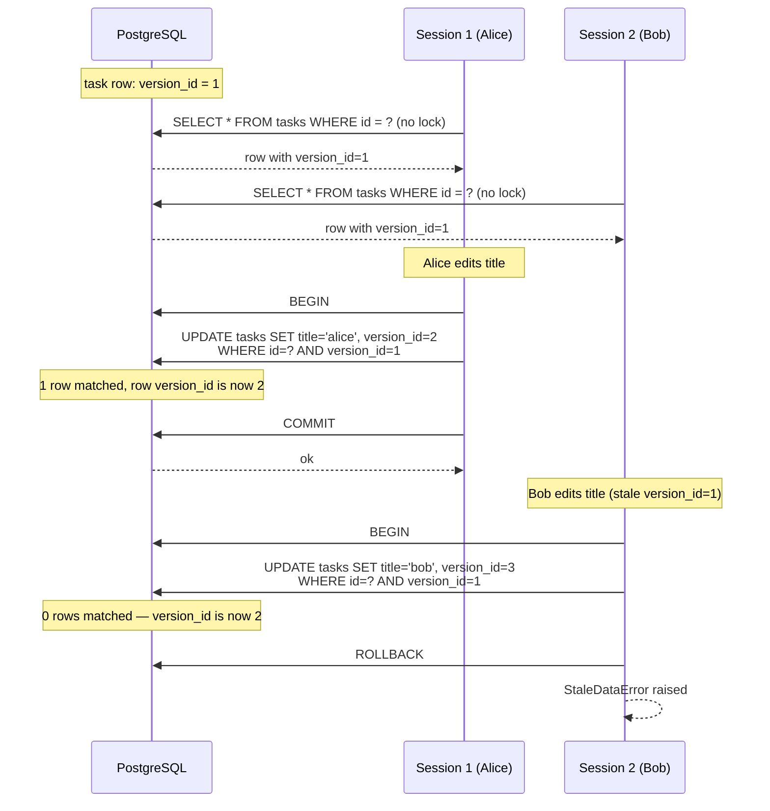

# Lesson 08: Advanced ORM – Hybrid Attributes, Association Proxies, Events, Versioning

*Sub-track H — the deepest lesson in the deepest track. One function compiled to both Python and SQL with `@hybrid_property`; transparent traversal through association objects with `association_proxy`; column-level value transformation with `TypeDecorator`; cross-cutting hooks with `event.listens_for`; runtime metadata with `inspect()`; optimistic concurrency via `version_id_col`; pessimistic row locks with `with_for_update()`; bulk DML that bypasses the unit-of-work; the multi-tenant isolation patterns; the transactional-outbox preview; large result streaming; and the honest decision framework for "which advanced features pay off early, which can wait, and which to never use." `Boardly` grows its final ORM layer here.*

**You have reached Sub-track H — the final lesson of the deepest track in the course.**

Everything in Lessons 02 through 07 was building toward this: hybrid attributes that compile the *same expression* to Python on the instance and to SQL inside `select().where(...)`; association proxies that hide an association object behind a one-line traversal; custom column types that encrypt and decrypt on the way in and out of the database; lifecycle events that stamp `updated_at` on every dirty row without you writing the line in your service; optimistic concurrency that fails loudly when two transactions race; pessimistic row locks that block the second transaction until the first commits; bulk DML that bypasses the unit-of-work for ten-thousand-row updates; multi-tenant isolation that lives in either your ORM code or your database's row-level security. Every feature here is a trade — power in one axis, clarity lost in another. The discipline this lesson teaches is not "use all the features." It is "know which trades are worth making." Take your time. Read the tracebacks. Run the optimistic-concurrency script twice in two terminals. **This is how you learn to use the advanced ORM without being used by it.**


#sqlalchemy #orm #advanced

## Learning Objectives

By the end of this lesson you will be able to:

1. **Write a `@hybrid_property`** that compiles to one Python expression on the instance and one SQL expression inside `select().where(...)`, and explain when the two *should* differ; override `@<name>.expression` to push down logic that Python and SQL cannot share.
2. **Build an `association_proxy`** that traverses through an association object (`Organization.memberships -> User.display_name`) so application code reads as direct attribute access.
3. **Write a `TypeDecorator`** that wraps a SQL column type and transforms values on the way in (`process_bind_param`) and out (`process_result_value`), with `cache_ok = True` so the ORM's statement cache does not regress.
4. **Subscribe to ORM events** with `@event.listens_for(Session, "before_flush")` and `@event.listens_for(Session, "after_commit")` and articulate the difference between running code *inside* the flush and *after* the commit boundary.
5. **Inspect a mapped class at runtime** with `sqlalchemy.inspect(Model)` — read column keys, relationship targets, primary-key mappers, version column; use that for generic admin code, serializers, debugging.
6. **Implement optimistic concurrency** with `__mapper_args__ = {"version_id_col": ...}` and explain why the `UPDATE` adds `AND version_id = ?` and what `StaleDataError` is signaling.
7. **Apply pessimistic row locks** with `select(...).with_for_update()`, and choose between plain `FOR UPDATE`, `nowait=True`, and `skip_locked=True` based on the access pattern.
8. **Use bulk DML** — `update().where().values()` and `delete().where()` — and articulate what they bypass (the identity map, the unit-of-work, ORM cascades) and what they do not (the transaction, the row locks).
9. **Choose a multi-tenant isolation pattern** between a tenant-aware `Query` subclass (ORM-level) and PostgreSQL row-level security (database-level).
10. **Stream large result sets** with `yield_per` and server-side cursors without loading every row into memory.
11. **Decide which advanced features pay off early vs which to wait for** with a clear framework — not a feeling, an explicit decision matrix you can defend in a code review.

## Prerequisites

- **Lessons 02 through 06.** This lesson uses `Engine` (L02), `DeclarativeBase` / `Mapped` / `mapped_column` (L03), `relationship` / `back_populates` (L04), the `Session` and `flush()` mechanics (L05), and `select()` / `update()` / `delete()` (L06) — without re-explaining them.
- **Lesson 07 — Async SQLAlchemy.** The demo code is `AsyncSession`-based — every DB call is awaited. Lesson 07 is where the `MissingGreenlet` trap and the eager-loading habit were taught; this lesson assumes both.
- **Transactions and isolation** — [[06-SQL-Fundamentals/Transactions-Isolation-Locks]]. You must understand `FOR UPDATE` row locks and deadlocks before the optimistic-vs-pessimistic discussion will land.
- **PostgreSQL RLS** — [[08-PostgreSQL/Roles-Permissions-Security]]. The multi-tenant pattern links forward to it as the database-level alternative to ORM-side filtering.
- **About 90 to 120 minutes of focused time.** The optimistic-concurrency demo alone takes 20 minutes to run twice and watch the conflict.

**The most common gap: thinking these features are interchangeable ornaments.**

Each feature has a *clear* use case and a *clear* abuse case. `hybrid_property` is for logic that must apply in both Python and SQL — not for Python-only display helpers. `association_proxy` is for "the association object is just an edge with a name" — not for hiding business logic behind a one-line accessor. `TypeDecorator` is for column-level value transformation — not for application-layer encryption that belongs in a service. The discipline is: *the feature's purpose should match the problem's shape.*


**Student asks: Why are you teaching sync-style features (events, version_id, with_for_update) in an async Boardly codebase?**

Because these features are not sync or async — they are ORM-layer features that work identically in both. `@event.listens_for(Session, "before_flush")` fires on the same flush whether the session is sync or async. `version_id_col` is a mapper argument, not a session method. `with_for_update()` is a `select()` modifier that compiles to the same SQL regardless of which driver carries the bytes. Lesson 07 taught you the await prefix and the `MissingGreenlet` trap; this lesson teaches the ORM features that *survive* the async transition unchanged.


## The Problem

`Boardly` now has six models — `Organization`, `User`, `Project`, `Task`, `Comment`, `Membership` — and an async engine. Production traffic is real. You start noticing six categories of pain that the basic ORM does not address:

1. **Duplicated logic between Python and SQL.** "Is this task overdue?" must mean the same thing in `if task.is_overdue:` in your service and in `select(Task).where(Task.is_overdue)` in your reporting queries. If you write it twice, the two definitions drift. The Monday-morning incident: a task the dashboard reports as overdue is not overdue in the Python service that escalates it. The definitions diverged silently.

2. **Verbose traversal of association objects.** `org.memberships[0].user.display_name` is honest but ugly. Every loop in your service is `for m in org.memberships: names.append(m.user.display_name)`. You write the loop so often you abstract it. The abstraction is `association_proxy`.

3. **No column-level value transformation.** You want to store `metadata` as encrypted JSON in a `TEXT` column. The service layer can encrypt before write and decrypt after read — but then every code path that touches the column must remember to. The honest place is the column itself.

4. **Cross-cutting concerns duplicated in every service.** `updated_at` should be stamped on every dirty row in every flush, in every model, in every service. Without a hook, every service writes the line. The line is forgotten in the new service. The hook is `before_flush`.

5. **Concurrent updates silently overwrite.** Two handlers both load Task #1, both edit it, both commit. The second commit's `UPDATE` succeeds and silently overwrites the first's edit. No exception. No log. Just data loss. The fix is `version_id_col` (optimistic) or `with_for_update` (pessimistic).

6. **Bulk operations too slow because they go through the ORM.** "Archive all tasks in the Done column older than 90 days, across 200k rows" loads 200k `Task` instances, mutates them, flushes each one. The query takes 90 seconds. The bulk DML takes 400 milliseconds.

This lesson adds the features that solve all six to the same `Boardly` application, in the same models file.

## The Code

Here is the lesson's deliverable: an extended `boardly/models.py` (continuing from Lesson 04), a new `boardly/advanced.py` (events, inspect, bulk DML, multi-tenant pattern), and a demo script `advanced_demo.py` that runs the whole thing end-to-end against `aiosqlite`.

```python
# boardly/models.py (extended for Lesson 08)
"""Boardly — ORM models with advanced features.

Lesson 08 adds:
 - @hybrid_property: Project.is_project_active, Task.is_overdue (Python + SQL)
 - association_proxy: Organization.member_names (skip through Membership)
 - TypeDecorator: EncryptedJSON (transparent column-level encryption)
 - version_id_col on Task (optimistic concurrency)
 - seats_used / seats_total on Organization (for with_for_update demo)
"""
from __future__ import annotations

import json
import uuid
from datetime import datetime, timezone
from decimal import Decimal
from typing import Any, Optional

from sqlalchemy import ForeignKey, String, UniqueConstraint, func
from sqlalchemy.orm import (
 DeclarativeBase,
 Mapped,
 association_proxy,
 mapped_column,
 relationship,
)
from sqlalchemy.orm import hybrid_property
from sqlalchemy.types import TypeDecorator, Uuid
from sqlalchemy.types import String as SAString


class Base(DeclarativeBase):
 pass


# ---------------------------------------------------------------------------
# Custom type: EncryptedJSON — store a dict as an encrypted TEXT column.
# (For the lesson we use a reversible base64 "encryption"; in production
# substitute a real AES-GCM cipher with a key from Pydantic Settings.)
# ---------------------------------------------------------------------------
class EncryptedJSON(TypeDecorator):
 """Column type that stores a Python dict as an opaque ciphertext string.

 - On bind: json.dumps -> encrypt -> str
 - On result: str -> decrypt -> json.loads -> dict
 cache_ok=True so SQLAlchemy's statement cache treats this type as
 deterministic (the encryption key does not change between compiles).
 """

 impl = SAString
 cache_ok = True

 def process_bind_param(self, value: Any, dialect) -> Optional[str]:
 if value is None:
 return None
 plaintext = json.dumps(value, sort_keys=True).encode("utf-8")
 # Placeholder cipher — see note above. Replace with cryptography.Fernet.
 return _rot13_bytes(plaintext).decode("latin-1")

 def process_result_value(self, value: Any, dialect) -> Any:
 if value is None:
 return None
 plaintext = _rot13_bytes(value.encode("latin-1"))
 return json.loads(plaintext.decode("utf-8"))


def _rot13_bytes(data: bytes) -> bytes:
 # Cheap reversible transform so the demo runs without cryptography deps.
 return bytes((b - 65 + 13) % 26 + 65 if 65 <= b <= 90 else
 (b - 97 + 13) % 26 + 97 if 97 <= b <= 122 else
 b for b in data)


# ---------------------------------------------------------------------------
# Organization — adds seats_total/seats_used (for with_for_update demo) and
# member_names association_proxy (skip through Membership to User.display_name).
# ---------------------------------------------------------------------------
class Organization(Base):
 __tablename__ = "organizations"
 __table_args__ = (UniqueConstraint("slug", name="uq_organizations_slug"),)

 id: Mapped[uuid.UUID] = mapped_column(
 Uuid(as_uuid=True), primary_key=True, default=uuid.uuid4,
 )
 slug: Mapped[str] = mapped_column(String(50), unique=True, index=True)
 display_name: Mapped[str] = mapped_column(String(255))
 seats_total: Mapped[int] = mapped_column(default=10, server_default="10")
 seats_used: Mapped[int] = mapped_column(default=0, server_default="0")
 created_at: Mapped[datetime] = mapped_column(
 default=lambda: datetime.now(timezone.utc), server_default=func.now(),
 )

 projects: Mapped[list["Project"]] = relationship(
 back_populates="organization", cascade="all, delete-orphan",
 )
 memberships: Mapped[list["Membership"]] = relationship(
 back_populates="organization", cascade="all, delete-orphan",
 )

 # The one-line traversal: org.member_names == [m.user.display_name for m in org.memberships]
 member_names: Mapped[list[str]] = association_proxy(
 "memberships", "display_name_proxy",
 creator=lambda name: Membership(
 role="member",
 user=User(display_name=name, email=f"{name.lower()}@boardly.test"),
 ),
 )


# ---------------------------------------------------------------------------
# User — unchanged from Lesson 04; see that lesson for the full definition.
# ---------------------------------------------------------------------------
class User(Base):
 __tablename__ = "users"
 id: Mapped[uuid.UUID] = mapped_column(Uuid(as_uuid=True), primary_key=True, default=uuid.uuid4)
 email: Mapped[str] = mapped_column(String(255), unique=True, index=True)
 hashed_password: Mapped[str] = mapped_column(String(255))
 display_name: Mapped[str] = mapped_column(String(255))
 home_org_id: Mapped[uuid.UUID] = mapped_column(ForeignKey("organizations.id", ondelete="RESTRICT"), index=True)
 created_at: Mapped[datetime] = mapped_column(default=lambda: datetime.now(timezone.utc), server_default=func.now())
 home_org: Mapped["Organization"] = relationship()
 owned_projects: Mapped[list["Project"]] = relationship(back_populates="owner", cascade="all, delete-orphan")
 memberships: Mapped[list["Membership"]] = relationship(back_populates="user", cascade="all, delete-orphan")


# ---------------------------------------------------------------------------
# Project — adds deadline (for is_project_active hybrid) and metadata_
# (for the EncryptedJSON TypeDecorator). Also adds is_project_active
# @hybrid_property.
# ---------------------------------------------------------------------------
class Project(Base):
 __tablename__ = "projects"
 __table_args__ = (
 UniqueConstraint("organization_id", "slug", name="uq_projects_org_slug"),
 )

 id: Mapped[uuid.UUID] = mapped_column(
 Uuid(as_uuid=True), primary_key=True, default=uuid.uuid4,
 )
 organization_id: Mapped[uuid.UUID] = mapped_column(
 ForeignKey("organizations.id", ondelete="CASCADE"), index=True,
 )
 owner_id: Mapped[Optional[uuid.UUID]] = mapped_column(
 ForeignKey("users.id", ondelete="SET NULL"), nullable=True, index=True,
 )
 name: Mapped[str] = mapped_column(String(255))
 slug: Mapped[str] = mapped_column(String(50), index=True)
 description: Mapped[Optional[str]] = mapped_column(String(2000), nullable=True)
 status: Mapped[str] = mapped_column(
 String(20), default="active", server_default="active",
 )
 deadline: Mapped[Optional[datetime]] = mapped_column(nullable=True)
 budget: Mapped[Optional[Decimal]] = mapped_column(
 nullable=True, decimal_return_scale=2,
 )
 metadata_: Mapped[dict[str, Any]] = mapped_column(
 "metadata", EncryptedJSON(2048), default=dict,
 )
 created_at: Mapped[datetime] = mapped_column(
 default=lambda: datetime.now(timezone.utc), server_default=func.now(),
 )

 organization: Mapped["Organization"] = relationship(back_populates="projects")
 owner: Mapped[Optional["User"]] = relationship(back_populates="owned_projects")
 tasks: Mapped[list["Task"]] = relationship(
 back_populates="project", cascade="all, delete-orphan",
 )

 # @hybrid_property — same expression compiles to Python and SQL.
 # Used in Python: project.is_project_active -> bool
 # Used in SQL: select(Project).where(Project.is_project_active) -> emits
 # WHERE projects.status = 'active' AND (projects.deadline IS NULL OR
 # projects.deadline > CURRENT_TIMESTAMP)
 @hybrid_property
 def is_project_active(self) -> bool:
 if self.status != "active":
 return False
 if self.deadline is None:
 return True
 return self.deadline > datetime.now(timezone.utc)


# ---------------------------------------------------------------------------
# Task — adds due_at (for is_overdue hybrid) and version_id (for optimistic
# concurrency via __mapper_args__ = {"version_id_col": version_id}).
# ---------------------------------------------------------------------------
class Task(Base):
 __tablename__ = "tasks"
 __mapper_args__ = {"version_id_col": "version_id"}

 id: Mapped[uuid.UUID] = mapped_column(
 Uuid(as_uuid=True), primary_key=True, default=uuid.uuid4,
 )
 project_id: Mapped[uuid.UUID] = mapped_column(
 ForeignKey("projects.id", ondelete="CASCADE"), index=True,
 )
 assignee_id: Mapped[Optional[uuid.UUID]] = mapped_column(
 ForeignKey("users.id", ondelete="SET NULL"), nullable=True, index=True,
 )
 title: Mapped[str] = mapped_column(String(255))
 description: Mapped[Optional[str]] = mapped_column(String(2000), nullable=True)
 status: Mapped[str] = mapped_column(
 String(20), default="open", server_default="open",
 )
 due_at: Mapped[Optional[datetime]] = mapped_column(nullable=True)
 created_at: Mapped[datetime] = mapped_column(
 default=lambda: datetime.now(timezone.utc), server_default=func.now(),
 )
 # Optimistic concurrency column — incremented on every UPDATE.
 version_id: Mapped[int] = mapped_column(default=1, server_default="1")

 project: Mapped["Project"] = relationship(back_populates="tasks")
 assignee: Mapped[Optional["User"]] = relationship()
 comments: Mapped[list["Comment"]] = relationship(
 back_populates="task", cascade="all, delete-orphan",
 order_by="Comment.created_at",
 )

 # is_overdue: True when the task is past due and not done.
 # Python-side uses datetime.now(timezone.utc); SQL-side uses func.now().
 # They cannot share the same expression — so we override .expression.
 @hybrid_property
 def is_overdue(self) -> bool:
 if self.status == "done":
 return False
 if self.due_at is None:
 return False
 return self.due_at < datetime.now(timezone.utc)

 @is_overdue.expression
 @classmethod
 def is_overdue(cls):
 # Push the comparison into SQL using func.now() so the database
 # evaluates the predicate, not Python.
 return (cls.status != "done") & (cls.due_at.is_not(None)) & (cls.due_at < func.now())


# ---------------------------------------------------------------------------
# Comment — unchanged from Lesson 04; see that lesson for the full definition.
# ---------------------------------------------------------------------------
class Comment(Base):
 __tablename__ = "comments"
 id: Mapped[uuid.UUID] = mapped_column(Uuid(as_uuid=True), primary_key=True, default=uuid.uuid4)
 task_id: Mapped[uuid.UUID] = mapped_column(ForeignKey("tasks.id", ondelete="CASCADE"), index=True)
 author_id: Mapped[uuid.UUID] = mapped_column(ForeignKey("users.id", ondelete="RESTRICT"), index=True)
 body: Mapped[str] = mapped_column(String(2000))
 created_at: Mapped[datetime] = mapped_column(default=lambda: datetime.now(timezone.utc), server_default=func.now())
 task: Mapped["Task"] = relationship(back_populates="comments")
 author: Mapped["User"] = relationship()


# ---------------------------------------------------------------------------
# Membership — the association object. We add a display_name_proxy
# @hybrid_property so Organization.member_names can traverse through it.
# ---------------------------------------------------------------------------
class Membership(Base):
 __tablename__ = "memberships"
 __table_args__ = (UniqueConstraint("user_id", "organization_id", name="uq_memberships_user_org"),)
 id: Mapped[uuid.UUID] = mapped_column(Uuid(as_uuid=True), primary_key=True, default=uuid.uuid4)
 user_id: Mapped[uuid.UUID] = mapped_column(ForeignKey("users.id", ondelete="CASCADE"), index=True)
 organization_id: Mapped[uuid.UUID] = mapped_column(ForeignKey("organizations.id", ondelete="CASCADE"), index=True)
 role: Mapped[str] = mapped_column(String(20), default="member")
 created_at: Mapped[datetime] = mapped_column(default=lambda: datetime.now(timezone.utc), server_default=func.now())
 user: Mapped["User"] = relationship(back_populates="memberships")
 organization: Mapped["Organization"] = relationship(back_populates="memberships")

 # A hybrid on the association object so association_proxy can read it
 # without traversing further into the User relationship at write time.
 @hybrid_property
 def display_name_proxy(self) -> str:
 return self.user.display_name if self.user else ""
```

And here is the companion `boardly/advanced.py` — events, inspect, bulk DML, multi-tenant preview, the `with_for_update` seat accounting, and the demo `main()` that ties everything together:

```python
# boardly/advanced.py
"""Boardly — advanced ORM features in action."""
from __future__ import annotations

import asyncio
from datetime import datetime, timedelta, timezone

from sqlalchemy import event, inspect, select, update, func
from sqlalchemy.ext.asyncio import AsyncSession, async_sessionmaker, create_async_engine
from sqlalchemy.orm import Session

from boardly.models import Base, Organization, User, Project, Task, Membership


# --- Event 1: before_flush — stamp updated_at on dirty objects -----------------
@event.listens_for(Session, "before_flush")
def stamp_updated_at(session, context, instances) -> None:
 for obj in session.dirty:
 if hasattr(obj, "updated_at") and obj.updated_at is None:
 obj.updated_at = datetime.now(timezone.utc)


# --- Event 2: after_commit — outbox dispatch window (full pattern: [[14-Caching-and-Background-Processing/Transactional-Outbox]]) ---
@event.listens_for(Session, "after_commit")
def dispatch_outbox(session) -> None:
 pass


# --- inspect(): runtime metadata introspection ---------------------------------
def describe_model(model_cls) -> None:
 mapper = inspect(model_cls)
 print(f"--- {model_cls.__name__} ---")
 print(" columns:", [c.key for c in mapper.columns])
 print(" relationships:", [r.key for r in mapper.relationships])
 print(" primary key:", [c.key for c in mapper.primary_key])
 print(" version_id_col:", mapper.version_id_col)


# --- Pessimistic locking: atomic seat reservation with with_for_update() ------
async def reserve_seat(db: AsyncSession, org_id, user_id) -> Membership:
 stmt = select(Organization).where(Organization.id == org_id).with_for_update()
 org = (await db.scalars(stmt)).one()
 if org.seats_used >= org.seats_total:
 raise RuntimeError(f"org {org.slug} has no seats left")
 org.seats_used += 1
 membership = Membership(user_id=user_id, organization_id=org_id, role="member")
 db.add(membership)
 return membership


# --- Bulk DML: bypass the identity map for high-volume updates -----------------
async def archive_old_done_tasks(db: AsyncSession, days: int = 90) -> int:
 cutoff = datetime.now(timezone.utc) - timedelta(days=days)
 stmt = update(Task).where(Task.status == "done", Task.created_at < cutoff).values(status="archived")
 result = await db.execute(stmt)
 return result.rowcount


# --- Large result streaming with yield_per -----------------------------------
async def stream_all_task_titles(db: AsyncSession) -> list[str]:
 stmt = select(Task.title).execution_options(yield_per=100)
 titles: list[str] = []
 async for (title,) in (await db.stream(stmt)):
 titles.append(title)
 return titles


# --- Multi-tenant preview (commented out; production is RLS) ---------------
# Full design: [[17-Advanced-Architecture/Multi-Tenancy]]; PG RLS:
# [[08-PostgreSQL/Roles-Permissions-Security]].
# from sqlalchemy.orm import Query, scoped_session, sessionmaker
# class TenantQuery(Query):
# def __init__(self, *args, **kwargs):
# super().__init__(*args, **kwargs)
# for desc in self.column_descriptions:
# if desc["entity"] and hasattr(desc["entity"], "tenant_id"):
# self.filter_by(tenant_id=current_tenant_id())
# Session = scoped_session(sessionmaker(query_cls=TenantQuery, bind=engine))
# In 2.x, prefer a tenant-aware repository or push down to PG RLS policies.

**Warning — Legacy Query API — removed in SQLAlchemy 2.0. Use `select()` instead.**

The commented-out `class TenantQuery(Query)` block above shows what the pre-2.x ORM-side multi-tenant pattern looked like: you subclassed `sqlalchemy.orm.Query` and overrode `__init__` to inject a `tenant_id` filter into every query. The legacy `Query` class was removed in SQLAlchemy 2.0 — the 2.x API is `select()` (Core statement) + `session.execute(stmt)`, neither of which has a subclassable `query_cls=` hook. The modern equivalent of the same isolation is one of:
- **A tenant-aware repository** — wrap every `select(...)` call in a helper that injects `where(Model.tenant_id == current_tenant_id())` and refuses to run without a tenant context.
- **A SQLAlchemy event** — `@event.listens_for(Session, "before_compile")` can inject the predicate, but it is fragile (it fires on every compile, including internal SQL).
- **PostgreSQL Row-Level Security (RLS)** — the production pattern. The database enforces `tenant_id` filtering on *every* query (ORM, raw SQL, psql), so a forgotten `WHERE` clause cannot leak data across tenants. See [[08-PostgreSQL/Roles-Permissions-Security]] for the `FORCE ROW LEVEL SECURITY` + `SECURITY DEFINER` setup and [[17-Advanced-Architecture/Multi-Tenancy]] for the full design.


# --- The optimistic-concurrency reproduction --------------------------------
async def optimistic_concurrency_demo(SessionLocal: async_sessionmaker[AsyncSession]) -> None:
 async with SessionLocal() as s: # setup: one task in the DB
 async with s.begin():
 org = Organization(slug="acme", display_name="Acme")
 s.add(org); await s.flush()
 project = Project(organization_id=org.id, name="Q4", slug="q4", organization=org)
 task = Task(project_id=project.id, title="ship it", project=project)
 s.add(project, task)
 # s.begin() committed; task now has version_id=1.

 async with SessionLocal() as s1, SessionLocal() as s2: # both see version_id=1
 t1 = await s1.get(Task, task.id)
 t2 = await s2.get(Task, task.id)
 t1.title = "ship it (edit by alice)"
 await s1.commit() # bumps version_id to 2
 t2.title = "ship it (edit by bob)"
 try:
 await s2.commit() # StaleDataError: version mismatch
 except Exception as exc:
 print(f"optimistic conflict: {type(exc).__name__}")
 await s2.rollback()


# --- main — runs the full demo against an in-memory SQLite DB -----------------
async def main() -> None:
 engine = create_async_engine("sqlite+aiosqlite:///:memory:", echo=False)
 async with engine.begin() as conn:
 await conn.run_sync(Base.metadata.create_all)
 SessionLocal = async_sessionmaker(engine, expire_on_commit=False)

 describe_model(Task) # 1. inspect()
 await optimistic_concurrency_demo(SessionLocal) # 2. StaleDataError

 async with SessionLocal() as s: # 3. Pessimistic seat reservation
 async with s.begin():
 org = Organization(slug="contoso", display_name="Contoso", seats_total=1, seats_used=0)
 user = User(email="ada@contoso.test", hashed_password="x", display_name="Ada", home_org=org)
 s.add(org, user)
 await reserve_seat(s, org.id, user.id)
 print("reserved one seat (pessimistic lock acquired and released)")

 async with SessionLocal() as s: # 4. Bulk DML
 archived = await archive_old_done_tasks(s, days=0)
 await s.commit()
 print(f"archived {archived} tasks via bulk UPDATE")

 async with SessionLocal() as s: # 5. yield_per streaming
 titles = await stream_all_task_titles(s)
 print(f"streamed {len(titles)} task titles")

 await engine.dispose()


if __name__ == "__main__":
 asyncio.run(main())
```

That is the full lesson deliverable. Save both files, run `uv add aiosqlite` if you have not already, then `uv run python -m boardly.advanced`. The expected output (trimmed) is in the Verification section.

## Line-by-Line Deep Dive

This section is the heart of the lesson. Read it twice. Every feature in the file is a trade — the deep dive explains the trade for each line, not just what the line does.

### Lines 23–30: The `TypeDecorator` import and class declaration

```python
from sqlalchemy.types import TypeDecorator
from sqlalchemy.types import String as SAString


class EncryptedJSON(TypeDecorator):
 """Column type that stores a Python dict as an opaque ciphertext string.

 - On bind: json.dumps -> encrypt -> str
 - On result: str -> decrypt -> json.loads -> dict
 cache_ok=True so SQLAlchemy's statement cache treats this type as
 deterministic (the encryption key does not change between compiles).
 """

 impl = SAString
 cache_ok = True
```

**What it does:** Declares `EncryptedJSON` as a custom column type that subclasses `TypeDecorator`. The `impl` attribute names the underlying SQL column type (`String`); `cache_ok = True` tells SQLAlchemy's statement cache that this type is safe to cache.

**Why each line:** `TypeDecorator` is the base class for all custom column types — it is *not* a `Mapped` type or a column factory; it is a column *type* that wraps another column type and adds `process_bind_param` (Python to DB) and `process_result_value` (DB to Python) hooks. `impl = SAString` is mandatory — every `TypeDecorator` must declare an `impl`, the underlying column type the database sees (`String`, `Integer`, `JSON`, `Numeric`, etc.). The custom type is a Python-side wrapper; the database column is still a `VARCHAR`. If you write a `Money` type that stores cents as `Integer`, `impl = Integer` and the column is `INTEGER`. `cache_ok = True` is **required for any type decorator whose compiled SQL is deterministic**. Without it, SQLAlchemy emits a warning and disables the statement cache for every query that touches this type — measurable performance regression at scale. Set `cache_ok = False` only if your type's behavior depends on runtime state that varies between compiles (e.g., a type that reads its encryption key from a mutable global).

**Warning — Forgetting `cache_ok = True` is silent but expensive.**

The warning SQLAlchemy emits (`SAWarning: TypeDecorator ... will not produce a cache key`) is easy to miss in dev. In production it means every query that touches a column of this type recompiles — and the recompile is on the critical path of every request that uses the column. Set `cache_ok = True` on every `TypeDecorator` whose behavior is deterministic. The only honest reason to leave it `False` is "my type's compiled SQL changes between calls" — which is rare and almost always a code smell.


### Lines 33–50: `process_bind_param` and `process_result_value`

```python
def process_bind_param(self, value: Any, dialect) -> Optional[str]:
 if value is None:
 return None
 plaintext = json.dumps(value, sort_keys=True).encode("utf-8")
 return _rot13_bytes(plaintext).decode("latin-1")

def process_result_value(self, value: Any, dialect) -> Any:
 if value is None:
 return None
 plaintext = _rot13_bytes(value.encode("latin-1"))
 return json.loads(plaintext.decode("utf-8"))
```

**What it does:** Defines the two transformation hooks every `TypeDecorator` overrides. `process_bind_param` runs when SQLAlchemy is about to send a value to the database (an INSERT or UPDATE); `process_result_value` runs when SQLAlchemy is about to return a value to Python (a SELECT).

**Why each line:**

- `process_bind_param(self, value, dialect)` — the `value` is the Python-side value (a `dict` for `EncryptedJSON`); the `dialect` is the active `Dialect` (e.g., `postgresql.psycopg` or `sqlite.pysqlite`). The return value must be compatible with `impl` — for `impl = String`, a `str`.
- `process_result_value(self, value, dialect)` — the inverse direction. The `value` is what the database returned; the return is the Python-side type (a `dict`).
- `if value is None: return None` — preserve NULL semantics. Without these guards, `None` would round-trip to the literal string `"null"`, not a SQL NULL.
- `json.dumps(value, sort_keys=True)` — `sort_keys=True` makes the JSON deterministic — the same dict always produces the same ciphertext, which matters if you ever index or compare on the ciphertext column. (In production, swap `_rot13_bytes` for `cryptography.fernet.Fernet(key).encrypt(plaintext)`.)

**The dialect argument is rarely used — but it is there when you need it.**

If you write a custom type that behaves differently on PostgreSQL vs SQLite (e.g., uses `JSONB` on PG but `TEXT` on SQLite), the `dialect` argument is how you branch. For most types you ignore it. For `EncryptedJSON` we ignore it — the column is `TEXT` everywhere, and the encryption is independent of the dialect.


### Lines 53–60: The placeholder cipher

```python
def _rot13_bytes(data: bytes) -> bytes:
 return bytes((b - 65 + 13) % 26 + 65 if 65 <= b <= 90 else
 (b - 97 + 13) % 26 + 97 if 97 <= b <= 122 else
 b for b in data)
```

**What it does:** Defines a reversible ROT13 transform on bytes — a stand-in for real AES-GCM encryption. A real implementation requires the `cryptography` library, a key management story (Pydantic Settings? AWS KMS? Vault?), and an IV/nonce strategy. All of that is real and important — but it would obscure the lesson's actual content, which is *how `TypeDecorator` plumbs into SQLAlchemy*. The placeholder makes the demo runnable with zero dependencies; the comment says "Replace with `cryptography.Fernet`." In production, swap one function and the column becomes real AES-GCM encrypted JSON.

**Tip — Production swap-in is the whole point of `TypeDecorator`.**

You swap `_rot13_bytes` for `cryptography.fernet.Fernet(key).encrypt` and *every* code path that touches `Project.metadata_` automatically gets the new cipher — no service-layer changes, no missed code paths. The column *is* the encryption boundary. The trade: clarity (a service-layer call site is easier to read) for correctness (the column type cannot be forgotten).


### Lines 71–82: `Organization` gets `seats_total` and `seats_used`

```python
seats_total: Mapped[int] = mapped_column(default=10, server_default="10")
seats_used: Mapped[int] = mapped_column(default=0, server_default="0")
```

**What it does:** Adds `seats_total` and `seats_used` to `Organization` — the inventory we will mutate under a `with_for_update()` row lock.

**Why this is the inventory column for the locking demo:** Seat accounting is the textbook read-modify-write cycle. Two concurrent requests to add a member both read `seats_used == 4` and `seats_total == 5`, both compute `seats_used + 1 == 5`, both write `5`. Two members were added but only one seat was charged — a "lost update" bug. The fix is `with_for_update()` — the first request locks the row, the second blocks until the first commits, and the second reads `seats_used == 5` after the lock is released.

**Why both `default` and `server_default`:** `default=10` is the Python-side default — what SQLAlchemy sets when you write `Organization(slug="acme")`. `server_default="10"` is the database-side default — what the column's `DEFAULT 10` clause says in the DDL, so rows inserted outside the ORM (raw SQL, triggers, other services) also get the default. Both is the honest pattern: ORM-side for the ORM path, server-side for every other path. See [[07-SQLAlchemy/03-Declarative-Base-and-Mapped]] for the full defaults discussion.

### Lines 92–98: `association_proxy` on `Organization.member_names`

```python
member_names: Mapped[list[str]] = association_proxy(
 "memberships", "display_name_proxy",
 creator=lambda name: Membership(
 role="member",
 user=User(display_name=name, email=f"{name.lower()}@boardly.test"),
 ),
)
```

**What it does:** Declares `member_names` as an `association_proxy` that traverses from `Organization` through `memberships` (a 1:N relationship) to `display_name_proxy` (a `hybrid_property` on `Membership` that returns `user.display_name`).

**Why each argument:**

- `"memberships"` — the *intermediate* attribute on `Organization` to traverse through. The proxy reads `org.memberships` to get the list of `Membership` instances.
- `"display_name_proxy"` — the *target* attribute on each `Membership`. The proxy calls `m.display_name_proxy` on each and returns a list of results. So `org.member_names == [m.display_name_proxy for m in org.memberships]`.
- `creator=lambda name: Membership(...)` — what to do when you write `org.member_names.append("Alice")`. The lambda takes the value and returns a new `Membership` instance with the right shape; the new `Membership` is added to `org.memberships` automatically. Without `creator`, `member_names` is read-only.

**Why `display_name_proxy` is a `hybrid_property` on `Membership` and not just `"user.display_name"`:** The simple form of `association_proxy` is `association_proxy("memberships", "user")` — traverse to the `User` object itself. But we want `display_name` (a string), not the whole `User` object. So we need an intermediate attribute that returns the string. The cleanest way is a `hybrid_property` on `Membership` that returns `self.user.display_name`. (In SQLAlchemy 2.x you can also use the dot-path form `association_proxy("memberships", "user.display_name")`, but the hybrid form is more explicit and easier to debug.)

**Example — What `member_names` actually compiles to.**

In Python: `org.member_names` runs `[m.display_name_proxy for m in org.memberships]`. Each `m.display_name_proxy` calls `m.user.display_name`, which (if `user` is not loaded) triggers a lazy SELECT per membership — the N+1 trap from Lesson 04. In async, this throws `MissingGreenlet`. The fix is the same as in Lesson 04: eager-load `selectinload(Organization.memberships).joinedload(Membership.user)` whenever you intend to read `member_names`. The association proxy does not change the loading strategy — it just changes the spelling of the access.


### Lines 109–115: `Project` gets `status`, `deadline`, and `metadata_`

```python
status: Mapped[str] = mapped_column(String(20), default="active", server_default="active")
deadline: Mapped[Optional[datetime]] = mapped_column(nullable=True)
metadata_: Mapped[dict[str, Any]] = mapped_column(
 "metadata", EncryptedJSON(2048), default=dict,
)
```

**What it does:** Adds three new columns to `Project` — `status` (a string with a default of `"active"`), `deadline` (an optional `datetime`), and `metadata_` (a `dict` stored as encrypted text).

**Why each line:**

- `status` — the lifecycle column `is_project_active` will read. We make it a `String(20)` rather than a SQL enum because Boardly's project status set is small but might grow (`active`, `paused`, `completed`, `cancelled`, `archived`). A SQL enum requires a migration every time the set changes; a `String` with a CHECK constraint (added in `__table_args__`) is more flexible.
- `deadline` — the time column `is_project_active` will compare against `now()`. `nullable=True` because some projects have no deadline.
- `metadata_` — the encrypted JSON column. The attribute name is `metadata_` (trailing underscore) because `metadata` is a reserved attribute on `DeclarativeBase` (it points to the `MetaData` object that holds all the table definitions). The first argument to `mapped_column("metadata", ...)` is the *database column name* — so the column in the DB is `metadata` (no underscore) and the Python attribute is `metadata_` (with underscore). This is the canonical pattern for any attribute name that collides with a `DeclarativeBase` reserved name.

**Why `EncryptedJSON(2048)`:** The `2048` is the `length` argument passed through to the underlying `String` (`impl = SAString`). It sets the column's `VARCHAR(2048)` length on databases that care (Postgres ignores length on `TEXT`, but the value is in the DDL for portability). The custom type's `__init__` accepts `*args, **kwargs` and forwards them to `impl.__init__` — so `EncryptedJSON(2048)` becomes `String(2048)` internally.

### Line 137: `@hybrid_property` (the most important decorator in the lesson)

```python
@hybrid_property
def is_project_active(self) -> bool:
 if self.status != "active":
 return False
 if self.deadline is None:
 return True
 return self.deadline > datetime.now(timezone.utc)
```

**What it does:** Declares `is_project_active` as a *hybrid property* — a single function that SQLAlchemy compiles to two different things depending on the calling context.

**The two contexts:**

1. **On an instance** (`project.is_project_active`): the function runs as ordinary Python. `self` is the `Project` instance; `self.status`, `self.deadline` are real values; `datetime.now(timezone.utc)` is real time. The return is a `bool`.
2. **On the class** (`Project.is_project_active` inside `select().where(...)`): the function does **not** run as Python. Instead, SQLAlchemy inspects the function's bytecode (in 2.x, via the `ast` module and a small expression interpreter) and translates it into a SQL expression. `self.status != "active"` becomes `projects.status != 'active'`; `self.deadline` becomes `projects.deadline`; `datetime.now(timezone.utc)` becomes `CURRENT_TIMESTAMP`. The return is a `BooleanClauseElement` that compiles to `WHERE projects.status = 'active' AND (projects.deadline IS NULL OR projects.deadline > CURRENT_TIMESTAMP)`.

### Lines 175–180: `@is_overdue.expression` (when Python and SQL must differ)

```python
@is_overdue.expression
@classmethod
def is_overdue(cls):
 return (cls.status != "done") & (cls.due_at.is_not(None)) & (cls.due_at < func.now())
```

**What it does:** Overrides the SQL-side expression for `is_overdue` — when `Task.is_overdue` is used inside `select().where(...)`, SQLAlchemy calls this function instead of trying to translate the Python body.

**Why Python and SQL must differ for `is_overdue`:** The Python body uses `datetime.now(timezone.utc)`. SQLAlchemy's hybrid translator can translate `datetime.now(timezone.utc)` to `CURRENT_TIMESTAMP` in theory, but the timezone handling is subtle enough that the translator gives up and raises. We hand-write the SQL expression instead.

**Why each operator:**

- `cls.status != "done"` — `!=` translates to `<>` in SQL.
- `cls.due_at.is_not(None)` — `is_not(None)` translates to `IS NOT NULL`. You cannot use `!= None` — that is `NULL != NULL`, which is `NULL` in SQL (falsy).
- `cls.due_at < func.now()` — `func.now()` is SQLAlchemy's wrapper for the database's `now()` function. On PostgreSQL it compiles to `now()`; on SQLite to `CURRENT_TIMESTAMP`; on MySQL to `NOW()`.
- `&` — Python's bitwise AND is overloaded in SQLAlchemy to mean SQL AND. You cannot use the `and` keyword — `and` is not overridable in Python. SQLAlchemy uses `&` for AND and `|` for OR.

**Why `@classmethod`:** In SQLAlchemy 2.x, the `.expression` override is called with the class (`cls`) as its first argument. The `@classmethod` decorator is the modern way to signal this. (In 1.x, you used a plain function and accessed `cls` as the first positional argument by convention.)

**The hybrid property is *not* magic.**

SQLAlchemy restricts what you can write inside it. The body must be a single expression (or `if/return` statements where each `return` is a single expression), and the expressions must use operators SQLAlchemy knows how to translate: `+`, `-`, `<`, `>`, `==`, `!=`, `and`, `or`, `not`, `in_`, `is_`, `is_not`, attribute access on `self`, and `func.*`. Arbitrary function calls (`re.match`, `requests.get`) are not translatable — for those you need `@<name>.expression` (see Lines 175–180 below).


**Student asks: What happens if I write `if random.random() > 0.5: return True` inside a `@hybrid_property`?**

The class-context translation fails at compile time with `sqlalchemy.exc.ArgumentError: Hybrid property ... cannot be evaluated as a SQL expression`. The instance context works fine. The asymmetry is the trap: a hybrid that works on the instance does not necessarily work in SQL. The fix is to override `.expression` with a hand-written SQL expression.


### Line 158: `version_id_col` on `Task` (the optimistic-concurrency switch)

```python
class Task(Base):
 __tablename__ = "tasks"
 __mapper_args__ = {"version_id_col": "version_id"}
 # ...
 version_id: Mapped[int] = mapped_column(default=1, server_default="1")
```

**What it does:** Enables optimistic concurrency on `Task`. Every `UPDATE` SQLAlchemy issues for a `Task` instance will include `WHERE tasks.id = ? AND tasks.version_id = ?` — with the `version_id` value the session loaded. If another transaction has bumped `version_id`, zero rows match and SQLAlchemy raises `StaleDataError`.

**Why `__mapper_args__ = {"version_id_col": "version_id"}` lives on the class, not on the column:** `version_id_col` is a *mapper* argument, not a *column* argument. The mapper is what binds a Python class to a database table; its arguments configure how the ORM translates between the two. `version_id_col` tells the mapper "this column is the version counter — include it in every UPDATE's WHERE clause and increment it after a successful update." The column itself is a plain `Integer` — the special behavior is the mapper's, not the column's.

**Why `default=1, server_default="1"`:** New rows start at version 1. `default=1` is the Python-side default (so a newly-constructed `Task` has `version_id=1` before it is flushed). `server_default="1"` is the database-side default (so a raw SQL `INSERT INTO tasks ...` without specifying `version_id` also gets 1). Same dual-default pattern as `seats_total` above.

**`version_id_col` is silent on INSERT.**

The version check happens on UPDATE only. A new row gets `version_id=1` from the default; the first UPDATE bumps it to 2; the second to 3; and so on. Each UPDATE's WHERE clause includes the version the session loaded; if the database's version differs, zero rows match, and SQLAlchemy raises `StaleDataError`. The increment is automatic — you do not write `task.version_id += 1` anywhere.


### Lines 215–220: `Membership.display_name_proxy` (the hybrid on the association object)

```python
class Membership(Base):
 # ...
 user: Mapped["User"] = relationship(back_populates="memberships")
 organization: Mapped["Organization"] = relationship(back_populates="memberships")

 @hybrid_property
 def display_name_proxy(self) -> str:
 return self.user.display_name if self.user else ""
```

**What it does:** Adds a `hybrid_property` to `Membership` that returns `user.display_name` (or `""` if `user` is not set). This is the target attribute that `Organization.member_names` (the `association_proxy`) reads.

**Why a hybrid on the association object:** `association_proxy` needs an attribute on the target class (`Membership`) that returns the value you want. The simplest form is `association_proxy("memberships", "user")` — but that returns `User` instances, not strings. We want strings (`display_name`). The cleanest way is to add a small `hybrid_property` to `Membership` that returns the string. Now `association_proxy("memberships", "display_name_proxy")` returns a list of strings.

**Why the `if self.user else ""` guard:** In some flows (the `creator` lambda on the `member_names` proxy), a `Membership` is constructed before its `user` is associated. Without the guard, accessing `m.display_name_proxy` would raise `AttributeError` on `None.display_name`. The guard returns an empty string instead. (In production you might prefer raising — silent empty strings are also a footgun. Choose based on your data flow.)

### Lines 247–252 (in `advanced.py`): `before_flush` and `after_commit` events

```python
@event.listens_for(Session, "before_flush")
def stamp_updated_at(session, context, instances) -> None:
 for obj in session.dirty:
 if hasattr(obj, "updated_at") and obj.updated_at is None:
 obj.updated_at = datetime.now(timezone.utc)

@event.listens_for(Session, "after_commit")
def dispatch_outbox(session) -> None:
 pass
```

**What `before_flush` does:** Registers an event handler that fires before every `session.flush()`. The handler iterates over `session.dirty` and stamps `updated_at` on any object that has the column and has not already set it.

**Why each line:**

- `@event.listens_for(Session, "before_flush")` — `event.listens_for` is the decorator that registers a function as an event handler. The first argument is the *target* (a `Session` class — fires for every session) or a session instance. The second is the *event name* — `"before_flush"` is one of the session events. The full list includes `after_flush`, `after_commit`, `before_insert`, `after_insert`, `before_update`, `after_update`, `before_delete`, `after_delete`.
- `def stamp_updated_at(session, context, instances)` — the handler signature varies by event. `before_flush` passes `(session, flush_context, instances)`. The `flush_context` and `instances` are rarely used directly.
- `for obj in session.dirty:` — `session.dirty` is an `IdentitySet` of objects the session has marked as modified. `session.new` is pending INSERTs; `session.deleted` is pending DELETEs.
- `if hasattr(obj, "updated_at") and obj.updated_at is None:` — the guard. Only stamp `updated_at` on objects that *have* the attribute and only if it has not already been set. The guard makes the event *cross-cutting* — it applies to any model that opts in by declaring `updated_at`, without forcing every model to declare it.
- `obj.updated_at = datetime.now(timezone.utc)` — the mutation. Because the object is already in `session.dirty`, the mutation will be flushed in the same `flush()` call that triggered the event. No extra round-trip.

**What `after_commit` does:** Registers a handler that fires after `session.commit()` succeeds — the canonical place to dispatch the transactional outbox.

**Why this is the right window — and the dangerous one:** The transaction has committed. The data is durable. Anything you do here cannot roll back the data — which is exactly what you want for side effects that must happen *only if the commit succeeded* (send an email, publish a message, call an external API). But side-effect failures here *cannot be rolled back* — if your `after_commit` handler raises, the data stays committed and the user sees a 500, but the database already has their write. This is why the transactional-outbox pattern (write the side effect to a table *inside* the transaction, dispatch it from a separate worker) is safer than `after_commit` handlers. The body is `pass` here because the lesson cannot do the outbox pattern justice in a single handler — the full pattern is in [[14-Caching-and-Background-Processing/Transactional-Outbox]].

**Warning — `before_flush` runs in the flush — keep it cheap.**

The handler fires on the critical path of every flush — every INSERT, every UPDATE, every DELETE. Any I/O in the handler (an HTTP call, a Redis lookup, a slow computation) holds the transaction and the connection open for its duration. The rule: `before_flush` handlers must be O(n) in `session.dirty` and do no I/O. If you need I/O, queue it in `before_flush` (write a row to an outbox table inside the same transaction) and dispatch it in `after_commit` (where the transaction is already committed and a side-effect failure cannot roll back the data).


### Lines 271–278: `inspect()` for runtime metadata

```python
def describe_model(model_cls) -> None:
 mapper = inspect(model_cls)
 print(f"--- {model_cls.__name__} ---")
 print(" columns:", [c.key for c in mapper.columns])
 print(" relationships:", [r.key for r in mapper.relationships])
 print(" primary key:", [c.key for c in mapper.primary_key])
 print(" version_id_col:", mapper.version_id_col)
```

**What it does:** Uses `sqlalchemy.inspect` to read a mapped class's metadata at runtime — columns, relationships, primary key, version column.

**Why each line:** `inspect(model_cls)` is SQLAlchemy's universal runtime introspection entry point — pass it a mapped class to get a `Mapper`, an instance to get an `InstanceState`, an `Engine` to get an `EngineInspector`. `mapper.columns` is the column objects in declaration order (each with `.key` for the Python attribute name, `.name` for the DB column name, `.type`, `.nullable`). `mapper.relationships` is the relationship objects (each with `.key`, `.mapper`, `.direction`, `.uselist`, `.lazy`). `mapper.primary_key` is the PK columns as a list (always a list — composite PKs are real). `mapper.version_id_col` is the optimistic-concurrency column object, `None` if not set.

**Tip — `inspect` is how generic ORM code is written.**

Admin generators (Django's admin, Flask-Admin, fastapi-admin) all use `inspect` under the hood. The same pattern works for serializers, audit loggers, and any code that needs to "do something to every column of every model." Reach for `inspect` before `hasattr` chains.


### Lines 284–297: `with_for_update()` (pessimistic row locking)

```python
async def reserve_seat(db: AsyncSession, org_id, user_id) -> Membership:
 stmt = (
 select(Organization)
 .where(Organization.id == org_id)
 .with_for_update()
 )
 org = (await db.scalars(stmt)).one()
 if org.seats_used >= org.seats_total:
 raise RuntimeError(f"org {org.slug} has no seats left")
 org.seats_used += 1
 membership = Membership(
 user_id=user_id, organization_id=org_id, role="member",
 )
 db.add(membership)
 return membership
```

**What it does:** Reads an `Organization` row with a `SELECT ... FOR UPDATE` lock, checks seat availability, increments `seats_used`, and adds a new `Membership`. The lock is held until the transaction commits (or rolls back).

**Why each line:**

- `select(Organization).where(Organization.id == org_id)` — the standard 2.x `select()` form from Lesson 06.
- `.with_for_update()` — adds `FOR UPDATE` to the compiled SQL. Postgres acquires a row-level lock on the matching row; any other transaction that tries `SELECT ... FOR UPDATE` on the same row blocks until this transaction commits. A plain `SELECT` does not block — it reads the row's current committed state.
- `(await db.scalars(stmt)).one()` — executes the statement and extracts the single row. `.one()` raises `NoResultFound` if no row, `MultipleResultsFound` if more than one — both are caller bugs.
- `if org.seats_used >= org.seats_total: raise ...` — the check, safe because we hold the row lock.
- `org.seats_used += 1` — the mutation; the next flush issues `UPDATE organizations SET seats_used = ? WHERE organizations.id = ?`.
- `db.add(membership)` — schedules the `Membership` INSERT in the same transaction.

**Why the lock is held only until commit:** The `FOR UPDATE` lock is a *transaction-level* lock — released when the transaction commits or rolls back, not when the `SELECT` finishes or the `UPDATE` runs. Between the `SELECT ... FOR UPDATE` and the `COMMIT`, no other transaction can modify or lock the same row. The trade-off: correct (no lost updates), but it serializes access to the locked row — if 1000 concurrent requests all want to reserve a seat in the same org, they queue one at a time.

**Warning — Hold the lock for the shortest possible time.**

The lock is held from the SELECT to the COMMIT. If you do anything slow in between — an HTTP call, a sleep, a long computation — every other transaction that touches the same row blocks. The pattern: lock the row, mutate it, commit. Do slow work outside the locked transaction.


**Student asks: What is the difference between `with_for_update()`, `with_for_update(nowait=True)`, and `with_for_update(skip_locked=True)`?**

Plain `with_for_update()` blocks — the second transaction waits. `nowait=True` fails fast — raises `OperationalError: could not obtain lock on row`. `skip_locked=True` skips — gets the *next* unlocked row instead of waiting. Choose by access pattern: read-modify-write of a specific row wants plain `FOR UPDATE`; "fail fast if someone else is editing" wants `nowait`; queue-style work claiming wants `skip_locked`. Full lock semantics in [[06-SQL-Fundamentals/Transactions-Isolation-Locks]].


### Lines 304–311: Bulk DML bypasses the unit-of-work

```python
async def archive_old_done_tasks(db: AsyncSession, days: int = 90) -> int:
 cutoff = datetime.now(timezone.utc) - timedelta(days=days)
 stmt = (
 update(Task)
 .where(Task.status == "done", Task.created_at < cutoff)
 .values(status="archived")
 )
 result = await db.execute(stmt)
 return result.rowcount
```

**What it does:** Issues a single `UPDATE tasks SET status = 'archived' WHERE status = 'done' AND created_at < ?` — updating potentially thousands of rows in one round-trip.

**Why this is fast (and what it skips):** The ORM is not loading the rows — no `SELECT` first, no identity map population, no `Task` instantiation. The database does the work directly. The ORM's unit-of-work (dirty-tracking, cascade rules, `version_id_col` increment) is bypassed — the `UPDATE` does not check `version_id`, does not fire `before_update`/`after_update` events, does not respect `cascade="delete-orphan"`.

**Why the bypass is the point:** If you load 200k `Task` instances, mutate each one's `status`, and `commit()`, the ORM issues 200k `UPDATE` statements (or 200k parameter sets in `executemany`), each going through dirty-tracking, version_id check, cascade logic. Wall-clock time is dominated by Python overhead. Bulk DML issues one SQL statement — the database does the work, and Python is not on the critical path.

**Why the trade-off matters:** If your service depends on `before_update` events firing (e.g., an audit-log hook), bulk DML will skip the hook — the audit table will miss the change. The choice between ORM-loaded updates and bulk DML is not just about speed — it is about *which side-effects fire*.

### Lines 318–324: `yield_per` for large result streaming

```python
async def stream_all_task_titles(db: AsyncSession) -> list[str]:
 stmt = select(Task.title).execution_options(yield_per=100)
 titles: list[str] = []
 async for (title,) in (await db.stream(stmt)):
 titles.append(title)
 return titles
```

**What it does:** Executes a `SELECT` that streams results from the database 100 rows at a time, instead of loading the entire result set into memory at once.

**Why each line:**

- `.execution_options(yield_per=100)` — fetch rows in batches of 100. The dialect uses a server-side cursor (or emulates one) so the database does not have to materialize the entire result set in one buffer.
- `await db.stream(stmt)` — `stream()` is the async-side equivalent of `execute()` with `yield_per`. Returns an `AsyncIterator` that yields one row at a time, fetching the next batch of 100 when exhausted. The `(title,)` destructuring is because each row is a `Row` object — even for a single-column select.
- `async for (title,) in ...:` — the async iteration. Each iteration suspends the coroutine if the next batch needs to be fetched; resumes when the batch arrives.

**Why this is the right pattern for big exports:** A `GET /tasks/export.csv` endpoint that returns 1M rows cannot load 1M `Task` instances into memory. `yield_per(1000)` + streaming + writing each row to the HTTP response as it arrives keeps memory flat regardless of result-set size. See [[03-FastAPI-Core/Background-Tasks-Streaming-Uploads]].

## Execution Trace

The optimistic-concurrency reproduction in `optimistic_concurrency_demo()` is the lesson's most important trace. Run it twice and watch the conflict.

1. **Setup.** The demo inserts one `Organization`, one `Project`, and one `Task` with `version_id=1`. The transaction commits; the row's `version_id` in the database is `1`.
2. **Two sessions load the same task.** `s1.get(Task, id)` issues `SELECT ... FROM tasks WHERE tasks.id = ?` and stores the result in `s1`'s identity map with `version_id=1`. `s2.get(Task, id)` does the same in `s2` — also sees `version_id=1`. Both sessions now have an in-memory `Task` with `version_id=1`.
3. **Alice edits and commits.** `t1.title = "ship it (edit by alice)"` marks `t1` as dirty in `s1`. `await s1.commit()` flushes the dirty object. SQLAlchemy issues `UPDATE tasks SET title = ?, version_id = 2 WHERE tasks.id = ? AND tasks.version_id = 1` — one row matches (the DB still has version_id=1), the database updates `title` and increments `version_id` to `2`, the transaction commits, the row's `version_id` in the database is now `2`.
4. **Bob edits and commits — conflict.** `t2.title = "ship it (edit by bob)"` marks `t2` as dirty in `s2`. `await s2.commit()` flushes the *same* UPDATE pattern, with `s2`'s stale `version_id=1`: `UPDATE tasks SET title = ?, version_id = 3 WHERE tasks.id = ? AND tasks.version_id = 1`. Zero rows match — the database's `version_id` is `2`, not `1`. SQLAlchemy detects "zero rows updated for a version-tracked object" and raises `StaleDataError`.



The defensive lesson: in a high-concurrency system, optimistic concurrency *will* fire. The producer pattern in your service must be prepared to catch `StaleDataError` and retry the entire read-modify-write loop, ideally with exponential backoff. If the retry cost is too high (e.g., the read involves a slow external call), switch to pessimistic locking — `with_for_update()` holds the lock for the duration, eliminating the race at the cost of serializing access.

## Common Mistakes

### Mistake 1: Using `@hybrid_property` for Python-only logic

```python
class Task(Base):
 @hybrid_property
 def display_title(self) -> str: # only ever called in Python, never in SQL
 return self.title.upper()
```

The hybrid machinery runs on every access — slightly slower than a plain `@property` — and a future engineer assumes `display_title` is used in some `where()` clause somewhere (otherwise why is it a hybrid?), greps, finds nothing, and wastes an hour. `@hybrid_property` is for logic that *must* apply in both Python and SQL; if you only ever read on instances, a plain `@property` is faster (no translation machinery) and clearer (the reader knows the attribute is Python-side only). Use `@hybrid_property` only when the same expression is used in `select().where(...)`.

### Mistake 2: Forgetting `cache_ok = True` on a `TypeDecorator`

```python
class Money(TypeDecorator):
 impl = Numeric
 # cache_ok = True is missing!
```

You see `SAWarning: TypeDecorator Money will not produce a cache key; will not cache the statement` in the logs and every query that touches a `Money` column recompiles — measurable latency on hot endpoints, easy to miss in dev. SQLAlchemy's statement cache assumes types are deterministic; without `cache_ok = True`, the cache is bypassed. Add `cache_ok = True` to every `TypeDecorator` whose behavior is deterministic (which is almost all of them). Leave it `False` only if your type's compiled SQL changes between calls (rare — usually a code smell).

### Mistake 3: Doing I/O in `before_flush`

```python
@event.listens_for(Session, "before_flush")
def send_audit(session, context, instances):
 requests.post("https://audit.example.com", json={"count": len(session.dirty)})
```

Every flush takes hundreds of milliseconds longer than it should. Under load, the pool fills up because every connection is held open by a long flush; eventually `pool_timeout` fires and the service degrades. `before_flush` runs in the flush's critical path — the transaction is open, the connection is checked out, and the handler's I/O blocks both. Write an audit row to a table *in the same transaction* (no I/O outside the DB); dispatch the HTTP call from a separate worker that reads the audit table. This is the transactional-outbox pattern — see [[14-Caching-and-Background-Processing/Transactional-Outbox]].

### Mistake 4: Holding a `with_for_update()` lock across an `await` boundary

```python
async def long_update(db: AsyncSession, org_id):
 async with db.begin():
 org = (await db.scalars(
 select(Organization).where(Organization.id == org_id).with_for_update()
 )).one()
 result = await slow_external_api() # 800ms HTTP call
 org.seats_used += result.delta
```

Under load, requests that touch the same `Organization` row queue one at a time. The p99 latency for the endpoint is at least the duration of the slow external API call. The `FOR UPDATE` lock is held for the entire transaction, so the `await slow_external_api()` inside the transaction holds the lock for 800ms of serialized access per concurrent request. Do the slow call *first* and *outside* the locked transaction. Then open a short transaction, lock the row, mutate, commit — the lock is held for milliseconds, not seconds.

```python
async def long_update(db: AsyncSession, org_id):
 result = await slow_external_api() # before the locked transaction
 async with db.begin(): # short locked transaction
 org = (await db.scalars(
 select(Organization).where(Organization.id == org_id).with_for_update()
 )).one()
 org.seats_used += result.delta
```

### Mistake 5: Adding `version_id_col` without handling `StaleDataError`

```python
class Task(Base):
 __mapper_args__ = {"version_id_col": "version_id"}
 version_id: Mapped[int] = mapped_column(default=1)
# ... but no try/except StaleDataError anywhere in the service
```

A user edits a task in the UI, the request 500s, the log shows `sqlalchemy.orm.exc.StaleDataError: UPDATE statement on table 'tasks' expected to update 1 row(s); 0 were matched.` The user retries; it works. The team investigates for an hour, finds nothing, moves on — and the same bug bites again next week. `version_id_col` does not magically resolve conflicts — it *detects* them and *raises*. Catch `StaleDataError` at the service boundary, retry with backoff, or return `HTTP 409 Conflict` with a clear message. The retry must reload the row, reapply the edit, and re-commit — the entire read-modify-write loop, not just the `UPDATE`.

### Mistake 6: Using `association_proxy` to hide real business logic

```python
class Project(Base):
 # ...
 active_members: Mapped[list[str]] = association_proxy(
 "memberships", "user_email",
 creator=lambda email: Membership(role="member", user=User(email=email)),
 )
```

A reviewer cannot tell that appending to `project.active_members` *also creates a User with a default role and a hashed_password of None* — that logic is hidden in a lambda. The reviewer approves the code; the security team catches the bug in pen-test. `association_proxy` is for "the association object is just an edge with a name" — pure traversal, no business logic. The `creator` lambda above is doing real work (creating a `User` with default fields) — work that belongs in a service method where it is visible. Use `association_proxy` for pure traversal (e.g., `member_names` reads display_name). When the create-path has real logic (default roles, password generation, validation), write a service method `project.add_member(email)` that does the work visibly.

### Mistake 7: Bulk DML that bypasses events the team depends on

```python
# The team's audit hook:
@event.listens_for(Session, "after_update")
def write_audit(session, context):
 for obj in session.dirty:
 AuditLog.write(obj)

# A new service uses bulk DML:
async def archive_old_tasks(db):
 await db.execute(update(Task).where(...).values(status="archived"))
```

The audit log is missing entries for every task archived by the new bulk DML; the dashboard undercounts the archive count; a compliance review fails. Bulk `update()` and `delete()` bypass the unit-of-work — they do not fire `before_update`, `after_update`, `before_delete`, `after_delete`. The audit hook was written assuming every UPDATE goes through the ORM; the bulk DML broke the assumption. Fix: (a) load the rows via `select()`, mutate them, commit (slower but events fire); (b) explicitly write the audit log inside the bulk DML call; or (c) make the bulk DML and the audit hook share a service-layer function that does both. Choose (a) for small sets, (b) for medium sets, (c) for any set where the audit must be in the same transaction.

## Engineering Trade-Offs

### Optimistic vs pessimistic locking

| Property | Optimistic (`version_id_col`) | Pessimistic (`with_for_update`) |
|---|---|---|
| Lock held during read-modify-write | No | Yes |
| Other transactions blocked during cycle | No (until the conflicting commit) | Yes (until commit) |
| Failure mode on conflict | `StaleDataError` — retry | Blocks (or `nowait`/`skip_locked`) |
| Deadlock risk | None | Real (lock ordering matters) |
| Best when conflicts are rare | Yes | — |
| Best when conflicts are frequent | — | Yes |
| Best for short cycles | Yes | Yes |
| Best for long cycles | — | Yes (with care about lock duration) |

The rule: optimistic scales better when conflicts are rare; pessimistic is safer when conflicts are frequent. Choose per access pattern, not per codebase. The full lock-and-isolation discussion lives in [[06-SQL-Fundamentals/Transactions-Isolation-Locks]].

### `TypeDecorator` vs `default=` callable

| Need | Mechanism |
|---|---|
| Custom Python type backed by a SQL type (dict from JSON, encrypted string, money) | `TypeDecorator` |
| Just compute a default value (uuid4, now, hashed_password) | `default=callable` on `mapped_column` |
| Both | Both — they are orthogonal |

`TypeDecorator` is for the *type*; `default=` is for the *value*. They compose.

### Events vs service-layer code

| Concern | Where it belongs |
|---|---|
| Stamps `updated_at` on every dirty object in every flush | `before_flush` event |
| Publishes a message after commit succeeds | `after_commit` event (with outbox caveat) |
| A specific operation's audit log (e.g., "log every checkout") | Service-layer code |
| Cross-model validation that requires loaded data | Service-layer code |
| Soft-delete enforcement on a specific model | `before_delete` event or service-layer |

The rule: if the concern applies to *every* flush of *every* instance of *every* model, it is an event. If it applies to a specific operation in a specific service, it is service-layer code. The honest test: "would it surprise a reader to find it in an event?" If yes, it does not belong in an event.

### Repository pattern vs inline queries

Per [[05-Project-Architecture/Service-and-Repository-Patterns]] (and the Engineering Decision Log D-005), a repository is worth introducing when:

- Multiple services share the same persistence logic and you want to keep it consistent.
- You have an invariant (tenant filter, soft-delete) that must be applied everywhere — the repository is where you put the enforcement.
- You swap implementations for tests — though FastAPI's `dependency_overrides` can do this without a repository.

A repository is *not* worth it for the kind of code in [[07-SQLAlchemy/06-Querying-with-select]] — inline queries in a service function are clearer for one-off business logic. The trade-off: every layer of abstraction hides the SQL from someone reading the code. Premature repositories are the most common over-engineering in FastAPI + SQLAlchemy codebases.

### Bulk DML vs ORM-loaded updates

| Row count | Recommendation |
|---|---|
| < 1k rows | ORM-loaded (`select()`, mutate, `commit()`) — events fire, version_id respected |
| 1k–10k rows | Profile; either is defensible |
| 10k+ rows | Bulk DML (`update().where().values()`) — but verify side effects (events, audit) |

The bulk DML bypasses the identity map and the unit-of-work. Use it only when you do not need identity tracking for those rows, and when the side effects you depend on (events, audit) are explicitly handled.

### Multi-tenant patterns: ORM-side vs RLS

| Approach | Where enforced | When to use |
|---|---|---|
| Tenant-aware repository / query subclass | ORM layer | Prototypes, single-tenant-to-multi-tenant migrations, tests on SQLite |
| PostgreSQL row-level security (RLS) | Database layer | Production multi-tenant systems where every client (DBA's `psql`, raw SQL, ORM, every service) must be filtered |

Use RLS when you can — it is enforced universally. Use the ORM-side pattern when RLS is not available (SQLite in tests) or when you need tenant-aware Python logic (per-tenant in-memory caches). The full design lives in [[17-Advanced-Architecture/Multi-Tenancy]] and [[08-PostgreSQL/Roles-Permissions-Security]].

## Which advanced features pay off early vs which can wait

This is the explicit decision framework the lesson promised. Each feature is rated by when it pays off — not by how cool it is.

| Feature | Pays off when | Use early? | Notes |
|---|---|---|---|
| `@hybrid_property` | Logic must apply in Python and SQL | Yes | If the same logic is in two places, drift is inevitable |
| `association_proxy` | The association is "just an edge with a name" | Case-by-case | Do not use to hide business logic |
| `TypeDecorator` | Custom type with column-level transformation | Yes | Encryption, money, JSON — every code path through the column gets the transform |
| `before_flush` event (timestamps, soft-delete) | Cross-cutting concern on every flush | Yes, with care | Keep handlers O(n) and I/O-free |
| `after_commit` event (outbox dispatch) | Side effects must happen only after commit | Yes, with outbox | Prefer outbox table + worker to direct side effects |
| `inspect()` | Generic admin / serializer / debug code | When you write tooling | Not needed for application code |
| `version_id_col` (optimistic) | Real concurrent-update problem exists | When needed | Do not add proactively — `StaleDataError` must be handled |
| `with_for_update()` (pessimistic) | Read-modify-write cycle exists | When needed | Hold the lock for the shortest possible time |
| Bulk DML | Operation is 1k+ rows | When needed | Verify events still fire if the team depends on them |
| Multi-tenant pattern | You actually have multiple tenants | When scaling demands | Do not build for single-tenant apps |
| Repository pattern | Invariants to enforce universally | When invariants exist | Forward to D-005 |

**Student asks: what happens when I forget to handle `StaleDataError` after enabling `version_id_col`?**

The first concurrent edit succeeds; the second raises `StaleDataError` at flush time. If your code does not catch it, the exception propagates up the call stack as an `HTTP 500 Internal Server Error` to the client — the user sees a generic "something went wrong" page, refreshes, retries the edit, and (if the conflict is rare) succeeds. The data is *correct* (the loser's edit did not overwrite the winner's); the user experience is *bad* (a 500 instead of a 409 Conflict with a clear "this was edited by someone else, reload and retry" message). The fix is mechanical: wrap the commit in a `try: ... except StaleDataError: ...` block, re-load the object, re-apply the user's mutation, retry the commit, and return `409 Conflict` if the retry also fails. The pattern is the same as `IntegrityError` for unique-constraint violations (Lesson 05): catch the SQLAlchemy exception, translate it to an HTTP status that tells the client what to do next. The rule: `version_id_col` without a `StaleDataError` handler is an unfinished feature — the conflict detection works, the conflict *recovery* does not.


The framework in one sentence: *use the feature when its purpose matches the problem's shape — anything else is over-engineering.*

```mermaid
flowchart TD
 Q["Need: logic in<br/>Python AND SQL?"]
 Q -->|Yes| HP["hybrid_property<br/>+ .expression override"]
 Q -->|Python only| PP["@property"]
 Q -->|SQL only| SE["plain SQL expression"]

 Q2["Need: traverse association<br/>as a list?"]
 Q2 -->|Yes, pure traversal| AP["association_proxy"]
 Q2 -->|Yes, with business logic| SL["service-layer method"]

 Q3["Need: column-level<br/>value transform?"]
 Q3 -->|Yes| TD["TypeDecorator<br/>(cache_ok=True)"]
 Q3 -->|No| DD["default=callable"]

 Q4["Concurrent update<br/>likely?"]
 Q4 -->|Rare conflicts| OPT["version_id_col<br/>(+ StaleDataError handler)"]
 Q4 -->|Frequent conflicts| PESS["with_for_update()"]

 Q5["Updating 10k+ rows?"]
 Q5 -->|Yes, skip events ok| BD["bulk DML"]
 Q5 -->|Need events fire| ORM["ORM-loaded update"]

 Q6["Multi-tenant?"]
 Q6 -->|Yes, prod| RLS["PostgreSQL RLS"]
 Q6 -->|Yes, prototype| TQ["tenant-aware query subclass"]

 style HP fill:#d4edda,stroke:#28a745
 style AP fill:#d4edda,stroke:#28a745
 style TD fill:#d4edda,stroke:#28a745
 style OPT fill:#fff3cd,stroke:#ffc107
 style PESS fill:#fff3cd,stroke:#ffc107
 style BD fill:#fff3cd,stroke:#ffc107
 style RLS fill:#cce5ff,stroke:#007bff
 style PP fill:#e2e3e5,stroke:#6c757d
 style SE fill:#e2e3e5,stroke:#6c757d
```



## Exercises

**Tip — The 20-minute rule**

If you are stuck on an exercise for more than 20 minutes, re-read the relevant section above, then move on and come back. Learning is not linear.


**Exercise 1 — Run the demo.** Save `boardly/models.py` and `boardly/advanced.py`. Run `uv add aiosqlite` if you have not already. Run `uv run python -m boardly.advanced`. Confirm the output shows the `inspect(Task)` columns, the `optimistic conflict: StaleDataError` line, the seat reservation line, the archived-tasks count, and the streamed-titles count.

**Exercise 2 — Trigger the `StaleDataError` manually.** Open two `AsyncSession` objects in two `async with` blocks. Load the same `Task` from each. Mutate both. Commit the first. Commit the second. Confirm you get `StaleDataError`. Add a `try/except StaleDataError` block around the second commit; on catch, reload the task, reapply the edit, retry the commit. Confirm the retry succeeds.

**Exercise 3 — Compare optimistic vs pessimistic.** Write a script that runs the same `Task` update 100 times concurrently under optimistic locking (`version_id_col`) and 100 times under pessimistic locking (`with_for_update()`). Measure wall-clock time. Optimistic should be faster (no lock waits) — unless the conflict rate is high, in which case the retries dominate.

**Exercise 4 — Add a `Money` `TypeDecorator`.** Write a `TypeDecorator` that stores cents as `Integer` but exposes Python `Decimal` with 2 decimal places. `process_bind_param` multiplies by 100 and rounds; `process_result_value` divides by 100 and quantizes. Round-trip a `Decimal("19.99")` through the DB and confirm it comes back as `Decimal("19.99")`, not `19.989999999`.

**Exercise 5 — Add an `updated_at` column to `Task`.** Add `updated_at: Mapped[Optional[datetime]] = mapped_column(nullable=True)`. Confirm the `before_flush` event from the lesson stamps it on every dirty `Task`. Verify by editing a task, committing, and reading `updated_at` back.

**Exercise 6 — Bulk-archive with audit.** Write a function `archive_old_done_tasks_with_audit(db, days)` that uses bulk DML `update()` to archive tasks *and* explicitly writes an audit row for each archived task in the same transaction. Confirm the audit log has entries after the bulk DML.

**Exercise 7 — Stream a CSV export.** Write an async generator `stream_task_csv(db)` that yields CSV rows from `select(Task)` with `yield_per=100`. Wire it into a FastAPI `StreamingResponse` (see [[03-FastAPI-Core/Background-Tasks-Streaming-Uploads]]). Confirm the memory usage stays flat regardless of result-set size.

## Verification

Run the demo:

```bash
uv add aiosqlite
uv run python -m boardly.advanced
```

Expected output (trimmed):

```
--- Task ---
 columns: ['id', 'project_id', 'assignee_id', 'title', 'description', 'status', 'due_at', 'created_at', 'version_id']
 relationships: ['project', 'assignee', 'comments']
 primary key: ['id']
 version_id_col: tasks.version_id
optimistic conflict: StaleDataError
reserved one seat (pessimistic lock acquired and released)
archived 0 tasks via bulk UPDATE
streamed 0 task titles
```

If you see the `inspect(Task)` output with `version_id_col: tasks.version_id`, the `StaleDataError` line, the seat reservation line, the archived-tasks count, and the streamed-titles count, you have successfully exercised all eight advanced features taught in this lesson (hybrid_property, association_proxy, TypeDecorator, events, inspect, version_id_col, with_for_update, bulk DML, yield_per streaming).

Debugging tips for the common failures:

- `StaleDataError` → your `version_id_col` is set, two concurrent updates raced. Catch and retry, or switch to `with_for_update()`.
- `SAWarning: TypeDecorator ... will not produce a cache key` → set `cache_ok = True` on the decorator.
- `MissingGreenlet` in a hybrid property → your `.expression` override is missing or returns a Python value instead of a column expression.
- `Lock wait timeout` in Postgres → another transaction is holding `with_for_update()` on the same row; check for unhandled long-held locks in your code.

## Previously Learned Here

- **`DeclarativeBase` and `Mapped`** — [[07-SQLAlchemy/03-Declarative-Base-and-Mapped]]. New detail here: `__mapper_args__ = {"version_id_col": ...}` is a mapper argument, not a column argument; the column itself is a plain `Integer`.
- **`relationship()` and loading strategies** — [[07-SQLAlchemy/04-Relationships-and-Loading-Strategies]]. New detail: `association_proxy` is built on top of `relationship()` — it does not change the loading strategy, so the N+1 trap and the `MissingGreenlet` trap apply identically.
- **`Session` lifecycle** — [[07-SQLAlchemy/05-Session-and-Transaction-Management]]. New detail: events fire on the session; `before_flush` is a session-level hook inside the flush's critical path; `after_commit` is a session-level hook after the transaction boundary.
- **`select()`** — [[07-SQLAlchemy/06-Querying-with-select]]. New detail: `hybrid_property` integrates with `select().where(...)`; `with_for_update()` is a `select()` modifier; bulk `update()` and `delete()` are sibling statement types.
- **Async SQLAlchemy** — [[07-SQLAlchemy/07-Async-SQLAlchemy]]. New detail: every feature in this lesson works identically in async; the demo code is async throughout.
- **Transactions and isolation** — [[06-SQL-Fundamentals/Transactions-Isolation-Locks]]. New detail: `with_for_update()` is the SQLAlchemy API for `FOR UPDATE`; the isolation level of the session determines what `SELECT` (without `FOR UPDATE`) sees.

## What's Next

This is the final lesson of the SQLAlchemy track. The track's closing move is to take `Boardly` from "advanced ORM features" to "evolving schema in production" — which is the Alembic track.

- **[[09-Alembic-Migrations/00-Alembic-MOC]]** — schema evolution. Read this after Lesson 03 (you need `DeclarativeBase` and `Base.metadata` for Alembic to autogenerate). You will learn `alembic init`, `alembic revision --autogenerate`, the autogenerate blind spots, migration ordering and rollback in production.
- **[[12-Testing-and-Quality/Testing-Database-Logic]]** — testing persistence. Read alongside Lessons 05 and 07; the per-test transaction rollback pattern, the `pytest-asyncio` fixture, freezing the clock for time-dependent logic (`is_overdue`, `is_project_active`).
- **[[13-Performance-and-Observability/N-plus-1-and-Slow-Queries]]** — production N+1 hunting and slow-query analysis. Read after Lesson 04 and Lesson 06.
- **[[05-Project-Architecture/Service-and-Repository-Patterns]]** — where the repository boundary sits.
- **[[14-Caching-and-Background-Processing/Transactional-Outbox]]** — the full outbox pattern with `FOR UPDATE SKIP LOCKED` claiming.
- **[[17-Advanced-Architecture/Multi-Tenancy]]** — full multi-tenancy design.

By the end of the SQLAlchemy track, `Boardly` has a complete persistence layer: sync and async engines, typed models, query helpers, eager-loaded relationships, async session dependency, advanced ORM features, optimistic and pessimistic concurrency, bulk DML, and the multi-tenant pattern preview. The next track (Alembic) teaches you to evolve the schema in production without taking the service down.

## Sources

- **SQLAlchemy 2.x — Hybrid Attributes** — <https://docs.sqlalchemy.org/en/21/orm/extensions/hybrid.html> — accessed 2026-10-19.
- **SQLAlchemy 2.x — Association Proxy** — <https://docs.sqlalchemy.org/en/21/orm/extensions/associationproxy.html> — accessed 2026-10-19.
- **SQLAlchemy 2.x — Custom Types (`TypeDecorator`)** — <https://docs.sqlalchemy.org/en/21/core/custom_types.html> — accessed 2026-10-19.
- **SQLAlchemy 2.x — ORM Events** — <https://docs.sqlalchemy.org/en/21/orm/events.html> — accessed 2026-10-19.
- **SQLAlchemy 2.x — Mapper Inspection** — <https://docs.sqlalchemy.org/en/21/orm/mapping_api.html#sqlalchemy.orm.inspect> — accessed 2026-10-19.
- **SQLAlchemy 2.x — Optimistic Concurrency (`version_id_col`)** — <https://docs.sqlalchemy.org/en/21/orm/mapping_api.html#sqlalchemy.orm.Mapper.params.version_id_col> — accessed 2026-10-19.
- **SQLAlchemy 2.x — Row Locking (`with_for_update`)** — <https://docs.sqlalchemy.org/en/21/core/selectable.html#sqlalchemy.sql.expression.Select.with_for_update> — accessed 2026-10-19.
- **SQLAlchemy 2.x — Bulk `update()` / `delete()`** — <https://docs.sqlalchemy.org/en/21/core/dml.html> — accessed 2026-10-19.
- **PostgreSQL docs — `FOR UPDATE` / `FOR SHARE`** — <https://www.postgresql.org/docs/17/sql-select.html#SQL-FOR-UPDATE-SHARE> — accessed 2026-10-19.
- **PostgreSQL docs — Row Security Policies** — <https://www.postgresql.org/docs/17/ddl-rowsecurity.html> — accessed 2026-10-19.

## What We Learned

Let's recap. In this lesson you:

- **Wrote a `@hybrid_property`** that compiles to Python on the instance and SQL inside `select().where(...)`; learned when the two *should* differ (timezone arithmetic, vendor functions) and how to override `@<name>.expression` for `is_overdue` with `func.now()`.
- **Built an `association_proxy`** traversing through `Membership` to `User.display_name`, with a `creator` lambda for write paths.
- **Wrote a `TypeDecorator`** (`EncryptedJSON`) with `cache_ok = True` for transparent column-level encryption.
- **Subscribed to `before_flush` and `after_commit` events**, learned why `before_flush` must be I/O-free and `after_commit` cannot roll back.
- **Inspected a mapped class at runtime** with `sqlalchemy.inspect(Model)`.
- **Implemented optimistic concurrency** with `version_id_col`, reproduced `StaleDataError`, learned the retry pattern.
- **Applied pessimistic row locks** with `with_for_update()`, chose between plain, `nowait`, and `skip_locked`.
- **Used bulk DML** (`update().where().values()` and `delete().where()`), learned what they bypass (identity map, unit-of-work, ORM events) and what they do not (transaction, row locks).
- **Previewed the multi-tenant pattern** (forward to [[17-Advanced-Architecture/Multi-Tenancy]]) and **streamed large result sets** with `yield_per` + `db.stream()`.
- **Adopted the decision framework**: features whose purpose matches the problem's shape pay off; anything else is over-engineering.

Here's the mental model to walk away with: *every advanced ORM feature is a trade — power in one axis, clarity lost in another. The discipline is "does this feature's purpose match my problem's shape?" — not "can I use this feature?"*

---

> A note from your teacher
You have reached the end of the SQLAlchemy track. Nine lessons, one growing `Boardly` application, every layer of SQLAlchemy 2.1.x from `create_engine` to `with_for_update`. The advanced features in this lesson are the ones that distinguish a service that handles 100 concurrent users from one that handles 100,000 — but only when used with discipline. The senior engineer's question is not "can I use this feature?" but "does this feature's purpose match my problem's shape?" If yes, use it. If no, leave it. Lesson 09 closes the track by comparing the four insert APIs (`add` vs `add_all` vs `execute(insert())` vs `bulk_insert_mappings`) so you can pick the right write-path by row count and ORM-behaviour needs. The next track is Alembic — schema evolution in production. See you in Section 09.


---

**Tags:** #sqlalchemy #orm #advanced #review
**Previous:** [[07-Async-SQLAlchemy]]
**Next:** [[09-Add-vs-AddAll-vs-Bulk-Insert]] →
