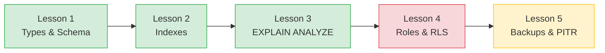
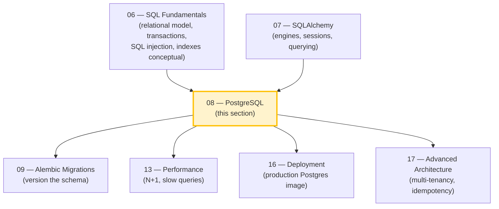

# PostgreSQL: Section Map of Content

*The deep dive on the database the rest of the vault assumes.*

**Welcome to Section 08.**

Everything you have built so far — the `Boardly` API in Section 03, the Pydantic models in Section 04, the architecture in Section 05, the SQL fundamentals in Section 06, the SQLAlchemy engines and sessions in Section 07 — has been *general*. It would run on PostgreSQL, MySQL, SQLite, or anything that speaks SQL. In this section we go *specific*. We pick one database — PostgreSQL 17 — and learn the parts that only PostgreSQL has: the type system, the index families, the planner's vocabulary, the role and RLS model, and the backup toolkit. Take it slow. This is the section where you stop writing SQL that works and start writing SQL that scales.


#postgresql #meta #moc

## Why PostgreSQL

You will meet engineers who tell you "use whatever database the framework's tutorial uses." That advice, said kindly, ages badly. The database is the longest-lived component of any backend. Application frameworks are swapped every five years. Languages fall in and out of fashion. The database outlives them all — and the data outlives the database. Picking a database with a real type system, a real query planner, a real role model, and a real backup story pays dividends for the lifetime of the product. PostgreSQL is that database. It is also free, well-documented, and battle-tested at scales from a single-node side project to Instagram.

This section does not teach SQL. SQL is in [[06-SQL-Fundamentals/00-SQL-MOC]]. It does not teach the ORM. The ORM is in [[07-SQLAlchemy/01-Foundations-and-Architecture]]. It teaches the parts of PostgreSQL that an application engineer must understand to operate it well: which types, which indexes, how to read a plan, how to lock down roles, how to back up.

Why PostgreSQL over MySQL or SQLite? Because PostgreSQL is the only one of the three that gives you all four — a real type system (`uuid`, `jsonb`, `numeric`, `timestamptz`, `interval`, arrays, ranges, enums), a real query planner you can inspect (`EXPLAIN ANALYZE`), a real role and RLS model (per-row security as a first-class feature), and a real backup story (`pg_basebackup` + PITR). SQLite is great for tests and prototypes but it has no roles, no RLS, no streaming replication. MySQL has improved a great deal but its type system is shallower (`jsonb` is just `json` with a function index; no arrays; no ranges), its `EXPLAIN` output is harder to read, and its replication story is more fragile. If you learn PostgreSQL well, every other database is a step down in at least one dimension. That is the trade-off: PostgreSQL is harder to install than SQLite and harder to operate than MySQL, but it is the only one that does not force you to lie to yourself about the things that matter.

**Student asks: Why does this section register `EXPLAIN ANALYZE` as a canonical concept here, when the SQL Fundamentals section already taught indexes?**

Because the SQL Fundamentals lesson teaches indexes *conceptually* — "a B-tree is a balanced tree that speeds up equality and range lookups." That is necessary but not sufficient. In PostgreSQL, the difference between an index being used and not being used is the *planner's cost model*, and the only way to see that model's decision is `EXPLAIN ANALYZE`. The canonical lesson [[EXPLAIN-ANALYZE-and-Query-Plans]] is where you actually learn to *read* a plan — to see "the planner chose a Seq Scan because the table has 200 rows and the index lookup would cost more than a sequential scan," or "the planner chose a Bitmap Heap Scan because the predicate is selective enough to justify the bitmap but not selective enough to justify a plain Index Scan." That is a PostgreSQL-specific skill, and it is reused in [[13-Performance-and-Observability/N-plus-1-and-Slow-Queries]] when you read SQLAlchemy-emitted SQL through the same lens.


## Lessons

| # | Lesson | What you walk away with | Lines of SQL |
|---|-------|--------------------------|---------------|
| 1 | [[Types-UUID-Identity-JSONB]] | The full Boardly schema using UUID, IDENTITY, JSONB, arrays, enums, ranges, and `timestamptz`. Why `timestamp without time zone` is almost never what you want. | ~120 |
| 2 | [[Indexes-Composite-and-Specialized]] | The indexes on every Boardly table. B-tree, GIN, GiST, BRIN. Composite ordering. Partial, expression, and covering indexes. | ~80 |
| 3 | [[EXPLAIN-ANALYZE-and-Query-Plans]] | Reading a plan top-down and bottom-up. Worked example: finding a missing index (2845 ms before, 8 ms after). | ~30 |
| 4 | [[Roles-Permissions-Security]] | The `boardly_app` and `boardly_migrator` roles, RLS for multi-tenant isolation, `SECURITY DEFINER` functions. | ~100 |
| 5 | [[Backups-and-Recovery]] | `pg_dump`, `pg_restore`, WAL archiving with `pg_basebackup`, PITR, `fsync`, `synchronous_commit`. A real backup + restore script. | ~60 |

If you read only one lesson, make it [[Types-UUID-Identity-JSONB]]. The default choices PostgreSQL lets you make — `serial` instead of `IDENTITY`, `timestamp` instead of `timestamptz`, JSONB on every column — compound into a schema you will regret in eighteen months. That lesson gives you a default for every "what type should this be?" question.

## The Growing Boardly Application

Section 03 built an in-memory `Boardly` API. Section 07 wired it to SQLAlchemy. In Section 08 we deepen the Boardly schema at the SQL level — same `Organization / User / Project / Task / Comment / Membership` entities from 07-SQLAlchemy, with the SQL types and constraints SQLAlchemy 2.x compiles to, plus two PostgreSQL-specific additions (`audit_log` and a partitioned `events` table). Each lesson adds another piece:



The Boardly schema in this section, distilled (SQL counterpart of the SQLAlchemy models you built in [[07-SQLAlchemy/03-Declarative-Base-and-Mapped]] and [[07-SQLAlchemy/04-Relationships-and-Loading-Strategies]]):

```sql
-- The Boardly tables you will design, index, secure, and back up.
organizations (id uuid, slug text, display_name text, metadata jsonb, created_at timestamptz)
users (id uuid, email text, hashed_password text, display_name text,
 home_org_id uuid, metadata jsonb, created_at timestamptz, deleted_at timestamptz)
projects (id uuid, organization_id uuid, owner_id uuid, name text, slug text,
 description text, budget numeric(12,2), status project_status, tags text[],
 metadata jsonb, created_at timestamptz, deleted_at timestamptz)
tasks (id uuid, project_id uuid, assignee_id uuid, title text, description text,
 status task_status, due_at timestamptz, created_at timestamptz, updated_at timestamptz)
comments (id uuid, task_id uuid, author_id uuid, body text, created_at timestamptz)
memberships (id uuid, user_id uuid, organization_id uuid, role membership_role,
 created_at timestamptz)
-- PostgreSQL-specific additions to the Boardly schema:
audit_log (id bigint GENERATED ALWAYS AS IDENTITY, action text,
 target_id uuid, actor_id uuid, occurred_at timestamptz, payload jsonb)
events (id bigint GENERATED ALWAYS AS IDENTITY, kind text,
 occurred_at timestamptz, payload jsonb) PARTITION BY RANGE (occurred_at)
```

The six core tables (`organizations`, `users`, `projects`, `tasks`, `comments`, `memberships`) are the SQL counterpart of the SQLAlchemy models from Section 07 — same entities, same foreign keys, same `RESTRICT` / `CASCADE` / `SET NULL` delete rules. The two additional tables (`audit_log`, `events`) are PostgreSQL-specific additions covered in Lesson 1: `audit_log` uses `bigint IDENTITY` for high-volume internal audit, and `events` is partitioned by month for time-series retention.

Every lesson in this section adds to or explains a choice on those tables. By the end, you have a defensible schema, a set of indexes that survive 10× growth, a plan-reading muscle for when the schema slows down, a role setup that bounds the blast radius of any bug, and a backup-and-recovery story you have actually tested.

**Warning — The four PostgreSQL mistakes you will make in your first year**

(1) Defaulting to `serial` for primary keys instead of `IDENTITY` — Lesson 1 explains why `IDENTITY` is the modern choice and `serial` is the legacy one. (2) Using `timestamp without time zone` for `created_at` — every value is ambiguous the moment you have users in two time zones. Lesson 1 covers `timestamptz`. (3) Reaching for B-tree on every column without measuring — Lesson 2 shows where GIN, GiST, BRIN, or a partial index is the right call. (4) Running the application and migrations as the same database role — Lesson 4 separates `boardly_app` from `boardly_migrator` so a SQL injection cannot `DROP TABLE`. Every one of these is a lesson someone learned the hard way; the section exists to spare you that tuition.


## Reading Paths

Three audiences, three paths through this section. Pick yours.

**Three reading paths**

- **The application engineer.** Lessons 1, 2, 3. You write the schema, you write the queries, you read the plans. Skip 4 and 5; come back when you are on call.
- **The platform / DBA engineer.** Lessons 4, 5, 2, 3. You own the cluster, the roles, the backups. You read plans only when paged.
- **The senior full-stack engineer.** All five, in order. You design the schema, you index it, you read the plan when it slows down, you lock down the roles, and you back it up before you ship.


## Dependency Graph

This section depends on Sections 06 and 07 and feeds Sections 09, 13, 16, and 17.



## Cross-References

- The `Transactions (SQL)` concept was first taught in [[06-SQL-Fundamentals/Transactions-Isolation-Locks]]. The [[EXPLAIN-ANALYZE-and-Query-Plans]] lesson reuses it when explaining `Lock Rows` plan nodes.
- The `SQL injection` concept was first taught in [[06-SQL-Fundamentals/SQL-Injection-and-Parameterized-Queries]]. The [[Roles-Permissions-Security]] lesson reuses it for blast-radius reduction through least privilege.
- The `Connection pool (SQLAlchemy)` concept was first taught in [[07-SQLAlchemy/02-Engines-Connections-Pools]]. Every "your application connects as ..." statement in [[Roles-Permissions-Security]] assumes you have read it.
- The `DeclarativeBase` and `Mapped / mapped_column` concepts were first taught in [[07-SQLAlchemy/03-Declarative-Base-and-Mapped]]. The [[Types-UUID-Identity-JSONB]] lesson cross-references them when mapping PostgreSQL UUID, IDENTITY, JSONB, array, enum, and range types back to the `Mapped[T]` / `mapped_column()` declarations the ORM compiles to.
- `EXPLAIN ANALYZE` is registered as the canonical concept in [[EXPLAIN-ANALYZE-and-Query-Plans]] (this section); [[13-Performance-and-Observability/N-plus-1-and-Slow-Queries]] will reuse it.
- The `Multi-tenancy` concept (canonical in [[17-Advanced-Architecture/Multi-Tenancy]]) is previewed here in the RLS sections of [[Roles-Permissions-Security]].

## How to Run Snippets Locally

The verified PostgreSQL version for this section is **17.x** (canonical learner version). Where a feature differs in **16.x LTS**, we call it out.

```bash
# Spin up Postgres 17 in Docker
docker run --rm -d --name pg-academy \
 -e POSTGRES_PASSWORD=academy -e POSTGRES_DB=academy \
 -p 5432:5432 postgres:17

# psql access
docker exec -it pg-academy psql -U postgres -d academy

# Python dependencies (for the SQLAlchemy lessons that consume this schema)
uv add "psycopg[binary]" sqlalchemy
```

For backup and restore testing, add a persistent volume so your base backups survive container restarts:

```bash
docker volume create pg-academy-data
docker run --rm -d --name pg-academy \
 -e POSTGRES_PASSWORD=academy \
 -v pg-academy-data:/var/lib/postgresql/data \
 -p 5432:5432 postgres:17
```

**Tip — psql niceties**

Inside `psql`, set `\x on` for expanded (vertical) row display, `\timing on` for query timings, and `\d+ tablename` to inspect a table. These three commands will be in your muscle memory by the end of Lesson 3.


## Verified Versions (October 2026)

| Tool | Version | Notes |
|------|---------|-------|
| PostgreSQL | 17.x | Canonical learner version for this section. |
| PostgreSQL LTS | 16.x | Mentioned where a behaviour differs; production long-term-support. |
| psql CLI | matches server | Ships with the postgres image. |
| PgBouncer | latest | Optional; covered only by reference in [[07-SQLAlchemy/02-Engines-Connections-Pools]]. |
| pgAdmin | latest | Optional; we use `psql` throughout. |

## How to Read This Section

1. **Read the frontmatter.** Each lesson's `prerequisites` are wikilinks to the earlier lesson that taught the concept. If a prerequisite is unfamiliar, follow the link.
2. **Read "The Problem" before "The Code."** The code only makes sense once you understand the failure mode it prevents.
3. **Read the code once, end to end, without stopping.** Get the shape. Then go back and read "Line-by-Line Deep Dive."
4. **Run the code.** Every lesson is verified against PostgreSQL 17 in a Docker container started exactly as shown above. The outputs in the "Verification" section are real.
5. **Do the exercises.** Reading is necessary; doing is sufficient.

**Student asks: Why target PostgreSQL 17 here when my production is still on 16?**

Because 17 is the long-term-support version available in October 2026 and the academy targets the version you will be running for the next two years, not the one you are running today. Lesson 1 covers `IDENTITY` columns, JSONB, and `timestamptz` — all stable since PostgreSQL 10. Lesson 2's GIN/GiST/BRIN indexes work the same on 16. Lesson 3's `EXPLAIN ANALYZE` differs only in one plan-node label (16 says `Parallel Seq Scan`; 17 says the same). The only feature that is 17-only is logical replication improvements, which we mention but do not depend on. If you are on 16 in production, every snippet in this section still runs; the academy version is 17 so you are not learning against a version that has been EOL for a year.


## Concept Registry Cross-Reference

`EXPLAIN ANALYZE` is the only concept first taught in this section; the other recurring concepts are first taught elsewhere and reused here. The canonical record is in [[00-Start-Here/Concept-Registry]].

- **`Transactions (SQL)`** — first taught in [[06-SQL-Fundamentals/Transactions-Isolation-Locks]]. Reused in [[EXPLAIN-ANALYZE-and-Query-Plans]] (for the `Lock Rows` plan node) and [[Backups-and-Recovery]] (for the durability half of ACID).
- **`SQL injection`** — first taught in [[06-SQL-Fundamentals/SQL-Injection-and-Parameterized-Queries]]. Reused in [[Roles-Permissions-Security]] for the defense-in-depth story.
- **`Connection pool (SQLAlchemy)`** — first taught in [[07-SQLAlchemy/02-Engines-Connections-Pools]]. Reused implicitly in [[Roles-Permissions-Security]] (the `boardly_app` role's blast-radius story assumes the application holds a pool, not a single connection).
- **`DeclarativeBase` and `Mapped / mapped_column`** — first taught in [[07-SQLAlchemy/03-Declarative-Base-and-Mapped]]. Reused in [[Types-UUID-Identity-JSONB]] when the SQL types are cross-referenced against the ORM's `Mapped[T]` annotations.
- **`EXPLAIN ANALYZE`** — first taught in [[EXPLAIN-ANALYZE-and-Query-Plans]] (this section). Reused in [[13-Performance-and-Observability/N-plus-1-and-Slow-Queries]] when hunting N+1 and slow queries in production.
- **`Multi-tenancy`** — first taught in [[17-Advanced-Architecture/Multi-Tenancy]] (previewed in [[Roles-Permissions-Security]]).

**Student asks: Why does this section preview `Multi-tenancy` in Lesson 4 when the canonical lesson is in Section 17? Aren't we re-teaching it before its first-taught?**

We are not re-teaching it — we are previewing it. Lesson 4 builds the *RLS policy* that the multi-tenant abstraction sits on top of: `CREATE POLICY tenant_isolation ON users USING (organization_id = current_setting('app.organization_id')::uuid)`. That is a concrete PostgreSQL artifact that has to exist before the architectural pattern can be discussed. Section 17 then takes the existence of those policies as a given and asks the harder architectural questions: who sets `app.organization_id`? How is the tenant resolved from the JWT? What about background jobs that have no request? The canonical order — PostgreSQL RLS first, multi-tenant architecture second — is forced by the fact that RLS is a *language feature* (taught best where the language lives) and multi-tenancy is an *architectural pattern* (taught best where the architecture lives).


## What's Next

After this section:

- [[09-Alembic-Migrations/00-Alembic-MOC]] versions the schema you design here.
- [[13-Performance-and-Observability/N-plus-1-and-Slow-Queries]] applies the plan-reading muscle from Lesson 3 to SQLAlchemy-emitted SQL.
- [[16-Deployment-and-DevOps/Docker-Multi-Stage-Non-Root]] runs this Postgres in production.
- [[17-Advanced-Architecture/Multi-Tenancy]] deepens the RLS patterns previewed in Lesson 4.

## Sources

- PostgreSQL 17 — Documentation index — <https://www.postgresql.org/docs/17/> — accessed 2026-10-15 — Authoritative reference for every type, index family, plan node, role statement, and backup tool covered in this section.
- PostgreSQL 16 — Documentation index — <https://www.postgresql.org/docs/16/> — accessed 2026-10-15 — Long-term-support reference; cited where 16 differs from 17.
- PostgreSQL — Release archive — <https://www.postgresql.org/docs/release/> — accessed 2026-10-15 — Confirms 17.x as the current major series, 16.x as active LTS, October 2026.

---

**Tags:** #postgresql #meta #moc #review
**Previous:** [[06-SQL-Fundamentals/00-SQL-MOC]]
**Next:** [[Types-UUID-Identity-JSONB]] →
