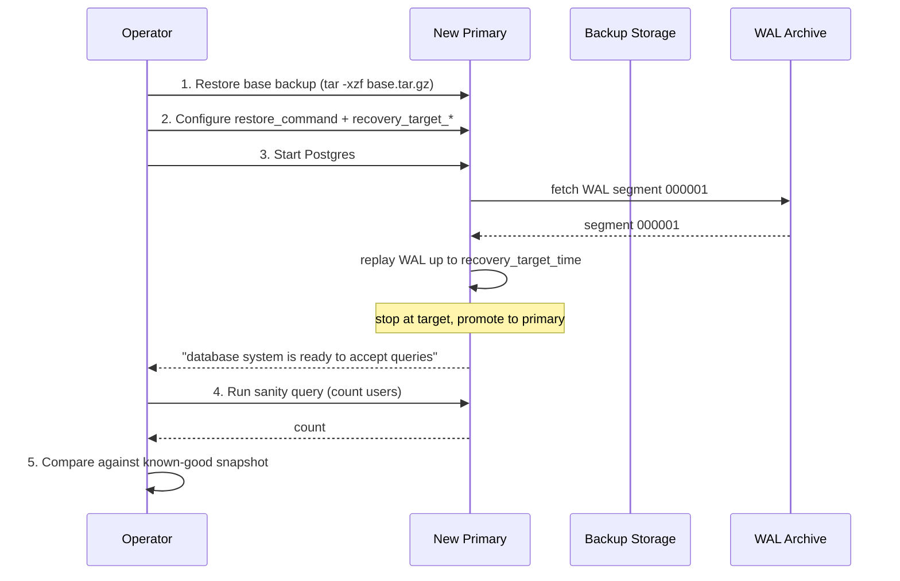

# Lesson 05: Backups and Recovery

*Backing up the Boardly database like you mean it — `pg_dump` formats, `pg_restore` for selective recovery, continuous WAL archiving with `pg_basebackup`, point-in-time recovery (PITR), `fsync` and `synchronous_commit`, and the restore drill that turns "we have backups" into "we have a recovery procedure."*

**Welcome to Lesson 5, the last lesson of Section 08.**

An untested backup is not a backup — it is a hope. The Postgres tooling for backups and recovery is excellent and complete, but it is also a system with real choices: logical vs physical, `fsync` on vs off, `synchronous_commit` on vs off, retention windows, restore-test cadence. The wrong default is silent — until you need it. This lesson teaches the toolkit and the discipline that turns "we have backups" into "we have a tested recovery procedure with measured RTO and RPO." Take it slow. Test a backup today. **This is how you learn.**


#postgresql #backups #recovery #pitr #wal #durability

## Learning Objectives

By the end of this lesson you will be able to:

1. **Choose between logical (`pg_dump`) and physical (`pg_basebackup` + WAL archive) backups** for a given RTO/RPO target.
2. **Use `pg_dump` formats** (`-F p`, `-F c`, `-F d`, `-F t`) and pick the right one by database size and restore pattern.
3. **Use `pg_restore`** for selective table/schema restore, parallel restore, and cross-version restore.
4. **Configure continuous WAL archiving** with `archive_command` and `archive_timeout`, and explain why both are needed.
5. **Take a base backup with `pg_basebackup`** and explain the `REPLICATION` privilege requirement.
6. **Perform point-in-time recovery (PITR)** to a target time, XID, LSN, or named restore point.
7. **Explain `fsync` and `synchronous_commit`** — the two distinct durability knobs — and name the rare cases where each can be relaxed.
8. **Design a "test the backup" procedure** that runs at least monthly, measures RTO and RPO, and reports PASS/FAIL.
9. **Recognise the backup exfiltration threat** and the encryption controls that mitigate it.

## Prerequisites

Before starting, you need:

- **The Transactions lesson** — [[06-SQL-Fundamentals/Transactions-Isolation-Locks]]. The durability half of ACID is the foundation everything here builds on. WAL, `fsync`, `synchronous_commit` — these are all mechanisms for the "D" in ACID.
- **The Roles lesson** — [[Roles-Permissions-Security]]. `pg_basebackup` requires a role with `REPLICATION`; `pg_dump` runs as a role with `SELECT` on every table. The canonical role setup covers both.
- **A throwaway Postgres 17 container** with persistent storage (for the backup/restore drills). The MOC shows the docker volume command.
- **About 90 minutes of focused time.** The script is short; the implications are long.

**The most common gap: RTO vs RPO**

RTO (recovery time objective) is "how long until we're back up." RPO (recovery point objective) is "how much data loss is acceptable." These are *different numbers* answering *different questions*:
- Logical backups give RPO = "since the last nightly dump" (up to 24 hours of data loss) and RTO = "the time to `pg_restore`" (potentially hours on a large database).
- Physical backups with continuous WAL archiving give RPO = "since the last WAL segment switch" (seconds to minutes) and RTO = "the time to restore the base backup and replay WAL" (typically 15–25 minutes for a 50 GB database).
The two are not interchangeable. A logical backup is fine for a dev database; it is criminal for a billing system.


## The Problem

You have a database. It has data. Two questions:

1. **What happens when the disk fails?** (The disk *will* fail. SSDs die, RAID controllers panic, the cloud provider loses a region.)
2. **What happens when a migration corrupts data?** (An `UPDATE` without a `WHERE` hits every row. A bad `ALTER TABLE` drops a column. The deploy is rolled back but the data is gone.)

The naive answer is "we have backups." The experienced answer is "we have a *tested recovery procedure* with measured RTO and RPO." The difference is everything.

This lesson teaches the four-part discipline:

1. **Logical backups** (`pg_dump`) for selective restore and dev seeds.
2. **Physical backups** (`pg_basebackup`) plus continuous WAL archiving for disaster recovery.
3. **Point-in-time recovery (PITR)** for the "bad migration" scenario.
4. **Restore drills** that turn the procedure into tested muscle.

Plus the durability knobs (`fsync`, `synchronous_commit`) that decide what "committed" actually means.

## The Code

Here is the complete backup-and-recovery setup for Boardly. Save as `boardly_backup.sh` (it's a shell script; the configuration files are SQL/INI fragments referenced from it).

```bash
#!/usr/bin/env bash
# boardly_backup.sh
# Section 08, Lesson 05: backup, archive, restore, and PITR drill for Boardly.

set -euo pipefail

# === Configuration ===
PGHOST="localhost"
PGUSER="boardly_migrator_login" # has REPLICATION and SELECT
PGDATABASE="academy"
PGVERSION="17" # must match the running major version
BACKUP_ROOT="/var/backups/boardly"
WAL_ARCHIVE="${BACKUP_ROOT}/wal"
BASE_BACKUP_DIR="${BACKUP_ROOT}/base"
LOGICAL_BACKUP_DIR="${BACKUP_ROOT}/logical"
S3_BUCKET="s3://my-bucket/boardly"
RETENTION_DAYS_BASE=14
RETENTION_DAYS_WAL=30

mkdir -p "${WAL_ARCHIVE}" "${BASE_BACKUP_DIR}" "${LOGICAL_BACKUP_DIR}"

# === 1. Logical backup (nightly, for selective restore) ===
take_logical_backup() {
 local stamp; stamp=$(date +%Y-%m-%d)
 local out="${LOGICAL_BACKUP_DIR}/boardly-${stamp}.dump"
 pg_dump -h "${PGHOST}" -U "${PGUSER}" -d "${PGDATABASE}" \
 -F d -j 4 \
 -f "${out}"
 # Optional: encrypt before upload
 # aws s3 cp "${out}" "${S3_BUCKET}/logical/$(basename "${out}")" --sse aws:kms
 find "${LOGICAL_BACKUP_DIR}" -name 'boardly-*.dump' -mtime +${RETENTION_DAYS_BASE} -delete
 echo "[logical] ${out}"
}

# === 2. Base backup (weekly, for disaster recovery) ===
take_base_backup() {
 local stamp; stamp=$(date +%Y-%m-%d)
 local out="${BASE_BACKUP_DIR}/base-${stamp}"
 pg_basebackup -h "${PGHOST}" -U "${PGUSER}" \
 -D "${out}" \
 -Ft -z -P \
 --wal-method=stream
 # Optional: ship to S3
 # aws s3 sync "${out}" "${S3_BUCKET}/base/$(basename "${out}")" --sse aws:kms
 find "${BASE_BACKUP_DIR}" -maxdepth 1 -name 'base-*' -type d -mtime +${RETENTION_DAYS_BASE} -exec rm -rf {} +
 echo "[base] ${out}"
}

# === 3. PITR drill (weekly, in a separate test cluster) ===
pitr_drill() {
 local target_time; target_time="$1" # e.g., '2026-10-12 12:00:00'
 local verify_sql; verify_sql="$2" # e.g., 'SELECT count(*) FROM users;'

 local stamp; stamp=$(date +%Y-%m-%d)
 local test_data="/tmp/pitr-test-${stamp}"
 rm -rf "${test_data}"; mkdir -p "${test_data}"

 # Restore latest base backup
 local latest_base; latest_base=$(ls -1d "${BASE_BACKUP_DIR}"/base-* | tail -1)
 tar -xzf "${latest_base}/base.tar.gz" -C "${test_data}"

 # Configure recovery
 touch "${test_data}/recovery.signal"
 cat >> "${test_data}/postgresql.auto.conf" <<EOF
restore_command = 'cp ${WAL_ARCHIVE}/%f %p'
recovery_target_time = '${target_time}'
recovery_target_action = 'promote'
EOF

 # Start a fresh Postgres on a non-conflicting port (assumes Docker)
 docker run --rm -d --name pitr-test \
 -v "${test_data}:/var/lib/postgresql/data" \
 -e POSTGRES_PASSWORD=drill -p 5433:5432 \
 "postgres:${PGVERSION}"

 # Wait for recovery to complete
 echo "[drill] waiting for recovery..."
 for _ in $(seq 1 60); do
 if docker exec pitr-test psql -U postgres -d "${PGDATABASE}" -c 'SELECT pg_is_in_recovery()' -At | grep -q '^f$'; then
 break
 fi
 sleep 5
 done

 # Verify
 echo "[drill] verifying..."
 docker exec pitr-test psql -U postgres -d "${PGDATABASE}" -c "${verify_sql}"

 # Measure RTO and RPO
 local rto; rto=$(docker logs pitr-test 2>&1 | grep 'database system is ready' | tail -1 | awk '{print $1}')
 echo "[drill] RTO (recovery time): see docker logs"
 echo "[drill] RPO target: ${target_time}"

 # Cleanup
 docker rm -f pitr-test
 rm -rf "${test_data}"
}

# === 4. Real recovery (primary lost the data disk) ===
real_recovery() {
 local target_time; target_time="$1"
 local new_data_dir; new_data_dir="/var/lib/postgresql/data"

 # 1. Provision a fresh Postgres 17 host (already done in real life).
 mkdir -p "${new_data_dir}"
 chown postgres:postgres "${new_data_dir}"
 chmod 700 "${new_data_dir}"

 # 2. Restore the latest base backup.
 local latest_base; latest_base=$(ls -1d "${BASE_BACKUP_DIR}"/base-* | tail -1)
 sudo -u postgres tar -xzf "${latest_base}/base.tar.gz" \
 -C "${new_data_dir}" --no-same-owner

 # 3. Configure recovery.
 sudo -u postgres touch "${new_data_dir}/recovery.signal"
 cat >> "${new_data_dir}/postgresql.auto.conf" <<EOF
restore_command = 'cp ${WAL_ARCHIVE}/%f %p'
recovery_target_time = '${target_time}'
recovery_target_action = 'promote'
EOF

 # 4. Start Postgres. It replays WAL and promotes.
 systemctl start "postgresql@${PGVERSION}"
 echo "[recover] watching logs; Ctrl+C when 'database system is ready to accept queries' appears."
 tail -f "/var/log/postgresql/postgresql-${PGVERSION}.log"
}

case "${1:-}" in
 logical) take_logical_backup ;;
 base) take_base_backup ;;
 drill) pitr_drill "${2:-$(date -d '3 days ago 12:00' '+%Y-%m-%d %H:%M:%S')}" \
 "SELECT count(*) AS users FROM users WHERE deleted_at IS NULL;" ;;
 recover) real_recovery "${2:?usage: $0 recover '2026-10-15 14:32:00'}" ;;
 *) echo "usage: $0 {logical|base|drill|recover} [arg]"; exit 1 ;;
esac
```

And the `postgresql.conf` snippet that enables WAL archiving (the prerequisite for PITR):

```ini
# postgresql.conf — added to the running primary
wal_level = replica
archive_mode = on
archive_command = 'test ! -f /var/backups/boardly/wal/%f && cp %p /var/backups/boardly/wal/%f'
archive_timeout = 60s
max_wal_senders = 5
synchronous_commit = on
fsync = on
```

That's ~120 lines of shell plus 8 lines of config. Run `boardly_backup.sh logical` tonight. Run `boardly_backup.sh base` this weekend. Run `boardly_backup.sh drill` every Sunday. That's the loop.

## Line-by-Line Deep Dive

### Section 1: `pg_dump` formats

```bash
pg_dump -h localhost -U boardly_migrator_login -d academy \
 -F d -j 4 \
 -f /var/backups/boardly/logical/boardly-2026-10-15.dump
```

**What this does:** Dumps the `academy` database to a directory-format backup, using 4 parallel jobs.

**The four formats:**

- **`-F p` (plain)** — readable SQL text. Replayable in `psql` with `psql -f backup.sql`. No parallelism, no selective restore. Good for small databases and schema-only dumps.
- **`-F c` (custom, compressed binary)** — the default for most uses. Supports parallel restore, selective restore (`pg_restore -t tablename`), and listing (`pg_restore -l`). Single file.
- **`-F d` (directory)** — one file per table. Supports *parallel dump* (with `-j N`) and parallel restore. The recommended format for any database over a few GB.
- **`-F t` (tar)** — similar to custom but tar-format. Less common; use `-F c` or `-F d` instead.

**Why `-F d` with `-j 4`:** Parallelism. A directory-format dump with `-j 4` runs 4 tables in parallel, which on a multi-core server cuts dump time by ~3× compared to a single-threaded dump. For a 50 GB database, that's the difference between 30 minutes and 10.

**`pg_dump` is MVCC-consistent**

`pg_dump` opens a single transaction with `REPEATABLE READ` isolation. The entire dump is a consistent snapshot of the database at the moment the dump started — even if writes continue during the dump.
The trade-off: a long-running dump holds a snapshot. `VACUUM` cannot reclaim dead tuples newer than the snapshot's `xmin`. On a high-write database, a 30-minute dump can balloon the table's dead-tuple count. Schedule dumps outside peak, or use a replica for dumping.


**Student asks: when is a logical backup (`pg_dump`) enough, and when do I need physical backups (`pg_basebackup` + WAL archive)?**

A logical backup is enough when your RPO (recovery point objective) is "as of last night's dump" and your RTO (recovery time objective) tolerates a full reload — which on a 50 GB database is 30+ minutes. Logical backups are also enough when the only failure mode you worry about is "drop table" — the dump is a fresh database you restore into. A logical backup is *not* enough when (a) your RPO is "zero data loss since the last commit" (a `pg_dump` taken at midnight cannot recover the transaction you committed at 14:31); (b) you need point-in-time recovery to undo a bad migration or a fat-finger `DELETE` that happened at 14:32; (c) you need to fail over to a replica with no service interruption. In all three cases you need physical backups plus WAL archiving plus PITR — which is what Sections 3–5 cover. The Boardly rule: logical backup nightly (cheap, off-site-copyable, restorable into a fresh DB), physical backup continuous (PITR safety net).


**Warning — Debugging `pg_dump` permission failures**

When `pg_dump` fails with `pg_dump: error: query failed: ERROR: permission denied for table audit_log`, the cause is almost always that the dump role lacks `SELECT` on one table — commonly a table created after the role's grants were last refreshed, or a table protected by RLS without `BYPASSRLS` on the role. Diagnose in order: (1) `psql -d academy -c "\dp audit_log"` shows the column-level grants; (2) `psql -d academy -c "SELECT rolname, rolbypassrls FROM pg_roles WHERE rolname = 'boardly_migrator_login';"` returns `rolbypassrls = t` only if the role can bypass RLS. The fix is `GRANT SELECT ON ALL TABLES IN SCHEMA public TO boardly_migrator_login;` plus `ALTER DEFAULT PRIVILEGES FOR boardly_app_user IN SCHEMA public GRANT SELECT ON TABLES TO boardly_migrator_login;` so future tables inherit the grant. Never grant the built-in `pg_read_all_data` role as a workaround — it is a cluster-wide superuser-equivalent grant that violates the least-privilege lesson in [[Roles-Permissions-Security]].


### Section 2: Selective restore with `pg_restore`

```bash
# List the contents
pg_restore -l /var/backups/boardly/logical/boardly-2026-10-15.dump

# Restore just the 'users' table into a different database
createdb academy_restored
pg_restore -t users -d academy_restored /var/backups/boardly/logical/boardly-2026-10-15.dump

# Restore just the schema (--schema-only) or just the data (--data-only)
pg_restore --schema-only -d academy_restored backup.dump
pg_restore --data-only -d academy_restored backup.dump

# Restore with parallelism
pg_restore -j 4 -d academy_restored backup.dump
```

**What this does:** Restores from a custom-format or directory-format dump, optionally selectively.

**Why selective restore:** The "we accidentally dropped the `users` table at 2 AM" scenario. You don't want to restore the entire database — you want to extract the `users` table from last night's backup and reload it. `pg_restore -t users` does exactly that.

**The flags:**
- `-t tablename` — restore only this table.
- `-n schemaname` — restore only this schema.
- `--schema-only` — restore only DDL (no data).
- `--data-only` — restore only data (no DDL).
- `--section=pre-data|data|post-data` — finer-grained: pre-data is schema, data is data, post-data is indexes/constraints/triggers.
- `--no-owner --no-privileges` — strip ownership and grants; use when restoring into a different role context.

**Warning — `pg_restore` requires the destination database to already exist**

`pg_restore` does not create the database — it connects to an existing one and creates objects inside it. Use `createdb` first. Alternatively, `pg_restore --create -d postgres` will create the database (with the name from the dump) and then restore into it.


**Danger — Never `pg_restore` an untrusted dump without `--no-owner --no-privileges`**

A custom-format dump carries the original object owners and ACLs as metadata. When you restore it with default flags, PostgreSQL tries to recreate each object owned by the original role. If that role does not exist on the destination cluster, the restore fails loudly — the safe failure. The unsafe failure is when the role *does* exist (e.g. `postgres` or a shared `boardly_app_user` across environments) and the dump is from an untrusted source: every restored table, function, and index is now owned by a privileged role in your environment, and any `SECURITY DEFINER` function in the dump runs as that privileged role on first invocation. Always restore external dumps into a sandbox database with a low-privilege connection role, and pass `--no-owner --no-privileges` so the objects inherit the connection role's identity, not the dump's. Pair this with `ALTER ROLE boardly_restore_role NOCREATEDB NOCREATEROLE NOINHERIT NOREPLICATION;` to fence the restore in. A malicious dump is an injection vector — the backup-exfiltration threat run in reverse. [[11-Authentication-and-Security/Threat-Model-First]] covers the threat-model side.


### Section 3: Continuous WAL archiving

```ini
wal_level = replica
archive_mode = on
archive_command = 'test ! -f /var/backups/boardly/wal/%f && cp %p /var/backups/boardly/wal/%f'
archive_timeout = 60s
```

**What this does:** Configures PostgreSQL to copy every completed WAL segment to `/var/backups/boardly/wal/`.

**What WAL is:** WAL (Write-Ahead Log) is the durability mechanism. Every change is written to a WAL segment file in `pg_wal/` *before* the data page is. On commit, the WAL is `fsync`'d. If the database crashes, Postgres replays WAL forward to the last-committed state. WAL is the difference between "we committed, the disk lost power, did we lose data?" (no, if WAL was flushed) and the same question without WAL (yes).

**What `archive_command` does:** PostgreSQL calls `archive_command` once per completed WAL segment file. `%p` is the path to the segment in `pg_wal/`; `%f` is the filename. The command copies the segment to durable storage.

**Why `test ! -f` first:** If a segment with the same name already exists in the archive, the command should *fail* (exit non-zero) so PostgreSQL retries. The `test ! -f` guard prevents overwriting an existing archive segment.

**Why `archive_timeout = 60s`:** A WAL segment is 16 MB by default. A low-write database may not produce 16 MB of WAL in hours — so the last few minutes of changes are stuck in the current (incomplete) segment. `archive_timeout = 60s` forces a segment switch every 60 seconds even if the segment isn't full, so the archived WAL is at most 60 seconds behind. This bounds your RPO.

**Tip — Make `archive_command` idempotent and fail loudly**

The command must be idempotent (running it twice produces the same result) and exit non-zero on failure (so PostgreSQL retries). The pattern `test ! -f X && cp %p X` is the simplest form. For S3: `aws s3 cp %p s3://bucket/wal/%f --sse aws:kms || exit 1` — the `|| exit 1` ensures failure if `aws s3 cp` fails.
Common bug: `archive_command` exits 0 even when the copy failed. PostgreSQL marks the segment as archived; you've silently lost a WAL segment. The next PITR will fail. Always check exit codes.


**WAL archive disk-full is a silent RPO breach**

`archive_command` writes one WAL segment (16 MB by default) per call. A sudden write spike — a bulk `UPDATE`, a large `COPY`, a runaway job — can produce hundreds of segments per minute. If the archive disk fills, `archive_command` starts failing; PostgreSQL retries indefinitely and eventually pauses commits once `pg_wal/` hits `max_wal_size` (default 1 GB). The symptom is "writes are hanging" with no error in the application log — the bottleneck is on the archive side. The production fix is two-part: (1) alert on `pg_stat_archiver.last_archived_time` being more than 5 minutes stale — `psql -d academy -c "SELECT now() - last_archived_time AS lag FROM pg_stat_archiver;"` should be under 300 seconds; (2) alert on `pg_stat_archiver.failed_count > 0`. Pair with a retention job (`find /var/backups/boardly/wal/ -mtime +30 -delete`) that runs *after* the S3 upload confirms, never before. A WAL archive that grows without bound eventually takes the primary down — the durability mechanism becomes the outage.


### Section 4: `pg_basebackup` for the base backup

```bash
pg_basebackup -h localhost -U boardly_migrator_login \
 -D /var/backups/boardly/base/base-2026-10-15 \
 -Ft -z -P \
 --wal-method=stream
```

**What this does:** Takes a consistent snapshot of the entire data directory, plus the WAL needed to bring it to a consistent state, into a tar archive.

**What `pg_basebackup` does internally:** It opens a replication connection to the server (the role must have `REPLICATION`), requests a non-exclusive base backup, and the server streams every file in the data directory. The server holds a checkpoint-consistent snapshot for the duration.

**Why each flag:**
- `-D` — the destination directory.
- `-Ft` — tar output (one tar file per tablespace; for a single-tablespace database, a single `base.tar`).
- `-z` — gzip-compress the tar.
- `-P` — show progress.
- `--wal-method=stream` — stream the WAL needed for consistency in a separate tar (`pg_wal.tar`) instead of including it in `base.tar`. This lets you replay WAL *after* restore.

**The privilege requirement:** The role must have `REPLICATION` (and `pg_hba.conf` must permit replication connections). The migrator role in Lesson 4 has `CREATEDB` but not `REPLICATION` — you'd add `ALTER ROLE boardly_migrator_login REPLICATION;` for this.

**Why a base backup plus WAL equals PITR**

A base backup is a snapshot at time T0. WAL segments contain every change after T0. Restoring = "copy base backup to data dir, replay WAL up to a target point." By choosing how much WAL to replay, you choose the recovery target. Stop at "2026-10-15 14:32:00" and you've recovered to that moment. Stop before a bad migration's transaction ID, and you've avoided the bad migration. This is PITR.


**Danger — `pg_basebackup` ships the entire data directory — guard the replication credential**

A role with `REPLICATION` can stream every byte of every table, every index, every `pg_authid` password hash, every row of every system catalog. Whoever holds the replication credential holds an offline copy of the entire database — including any secrets stored in tables, which is a common (and bad) pattern for API keys, OAuth tokens, and signing keys. Three production controls: (1) store the replication password in a secret manager, never in `~/.pgpass` on a shared host or in environment variables visible to `ps`; (2) rotate it quarterly and on every team member's departure — `ALTER ROLE boardly_migrator_login WITH PASSWORD 'new';` plus a `pg_ctl reload` to refresh `pg_hba.conf`; (3) restrict the `host replication` line in `pg_hba.conf` to the backup host's IP (`host replication boardly_migrator_login 10.0.1.5/32 scram-sha-256`), never `0.0.0.0/0`. The `boardly_backup.sh` script's `PGUSER="boardly_migrator_login"` line is the credential handle; treat it like a root password. [[11-Authentication-and-Security/Password-Hashing]] covers the secret-storage side; this is the database-side mirror.


### Section 5: PITR in action

```bash
# 1. Restore the base backup to a fresh data directory.
tar -xzf /var/backups/boardly/base/base-2026-10-15/base.tar.gz \
 -C /var/lib/postgresql/data --no-same-owner

# 2. Configure recovery.
touch /var/lib/postgresql/data/recovery.signal
cat >> /var/lib/postgresql/data/postgresql.auto.conf <<'EOF'
restore_command = 'cp /var/backups/boardly/wal/%f %p'
recovery_target_time = '2026-10-15 14:32:00'
recovery_target_action = 'promote'
EOF

# 3. Start Postgres. It replays WAL up to the target and stops.
systemctl start postgresql@17
```

**What this does:** Restores the database to its state at 14:32:00 on 2026-10-15.

**What happens internally:**
1. PostgreSQL starts in recovery mode (because `recovery.signal` exists).
2. It reads `postgresql.auto.conf` and finds `restore_command` and `recovery_target_*`.
3. It replays each archived WAL segment, applying each transaction's changes to the data files.
4. When it reaches `recovery_target_time`, it stops (or continues to the end of the segment containing the target).
5. With `recovery_target_action = 'promote'`, it completes recovery and starts accepting writes (becomes a primary).

**The four recovery targets:**
- `recovery_target_time` — stop at a wall-clock time. Uses commit timestamps (`track_commit_timestamp` need not be on; LSN-to-time mapping is built into WAL).
- `recovery_target_xid` — stop at a transaction ID.
- `recovery_target_lsn` — stop at a WAL Log Sequence Number.
- `recovery_target_name` — stop at a named restore point set with `SELECT pg_create_restore_point('name');`.
- `recovery_target_inclusive = on/off` — whether the target transaction itself is included.

**Tip — `pg_create_restore_point` for migration pre-flight**

Before a risky migration, run:
```sql
SELECT pg_create_restore_point('before-migration-2026-10-15');
```
If the migration corrupts data, PITR to the named restore point:
```ini
recovery_target_name = 'before-migration-2026-10-15'
recovery_target_action = 'promote'
```
RPO is zero — every transaction committed *before* the restore point is preserved; every transaction *after* (including the bad migration) is rolled back.


**Warning — Debugging "recovery ended before configured recovery target was reached"**

PITR occasionally fails with `FATAL: recovery ended before configured recovery target was reached` — meaning the WAL archive does not contain the segment holding your `recovery_target_time`. The cause is one of three: (a) `archive_command` silently dropped a segment (audit `psql -d academy -c "SELECT failed_count FROM pg_stat_archiver;"` — a non-zero value is the smoking gun); (b) the target time is *before* the base backup was taken — PITR can only replay *forward* from the base backup, never backward, so a target time earlier than the base backup is unrecoverable from that base; (c) the target time is in a segment that the retention job has pruned from the archive. Diagnose with `psql -d academy -c "SELECT pg_walfile_name(pg_current_wal_lsn());"` for the current segment on the primary, and `ls -1 /var/backups/boardly/wal/ | sort | tail -5` for the latest archived segment — the gap between them is the unarchived window. The fix is upstream: pick a target time inside the archived window, or restore from an earlier base backup whose timeline includes the target. Never disable `archive_timeout` to "catch up" — that increases RPO without fixing the gap. [[16-Deployment-and-DevOps/Migration-Ordering-and-Rollback]] covers the deploy-side rollback path this PITR is a safety net for.


### Section 6: `fsync` and `synchronous_commit`

Two distinct durability knobs. Engineers confuse them; the difference matters.

#### `fsync` (cluster-level)

```ini
fsync = on # default; never turn off in production
```

**What it does:** At the cluster level, PostgreSQL calls `fsync()` on data and WAL writes to ensure they reach durable storage (not just the OS page cache). With `fsync = off`, PostgreSQL trusts the OS page cache — a crash can lose recent writes.

**When to relax:** Never in production. The speed gain is a few percent on writes; the risk is total cluster corruption on a crash. The legitimate cases are: a benchmark, a disposable dev database, a "we will rebuild from a known-good dump if it dies" analytics scratch. Nowhere that data matters.

**Danger — `fsync = off` is a cluster-kill switch**

If you turn `fsync = off` on a production cluster, a power loss can corrupt the entire database — not just lose recent writes, but break the on-disk data structures such that PostgreSQL cannot start. There is no recovery from this except restore-from-backup. Never.


#### `synchronous_commit` (session/transaction-level)

```ini
synchronous_commit = on # default
```

**What it does:** At the session or transaction level, `COMMIT` waits until the WAL is flushed and `fsync`'d before returning. Other settings:

- **`on` (default)** — `COMMIT` waits for the local WAL flush.
- **`off`** — `COMMIT` returns immediately; the WAL is flushed at the next checkpoint. A crash within ~1 second can lose committed transactions. *Acceptable for some analytics, telemetry, idempotent event ingestion — never for billing.*
- **`local`** — like `on`, but only for the local node (ignored for synchronous replication).
- **`remote_write` / `remote_flush` / `remote_apply`** — replication-aware variants: `COMMIT` waits for the WAL to reach a sync replica (written, flushed, or applied).

**Per-transaction opt-out:**

```sql
BEGIN;
SET LOCAL synchronous_commit = off;
INSERT INTO events (kind, payload) VALUES ('click', '{...}');
COMMIT;
-- COMMIT returned immediately. A crash within ~1 second can lose this row.
```

**The classic "fastest path" trade:** relax `synchronous_commit` for low-stakes, high-volume writes where re-processing the source is possible. Never relax it for writes that produce unique IDs or financial state.

**Student asks: `fsync` is the cluster-level knob and `synchronous_commit` is the session-level knob — what is the actual interaction when both are at their defaults?**

At the defaults (`fsync = on`, `synchronous_commit = on`), `COMMIT` blocks until the WAL record for that transaction is flushed to disk and `fsync()`'d. So the application's `COMMIT` returning success is a hard guarantee: the data is on stable storage. If you turn `synchronous_commit = off` for one session while keeping `fsync = on`, that session's `COMMIT` returns immediately — but the WAL is still flushed at the next checkpoint, and when it is, it goes through the same `fsync()` as everything else. So `fsync = off` disables the durability at the storage layer (the OS page cache is the floor); `synchronous_commit = off` disables the *wait* for that durability at the session layer (the storage floor stays). They compose: `fsync = off + synchronous_commit = on` means "I claim the transaction is durable, but I lied — it is in the OS page cache, not on disk." `fsync = on + synchronous_commit = off` means "I will not block COMMIT on durability, but the durability floor is real — it just arrives later, at the next checkpoint." This is why `fsync = off` is the cluster-kill switch and `synchronous_commit = off` is the per-session throughput knob.


**Spot the bug — why is this dangerous?**

```sql
BEGIN;
SET LOCAL synchronous_commit = off;
INSERT INTO invoices (id, total_cents) VALUES (gen_random_uuid(), 12345);
COMMIT;
```
Answer: `invoices` is financial state. A crash within 1 second can lose the committed invoice row. The customer's invoice is gone — irrecoverably, because the UUID is gone too. `synchronous_commit = off` is fine for click events; it is criminal for invoices. **In the Boardly schema, the equivalent high-stakes table is `audit_log`** — an `admin_promote` audit-log entry that survives the crash is the difference between "we have a record" and "we have a compliance failure." Never relax `synchronous_commit` on `audit_log` inserts; relax it only on the partitioned `events` table where lost click events can be re-derived.


**`synchronous_commit = remote_apply` requires `synchronous_standby_names`**

The `remote_*` settings on `synchronous_commit` are no-ops without a matching `synchronous_standby_names` entry in `postgresql.conf`. Engineers occasionally flip `synchronous_commit = remote_flush` expecting synchronous replication and discover the hard way — `COMMIT` returns immediately because no sync standby is configured. The production pattern: `synchronous_standby_names = 'FIRST 1 (boardly_replica_1)'` plus `synchronous_commit = remote_flush` on the primary. Then `COMMIT` blocks until the WAL is flushed on the standby. Monitor with `psql -d academy -c "SELECT application_name, sync_state, sync_priority, state FROM pg_stat_replication;"` — `sync_state = sync` confirms the standby is the sync target. The trade-off: every transaction's latency now includes the network round-trip to the standby. For a cross-AZ standby with 2 ms RTT, that is 4 ms added to every `COMMIT` — measurable on a high-write service. Run the numbers before flipping the knob; the [[13-Performance-and-Observability/Structured-Logging-and-Request-IDs]] lesson covers measuring commit latency in production.


### Section 7: Testing restores

The untested backup is no backup. The test procedure:

1. **Provision** a throwaway Postgres instance of the same major version.
2. **Restore** the latest base backup into it.
3. **Replay** WAL forward to "now."
4. **Run** a sanity check: `SELECT count(*) FROM users; SELECT max(created_at) FROM tasks;`.
5. **Compare** row counts and spot-check sums against a known-good snapshot.
6. **Time** the restore. RTO is the wall-clock time from "primary failed" to "restored replica serving traffic."
7. **PITR-test:** pick a random restore point in the last week and verify the database can be recovered to that point.

Automate the test in CI, at least monthly. Anything else is theater.

```bash
# The weekly drill from boardly_backup.sh
./boardly_backup.sh drill \
 --target "$(date -d '3 days ago 12:00' '+%Y-%m-%d %H:%M:%S')" \
 --verify "SELECT count(*) AS users FROM accounts WHERE deleted_at IS NULL;"
```

**The untested backup is no backup**

If you have never restored a backup into a fresh cluster, you do not have a backup. You have a hope. The drill proves you have a recovery procedure. Run it monthly. Run it weekly if you can. Run it every time the backup script changes.


**Production restore-drill cadence and the "drill failed" runbook**

A monthly restore drill is the floor; the production ceiling is an automated drill that runs in CI on every backup-script change and on a weekly cron, with the result piped to the on-call channel. The drill's `PASS`/`FAIL` must page on `FAIL` — a silent drill failure is worse than no drill, because it lulls the team into believing the procedure works. Concretely: the `boardly_backup.sh drill` invocation writes `RTO: <seconds>` and `RPO: <seconds>` to a known metrics path; the alerting rule fires if either exceeds the documented SLO (e.g. `rto_seconds > 1800` for a 30-minute SLO). Pair this with a quarterly *full* drill that restores into a fresh production-sized cluster, not just a throwaway container — the container drill catches script rot; the full drill catches the "the new OS has a different tar/gzip" failure mode that the container drill hides. Document the runbook in the same repository as the backup script; a runbook that lives in a separate wiki rots as fast as the procedure it describes. [[16-Deployment-and-DevOps/Docker-Multi-Stage-Non-Root]] covers the non-root container pattern; this is the database-side mirror.


## Execution Trace

PITR in sequence.



**The two-recovery-target scenarios**

- **Disaster recovery** (primary lost the disk): `recovery_target_time = 'now'` (or omit; default is "replay everything"). RPO is bounded by `archive_timeout` (60 seconds in our config). RTO is "restore base backup + replay WAL."
- **Bad migration** (a `UPDATE` without `WHERE` hit `users`): `recovery_target_name = 'before-migration-...'`. RPO is zero for everything before the restore point; the bad migration is excluded. RTO is the same as disaster recovery.
The two scenarios use the same backup infrastructure, the same `restore_command`, the same `recovery_target_action = 'promote'`. Only the `recovery_target_*` differs.


## Common Mistakes

### Mistake 1: Untested backups

**Symptom:** A real outage happens. You run `pg_restore` from the nightly backup. It fails halfway with a corrupt-dump error. Or it succeeds but takes 12 hours, far beyond your stated RTO. Or it succeeds, but the database is missing the last 8 hours of writes you didn't realize weren't archived.

**Why:** You've never tested the procedure. The dump file is fine; the procedure is broken. Or the dump file is corrupt because of a disk error that `pg_dump` quietly swallowed.

**Fix:** Run `boardly_backup.sh drill` every week. Measure RTO. Confirm the sanity query passes. If the procedure has rotted (e.g., a S3 bucket permission changed), find out in the drill, not in the outage.

### Mistake 2: `fsync = off` in production

```ini
# WRONG in production
fsync = off
```

**Symptom:** Writes are 5% faster. Six months later, a power loss corrupts the entire cluster. PostgreSQL cannot start. The data is unrecoverable except from the last backup.

**Why:** `fsync = off` trusts the OS page cache. A power loss loses the page cache. The on-disk data files can be in an internally-inconsistent state — WAL references pages that were never written.

**Fix:** `fsync = on` always. The 5% write speed is not worth total cluster corruption risk.

### Mistake 3: `archive_command` that doesn't fail properly

```bash
# WRONG (silent WAL loss)
archive_command = 'cp %p /var/backups/boardly/wal/%f'
# If /var/backups is full, cp fails... but PostgreSQL might mark it archived anyway in some shells.
```

**Symptom:** PITR fails — a WAL segment is missing from the archive. Or worse: PITR succeeds but produces an inconsistent database because a segment was skipped.

**Why:** `archive_command` must exit non-zero on failure so PostgreSQL retries. A bare `cp` may exit 0 in some failure modes (e.g., the file was created but is empty).

**Fix:** `archive_command = 'test ! -f /var/backups/boardly/wal/%f && cp %p /var/backups/boardly/wal/%f'` (or for S3: `aws s3 cp %p s3://bucket/wal/%f --sse aws:kms || exit 1`). Check exit codes.

### Mistake 4: No `archive_timeout`

```ini
archive_timeout = 0 # default; never switches
```

**Symptom:** A low-write database produces a 16 MB WAL segment every 4 hours. The last 3 hours of changes are stuck in the current (incomplete) segment. RPO is 4 hours, not minutes.

**Why:** PostgreSQL archives a segment only when it's complete. A low-write database fills segments slowly. `archive_timeout = 60s` forces a segment switch every 60 seconds even if it's not full, so the archived WAL is at most 60 seconds behind.

**Fix:** `archive_timeout = 60s` for any database where you care about RPO. 30s for tighter RPO; the cost is more WAL segments to archive.

### Mistake 5: Single base backup retained

```bash
# Only keeping last night's base backup
find /var/backups/boardly/base/ -mtime +1 -delete
```

**Symptom:** The last base backup is corrupt (S3 returned a 206 with a missing chunk, or the disk had a bad sector). You've lost the entire database.

**Why:** A single backup has no redundancy. Corrupt backups are silent until you try to restore.

**Fix:** Keep 7–14 days of base backups. Keep WAL for at least as long as the oldest base backup. The combination (oldest base backup + WAL forward) lets you PITR to any point in the retention window.

### Mistake 6: Logical backups as the only backup

**Symptom:** `pg_dump` on a 1 TB database takes 12 hours, holds a snapshot the whole time (preventing `VACUUM`), and produces a 200 GB dump file that takes 6 hours to restore. RTO = 18 hours. RPO = up to 24 hours.

**Why:** Logical backups are slow at scale. They're great for selective restore and dev seeds; they're wrong for disaster recovery on a large database.

**Fix:** Physical backups (`pg_basebackup` + WAL archive) for disaster recovery. Logical backups (`pg_dump`) for selective restore and dev seeds. Both, not either/or.

### Mistake 7: Restoring to a different major version

```bash
# WRONG (PostgreSQL 17 base backup restored to PostgreSQL 18)
tar -xzf base.tar.gz -C /var/lib/postgresql/data
systemctl start postgresql@18
```

**Symptom:** PostgreSQL refuses to start. The on-disk binary format is incompatible across major versions.

**Why:** Physical backups are tied to the major version. The binary layout of the data files changes between major versions.

**Fix:** Use `pg_upgrade --link` for in-place major-version upgrades, or dump-then-restore (`pg_dump` from old version, `pg_restore` into new version) for cross-version migration. Plan major-version upgrades as separate projects; don't try to combine them with disaster recovery.

### Mistake 8: `pg_basebackup` over a non-replication connection

```bash
# WRONG (no REPLICATION privilege, no pg_hba.conf entry)
pg_basebackup -h localhost -U boardly_app_user ...
```

**Symptom:** `pg_basebackup` fails with `FATAL: no pg_hba.conf entry for replication`.

**Why:** `pg_basebackup` opens a replication connection, which requires both the `REPLICATION` privilege on the role and a `host replication` entry in `pg_hba.conf`.

**Fix:** `ALTER ROLE boardly_migrator_login REPLICATION;` and add a `host replication boardly_migrator_login 0.0.0.0/0 md5` entry to `pg_hba.conf`. Reload (`pg_ctl reload`).

### Mistake 9: `recovery_target_inclusive` misunderstood

```ini
recovery_target_xid = '1234567'
recovery_target_inclusive = on # default
# Replays transaction 1234567. The bad migration's transaction.
```

**Symptom:** You wanted to recover *up to* the bad migration. Instead, you recovered *through* it — the bad data is in the restored database.

**Why:** `recovery_target_inclusive = on` (the default) includes the target transaction. `off` excludes it.

**Fix:** For "recover up to but not including the bad transaction," set `recovery_target_inclusive = off`. Or use `recovery_target_name` (a named restore point set *before* the bad transaction) — inclusive vs exclusive is clearer with restore points.

### Mistake 10: `synchronous_commit = off` for billing writes

```sql
-- WRONG
SET LOCAL synchronous_commit = off;
INSERT INTO invoices (...) VALUES (...);
COMMIT;
```

**Symptom:** A crash within 1 second loses the committed invoice. The customer's invoice is gone — irrecoverably.

**Why:** `synchronous_commit = off` is fine for telemetry and idempotent event ingestion. It is criminal for any write that produces unique state (financial, identity, audit).

**Fix:** `synchronous_commit = on` (the default) for any write where a lost commit is unrecoverable. Reserve `off` for genuinely low-stakes, high-volume, re-emittable writes.

## Engineering Trade-Offs

### Logical vs physical backups

- **Logical (`pg_dump`)** — portable across versions, selective restore, slow at scale, holds MVCC snapshot. Best for: small databases, schema migrations, cross-version transfers, dev seeds.
- **Physical (`pg_basebackup` + WAL archive)** — fast at scale, version-locked, full-database only in base form, supports PITR. Best for: large production databases, disaster recovery, fast RTO.

The rule: use *both*. Nightly `pg_dump` for selective recovery; continuous physical + WAL for disaster recovery.

### `synchronous_commit = on` vs `off` vs `remote_*`

- **`on`** — for anything where a lost commit is unrecoverable (billing, identity, audit).
- **`off`** — for high-volume idempotent telemetry where the upstream can re-emit.
- **`remote_flush`** — for replicas that must not lose data (synchronous replication).

The rule: `on` by default. `off` only for measured, low-stakes workloads. Never `off` for billing or audit.

### `recovery_target_action = promote` vs `pause`

- **`promote`** — the restored node becomes a writable primary. Best for outage recovery.
- **`pause`** — the node stays in recovery, letting you inspect or roll further forward/back. Best for forensic recovery.

The rule: `promote` during an outage; `pause` during forensics.

### Replication vs WAL archiving

- **Streaming replication** — keeps a hot replica up to date. RPO ≈ 0 (replica is current). RTO = "failover time" (seconds).
- **WAL archiving** — keeps cold storage for PITR. RPO = WAL switch interval (seconds to minutes). RTO = "restore time" (minutes to hours).

The rule: they complement. Replication for failover; archiving for "rewind." Use both.

### Retention

- **Longer retention** — more storage, longer PITR window, better protection against "we discovered the bad migration two weeks later."
- **Shorter retention** — less storage, cheaper.

The rule: 14 days of base backups, 30 days of WAL as a default. Compliance-driven data may need years.

### Restore test frequency

- **Monthly** — minimum. Catches most procedure rot.
- **Weekly** — ideal. Catches recent changes.
- **Every backup script change** — required. The backup script *will* break; find out in a drill, not in an outage.

The rule: monthly minimum, weekly ideal, immediate on script change.

**Student asks: how do I balance RPO and RTO when I can only afford one of streaming replication or WAL archiving?**

Pick by what hurts more. **RPO** is "how much data can you afford to lose." **RTO** is "how long can the system be down." Streaming replication gives RPO ≈ 0 (the replica is current within milliseconds) and RTO of seconds (promote the replica). WAL archiving alone gives RPO bounded by `archive_timeout` (seconds to minutes) and RTO of minutes to hours (restore base backup + replay WAL). If losing 5 minutes of `users` writes after a failover is unacceptable (a billing system, an SSO provider), you need streaming replication — RPO is the constraint. If losing 5 minutes is tolerable but being down for an hour during a restore is not (an internal analytics dashboard), you still need streaming replication — RTO is the constraint. The case where WAL archiving alone is "enough" is when *both* are loose: an internal tool where the team can tolerate an hour of downtime and a few minutes of lost writes. Most production FastAPI services cannot tolerate either, so the realistic answer is "both, and run the drill monthly." If the budget only stretches to one, the right answer is usually streaming replication — but you must immediately provision WAL archiving as the secondary, because streaming replication alone does not protect against a `DROP TABLE` (the bad change replicates to the replica instantly). WAL archiving + a restore point does.


## Exercises

**Tip — The 20-minute rule**

If you're stuck for more than 20 minutes, re-read the relevant section, then move on.


**Exercise 1 — Take a logical backup.** With the Boardly schema and data from Lesson 1, run `pg_dump -F c -f /tmp/boardly.dump -d academy`. Drop the database (`dropdb academy`). Recreate it (`createdb academy`). Restore (`pg_restore -d academy /tmp/boardly.dump`). Confirm row counts match.

**Exercise 2 — Selective restore.** Drop the `users` table. Use `pg_restore -t users -d academy /tmp/boardly.dump` to restore just the `users` table. Confirm the table is back, with all rows.

**Exercise 3 — Configure WAL archiving.** Add the `archive_command` snippet to `postgresql.conf`. Reload. Insert a row. Wait 60 seconds. Check `ls /var/backups/boardly/wal/` — there should be at least one archived segment.

**Exercise 4 — Take a base backup.** Use `pg_basebackup` to take a base backup. Verify it produced `base.tar.gz` and `pg_wal.tar`.

**Exercise 5 — PITR drill.** Insert a row, note the time. Run `boardly_backup.sh drill` with a target time *before* your insert. The recovered database should *not* have your row.

**Exercise 6 — Restore point.** Run `SELECT pg_create_restore_point('before-bad-update');`. Then run a "bad" `UPDATE` (e.g., `UPDATE users SET email = 'deleted@deleted.com';` — no WHERE). Run `boardly_backup.sh recover` with `recovery_target_name = 'before-bad-update'`. Confirm the emails are restored to their pre-bad-update state.

**Exercise 7 — Encryption at rest.** Configure `archive_command` to upload WAL segments to S3 with `--sse aws:kms` (server-side encryption with KMS). Verify with `aws s3 ls s3://bucket/wal/ --recursive | head`. This is the backup-exfiltration control.

**Exercise 8 — Spot the bug.** This `archive_command` is unsafe. Why?

```ini
archive_command = 'cp %p /var/backups/boardly/wal/%f'
```

(Answer: if `/var/backups/boardly/wal/` is full or the destination file already exists with a different content, `cp` may succeed (exit 0) with a partial or zero-byte file. PostgreSQL marks the segment as archived. PITR later fails because the segment is missing or corrupt. Fix: `test ! -f X && cp %p X` and check exit codes.)

**Exercise 9 — Verify the dump role's grants.** Before the nightly dump, run `psql -d academy -c "\dp users"` and `psql -d academy -c "SELECT rolname, rolbypassrls FROM pg_roles WHERE rolname = 'boardly_migrator_login';"`. Confirm the role has `SELECT` on every user table and `rolbypassrls = t` if any table is RLS-protected. If a grant is missing, run `GRANT SELECT ON ALL TABLES IN SCHEMA public TO boardly_migrator_login;` and `ALTER DEFAULT PRIVILEGES FOR boardly_app_user IN SCHEMA public GRANT SELECT ON TABLES TO boardly_migrator_login;`, then re-run the dump. Expected: the dump completes without `permission denied` errors and `rolbypassrls = t` if RLS is in use.

**Exercise 10 — Verify the MVCC snapshot does not bloat `pg_stat_user_tables`.** In one psql session run `psql -d academy -c "BEGIN ISOLATION LEVEL REPEATABLE READ; SELECT pg_current_snapshot();"` and hold the transaction open (do not COMMIT). In a second session run `psql -d academy -c "SELECT n_dead_tup, last_autovacuum FROM pg_stat_user_tables WHERE relname = 'tasks';"` and `psql -d academy -c "SELECT pid, state, query_start FROM pg_stat_activity WHERE state = 'idle in transaction';"`. Wait 5 minutes, re-check `n_dead_tup` — it should rise while the snapshot is held. Run `COMMIT;` in the first session, wait 60 seconds, and confirm `n_dead_tup` drops after `VACUUM` reclaims the dead tuples. Expected: the snapshot-holding session is visible in `pg_stat_activity` and the dead-tuple count tracks the snapshot hold.

**Exercise 11 — Verify `archive_command` is being called and succeeding.** After configuring WAL archiving, run `psql -d academy -c "SELECT archived_count, failed_count, last_archived_wal, last_archived_time, now() - last_archived_time AS lag FROM pg_stat_archiver;"`. Insert a row (`psql -d academy -c "INSERT INTO tasks (id, owner_id, title) VALUES (gen_random_uuid(), (SELECT id FROM users LIMIT 1), 'drill-test');"`), wait 65 seconds, re-run the archiver query. Expected: `archived_count` increments by at least 1, `failed_count` stays at 0, `lag` is under 65 seconds. If `failed_count > 0`, the `archive_command` is failing — check `psql -d academy -c "SHOW archive_command; SHOW log_min_messages;"` and inspect `tail -50 /var/log/postgresql/postgresql-17.log` for the error.

**Exercise 12 — Verify a base backup is restorable into a fresh cluster.** Run `pg_basebackup -h localhost -U boardly_migrator_login -D /tmp/base-test -Ft -z -P --wal-method=stream`. Confirm the output directory contains `base.tar.gz` and `pg_wal.tar`. Start a fresh container: `docker run --rm -d --name restore-check -e POSTGRES_PASSWORD=t -p 5433:5432 postgres:17`. Copy the base backup in: `docker cp /tmp/base-test/base.tar.gz restore-check:/tmp/`. Stop the container, extract the backup over its data directory, configure recovery: `docker stop restore-check && docker exec -u postgres restore-check sh -c "rm -rf /var/lib/postgresql/data/* && tar -xzf /tmp/base.tar.gz -C /var/lib/postgresql/data --no-same-owner && touch /var/lib/postgresql/data/recovery.signal"` then `docker start restore-check`. Wait for recovery, then verify: `psql -h localhost -p 5433 -U postgres -d academy -c "SELECT count(*) FROM users;"`. Expected: the count matches the live database within the RPO window (typically under 60 seconds of drift with `archive_timeout = 60s`). Teardown: `docker rm -f restore-check`.

**Exercise 13 — Verify PITR to a named restore point.** On the live primary, run `psql -d academy -c "SELECT pg_create_restore_point('pre-drill-$(date +%s)');"` and note the restore-point name and the wall-clock time. Insert 10 rows into `tasks` with `created_at = now()` (use a small Python loop or 10 `INSERT` statements). Restore a fresh cluster from the latest base backup (the Exercise 12 pattern) with `recovery_target_name = 'pre-drill-<timestamp>'` and `recovery_target_action = 'promote'` in `postgresql.auto.conf`. After recovery completes, run `psql -h localhost -p 5433 -U postgres -d academy -c "SELECT count(*) FROM tasks WHERE created_at > '<restore-point-wall-clock-time>';"`. Expected: 0 — the 10 inserted rows are absent in the recovered instance, proving PITR stopped at the named restore point and excluded every transaction after it.

**Exercise 14 — Spot the bug.** This `archive_command` is unsafe — `archive_command = 'rsync -a %p /var/backups/boardly/wal/%f'`. Why? (Answer: `rsync` returns 0 even on partial transfers when the connection drops mid-transfer; PostgreSQL marks the segment as archived and moves on, leaving a partial segment in the archive. PITR later fails because the segment is incomplete. Fix: `archive_command = 'test ! -f /var/backups/boardly/wal/%f && rsync -a %p /var/backups/boardly/wal/%f || exit 1'` — the `test ! -f` guard prevents overwrite of an existing segment, and the `|| exit 1` ensures PostgreSQL retries on rsync failure. Always pair the idempotency guard with the explicit exit-on-failure.)

## Verification

```bash
# 1. Verify archive_command is being called (archive_status/.done files exist)
ls -l /var/lib/postgresql/data/pg_wal/archive_status/ | head
# Expected: .done files for archived segments

# 2. Verify recent WAL segments were archived
ls -l /var/backups/boardly/wal/ | tail -5
# Expected: segments with timestamps in the last few minutes

# 3. Verify the last base backup is restorable into a fresh instance
docker run --rm -d --name restore-test -e POSTGRES_PASSWORD=t postgres:17
docker exec -i restore-test createdb -U postgres academy_restored
docker cp /tmp/latest-base.tar.gz restore-test:/tmp/
docker exec -i restore-test pg_restore -U postgres -d academy_restored \
 /tmp/latest-base.tar.gz
docker exec -i restore-test psql -U postgres -d academy_restored \
 -c "SELECT count(*) FROM users;"
# Expected: row count matches the live database
docker rm -f restore-test

# 4. Run the weekly PITR drill
./boardly_backup.sh drill "$(date -d '3 days ago 12:00' '+%Y-%m-%d %H:%M:%S')" \
 "SELECT count(*) FROM users WHERE deleted_at IS NULL;"
# Expected output:
# [drill] waiting for recovery...
# [drill] verifying...
# count
# --------
# 1234
# [drill] RTO: <seconds>
# [drill] RPO target: 2026-10-12 12:00:00
```

In CI, the restore-drill job should print:

```
RTO: <seconds>
RPO: <seconds, WAL switch interval>
Sanity: PASS
```

## Previously Learned Here

These concepts were taught in earlier lessons. We link back instead of re-explaining:

- **`Transactions (SQL)`** — [[06-SQL-Fundamentals/Transactions-Isolation-Locks]]. The durability half of ACID is the foundation. `synchronous_commit` and `fsync` are the knobs that control it. The canonical lesson covers `BEGIN`/`COMMIT` semantics and the four isolation levels.
- **`Roles, Permissions, Security`** — [[Roles-Permissions-Security]]. `pg_basebackup` requires a role with `REPLICATION`. The migrator role is the right one. The app role does not need `REPLICATION`. The canonical lesson covers the role hierarchy.
- **`Engine`** — [[07-SQLAlchemy/02-Engines-Connections-Pools]]. The application's connection string points at a role designed in Lesson 4. The engine lesson covers the SQLAlchemy side.
- **`EXPLAIN ANALYZE`** — [[EXPLAIN-ANALYZE-and-Query-Plans]]. Back up before running `EXPLAIN ANALYZE` on a destructive query — the `ANALYZE` step runs the query, and if you forgot the rollback wrapper, you've mutated data. PITR is your safety net.

## What's Next

This is the last lesson in Section 08. You have:

- The **Boardly schema** with PostgreSQL-specific types (Lesson 1).
- The **indexes** that make the schema scale (Lesson 2).
- The **plan-reading muscle** to diagnose slow queries (Lesson 3).
- The **roles and RLS** that bound the blast radius of any bug (Lesson 4).
- The **backup-and-recovery procedure** that turns "we have backups" into "we have a tested recovery procedure with measured RTO and RPO" (this lesson).

Section 09 (Alembic Migrations) versions the schema you designed here. Section 13 (Performance) applies the plan-reading muscle to SQLAlchemy-emitted SQL. Section 16 (Deployment) runs this PostgreSQL in a production Docker image. Section 17 (Advanced Architecture) deepens the RLS patterns from Lesson 4.

The most important next action is not a lesson — it is to **run a restore drill today.** If you have a database in production, run `boardly_backup.sh drill` against it. If the procedure has rotted, find out now, not in the outage. The untested backup is no backup.

## Sources

- PostgreSQL 17 — "Backup and Restore" — <https://www.postgresql.org/docs/17/backup.html> — accessed 2026-10-15 — Authoritative overview of the three approaches (SQL dump, file-system-level, continuous archiving) and their trade-offs.
- PostgreSQL 17 — `pg_dump` — <https://www.postgresql.org/docs/17/app-pgdump.html> — accessed 2026-10-15 — Format options, parallelism, section dumps, selective restore flags.
- PostgreSQL 17 — `pg_restore` — <https://www.postgresql.org/docs/17/app-pgrestore.html> — accessed 2026-10-15 — Selective table/schema restore, parallel restore, listing contents.
- PostgreSQL 17 — `pg_basebackup` — <https://www.postgresql.org/docs/17/app-pgbasebackup.html> — accessed 2026-10-15 — Base backup mechanics, tar/directory output, compression, replication privilege.
- PostgreSQL 17 — "Continuous Archiving and Point-in-Time Recovery" — <https://www.postgresql.org/docs/17/continuous-archiving.html> — accessed 2026-10-15 — `archive_command`, `restore_command`, `recovery_target_*`, restore points, recovery flow.
- PostgreSQL 17 — "Reliability and Logging" — <https://www.postgresql.org/docs/17/wal-configuration.html> — accessed 2026-10-15 — `wal_level`, `archive_timeout`, WAL segment sizing.
- PostgreSQL 17 — "Server Configuration: fsync, synchronous_commit" — <https://www.postgresql.org/docs/17/runtime-config-wal.html> — accessed 2026-10-15 — The durability knobs and their semantics for `COMMIT`.
- PostgreSQL 17 — "Recovery Target" — <https://www.postgresql.org/docs/17/runtime-config-wal.html#RUNTIME-CONFIG-RECOVERY-TARGET> — accessed 2026-10-15 — Time/XID/LSN/restore-point targets and `recovery_target_inclusive`.
- Amazon Web Services — "S3 server-side encryption" — <https://docs.aws.amazon.com/AmazonS3/latest/userguide/serv-side-encryption.html> — accessed 2026-10-15 — The `--sse` flag used in the `archive_command` example for backup-exfiltration protection.

## What We Learned

Let's recap. In this lesson you:

- **Chose between logical (`pg_dump`) and physical (`pg_basebackup` + WAL archive) backups** by RTO/RPO target.
- **Used `pg_dump` formats** (`-F p`, `-F c`, `-F d`, `-F t`) and picked `-F d -j N` for databases over a few GB.
- **Used `pg_restore`** for selective table/schema restore, parallel restore, and cross-section restore.
- **Configured continuous WAL archiving** with `archive_command` and `archive_timeout`, and learned why both are needed (RPO bound by `archive_timeout`).
- **Took a base backup with `pg_basebackup`** and learned the `REPLICATION` privilege requirement.
- **Performed PITR** to a target time, XID, LSN, or named restore point.
- **Used `pg_create_restore_point`** for migration pre-flight.
- **Explained `fsync` and `synchronous_commit`** — the two distinct durability knobs — and named the rare cases where each can be relaxed.
- **Designed a "test the backup" procedure** that runs at least monthly, measures RTO and RPO, and reports PASS/FAIL.
- **Recognised the backup exfiltration threat** and the encryption controls that mitigate it.

Here's the mental model to walk away with: *an untested backup is not a backup — it is a hope. The Postgres tooling for backups and recovery is excellent, but it is a system with real choices, and the wrong default is silent until you need it. Logical backups for selective restore; physical backups plus WAL archive for disaster recovery; PITR for the "bad migration" scenario; restore drills for the "did the procedure rot?" question. Run a drill today. If the procedure has rotted, find out now — not in the outage. The untested backup is no backup.*

---

> A note from your teacher
You just finished Section 08. Five lessons, a real schema, real indexes, a real plan-reading muscle, a real role setup, a real backup procedure. The Boardly app you built in Section 03 was in-memory; the Boardly app at the end of Section 08 is a defensible, scalable, observable, locked-down, recoverable database backend. The next sections — 09 (Alembic), 13 (Performance), 16 (Deployment), 17 (Architecture) — build on this foundation. But before you go to them, run a restore drill against a real database. Today. The untested backup is no backup. See you in Section 09.


---

**Tags:** #postgresql #backups #recovery #pitr #wal #durability #review
**Previous:** [[Roles-Permissions-Security]]
**Next:** [[09-Alembic-Migrations/00-Alembic-MOC]] →
