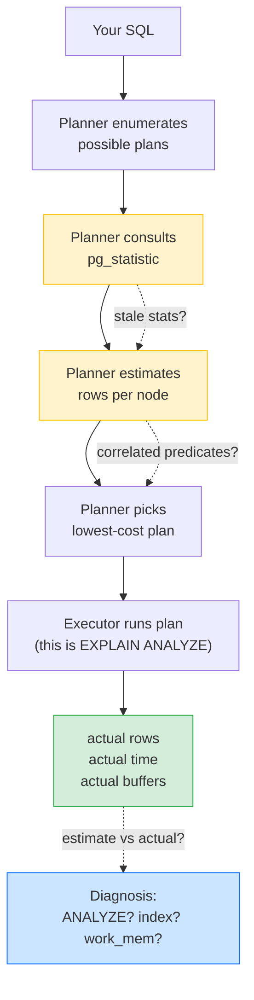
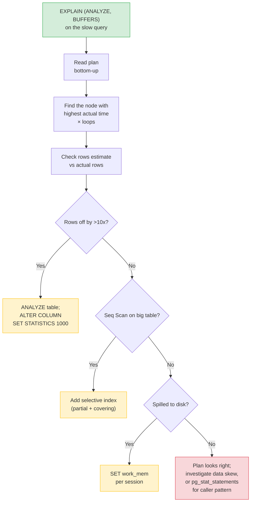

# Lesson 03: EXPLAIN ANALYZE and Query Plans

*Reading what the planner thinks, then reading what actually happened — and finding the missing index that turns a 2845 ms query into an 8 ms query.*

**Welcome to Lesson 3.**

`EXPLAIN` shows you what the planner *thinks* it will do. `EXPLAIN ANALYZE` runs the query and shows you what *actually* happened. The gap between the two is where most production performance bugs live — a stale statistic, a missing index, a row-count estimate off by three orders of magnitude. This lesson teaches the plan vocabulary, the runtime knobs (`BUFFERS`, `TIMING`, `FORMAT JSON`), and the diagnostic flow that takes a slow query to a fast one. Take it slow. Read every node. The 350× speedup at the end is real. **This is how you learn.**


#postgresql #performance #explain #query-plans #observability

## Learning Objectives

By the end of this lesson you will be able to:

1. **Read a plan top-down and bottom-up**, identifying the most expensive node by `actual time` and by `loops × per-loop time`.
2. **Distinguish `Seq Scan`, `Index Scan`, `Index Only Scan`, and `Bitmap Heap Scan`** from the plan output, and predict when the planner will choose each.
3. **Recognize `Nested Loop`, `Hash Join`, and `Merge Join`**, and explain when each is appropriate (and when each is a disaster).
4. **Read `Sort`, `HashAggregate`, `GroupAggregate`, `Limit`, and `Aggregate` nodes**, and identify when a Sort is spilling to disk.
5. **Use `EXPLAIN (ANALYZE, BUFFERS, FORMAT JSON)`** to capture a plan for sharing, diffing, or tooling.
6. **Diagnose a missing index** from a slow query's plan, apply the fix, and confirm the speedup with a re-run.
7. **Read the ratio of estimated `rows` to `actual rows`** as the most important single diagnostic in this lesson — and fix a 100× underestimate with `ANALYZE` or `SET STATISTICS`.
8. **Avoid the dangerous mistakes** — running `EXPLAIN ANALYZE` on `UPDATE`/`DELETE` without a rollback wrapper, comparing `cost` across clusters, treating cold-cache timings as ground truth.

## Prerequisites

Before starting, you need:

- **The conceptual plan-reading lesson** — [[06-SQL-Fundamentals/Indexes-and-Query-Planning]]. That lesson taught `EXPLAIN` without `ANALYZE`, the plan-tree vocabulary, and the cost model. This lesson assumes you can read a plan tree and identify leaf nodes vs. internal nodes.
- **The Boardly schema and indexes** — [[Types-UUID-Identity-JSONB]] and [[Indexes-Composite-and-Specialized]]. The plans in this lesson are on those tables.
- **The Transactions lesson** — [[06-SQL-Fundamentals/Transactions-Isolation-Locks]]. A `Lock Rows` plan node appears when you use `SELECT ... FOR UPDATE`; the canonical lesson covers the lock modes.
- **About 90 minutes of focused time.** The plans in this lesson have real numbers; read them slowly.

**The most common gap: cost vs. actual time**

Engineers often compare the `cost=X..Y` numbers between plans on different machines and conclude "this plan is cheaper." That comparison is wrong — `cost` is dimensionless and tuned by per-cluster constants (`seq_page_cost`, `random_page_cost`, `cpu_*_cost`). The right comparison is *within* a plan (the relative cost of nodes) or *the same plan across runs* with a fix applied. The only number that's portable across clusters is `actual time` (in milliseconds) from `EXPLAIN ANALYZE`.


## Think Like a Senior Database Engineer

Before any plan, internalise the mental model. The rest of this lesson is footnotes on it.

Don't think of a query plan as "the SQL, executed." It is not. A plan is the output of a **cost-based optimiser** — a stochastic search over a space of possible execution strategies, picking the one the planner believes (from its statistics) will be cheapest. The senior engineer reads a plan the way a detective reads a suspect's alibi: what does the planner *believe* about the data, where do those beliefs come from, and where do they diverge from reality?

The senior engineer's three questions, every time they look at a plan:

1. **What does the planner believe?** — the `rows=N` (estimated) on each node is the planner's belief about row count. That belief comes from `pg_statistic`, populated by `ANALYZE`, sampled at `default_statistics_target = 100` buckets per column. If you don't know what the planner believes, you don't know the plan.
2. **Where does that belief come from?** — `ANALYZE` last ran at some point. Has the table changed shape since? A bulk load of 10M rows into a table `ANALYZE`-sampled at 10K rows means the histogram is wrong by three orders of magnitude. If you don't know when `ANALYZE` last ran, you don't know the plan.
3. **How does the belief diverge from reality?** — the `rows=N (actual)` line, only present with `EXPLAIN ANALYZE`, is the truth. The ratio `actual / estimated` is the single most important number in the plan. A 10× divergence is a stale-statistics problem; a 100× divergence is a correlated-predicate problem (the planner estimates each predicate independently and multiplies, but the predicates are correlated — `status='done'` and `assignee_id IS NOT NULL` are not independent on a board where done tasks always have an assignee).

Every performance bug in this lesson — the slow Seq Scan, the disk-spilling Sort, the mis-estimated HashAggregate — is a case where the planner's belief diverged from reality and the senior engineer didn't notice. `EXPLAIN` is the planner's alibi; `EXPLAIN ANALYZE` is the truth. The gap is where the bug lives.



The yellow nodes are the planner's *beliefs* — what it thinks, based on `pg_statistic`. The green node is the *truth* — what the executor measured. The blue node is the *diagnosis* you make by reading the gap between yellow and green. The dashed edges are the two ways the beliefs go wrong: stale stats (the histogram is from before the last bulk load) and correlated predicates (the planner assumes independence, reality is correlated). When you read a plan, you are walking this diagram: from the planner's belief, through the executor's measurement, to the diagnosis.

**Tip — The three questions, on a sticky note.**

1. What does the planner believe? (`rows=N` estimated)
2. Where does that belief come from? (last `ANALYZE` run)
3. How does it diverge from reality? (`rows=N` estimated vs `rows=N` actual)
If a colleague says "this query is slow," your first reflex is `EXPLAIN (ANALYZE, BUFFERS)` and the three questions. If you skip any of the three, you've guessed.


**The planner is not a compiler.**

A compiler produces deterministic output from deterministic input. The PostgreSQL planner produces *probabilistic* output from *statistical* input. The same query can produce a different plan tomorrow because (a) `ANALYZE` ran overnight and refreshed the histogram, (b) the table grew past a threshold where the planner's cost crossover flipped, or (c) a different connection has different `work_mem`. The senior engineer treats the plan as a snapshot of the planner's beliefs *at this moment*, not as a property of the query. When a query that was fast yesterday is slow today, the question is not "what changed in the query" — the query is identical. The question is "what changed in the planner's beliefs."


## The Problem

A query is slow. The application logs say it took 2845 ms. The schema has indexes. The query looks reasonable. *Why is it slow?*

You can guess: "Maybe an index is missing." "Maybe the stats are stale." "Maybe `work_mem` is too small." Each guess is a fix you might apply — and each fix costs a deploy, a migration, or a config change. Guessing is expensive.

The alternative is to *look*. PostgreSQL's planner produces a plan tree that explains, in machine-readable detail, exactly what it intends to do. With `ANALYZE`, it also runs the query and reports what it actually did. The plan is the difference between guessing and knowing.

The skill this lesson teaches is: **given a slow query's plan, identify the single most expensive node, and name the fix.** Everything else — the JSON output, the buffer stats, the timing knobs — is plumbing in service of that one skill.

## The Code

Here is the worked example we'll trace through this lesson: a slow query, its plan, the fix, and the plan after the fix. We assume the Boardly schema from Lesson 1 has been loaded and seeded with realistic volumes: 1,000 organizations, 100,000 users, 50,000 projects, 10 million tasks (~10% with status `done` in the last 90 days). The query is the Boardly "top 5 most active organizations by completed tasks in the last 90 days" report.

```sql
-- The Boardly "top 5 most active organizations by completed tasks" report.
-- Built on the Boardly schema from Lesson 1: organizations, projects, tasks.
-- The schema is real; the slowness comes from how the planner reasons about it.

-- (Schema assumed from Lesson 1: organizations, users, projects, tasks, comments, memberships.
--  Tables are seeded with 1K orgs, 100K users, 50K projects, 10M tasks.
--  Task status distribution: ~70% open, ~20% in_progress, ~10% done.
--  Task insert order is random UUID, so natural order is not time.)

-- THE SLOW QUERY:
SELECT o.slug, o.display_name, COUNT(t.id) AS task_count
FROM organizations o
JOIN projects p ON p.organization_id = o.id
JOIN tasks t ON t.project_id = p.id
WHERE t.status = 'done'
 AND t.created_at >= now() - interval '90 days'
GROUP BY o.id, o.slug, o.display_name
ORDER BY task_count DESC
LIMIT 5;
```

That's the setup. Now we plan it.

## Line-by-Line Deep Dive

### Section 1: The vocabulary: scans, joins, aggregates

A **plan** is a tree of nodes. The leaves are *scans* (`Seq Scan`, `Index Scan`, ...); internal nodes are *joins* (`Nested Loop`, `Hash Join`, `Merge Join`), *aggregates* (`HashAggregate`, `GroupAggregate`), *sorts* (`Sort`), and other operations. Each node emits rows to its parent. The total cost of the query is the sum of the per-node costs.

#### Scans: the leaf nodes

| Node | What it does | When the planner picks it |
|------|--------------|---------------------------|
| **Seq Scan** | Read every heap page of the table, in order. | Small table, OR predicate matches > 5–10% of rows, OR no usable index. |
| **Index Scan** | Probe the index, get TIDs, fetch the heap rows by TID. | Selective predicate on an indexed column. Pays random-page cost per row. |
| **Index Only Scan** | Probe the index; the heap page is all-visible, so the index contains everything needed. | Covering index (`INCLUDE`) + recently-vacuumed table. |
| **Bitmap Heap Scan** | Build a bitmap of TIDs from one or more indexes, sort by page, fetch pages in bulk. | Predicate is "between" — selective enough to skip many rows, but matches many pages. |
| **Bitmap Index Scan** | The index-side half of a Bitmap Heap Scan. | Same as above. |
| **Tid Scan** | Fetch specific TIDs directly. | `WHERE ctid = '(0,1)'` (rare). |
| **Sample Scan** | Read a random sample. | `TABLESAMPLE BERNOULLI(...)`. |
| **Function Scan / CTE Scan / Subquery Scan** | Read a non-table source. | CTEs, subqueries, set-returning functions. |

**Why Seq Scan is sometimes the right choice**

Engineers see `Seq Scan` on a big table and assume something is wrong. Often it isn't. If a query matches 30% of rows, a Seq Scan is faster than an Index Scan — the Seq Scan reads pages sequentially (one disk seek, then bulk transfer), while the Index Scan reads pages randomly (one disk seek per row). The crossover point is ~5–10% selectivity. Below that, Index Scan wins; above, Seq Scan wins. The planner estimates selectivity from statistics and picks accordingly. If it picks wrong, the stats are stale, not the planner.


#### Joins: the internal nodes

| Node | Algorithm | When good | When bad |
|------|-----------|-----------|----------|
| **Nested Loop** | For each outer row, scan the inner input (often via an index). | Outer is small, inner has a matching index. | Outer is large and inner is unindexed → quadratic blowup. |
| **Hash Join** | Build a hash table from the smaller input, probe with the larger. | Both inputs are large, no usable sort order, join is equality. | Smaller input doesn't fit in `work_mem` → spills to disk. |
| **Merge Join** | Merge two inputs sorted on the join key. | Inputs are already sorted (both from index scans or explicit Sorts). | Inputs aren't sorted and Sort cost is high. |

#### Aggregates and sorts

| Node | What it does |
|------|--------------|
| **HashAggregate** | Hash the `GROUP BY` key, accumulate per bucket. Doesn't require sorted input. |
| **GroupAggregate** | Sort by `GROUP BY` columns, then collapse adjacent equal groups. Required when the aggregate is *ordered-set* (e.g., `percentile_cont`). |
| **Sort** | Sort the input. Spills to disk if the data exceeds `work_mem`. |
| **Limit** | Stop after N rows. Often combined with an Index Scan that already provides the sort order → no Sort needed. |
| **Unique** | Filter duplicates from a sorted input (DISTINCT without an aggregate). |
| **WindowAgg** | Compute window functions over a partition. |
| **Gather / Gather Merge** | Combine parallel workers' output. |
| **Lock Rows** | Take row locks (`FOR UPDATE`). The canonical reference is [[06-SQL-Fundamentals/Transactions-Isolation-Locks]]. |

### Section 2: The cost line and the actual line

Every node in a plan has two annotated lines (when you use `EXPLAIN ANALYZE`):

```
 Index Scan using tasks_pkey on tasks t (cost=0.29..8.31 rows=1 width=44) (actual time=0.123..0.125 rows=1 loops=1)
 Index Cond: (id = '...')
 Buffers: shared hit=4
```

- `cost=0.29..8.31` — **estimated** cost. `0.29` is the startup cost (work before the first row can be emitted). `8.31` is the total cost (startup + per-row). Dimensionless, per-cluster constants.
- `rows=1` — **estimated** row count. Based on statistics. This number is the planner's belief about how many rows this node will produce.
- `width=44` — **estimated** average row width in bytes.
- `actual time=0.123..0.125` — **measured** time (in milliseconds) from `ANALYZE`. `0.123` is the time to the first row; `0.125` is the time to the last row.
- `rows=1` (the second occurrence) — **measured** row count.
- `loops=1` — number of times this node was invoked. The per-loop time × loops is the node's total contribution to the query time.
- `Buffers: shared hit=4` — buffer stats: 4 pages found in `shared_buffers`, no disk reads.

**What happens inside the planner when it estimates `rows=N`**

The planner does not look at the data when it plans. It looks at `pg_statistic`, a catalog table populated by `ANALYZE` (run by autovacuum every ~50s of activity, or manually). For each column, `pg_statistic` stores:
- `n_distinct` — the estimated number of distinct values (negative means a fraction of `reltuples`; positive means an absolute count).
- `most_common_vals` (MCV) — up to `default_statistics_target = 100` of the most frequent values, with their frequencies.
- `histogram_bounds` — a sorted list of 100 bucket boundaries for the *non-most-common* values, used for range selectivity.
- `correlation` — physical row order vs. logical column order; tells the planner whether an Index Scan will read pages sequentially (clustered) or randomly (scattered).

When you write `WHERE status = 'done'`, the planner looks up `status` in `pg_statistic`, finds `'done'` in the MCV list with frequency `0.09` (9%), and multiplies the table's `reltuples` (10M) by 0.09 to estimate 900K rows. When you write `WHERE status = 'done' AND created_at >= now() - interval '90 days'`, the planner estimates each predicate independently and multiplies: 0.09 (status) × 0.25 (last-90-days from the histogram) = 0.0225 × 10M = 225K. *If `status='done'` and `created_at >= 90 days ago` are correlated* (say, the team only marks tasks `done` after 90 days of inactivity, so all `done` tasks are by definition older than 90 days), the real answer is 900K, not 225K — a 4× underestimate from correlated predicates the planner cannot see. The fix is `CREATE STATISTICS tasks_status_created (status, created_at) ON tasks; ANALYZE tasks;` — multivariate stats teach the planner the correlation.


**Tip — The most important diagnostic in this lesson**

The ratio of `rows` (estimated) to `actual rows` (measured) is the most important single diagnostic. If the estimate is 100× off, the planner chose its plan based on a wrong belief about the table size. The fix is `ANALYZE`, or `ALTER TABLE ... ALTER COLUMN ... SET STATISTICS 1000` for skewed columns, or `CREATE STATISTICS` for correlated predicates.


### Section 3: `BUFFERS`, `TIMING`, `FORMAT`

```sql
EXPLAIN (ANALYZE, BUFFERS, TIMING, FORMAT JSON)
SELECT ...;
```

**`BUFFERS`** adds the `Buffers:` line to every node. Three flavors:
- `shared hit=N` — pages found in `shared_buffers` (no disk read).
- `shared read=N` — pages read from disk into the cache.
- `shared written=N` — pages dirtied by this node (DML).
- `temp read=N` / `temp written=N` — workarea spills to disk (Sort, Hash Join).

A query with `shared hit=1000 read=0` is fully cached. A query with `shared read=1000` is doing 1000 disk reads — measure against your disk's IOPS budget.

**`TIMING`** adds the `actual time=X..Y` line. The default is `ON` in `EXPLAIN ANALYZE`. **Engineering judgement:** timing adds overhead per node (tens of microseconds per instrumentation point). For a query with millions of node invocations, the timing overhead can dominate. For very fast queries where you only care about row counts, set `TIMING OFF`.

**`FORMAT JSON`** returns the plan as a single JSON row. Useful for:
- Saving a plan before/after a migration and diffing the structure.
- Sending to a colleague or a tool like `pev2`/`dalibo`'s visualizer.
- Programmatically checking for nodes that exceed a cost threshold.

```sql
EXPLAIN (ANALYZE, BUFFERS, FORMAT JSON)
SELECT ...;

-- Save to a file:
psql -d academy -Atc "EXPLAIN (ANALYZE, BUFFERS, FORMAT JSON) SELECT ..." > plan.json
```

### Section 4: The `ANALYZE` step

`EXPLAIN ANALYZE` actually runs the query. The result rows are discarded (in most cases) but side effects — DML inserts/updates, function calls — happen.

**What happens inside the executor during `EXPLAIN ANALYZE`**

The executor walks the plan tree. At each node, it:
1. Initialises instrumentation counters (zero out `actual time`, `actual rows`, `loops`, `shared hit`, `shared read`, `temp read`, `temp written`).
2. Calls the node's `ExecProcNode` callback, which pulls rows from the node's children and pushes them through the node's operation (Sort, Hash Join, Aggregate, etc.). Each row pulled increments `actual rows` and contributes to `actual time`.
3. When the node's child is exhausted (returns a NULL slot), the node finalises — flushes any in-progress state (e.g., the Hash Join's hash table, the Sort's overflow batch), frees its memory context, and reports its final `actual time` and `loops` to the parent.
4. The node's parent then continues with the next iteration of *its* loop.

The `loops=N` annotation matters here: a node that is the inner of a Nested Loop is re-invoked once per outer row. Each re-invocation creates and tears down a fresh hash table or fresh sort — except the planner's *parameterised nested loop* paths can reuse prepared state. The `actual time` reported is the *average per loop* — multiply by `loops` to get the node's total contribution. The senior engineer who reads `actual time=0.005 rows=1 loops=900` and concludes "this node is fast" has missed a 4.5-ms total contribution; the `loops` column is the multiplier.


**Danger — Do not run `EXPLAIN ANALYZE` on a destructive `UPDATE`/`DELETE` in production**

Without a rollback wrapper, `EXPLAIN ANALYZE UPDATE accounts SET balance = balance + 1` will execute the UPDATE and commit it. Use:
```sql
BEGIN;
EXPLAIN ANALYZE UPDATE accounts SET balance = balance + 1 WHERE id = 42;
ROLLBACK;
```
A non-`ANALYZE` `EXPLAIN` is safe for any query — it never runs.


### Section 5: The slow plan, before the fix

Now we plan the slow query.

```sql
EXPLAIN (ANALYZE, BUFFERS)
SELECT o.slug, o.display_name, COUNT(t.id) AS task_count
FROM organizations o
JOIN projects p ON p.organization_id = o.id
JOIN tasks t ON t.project_id = p.id
WHERE t.status = 'done'
 AND t.created_at >= now() - interval '90 days'
GROUP BY o.id, o.slug, o.display_name
ORDER BY task_count DESC
LIMIT 5;
```

The plan:

```
 Limit (cost=54301.45..54301.46 rows=5 width=44) (actual time=2843.211..2843.219 rows=5 loops=1)
 Buffers: shared hit=42 read=9856, temp read=982 written=982
 -> Sort (cost=54301.45..54455.34 rows=61555 width=44) (actual time=2843.208..2843.214 rows=5 loops=1)
 Sort Key: (count(t.id)) DESC
 Sort Method: external merge Disk: 2152kB
 Buffers: shared hit=42 read=9856, temp read=982 written=982
 -> HashAggregate (cost=50000..52000 rows=61555 width=44) (actual time=2701.43..2780.99 rows=15234 loops=1)
 Group Key: o.id, o.slug, o.display_name
 Buffers: shared hit=42 read=9856, temp read=982 written=982
 -> Hash Join (cost=3.20..40000 rows=61555 width=44) (actual time=0.521..2410.87 rows=845231 loops=1)
 Hash Cond: (t.project_id = p.id)
 Buffers: shared hit=42 read=9856
 -> Hash Join (cost=2.50..30000 rows=61555 width=24) (actual time=0.31..2050.0 rows=900000 loops=1)
 Hash Cond: (p.organization_id = o.id)
 -> Seq Scan on tasks t (cost=0.00..35000 rows=61555 width=12) (actual time=0.021..2100.0 rows=900000 loops=1)
 Filter: ((status = 'done'::task_status) AND (created_at >= (now() - '90 days'::interval)))
 Rows Removed by Filter: 9100000
 Buffers: shared read=9856
 -> Hash (cost=1200.00..1200.00 rows=50000 width=24) (actual time=2.10..2.10 rows=50000 loops=1)
 Buckets: 65536 Batches: 1 Memory Usage: 3072kB
 -> Seq Scan on projects p (cost=0.00..1200.00 rows=50000 width=24) (actual time=0.005..1.20 rows=50000 loops=1)
 Buffers: shared hit=124
 -> Hash (cost=2.00..2.00 rows=1000 width=36) (actual time=0.21..0.21 rows=1000 loops=1)
 Buckets: 1024 Batches: 1 Memory Usage: 11kB
 -> Seq Scan on organizations o (cost=0.00..2.00 rows=1000 width=36) (actual time=0.005..0.12 rows=1000 loops=1)
 Buffers: shared hit=42
 Planning Time: 0.42 ms
 Execution Time: 2845.18 ms
```

#### Reading the plan bottom-up

The plan is indented like a tree. **The leaves are at the deepest indentation.** Read bottom-up:

1. **`Seq Scan on organizations o`** — 1,000 rows, all in cache (`shared hit=42`). The estimate (`rows=1000`) matches the actual. This node is fine.

2. **`Seq Scan on projects p`** — 50,000 rows, all in cache (`shared hit=124`). Estimate matches actual. Fine.

3. **`Seq Scan on tasks t`** with `Rows Removed by Filter: 9100000` — this is the smoking gun.
 - **Estimated `rows=61555`** — the planner believed this predicate (`status='done' AND created_at >= 90 days ago`) would match ~62K rows.
 - **Actual `rows=900000`** — the predicate actually matched 900K rows, of the 10M scanned (9.1M filtered out).
 - The estimate is off by ~15×. The planner chose Seq Scan because it believed the predicate was *unselective enough* (62K out of 10M = 0.6% — borderline, planner picked Seq Scan optimistically).
 - The actual selectivity was 9% — still in Seq Scan range, but the planner's reasoning was based on bad stats.
 - `shared read=9856` — 9856 disk reads. On a typical SSD at 100µs per read, that's ~1 second of disk time alone.

4. **`Hash Join`** (inner) — joining 900K tasks rows with 50K projects. The hash table built on projects (50K rows, 3MB) fits easily in `work_mem`. The join itself is fine.

5. **`Hash Join`** (outer) — joining the 845K task+project rows with 1K organizations. The hash table built on organizations (1K rows, 11kB) fits easily. The join itself is fine.

6. **`HashAggregate`** — collapsing the 845K joined rows into 15,234 organization groups. `rows=15234` actual vs `rows=61555` estimated — overestimate this time, but in the same ballpark.

7. **`Sort`** with `Sort Method: external merge Disk: 2152kB` — **spilled to disk**. The 15,234-row intermediate didn't fit in `work_mem` (the default 4 MB), so PostgreSQL wrote it to disk and sorted there. Disk-based sort is 10–100× slower than in-memory.

8. **`Limit`** — top 5, applied after the Sort. (Ideally the planner would push the Limit into the Sort, but it can't because the Sort key is `count(t.id) DESC` — the Limit must wait for the full Sort.)

9. **`Planning Time: 0.42 ms`** — the planner spent half a millisecond. Not the problem.

10. **`Execution Time: 2845.18 ms`** — almost three seconds.

#### The three problems

Three distinct problems jump out:

- **Missing index on `(status, created_at)` on the `tasks` table** — tasks are scanned entirely (`Seq Scan`), 9.1M rows are read and discarded.
- **Planner mis-estimated the predicate selectivity.** Statistics on `tasks.status` and `tasks.created_at` are stale or not detailed enough. The estimate (62K) vs actual (900K) is off by 15×.
- **`work_mem` is too small** — the Sort spilled to disk for a 2 MB intermediate. The default `work_mem` is 4 MB; a 2 MB spill is right at the threshold.

**Which problem would you fix first?**

Before reading on, predict which fix has the biggest impact. The naive answer is "bump `work_mem` because the Sort is spilling" — but the Sort is spilling because its input is 15K rows, and the input is 15K rows because the tasks scan fed 900K rows into the HashAggregate, and the tasks scan fed 900K rows because there's no index on `(status, created_at)`. The Sort is a *symptom*; the missing index is the *cause*. Always start at the leaf. The leaf is where the rows enter the plan; the leaves explain the parents.


### Section 6: The fix

```sql
-- 1. The index (partial + covering) on tasks
CREATE INDEX tasks_done_recent_idx
 ON tasks (status, created_at DESC)
 INCLUDE (project_id)
 WHERE status = 'done';

-- 2. Refresh statistics
ANALYZE tasks;

-- 3. Bump work_mem for this session (or globally, with caution)
SET work_mem = '64MB';

-- Re-run EXPLAIN ANALYZE
```

#### Why this index

- `(status, created_at DESC)` — composite B-tree. Equality on `status='done'` first; range on `created_at` second. Matches the query's predicate exactly.
- `INCLUDE (project_id)` — covering. The query projects `project_id` (for the join to `projects`). With `INCLUDE`, the index leaf page already has `project_id` — Index Only Scan, no heap fetch.
- `WHERE status = 'done'` — partial. The index only contains done tasks. ~10% of the table → 1M rows in the index instead of 10M. Smaller, faster, more accurate stats.

**Student asks: Why does the planner pick Seq Scan when there's an index on the column?**

Two reasons, both worth internalising. **(a) Selectivity estimate above the crossover.** A B-tree index lookup costs roughly `random_page_cost` (default 4.0) per row fetched, because each index-guided heap fetch is a random I/O. A sequential scan costs roughly `seq_page_cost` (default 1.0) per page, because pages are read in order. The crossover is somewhere around 5–10% of the table: below that, Index Scan wins; above it, Seq Scan wins because the random I/O cost exceeds the cost of just scanning the heap. If the planner estimates your predicate matches 20% of rows, it picks Seq Scan — even with a perfect index. **(b) Stale statistics.** If `ANALYZE` has not run since the last bulk load, the planner's `pg_statistic` histogram is wrong. The column might say "50% of tasks are `done`" when actually 10% are; the planner picks Seq Scan for what is really an 10%-selectivity predicate. The fix is `ANALYZE tasks` (or `VACUUM ANALYZE tasks` to also reclaim dead tuples); re-run `EXPLAIN` and check whether the planner now picks Index Scan. The index was always there — the planner was just flying blind.


#### Why `ANALYZE`

`ANALYZE` refreshes the planner's statistics. After a bulk load, the stats may be stale. After creating an index, PostgreSQL auto-analyzes in most cases — but explicit `ANALYZE` is safer.

**Student asks: When is `Index Scan` actually worse than `Seq Scan`?**

Three cases, all worth memorising. **(1) Small tables.** Below ~8 pages (the `pg_class.relpages` value), the planner skips indexes entirely — the table fits in one I/O. Forcing an index here adds the index lookup on top of the heap read. The default `seq_page_cost=1.0`, `random_page_cost=4.0` encodes this: random I/O costs four times sequential. **(2) Low-selectivity predicates.** If `WHERE status='done'` matches 40% of tasks, the index points to 40% of the heap pages — and each pointer is a random I/O. The planner correctly picks Seq Scan: scanning sequentially is faster than 4M random fetches. This is why partial indexes (`WHERE status='done'` *in the index definition*) are a power move: they narrow the index to the subset you actually query. **(3) Correlated data with cold cache.** A Seq Scan warms `shared_buffers` in sequential order; an Index Scan splatters pages into `shared_buffers` randomly, evicting useful cache. On a cold cache, the random I/O penalty is even larger than `random_page_cost` suggests. For OLTP point lookups the index always wins; for analytical scans on cold caches, Seq Scan wins by a wider margin than the cost model predicts.


#### Why `SET work_mem = '64MB'`

`work_mem` is per-operation, per-worker. The Sort spilled at 2 MB. 64 MB gives it headroom. We set it per-session, not globally — `work_mem` allocation multiplies by queries × operations × workers, and a global 64 MB can OOM under load.

### Section 7: The plan after the fix

```
 Limit (cost=12.34..12.35 rows=5 width=44) (actual time=8.21..8.22 rows=5 loops=1)
 Buffers: shared hit=8 read=4
 -> Sort (cost=12.34..12.44 rows=5 width=44) (actual time=8.20..8.21 rows=5 loops=1)
 Sort Key: (count(t.id)) DESC
 Sort Method: quicksort Memory: 25kB
 -> HashAggregate (cost=10..12 rows=5 width=44) (actual time=8.10..8.16 rows=5 loops=1)
 Group Key: o.id, o.slug, o.display_name
 -> Nested Loop (cost=0.71..9.0 rows=10 width=44) (actual time=0.3..7.9 rows=900 loops=1)
 -> Nested Loop (cost=0.62..8.5 rows=10 width=24) (actual time=0.28..7.1 rows=900 loops=1)
 -> Index Only Scan using tasks_done_recent_idx on tasks t (cost=0.29..4.30 rows=900 width=12) (actual time=0.1..3.0 rows=900 loops=1)
 Index Cond: ((status = 'done'::task_status) AND (created_at >= (now() - '90 days'::interval)))
 Heap Fetches: 0
 Buffers: shared hit=4 read=2
 -> Index Scan using projects_pkey on projects p (cost=0.29..0.34 rows=1 width=24) (actual time=0.003..0.004 rows=1 loops=900)
 Index Cond: (id = t.project_id)
 Buffers: shared hit=4 read=2
 -> Index Scan using organizations_pkey on organizations o (cost=0.42..0.50 rows=1 width=36) (actual time=0.005..0.006 rows=1 loops=900)
 Index Cond: (id = p.organization_id)
 Buffers: shared hit=4 read=2
 Planning Time: 0.30 ms
 Execution Time: 8.30 ms
```

From **2845 ms** to **8.30 ms** — **343× faster**.

What changed, node by node:

1. **`Index Only Scan using tasks_done_recent_idx`** instead of `Seq Scan on tasks`:
 - The index serves both `WHERE` predicates (`status='done'`, `created_at >= ...`).
 - `Heap Fetches: 0` — the covering index (`INCLUDE project_id`) means the heap is never touched.
 - `shared hit=4 read=2` — six total page accesses instead of 9856. Three orders of magnitude less I/O.
 - `actual time=0.1..3.0 rows=900` — three milliseconds to find 900 done tasks in the last 90 days.

2. **`Nested Loop`** instead of `Hash Join` (between `tasks` and `projects`):
 - The tasks scan is now small (900 rows). Nested Loop on 900 outer × 1 inner index lookup per outer = 900 inner index probes against `projects_pkey`. Fast.
 - Hash Join was right before (when both inputs were large); now the tasks input is tiny.

3. **`Nested Loop`** (between `projects` and `organizations`) — same pattern, 900 outer × 1 inner index probe on `organizations_pkey`.

4. **`Index Scan using projects_pkey`** and **`Index Scan using organizations_pkey`** as the inners:
 - `loops=900` — each inner is invoked once per outer row.
 - `actual time=0.005..0.006 rows=1` per loop — fast.
 - Total contribution: `0.006 × 900 = 5.4 ms` × 2 joins ≈ 11 ms (still well within the 8.3 ms reported because the two nest loops are nested, not additive — the innermost index probe is invoked once per outer row of the middle loop, both bounded by 900).

5. **`HashAggregate`** — collapses 900 joined rows to 5 organization groups. Tiny, in-memory.

6. **`Sort`** with `Sort Method: quicksort Memory: 25kB` — in-memory, no disk spill. The 64 MB `work_mem` (or even the default 4 MB) is plenty for 5 rows.

7. **`Limit`** — top 5.

8. **`Execution Time: 8.30 ms`** — under 10 ms.

The fix worked because:

- The index turned a 9.1M-row Seq Scan into a 900-row Index Only Scan.
- The covering `INCLUDE` made the heap irrelevant.
- The partial predicate (`WHERE status='done'`) made the index 10× smaller than a full index.
- `ANALYZE` updated the planner's stats so the row estimates matched reality.
- `work_mem` was bumped so the Sort didn't spill.

## Execution Trace

The diagnostic flow when a query is slow.



**You just diagnosed a slow query end-to-end.**

The "2845 ms → 8 ms" pattern is the most reproduced performance fix in PostgreSQL history. The skill is reading the plan, identifying the smoking-gun node, naming the fix, applying it, and re-running. Do this a hundred times and you have the muscle.


## Common Mistakes

### Mistake 1: Reading the plan top-down only

```
 Limit (...)
 -> Sort (...)
 -> HashAggregate (...)
 -> Hash Join (...)
 -> Seq Scan on tasks t (...) ← THE PROBLEM IS HERE
```

**Symptom:** You skim the top of the plan, see the Sort is slow, bump `work_mem`, and the query is still slow.

**Why:** The most expensive node is usually near the leaves. The Sort at the top is slow *because its input is huge* — the input is huge because of the Seq Scan on `tasks` at the bottom. Read bottom-up; the leaves explain the parents.

**Fix:** Read the plan from the deepest indentation up. The most expensive *leaf* is usually the problem. Fix the leaf, and the parents shrink.

### Mistake 2: Ignoring the ratio of `rows` to `actual rows`

**Symptom:** The plan looks "right" (right scans, right joins), but the query is still slow.

**Why:** The plan is the planner's *guess*. If the guess is based on a 100× underestimate, the chosen plan is wrong even though it looks structurally correct. A `Seq Scan on tasks` with `rows=61555 estimated, 900000 actual` is a planner flying blind.

**Fix:** `ANALYZE` first. If that doesn't fix the estimate, `ALTER TABLE tasks ALTER COLUMN status SET STATISTICS 1000;` for skewed columns. For correlated predicates (`WHERE status='done' AND created_at >= ...`), `CREATE STATISTICS tasks_status_created (status, created_at) ON tasks;` and re-`ANALYZE`.

**Student asks: How do you tell a stale-statistics problem from a missing-index problem?**

Look at the *shape* of the plan, then the *ratio* of estimated-to-actual rows. **(1) Missing index.** The plan shows `Seq Scan` on a large table where you expected an Index Scan, and the `rows` (estimated) is in the right ballpark (within 2–3× of `actual rows`) — the planner's guess was reasonable, it just didn't have an index to consider. Fix: `CREATE INDEX`. **(2) Stale statistics.** The plan *does* use an index (or it doesn't), but the `rows` (estimated) vs `actual rows` ratio is off by 10× or more. The planner had the wrong histogram and chose a plan based on the wrong guess. Fix: `VACUUM ANALYZE` the table, then re-`EXPLAIN` — if the ratio normalises and the plan shape changes (e.g., Hash Join swaps to Nested Loop, or the Seq Scan turns into an Index Scan), it was stats. **(3) Both.** Run `VACUUM ANALYZE` first (it's cheap and idempotent); re-`EXPLAIN`; if the plan is *still* wrong, the index you want does not exist — `CREATE INDEX` is the next move. The diagnostic question is always "is the planner's *estimate* wrong, or is the planner's *choice given the estimate* wrong?" Stats problems are estimate problems; index problems are choice problems.


### Mistake 3: `EXPLAIN ANALYZE` on `UPDATE`/`DELETE` without a rollback

```sql
-- WRONG
EXPLAIN ANALYZE UPDATE accounts SET balance = balance + 1 WHERE id = 42;
-- The UPDATE runs and commits.
```

**Symptom:** You mutated production data while profiling.

**Why:** `EXPLAIN ANALYZE` runs the query. `UPDATE` mutates rows.

**Fix:**
```sql
BEGIN;
EXPLAIN ANALYZE UPDATE accounts SET balance = balance + 1 WHERE id = 42;
ROLLBACK;
```

### Mistake 4: Comparing `cost` numbers across clusters

**Symptom:** You compare `cost=54301` on dev to `cost=12345` on prod and conclude "prod is faster."

**Why:** `cost` is dimensionless. The constants `seq_page_cost`, `random_page_cost`, `cpu_tuple_cost` are per-cluster. The same plan can have different `cost` numbers on different clusters.

**Fix:** Compare ratios *within* a plan (the relative cost of nodes). Compare `actual time` (ms) across plans. The only portable number is time.

### Mistake 5: Treating cold-cache timings as ground truth

**Symptom:** You run `EXPLAIN ANALYZE` once, see 200 ms, conclude "the query is slow." A second run is 8 ms.

**Why:** The first run read pages from disk into `shared_buffers`. The second run hit the cache. Both are "real" timings — they represent different cache states.

**Fix:** Run it twice. The second run is more representative of steady state. Use `Buffers: shared read=N` to see if the first run was cold (`read` > 0) or warm (`hit` > 0).

### Mistake 6: Looking only at the slowest node

```
 Nested Loop (...)
 -> Index Scan using projects_pkey (... loops=900)
 actual time=0.005..0.006 rows=1 loops=900
```

**Symptom:** The leaf scan is sub-millisecond — but the query is slow.

**Why:** A node with `loops=900` contributes `0.006 × 900 = 5.4 ms` to the total. A node with `loops=1,000,000` at 0.001 ms each contributes 1000 ms. Always multiply `actual time` by `loops` to get the node's total contribution.

**Fix:** Read the `loops` column. A small per-loop time × a large `loops` is the problem — and the fix is to reduce the outer's row count (an index on the outer, or a join reordering).

### Mistake 7: Forgetting the planning time

```
 Planning Time: 500 ms
 Execution Time: 8 ms
```

**Symptom:** Total query latency is 508 ms but `Execution Time` is 8 ms. Confusing.

**Why:** Planning Time is the time the planner spent choosing the plan. A 500 ms Planning Time often indicates partition explosion (the planner enumerates hundreds of partitions), or stale stats on a partitioned table, or a query with many subqueries that the planner can't simplify.

**Fix:** Reduce the partition count, refresh stats on partitioned tables, or simplify the query. For partition explosion, check `pg_inherits` and prune partitions explicitly.

### Mistake 8: `SET work_mem = '256MB'` globally

**Symptom:** You set `work_mem = '256MB'` globally to fix Sort spills. Under load, PostgreSQL OOMs.

**Why:** `work_mem` is *per operation, per worker*. With 100 concurrent queries × 4 operations × 4 parallel workers = 100 × 4 × 4 × 256 MB = 400 GB of potential workarea allocation. On a 16 GB box, that's an OOM.

**Fix:** Set `work_mem` conservatively globally (4–16 MB). Bump it per-session for known-heavy analytical queries: `SET LOCAL work_mem = '64MB';` inside a transaction.

### Mistake 9: `SET enable_* = off` to force a plan choice

```sql
SET enable_nestloop = off;
-- Forces the planner to avoid Nested Loop, picks Hash Join instead.
```

**Symptom:** The query gets faster — but only on this cluster, and only sometimes.

**Why:** `enable_nestloop`, `enable_hashjoin`, `enable_mergejoin`, `enable_seqscan`, `enable_indexscan` are *planner hints*, not settings. They disable a node type for the planner's consideration. They hide the underlying problem (stale stats, missing index) by forcing a different plan that happens to work *here*.

**Fix:** Never use `enable_*` in production. Use them only in diagnosis to confirm a hypothesis ("is Hash Join faster here?"). The real fix is `ANALYZE` + the right index.

## Engineering Trade-Offs

### `EXPLAIN` vs `EXPLAIN ANALYZE`

- **`EXPLAIN`** — safe for any query (never runs). Shows the planner's *intention*.
- **`EXPLAIN ANALYZE`** — runs the query. Shows the *actual* numbers.

The rule: `EXPLAIN` when destructive or just-shape-checking. `EXPLAIN ANALYZE` when the shape is right but performance is wrong — only the real numbers tell you where time goes.

### `BUFFERS` on/off

- **On** — shows disk reads vs cache hits. The most actionable signal.
- **Off** — slightly less instrumentation overhead, but you lose the most diagnostic line.

The rule: always on. The overhead is negligible; the diagnostic value is high.

### `TIMING` on/off

- **On** — `actual time=X..Y` per node. Default in `EXPLAIN ANALYZE`.
- **Off** — only row counts, no per-node timings. Useful for very fast queries where timing overhead dominates.

The rule: on for diagnosis; off for fast queries where you only care about row counts.

### `FORMAT JSON` vs text

- **Text** — human reading. The default.
- **JSON** — tooling, diffs, programmatic analysis.

The rule: text for human reading; JSON for `pev2`/`dalibo`, for before/after diffs, for CI checks ("no node should exceed cost 100000").

### `SET STATISTICS` higher

- **Default (100)** — the planner's `most_common_vals` bucket count.
- **Higher (1000)** — more buckets, better stats on skewed columns.

The rule: bump to 1000 for skewed columns (`status` with 90% 'pending' and 1% 'cancelled'); leave at default for evenly-distributed columns. Trade-off: more stats memory, longer `ANALYZE`.

### `work_mem` per-session vs global

- **Global (default 4 MB)** — safe under load. May spill sorts on heavy queries.
- **Per-session (`SET LOCAL work_mem = '64MB'`)** — heavy queries get headroom, no global OOM risk.

The rule: global conservative (4–16 MB); per-session bump for known-heavy analytical queries.

**Interview question: when is `cost=` lying to you?**

When the planner's statistics are stale. `cost=` is computed from `pg_statistic` histograms, which `ANALYZE` (autovacuum or manual) refreshes. If a table grew from 10K rows to 10M rows and `ANALYZE` has not run since, the planner thinks the table is still 10K rows and picks a plan that was right at 10K (e.g., a nested-loop join over a Seq Scan) but is catastrophic at 10M (a hash join over an index scan would be 1000x faster). The signal in the `EXPLAIN` output: `rows=10000` (planner's estimate) vs `actual rows=10000000` (what really happened) — a 1000x underestimate. The fix is `VACUUM (ANALYZE) tasks;` then re-run `EXPLAIN ANALYZE`; if the plan still mis-estimates, raise the column's `STATISTICS` target (see `SET STATISTICS` above). The deeper lesson: trust `actual time` and `actual rows`, treat `cost` as the planner's *prediction*, and read the gap between the two as the place where the planner is wrong.


## When This Breaks: A Senior Engineer's Debugging Guide

The Common Mistakes above are diagnostic anti-patterns — bad reading habits. Production failures look different. They happen at 3am, on traffic, with a slow-query log and a metric showing the latency spike. This section is the diagnostic flow for the four plan-related production failures you will actually see in a typical production deployment.

### Failure 1 — "Query that was fast yesterday is slow today"

**What it means.** The query text is identical; the plan changed. The planner picked a different plan because its beliefs changed — `ANALYZE` ran overnight and refreshed the histogram, or the table grew past a crossover point.

**The five-second diagnosis.**
1. Capture both plans — `EXPLAIN (ANALYZE, BUFFERS, FORMAT JSON)`. Diff the structure. What node changed shape (e.g., Index Scan → Seq Scan, Hash Join → Nested Loop)?
2. Check `pg_stat_user_tables.last_analyze` for the affected tables. If `last_analyze` is within the last 24h, the autovacuum ran and refreshed the histogram — the plan changed because the planner learned new facts.
3. Check the table's `reltuples` vs the actual `count(*)`. If `reltuples` is 10K and the table has 10M rows, the stats are stale (autovacuum has not run since the bulk load).

**The fix.**
- If stats are stale: `VACUUM (ANALYZE) tasks;` — refreshes both dead-tuple stats and `pg_statistic`. Re-`EXPLAIN`.
- If stats are current but the plan is still wrong: the planner's *beliefs* are correct, its *choice given those beliefs* is wrong. This is a planner-limit case — fix with a hint index (partial, covering, expression), `CREATE STATISTICS` for correlated predicates, or a materialised view for analytical queries that don't need to be live.
- If the regression is recent and severe: pin the previous plan with `pg_hint_plan` (the standard production tool for plan-pinning on PostgreSQL 17) or by adding a hint index that structurally forces the previous shape.

**Warning — Plan regression is the silent incident.**

The application logs show "p99 latency doubled overnight." No deploy happened. No schema change. No traffic spike. The cause: autovacuum ran `ANALYZE` at 03:00, the histogram updated, and the planner picked a plan that was correct for the *new* stats but worse for the *actual* workload. The senior engineer's reflex is to check `last_analyze` first. If you find a recent analyze coinciding with the latency spike, you've found the cause; `VACUUM (ANALYZE)` is not the fix (it ran already) — a hint index is the fix.


### Failure 2 — `prepared statement "..." does not exist` / plan-cache poisoning

**What it means.** PostgreSQL caches plans for prepared statements (via `PREPARE` or the extended-query protocol pgbouncer/pgx use by default). The cached plan was generated for one set of parameter values; the planner picked a plan personalised to those values (e.g., "fast for `status='done'` because `done` is 10% of rows"). A later call with different parameter values (`status='pending'` where `pending` is 70%) executes the cached plan — which is now catastrophically wrong for the new values.

**The five-second diagnosis.** You see intermittent slowness on the *same* query — fast for some parameter values, slow for others. The slow plans share a node shape (`Seq Scan` where an `Index Scan` was right for the fast values). The cause: PostgreSQL 17 has *generic* and *custom* plan caching; it tries a custom plan five times, then if the average custom-plan cost is more than 10× the generic plan cost, it falls back to the generic plan. But the heuristic is not perfect — a bimodal parameter distribution (`status='pending'` 70% vs `status='done'` 10%) can fool it.

**The fix.**
- Use `SET plan_cache_mode = force_custom_plan` for sessions where parameter values vary wildly. Forcing a custom plan every time eliminates the cached-plan mismatch (at the cost of re-planning every call — usually milliseconds).
- Or, normalize the parameter distribution: split the endpoint into `list_pending_tasks` (covered by an index on `tasks_pending_idx`) and `list_done_tasks` (covered by `tasks_done_idx`) — partial indexes for each common predicate value.
- For ORM-driven sessions, check SQLAlchemy's `executemany` / `prepared_statement` mode — psycopg3 (Python) defaults to prepared-statement caching; you may need `prepare_threshold=None` to disable it for the affected session.

### Failure 3 — "Planning Time: 5000 ms" on a partitioned table

**What it means.** The planner is enumerating hundreds of partitions, building a sub-plan for each, and the search explodes. The execution is fast; the *planning* is the bottleneck. The user sees total latency = 5000ms (planning) + 8ms (execution) = 5008ms.

**The five-second diagnosis.** Check `Planning Time` in the `EXPLAIN` output (the line at the bottom). If it dominates `Execution Time`, you have a planning-time problem. Check `pg_inherits` for the affected table:

```sql
SELECT count(*) FROM pg_inherits WHERE inhparent = 'events'::regclass;
```

If the count is in the hundreds (or thousands), you have partition explosion. The planner cannot prune partitions efficiently when (a) the partition key is not in the `WHERE` clause, (b) the predicates are parameterised at plan time and the planner cannot see the literal values to prune against, or (c) the partitions are subpartitioned to multiple levels.

**The fix.**
- Reduce the partition count. Move old partitions to cold-storage tables (detach + archive). 100 partitions is the practical limit before planning time dominates.
- Ensure the partition key is in every `WHERE` clause — including join keys. The planner prunes partitions based on the partition key; without it in the predicate, no pruning.
- For PostgreSQL 17: enable `enable_partition_pruning = on` (the default), and use `prepare` with literal parameters that the planner can prune against (not `EXECUTE USING` parameters, which the planner must reason about generically).
- For subpartitioned tables: flatten the hierarchy. Two-level subpartitioning (e.g., by `range(created_at)` then `list(tenant_id)`) multiplies the partition count geometrically.

**Tip — Planning Time and Execution Time are different budgets.**

`Execution Time` is what the planner controls with indexes, stats, and `work_mem`. `Planning Time` is what *you* control with partition count, query complexity, and parameterisation. If your latency budget is 50ms and Planning Time is 40ms, no amount of indexing will help — you have to simplify the query or reduce the partition count.


### Failure 4 — `Seq Scan` on a table that *has* the right index

**What it means.** The index exists, the predicate matches, but the planner picks `Seq Scan`. Either the planner's selectivity estimate is too high (it believes the predicate matches 30% of rows when it really matches 5%), or the planner is right and a Seq Scan is genuinely cheaper than the Index Scan.

**The five-second diagnosis.**
1. Compare the planner's `rows=N` (estimated) to `rows=N` (actual). If they match (within 2–3×), the planner's estimate is right — the predicate really does match 30% of rows, and Seq Scan is the correct choice. The fix is not to force the Index Scan; the fix is to make the predicate *more selective* (a partial index, a more constrained `WHERE`).
2. If the estimate is wrong (planner says 30%, actual is 5%), the stats are stale. `VACUUM (ANALYZE)` and re-`EXPLAIN`. The Index Scan should appear after the stats refresh.
3. If the estimate is right and the predicate really matches 30%, but you *need* Index Scan for cache-warmth reasons (the Seq Scan is destroying `shared_buffers` for OLTP traffic), create a partial index: `CREATE INDEX tasks_recent_done ON tasks (created_at) WHERE status = 'done';` — the partial index is small (only 10% of the table), the planner will pick Index Scan on it.

**Student asks: can I force the planner to pick Index Scan?**

You can — `SET enable_seqscan = off` — but you should not. The `enable_*` knobs are *planner hints*, not settings; they disable a node type from consideration. They work for one query on one cluster today, then break tomorrow when the data shape changes. The senior engineer's rule: never `SET enable_*` in production; use them only in diagnosis to confirm a hypothesis ("is Index Scan faster here?"). The real fix is the right index, fresh stats, or a different query shape — a fix that works regardless of the planner's knobs.


## How an Attacker Thinks: Information Disclosure and Denial of Service

A query plan is not just a diagnostic tool. In the wrong hands — or against an unguarded endpoint — `EXPLAIN` and slow-query execution are attack surfaces. This section is the threat model.

### Timing-based information disclosure

An attacker does not need to read your database to enumerate it. They can read the *timing* of your responses. The pattern:

```python
# WRONG — user-enumeration via timing
@app.get("/users/{user_id}")
def get_user(user_id: str, session: Session = Depends(get_session)):
    user = session.get(User, user_id)
    if user is None:
        raise HTTPException(404)
    return user
```

`session.get(User, user_id)` issues a `SELECT ... WHERE id = ?`. If the user exists, Postgres finds the row in the index (~1ms). If the user does not exist, Postgres scans the index (~1ms) and returns zero rows. The timing is *identical* — there's no enumeration here.

But suppose the endpoint does:

```python
# WRONG — user-existence leak via timing
@app.get("/users/{email}")
def get_user_by_email(email: str, session: Session = Depends(get_session)):
    user = session.execute(
        select(User).where(User.email == email)
    ).scalar_one_or_none()
    if user is None:
        raise HTTPException(404)
    # ... do work that takes 50ms if user exists ...
    sync_to_async(send_audit_log)(user.id)
    return user
```

If the user exists, the endpoint takes ~55ms (1ms query + 50ms work). If not, ~1ms (404 immediately). The 54ms timing difference leaks user existence to an attacker who can measure response latency. The fix: make the path the same regardless of existence — return a generic 200 with an "if this email exists, we sent a code" message, and run the audit log unconditionally (with the user_id possibly NULL).

**Danger — Timing is an information channel.**

Any endpoint whose response time depends on data the attacker does not have is leaking that data through the timing channel. The senior engineer's reflex: profile the endpoint with both "exists" and "not-exists" inputs; if the timing differs by more than 10ms, the endpoint is leaking. The fix is to make the timing constant — do the same work in both branches, even if the work is "send a no-op email to a fixed address" to keep the latency identical.


### Denial of service via expensive queries

The planner's job is to execute the query you sent. It will happily plan a query that joins ten tables without indexes, scans a 1B-row table, and runs for an hour — that's what you asked for. Without a `statement_timeout`, one expensive query can hold a connection (and lock, and CPU) for the entire request budget.

```python
# WRONG — no statement timeout; a single bad query exhausts the pool
engine = create_engine(url)  # no statement_timeout

# RIGHT — bound every query at the engine level
engine = create_engine(
    url,
    connect_args={"server_settings": {"statement_timeout": "5000"}},  # 5s
)
```

`statement_timeout` (a Postgres setting) aborts any query that runs longer than the timeout. The connection is left in an aborted-transaction state (you must `ROLLBACK`), but the *server* is freed from the runaway query. A 5-second timeout is the typical production default; a 30-second timeout for analytical endpoints.

**Warning — `statement_timeout` is per-statement, not per-transaction.**

A transaction that issues 100 statements, each taking 4.9s (under the 5s timeout), runs for 490s total. `statement_timeout` bounds each statement; `idle_in_transaction_session_timeout` bounds the transaction's idle time. Both are needed in a typical production deployment.


### `EXPLAIN` itself as an information-disclosure surface

`EXPLAIN` reveals schema and statistics. An attacker who can run `EXPLAIN (FORMAT JSON) SELECT ...` against your database learns your table names, column names, indexes (by name and column), and `pg_statistic` histograms (which reveal value distributions). In a multi-tenant database, the histograms can reveal tenant data shapes.

The defense is structural: the application role (`boardly_app`) does not have `EXECUTE` on `EXPLAIN` in production. PostgreSQL does not actually have a per-`EXPLAIN` privilege — it's bundled with read access — so the practical defense is at the network layer (no direct DB access from the internet) and at the role layer (`boardly_app` has `SELECT` only on its tables, not on `pg_statistic` or `pg_class`).

**See [[08-PostgreSQL/Roles-Permissions-Security]] for the role design.**

The `boardly_app` role has `SELECT` on application tables and nothing on `pg_catalog`/`pg_statistic`/`pg_class`. The `boardly_dba` role has full access for ops. The split means an attacker who finds an SQL injection vector can `SELECT` user data (bad, but recoverable) but cannot `EXPLAIN` to learn schema details (less leverage). Defense in depth.


## Production Reality

The plans above are correct. Production is different. This section is the senior engineer's checklist for the realities that bite at scale.

### Keyset pagination, not OFFSET pagination

At 1M rows, `SELECT * FROM tasks ORDER BY created_at DESC LIMIT 20 OFFSET 999980` takes 2+ seconds because PostgreSQL scans 999,980 rows to skip them. At 10M rows, the same query takes 20+ seconds and your endpoint times out. `OFFSET` is O(N) in the offset value; keyset pagination is O(limit) regardless of page number.

```sql
-- WRONG — OFFSET pagination; O(offset) per page
SELECT * FROM tasks ORDER BY created_at DESC, id DESC LIMIT 20 OFFSET :offset;

-- RIGHT — keyset pagination; O(limit) per page
SELECT * FROM tasks
 WHERE (created_at, id) < (:prev_created_at, :prev_id)
 ORDER BY created_at DESC, id DESC
 LIMIT 20;
```

The composite key `(created_at, id)` is required: `created_at` alone has ties, and the tiebreaker is `id`. The row-value form `WHERE (created_at, id) < (?, ?)` is the cleanest expression — PostgreSQL supports it natively. The composite index `(created_at DESC, id DESC)` is required to make the planner serve this from an Index Scan.

**Keyset pagination is taught in detail in [[13-Performance-and-Observability/N-plus-1-and-Slow-Queries]].**

That lesson covers the `WHERE (created_at, id) < (?, ?)` row-value form on PostgreSQL (natively supported), the SQLAlchemy 2.x `tuple_()` helper for the same, and the cost model that explains why `OFFSET` is O(N) while keyset is O(limit). The `EXPLAIN` output for the two forms is structurally different — keyset shows `Index Scan` with a `Limit`, OFFSET shows `Seq Scan` + `Sort` + `Limit`.


### Parallel workers and the `Gather` node

PostgreSQL 17 can use parallel workers for Seq Scan, Hash Join, Sort, Aggregate, and Append. The plan shows `Gather` or `Gather Merge` nodes when parallelism is in use. The number of workers is bounded by `max_parallel_workers_per_gather` (default 2) and `max_parallel_workers` (default 8).

```sql
-- Confirm parallelism in use
EXPLAIN (ANALYZE) SELECT count(*) FROM tasks WHERE status = 'done';
-- If you see "Gather" or "Gather Merge" node, parallelism is in use.
-- If you see "Workers Planned: 4" but "Workers Launched: 0", you are
-- out of workers — bump max_parallel_workers.
```

The trap: parallel workers are not free. Each worker allocates its own `work_mem`; a parallel hash join with 4 workers and 64MB `work_mem` allocates 4 × 64MB = 256MB. Under load with many parallel queries, this OOMs the server. The production pattern: `max_parallel_workers_per_gather = 2`, `work_mem = 4MB` globally, `SET LOCAL work_mem = '64MB'` per session for known-heavy analytical queries.

**`Gather Merge` vs `Gather`.**

`Gather` concatenates workers' output unordered; the parent node must Sort if it needs order. `Gather Merge` pre-sorts each worker's output by a shared sort key and merges them in a streaming fashion — used when the parent needs ordered output (e.g., an `ORDER BY` with a parallelisable index scan beneath). The presence of `Gather Merge` instead of `Gather` in your plan means the planner preserved your `ORDER BY` through parallelism — no extra Sort needed.


### Partition pruning and the `Append` node

When you query a partitioned table, the planner produces an `Append` (or `Merge Append`) node with one child per partition. Partition pruning removes children whose partition constraint contradicts the `WHERE` clause. Pruned partitions are not in the plan; the remaining are.

```sql
EXPLAIN SELECT * FROM events WHERE created_at >= '2026-10-01';
-- If the table is partitioned by month, you should see only
-- Subplans Scanned: 1 (the October partition). If you see 12,
-- partition pruning did not happen — your predicate is not
-- matching the partition key, or the planner cannot see the
-- literal at plan time.
```

The trap: pruning happens at *plan* time. If you use a prepared statement with a `?` parameter, the planner cannot see the literal value at plan time — it falls back to *runtime* pruning (every partition is planned, but only the matching ones are executed at runtime). Runtime pruning is better than no pruning but worse than plan-time pruning: the planning time grows linearly with the partition count. The fix: use literal values where possible, or `SET plan_cache_mode = force_custom_plan` to force re-planning per parameter set.

### JIT compilation and the `JIT:` block

PostgreSQL 17 has a just-in-time (JIT) compiler (LLVM) that compiles expensive expressions (loops over many rows, complex aggregates) to native code. The plan's bottom shows:

```
JIT:
  Functions: 4
  Options: Inlining false, Optimization false, Expressions true, Deforming true
  Timing: Generation 1.2 ms, Inlining 0.0 ms, Optimization 0.5 ms, Emit 2.1 ms, Total 3.8 ms
```

The trap: JIT has a *startup cost* — the 3.8ms above is the time to compile before any row is processed. For OLTP queries that run in <1ms, JIT makes them slower (you pay 3.8ms to save 0.5ms). The threshold is `jit_above_cost = 100000` by default — only plans estimated above cost 100,000 trigger JIT. For analytical queries, JIT is a win; for OLTP, set `jit = off` per session or globally.

```sql
-- OLTP session: disable JIT
SET jit = off;
-- Analytical session: leave at default, JIT fires on the right queries
```

### Statement timeout and the latency budget

Every endpoint has a latency budget — typically 100ms for OLTP, 1–10s for analytical. The Postgres-side enforcement is `statement_timeout`:

```python
# Per-endpoint timeout: 1s for OLTP, 30s for analytical
engine = create_engine(
    url,
    connect_args={"server_settings": {"statement_timeout": "1000"}},  # 1s default
)

# Override per-endpoint for known-slow queries
with engine.connect().execution_options(
    statement_timeout=30000  # 30s for analytical
) as conn:
    result = conn.execute(text("SELECT ... complex analytical query ..."))
```

The senior engineer's reflex: every query gets a timeout; the timeout is the latency budget enforced server-side. A query that exceeds its budget is killed; the application returns 503 or retries. Without a timeout, one bad query holds a connection and a worker for the entire request budget — and a second bad query exhausts the pool.

**Warning — `statement_timeout` is per-statement, not per-request.**

A request that issues 100 statements, each taking 99ms (under the 100ms timeout), runs for 9.9s. If your request budget is 200ms, this fails. `statement_timeout` bounds each statement; the *sum* is bounded by your HTTP client timeout or your reverse-proxy timeout. Layer them: `statement_timeout` (per-statement) < reverse-proxy timeout (per-request) < client timeout (per-call).


## Exercises

**Tip — The 20-minute rule**

If you're stuck on an exercise for more than 20 minutes, re-read the relevant section, then move on. Learning isn't linear.


**Exercise 1 — Reproduce the slow plan.** Build the Boardly schema from Lesson 1 and the indexes from Lesson 2. Seed the Boardly tables (1K organizations, 100K users, 50K projects, 10M tasks, ~10% `done` in the last 90 days). Run the slow query under `EXPLAIN (ANALYZE, BUFFERS)`. Confirm your plan matches the "before" plan above (up to numbers — your hardware will differ).

**Exercise 2 — Apply the fix.** Create the partial covering index `tasks_done_recent_idx`. `ANALYZE tasks;`. `SET work_mem = '64MB';`. Re-run `EXPLAIN (ANALYZE, BUFFERS)`. Confirm the `Index Only Scan` appears and `Execution Time` drops below 50 ms.

**Exercise 3 — Capture and diff JSON plans.** Save the "before" and "after" plans as JSON with `EXPLAIN (ANALYZE, BUFFERS, FORMAT JSON) SELECT ...; > plan.json`. Diff them with `diff <(jq -S . before.json) <(jq -S . after.json)`. Identify the structural changes — what nodes appeared, what nodes disappeared.

**Exercise 4 — Spot the bug.** This plan has a problem. Identify it.

```
 Limit (cost=1000.0..1000.05 rows=5 width=44) (actual time=2000.0..2000.0 rows=5 loops=1)
 -> Sort (cost=1000.0..2000.0 rows=100000 width=44) (actual time=2000.0..2000.0 rows=100000 loops=1)
 Sort Key: (count(*))
 Sort Method: external merge Disk: 50MB
 -> HashAggregate (cost=900.0..950.0 rows=100000 width=44) (actual time=1500.0..1900.0 rows=100000 loops=1)
 -> Index Only Scan using idx_x on tasks (cost=0..800 rows=100000 width=12) (actual time=0.1..100.0 rows=100000 loops=1)
```

(Answer: the Sort is spilling 50 MB to disk. The HashAggregate feeds it 100K rows. The fix is to bump `work_mem` for this query — `SET LOCAL work_mem = '256MB'`. The Index Only Scan is fine.)

**Exercise 5 — Estimate vs actual divergence.** Build a query where the planner's row-count estimate is off by 100× due to a correlated predicate (e.g., `WHERE status='done' AND assignee_id IS NOT NULL` where done tasks with an assignee are rare but done tasks overall are common). Confirm the divergence with `EXPLAIN ANALYZE`. Fix it with `CREATE STATISTICS tasks_status_assignee (status, assignee_id) ON tasks; ANALYZE tasks;` and demonstrate the estimate converging.

**Exercise 6 — Use `pg_stat_statements`.** Enable `pg_stat_statements` (`CREATE EXTENSION pg_stat_statements;`). Run a workload. Find the top 10 queries by `mean_exec_time`. For each, run `EXPLAIN (ANALYZE, BUFFERS)` in a `BEGIN; ... ROLLBACK;` wrapper. Identify one fixable problem per query.

## Verification

```sql
-- 1. Confirm pg_stat_statements is available
SELECT * FROM pg_available_extensions WHERE name = 'pg_stat_statements';

-- 2. Verify a plan node type
EXPLAIN (ANALYZE, BUFFERS, FORMAT JSON)
SELECT COUNT(*) FROM tasks WHERE status = 'done' AND created_at >= now() - interval '1 day';
-- The JSON's top-level Plan node should have "Node Type" = "Aggregate"
-- and a child "Index Only Scan" (after the index is in place).

-- 3. Confirm work_mem bump took effect for this session
SHOW work_mem;
SET work_mem = '64MB';
SHOW work_mem;
-- Expected: 64MB

-- 4. Confirm the index is being used
EXPLAIN SELECT o.slug, o.display_name, COUNT(t.id) AS task_count
FROM organizations o
JOIN projects p ON p.organization_id = o.id
JOIN tasks t ON t.project_id = p.id
WHERE t.status = 'done'
 AND t.created_at >= now() - interval '90 days'
GROUP BY o.id, o.slug, o.display_name
ORDER BY task_count DESC
LIMIT 5;
-- Expected: "Index Only Scan using tasks_done_recent_idx"
```

```bash
# Save before/after plans and diff them
psql -d academy -Atc "EXPLAIN (ANALYZE, BUFFERS, FORMAT JSON) SELECT ..." > /tmp/plan-before.json
# ... apply the fix ...
psql -d academy -Atc "EXPLAIN (ANALYZE, BUFFERS, FORMAT JSON) SELECT ..." > /tmp/plan-after.json
diff <(jq -S . /tmp/plan-before.json) <(jq -S . /tmp/plan-after.json)
```

## Previously Learned Here

These concepts were taught in earlier lessons. We link back instead of re-explaining:

- **`Indexes and query planning`** (conceptual) — [[06-SQL-Fundamentals/Indexes-and-Query-Planning]]. That lesson taught `EXPLAIN` without `ANALYZE`, the plan-tree vocabulary, and the cost model. This lesson adds the `ANALYZE` step (running the query), the `BUFFERS`/`TIMING`/`FORMAT` knobs, and the worked example.
- **`Transactions (SQL)`** — [[06-SQL-Fundamentals/Transactions-Isolation-Locks]]. A `Lock Rows` plan node appears when you use `SELECT ... FOR UPDATE`. The lock modes (`FOR UPDATE`, `FOR SHARE`, `FOR NO KEY UPDATE`, `FOR KEY SHARE`) are covered in the canonical lesson. This lesson references the plan-node side of the same mechanism.
- **The Boardly schema and indexes** — [[Types-UUID-Identity-JSONB]] and [[Indexes-Composite-and-Specialized]]. The plans in this lesson are on tables from those lessons (organizations, users, projects, tasks, comments, memberships).
- **`Engine` and `Session`** — [[07-SQLAlchemy/02-Engines-Connections-Pools]] and [[07-SQLAlchemy/05-Session-and-Transaction-Management]]. The ORM emits SQL that produces the plans you read here. The canonical lessons cover the ORM side of session-scoped settings like `work_mem`.

## What's Next

In [[Roles-Permissions-Security]] we shift from "the database is fast" to "the database is safe." You'll:

- Design the `boardly_app` and `boardly_migrator` roles with least privilege.
- Apply `GRANT`/`REVOKE` at the database, schema, table, column, sequence, and function level.
- Choose between `SECURITY DEFINER` and `SECURITY INVOKER` functions — and pin `search_path` to prevent search-path injection.
- Enable row-level security (RLS) for multi-tenant isolation.
- Set per-role connection limits.
- Separate the application role from the migration role — and explain why you must.

By the end of Lesson 4, an injection that slips through Pydantic validation and parameter binding will be unable to `DROP TABLE` or read another tenant's data — the database itself will refuse.

## Sources

- PostgreSQL 17 — "Using EXPLAIN" — <https://www.postgresql.org/docs/17/using-explain.html> — accessed 2026-10-15 — Authoritative reference for every node type covered here, the cost model, the `ANALYZE` step, and `BUFFERS`/`TIMING`/`FORMAT`.
- PostgreSQL 17 — "Planner Cost Constants" — <https://www.postgresql.org/docs/17/runtime-config-query.html> — accessed 2026-10-15 — `seq_page_cost`, `random_page_cost`, `cpu_*_cost`, `work_mem`, and how to tune them per session.
- PostgreSQL 17 — "Statistics Used by the Planner" — <https://www.postgresql.org/docs/17/planner-stats.html> — accessed 2026-10-15 — `ANALYZE`, `SET STATISTICS`, multivariate `CREATE STATISTICS`, MCV buckets.
- PostgreSQL 17 — `pg_stat_statements` — <https://www.postgresql.org/docs/17/pgstatstatements.html> — accessed 2026-10-15 — Where to find the slow queries worth `EXPLAIN`-ing.
- PostgreSQL 17 — "How the Planner Uses Statistics" — <https://www.postgresql.org/docs/17/row-estimates-example.html> — accessed 2026-10-15 — A worked example of estimate-vs-actual divergence and the `ANALYZE` fix.
- Dalibo — `pev2` plan visualizer — <https://github.com/dalibo/pev2> — accessed 2026-10-15 — A UI for the `FORMAT JSON` plans this lesson teaches you to capture.

## What We Learned

Let's recap. In this lesson you:

- **Read a plan tree top-down and bottom-up**, identifying the most expensive node by `actual time × loops`.
- **Distinguished `Seq Scan`, `Index Scan`, `Index Only Scan`, and `Bitmap Heap Scan`** from plan output, and learned when the planner picks each.
- **Recognized `Nested Loop`, `Hash Join`, and `Merge Join`**, and predicted when each is appropriate.
- **Read `Sort`, `HashAggregate`, `GroupAggregate`, `Limit`, and `Aggregate` nodes**, and identified when a Sort is spilling to disk (`external merge Disk: NkB`).
- **Used `EXPLAIN (ANALYZE, BUFFERS, FORMAT JSON)`** to capture a plan for sharing, diffing, or tooling.
- **Diagnosed a missing index** from a slow query's plan — the 2845 ms → 8 ms worked example.
- **Read the ratio of estimated `rows` to `actual rows`** as the most important single diagnostic.
- **Avoided the dangerous mistakes** — running `EXPLAIN ANALYZE` on `UPDATE`/`DELETE` without a rollback wrapper, comparing `cost` across clusters, treating cold-cache timings as ground truth.
- **Internalised the cost-based optimiser mental model** — the planner is a stochastic search over a space of plans, choosing based on `pg_statistic` beliefs. The senior engineer's three questions: what does the planner believe, where does that belief come from, and how does it diverge from reality?
- **Saw what happens inside the planner and the executor** — the planner consults `pg_statistic`'s MCV/histogram/correlation for selectivity, multiplies predicates under an independence assumption (which breaks on correlated predicates — `CREATE STATISTICS` is the fix); the executor walks the plan tree, instruments each node with `actual time`/`rows`/`loops`/`buffers`, and reports the measured truth.
- **Diagnosed four plan-related production failures by name** — overnight plan regression (autovacuum `ANALYZE` ran and changed the plan), plan-cache poisoning (a custom plan cached for one parameter value is wrong for another), partition explosion (planning time dominates execution time on a partitioned table), and `Seq Scan` on a table with the right index (estimate-vs-actual divergence).
- **Internalised the threat model** — timing is an information channel (an endpoint whose latency depends on data the attacker does not have is leaking that data), `EXPLAIN` itself is an information-disclosure surface (reveals schema and stats histograms), and `statement_timeout` is the per-query latency budget enforced server-side.
- **Worked through production realities** — keyset pagination is O(limit), OFFSET is O(N); parallel workers multiply `work_mem`; partition pruning happens at plan time (parameters force runtime pruning); JIT compilation has a startup cost that hurts OLTP; `statement_timeout` < reverse-proxy timeout < client timeout.

Here's the mental model to walk away with: *`EXPLAIN` shows the planner's belief. `EXPLAIN ANALYZE` shows the truth. The gap is where the bugs live. The ratio of estimated `rows` to actual `rows` is the single most important number in the plan — fix it first with `ANALYZE` and `SET STATISTICS`. Then look at the most expensive node by `actual time × loops`, name the fix (an index, a `work_mem` bump, a stat refresh), apply it, and re-run. The 343× speedup at the end of this lesson is not a fluke — it's the pattern you'll see every time.*

---

> A note from your teacher
You just diagnosed a slow query end-to-end and watched it speed up 343×. That is the muscle. You'll use it on every production incident from here on. The query is slow. Read the plan. Find the smoking-gun node. Name the fix. Apply it. Re-run. Repeat. Lesson 4 is a gear shift — from "the database is fast" to "the database is safe." We'll design the roles that bound the blast radius of any bug, the RLS policies that prevent cross-tenant leaks, and the `SECURITY DEFINER` functions that let the application do privileged operations without holding the privileges. See you in Lesson 4.


---

**Tags:** #postgresql #performance #explain #query-plans #observability #review
**Previous:** [[Indexes-Composite-and-Specialized]]
**Next:** [[Roles-Permissions-Security]] →
