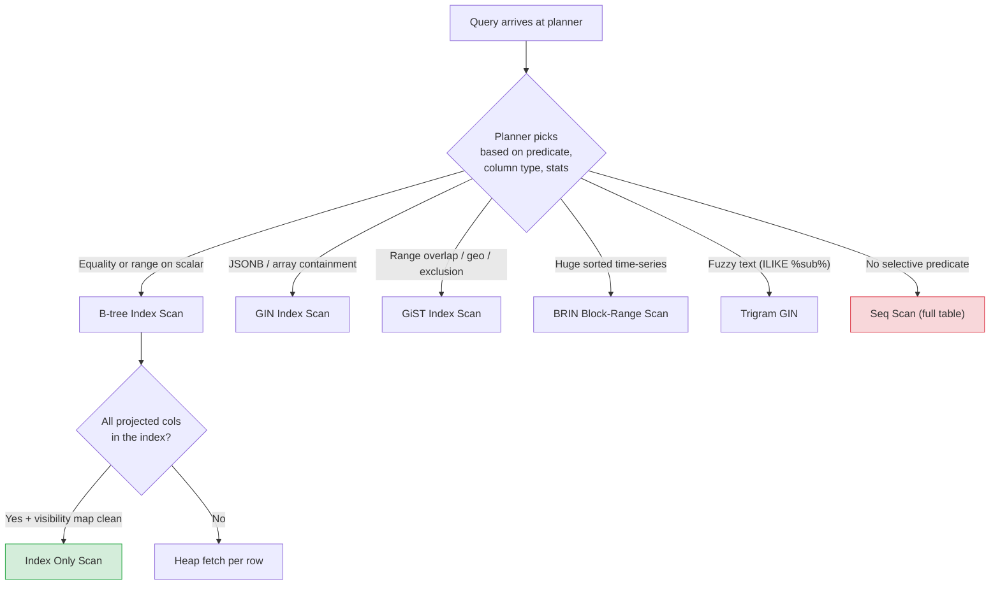

# Lesson 02: Indexes – Composite and Specialized

*Adding the indexes that make the Boardly schema scale — B-tree composites, GIN for JSONB and arrays, GiST for ranges, BRIN for time-series, partial and expression indexes, covering indexes with `INCLUDE`, and the cost of over-indexing.*

**Welcome to Lesson 2.**

The schema from Lesson 1 is correct — but it is slow. Every `WHERE organization_id = ? AND status = 'active' ORDER BY created_at DESC LIMIT 20` is a Seq Scan over millions of rows. Every `WHERE tags @> ARRAY['python']` is a full-table parse. Every case-insensitive email lookup is a `Seq Scan` with a `lower(email)` filter. In this lesson we add the indexes that turn those scans into probes — and we learn *when not to add an index*. Because indexes cost writes, and the table with twelve indexes is the table whose insert latency is destroying your throughput. Take it slow. Index deliberately. Measure before and after. **This is how you learn.**


#postgresql #indexes #btree #gin #gist #brin #performance

## Learning Objectives

By the end of this lesson you will be able to:

1. **Pick the right index family** for a column's type and query pattern — B-tree for equality/range on scalars, GIN for JSONB/arrays/full-text, GiST for ranges/geometry/exclusion, BRIN for time-series on huge sorted tables, SP-GiST for unbalanced data.
2. **Order columns in a composite index** to maximize plan reuse — equality columns first, then range, then sort — and explain *why* `(organization_id, created_at)` serves `WHERE organization_id = ? AND created_at > ?` but not the reverse.
3. **Build partial indexes** with `WHERE` clauses that match your queries' predicates — and explain the "predicate implication" rule that decides when a partial index is even considered.
4. **Build expression indexes** like `LOWER(email)` and `metadata->>'locale'` — and ensure the query matches the indexed expression *exactly*.
5. **Build covering indexes** with `INCLUDE` to enable `Index Only Scan` — and explain the visibility-map dependency that decides whether `Index Only Scan` actually skips the heap.
6. **Audit and prune indexes** that aren't pulling their weight, using `pg_stat_user_indexes` and the write-amplification cost.
7. **Use `CREATE INDEX CONCURRENTLY`** in production and recover from the half-built invalid index.
8. **Choose between `jsonb_path_ops` and the default GIN opclass** by the queries you actually run.

## Prerequisites

Before starting, you need:

- **The conceptual B-tree/GIN/GiST/BRIN lesson** — [[06-SQL-Fundamentals/Indexes-and-Query-Planning]]. That lesson taught the planner's vocabulary at a conceptual level. This lesson applies it to real Boardly queries.
- **The Boardly schema from Lesson 1** — [[Types-UUID-Identity-JSONB]]. The indexes we add here are on the tables designed there.
- **About 90 minutes of focused time.** The code is short; the explanation is long. Read it slowly.

**The most common gap: which index family for which query?**

Engineers coming from MySQL often know only B-tree. PostgreSQL has *five* practical index families: B-tree (default), GIN (inverted), GiST (generalized search tree), BRIN (block range), SP-GiST (space-partitioned GiST). Each supports a different operator set and is the right tool for a different query. The table below is your quick reference; the rest of the lesson is the deep dive.


## The Problem

Every index is a trade. The trade is: faster reads for slower writes, more disk for more cache hits. The right number of indexes is "enough that the hot queries are fast, no more." Most production tables have too many — because each new index "looked safe" when it was added, and nobody pruned the old ones.

The PostgreSQL-specific problem is that the wrong *family* of index is just as bad as no index at all. A B-tree on a JSONB column is useless (you cannot B-tree a JSON document). A GIN on a scalar `text` column is wasteful (a B-tree is half the size and supports `LIKE 'prefix%'`). A BRIN on a randomly-distributed column (a v4 UUID) is useless (BRIN needs monotonic data). Picking the right *family* is the first decision; picking the right *columns and order* is the second; picking *partial, expression, or covering* is the third; and pruning what doesn't pay is the fourth.

This lesson covers all four, applied to the Boardly schema.

## The Code

Here are the indexes we add to the Boardly schema from Lesson 1. Save as `boardly_indexes.sql`.

```sql
-- boardly_indexes.sql
-- Section 08, Lesson 02: indexes for the Boardly schema.
-- Builds on boardly_schema.sql from Lesson 1.

-- 1. Per-organization composite B-tree indexes (the workhorses)
CREATE INDEX users_home_org_active_idx
 ON users (home_org_id, created_at DESC)
 WHERE deleted_at IS NULL;

CREATE INDEX projects_org_owner_idx
 ON projects (organization_id, owner_id, created_at DESC)
 WHERE deleted_at IS NULL;

CREATE INDEX projects_org_status_idx
 ON projects (organization_id, status, created_at DESC)
 WHERE deleted_at IS NULL;

CREATE INDEX tasks_project_due_idx
 ON tasks (project_id, due_at)
 WHERE due_at IS NOT NULL;

CREATE INDEX comments_task_created_idx
 ON comments (task_id, created_at DESC);

-- 2. Case-insensitive email lookup (expression index)
CREATE UNIQUE INDEX users_email_lower_uniq
 ON users (LOWER(email))
 WHERE deleted_at IS NULL;

-- 3. GIN on tags arrays (the array containment index)
CREATE INDEX projects_tags_gin ON projects USING GIN (tags);
CREATE INDEX tasks_tags_gin ON tasks USING GIN (tags);

-- 4. GIN on JSONB metadata (from Lesson 1) — default opclass
-- (already created; shown here for completeness)
-- CREATE INDEX users_metadata_gin ON users USING GIN (metadata);
-- CREATE INDEX projects_metadata_gin ON projects USING GIN (metadata);
-- CREATE INDEX organizations_metadata_gin ON organizations USING GIN (metadata);

-- 5. jsonb_path_ops variant on tasks.metadata (smaller, @>-only)
CREATE INDEX tasks_metadata_pathops_idx
 ON tasks USING GIN (metadata jsonb_path_ops);

-- 6. Covering index for the "recent active projects" query pattern
-- (illustrates INCLUDE on the projects table)
CREATE INDEX projects_recent_active_covering_idx
 ON projects (organization_id, created_at DESC)
 INCLUDE (name, status, owner_id)
 WHERE deleted_at IS NULL;

-- 7. BRIN on the partitioned events table (time-series index)
CREATE INDEX events_occurred_brin
 ON events USING BRIN (occurred_at)
 WITH (pages_per_range = 32);

-- Also a composite B-tree on each partition for kind-scoped queries
CREATE INDEX events_2026_10_kind_idx
 ON events_2026_10 (kind, occurred_at DESC)
 WHERE kind IN ('project_viewed', 'task_moved', 'comment_posted');

-- 8. GiST exclusion constraint on a task_schedule table (range overlap)
CREATE TABLE task_schedule (
 id uuid PRIMARY KEY DEFAULT gen_random_uuid(),
 task_id uuid NOT NULL REFERENCES tasks(id) ON DELETE CASCADE,
 assignee_id uuid NOT NULL REFERENCES users(id) ON DELETE CASCADE,
 during tstzrange NOT NULL,
 EXCLUDE USING gist (task_id WITH =, during WITH &&)
);

CREATE INDEX task_schedule_during_gist ON task_schedule USING GIST (during);

-- 9. Trigram GIN for fuzzy text search on task and project titles
CREATE EXTENSION IF NOT EXISTS pg_trgm;
CREATE INDEX tasks_title_trgm ON tasks USING GIN (title gin_trgm_ops);
CREATE INDEX projects_name_trgm ON projects USING GIN (name gin_trgm_ops);

-- 10. Audit unused indexes — run this AFTER the workload has run for a while
-- SELECT schemaname, relname, indexrelname, idx_scan, idx_tup_read,
-- pg_size_pretty(pg_relation_size(indexrelid)) AS size
-- FROM pg_stat_user_indexes
-- WHERE idx_scan = 0
-- AND indexrelname NOT IN (
-- SELECT conname FROM pg_constraint WHERE contype IN ('u','p'))
-- ORDER BY pg_relation_size(indexrelid) DESC;
```

That's ~80 lines. Run it. Inspect with `\d+ users`. Query. Time. Drop the indexes you don't need. That's the loop.

## Line-by-Line Deep Dive

### Lines 5–8: The per-organization composite index

```sql
CREATE INDEX users_home_org_active_idx
 ON users (home_org_id, created_at DESC)
 WHERE deleted_at IS NULL;
```

**What this does:** Creates a B-tree composite index on `(home_org_id, created_at DESC)`, but only for rows where `deleted_at IS NULL`.

**Why each part:**

- `users (home_org_id, created_at DESC)` — the *sort key* of the B-tree. Rows are sorted by `home_org_id` first, then by `created_at DESC` within each organization. This serves two query patterns:
 - `WHERE home_org_id = ? AND created_at > ?` — equality on the first column, range on the second. The B-tree walks to the organization, then scans forward.
 - `WHERE home_org_id = ? ORDER BY created_at DESC LIMIT 20` — equality on the first column, the index already provides the `created_at DESC` order. No `Sort` node in the plan. This is the Boardly admin dashboard "recently joined users in this organization" query.
- `WHERE deleted_at IS NULL` — the **partial predicate**. The index only contains rows that are not soft-deleted. Three consequences:
 1. The index is smaller (no dead rows).
 2. The planner can use it for any query whose `WHERE` clause *implies* `deleted_at IS NULL` — i.e., `WHERE deleted_at IS NULL AND home_org_id = ?`. It cannot use the index for `WHERE home_org_id = ?` alone, because that query might also return soft-deleted rows.
 3. Statistics are more accurate — the planner knows the index contains exactly the active rows.

**The composite B-tree column-ordering rule**

A B-tree composite index on `(a, b, c)` is sorted by `a`, then `b`, then `c`. It serves:
- `WHERE a = ?` — yes (prefix match).
- `WHERE a = ? AND b = ?` — yes.
- `WHERE a = ? AND b = ? AND c = ?` — yes.
- `WHERE b = ? AND c = ?` — **no.** No prefix.
- `WHERE a = ? AND c = ?` — partial. Uses `a`, then filters on `c` from the matched rows.
- `ORDER BY a, b, c` — yes (the index already provides that order).
- `ORDER BY b, c` — no (no leading `a`).

The rule: **equality columns first, then range, then sort.** Sort columns must match the index order direction unless you want the planner to add a `Sort` node.


**Spot the bug — why won't this index serve `ORDER BY created_at ASC`?**

Answer: the index is ordered `(home_org_id ASC, created_at DESC)`. The index can serve `ORDER BY home_org_id ASC, created_at DESC` directly. It cannot serve `ORDER BY home_org_id ASC, created_at ASC` without a `Sort` node — the planner would have to read the index backwards, but mixed direction is impossible within a single B-tree. If you need both `ASC` and `DESC` orders on the same column, you need two indexes.


### Lines 10–17: More per-organization composites

```sql
CREATE INDEX projects_org_owner_idx
 ON projects (organization_id, owner_id, created_at DESC)
 WHERE deleted_at IS NULL;

CREATE INDEX projects_org_status_idx
 ON projects (organization_id, status, created_at DESC)
 WHERE deleted_at IS NULL;
```

**What this does:** Two composite indexes on `projects`, one for "projects by owner" and one for "projects by status."

**Why two instead of one:** A composite `(organization_id, owner_id, status, created_at DESC)` would serve both, but at the cost of a 4-column index. The choice depends on the queries. If both `owner_id` and `status` are *always* filtered together, the 4-column index wins. If they're filtered *separately*, two 3-column indexes win — each is smaller, more selective, and the planner can pick.

**Engineering judgement:** Two 3-column indexes beat one 4-column when the query patterns diverge. Three or more 3-column indexes on the same table means you should reconsider the access patterns — perhaps the schema is fighting you.

### Lines 19–23: Task- and comment-scoped indexes

```sql
CREATE INDEX tasks_project_due_idx
 ON tasks (project_id, due_at)
 WHERE due_at IS NOT NULL;

CREATE INDEX comments_task_created_idx
 ON comments (task_id, created_at DESC);
```

**What this does:**
- `tasks (project_id, due_at) WHERE due_at IS NOT NULL` — serves the Boardly "upcoming deadlines for this project" query. The partial predicate skips the ~30% of tasks that have no deadline, making the index ~30% smaller and selective.
- `comments (task_id, created_at DESC)` — serves the Boardly "all comments on a task, newest-first" query. The index already provides `created_at DESC` order; no `Sort` node.

**Why no `WHERE deleted_at IS NULL` predicate on `tasks` and `comments`:** `tasks` and `comments` don't have a `deleted_at` column (see Lesson 1's design — `tasks` are archived via `status`, and `comments` are hard-deleted via `ON DELETE CASCADE` on the task). A partial predicate would be a no-op.

### Lines 26–29: The expression index for case-insensitive email

```sql
CREATE UNIQUE INDEX users_email_lower_uniq
 ON users (LOWER(email))
 WHERE deleted_at IS NULL;
```

**What this does:** Creates a unique index on `LOWER(email)` — enforcing case-insensitive uniqueness among active users.

**Why `LOWER(email)` and not `email`:** Email is case-insensitive in practice (RFC 5321 says the local part is technically case-sensitive but every major provider treats it as insensitive). Without `LOWER`, you could have `Alice@example.com` and `alice@example.com` as distinct rows. With `LOWER`, they collide and the second insert is rejected.

**Why unique:** So the application doesn't have to enforce email uniqueness itself — the database does it.

**The query must match the expression:** This index serves `WHERE LOWER(email) = 'alice@example.com'`. It does *not* serve `WHERE email = 'alice@example.com'` (no expression match) or `WHERE email ILIKE 'alice@example.com'` (different operator). Be consistent.

**Warning — Expression indexes and the planner's reasoning**

The planner matches query predicates to indexed expressions by *syntactic equality*, not by *semantic equivalence*. So `WHERE lower(email) = 'alice@...'` matches the index; `WHERE email = lower('ALICE@...')` does not, even though they're semantically the same. The rule: pick one canonical form (we recommend `WHERE lower(email) = ?`) and use it everywhere.


**Danger — Security: expression indexes leak the soft-delete convention and query patterns to any connected role**

The `users_email_lower_uniq` index is exposed via `pg_indexes` (a `PUBLIC`-readable system view in PostgreSQL 17) to *every* login role with `CONNECT` on the database. An attacker with the most junior role runs `SELECT indexdef FROM pg_indexes WHERE tablename = 'users';` and learns (a) the soft-delete convention (`WHERE deleted_at IS NULL`), (b) the case-insensitive email policy (`LOWER(email)`), and (c) the exact column list of every covering index — without `SELECT`-ing a single row of `users`. The catalog itself cannot be fully locked down (the planner needs to read it to plan queries), so the threat-model response is access-layer: (a) revoke `CONNECT` on the production database from every role that does not need it, reserving it for the migrator and app roles; (b) treat index *names* and *predicates* as threat-model inputs — assume an attacker who can `CONNECT` knows your query patterns, and do not rely on "the index is hidden"; (c) pair with row-level security on `users` itself. See [[Roles-Permissions-Security]] and [[11-Authentication-and-Security/Threat-Model-First]]. The general rule: an index is a public declaration of how you query the table.


### Lines 32–34: GIN on the `tags` arrays

```sql
CREATE INDEX projects_tags_gin ON projects USING GIN (tags);
CREATE INDEX tasks_tags_gin ON tasks USING GIN (tags);
```

**What this does:** Creates GIN indexes on the Boardly `tags text[]` columns on `projects` and `tasks` (both Boardly tables from Lesson 1 support tag arrays).

**Why GIN for arrays:** An array is a non-scalar value. A B-tree cannot index "the array contains `python`" — it can only index "the array is exactly `['python','rust']`." GIN is an inverted index: it maps each *element* of each array to the TID of the row containing it. So `WHERE 'python' = ANY(tags)` (or `tags @> ARRAY['python']`) is a GIN probe, not a Seq Scan.

**The operators GIN supports on arrays:**
- `@>` — contains (the array on the left contains all elements of the array on the right).
- `<@` — contained by.
- `&&` — overlaps (any common element).
- `=` — equality (the arrays are identical).

`ANY` and `@>` are the common query forms. `WHERE 'python' = ANY(tags)` is rewritten internally to `tags @> ARRAY['python']` by the planner, so both use the GIN.

**Warning — Debugging: GIN queries slow down right after a bulk insert, then recover**

The default `fastupdate = on` batches GIN inserts into a pending list capped by `gin_pending_list_limit` (default 4 MB per index). Under write pressure the pending list fills, the index goes "pending," and queries that touch the GIN degrade from sub-millisecond to multi-second until the pending list is flushed by autovacuum or a manual `VACUUM`. The symptom is distinctive: latency spikes 30 to 60 seconds after every bulk load, then settles. Debug the cycle with `SELECT * FROM pg_stat_user_indexes WHERE indexrelname LIKE '%_gin';` — a `idx_scan` climbing while `idx_tup_read` stays flat means the pending list is being scanned repeatedly. The fix is workload-specific: `ALTER INDEX projects_tags_gin SET (fastupdate = off);` for low-latency query workloads (every insert updates the GIN immediately, slower writes, consistent reads); or `ALTER SYSTEM SET gin_pending_list_limit = '32MB';` for read-heavy JSONB with moderate inserts. Run `VACUUM projects;` once after the change to flush the existing pending list. See [[13-Performance-and-Observability/N-plus-1-and-Slow-Queries]] for the slow-query triage loop.


### Lines 38–40: The `jsonb_path_ops` variant

```sql
CREATE INDEX tasks_metadata_pathops_idx
 ON tasks USING GIN (metadata jsonb_path_ops);
```

**What this does:** Creates a GIN index on `tasks.metadata` using the `jsonb_path_ops` operator class instead of the default `jsonb_ops`.

**Why a different opclass:** The default GIN opclass (`jsonb_ops`) supports the full JSONB operator family: `@>`, `<@`, `?`, `?|`, `?&`, `@?` (JSON path), `@@` (JSON path with expression). It is the right default.

`jsonb_path_ops` is a *smaller, faster* opclass that supports *only* `@>` (containment). It is ~30% the size of the default GIN and faster for the only query it serves. If your JSONB queries are all containment (`@>`), `jsonb_path_ops` wins. If you need `?` (key existence) or `@?` (path), you need the default.

**Tip — Pick the opclass by the queries you run**

- Default `jsonb_ops`: full operator family. Larger, slower. The right default.
- `jsonb_path_ops`: `@>` only. Smaller, faster. Pick when you've measured and your workload is `@>`-only.
Don't index the same column twice — pick one. If you need both, the default wins (it's the right tool for the unknown).


### Lines 43–47: The covering index

```sql
CREATE INDEX projects_recent_active_covering_idx
 ON projects (organization_id, created_at DESC)
 INCLUDE (name, status, owner_id)
 WHERE deleted_at IS NULL;
```

**What this does:** Creates a B-tree on `(organization_id, created_at DESC)` but *also stores* `name`, `status`, and `owner_id` in the index leaf pages.

**Why `INCLUDE`:** The "recent active projects for organization" query returns `name`, `status`, `owner_id` for the top 20. Without `INCLUDE`, the planner probes the index to find the matching TIDs, then fetches each row from the heap (the table) to get the projected columns. With `INCLUDE`, the index leaf page *already contains* `name`, `status`, `owner_id` — the heap is never touched. This is `Index Only Scan`, the fastest possible read.

**The difference between key columns and `INCLUDE` columns:**
- Key columns (`organization_id, created_at DESC`) are part of the B-tree sort key. They're used for navigation (equality/range probing) and ordering.
- `INCLUDE` columns (`name, status, owner_id`) are stored in the leaf pages but are *not* part of the sort key. They cannot be used for `WHERE` filtering or `ORDER BY` — they exist solely to enable `Index Only Scan`.

**The visibility-map dependency**

`Index Only Scan` works only when the heap page containing the row is marked "all visible" in the visibility map. The visibility map is maintained by `VACUUM`. If a row's heap page has uncommitted or recently-dead tuples, the index leaf page can claim the row, but the planner still has to fetch the heap to check MVCC visibility. So `Index Only Scan` *degrades* to "index + visibility-check heap fetch" on a non-vacuumed table.
The implication: keep autovacuum tuned. If your `Index Only Scan` is slow, the visibility map is stale.


**Student asks: when do I put a column in the B-tree key vs `INCLUDE`?**

A column belongs in the *key* (`ON projects (organization_id, created_at)`) when the query uses it for *navigation* — equality (`WHERE organization_id = ?`), range (`created_at > ?`), or ordering (`ORDER BY created_at DESC`). A column belongs in `INCLUDE` (`INCLUDE (name, status, owner_id)`) when the query *only projects it back* — i.e., the query does not filter on it but does `SELECT` it. The diagnostic question: "would the planner *use this column to narrow down rows*, or only *to satisfy the SELECT list*?" If the former, key; if the latter, `INCLUDE`. The cost of putting a column in the key unnecessarily is real: the B-tree sort key gets wider, the planner's reasoning about range queries against it becomes less efficient, and inserts get slower (more keys per leaf). The cost of putting a key column in `INCLUDE` is worse: the index cannot answer the query at all, because `INCLUDE` columns cannot filter.


### Lines 50–55: BRIN on the time-series events table

```sql
CREATE INDEX events_occurred_brin
 ON events USING BRIN (occurred_at)
 WITH (pages_per_range = 32);
```

**What this does:** Creates a BRIN (Block Range Index) on `events.occurred_at`.

**Why BRIN:** The `events` table is a time-series. The data is naturally ordered by `occurred_at` (we partition by month and insert in time order). A BRIN stores, for each block range of the heap, the *min and max* value of the column. A query like `WHERE occurred_at >= '2026-10-01'` skips entire block ranges whose `max` is below the threshold — without reading them.

**Size:** A B-tree on a 1B-row table is ~21 GB. A BRIN on the same table is ~5 MB. The B-tree is faster for a single-row lookup; the BRIN is faster for a range scan on a sorted table — and it's 4000× smaller.

**`pages_per_range = 32`:** The number of heap pages summarized per BRIN entry. The default is 128. Smaller ranges (32) mean finer-grained skipping but a larger index. For time-series with a typical 1-month query window, 128 (the default) is fine; for tighter windows, 32 is better.

**Warning — BRIN requires naturally-ordered data**

BRIN works only when the table is naturally ordered by the indexed column. Two requirements:
1. The table must be **physically sorted** by the column. Time-series insert order is the canonical case. A table where rows arrive in random order (e.g., inserts keyed by v4 UUID) is not naturally ordered — BRIN on it is useless.
2. The data must be **monotonic per block range**. If a single 8 KB heap page contains rows from many time periods (e.g., a reindex shuffled them), BRIN's min/max summary is unhelpful.
If you're not sure, measure: BRIN vs B-tree on a real query, on your data, at your scale. Don't assume BRIN wins.


**Student asks: a B-tree is 21 GB and a BRIN is 5 MB on the same billion-row table — why is the B-tree ever worth it?**

Because they answer different questions. A BRIN answers "give me all rows whose `occurred_at` is in this range, and the table is sorted by `occurred_at`" — it skips block ranges by their min/max, so it is brilliant for time-bucket scans on a monotonic table. A B-tree answers "give me the row(s) where `occurred_at = '2026-10-15 14:32:00.123456+00'`" — a single-point lookup — and that one-row lookup is what an alerting dashboard wants when an event is shown in detail. BRIN cannot answer that point lookup without scanning the matching block range; the B-tree does it in O(log N). The 21 GB is the price of "every single-point lookup is O(log N)." On a time-series table, you usually keep *both*: BRIN for the bulk scans, B-tree for the single-row lookups.


### Lines 58–61: The composite B-tree on the events partition

```sql
CREATE INDEX events_2026_10_kind_idx
 ON events_2026_10 (kind, occurred_at DESC)
 WHERE kind IN ('project_viewed', 'task_moved', 'comment_posted');
```

**What this does:** A composite, partial index on the October partition of the `events` table.

**Why a B-tree on the partition when we already have BRIN on the parent:** BRIN is good for "scan all events in a window." B-tree is good for "all events in a window *for one kind*" (e.g., all `task_moved` events in the last 7 days). The two queries have different shapes: BRIN shines on bulk range scans; B-tree shines on selective kind+range queries. Both indexes coexist on the partitioned table — partition pruning picks the partition, the B-tree picks the rows.

**Why partition-specific and not on the parent:** In PostgreSQL 17, you can create indexes on the partitioned parent and they're propagated to each child partition. But for *partial* indexes with kind-specific predicates, per-partition is sometimes clearer. Both forms work; pick the one that matches your mental model.

**Production reality: partition pruning failure turns one B-tree probe into twelve Seq Scans**

A teammate writes `SELECT count(*) FROM events WHERE occurred_at >= '2026-10-01' AND kind = 'task_moved';` expecting the planner to prune to the `events_2026_10` partition and use the partial B-tree. The plan shows an `Append` of `Seq Scan` across all twelve monthly partitions instead. The two common causes: (a) the query's `occurred_at` literal was cast to `timestamp without time zone` while the column is `timestamptz`, defeating the partition-boundary comparison — fix by typing every query literal as `timestamptz` (`WHERE occurred_at >= '2026-10-01'::timestamptz`); (b) `enable_partition_pruning` was set to `off` on the session (a leftover from a debugging session two weeks ago) — fix with `SHOW enable_partition_pruning;` and `SET enable_partition_pruning = on;`. Debug both with `EXPLAIN` — the plan reports "Subplans Removed: 11" when pruning works, "Subplans Removed: 0" when it does not. The production default is `enable_partition_pruning = on` in `postgresql.conf`; verify it. See [[Types-UUID-Identity-JSONB]] for the `timestamptz` discipline and [[13-Performance-and-Observability/N-plus-1-and-Slow-Queries]] for the slow-query triage loop.


### Lines 64–70: The GiST exclusion constraint

```sql
CREATE TABLE task_schedule (
 id uuid PRIMARY KEY DEFAULT gen_random_uuid(),
 task_id uuid NOT NULL REFERENCES tasks(id) ON DELETE CASCADE,
 assignee_id uuid NOT NULL REFERENCES users(id) ON DELETE CASCADE,
 during tstzrange NOT NULL,
 EXCLUDE USING gist (task_id WITH =, during WITH &&)
);

CREATE INDEX task_schedule_during_gist ON task_schedule USING GIST (during);
```

**What this does:** Creates a `task_schedule` table with an *exclusion constraint* preventing two scheduled work sessions of the same task from overlapping in time. (A task can have many scheduled sessions, but they cannot overlap.)

**Why this is the killer GiST feature:** A `UNIQUE` constraint can only say "no two rows have the same value in this column." An exclusion constraint can say "no two rows have *overlapping* values across these columns" — using *any* operator, not just `=`. The constraint `EXCLUDE USING gist (task_id WITH =, during WITH &&)` reads as: "no two rows where `task_id` is equal AND `during` overlaps (`&&`)."

**What GiST is, internally:** GiST (Generalized Search Tree) is a framework for "balanced search tree over non-scalar data." Different operator classes plug into it: range overlap (`&&`), geometric overlap, trigram similarity (`%`), inet containment. The exclusion constraint above is backed by a GiST index that the planner uses to check the constraint on every INSERT/UPDATE.

**The separate `task_schedule_during_gist` index:** The exclusion constraint's GiST index serves constraint-checking (the `INSERT` path). For `WHERE during && tstzrange('2026-10-01', '2026-10-07')` queries, the same index serves both purposes — you don't strictly need the second index. We add it explicitly to make the access pattern obvious; in production you'd profile and drop if redundant.

**Example — Exclusion constraints are impossible with CHECK or UNIQUE**

You cannot express "no overlapping time ranges" with `CHECK` (which is per-row) or `UNIQUE` (which is per-column-equality). The exclusion constraint is the only way. Use it for: task schedules, room bookings, reservations, IP allocation ranges — anything where "no overlap" is the invariant.


**Warning — Debugging: the exclusion constraint rejects an INSERT it should allow**

The symptom: an `INSERT INTO task_schedule (...)` fails with `conflicting key value violates exclusion constraint` but `SELECT * FROM task_schedule WHERE during && tstzrange('<new_start>', '<new_end>');` returns zero rows. The cause is almost always a recently-deleted tuple whose death has not been vacuumed yet — the exclusion check traverses the GiST index, which still holds the dead tuple's entry, and the dead tuple's `during` overlaps the new INSERT. The fix is `VACUUM task_schedule;` (or wait for autovacuum), then retry the INSERT. The deeper fix is tuning autovacuum on write-heavy GiST tables: `ALTER TABLE task_schedule SET (autovacuum_vacuum_scale_factor = 0.05);` so the table is vacuumed more aggressively. Debug the dead-tuple count with `CREATE EXTENSION IF NOT EXISTS pgstattuple; SELECT dead_tuple_count, dead_tuple_percent FROM pgstattuple('task_schedule');` — anything above 10% means autovacuum is losing the race. See [[13-Performance-and-Observability/N-plus-1-and-Slow-Queries]] for the autovacuum-tuning loop.


### Lines 73–75: Trigram GIN for fuzzy text search

```sql
CREATE EXTENSION IF NOT EXISTS pg_trgm;
CREATE INDEX tasks_title_trgm ON tasks USING GIN (title gin_trgm_ops);
CREATE INDEX projects_name_trgm ON projects USING GIN (name gin_trgm_ops);
```

**What this does:** Creates trigram GIN indexes on `tasks.title` and `projects.name`, supporting `LIKE '%substring%'` and `ILIKE` queries that B-tree cannot serve.

**Why trigram:** A B-tree can serve `LIKE 'prefix%'` (using `text_pattern_ops`), because the index is sorted and the prefix maps to a range. But `LIKE '%substring%'` — where the substring is in the middle — cannot use a B-tree at all, because the prefix is unknown.

A trigram index breaks the text into 3-character substrings ("tri-grams") and GIN-indexes them. `LIKE '%python%'` is rewritten as "find rows whose trigram set contains the trigrams of `python`." This is approximate (it returns candidate rows), and PostgreSQL then filters them by exact `LIKE`. The result: `LIKE '%python%'` on a 10M-row table goes from 30 seconds (Seq Scan) to 50 ms (GIN + filter).

**The trigram GiST variant:** `USING GIST (title gist_trgm_ops)` is also supported and is *faster for similarity* (`%` operator) but slower for `LIKE`. Pick by query type. Apply on `tasks.title` or `projects.name` — both are Boardly columns where fuzzy search is useful ("find the task with 'login' in the title").

**When to use `text_pattern_ops` vs `pg_trgm`**

- `text_pattern_ops` (a B-tree opclass): serves `LIKE 'prefix%'` only. Use it when your only pattern query is prefix search.
- `pg_trgm` (GIN or GiST): serves `LIKE '%substring%'` and similarity (`%`). Use it for general fuzzy search.
If your queries are all prefix, the B-tree opclass wins (smaller, simpler). For anything else, trigram.


**Production reality: trigram GIN is 3 to 5 times the size of the underlying text column**

A trigram GIN index on a `VARCHAR(200)` column on a 10 M-row table is typically 3 to 5 GB — three to five times the size of the column data itself. On `tasks.title` (Boardly's `String(200)`) at 10 M rows, the trigram GIN can exceed the table's heap size. The production pattern is to measure before committing: `SELECT pg_size_pretty(pg_relation_size('tasks_title_trgm')) AS idx, pg_size_pretty(pg_total_relation_size('tasks') - pg_relation_size('tasks_title_trgm')) AS heap;` and audit `idx_scan` over a representative week. If `idx_scan` is low (the fuzzy search is rarely used) and the index is large, drop it and move the fuzzy search to application-side `tsvector` indexing (`ALTER TABLE tasks ADD COLUMN title_tsv tsvector GENERATED ALWAYS AS (to_tsvector('english', title)) STORED; CREATE INDEX tasks_title_tsv ON tasks USING GIN (title_tsv);`) — the `tsvector` GIN is roughly 10x smaller and serves full-text queries that trigram cannot (`phraseto_tsquery`, websearch syntax). See [[Types-UUID-Identity-JSONB]] for the JSONB-vs-tsvector trade-off and [[13-Performance-and-Observability/N-plus-1-and-Slow-Queries]] for the size-vs-scan audit loop.


### Lines 78–84: The unused-index audit

```sql
SELECT schemaname, relname, indexrelname, idx_scan, idx_tup_read,
 pg_size_pretty(pg_relation_size(indexrelid)) AS size
FROM pg_stat_user_indexes
WHERE idx_scan = 0
 AND indexrelname NOT IN (
 SELECT conname FROM pg_constraint WHERE contype IN ('u','p'))
ORDER BY pg_relation_size(indexrelid) DESC;
```

**What this does:** Lists every user index that has had zero scans since the last `pg_stat_reset()`, excluding indexes that back primary-key or unique constraints.

**Why this is the most important query in this lesson:** Every index costs writes. An index with `idx_scan = 0` since the last stats reset is paying its write cost and returning zero read benefit. Drop it. The exception is indexes that back constraints — they exist for correctness, not for query speed, and `idx_scan` doesn't count constraint checks.

**Danger — The untested index drop is a footgun**

The `idx_scan = 0` filter can be misleading:
1. Stats reset on `pg_stat_reset()` — if you ran that recently, your "unused" list is wrong. Look at the value over a representative window (a week of production traffic).
2. Some indexes serve queries that run only monthly (billing, reporting). Look at `idx_scan` over a *representative* window before dropping.
3. Dropping an index in production should always go through `DROP INDEX CONCURRENTLY` — and you should test the resulting plan changes on a replica first.
Use this query as a *candidate list*, not a kill list.


**Danger — Security: the audit query itself is a threat-model input**

The unused-index audit reads `pg_stat_user_indexes`, which is `PUBLIC`-readable in PostgreSQL 17. An attacker with `CONNECT` on the database runs the audit and learns (a) which indexes exist and therefore which queries the application runs, (b) which indexes are *never scanned* and therefore which features are dormant or deprecated, and (c) the approximate size of each table's index footprint — all without `SELECT` on any user table. The `idx_scan = 0` list is a roadmap of "where the application is not exercising the schema," which is also a roadmap of "where a new feature could be added without breaking anything the attacker wants to exploit." The defense is layered: (a) revoke `CONNECT` on the production database from every role that does not need it; (b) run the audit from a dedicated `boardly_migrator` role that is the only non-superuser with `CONNECT`; (c) treat the index list as a threat-model input — assume an attacker who can `CONNECT` knows your query patterns. See [[Roles-Permissions-Security]] and [[11-Authentication-and-Security/OWASP-API-Top-10]] for the role-hygiene and threat-model patterns.


## Execution Trace

What happens when a query uses each index family.

```sql
-- 1. B-tree composite, partial
EXPLAIN SELECT id, email, display_name FROM users
WHERE home_org_id = '6c7d...' AND deleted_at IS NULL
ORDER BY created_at DESC LIMIT 20;
-- Expected: Index Scan using users_home_org_active_idx

-- 2. Index Only Scan (covering index)
EXPLAIN SELECT organization_id, created_at, name, status, owner_id
FROM projects
WHERE organization_id = '6c7d...' AND deleted_at IS NULL
ORDER BY created_at DESC LIMIT 20;
-- Expected: Index Only Scan using projects_recent_active_covering_idx

-- 3. GIN on tags array
EXPLAIN SELECT * FROM projects WHERE 'python' = ANY(tags);
-- Expected: Bitmap Index Scan on projects_tags_gin

-- 4. GIN on JSONB
EXPLAIN SELECT * FROM tasks WHERE metadata @> '{"priority":"high"}';
-- Expected: Bitmap Index Scan on tasks_metadata_pathops_idx

-- 5. Expression index
EXPLAIN SELECT * FROM users WHERE lower(email) = 'alice@example.com' AND deleted_at IS NULL;
-- Expected: Index Scan using users_email_lower_uniq

-- 6. BRIN on time-series
EXPLAIN SELECT count(*) FROM events WHERE occurred_at >= '2026-10-01';
-- Expected: Bitmap Index Scan on events_occurred_brin

-- 7. GiST exclusion (constraint check)
INSERT INTO task_schedule (task_id, assignee_id, during) VALUES
 ('7a8b9c0d-...', '6c7d8e2f-...', tstzrange('2026-10-01 10:00', '2026-10-01 12:00'));
-- (succeeds)
INSERT INTO task_schedule (task_id, assignee_id, during) VALUES
 ('7a8b9c0d-...', '6c7d8e2f-...', tstzrange('2026-10-01 11:00', '2026-10-01 13:00'));
-- ERROR: conflicting key value violates exclusion constraint

-- 8. Trigram GIN
EXPLAIN SELECT * FROM tasks WHERE title ILIKE '%python%';
-- Expected: Bitmap Index Scan on tasks_title_trgm
```



**You've just indexed a real schema.**

The schema from Lesson 1 now has B-tree composites for the per-organization queries, a unique expression index for case-insensitive email, GIN for tags and JSONB and trigram, GiST for range exclusion, BRIN for the time-series, and a covering index for the dashboard. The plan choices the planner makes are now *good* choices. Lesson 3 is where you learn to read those plans.


## Common Mistakes

### Mistake 1: Two single-column indexes where a composite would do

```sql
-- WRONG
CREATE INDEX projects_org_idx ON projects (organization_id);
CREATE INDEX projects_owner_idx ON projects (owner_id);
-- Query: WHERE organization_id = ? AND owner_id = ?
```

**Symptom:** The planner BitmapAnd-s the two indexes — possible but slower and larger than a composite.

**Why:** Two single-column indexes can be combined by the planner via BitmapAnd, but a single composite `(organization_id, owner_id)` is smaller, faster, and serves more queries.

**Fix:** `CREATE INDEX projects_org_owner_idx ON projects (organization_id, owner_id, created_at DESC);`

### Mistake 2: Composite indexes with range columns first

```sql
-- WRONG
CREATE INDEX projects_created_org_idx
 ON projects (created_at DESC, organization_id);
-- Query: WHERE organization_id = ? AND created_at > ?
```

**Symptom:** The index isn't used for the query — the planner falls back to a Seq Scan.

**Why:** The index is sorted by `created_at` first, then `organization_id`. The query has equality on `organization_id` (the *second* column) — no prefix match.

**Fix:** Equality columns first, then range, then sort. `(organization_id, created_at DESC)`.

### Mistake 3: Partial indexes the query doesn't imply

```sql
-- Index:
CREATE INDEX users_active_idx ON users (email) WHERE deleted_at IS NULL;

-- Query that doesn't use the index:
SELECT * FROM users WHERE email = 'alice@example.com';
-- (No mention of deleted_at — the planner can't guarantee the index is sufficient)
```

**Symptom:** The index isn't used even though it's exactly what you'd want for an active-user lookup.

**Why:** The index's predicate is `WHERE deleted_at IS NULL`. The query has no `deleted_at IS NULL` predicate, so it could match soft-deleted rows the index doesn't contain. The planner can't use the index.

**Fix:** Make the query's predicate imply the index's. `SELECT * FROM users WHERE email = ? AND deleted_at IS NULL`.

### Mistake 4: Using `text_pattern_ops` when you mean a trigram

```sql
-- WRONG (only serves prefix LIKE)
CREATE INDEX tasks_title_prefix ON tasks (title text_pattern_ops);
-- Query: WHERE title LIKE '%python%' — not served
```

**Symptom:** The `LIKE '%substring%'` query is still a Seq Scan.

**Why:** `text_pattern_ops` supports `LIKE 'prefix%'` only (because the index is sorted and the prefix maps to a B-tree range). It does not help `LIKE '%suffix%'` or `LIKE '%substring%'`.

**Fix:** Use `pg_trgm` GIN. `CREATE EXTENSION pg_trgm; CREATE INDEX tasks_title_trgm ON tasks USING GIN (title gin_trgm_ops);`

### Mistake 5: Forgetting `ANALYZE` after a bulk load

```sql
-- Sequence:
COPY tasks FROM '/tmp/tasks.csv' WITH (FORMAT csv);
-- Now query: SELECT * FROM tasks WHERE project_id = ?
-- The planner uses stale statistics and picks a Seq Scan.
```

**Symptom:** The planner chooses a Seq Scan even though a perfect index exists.

**Why:** `ANALYZE` updates the planner's statistics. A bulk `COPY` doesn't trigger autovacuum's analyze threshold immediately. The planner reasons about the table as if it had 100 rows when it has 10M.

**Fix:** `ANALYZE tasks;` after the load.

### Mistake 6: Leaving invalid indexes after a failed `CONCURRENTLY`

```sql
CREATE INDEX CONCURRENTLY tasks_status_idx ON tasks (status);
-- ... long-running; a long-running transaction blocks it
-- ... it fails midway and leaves an invalid index
```

**Symptom:** The index sits there consuming space and write budget, but `indisvalid = false` so the planner never uses it.

**Why:** `CREATE INDEX CONCURRENTLY` doesn't take an `ACCESS EXCLUSIVE` lock, so it can run while traffic is flowing. But it can also fail midway (a long-running transaction conflicts). On failure, the index is left behind in an invalid state.

**Fix:** Detect with `SELECT indexrelname, indisvalid FROM pg_index JOIN pg_class ON c.oid = i.indexrelid WHERE c.relname LIKE 'tasks_%';`. Drop invalid indexes with `DROP INDEX CONCURRENTLY tasks_status_idx;`. Recreate.

### Mistake 7: Indexing every foreign key

```sql
-- WRONG (reflexive)
CREATE INDEX tasks_assignee_fk_idx ON tasks (assignee_id);
CREATE INDEX memberships_org_fk_idx ON memberships (organization_id);
-- ... etc.
```

**Symptom:** A write-heavy table with eight FK indexes, half of them never scanned.

**Why:** PostgreSQL does *not* auto-index foreign keys (unlike some databases). It's a common reflex to add them. But not every FK is queried — some are only there for `ON DELETE CASCADE`. Audit `idx_scan` before assuming an FK needs an index. The `tasks.assignee_id` and `memberships.organization_id` indexes in our schema are explicit choices, not reflexes.

**Fix:** Add FK indexes for FKs that are joined on, or where `ON DELETE` performance matters. Audit and drop FK indexes that have `idx_scan = 0` over a representative window.

### Mistake 8: Over-indexing write-heavy tables

```sql
-- WRONG (six indexes on a high-write table)
CREATE TABLE events (...);
CREATE INDEX events_kind_idx ON events (kind);
CREATE INDEX events_time_idx ON events (occurred_at);
CREATE INDEX events_kk_idx ON events (kind, occurred_at);
CREATE INDEX events_kd_idx ON events (kind, due_at);
CREATE INDEX events_kp_idx ON events (kind, payload);
CREATE INDEX events_pk_idx ON events (payload, kind);
-- Now inserts are 6× slower than with one index.
```

**Symptom:** Insert latency is destroying throughput. The schema's indexes are paying for reads nobody runs.

**Why:** Each `INSERT` (and each `UPDATE` of an indexed column) touches every index. Six indexes = six writes per insert.

**Fix:** Audit with `pg_stat_user_indexes`. Drop the indexes with `idx_scan = 0` over a representative window. Consider partitioning if the table can't be reduced — partition pruning narrows the planner's scope per query, and per-partition indexes are smaller.

### Mistake 9: Defaulting to `btree` for a column that only ever needs equality

```sql
-- Wrong default
CREATE INDEX users_role_idx ON users (role);
```

**Symptom:** The B-tree is 3× the size of a `hash` index would be, with no benefit.

**Why:** A B-tree supports `=`, `<`, `>`, `BETWEEN`, `IN`, `IS NULL`, prefix-`LIKE`. If you only ever query `WHERE role = 'admin'`, a `hash` index is smaller and equality-only. (Hash indexes are crash-safe since PostgreSQL 10.)

**Fix:** Measure. If your query workload on a column is equality-only and high-volume, a `hash` index is smaller and faster. But hash indexes cannot back unique constraints or serve range queries — only use them when you've measured the win.

## Engineering Trade-Offs

### B-tree vs BRIN on time-series

- **B-tree** — ~10× the size of BRIN for a monotonic column. Faster for single-row lookups, supports all comparison operators.
- **BRIN** — tiny on disk (hundreds of MB on a 1B-row table), fast for range scans, useless for single-row lookups and useless on unordered data.

The rule: B-tree for selective queries on any column; BRIN for range scans on naturally-ordered huge tables.

### Partial vs full index

- **Partial** — smaller, the predicate is "free" selectivity, more accurate stats.
- **Full** — serves any query, no implication requirement.

The rule: partial when the predicate is on every query (e.g., `WHERE deleted_at IS NULL` is on every active-user query); full when queries vary.

### Covering vs minimal

- **Covering (`INCLUDE`)** — serves more queries Index-Only, larger, more expensive to maintain.
- **Minimal** — smaller, faster to maintain, requires heap fetch for non-key columns.

The rule: covering when the projection is small and the query frequency is high; minimal when the projection is wide or the query is rare.

### GIN `fastupdate` on/off

- **`fastupdate=on` (default)** — inserts batched into a pending list, fast inserts, slower queries until the list is flushed.
- **`fastupdate=off`** — every insert updates the GIN immediately, slower inserts, consistent query latency.

The rule: `on` for read-heavy JSONB with moderate inserts; `off` for low-latency query workloads with high write churn.

### `jsonb_path_ops` vs default GIN opclass

- **Default `jsonb_ops`** — supports full JSONB operator family, larger.
- **`jsonb_path_ops`** — supports `@>` only, ~30% the size, faster.

The rule: `jsonb_path_ops` when you've measured and your workload is `@>`-only; default otherwise.

### `CREATE INDEX CONCURRENTLY` vs blocking `CREATE INDEX`

- **`CONCURRENTLY`** — no `ACCESS EXCLUSIVE` lock, runs while traffic flows, slower, can fail and leave an invalid index.
- **Blocking** — `ACCESS EXCLUSIVE` lock, faster, no traffic during creation, never fails midway.

The rule: `CONCURRENTLY` in production always. The slower creation is worth the zero-downtime. Block only in dev or during a maintenance window.

### Hash vs B-tree

- **B-tree** — the right default. Supports all comparison operators, unique constraints, range queries.
- **Hash** — smaller, equality-only, no unique constraints, no range.

The rule: B-tree. Hash only when you've profiled the savings on a high-volume equality-only column and don't need unique or range.

**Student asks: I have a partial index `WHERE deleted_at IS NULL` and a query that says `WHERE deleted_at IS NULL AND ...`. Why does the planner sometimes still Seq Scan?**

Three reasons, in order of frequency. **(1) The planner estimates the predicate matches too many rows.** If 5% of rows are soft-deleted, then 95% are active — a partial index on `WHERE deleted_at IS NULL` covers 95% of the table, and the planner may correctly judge that a Seq Scan is cheaper than an Index Scan that touches 95% of heap pages randomly. The fix is not the index — it is your selectivity estimate; if you really need Index Scan here, narrow the predicate (e.g., `WHERE deleted_at IS NULL AND status = 'active'`). **(2) The query's predicate does not imply the index's predicate.** `WHERE deleted_at IS NULL` implies the index's `WHERE deleted_at IS NULL` trivially. But `WHERE deleted_at IS DISTINCT FROM '1970-01-01'` (a fancier way of saying "not soft-deleted") does *not* imply it — the planner cannot prove equivalence, so it cannot use the partial index. The fix is to write the predicate the same way the index does, or use `ALTER TABLE ... ALTER COLUMN ... SET STATISTICS 1000` so the planner can reason about it. **(3) Stale stats on the partial-index predicate.** If `ANALYZE` has not run since the soft-delete column was populated, the planner's estimate of "how many rows match `WHERE deleted_at IS NULL`" is a guess, and the guess drives the Seq-Scan-vs-Index-Scan choice. The fix is `VACUUM ANALYZE` the table. The general principle: a partial index is a *contract* — the query must meet the contract (imply the predicate), and the planner must be able to *prove* the contract is met.


## Exercises

**Tip — The 20-minute rule**

If you're stuck on an exercise for more than 20 minutes, re-read the relevant section, then move on. Learning isn't linear.


**Exercise 1 — Add the indexes.** Save `boardly_indexes.sql` and run it against the schema from Lesson 1. Inspect with `\d+ users`, `\d+ projects`, `\d+ tasks`. Confirm each index exists.

**Exercise 2 — Verify the index is used.** For each query in the "Execution Trace" section, run `EXPLAIN` (not `ANALYZE` yet — Lesson 3) and confirm the index name appears in the plan. If it doesn't, figure out why (predicate implication? expression mismatch? stale stats?).

**Exercise 3 — Test the exclusion constraint.** Insert a booking. Try to insert an overlapping booking for the same resource. Confirm the second is rejected. Try to insert an overlapping booking for a *different* resource — should succeed.

**Exercise 4 — Compare GIN opclasses.** Create a `tasks_metadata_gin_default` (default opclass) and `tasks_metadata_pathops` (`jsonb_path_ops`). Compare sizes with `SELECT pg_size_pretty(pg_relation_size('tasks_metadata_gin_default'));`. Run a `@>` query under `EXPLAIN ANALYZE` and compare timings.

**Exercise 5 — Audit unused indexes.** Run the audit query at the bottom of `boardly_indexes.sql`. Identify any indexes with `idx_scan = 0` (in a real workload, you'd let it run for a week first). If you find any, write the `DROP INDEX CONCURRENTLY` statement.

**Exercise 6 — Spot the bug.** This index is created:

```sql
CREATE INDEX users_email_idx ON users (email) WHERE deleted_at IS NULL;
```

But this query doesn't use it:

```sql
SELECT * FROM users WHERE lower(email) = 'alice@example.com';
```

Why not? What two changes (one to the index, one to the query) would make it work?

(Answer: the query uses `lower(email)` as the predicate, but the index is on `email`. Either change the index to `(lower(email))` and the query to `WHERE lower(email) = ? AND deleted_at IS NULL`, or change the query to `WHERE email = lower(?) AND deleted_at IS NULL` and the index stays. The former is the standard pattern.)

**Exercise 7 — Index bloat diagnosis.** Install the `pgstattuple` extension, run a 500-UPDATE workload on `task_schedule` (each UPDATE shifts `during` by one hour), and measure the dead-tuple ratio on the GiST index with `psql -d academy -c "SELECT table_len, tuple_count, dead_tuple_count, dead_tuple_percent FROM pgstattuple('task_schedule_during_gist');"`. Run `psql -d academy -c "VACUUM task_schedule;"` and re-measure. Confirm the `dead_tuple_percent` drops to near zero.

**Exercise 8 — Recover from a failed `CREATE INDEX CONCURRENTLY`.** Simulate the failure: `psql -d academy -c "SET statement_timeout = '50ms'; CREATE INDEX CONCURRENTLY tasks_status_conc_idx ON tasks (status);"` against a `tasks` table with enough rows that the build exceeds 50 ms. The build aborts and leaves an invalid index. Verify with `psql -d academy -c "SELECT indexrelname, indisvalid, indisready FROM pg_index i JOIN pg_class c ON c.oid = i.indexrelid WHERE c.relname = 'tasks_status_conc_idx';"` (expect `indisvalid = f`), then recover with `psql -d academy -c "DROP INDEX CONCURRENTLY tasks_status_conc_idx;"` and retry without the timeout.

**Exercise 9 — Visibility map and Index Only Scan degradation.** Confirm the covering-index plan with `psql -d academy -c "EXPLAIN SELECT organization_id, created_at, name, status, owner_id FROM projects WHERE organization_id = '<uuid>' AND deleted_at IS NULL ORDER BY created_at DESC LIMIT 20;"` (expect "Index Only Scan"). Then `DELETE` 1000 rows from `projects` and `INSERT` 1000 new rows without vacuuming. Re-run the same `EXPLAIN` and observe the access method change from "Index Only Scan" to "Index Scan" (with heap fetches). Run `psql -d academy -c "VACUUM projects;"` and re-run — confirm "Index Only Scan" returns.

**Exercise 10 — Partial index predicate implication.** Create a partial index with `psql -d academy -c "CREATE INDEX users_active_email_idx ON users (email) WHERE deleted_at IS NULL;"`. Predict which of three queries use the index, then verify each with `EXPLAIN`: (a) `psql -d academy -c "EXPLAIN SELECT * FROM users WHERE email = 'alice@example.com' AND deleted_at IS NULL;"` (expect "Index Scan using users_active_email_idx"); (b) `psql -d academy -c "EXPLAIN SELECT * FROM users WHERE email = 'alice@example.com';"` (expect "Seq Scan" — predicate not implied); (c) `psql -d academy -c "EXPLAIN SELECT * FROM users WHERE email = 'alice@example.com' AND deleted_at IS NOT NULL;"` (expect "Seq Scan" — different predicate).

**Exercise 11 — Trigram GIN vs B-tree `text_pattern_ops` for LIKE.** Create both indexes: `psql -d academy -c "CREATE INDEX tasks_title_btree ON tasks (title text_pattern_ops);"` and `psql -d academy -c "CREATE INDEX tasks_title_trgm ON tasks USING GIN (title gin_trgm_ops);"`. Run `psql -d academy -c "EXPLAIN SELECT * FROM tasks WHERE title LIKE 'Login%';"` (prefix — expect the B-tree) and `psql -d academy -c "EXPLAIN SELECT * FROM tasks WHERE title LIKE '%login%';"` (substring — expect the trigram GIN).

**Exercise 12 — Audit unused indexes and drop safely.** Run `psql -d academy -c "SELECT schemaname, relname, indexrelname, idx_scan, pg_size_pretty(pg_relation_size(indexrelid)) AS size FROM pg_stat_user_indexes WHERE idx_scan = 0 AND indexrelname NOT IN (SELECT conname FROM pg_constraint WHERE contype IN ('u','p')) ORDER BY pg_relation_size(indexrelid) DESC;"`. Pick one candidate, verify it backs no constraint, then drop it with `psql -d academy -c "DROP INDEX CONCURRENTLY <index_name>;"`. Confirm the application still serves the query that previously used it (the planner falls back to a Seq Scan or another index).

## Verification

```sql
-- 1. Inspect index definitions
SELECT indexname, indexdef FROM pg_indexes WHERE tablename = 'users';
SELECT indexname, indexdef FROM pg_indexes WHERE tablename = 'projects';

-- 2. Check index validity
SELECT indexrelname, indisvalid, indisready
FROM pg_index i
JOIN pg_class c ON c.oid = i.indexrelid
WHERE c.relname LIKE 'users_%_idx' OR c.relname LIKE 'projects_%_idx';

-- 3. Confirm a covering index enables Index Only Scan
EXPLAIN SELECT organization_id, created_at, name, status, owner_id
FROM projects
WHERE organization_id = '6c7d...' AND deleted_at IS NULL
ORDER BY created_at DESC LIMIT 20;
-- Expected: "Index Only Scan using projects_recent_active_covering_idx"

-- 4. Confirm the exclusion constraint
\d+ task_schedule
-- Expected: "EXCLUDE USING gist (task_id WITH =, during WITH &&)"

-- 5. Audit unused indexes
SELECT schemaname, relname, indexrelname, idx_scan,
 pg_size_pretty(pg_relation_size(indexrelid)) AS size
FROM pg_stat_user_indexes
WHERE idx_scan = 0
 AND indexrelname NOT IN (
 SELECT conname FROM pg_constraint WHERE contype IN ('u','p'))
ORDER BY pg_relation_size(indexrelid) DESC;
```

```bash
docker exec -it pg-academy psql -U postgres -d academy -c "\d+ users"
docker exec -it pg-academy psql -U postgres -d academy -c "\d+ projects"
docker exec -it pg-academy psql -U postgres -d academy -c "\d+ task_schedule"
```

## Previously Learned Here

These concepts were taught in earlier lessons. We link back instead of re-explaining:

- **`Indexes and query planning`** (conceptual) — [[06-SQL-Fundamentals/Indexes-and-Query-Planning]]. That lesson taught the B-tree default, the planner's cost model, and the plan-tree vocabulary. This lesson applies it to PostgreSQL-specific families.
- **`Transactions (SQL)`** — [[06-SQL-Fundamentals/Transactions-Isolation-Locks]]. Row locks are taken on index entries during `SELECT ... FOR UPDATE`. The lock shape depends on whether the planner chose an Index Scan (a few row locks) or a Seq Scan (a single relation-level lock, often surprising). The canonical lesson covers the lock modes; this lesson covers which index choice produces which lock shape.
- **`Engine`** and **`Session`** — [[07-SQLAlchemy/02-Engines-Connections-Pools]] and [[07-SQLAlchemy/05-Session-and-Transaction-Management]]. The ORM emits SQL that either uses or fails to use these indexes; the canonical lessons cover the ORM side.
- **The Boardly schema** — [[Types-UUID-Identity-JSONB]]. The indexes here are on the tables designed in Lesson 1.

## What's Next

In [[EXPLAIN-ANALYZE-and-Query-Plans]] we learn to *read* the plans that these indexes produce. You'll:

- Distinguish `Seq Scan`, `Index Scan`, `Index Only Scan`, and `Bitmap Heap Scan` from plan output.
- Recognize `Nested Loop`, `Hash Join`, and `Merge Join` and predict when each is appropriate.
- Use `EXPLAIN (ANALYZE, BUFFERS, FORMAT JSON)` to capture a plan for sharing.
- Walk through a worked example of finding a missing index — 2845 ms before the fix, 8 ms after.

By the end of Lesson 3, you will be able to look at any slow query's plan and say, with confidence, "this is the problem, and this is the fix."

## Sources

- PostgreSQL 17 — "Index Types" — <https://www.postgresql.org/docs/17/indexes-types.html> — accessed 2026-10-15 — B-tree, hash, GiST, GIN, BRIN, SP-GiST semantics.
- PostgreSQL 17 — "Indexes: Multicolumn" — <https://www.postgresql.org/docs/17/indexes-multicolumn.html> — accessed 2026-10-15 — Column-ordering rules, prefix matching, interleaved range/equality.
- PostgreSQL 17 — "Indexes: Partial" — <https://www.postgresql.org/docs/17/indexes-partial.html> — accessed 2026-10-15 — Predicate implication requirement, partial unique constraint patterns.
- PostgreSQL 17 — "Indexes: Index-Only Scans and Covering" — <https://www.postgresql.org/docs/17/indexes-index-only-scans.html> — accessed 2026-10-15 — `INCLUDE`, visibility map dependency.
- PostgreSQL 17 — "GiST" — <https://www.postgresql.org/docs/17/gist.html> — accessed 2026-10-15 — Framework description, available operator classes, exclusion constraints.
- PostgreSQL 17 — "GIN" — <https://www.postgresql.org/docs/17/gin.html> — accessed 2026-10-15 — `fastupdate`, pending list, `jsonb_path_ops`, query patterns.
- PostgreSQL 17 — "BRIN" — <https://www.postgresql.org/docs/17/brin.html> — accessed 2026-10-15 — Block-range summarization, `autosummarize`, when BRIN beats B-tree.
- PostgreSQL 17 — `pg_trgm` — <https://www.postgresql.org/docs/17/pgtrgm.html> — accessed 2026-10-15 — Trigram GIN/GiST for fuzzy and substring matching.
- PostgreSQL 17 — "Examining Index Usage" — <https://www.postgresql.org/docs/17/indexes-examine.html> — accessed 2026-10-15 — `pg_stat_user_indexes`, the unused-index audit.
- PostgreSQL 17 — `CREATE INDEX CONCURRENTLY` — <https://www.postgresql.org/docs/17/sql-createindex.html#SQL-CREATEINDEX-CONCURRENTLY> — accessed 2026-10-15 — Non-blocking index creation and recovery from failure.

## What We Learned

Let's recap. In this lesson you:

- **Picked the right index family** for each Boardly query pattern — B-tree for scalars, GIN for JSONB/arrays/trigram, GiST for range exclusion, BRIN for time-series.
- **Ordered composite index columns** correctly — equality first, then range, then sort — and learned why `(organization_id, created_at DESC)` serves the per-organization "recent active" query.
- **Built partial indexes** with `WHERE deleted_at IS NULL` predicates, and learned the "query predicate must imply index predicate" rule.
- **Built expression indexes** for `LOWER(email)` and `metadata->>'locale'`, and learned that the query must match the indexed expression exactly.
- **Built covering indexes** with `INCLUDE` to enable `Index Only Scan`, and learned the visibility-map dependency.
- **Built GiST exclusion constraints** for the `task_schedule` table, and learned why this is impossible with `CHECK` or `UNIQUE`.
- **Built BRIN on the time-series `events` table**, and learned the two requirements: naturally-ordered data and monotonic-per-block data.
- **Built a trigram GIN** for `ILIKE '%substring%'` queries, and learned when to prefer it over `text_pattern_ops`.
- **Audited unused indexes** with `pg_stat_user_indexes`, and learned to use it as a candidate list, not a kill list.
- **Used `CREATE INDEX CONCURRENTLY`** as the production-safe index creation form, and learned to recover from invalid index leftovers.

Here's the mental model to walk away with: *an index is a trade. The right number of indexes is "enough that the hot queries are fast, no more." The right family is decided by the column type and the query operator. The right column order is decided by the query's predicate shape. The right extras (partial, expression, covering) are decided by the query's specific pattern. And every index must justify its write cost — `idx_scan = 0` over a representative window means drop it.*

---

> A note from your teacher
You just indexed a real schema. Eight index types on five tables, each picked for a specific query pattern, each measured against the alternative. The planner now has good choices to make. Lesson 3 is where you learn to read the plan the planner actually picked — and find the one slow query where the planner made a bad choice because you forgot an index, or your stats were stale, or your `work_mem` was too small. The reading-the-plan muscle is what separates "I added some indexes" from "I know why this query is slow." See you in Lesson 3.


---

**Tags:** #postgresql #indexes #btree #gin #gist #brin #performance #review
**Previous:** [[Types-UUID-Identity-JSONB]]
**Next:** [[EXPLAIN-ANALYZE-and-Query-Plans]] →
