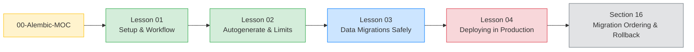

# Section 09: Alembic Migrations (Map of Content)

*The map of content for the four-lesson tour of how `Boardly`'s schema grows up — from `Base.metadata.create_all()` in dev to a deployable, reversible, zero-downtime migration pipeline in production.*

**Welcome to Section 09.**

You have SQLAlchemy models. You can `Base.metadata.create_all(engine)` and your tables exist. That works in dev. It does not work in production — because production has data, has traffic, has two versions of the app running at the same time during a deploy, and has DBAs who want to read the SQL before it runs. Alembic is the tool that bridges those worlds. Four lessons, one growing schema, no surprises. Pull up a chair.


#alembic #migrations #moc

## What this section is, in one paragraph

Alembic is a thin layer of three things: a directory full of Python files (`alembic/versions/`) where each file is a forward-and-reverse pair of schema operations; a one-row table in the target database (`alembic_version`) holding the hash of the currently-applied revision; and a config file plus an `env.py` that knows how to connect to your database and import your models. A migration run is "find the current revision in `alembic_version`, walk the DAG from there to the target revision, and apply each step's `upgrade()` or `downgrade()` in turn." The four lessons in this section teach you how to use that pipeline without losing data, without locking your writers, and without taking the app down.

Why not just write SQL `ALTER TABLE` scripts by hand? Because a hand-written SQL script has no chain of custody: you cannot tell which revision the database is on, you cannot roll back deterministically, and you cannot tell whether two developers' branches conflict until they both try to deploy. Alembic gives you a versioned DAG of migrations — each one is a Python file with an `upgrade()` and a `downgrade()`, each one is identified by a hash, and the database itself records which hash it is currently on. That single source of truth is what makes "deploy migration N, then rollback to N-1 if healthchecks fail" an actual command (`alembic downgrade -1`) instead of a hopeful guess.

## The four lessons at a glance

| Lesson | What it teaches | The Boardly change that drives it |
|---|---|---|
| [[Alembic-Setup-and-Workflow]] | `uv add alembic`, `alembic init`, the `alembic.ini` and `env.py`, wiring `Base.metadata` in, `alembic revision -m`, `alembic upgrade head`, `alembic downgrade -1`, the `alembic_version` table, branching. | The first migration creates the `users` and `projects` tables from the Boardly models. |
| [[Autogenerate-and-Its-Limits]] | What `--autogenerate` can detect (tables, columns, FKs, indexes, nullability) and what it cannot (renames, data migrations, server defaults, check constraints). Always review. | A rename: `Project.description` becomes `Project.summary`. Autogenerate mis-detects it; we fix it by hand with `op.alter_column`. |
| [[Data-Migrations-Safely]] | Moving rows, not just schema. Batching, idempotency, `op.execute()`, `op.bulk_insert()`, avoiding `SELECT *` on huge tables, testing migrations as reversible pairs. | Adding a `slug` column to `projects` and backfilling `slug = slugify(title)` for every existing row. |
| [[Deploying-Migrations-in-Production]] | Migration ordering, multi-instance coordination, `alembic upgrade head` as a deploy step (not a lifespan step), expand-contract (add nullable → write → backfill → require → tighten). | A Kubernetes Job + GitHub Actions workflow that ships the `slug` change with zero downtime. |

## Lesson dependency graph



Read the four lessons in order. Each one assumes the workflow of the previous one.

**Tip — What "schema management" means in this section**

Schema management is not "create the tables once." It is the *evolution* of the schema over the lifetime of the application — adding columns, renaming fields, backfilling data, tightening constraints, deploying the change safely. `Base.metadata.create_all()` handles step one (create); Alembic handles steps two through infinity.


## The growing Boardly schema

This section picks up the `Boardly` app from [[07-SQLAlchemy/03-Declarative-Base-and-Mapped]] and gives it a real schema-management pipeline. The two tables we will evolve:

```python
# boardly/models/user.py
class User(Base):
 __tablename__ = "users"
 id: Mapped[uuid.UUID] = mapped_column(PG_UUID(as_uuid=True), primary_key=True, default=uuid.uuid4)
 email: Mapped[str] = mapped_column(String(320), unique=True)
 display_name: Mapped[str] = mapped_column(String(80))
 hashed_password: Mapped[str] = mapped_column(String(255))
 is_active: Mapped[bool] = mapped_column(default=True, server_default=func.text("true"))
 created_at: Mapped[datetime] = mapped_column(server_default=func.now())

# boardly/models/project.py
class Project(Base):
 __tablename__ = "projects"
 id: Mapped[uuid.UUID] = mapped_column(PG_UUID(as_uuid=True), primary_key=True, default=uuid.uuid4)
 title: Mapped[str] = mapped_column(String(200))
 description: Mapped[str | None] = mapped_column(String(2000), nullable=True)
 status: Mapped[str] = mapped_column(String(20), default="planning", server_default="planning")
 owner_id: Mapped[uuid.UUID] = mapped_column(ForeignKey("users.id", ondelete="CASCADE"))
 created_at: Mapped[datetime] = mapped_column(server_default=func.now())
 updated_at: Mapped[datetime] = mapped_column(server_default=func.now(), onupdate=func.now())
```

By Lesson 04, the `projects` table has gained a `summary` column (renamed from `description`), a `slug` column (backfilled from `title`), and a `NOT NULL` constraint on `slug` — all without a single second of downtime.

## How this section relates to the rest of the vault

| Concern | Lives in |
|---|---|
| The SQLAlchemy models Alembic diffs against | [[07-SQLAlchemy/03-Declarative-Base-and-Mapped]] |
| The engine and pool Alembic uses to run migrations | [[07-SQLAlchemy/02-Engines-Connections-Pools]] |
| Transactions, isolation, and locks (relevant to data migrations) | [[07-SQLAlchemy/05-Session-and-Transaction-Management]] and [[06-SQL-Fundamentals/Transactions-Isolation-Locks]] |
| The project layout that the `alembic/` directory lives inside | [[05-Project-Architecture/Layered-FastAPI-Apps]] |
| The FastAPI lifespan — and why `upgrade head` does not belong there | [[03-FastAPI-Core/Application-and-Lifespan]] |
| Production deploy and rollback for migrations | [[16-Deployment-and-DevOps/Migration-Ordering-and-Rollback]] |
| Async SQLAlchemy (consumes the same schema Alembic produces) | [[07-SQLAlchemy/07-Async-SQLAlchemy]] |
| Testing database logic (uses the migration chain to build a fresh DB) | [[12-Testing-and-Quality/Testing-Database-Logic]] |

## Registered concepts taught or reused here

This section does **not** register any new canonical concepts — `Database migrations` is implicitly first-taught here, but it is a one-section topic so it does not warrant a registry entry. What this section does is *reuse* concepts taught elsewhere:

- **DeclarativeBase** — first taught in [[07-SQLAlchemy/03-Declarative-Base-and-Mapped]]. Reused here as `Base.metadata`, the source of truth `alembic revision --autogenerate` diffs against.
- **Engine (SQLAlchemy)** — first taught in [[07-SQLAlchemy/02-Engines-Connections-Pools]]. Reused here as the engine `env.py` builds to run migrations (with `pool.NullPool`, because migrations are one-shot).
- **Mapped / mapped_column** — first taught in [[07-SQLAlchemy/03-Declarative-Base-and-Mapped]]. Reused here as the model attributes autogenerate diffs against the live database.
- **Session / AsyncSession (SQLAlchemy)** — first taught in [[07-SQLAlchemy/05-Session-and-Transaction-Management]]. Reused in Lesson 03 ([[Data-Migrations-Safely]]) for batched `SELECT`/`UPDATE` data backfills that lean on the session's identity map and transaction boundary to stay resumable and reversible.
- **FastAPI lifespan** — first taught in [[03-FastAPI-Core/Application-and-Lifespan]]. Mentioned here as where NOT to call `upgrade head` (Lesson 04 explains the migration ordering problem in depth).
- **Transactions (SQL)** — first taught in [[06-SQL-Fundamentals/Transactions-Isolation-Locks]]. Reused in Lesson 03 (data migrations) and Lesson 04 (zero-downtime deploy).

**Student asks: Why doesn't this section register `Database migrations` as a canonical concept? It is the entire subject of the section.**

Because the registry tracks concepts that get *reused outside their first-taught section*. `Engine`, `DeclarativeBase`, `Session` are all reused across many later sections — so they each get a canonical entry. `Database migrations` is taught here and then... not really reused — every later section that mentions migrations just links back to one of these four lessons rather than re-teaching the concept. There is no "second lesson on database migrations" elsewhere in the vault. The registry's purpose is to prevent duplication; if a concept has only one home, the registry has nothing to deduplicate. That is the judgment call: one-section topics stay implicit; multi-section topics get a canonical entry so they do not get re-derived.


**Student asks: Why does Alembic's `env.py` use `poolclass=NullPool` instead of the `QueuePool` we configured for the application in Lesson 02?**

Because migrations are a one-shot process: a single Python process connects, runs `upgrade()` or `downgrade()`, and exits. There is no second connection to share a pool with, and no benefit to keeping a connection warm across migrations because each migration is its own transaction. `NullPool` is the no-op pool that opens a fresh connection on demand and closes it immediately — exactly the lifecycle you want for a one-shot script. `QueuePool` would hold the connection open after the migration finished, which is wasteful and, in a CI runner, can leak past the test run.


## Verified versions (October 2026)

| Tool | Version | Verified date | Why it matters |
|---|---|---|---|
| Alembic | 1.20.0 | 2026-10-19 | The `alembic init` layout, `op` API, and `TaskGroup`-style merge commands are stable as of this version. |
| SQLAlchemy | 2.1.5 | 2026-10-19 | The `Mapped` / `mapped_column` API Alembic diffs against. |
| Python | 3.12 | 2026-10-19 | `asyncio.TaskGroup`, `except*`, and `asyncio.timeout()` are all stable. |
| `uv` | 0.13.1 | 2026-10-19 | All install commands use `uv add` rather than `pip install`. |
| PostgreSQL | 17.x | 2026-10-19 | The dialect the example migrations target. SQLite is the dev fallback. |

**Why these versions matter**

Alembic's API has been stable since 1.13 — `alembic init` produces the same `env.py` skeleton, the `op.X` helpers have the same signatures, and the `alembic_version` table is unchanged. SQLAlchemy 2.x's `Mapped` / `mapped_column` form is what `Base.metadata` reflects against; pre-2.x code used `db.Column(...)` directly. Python 3.12 is the minimum we recommend — `asyncio.TaskGroup` (used in Section 10) requires 3.11+, and 3.12 fixes several async-gen finalization bugs.


## How to read this section

1. **Read [[Alembic-Setup-and-Workflow]] in full.** It installs Alembic, wires `Base.metadata` into `env.py`, and creates the first migration by hand. Every later lesson assumes this setup.
2. **Read [[Autogenerate-and-Its-Limits]] carefully.** The single most dangerous Alembic feature is `--autogenerate`. The lesson shows a real rename that autogenerate mis-detects as a drop+add — the data-loss trap — and the manual `op.alter_column` fix.
3. **Read [[Data-Migrations-Safely]] before writing any migration that touches existing rows.** The lesson teaches batching, idempotency, and the `op.execute()` vs `op.bulk_insert()` trade-off. The example is a real backfill (`slug = slugify(title)`).
4. **Read [[Deploying-Migrations-in-Production]] before the first production deploy.** The lesson explains the migration ordering problem (schema-before-code vs code-before-schema), the expand-contract pattern, and a real Kubernetes Job + GitHub Actions workflow.

**Tip — The 20-minute rule**

If a migration concept does not click after 20 minutes, step back. Read [[07-SQLAlchemy/05-Session-and-Transaction-Management]] again — most "I don't get Alembic" questions are actually "I don't get transaction boundaries" questions.


## Related engineering decisions

The vault's [[Engineering-Decision-Log]] records two decisions this section operationalizes:

- **D-003 — Use Alembic for schema management, not `Base.metadata.create_all()`.** `create_all()` is acceptable only for ephemeral test databases. Every persistent database — dev, staging, production — runs through Alembic.
- **D-006 — Use `uv` as the project manager.** Every install command in this section is `uv add ...`, never `pip install ...`.

**Why is `create_all()` banned in production but allowed in tests?**

Two reasons. (1) `create_all()` only creates tables that are missing — it cannot alter an existing table to add a column, change a type, or rename anything. In tests, you drop and recreate the database on every run, so there is no "existing table" to alter. In production, you cannot drop and recreate — you would lose every row. (2) `create_all()` has no history: there is no record of what changed, when, or in what order. Alembic gives you a versioned, reviewable, reversible chain of changes. The discipline is worth the setup cost the moment you have users.


## Exercises for this section

Hands-on exercises live in [[20-Exercises-and-Labs/00-Exercises-MOC]]. Specifically:

- The "rename a column without losing data" lab (Alembic Lesson 02).
- The "backfill a column in batches" lab (Alembic Lesson 03).
- The "zero-downtime deploy of a NOT NULL column" lab (Alembic Lesson 04).

## What's next

After [[Deploying-Migrations-in-Production]], the next stop is [[10-Async-Python/Event-Loop-and-Coroutines]] — the canonical lesson on the event loop and coroutines, which `Boardly`'s async endpoints (and async SQLAlchemy) sit on top of. Then [[16-Deployment-and-DevOps/Migration-Ordering-and-Rollback]] for the production deploy pipeline that wraps the Lesson 04 workflow.

---

**Tags:** #alembic #migrations #moc #review
**Previous:** [[07-SQLAlchemy/00-SQLAlchemy-MOC]]
**Next:** [[Alembic-Setup-and-Workflow]] →
