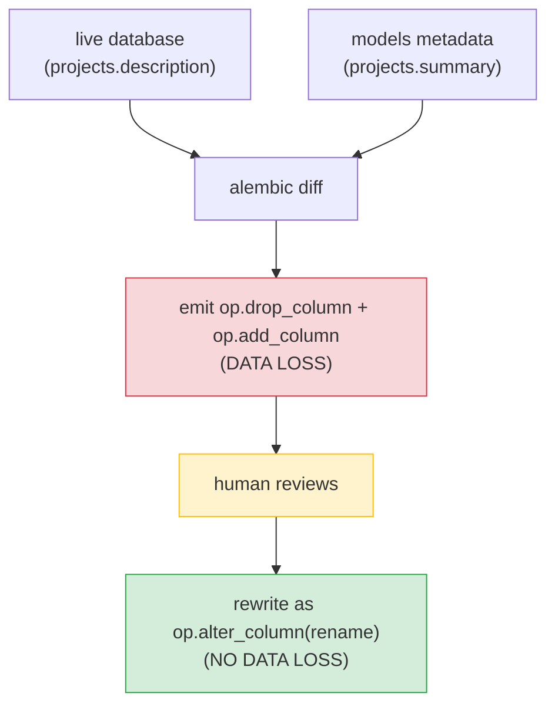
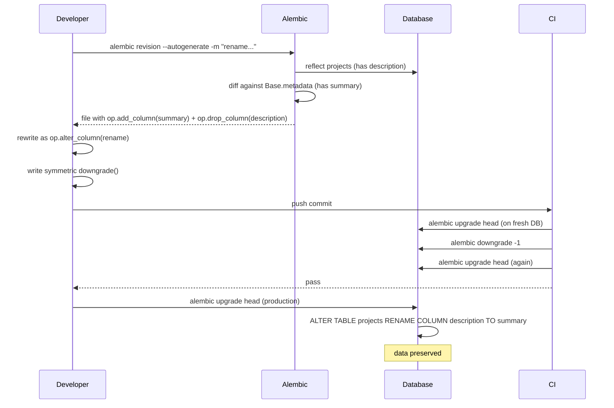

# Lesson 02: Autogenerate and Its Limits

*What `alembic revision --autogenerate` can detect, what it cannot, and why a rename detected as a destructive drop+add is the single most common Alembic data-loss incident — with the manual `op.alter_column` fix, line by line.*

**You have a working Alembic pipeline now.**

Lesson 01 wired `env.py`, applied the first migration, and rolled it back. Today you will use `--autogenerate` for the first time and watch it do something brilliant and something terrible in the same breath. The brilliant part: it drafts a migration in two seconds that would take you twenty minutes by hand. The terrible part: it gets a column rename wrong in a way that would destroy every value in the column if you shipped it. The lesson is not "do not use autogenerate" — it is "always review." By the end you will have a seven-item checklist that takes five minutes and catches every autogenerate footgun.


#alembic #autogenerate #migrations

## Learning Objectives

By the end of this lesson you will be able to:

1. **Enumerate what autogenerate can detect** — new tables, removed tables, new columns, removed columns, type changes, nullability changes, new foreign keys, new indexes, new unique constraints, server defaults.
2. **Enumerate what autogenerate cannot detect** — column renames, table renames, data migrations, server-default content changes, check constraints (by default), enum value additions, index concurrence.
3. **Recognize the "rename detected as drop+add" failure mode** in a generated file by inspection.
4. **Repair a mis-detected rename** with `op.alter_column(..., new_column_name=...)` and the symmetric `op.execute("ALTER INDEX ... RENAME TO ...")` for indexes.
5. **Apply the seven-item pre-commit checklist** to any generated migration in under five minutes.
6. **Decide when to use autogenerate and when to hand-write** the migration.
7. **Configure `compare_type=True` and `compare_server_default=True`** in `env.py`, and explain the trade-off between false positives and missed changes.

## Prerequisites

Before starting, you need:

- **The Lesson 01 pipeline** — [[Alembic-Setup-and-Workflow]]. You have a working `alembic/env.py`, the first migration applied, and the Boardly `users` and `projects` tables in your dev database.
- **The DeclarativeBase lesson** — [[07-SQLAlchemy/03-Declarative-Base-and-Mapped]]. You need to be comfortable reading `Mapped[T]` annotations and `mapped_column(...)` calls.
- **About 80 minutes of focused time.** The code is small; the explanations are long.

**The most common gap: "what is a diff, anyway?"**

Autogenerate is a *diff* between two `MetaData` objects: the one reflected from the live database, and the one built from `Base.metadata`. A diff is mechanical — it lists the differences. It does not know your intent. If the diff says "users.email is gone and users.email_address is added", the diff does not know whether you meant "rename email to email_address" or "drop email, add email_address." That distinction is semantic, not structural, and autogenerate has no semantic layer. This single fact is the root of every autogenerate footgun.


## The Problem

`alembic revision --autogenerate` is the single most useful and the single most dangerous Alembic feature. It is useful because it diffs your models against the database and writes a migration for you in seconds. It is dangerous because the diff is purely structural — Alembic can see that `email` is in the models and `email_address` is in the database, but it cannot tell whether you meant "rename `email` to `email_address`" (one operation, no data loss) or "drop `email`, add `email_address`" (two operations, all values destroyed). Without review, every autogenerate is a data-loss incident waiting to happen.

This is the lesson that teaches you to review. It is also the lesson that teaches you to recognize the *specific* failure modes — renames, server defaults, check constraints — by name, so that when you open a generated file you know what to look for.



The human step is the only one that prevents the data-loss default. Every other step is mechanical.

## The Code

This lesson's example is a single column rename in the Boardly `projects` table. The `description` column becomes `summary`. We will:

1. Start from the Lesson 01 schema (`projects` has `description: Mapped[str | None]`).
2. Modify the model to rename `description` to `summary`.
3. Run `alembic revision --autogenerate -m "rename description to summary"`.
4. Read the generated file and identify the rename-as-drop+add bug.
5. Rewrite the migration as `op.alter_column(..., new_column_name="summary")` plus a manual index rename.
6. Apply the migration and verify the data is preserved.

### The starting point: `projects` has `description`

```python
# boardly/models/project.py — Lesson 01 state
class Project(Base):
 __tablename__ = "projects"
 id: Mapped[uuid.UUID] = mapped_column(
 PG_UUID(as_uuid=True), primary_key=True, default=uuid.uuid4
 )
 title: Mapped[str] = mapped_column(String(200))
 description: Mapped[str | None] = mapped_column(String(2000), nullable=True)
 status: Mapped[str] = mapped_column(
 String(20), default="planning", server_default="planning"
 )
 owner_id: Mapped[uuid.UUID] = mapped_column(
 ForeignKey("users.id", ondelete="CASCADE")
 )
 created_at: Mapped[datetime] = mapped_column(server_default=func.now())
 updated_at: Mapped[datetime] = mapped_column(
 server_default=func.now(), onupdate=func.now()
 )
```

Production has the `projects` table with `description`, populated with a million rows of real board descriptions.

### The rename decision

You decide `description` should be `summary` for clarity. You change the model:

```python
# boardly/models/project.py — after the rename
class Project(Base):
 __tablename__ = "projects"
 # ...
 summary: Mapped[str | None] = mapped_column(String(2000), nullable=True)
 # ...rest unchanged...
```

### The autogenerate output: the buggy file

```bash
uv run alembic revision --autogenerate -m "rename description to summary"
```

The generated file (Alembic 1.20.0 against PostgreSQL 17):

```python
"""rename description to summary

Revision ID: 0002_rename_description_to_summary
Revises: 0001_initial_schema
Create Date: 2026-10-19 12:34:56.000000
"""
from __future__ import annotations

import sqlalchemy as sa
from alembic import op
from sqlalchemy.dialects.postgresql import UUID as PG_UUID

# revision identifiers, used by Alembic.
revision = "0002_rename_description_to_summary"
down_revision = "0001_initial_schema"
branch_labels = None
depends_on = None


def upgrade() -> None:
 op.add_column(
 "projects",
 sa.Column("summary", sa.String(length=2000), nullable=True),
 )
 op.drop_column("projects", "description")


def downgrade() -> None:
 op.add_column(
 "projects",
 sa.Column("description", sa.String(length=2000), nullable=True),
 )
 op.drop_column("projects", "summary")
```

That is the bug. Two operations that, applied against a populated table, would destroy every value in `description`.

Why doesn't autogenerate realise this is a rename and not a drop+add? Because autogenerate operates on *textual* identity, not *semantic* identity. The diff sees two snapshots — the database has a column called `description` of type `VARCHAR(2000)`, the model has a column called `summary` of type `String(2000)`. There is no information in either snapshot that says "the second column is the first one, renamed." The diff algorithm would have to guess that a column disappearing and a structurally-identical column appearing is the same column with a new name — and that guess is wrong as often as it is right (sometimes a disappearing column really was deleted, and the new column really is new). Faced with a problem that has no deterministic answer, Alembic chose the conservative behaviour: report the structural facts (one column gone, one column appeared) and let a human decide what the intent was. The human's job, on seeing `op.add_column("summary") + op.drop_column("description")` for structurally-identical columns, is to recognise the rename pattern and rewrite as `op.alter_column(..., new_column_name="summary")`. This is the single most important manual review step in the autogenerate workflow.

### The fix: rewrite as `op.alter_column`

```python
def upgrade() -> None:
 # Rename the column in place. One statement. Preserves data and indexes.
 op.alter_column(
 "projects",
 "description",
 new_column_name="summary",
 existing_type=sa.String(length=2000),
 existing_nullable=True,
 )


def downgrade() -> None:
 op.alter_column(
 "projects",
 "summary",
 new_column_name="description",
 existing_type=sa.String(length=2000),
 existing_nullable=True,
 )
```

That is the entire lesson. The rest of this file explains every line, every failure mode, and the seven-item checklist that catches this kind of bug before it ships.

## Line-by-Line Deep Dive

This section is the heart of the lesson. Read it twice. Do not skim.

### Lines 1–14 of the generated file: the header

```python
"""rename description to summary

Revision ID: 0002_rename_description_to_summary
Revises: 0001_initial_schema
Create Date: 2026-10-19 12:34:56.000000
"""
from __future__ import annotations

import sqlalchemy as sa
from alembic import op
from sqlalchemy.dialects.postgresql import UUID as PG_UUID

# revision identifiers, used by Alembic.
revision = "0002_rename_description_to_summary"
down_revision = "0001_initial_schema"
branch_labels = None
depends_on = None
```

**What it does:** Standard Alembic header. The docstring is your `-m` message. The four module-level variables tell Alembic where this migration fits in the DAG.

**Line by line:**

- `revision = "0002_rename_description_to_summary"` — the unique identifier Alembic generated. In production, this would be a random 12-character hex (`a1b2c3d4e5f6`); we use a readable ID for teaching.
- `down_revision = "0001_initial_schema"` — this migration comes after `0001_initial_schema` in the DAG.
- `branch_labels = None` and `depends_on = None` — defaults; we leave them alone.

**Why the import of `PG_UUID` even though we do not use it**

Alembic's `script.py.mako` template imports every type it thinks the migration might need. The `PG_UUID` import is there because the model uses it; the autogenerate engine imports every type from every model it scanned, conservatively. You can delete unused imports — your linter will warn — but they are harmless. The Mako template is editable if you want to customise the boilerplate.


### The `upgrade()` body: the bug

```python
def upgrade() -> None:
 op.add_column(
 "projects",
 sa.Column("summary", sa.String(length=2000), nullable=True),
 )
 op.drop_column("projects", "description")
```

**What it does:** Adds the `summary` column as nullable, then drops the `description` column. The generated SQL is roughly:

```sql
ALTER TABLE projects ADD COLUMN summary VARCHAR(2000);
ALTER TABLE projects DROP COLUMN description;
```

**Why this is wrong, step by step:**

1. `op.add_column("projects", sa.Column("summary", sa.String(2000), nullable=True))` — adds `summary` as nullable. All existing rows have `summary = NULL`. (Note: if you had made it `nullable=False` with no `server_default`, this line would fail on a populated table because the database would refuse to add a NOT NULL column with no default. That is the *second*-most-common autogenerate failure mode, and we cover it under Common Mistakes below.)
2. `op.drop_column("projects", "description")` — drops the `description` column entirely. Every value in `description` — every board's text, every link, every note — is gone. There is no recovery except restoring from a backup.

The migration is structurally correct: it brings the schema from "has `description`" to "has `summary`." It is semantically wrong: it does so by destroying the data, not by preserving it through a rename.

**Danger — The migration review must be enforced by branch protection, not by goodwill**

The seven-item checklist is only as strong as the rule that says "no migration file is merged without a human reviewer signing off." The production pattern: branch protection on `main` requires at least one review on any PR touching `alembic/versions/*.py`, plus a CODEOWNERS entry that names a database-experienced reviewer. Without the rule, a junior engineer ships `op.add_column` + `op.drop_column` on a Friday afternoon and the on-call gets paged Monday at 9 AM. The rule is enforced with `git config` and the platform's branch protection UI, not with a comment in the README. Pair this with a CI check that runs `uv run alembic upgrade head && uv run alembic downgrade -1 && uv run alembic upgrade head` on every PR — that catches the asymmetric-downgrade bug automatically. [[12-Testing-and-Quality/Testing-FastAPI-Endpoints]] covers the CI side; this is the migration-specific gate.


### The fix: `op.alter_column` with `new_column_name`

```python
def upgrade() -> None:
 op.alter_column(
 "projects",
 "description",
 new_column_name="summary",
 existing_type=sa.String(length=2000),
 existing_nullable=True,
 )
```

**What it does:** Renames the column in place. The generated SQL on PostgreSQL is:

```sql
ALTER TABLE projects RENAME COLUMN description TO summary;
```

**Why this is the right operation:**

- It is one statement. PostgreSQL renames the column in place. No data is copied, no rows are touched, no locks are held beyond the brief metadata lock.
- All values are preserved. `summary` has the same rows with the same data as `description` did.
- Dependent indexes are *preserved* but their *names* are not. On PostgreSQL 10+, `RENAME COLUMN` keeps the index working but does not rename it — `ix_projects_description` stays `ix_projects_description` even though the column is now `summary`. To rename the index, issue a separate `ALTER INDEX`.

**Line by line of `op.alter_column`:**

- `"projects"` — the table name.
- `"description"` — the current column name.
- `new_column_name="summary"` — the new column name. This keyword is what makes the call a rename rather than a type or nullability change.
- `existing_type=sa.String(length=2000)` — Alembic's API requires you to tell it the existing type. The reason is that `op.alter_column` is overloaded: it handles type changes, nullability changes, default changes, and renames. Alembic needs to know the current type to emit the right SQL. You can read it from the database (using `op.get_bind()` to inspect) or hardcode it (you know the type).
- `existing_nullable=True` — same story. Tell Alembic the current nullability so it does not accidentally change it.

**Student asks: Why does `op.alter_column` need `existing_type` when I am only renaming?**

Because `op.alter_column` is a single overloaded function for ALTER TABLE changes. Whether you are changing the type, the nullability, the default, or the name, you call the same function. The function emits the right SQL based on which keyword arguments you pass. If you do not pass `existing_type`, Alembic does not know whether to keep the type as-is or change it. The keyword is a "leave this alone" signal. It is slightly verbose, but it means one function handles every ALTER TABLE case — a trade-off the Alembic authors chose over a dozen specialised functions.


**`op.alter_column` with a `type_` change can rewrite the whole table**

A pure rename via `op.alter_column(..., new_column_name=...)` emits `ALTER TABLE ... RENAME COLUMN ...` — a metadata-only change that takes milliseconds regardless of table size. But `op.alter_column(..., type_=...)` for many type changes rewrites every row: `INTEGER -> BIGINT` rewrites; `TEXT -> VARCHAR(N)` rewrites; `VARCHAR(255) -> VARCHAR(320)` widening is metadata-only on PostgreSQL 17; `VARCHAR(255) -> TEXT` is metadata-only. The rewrite takes an `ACCESS EXCLUSIVE` lock and on a million-row table means minutes of downtime. The production pattern for wide-table type changes: stage them with `pg_repack` (which rebuilds the table concurrently), or split into `ADD COLUMN` + backfill + `DROP COLUMN` + rename (see [[Data-Migrations-Safely]]). Always check the table's row count before deploying — `psql -d boardly_dev -c "SELECT reltuples::bigint AS rows FROM pg_class WHERE relname = 'projects';"` reveals whether the rewrite is a thousand-row operation or a ten-million-row operation. The former is safe in a transaction; the latter needs the multi-step pattern.


### Renaming the index: `op.execute("ALTER INDEX ...")`

In our example, the `description` column does not have an index (only `email` on `users` and `status` on `projects` do). But suppose it did — `ix_projects_description`. After the column rename, on PostgreSQL, the index still has its old name. To rename it:

```python
def upgrade() -> None:
 op.alter_column(
 "projects",
 "description",
 new_column_name="summary",
 existing_type=sa.String(length=2000),
 existing_nullable=True,
 )
 op.execute("ALTER INDEX ix_projects_description RENAME TO ix_projects_summary")
```

**Why `op.execute` and not an `op.X` helper?** Alembic does not have a portable `op.rename_index` (the closest is `op.create_index` and `op.drop_index`, which would rebuild the index — wasteful). Raw SQL via `op.execute` is the right tool here; `ALTER INDEX ... RENAME TO ...` is supported on PostgreSQL, SQLite (3.25+), and modern MySQL. For older MySQL, you would `DROP INDEX ... ADD INDEX ...`, which rebuilds.

**Tip — Prefer Alembic operations when they exist.**

`op.alter_column` is portable across dialects. `op.execute("ALTER INDEX ... RENAME TO ...")` is dialect-specific. The rule: use the Alembic operation when one exists; fall back to `op.execute` for dialect-specific features (concurrent index creation, enum value addition, partial indexes).


**Warning — Debugging index-name drift after a column rename**

After a column rename via `op.alter_column(..., new_column_name=...)`, PostgreSQL preserves the index but does not rename it — the index `ix_projects_description` keeps its name even though the column is now `summary`. This is a debugging trap: `psql -d boardly_dev -c "\d projects"` shows an index named `ix_projects_description` on a column named `summary`, which looks like a leftover from a previous migration. Diagnose with `psql -d boardly_dev -c "SELECT indexname, indexdef FROM pg_indexes WHERE tablename = 'projects';"` — the `indexdef` shows the actual column(s) the index covers. The fix is the `op.execute("ALTER INDEX ix_projects_description RENAME TO ix_projects_summary")` shown above. Skip the rename and a future engineer may "clean up" the "stale" index by dropping it, silently removing a real index and degrading query plans. Pair this with a CI assertion that runs `psql -d boardly_dev -c "SELECT indexname FROM pg_indexes WHERE tablename = 'projects' AND indexname NOT LIKE 'ix_%';"` after every migration to catch index-name drift early.


### The symmetric `downgrade()`

```python
def downgrade() -> None:
 op.alter_column(
 "projects",
 "summary",
 new_column_name="description",
 existing_type=sa.String(length=2000),
 existing_nullable=True,
 )
```

The downgrade reverses the upgrade: rename `summary` back to `description`. If you added an `op.execute("ALTER INDEX ...")` in the upgrade, add the reverse in the downgrade.

**Warning — The downgrade must symmetrically reverse the upgrade.**

If the upgrade renames `description → summary` and renames the index `ix_projects_description → ix_projects_summary`, the downgrade must rename `summary → description` and rename the index `ix_projects_summary → ix_projects_description`. The CI pattern of `upgrade → downgrade → upgrade` (which we recommend) will catch an asymmetric downgrade.


### What autogenerate CAN detect

These are the differences autogenerate *can* detect correctly:

| Change | Autogenerate emits | Example |
|---|---|---|
| New table | `op.create_table(...)` | A new `Tag` model appears in `Base.metadata`. |
| Removed table | `op.drop_table(...)` | A model is deleted. |
| New column | `op.add_column(...)` | A new `Mapped[T]` attribute appears. |
| Removed column | `op.drop_column(...)` | A `Mapped[T]` attribute is deleted. |
| Type change | `op.alter_column(..., type_=...)` (with `compare_type=True`) | `String(255)` becomes `String(320)`. |
| Nullability change | `op.alter_column(..., nullable=...)` (with `compare_type=True`) | `nullable=True` becomes `nullable=False`. |
| New foreign key | `op.create_foreign_key(...)` | A `ForeignKey(...)` is added to a column. |
| New index | `op.create_index(...)` | An `Index(...)` is added to `__table_args__`. |
| New unique constraint | `op.create_unique_constraint(...)` | A `UniqueConstraint(...)` is added. |
| Server default added/removed | `op.alter_column(..., server_default=...)` (with `compare_server_default=True`) | `server_default=sa.text("now()")` is added. |

All of these are *mechanical* differences: the diff does not need to know your intent. It just looks at the two schemas and lists what differs.

### What autogenerate CANNOT detect

These are the differences autogenerate *cannot* detect, or detects wrongly:

- **Column renames.** The diff sees `description` gone and `summary` added; it cannot tell that this is a rename. This is the canonical autogenerate footgun.
- **Table renames.** Same shape: `projects` gone, `boards` added. Autogenerate writes `op.drop_table("projects")` + `op.create_table("boards", ...)` — destroying every row.
- **Data migrations.** No diff between empty models and a database with a million rows. A backfill like `UPDATE projects SET summary = description` is invisible to autogenerate.
- **Server default content changes.** `server_default=sa.text("now()")` vs `server_default=sa.func.now()` may produce the same SQL but autogenerate may emit a spurious alter.
- **CHECK constraint changes.** By default, autogenerate does not diff CHECK constraints because of dialect differences. You can enable it via `compare_server_default=True` and `compare_type=True` in `context.configure(...)` — but expect false positives.
- **Enum value additions.** A PostgreSQL `ENUM` type's values are not compared by default. Adding a new value requires a special `ALTER TYPE ... ADD VALUE` that autogenerate will not write — and even if it did, PostgreSQL does not allow `ALTER TYPE ... ADD VALUE` inside a transaction.
- **Index concurrence.** Autogenerate writes `op.create_index(...)`; in PostgreSQL you usually want `op.create_index(..., postgresql_concurrently=True)` for production. The flag is not inferred.

**Student asks: Why doesn't autogenerate detect CHECK constraints by default?**

Because comparing two CHECK constraints for *semantic equality* is undecidable in general. A CHECK constraint body is a SQL expression: `CHECK (status IN ('active', 'inactive'))` and `CHECK (status = 'active' OR status = 'inactive')` mean the same thing but have different ASTs. The diff that autogenerate runs (an `OperationContainer` against `Base.metadata`) compares textual representations, not semantics. Two textually-different constraints produce a spurious `op.drop_constraint` + `op.create_constraint` on every autogenerate run — which would then break the rolling-deploy contract (the constraint is dropped on the first deploy, the new one is added on the second). The Alembic authors chose "off by default" rather than ship a diff that lies about 30% of the time. If you really need it, set `compare_server_default=True` and `include_object` filters — but expect noise.


**Student asks: When should I just hand-write the migration instead of using `--autogenerate`?**

Four cases, all worth memorising as a checklist before you reach for `--autogenerate`. **(1) Any rename.** Renames are detected as drop+add. Always hand-write renames as `op.alter_column(..., new_column_name=...)` (column) or `op.rename_table(...)` (table). **(2) Any data migration.** `UPDATE`/`DELETE`/`INSERT` backfills, denormalisations, slug generations, soft-delete sweeps — autogenerate cannot see data. **(3) Any `server_default` content change.** `sa.text("now()")` vs `sa.func.now()` may render to the same SQL but produce a spurious alter; hand-write `op.alter_column(..., server_default=...)` only if you really need to change the value. **(4) Anything involving a `CHECK` constraint, an `ENUM` value, or a `CREATE INDEX CONCURRENTLY`.** The dialect cannot diff these cleanly; hand-write them with explicit `op.execute(...)` calls. The rule of thumb: autogenerate is for *structural* additions (new table, new column, new FK, new index). Anything that involves intent, data, or a dialect-specific keyword — hand-write it.


**Danger — The five dangerous false-positives**

1. A rename detected as drop+add → data loss.
2. A type change `String(255) → String(50)` that would truncate data → migration fails on PostgreSQL, succeeds silently on MySQL (truncating).
3. A `nullable=False` alter on a column with existing NULLs → migration fails on the alter.
4. A new `NOT NULL` column without a `server_default` → migration fails on a populated table.
5. A `drop_table` because the model module was not imported in `env.py` → drops a table that still exists in production.


**Danger — `compare_type = False` is silent schema drift**

With `compare_type = False` (the Alembic default), a type change in the model — `String(255) -> String(64)` to enforce a new length cap — produces *no* migration. The model and the database silently diverge. The application now writes strings up to 64 characters; the database still accepts 255. A future `INSERT` of a 100-character string succeeds in the database but violates the model's expectation — the bug surfaces as a validation error or a `DataError` in production weeks later, with no migration in the audit trail. The production pattern: keep `compare_type = True` and provide a custom comparison function (the Alembic docs have an example) that returns `True` for equivalent types like `VARCHAR(N)` vs `String(N)`. Then audit the autogenerate output in CI — `uv run alembic revision --autogenerate -m "ci-drift-check"` on every PR and assert the generated file is empty (or only contains the change under review). A non-empty file in the "no changes" PR is schema drift; block the merge.


## Execution Trace

A rename detected as drop+add and repaired:

1. **Developer** changes the model: `description` → `summary` in `boardly/models/project.py`.
2. **Developer** runs `uv run alembic revision --autogenerate -m "rename description to summary"`.
3. **Alembic** reflects the database (`projects.description` exists), diffs against `Base.metadata` (`projects.summary` exists, no `description`), emits a migration with `op.add_column("summary")` + `op.drop_column("description")`.
4. **Developer** opens the file, reads the diff, recognizes the rename pattern (`drop X` + `add Y` with the same type and same nullability and the same column constraints).
5. **Developer** deletes the two operations, replaces with `op.alter_column("projects", "description", new_column_name="summary", existing_type=..., existing_nullable=...)`. Adds `op.execute("ALTER INDEX ...")` if there is an index on the column.
6. **Developer** writes the symmetric `downgrade()`.
7. **CI** runs `alembic upgrade head` against a fresh ephemeral database, then runs `alembic downgrade -1` and confirms the schema matches the previous revision. Then runs `upgrade head` again. The migration pair is reversible; CI passes.
8. **Deploy** applies the migration. The rename is one statement; the index rename is another. Total wall time: seconds.



## The Seven-Item Pre-Commit Checklist

Read every generated file and answer these seven questions. If any of the first three answers is "yes, this is a rename," rewrite. If any of the last four answers is "I do not know," test the migration on a copy of production data before deploying.

1. **Are there any `op.drop_column` calls?** If yes, is this a rename (does a corresponding `op.add_column` exist with the same type and the same constraints)? If yes, rewrite as `op.alter_column(..., new_column_name=...)`.
2. **Are there any `op.drop_table` calls?** If yes, is this a rename? If yes, use `op.rename_table("old", "new")` instead. If no, are you sure you want to drop the table? Confirm the data is not needed.
3. **Are there any `op.drop_index` + `op.create_index` pairs with the same columns?** This is an index rename — use `op.execute("ALTER INDEX ... RENAME TO ...")` on PostgreSQL, or `op.rename_index(...)` on SQLite (where it exists).
4. **Are there any `op.alter_column(..., type_=...)` calls?** If yes, is the type change compatible? (e.g. `String(255) → String(320)` is safe; `String(255) → String(50)` will truncate data and fail on PostgreSQL.)
5. **Are there any `op.alter_column(..., nullable=False)` calls?** If yes, do existing rows have NULLs? If yes, the migration will fail — backfill first (see [[Data-Migrations-Safely]]).
6. **Are there any new `NOT NULL` columns without a `server_default`?** Same problem as (5). Add a `server_default` for a one-time backfill, or split into a multi-step migration.
7. **Does the `downgrade()` symmetrically reverse the `upgrade()`?** Run `alembic upgrade head && alembic downgrade -1 && alembic upgrade head` in CI to verify.

If the answer to any of 1–3 is "yes, this is a rename," rewrite. If the answer to 4–6 is "I do not know," test the migration on a copy of production data before deploying.

**Production pattern: automate the seven-item checklist in CI**

The seven-item checklist is human review — and humans miss items on Friday afternoons. The production pattern is to automate as much of it as CI can: a pre-commit hook that runs `uv run alembic revision --autogenerate -m "pre-commit check"` and asserts the output is either empty or matches the staged migration file's operations (the "drift check"). A CI step that greps the staged migration file for `op.drop_column`, `op.drop_table`, `op.drop_index` and requires a `# REVIEW:` comment on the line above each — a junior engineer cannot merge a `drop_*` migration without acknowledging it. A CI step that runs the `uv run alembic upgrade head && uv run alembic downgrade -1 && uv run alembic upgrade head` triple plus the row-count comparison. The remaining human review is the *semantic* check — "is this drop+add a rename?" — which CI cannot answer. The combination catches roughly 80 percent of the autogenerate footguns mechanically and leaves the human reviewer free to focus on the semantic intent question. [[12-Testing-and-Quality/Testing-FastAPI-Endpoints]] covers the test-triple pattern; this is the migration-specific application.


## When to Skip Autogenerate

Hand-write the migration when:

- You are renaming a column, table, index, or constraint. (Autogenerate will mis-detect.)
- You are adding a `CHECK` constraint that needs to be added `NOT VALID` first then validated later (PostgreSQL pattern).
- You are changing a server default to a function that autogenerate will not recognize as equivalent (`now()` vs `CURRENT_TIMESTAMP`).
- You are doing a data migration (see [[Data-Migrations-Safely]]).
- You are adding a PostgreSQL `ENUM` value (autogenerate does not write `ALTER TYPE ... ADD VALUE`).
- You need `postgresql_concurrently=True` on index creation.

**The autogenerate output is a draft.**

Treat every autogenerate as a draft. The diff is correct in the sense of "these two schemas differ in these ways". The migration it writes is *a* migration that resolves the diff. It is not necessarily *the* migration you want. Reviewing is not optional.


**Production pattern: pre-deploy mirror diff against a production clone**

Before merging any migration, run `uv run alembic revision --autogenerate -m "pre-deploy drift check"` against a restored copy of production (the [[08-PostgreSQL/Backups-and-Recovery]] drill cluster is ideal). The expected output is *zero operations* — the migration under review brings the schema to the model state; the autogenerate against the post-migration database should be a no-op. If it emits operations, the migration is *incomplete* — it does not actually bring the schema to the model state. This is the "did I forget a column?" check that the seven-item checklist cannot catch (the checklist reviews *one* migration; the mirror check reviews the *cumulative* state). Run it on every migration PR; a non-empty autogenerate against the post-migration state is a CI failure.


## `compare_type` and `compare_server_default`: on or off?

In Lesson 01 we set both to `True`:

```python
context.configure(
 connection=connection,
 target_metadata=target_metadata,
 compare_type=True,
 compare_server_default=True,
)
```

**What they do:**

- `compare_type=True` makes autogenerate emit `op.alter_column(..., type_=...)` when column types differ. Without it, a type change in your model is invisible to autogenerate.
- `compare_server_default=True` does the same for server defaults.

**The trade-off:**

- **Off (default):** autogenerate misses real type and default changes. You hand-write those migrations.
- **On:** autogenerate catches real changes but produces false positives on equivalent types. `String(320)` in your model and `VARCHAR(320)` reflected from the database may look different to autogenerate even though they are the same type. You get a spurious `op.alter_column(..., type_=...)` no-op.

**Warning — `compare_type=True` false positives**

```python
# model
email: Mapped[str] = mapped_column(String(320))
```
If autogenerate reflects the database column as `VARCHAR(320)` and your model says `String(320)`, autogenerate may emit a no-op alter with `compare_type=True` because SQLAlchemy's type comparison considers `VARCHAR` and `String` distinct types. Fix this by either:
- Setting `compare_type=False` (the default) and accepting that real type changes need hand-written migrations.
- Providing a custom `compare_type` function in `env.py` that returns `True` for equivalent types. (The Alembic docs have an example.)


**Warning — Debugging flaky autogenerate runs: the same model produces different output**

Occasionally the same model changeset produces different autogenerate output on two consecutive runs — one run emits a spurious `op.alter_column(..., type_=...)`, the next run emits nothing. The cause is almost always `compare_type = True` or `compare_server_default = True` comparing types or defaults whose textual representation depends on a non-deterministic reflection: `server_default = sa.func.now()` reflects as `now()` on one run and `CURRENT_TIMESTAMP` on another (the database stores the same `now()` function but `pg_attrdef` may present either spelling depending on the connection's `DateStyle` or the reflection query's path). Diagnose with `psql -d boardly_dev -c "SELECT column_name, data_type, column_default FROM information_schema.columns WHERE table_name = 'projects';"` — the `column_default` is the literal string the database stores. The fix is a custom `compare_server_default` function in `env.py` that normalizes the string before comparison. Without it, the flaky autogenerate blocks every CI run that hits the unlucky timing. Pair with a CI log that records the `column_default` value at autogenerate time so the flaky timing is reproducible.


## Common Mistakes

### Mistake 1: Trusting autogenerate for renames

The canonical mistake. Always check `op.drop_column` + `op.add_column` pairs.

### Mistake 2: `compare_type=True` causing spurious type alters

Covered above. Either turn it off or supply a custom comparison function.

### Mistake 3: `compare_server_default=True` causing spurious default alters

`server_default=sa.func.now()` reflects as `now()` in the database. If the model has `sa.text("now()")` instead, autogenerate sees them as different defaults and emits a no-op alter. Custom `compare_server_default` function or leave the default off.

### Mistake 4: Autogenerate without importing all model files

The same trap as in [[Alembic-Setup-and-Workflow]]: if a model module is not imported in `env.py`, its tables are not on `Base.metadata`, and autogenerate will see "the database has a table the models do not" and emit `op.drop_table`. **This is a disaster in production.** The seven-item checklist item 2 catches this.

**Danger — A `drop_table` from a missing model import is a production data-loss incident**

The Mistake 4 scenario is the highest-severity autogenerate failure: a model module not imported in `env.py` causes autogenerate to emit `op.drop_table("<table-with-a-million-rows>")`. If the engineer reviews the file and notices the `op.drop_table`, they ask "why?" and the answer is "I forgot to import the model." If they do not review — or review cursorily and the file is long — the table is dropped on deploy. The defense is layered: (1) the `env.py` must import every model module — use `from boardly.models import *  # noqa: F401,F403` (or, better, an `__init__.py` that re-exports all models) so a new model file is auto-included; (2) the seven-item checklist's item 2 catches `op.drop_table` calls; (3) the CI `uv run alembic upgrade head && uv run alembic downgrade -1 && uv run alembic upgrade head` triple catches it because the downgrade's `op.create_table` will fail without the model definitions; (4) a pre-deploy mirror check — run `uv run alembic upgrade head --sql` against a copy of production and grep the SQL for `DROP TABLE` — is the last line. [[Deploying-Migrations-in-Production]] covers the deploy-side gate; this is the autogenerate-side prevention.


### Mistake 5: Running `--autogenerate` against an outdated database

If your local database is missing the latest migration, autogenerate will produce a migration that re-creates things that already exist in production. Run `alembic upgrade head` *before* `alembic revision --autogenerate`.

### Mistake 6: Forgetting the `downgrade()`

Autogenerate writes a downgrade by reversing the upgrade's operations. If you rewrite the upgrade, you must rewrite the downgrade too. A migration without a tested downgrade is a one-way door.

### Mistake 7: `nullable=False` on a new column without a `server_default`

```python
def upgrade():
 op.add_column("projects", sa.Column("summary", sa.String(2000), nullable=False))
```

Against a populated table, this fails. The fix is a server default (for a one-time backfill) or a multi-step migration: add nullable, backfill, then alter to NOT NULL. See [[Data-Migrations-Safely]] and [[Deploying-Migrations-in-Production]].

**Warning — Debugging the `NOT NULL` column-addition failure**

The Mistake 7 scenario fails on a populated table with `psql: ERROR: column "summary" of relation "projects" contains null values` on PostgreSQL 17 — the database detects that existing rows have no value for the new NOT NULL column and refuses the metadata change. The fix is the three-step pattern from [[Data-Migrations-Safely]]: (1) `op.add_column("projects", sa.Column("summary", sa.String(2000), nullable=True))` — add as nullable; (2) write a data migration that backfills `summary` from `description` (`UPDATE projects SET summary = description WHERE summary IS NULL`); (3) `op.alter_column("projects", "summary", nullable=False, existing_type=sa.String(2000))` — flip to NOT NULL after the backfill. Diagnose with `psql -d boardly_dev -c "SELECT count(*) AS null_count FROM projects WHERE summary IS NULL;"` — the count must be 0 before step 3. The CI gate is `uv run alembic upgrade head` against a test database populated with a sanitized copy of production data — a fresh empty test database would not catch the NOT NULL failure because there are no rows to violate the constraint.


## Engineering Trade-Offs

### Autogenerate speed vs. review cost

Autogenerate saves minutes per migration and costs a careful read. For high-change projects, the savings compound. For low-change projects with critical data, hand-writing every migration is the safer default.

### `compare_type` and `compare_server_default` on or off

- **Off (default):** autogenerate misses real type and default changes. You hand-write those migrations.
- **On:** autogenerate catches real changes but produces false positives on equivalent types.

For a small project, off is better — the false positives cost more than the missed changes. For a large project with disciplined reviewers, on is better — the missed changes are the danger.

### Renaming at all

The safest column name is the one that already exists. The cost of a rename is the migration + the deploy + the rollback path + the time-bomb of code that still references the old name. Consider whether the rename is worth it. If "no", revert the model change.

### Using `op.execute` vs. Alembic operations

`op.alter_column(..., new_column_name=...)` is portable across dialects. `op.execute("ALTER INDEX ... RENAME TO ...")` is PostgreSQL-specific. Prefer the Alembic operation when one exists; fall back to `op.execute` for dialect-specific features (concurrent index creation, enum value addition).

### When to use which: autogenerate vs hand-written

The `## When to Skip Autogenerate` H2 above gives you the *asymmetric* answer — a list of cases where you must hand-write. The symmetric question is harder: given a fresh change to the model, which path do you reach for first? The honest answer is "it depends on the shape of the change." Here is the decision matrix, with the rationale for each cell.

#### The decision matrix

| Axis | Autogenerate is the right default | Hand-write is the right default |
|---|---|---|
| **Schema shape** | Additive change (new table, new column, new index, new FK, new unique constraint) on a clean metadata diff | Non-additive change (rename of column / table / index / constraint; drop with data loss; type narrowing like `String(255)→String(50)`; server-default content change) |
| **Data motion** | None — the migration is purely DDL | Any — backfill, copy-between-columns, conditional updates, partial data migration (use [[Data-Migrations-Safely]]) |
| **Diff size** | Small and readable: the generated `upgrade()` is under ~30 lines and you can read every operation without scrolling | Large or noisy: the generated `upgrade()` is 200+ lines of alters, or `compare_type=True` produced dozens of spurious no-op alters |
| **Dialect features needed** | Standard `op.add_column`, `op.create_index`, `op.create_table` | `postgresql_concurrently=True` index creation; `ALTER TYPE ... ADD VALUE` for ENUMs; `NOT VALID` then `VALIDATE CONSTRAINT` two-step for CHECK constraints; partial indexes; exclusion constraints |
| **Review confidence** | The seven-item checklist passes in under five minutes; every `op.*` call maps to one intent you can articulate | The checklist trips on item 1–3 (rename mis-detected) or item 4–6 (type / nullability / default safety unclear); you must rewrite the body |
| **Downgrade feasibility** | The symmetric reverse that autogenerate writes is correct | The reverse requires data recovery (impossible) or a multi-step rollback dance; you must hand-write the downgrade |

#### When autogenerate is the right default

Reach for `alembic revision --autogenerate` first when the change is **additive** and the diff is **small and readable**:

- **New table.** You added a `Tag` model. Autogenerate writes `op.create_table("tags", ...)` with all the columns, the primary key, and any FKs. Read it once, confirm the columns match the model, ship it. (Checklist item 2: confirm no `op.drop_table` paired with it.)
- **New column.** You added `slug` to `Project` as `Mapped[str] = mapped_column(String(120), nullable=True)`. Autogenerate writes `op.add_column("projects", sa.Column("slug", sa.String(120), nullable=True))`. The `nullable=True` is the key — additive columns that are nullable cannot fail on existing rows. Ship it.
- **New index.** You added `index=True` to a `Mapped[...]` attribute, or you wrote `__table_args__ = (Index("ix_projects_owner_id", "owner_id"),)`. Autogenerate writes `op.create_index(...)`. Read it once, ship it. (Checklist item 3: confirm no `op.drop_index` paired with it.)
- **New FK.** You added a `ForeignKey("users.id")` to a column. Autogenerate writes the FK as part of `op.add_column` or `op.create_foreign_key`. Read it once, confirm the `ondelete` rule, ship it.
- **New unique constraint.** You added `UniqueConstraint("slug", "tenant_id", name="uq_projects_slug_tenant")`. Autogenerate writes `op.create_unique_constraint(...)`. Read it once, ship it.

**Additive changes are autogenerate's sweet spot.**

The five cases above cover roughly 70–80% of real schema changes in a mature project. The generated migration is one or two `op.*` calls, the diff matches your intent, and the seven-item checklist passes in under a minute. Reach for autogenerate first whenever the change is additive; only switch to hand-written when the checklist trips.


#### When hand-writing is the right default

Reach for a hand-written `def upgrade():` from the start when the change is **non-additive** or **involves data motion** or **needs dialect features autogenerate does not emit**:

- **Rename (column, table, index, constraint).** Autogenerate always mis-detects a rename as a drop+add pair. Trying to "fix" the generated file is more work than writing the migration from scratch, because you have to delete the drop+add, write the `op.alter_column(..., new_column_name=...)` (or `op.rename_table(...)`), and rewrite the symmetric `downgrade()`. Start fresh: open a blank `revision --m "rename X to Y"`, write the four lines, ship it.
- **Data migration.** Anything that touches rows, not schema: backfilling `slug` from `title`, copying `description` to `summary` before dropping `description`, splitting a `full_name` column into `first_name` and `last_name`, seeding reference data. Autogenerate emits zero SQL for these — they are invisible to a metadata diff. Use [[Data-Migrations-Safely]]'s three-principle pattern (batches, idempotency, reversibility).
- **`server_default` content change.** Changing `server_default=sa.func.now()` to `server_default=sa.text("CURRENT_TIMESTAMP")` is a no-op semantically (Postgres stores both as `now()`), but `compare_server_default=True` will flag it as a change. The autogenerate output is a spurious `op.alter_column(..., server_default=...)` that does nothing useful. Hand-write the alter only if you actually need the database column's default string to change; otherwise, leave the model and the database as they are.
- **CHECK constraint addition.** The safe PostgreSQL pattern is two-step: `ALTER TABLE ... ADD CONSTRAINT ... CHECK (...) NOT VALID` (does not scan existing rows), then `ALTER TABLE ... VALIDATE CONSTRAINT ...` (scans rows but does not hold a long lock). Autogenerate does not emit this dance. Hand-write both steps in the same `upgrade()` and the symmetric reverse in `downgrade()`.
- **PostgreSQL ENUM addition.** Adding a new value to an existing `ENUM` type requires `ALTER TYPE ... ADD VALUE ...` *outside any transaction* (Postgres 17 relaxed this for `ADD VALUE` if no other new value is being added in the same transaction, but the rule is subtle). Autogenerate does not write `ALTER TYPE ... ADD VALUE`. Hand-write it (often as `op.execute("ALTER TYPE ... ADD VALUE ...")` with `with op.get_context().autocommit_block():` if needed).
- **Concurrent index creation.** `op.create_index(..., postgresql_concurrently=True)` cannot run inside a transaction. Autogenerate writes a plain `op.create_index` that holds a long lock. Hand-write the concurrent form when the table is large.

**Warning — Autogenerate is a draft, not a spec.**

The mental model to walk away with: autogenerate is a *draft* of a migration that resolves the metadata diff. It is not *the* migration you want. The diff is correct in the sense of "these two schemas differ in these ways"; the migration it writes is *a* migration that resolves the diff — but it may resolve it in a way that destroys data (rename), is incomplete (CHECK constraint), or is unsafe at scale (concurrent index). Treat the autogenerate output the way you treat a code-review comment from an eager junior: helpful starting point, never the final word. The seven-item checklist is the review you owe it.


**Student asks: I always hear "always review the generated file." What does that actually mean in practice?**

It means: open the generated `.py` file in your editor *before* you commit it, and walk the seven-item checklist in order. Concretely: (1) search for `op.drop_column` — if it appears, is there a matching `op.add_column` in the same `upgrade()`? That is a rename mis-detected as drop+add; rewrite. (2) Search for `op.drop_table` — same question. (3) Search for `op.drop_index` paired with `op.create_index` — index rename; rewrite. (4) Read every `op.alter_column(..., type_=...)` — is the new type wider or narrower? Narrower truncates data. (5) Read every `op.alter_column(..., nullable=False)` — are there NULLs in the column right now? If yes, backfill first. (6) Read every new `op.add_column` with `nullable=False` — does it have a `server_default`? If not, the migration fails on existing rows. (7) Read the `downgrade()` — does it symmetrically reverse the `upgrade()`? If you rewrote the upgrade, you must rewrite the downgrade. Five minutes. Every time. No exceptions, including for "trivial" migrations.


**Student asks: is there a rule of thumb for when autogenerate saves time and when it costs time?**

Yes. Autogenerate saves time when the generated file is **shorter than the version you would have written by hand** and **passes the seven-item checklist without rewriting**. That intersection holds for additive changes (new table, new nullable column, new index, new FK, new unique constraint) on a clean metadata diff. Autogenerate costs time when the generated file is **longer than the hand-written version** (rename mis-detected as drop+add; data migration emitting zero SQL) or **fails the checklist** (spurious `compare_type` alters; missing `server_default` on a NOT NULL column; missing `postgresql_concurrently=True`). The cost is not just the rewrite — it is also the risk that you trust the generated file and ship the bug. The rule of thumb: reach for autogenerate first when the change is additive and you expect a short file; reach for hand-written first when the change is non-additive or involves data motion.


**Tip — The hybrid pattern: autogenerate then rewrite the dangerous parts.**

A useful pattern for changes that are *mostly* additive but contain one non-additive piece: run `alembic revision --autogenerate`, then delete the drop+add pair the autogenerate wrote for the rename and replace it with `op.alter_column(..., new_column_name=...)`. Keep the autogenerate's `op.add_column` and `op.create_index` calls verbatim. This gets you the additive parts for free (no chance of a typo in a column name) and lets you concentrate your review on the dangerous parts. The hybrid is what most senior engineers do in practice.


**Two paths, one decision matrix.**

The choice between autogenerate and hand-written is not ideological — it is a per-migration decision driven by the shape of the change. Additive + small + clean diff: autogenerate. Non-additive + data motion + dialect features: hand-written. The seven-item checklist is the bridge: it catches the autogenerate footguns (rename, narrow type, NOT NULL without default, asymmetric downgrade) in five minutes of reading, regardless of which path you started from. Internalize the matrix and the checklist; you will write safer migrations faster than engineers who reflexively pick one path for every change.


#### A side-by-side: the canonical rename

To make the matrix concrete, here is the same model change (`Project.description → Project.summary`) implemented two ways. The autogenerate path produces the dangerous drop+add; the hand-written path produces the safe `op.alter_column`. The diff between the two is the entire reason the matrix exists.

**Autogenerate path** (run `alembic revision --autogenerate -m "rename description to summary"`):

```python
def upgrade():
    op.add_column("projects", sa.Column("summary", sa.String(2000), nullable=True))
    op.drop_index("ix_projects_description", table_name="projects")
    op.drop_column("projects", "description")

def downgrade():
    op.add_column("projects", sa.Column("description", sa.String(2000), nullable=True))
    op.create_index("ix_projects_description", "projects", ["description"], unique=False)
    op.drop_column("projects", "summary")
```

The checklist trips on item 1 (`op.drop_column` paired with `op.add_column` — rename mis-detected). The data in `description` is destroyed when `op.drop_column` runs. Ship this and you lose every project's description.

**Hand-written path** (run `alembic revision -m "rename description to summary"` and write the four lines):

```python
def upgrade():
    op.alter_column(
        "projects", "description",
        new_column_name="summary",
        existing_type=sa.String(2000),
        existing_nullable=True,
    )
    op.execute("ALTER INDEX ix_projects_description RENAME TO ix_projects_summary")

def downgrade():
    op.alter_column(
        "projects", "summary",
        new_column_name="description",
        existing_type=sa.String(2000),
        existing_nullable=True,
    )
    op.execute("ALTER INDEX ix_projects_summary RENAME TO ix_projects_description")
```

The checklist passes on sight (no `op.drop_column`). The data in `description` is preserved by `RENAME COLUMN` under the hood. Ship this and every project's description is now its summary.

The two paths take roughly the same number of minutes (autogenerate + 5-minute checklist + rewrite = hand-write + 1-minute read). The difference is risk: the autogenerate path's risk is that you skip the rewrite and ship the drop+add; the hand-written path's risk is a typo in the column name (caught by the test-pair in CI). For renames, hand-written is the safer default — which is exactly what the matrix says.

## Exercises

**Tip — The 20-minute rule**

If you are stuck on an exercise for more than 20 minutes, re-read the relevant section above, then move on and come back. Learning is not linear.


**Exercise 1 — Reproduce the bug.** Take the example app from Lesson 01. Change `Project.description` to `Project.summary`. Run `alembic revision --autogenerate -m "rename description to summary"`. Open the file. Confirm the bug (drop+add). Apply `alembic upgrade head`. Verify in psql that the data was destroyed (`SELECT summary FROM projects LIMIT 5;` should show NULLs). Roll back with `alembic downgrade -1`. Restore the data from a backup (or just re-seed).

**Exercise 2 — Apply the fix.** Repeat Exercise 1, but before applying, rewrite the migration as `op.alter_column("projects", "description", new_column_name="summary", existing_type=sa.String(2000), existing_nullable=True)`. Apply. Verify in psql that the data is preserved.

**Exercise 3 — Seven-item checklist.** Generate a migration that adds a new `Tag` model with `id`, `name`, `created_at`. Run the checklist. Confirm there are no `op.drop_column` calls. Apply.

**Exercise 4 — Test the pair.** With your renamed migration, run `alembic upgrade head && alembic downgrade -1 && alembic upgrade head`. Confirm no errors. Confirm the database ends in the same state each time.

**Exercise 5 — A `nullable=False` alter.** Add a new column `slug` to `Project` as `nullable=True`. Generate, apply. Now write a *second* migration by hand that alters the column to `nullable=False` *with a server_default* of `''` so it does not fail on existing rows. Apply. Roll back. Re-apply.

**Exercise 6 — `compare_type` false positive.** With `compare_type=True` in `env.py`, generate a migration without changing any models. If the output has `op.alter_column(..., type_=...)` calls, those are false positives — explain why and how you would suppress them.

**Exercise 7 — Spot the bug.** This migration is supposed to rename `users.email` to `users.email_address`. What is wrong with it?

```python
def upgrade():
 op.alter_column("users", "email", new_column_name="email_address")
 op.execute("ALTER INDEX ix_users_email RENAME TO ix_users_email_address")

def downgrade():
 op.alter_column("users", "email_address", new_column_name="email")
 op.execute("ALTER INDEX ix_users_email_address RENAME TO ix_users_email")
```

(Answer: the `op.alter_column` calls are missing `existing_type` and `existing_nullable`. Alembic will raise a configuration error. Fix by adding both keywords with the values from the model.)

**Exercise 8 — Verify the rename preserved data with `uv run alembic check`.** After applying the rename migration from Exercise 2, run `psql -d boardly_dev -c "SELECT summary, length(summary) FROM projects LIMIT 5;"` to confirm the values are non-NULL and have the same length as the original `description` values (compare against a pre-migration `pg_dump` taken before the rename). Then run `uv run alembic check` — Alembic 1.20.0's `check` command exits non-zero if the diff between the model and the database is non-empty. Expected: `summary` values are non-NULL with lengths matching the pre-migration `description` lengths, and `uv run alembic check` exits 0.

**Exercise 9 — Reproduce the `existing_type` error.** Take the buggy `op.alter_column("users", "email", new_column_name="email_address")` from Exercise 7 (without `existing_type`). Run `uv run alembic upgrade head` and observe the Alembic error (`ArgumentError` or `KeyError: 'existing_type'`, depending on the Alembic version). Add `existing_type=sa.String(320)` and `existing_nullable=False` to both the upgrade and the downgrade and re-run `uv run alembic upgrade head`. Expected: the migration succeeds; `psql -d boardly_dev -c "\d users"` shows the renamed column with no `email` column remaining.

**Exercise 10 — Test the asymmetric-downgrade detector.** Write a migration that renames `description` to `summary` in `upgrade()` with the correct `op.alter_column("projects", "description", new_column_name="summary", existing_type=sa.String(2000), existing_nullable=True)` plus the `op.execute("ALTER INDEX ix_projects_description RENAME TO ix_projects_summary")` line, but forget the `op.execute("ALTER INDEX ...")` line in `downgrade()`. Run `uv run alembic upgrade head && uv run alembic downgrade -1`. The downgrade should succeed (the index rename is optional on PostgreSQL), but `psql -d boardly_dev -c "SELECT indexname FROM pg_indexes WHERE tablename = 'projects';"` should show `ix_projects_summary` — the asymmetric leftover from the upgrade. Add the missing `op.execute("ALTER INDEX ix_projects_summary RENAME TO ix_projects_description")` line to `downgrade()`, re-run the `uv run alembic upgrade head && uv run alembic downgrade -1 && uv run alembic upgrade head` triple, and confirm `psql -d boardly_dev -c "SELECT indexname FROM pg_indexes WHERE tablename = 'projects';"` shows the same index name across the triple.

**Exercise 11 — Verify the `compare_type = False` drift.** With `compare_type = False` in `env.py`, change `Project.title` from `String(200)` to `String(64)` in the model. Run `uv run alembic revision --autogenerate -m "narrow title (compare_type off)"`. Expected: the generated file's `upgrade()` body is empty — the type change is invisible to autogenerate. Delete the empty migration file. Then flip `compare_type = True` in `env.py`, re-run `uv run alembic revision --autogenerate -m "narrow title (compare_type on)"`. Expected: the generated file now contains `op.alter_column("projects", "title", type_=sa.String(length=64))`. Apply with `uv run alembic upgrade head` and run `psql -d boardly_dev -c "\d projects"` to confirm the column is now `varchar(64)`.

**Exercise 12 — Verify the missing-model-import trap.** In `env.py`, comment out the `import boardly.models.project  # noqa` line (or equivalent). Add a new `Tag` model in a new file `boardly/models/tag.py` (also unimported). Run `uv run alembic revision --autogenerate -m "missing-import-check"`. Expected: the generated file contains `op.drop_table("projects")` — autogenerate sees the database has `projects` but the model metadata does not, and emits a destructive drop. This is the data-loss incident waiting to happen — the seven-item checklist item 2 catches it. Re-add the `import boardly.models.project` line and add `import boardly.models.tag  # noqa`, re-run `uv run alembic revision --autogenerate -m "missing-import-check (fixed)"`, and confirm the file is empty (no operations).

**Exercise 13 — Verify the post-migration drift check.** After applying any migration from this lesson, run `uv run alembic revision --autogenerate -m "post-migration drift check"` against the migrated database. Expected: the generated file's `upgrade()` body is empty — the migration brought the schema to the model state. If it is non-empty, the migration is incomplete; read the file and identify what the migration missed (a missing `op.alter_column`, a forgotten `op.execute`, a column whose type change was not emitted). Pair this with `uv run alembic check` (Alembic 1.20.0) which exits non-zero on drift — wire it into CI as a post-migration gate so a non-empty autogenerate output fails the build.

## Verification

```bash
# 1. Generate a migration
uv run alembic revision --autogenerate -m "rename description to summary"
# expected: a file in alembic/versions/

# 2. Read it
sed -n '1,40p' alembic/versions/*_rename_description_to_summary.py
# expected: you can recognize the operations and confirm they match your intent

# 3. Test the pair: upgrade, downgrade, upgrade
uv run alembic upgrade head
uv run alembic downgrade -1
uv run alembic upgrade head
# expected: no errors; database ends in the same state each time

# 4. Confirm the rename preserved data (for a rename migration):
psql -d boardly_dev -c "SELECT summary FROM projects LIMIT 5;"
# expected: real summary values, not NULLs

# 5. Confirm the column has the right type after the rename:
psql -d boardly_dev -c "\d projects"
# expected: column "summary" of type VARCHAR(2000), nullable, no "description" column
```

## Previously Learned Here

- **Mapped / mapped_column** — [[07-SQLAlchemy/03-Declarative-Base-and-Mapped]]. Used here as the source `target_metadata` autogenerate diffs against. New detail: a model attribute change is what triggers the diff.
- **Engine (SQLAlchemy)** — [[07-SQLAlchemy/02-Engines-Connections-Pools]]. Used here as the engine Alembic uses to reflect the database for the diff.
- **DeclarativeBase** — [[07-SQLAlchemy/03-Declarative-Base-and-Mapped]]. Reused here as `Base.metadata`. New detail: every model module must be imported in `env.py` for the diff to see all tables.

## What's Next

In [[Data-Migrations-Safely]] you will:

- Move beyond schema changes and learn how to migrate *data* — copying values between columns, backfilling new columns from existing data, seeding reference data.
- Learn the three principles of safe data migrations: batches, idempotency, and reversibility.
- Write a real backfill (`slug = slugify(title)`) for the Boardly `projects` table.
- Test the migration as a reversible pair (`upgrade → downgrade → upgrade`).

By the end of Lesson 03, you will be able to write a data migration on a million-row table without locking the writers, without OOMing, and without leaving the database in a half-migrated state on failure.

## Sources

- Alembic — Auto Generating Migrations — <https://alembic.sqlalchemy.org/en/latest/autogenerate.html> — accessed 2026-10-19 — the canonical list of what autogenerate can and cannot detect.
- Alembic — Operations Reference — <https://alembic.sqlalchemy.org/en/latest/ops.html> — accessed 2026-10-19 — `op.alter_column`, `op.rename_table`, and the full operation API.
- Alembic — Cookbook: Altering SQLite columns — <https://alembic.sqlalchemy.org/en/latest/cookbook.html> — accessed 2026-10-19 — dialect-specific notes that explain why some operations need `op.execute`.
- PostgreSQL — ALTER TABLE — <https://www.postgresql.org/docs/current/sql-altertable.html> — accessed 2026-10-19 — the underlying SQL that `op.alter_column` emits.
- SQLAlchemy 2.x — MetaData — <https://docs.sqlalchemy.org/en/21/core/metadata.html> — accessed 2026-10-19 — the structure autogenerate reflects and diffs.

## What We Learned

Let's recap. In this lesson you:

- **Learned what autogenerate can detect** — new tables, removed tables, new columns, removed columns, type changes, nullability changes, new foreign keys, new indexes, new unique constraints, server defaults.
- **Learned what autogenerate cannot detect** — column renames, table renames, data migrations, server-default content changes, check constraints, enum value additions, index concurrence.
- **Recognized the "rename detected as drop+add" failure mode** in a generated file by inspection.
- **Repaired a mis-detected rename** with `op.alter_column(..., new_column_name=...)` and the symmetric `op.execute("ALTER INDEX ... RENAME TO ...")` for indexes.
- **Applied the seven-item pre-commit checklist** to any generated migration in under five minutes.
- **Decided when to use autogenerate and when to hand-write** the migration.
- **Configured `compare_type=True` and `compare_server_default=True`** in `env.py`, and explained the trade-off between false positives and missed changes.

Here's the mental model to walk away with: *autogenerate is a diff, not a decision. It tells you what changed; it does not tell you what you meant. The rename-as-drop+add is the canonical case where the diff is technically correct but semantically wrong. The seven-item checklist is your defence: it catches every autogenerate footgun in five minutes of reading.*

---

> A note from your teacher
Autogenerate is your friend, but a friend with a habit of getting renames wrong. Read every file it writes. Five minutes of reading is cheaper than a backup restore. Next we will move from schema changes to data changes — backfilling a `slug` column from `title` for every row in `projects`, in batches, idempotently, and reversibly. See you in Lesson 03.


---

**Tags:** #alembic #autogenerate #migrations #review
**Previous:** [[Alembic-Setup-and-Workflow]]
**Next:** [[Data-Migrations-Safely]] →
