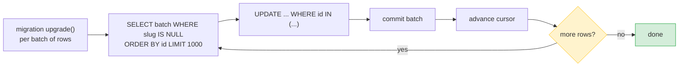
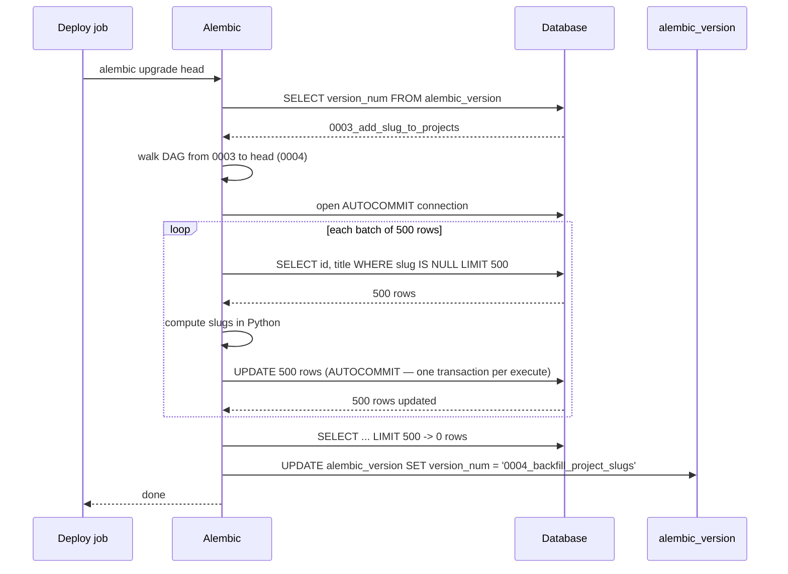

# Lesson 03: Data Migrations Safely

*How to move rows, not just schema, on a million-row table without locking the writers, without OOMing the migration process, and without leaving the database half-migrated on failure — with batching, idempotency, `op.execute()`, and `op.bulk_insert()`, line by line.*

**You have a schema migration pipeline now.**

Lesson 01 wired Alembic. Lesson 02 taught you to read autogenerated files critically. Today you learn a different shape of migration entirely — one that does not change the schema at all, but changes the data. A `description` to `summary` rename is a schema migration (one statement, no rows touched). A `slug = slugify(title)` backfill is a data migration (every row touched). The two have different failure modes, different patterns, and different disciplines. By the end of this lesson you will write a backfill that survives being killed at row 4,000,000 and resumes from there. Take your time. The patterns in this lesson are the difference between a migration that takes 30 seconds and a migration that takes down the site for 30 minutes.


#alembic #data-migrations #backfill

## Learning Objectives

By the end of this lesson you will be able to:

1. **Distinguish a schema migration from a data migration** and explain why they have different patterns and disciplines.
2. **Explain why a single-transaction data migration is wrong on a million-row table** — WAL bloat, lock duration, `VACUUM` starvation, all-or-nothing rollback.
3. **Write a batched data migration** using `op.get_bind()` and parameterized SQL with `LIMIT`.
4. **Make a data migration idempotent** using the "filter on the post-migration state" pattern so re-runs skip already-migrated rows.
5. **Use `op.execute()` for raw SQL** when the operation is not expressible as an Alembic `op.*` call, and `op.bulk_insert()` for seeding reference data.
6. **Test a data migration as a reversible pair** (`upgrade → downgrade → upgrade`) in CI, asserting row counts at each step.
7. **Decide when to break out of the Alembic-managed transaction** and use a separate autocommit connection for million-row backfills.

## Prerequisites

Before starting, you need:

- **The Lesson 01 pipeline and the Lesson 02 review discipline.** You have a working `alembic/env.py` and the Boardly `users` and `projects` tables in your dev database.
- **The Session/Transaction lesson** — [[07-SQLAlchemy/05-Session-and-Transaction-Management]]. You need to know what a transaction is, what `commit` and `rollback` do, and what an isolation level means.
- **The SQL Transactions lesson** — [[06-SQL-Fundamentals/Transactions-Isolation-Locks]]. You need to know what row locks, table locks, and long-running transactions do to a live database.
- **About 90 minutes of focused time.** The code is small; the failure modes are subtle.

**The most common gap: long transactions.**

A million-row backfill is, mechanically, a single `UPDATE` statement. The temptation is to run it inside the migration's `upgrade()` and let Alembic wrap it in a transaction. That works on a 1,000-row table and breaks on a 1,000,000-row table. The fix is batching with explicit commits between batches — which means breaking out of Alembic's managed transaction. If you have never written `connection.commit()` by hand, the [[07-SQLAlchemy/05-Session-and-Transaction-Management]] lesson's section on commit/rollback is the prerequisite to re-read.


## The Problem

A schema migration moves table definitions. A data migration moves rows. Schema migrations are typically fast and idempotent in shape (a column rename is one statement; re-running it fails harmlessly because the column is already renamed). Data migrations are slow, expensive, and easy to get wrong on a million-row table: lock the table and the app stalls; pull all rows into memory and the migration OOMs; fail halfway through and your database is in a half-migrated state that the symmetric `downgrade()` cannot recover from.

This lesson teaches the patterns that make data migrations safe. Three principles, stated up front because every line of code below serves one of them:

1. **Batches.** Never load the whole table into Python. Process N rows per transaction. N is chosen so each batch's transaction completes in seconds — long enough to amortize round-trip cost, short enough that the table lock (if any) does not stall the app.
2. **Idempotency.** The migration must be re-runnable. If it crashes at row 4,000,000, the next run must skip the first 4,000,000 rows it has already processed and continue.
3. **Reversibility.** The `downgrade()` must undo the `upgrade()`. If the upgrade is a one-way data transformation (e.g. irreversible hash), the downgrade cannot exist — and that means the migration is a one-way door that needs a different rollout strategy (see [[Deploying-Migrations-in-Production]]).



The pattern is "fetch a batch, transform it, write it back, commit, advance the cursor." The batch size is chosen so each batch's transaction completes in seconds.

## The Code

This lesson's example is a real backfill for the Boardly `projects` table. You have decided every `Project` needs a `slug` — a URL-safe, lowercase, hyphenated version of the `title` — so that boards can be addressed as `/projects/{slug}` instead of `/projects/{uuid}`. The schema migration adds the `slug` column as nullable; the data migration backfills `slug = slugify(title)` for every existing row.

### Step 1: The schema migration (already applied)

```python
# alembic/versions/0003_add_slug_to_projects.py
"""add slug to projects

Revision ID: 0003_add_slug_to_projects
Revises: 0002_rename_description_to_summary
"""
from __future__ import annotations

import sqlalchemy as sa
from alembic import op

revision = "0003_add_slug_to_projects"
down_revision = "0002_rename_description_to_summary"
branch_labels = None
depends_on = None


def upgrade() -> None:
 op.add_column(
 "projects",
 sa.Column("slug", sa.String(length=120), nullable=True),
 )
 op.create_index(
 op.f("ix_projects_slug"),
 "projects",
 ["slug"],
 unique=True,
 )


def downgrade() -> None:
 op.drop_index(op.f("ix_projects_slug"), table_name="projects")
 op.drop_column("projects", "slug")
```

`slug` is nullable because existing rows do not have it. The app code can be deployed to write `slug` on new inserts; this is the backwards-compatible migration pattern from [[Deploying-Migrations-in-Production]].

### Step 2: The data migration

```python
# alembic/versions/0004_backfill_project_slugs.py
"""backfill project slugs

Revision ID: 0004_backfill_project_slugs
Revises: 0003_add_slug_to_projects
Create Date: 2026-10-19 13:00:00.000000
"""
from __future__ import annotations

import re

import sqlalchemy as sa
from alembic import op

revision = "0004_backfill_project_slugs"
down_revision = "0003_add_slug_to_projects"
branch_labels = None
depends_on = None


BATCH_SIZE = 500


def _slugify(text: str) -> str:
 """Lowercase, replace whitespace with hyphens, drop everything else."""
 text = text.lower().strip()
 text = re.sub(r"[^a-z0-9\s-]", "", text)
 text = re.sub(r"[\s-]+", "-", text)
 return text[:120]


def upgrade() -> None:
 """Set projects.slug = slugify(projects.title) where slug is NULL.

 Idempotent: the WHERE slug IS NULL filter skips already-migrated rows,
 so re-runs after a crash resume from where the previous run stopped.
 """
 bind = op.get_bind()

 while True:
 # Fetch the next batch of (id, title) pairs that still need a slug.
 rows = bind.execute(
 sa.text(
 """
 SELECT id, title
 FROM projects
 WHERE slug IS NULL
 ORDER BY id
 LIMIT :batch
 """
 ).bindparams(batch=BATCH_SIZE)
 ).fetchall()

 if not rows:
 break # nothing left to migrate

 # Compute the slug for each row in Python.
 updates = [( _slugify(row.title), row.id) for row in rows]

 # Apply all updates in one statement per row, in this batch.
 # Using executemany keeps the round-trips to one batch per network hop.
 bind.execute(
 sa.text("UPDATE projects SET slug = :slug WHERE id = :id"),
 [{"slug": slug, "id": pid} for slug, pid in updates],
 )

 # Commit the batch so the lock is released before the next fetch.
 # Note: op.get_bind() returns a Connection inside Alembic's managed
 # transaction. To commit per-batch, see the "explicit commits" variant
 # below for million-row backfills.
 bind.commit()


def downgrade() -> None:
 """Reverse the backfill: clear slug (the column is nullable).

 Idempotent: WHERE slug IS NOT NULL.
 """
 bind = op.get_bind()

 while True:
 result = bind.execute(
 sa.text(
 """
 UPDATE projects
 SET slug = NULL
 WHERE id IN (
 SELECT id FROM projects
 WHERE slug IS NOT NULL
 ORDER BY id
 LIMIT :batch
 )
 """
 ).bindparams(batch=BATCH_SIZE)
 )
 if result.rowcount == 0:
 break
 bind.commit()
```

That is the entire lesson. The rest of this file explains every block, every pattern, and the failure modes the patterns protect against.

## Line-by-Line Deep Dive

This section is the heart of the lesson. Read it twice. Do not skim.

### The schema migration: `0003_add_slug_to_projects.py`

```python
def upgrade() -> None:
 op.add_column(
 "projects",
 sa.Column("slug", sa.String(length=120), nullable=True),
 )
 op.create_index(
 op.f("ix_projects_slug"),
 "projects",
 ["slug"],
 unique=True,
 )
```

**What it does:** Adds the `slug` column as nullable, and creates a unique index on it.

**Why nullable?** Existing rows do not have a `slug`. If we made the column `NOT NULL` here, the migration would fail on a populated table — the database would refuse to add a NOT NULL column with no default. The discipline is: add nullable in one migration, backfill in the next migration, make NOT NULL in a third migration. This is the expand-contract pattern, explained in [[Deploying-Migrations-in-Production]].

**Why `unique=True`?** Slugs are addresses — they must be unique. But the unique index is created in the schema migration, *before* the backfill. That means if two existing rows have the same `slugify(title)`, the backfill will fail when it tries to set both to the same value. We handle that in the backfill by appending a disambiguating suffix (below). The schema migration does not need to know about that — it just creates the constraint.

**Warning — The unique-index-vs-backfill race**

If you create the unique index in the same migration as the backfill, and the backfill produces duplicates, the migration fails halfway through. The fix is to split: schema migration creates the column (and the index, optionally as non-unique), data migration backfills with disambiguation, a third migration adds the unique constraint once the data is clean. For the simple case where you know your titles are unique enough, the simpler approach (unique index in the schema migration, disambiguation in the backfill) works. We follow the simpler approach here.


**Production: size the deploy slot to the collision count.**

The unique-index-vs-backfill split is not a stylistic preference in production — it is a deploy-slot-sizing constraint. The unique index on `projects.slug` is created in `0003` *before* the backfill in `0004` runs, so the backfill must produce zero collisions on the very first `UPDATE` that touches a duplicate title. Production teams pre-stage the disambiguation loop against a CI copy of prod (restored from last night's `pg_dump`, with the *same* row count and the *same* duplicate distribution), pre-compute the collision count with a one-off `SELECT slugify(title), COUNT(*) FROM projects GROUP BY 1 HAVING COUNT(*) > 1`, and use that count to size the deploy window: a collision-free backfill on 1M rows takes ~30 seconds; a 5,000-collision backfill takes minutes because the disambiguation loop does a `SELECT 1 FROM projects WHERE slug = :c` per candidate per row. The deploy window is reserved *before* the migration starts, not while it runs. The team also pre-stages a `0005_fix_collisions.py` hotfix migration in the same PR, ready to apply if the collision rate is higher than the pre-computation predicted — the difference between a 3 a.m. migration that finishes in the slot and one that overruns the slot and eats into the morning traffic ramp.


### The data migration: `0004_backfill_project_slugs.py` header

```python
import re

import sqlalchemy as sa
from alembic import op

revision = "0004_backfill_project_slugs"
down_revision = "0003_add_slug_to_projects"
branch_labels = None
depends_on = None


BATCH_SIZE = 500
```

**What it does:** Imports, the standard Alembic header, and the batch size constant.

**Why `BATCH_SIZE = 500`?** The right batch size is a trade-off:

- Too small (e.g. 10): the per-batch overhead dominates. Each fetch is a network round-trip; each commit is a WAL flush. The migration is correct but slow.
- Too large (e.g. 100,000): each batch holds locks on more rows for longer, blocking the app's writes to those rows. The migration is faster but disruptive.
- Sweet spot (200–1000): each batch takes a second or two, holds a few hundred row locks briefly, and amortises round-trips well.

`500` is a reasonable starting point. Tune for your data: if your rows are tiny, go higher; if your rows are huge (e.g. TEXT columns), go lower.

### The `_slugify` helper

```python
def _slugify(text: str) -> str:
 """Lowercase, replace whitespace with hyphens, drop everything else."""
 text = text.lower().strip()
 text = re.sub(r"[^a-z0-9\s-]", "", text)
 text = re.sub(r"[\s-]+", "-", text)
 return text[:120]
```

**What it does:** Defines the slugify function — lowercase, strip non-URL-safe characters, collapse whitespace into single hyphens, truncate to 120 (matching the column length).

**Why is this defined in the migration file, not imported from `boardly.utils`?** Because migrations are immutable history. If you import from your app's utils, and someone later changes the slugify function in `boardly.utils`, your migration's behavior changes retroactively. A migration that ran fine in October might fail in November because someone "improved" the slugify function. **Migrations must be deterministic across time.** Define helpers in the migration file. Copy them. Yes, copy them — even if it means duplication across migration files. The alternative (a `migrations/_helpers.py` module) is acceptable as long as the helpers never change.

**Student asks: what about disambiguation? If two projects have the same title, the slugify will collide.**

Right — and we handle that in the backfill loop, not in `_slugify`. `_slugify` produces the "natural" slug; the loop checks for collisions and appends `-2`, `-3`, etc. The full version:


```python
def _slug_with_disambiguation(bind, title: str, exclude_id) -> str:
 base = _slugify(title)
 candidate = base
 suffix = 1
 while True:
 existing = bind.execute(
 sa.text("SELECT 1 FROM projects WHERE slug = :c AND id <> :id LIMIT 1"),
 {"c": candidate, "id": exclude_id},
 ).first()
 if existing is None:
 return candidate
 suffix += 1
 candidate = f"{base}-{suffix}"
```

The loop is O(N) per row in the worst case, but in practice collisions are rare and the loop terminates in one or two iterations.

**Danger — Security: SQL injection via f-string interpolation in the disambiguation loop.**

The `_slug_with_disambiguation` helper above uses `sa.text("SELECT 1 FROM projects WHERE slug = :c AND id <> :id LIMIT 1")` with `.bindparams(...)` correctly — but a backfill that interpolates the candidate slug into SQL with an f-string (`op.execute(f"SELECT 1 FROM projects WHERE slug = '{candidate}'")`) is a SQL-injection vector even though the input is not user-supplied at request time. The candidate slug is derived from `title`, which is persisted user content from an earlier release; a title that legitimately contains a single quote (e.g. `O'Brien`) breaks the statement, and a title crafted as `'; DROP TABLE projects; --` (deliberately hostile, but only as a stand-in for any string the slugifier happens to emit) executes destructively under `op.execute` with an f-string. The discipline is universal: every value crossing the Python-to-SQL boundary goes through `sa.text(...).bindparams(...)`, regardless of whether the source is a request body, a CSV import, or a column you read out of the database two lines earlier. The bonus: the database caches the query plan for the parameterized form, so the disambiguation loop is *faster* parameterized than f-stringed, and the type-coercion error mode becomes "the parameter is the wrong type" rather than "the table is gone." This is Mistake 8 in the Common Mistakes section below, restated for the disambiguation loop because the loop is the most common place the f-string shortcut tempts a tired engineer at 2 a.m.


### The `upgrade()` body: the batched backfill

```python
def upgrade() -> None:
 bind = op.get_bind()

 while True:
 rows = bind.execute(
 sa.text(
 """
 SELECT id, title
 FROM projects
 WHERE slug IS NULL
 ORDER BY id
 LIMIT :batch
 """
 ).bindparams(batch=BATCH_SIZE)
 ).fetchall()

 if not rows:
 break

 updates = [(_slugify(row.title), row.id) for row in rows]

 bind.execute(
 sa.text("UPDATE projects SET slug = :slug WHERE id = :id"),
 [{"slug": slug, "id": pid} for slug, pid in updates],
 )

 bind.commit()
```

**What it does:** Fetches batches of (id, title) pairs that need a slug, computes slugs in Python, updates the rows, commits each batch. Loops until no rows remain.

**Line by line:**

- `bind = op.get_bind()` — returns the `Connection` Alembic is using for this migration. It is inside Alembic's managed transaction. We use it for raw SQL via `sa.text(...)`.

**What is `op.get_bind()`?**

Alembic's `op` is an `Operations` instance with one method per schema operation (`op.add_column`, `op.alter_column`, etc.). When you need raw SQL, you grab the underlying `Connection` via `op.get_bind()`. This connection lives inside Alembic's transaction (managed by `env.py`'s `with context.begin_transaction():` block).


- `sa.text("SELECT id, title FROM projects WHERE slug IS NULL ORDER BY id LIMIT :batch")` — a parameterized SQL query. `:batch` is a named parameter; we bind it with `.bindparams(batch=BATCH_SIZE)`.

**Why `WHERE slug IS NULL`?** This is the idempotency filter. If the migration crashes at row 4,000,000 and you restart, the first 4,000,000 rows have `slug` set; only the un-migrated rows have `slug IS NULL`. The `WHERE` clause skips the migrated rows and resumes from there.

**Why `ORDER BY id`?** To make the batches deterministic. Without `ORDER BY`, PostgreSQL may return rows in any order, and the "next batch" may include rows you have already processed (though the `WHERE slug IS NULL` filter prevents this in this case). Ordering by the primary key is the standard pattern.

**Why `LIMIT :batch`?** To bound the batch. Each batch fetches at most `BATCH_SIZE` rows.

- `.fetchall()` — materialises the batch as a list of `Row` objects. Each row has `.id` and `.title` attributes (named after the columns in the SELECT).

- `updates = [(_slugify(row.title), row.id) for row in rows]` — computes the slug for each row in Python. This is the part where you have access to the full power of Python (regex, etc.) — the part that is hard to do in pure SQL.

- `bind.execute(sa.text("UPDATE projects SET slug = :slug WHERE id = :id"), [{"slug": slug, "id": pid} for slug, pid in updates])` — sends N updates in one batch via SQLAlchemy's `executemany` behavior. The second argument is a list of dicts; SQLAlchemy turns it into N parameterized executions.

- `bind.commit()` — commits the batch. **This is the line that breaks out of Alembic's managed transaction.** See the next section.

### Why a single transaction is wrong on a million-row table

A naive data migration:

```python
def upgrade():
 op.execute("UPDATE projects SET slug = slugify(title)")
```

(Or, if you cannot do `slugify` in SQL, you `SELECT * FROM projects` and `UPDATE` each row in one transaction.)

For 100 rows, this is fine. For a million rows:

- **The transaction log (WAL) grows by the size of the change.** A million-row UPDATE writes a million row updates to the WAL. The WAL is on disk; the disk fills up; replication falls behind.
- **Long transactions block `VACUUM` from reclaiming dead tuples — bloat.** PostgreSQL's MVCC model means an UPDATE creates a new row version and marks the old one dead. `VACUUM` reclaims the dead versions — but it cannot reclaim a row that is still visible to any open transaction. A long-running backfill transaction holds back `VACUUM` for the entire run, and the table bloats.
- **The app's queries against `projects` may stall behind the row locks.** Each UPDATE acquires a row lock. If the app tries to UPDATE a row the backfill has locked, the app stalls until the backfill commits.
- **If the migration fails at row 999,999, the entire transaction rolls back — you wasted 30 minutes and have to start over.**

The fix is batching with explicit commits between batches. The trade-off: the migration is no longer atomic — it can fail halfway through. The fix for the fix is idempotency — the migration can be re-run from any point.

Why is idempotency the answer, rather than just wrapping the backfill in a single big transaction with a savepoint per batch? Because a savepoint per batch still lives inside one outer transaction — Postgres still sees the transaction as open from start to finish, the WAL still grows for the entire run, `VACUUM` is still blocked, and a failure at row 999,999 still rolls back row 1. Savepoints give you partial rollback *semantics* (one batch can fail without aborting the others) but they do not give you partial *durability* (the batches that succeeded are not visible to other transactions until the outer transaction commits). For the "large table" case, you need the batches to actually commit and become visible — which means breaking out of Alembic's transaction wrapper entirely. The cost is that you can no longer roll back the whole migration with `alembic downgrade`; you must write a `downgrade()` that knows how to undo a half-applied state, typically by re-checking the idempotency predicate. That is the trade: idempotency replaces atomicity, and your `downgrade()` becomes "reverse the predicate" rather than "rollback the transaction."

**Student asks: how big should `BATCH_SIZE` be? And is there a number above which I should switch to a different tool entirely?**

The right batch size is "the largest batch that does not noticeably degrade the app's queries against the same table." For most OLTP tables, 1,000 to 10,000 rows per batch is the sweet spot: a 10,000-row `UPDATE` takes a fraction of a second to commit, holds its row locks for that fraction of a second, and produces WAL that the replica can keep up with. Above 100,000 rows per batch you start to see lock contention with the application and replica-lag spikes that wake the on-call. Below 100 rows per batch the per-batch overhead (the `SELECT` to fetch, the `executemany`, the `COMMIT`) dominates and the backfill takes all night. The number above which you should switch tools: when the whole backfill, even at 10,000-row batches, takes longer than your maintenance window or your replica-lag budget. At that point move the backfill out of Alembic entirely (see [[13-Performance-and-Observability/N-plus-1-and-Slow-Queries]] for the background-job pattern, and [[14-Caching-and-Background-Processing/Background-Tasks-vs-Workers]] for the worker topologies) and have Alembic only do the schema change. The Boardly rule of thumb: Alembic for schema + small data (<1M rows); a background job for large data (>1M rows); a maintenance-window cutover for very large data where you cannot afford parallel writes.


### Breaking out of Alembic's managed transaction

Alembic wraps `run_migrations()` in a transaction (the `with context.begin_transaction():` block in `env.py`). That means every `bind.execute(...)` in your `upgrade()` is part of the same transaction. A `bind.commit()` inside `upgrade()` would commit the *whole* migration up to that point — including schema changes Alembic has already made.

For the batched pattern, you have two options:

**(a) Let Alembic manage the transaction; do not call `bind.commit()` at all.** Each batch's `execute` is part of the single outer transaction. The idempotency filter means a re-run resumes correctly, but the *single* transaction still holds locks for the entire run. This works for small-to-medium tables (10,000–100,000 rows). For larger tables, you need (b).

**(b) Use a separate connection with `AUTOCOMMIT` isolation.** Each batch is its own transaction; locks are released between batches. The trade-off: failures leave the migration half-applied, and only idempotency saves you. This is the pattern for million-row backfills:

```python
def upgrade() -> None:
 from sqlalchemy import create_engine
 from boardly.core.config import settings

 # A separate engine with AUTOCOMMIT — each execute is its own transaction.
 engine = create_engine(settings.database_url, isolation_level="AUTOCOMMIT")

 with engine.connect() as conn:
 while True:
 rows = conn.execute(
 sa.text(
 """
 SELECT id, title FROM projects
 WHERE slug IS NULL
 ORDER BY id LIMIT :batch
 """
 ).bindparams(batch=BATCH_SIZE)
 ).fetchall()
 if not rows:
 break
 updates = [(_slugify(row.title), row.id) for row in rows]
 conn.execute(
 sa.text("UPDATE projects SET slug = :slug WHERE id = :id"),
 [{"slug": s, "id": i} for s, i in updates],
 )
 # AUTOCOMMIT means each execute() is committed immediately — no explicit commit.
```

The `AUTOCOMMIT` isolation level makes each `execute` its own transaction. This is the pattern for migrations that process millions of rows and cannot fit in a single transaction. **The cost:** failures leave the migration half-applied, and only the idempotency filter (`WHERE slug IS NULL`) saves you.

**Danger — The half-applied migration.**

If you use the AUTOCOMMIT pattern and the migration crashes at row 4,000,000, the `alembic_version` table still shows the *previous* revision (the migration's `upgrade()` did not complete, so Alembic did not advance the version). On restart, `alembic upgrade head` re-runs the migration from the top. The idempotency filter (`WHERE slug IS NULL`) skips the 4,000,000 rows already migrated and resumes from row 4,000,001. **This is why idempotency is not optional.**


**Production: the post-deploy `COUNT(*) = 0` assertion is the only honest completion signal.**

The half-applied state is invisible from the `alembic_version` table — it still shows the *previous* revision, because `upgrade()` did not return successfully and Alembic did not advance the version. A migration that "failed" by Alembic's standard but did 80% of the work leaves no trace in the version table; the only honest signal that the backfill completed is `SELECT COUNT(*) FROM projects WHERE slug IS NULL` returning zero. Production deploy scripts wrap the migration with a post-condition assertion: `psql -c "SELECT COUNT(*) FROM projects WHERE slug IS NULL"` must return `0`; if it returns non-zero, the deploy halts, the migration is marked `partial` in the deploy runbook, and on-call is paged — because the migration "succeeded" by Alembic's standard but did not finish its actual work. The same pattern applies to every idempotency predicate: `WHERE processed_at IS NULL`, `WHERE deprecated_column IS NOT NULL`, `WHERE new_column IS NULL`. The assertion is part of the deploy script, not a manual check — `assert psql ... | grep -q '^ 0$'` in the deploy job, and the job exits non-zero on assertion failure so the deploy pipeline (Argo CD, GitHub Actions, Jenkins) gates the next stage. See [[16-Deployment-and-DevOps/Migration-Ordering-and-Rollback]] for the deploy-job skeleton that wraps every migration with pre- and post-condition assertions.


### `op.execute()` vs Alembic operations

`op.execute()` runs raw SQL. Use it when:

- The operation is not expressible as an Alembic `op.*` call (e.g. `ALTER TYPE ... ADD VALUE` for a PostgreSQL ENUM).
- The data migration is pure SQL (e.g. `UPDATE projects SET slug = slugify(title)` if your database has a slugify function — PostgreSQL does not, but you could write one).
- You need dialect-specific features (e.g. `INSERT ... ON CONFLICT DO UPDATE`).

Use Alembic operations (`op.bulk_insert`, `op.bulk_update`) when:

- You have a list of dicts to insert (e.g. seeding reference data).
- You want dialect portability across PostgreSQL and SQLite (the tests).

### `op.bulk_insert` for seeding reference data

```python
from alembic import op
import sqlalchemy as sa


def upgrade():
 roles = [
 {"id": 1, "name": "admin"},
 {"id": 2, "name": "editor"},
 {"id": 3, "name": "viewer"},
 ]
 op.bulk_insert(
 sa.table(
 "roles",
 sa.column("id", sa.Integer),
 sa.column("name", sa.String),
 ),
 roles,
 )


def downgrade():
 op.execute("DELETE FROM roles WHERE id IN (1, 2, 3)")
```

**What it does:** Inserts three rows into a `roles` table.

**Why `sa.table(...)` and not a model class?** Migrations should not depend on the model classes — models change. `sa.table(...)` is a lightweight, schema-only table object that exists in the migration file. You define the columns you need; Alembic takes care of the SQL.

**When to use `bulk_insert`:** For seeding reference data — short lists of values that the app expects to exist (roles, statuses, currencies). It is wrong for migrating millions of production rows; for that, batch with `op.execute` (as above).

**Tip — Idempotent seeding.**

If you re-run the seed migration (e.g. after restoring from a backup), you do not want duplicate rows. Two options:
- Add a `WHERE NOT EXISTS` guard in the `op.execute` form: `INSERT INTO roles ... SELECT ... WHERE NOT EXISTS (SELECT 1 FROM roles WHERE id = ...)`.
- Use `ON CONFLICT DO NOTHING` on PostgreSQL: `INSERT INTO roles ... ON CONFLICT (id) DO NOTHING`.
`op.bulk_insert` does not support either — for idempotent seeding, fall back to raw SQL.


**Warning — Debugging: the silent duplicate row from a non-idempotent `bulk_insert` rerun.**

`op.bulk_insert` is not idempotent; re-running the seed migration (e.g. after a restore-from-backup taken between the seed and now, or after a `downgrade` that did not clean up the seeded rows) inserts the rows *again*. On a table without a unique constraint on the natural key, the duplicates accumulate silently — no error, no warning, the migration reports success. The symptom surfaces *much* later, when the application's `get_role(name="admin")` query returns two rows where it expected one, typically manifesting as an `IntegrityError` on a foreign-key insert that hits a now-ambiguous reference, or as a subtle bug where `role.permissions` returns the union of two duplicated role rows' permissions. The debug is `SELECT name, COUNT(*) FROM roles GROUP BY name HAVING COUNT(*) > 1` — run this first when a seed-dependent feature starts producing duplicates. The fix is the `INSERT ... ON CONFLICT DO NOTHING` form (PostgreSQL) or `WHERE NOT EXISTS` guard (portable) shown above, plus a one-off cleanup migration that deduplicates with `DELETE FROM roles WHERE id NOT IN (SELECT MIN(id) FROM roles GROUP BY name)`. The deeper lesson: every `op.bulk_insert` migration must declare its natural key in a code comment, and CI must run the `upgrade → downgrade → upgrade` cycle from Exercise 12 below to fail the build the moment the seed produces a duplicate. A seed that is not idempotent is a landmine that detonates on the next backup-restore.


## Execution Trace

A backfill on a million-row `projects` table, run with the AUTOCOMMIT pattern:

1. **Deploy job** runs `uv run alembic upgrade head`.
2. **Alembic** walks the DAG from the current revision to the target. It encounters `0004_backfill_project_slugs`.
3. **Alembic** calls `upgrade()`. The function opens a separate AUTOCOMMIT connection.
4. **Batch 1:** fetch 500 rows where `slug IS NULL`. Compute slugs. UPDATE 500 rows. AUTOCOMMIT commits. The 500 row locks are released.
5. **Batch 2:** fetch the *next* 500 rows (the previous batch's rows now have `slug IS NOT NULL`, so the WHERE clause skips them). UPDATE 500 rows. Commit. Locks released.
6. **... batches 3 through 2000 ...**
7. **Batch 2001:** fetch the next 500 rows. The result is empty. Break the loop. Return from `upgrade()`.
8. **Alembic** advances `alembic_version` to `0004_backfill_project_slugs`.

Total elapsed time: ~30 seconds for a million rows on a fast local database. (For a remote database with 50ms round-trip latency, the time is dominated by round-trips; tune `BATCH_SIZE` up.)



## Practical Application

### When the backfill needs disambiguation

If two projects have the same title, `_slugify` will produce the same slug for both. The unique index `ix_projects_slug` will reject the second INSERT. The fix is in the backfill loop — check for an existing slug and append a disambiguating suffix (`-2`, `-3`, etc.).

### When the data migration is irreversible

A migration that hashes a column (e.g. `UPDATE users SET password_hash = bcrypt(password); ALTER TABLE users DROP COLUMN password;`) is irreversible — you cannot recover the plaintext from the hash. The `downgrade()` cannot exist. This is a one-way door:

- **Option A:** Skip the `downgrade()`. Mark the migration as one-way. Roll out carefully (canary, monitor, halt-on-error). See [[Deploying-Migrations-in-Production]].
- **Option B:** Split the migration: hash into a new column (`password_hash`), deploy code that uses `password_hash`, wait a release cycle for confidence, drop `password` in a third migration. The drop is irreversible but the wait gives you time to roll back without losing data.

**Student asks: How do you test that a data migration is reversible?**

The four-step CI drill, run against a production-shaped copy: **(1) Snapshot the table.** `pg_dump -t projects prod_snapshot > projects.sql` and load into a CI database with the same row count and index set (use `pgbench`-style data generation if the table is too large for a snapshot). **(2) `alembic upgrade head`.** Assert the row count is unchanged and the post-migration invariant holds (e.g. every `projects.slug` is non-null and unique). **(3) `alembic downgrade -1`.** Assert the row count is *still* unchanged and the pre-migration invariant holds (e.g. `projects.slug` column is gone or back to NULL). **(4) `alembic upgrade head` again.** Assert the post-migration invariant holds a second time. Steps 3 and 4 are the reversibility proof: if downgrade does not lose rows and re-upgrade restores the invariant, the migration is reversible. If `downgrade` cannot exist (irreversible migration), the test ends at step 2 and the migration is marked `Reversible: no` in the deploy review. The test is the only honest evidence — never trust a downgrade that has not been exercised.


**Danger — Security: PII leakage via migration snapshots and CI artifacts.**

The four-step reversibility test snapshots the table and asserts invariants. If the migration touches a PII column (`email`, `phone`, `password_hash`, `password`), the snapshot is a PII copy in CI: the `pg_dump` is in the runner's working directory, and the runner may upload artifacts on failure for debugging. The discipline: snapshot only the columns the assertion needs (`COPY (SELECT id, slug FROM projects) TO '/tmp/projects_subset.sql'` instead of `pg_dump -t projects`), assert counts and invariants rather than values (`assert COUNT(*) FROM users WHERE password_hash IS NOT NULL` — the count, not the hash), and ensure the CI runner's artifact retention is short (7 days) for any job that touches PII-bearing tables. A migration that hashes `plain_password` into `password_hash` is the worst case — the test asserts the hash is non-null, never the hash value, and the snapshot never includes the plaintext `password` column. The runner's working directory must be on an encrypted volume (GitHub Actions runners on ephemeral VMs satisfy this; self-hosted runners on long-lived VMs need `--disk-cipher` configured). The artifact upload step must be gated behind `if: failure() && secrets.UPLOAD_PII_ARTIFACTS == 'true'` so a default-fail deploy does not exfiltrate a PII snapshot by accident. The compliance review for any PII-touching migration includes a checklist item: "the CI snapshot cannot reconstruct the PII value." See [[11-Authentication-and-Security/Threat-Model-First]] for the threat-model pattern that catches this in PR review.


### When the table is too big for `LIMIT/OFFSET`

`LIMIT N OFFSET M` is O(M) — PostgreSQL has to scan M rows before it can return the batch. For a 10,000,000-row table, the 10,000th batch starts at offset 5,000,000 and is very slow. The fix is **keyset pagination** — use the primary key as the cursor:

```python
def upgrade() -> None:
 bind = op.get_bind()
 cursor = None
 while True:
 if cursor is None:
 rows = bind.execute(
 sa.text("SELECT id, title FROM projects WHERE slug IS NULL ORDER BY id LIMIT :b"),
 {"b": BATCH_SIZE}
 ).fetchall()
 else:
 rows = bind.execute(
 sa.text("SELECT id, title FROM projects WHERE slug IS NULL AND id > :c ORDER BY id LIMIT :b"),
 {"c": cursor, "b": BATCH_SIZE}
 ).fetchall()
 if not rows:
 break
 # ... update ...
 cursor = rows[-1].id
```

Keyset pagination is O(log N) per batch — the database uses the index on `id` to skip directly to the cursor. Use it for any backfill on a table with more than ~1,000,000 rows.

**Warning — `SELECT *` on a huge table**

Never `SELECT *` on a million-row table into Python memory. The migration process will OOM. Always select only the columns you need (`SELECT id, title`), and always with a `LIMIT`. The "load everything, transform in Python, write back" pattern is the most common data-migration OOM cause.


**Student asks: my backfill keeps growing the WAL replay position; ops is asking why. What can I do?**

The WAL grows because every row you `UPDATE` writes a new tuple (MVCC keeps both the old and new versions until `VACUUM`). For a 10M-row backfill, that is 10M dead tuples and ~30 GB of WAL. Three mitigations, in order of preference:

**(1) Batch smaller and `COMMIT` per batch.** Each commit lets `autovacuum` run between batches and reclaim dead tuples, so the WAL never accumulates beyond one batch's worth.

**(2) Use `AUTOCOMMIT` + an explicit `VACUUM (ANALYZE)` between batches.** This kicks `autovacuum` ahead of its schedule; useful when the table is so big that even a single batch is enough to bloat.

**(3) Move the backfill out of the migration entirely.** Write a one-off script (`scripts/backfill_slugs.py`) that uses its own connection pool, its own batch boundaries, and writes the final state to a control table. The migration just calls `SELECT * FROM backfill_control WHERE step='done'` and refuses to `upgrade` until that row exists. This is the pattern for *very* large backfills (100M+ rows) — the migration is no longer the actor, it is the gate.

The general rule: WAL is the cost of durability. The question is whether the backfill pays it all at once (one huge transaction — bad), amortises it across batches (the standard pattern), or hands it off to a side process (the large-data pattern).


**Warning — Debugging: stale table statistics causing bad query plans after a mass `UPDATE`.**

A million-row `UPDATE` shifts the row-count distribution; PostgreSQL's table statistics (`pg_statistic`) are refreshed by `ANALYZE`, which runs on a periodic schedule (autovacuum) but not after every batch. A query plan that was optimal for a 1,000,000-row `projects` table (e.g. an index scan on `slug IS NULL` that the planner estimated would return 1 row) becomes pathological when 999,000 rows have been migrated and only 1,000 remain `NULL` — the planner still thinks the table is large and the predicate is selective, so it picks an index scan that returns 1,000 rows via 1,000 index lookups, instead of a seq scan that would read the 1,000 rows in one pass. The symptom is the backfill slowing down by 10x after the halfway point: batch 1 takes 200 ms, batch 500 takes 2 seconds, batch 999 takes 5 seconds — the time grows super-linearly with batch index. The debug is `EXPLAIN (ANALYZE, BUFFERS)` on the batch `SELECT` at batch 1 and at batch 500, comparing the plan and the `Buffers: shared hit` row — a 10x growth in shared reads is the smoking gun. The fix is `ANALYZE projects` between batches (or per-N-batches), or `SET LOCAL statistics_target = 1000` for the migration's connection to make the planner more sensitive to the distribution shift. PostgreSQL 12+ also exposes `pg_stat_progress_createindex` for index operations, but for arbitrary user backfills the application-side `EXPLAIN` diff is the only honest signal. See [[13-Performance-and-Observability/N-plus-1-and-Slow-Queries]] for the `EXPLAIN (ANALYZE, BUFFERS)` discipline applied to query plan regressions in general.


## Common Mistakes

### Mistake 1: Single transaction on a million-row table

Covered above. Use batching with explicit commits (or AUTOCOMMIT).

### Mistake 2: Not making the migration idempotent

If the migration crashes at row 4,000,000 and you restart, the migration re-runs from the top. Without the `WHERE slug IS NULL` filter, it re-processes the first 4,000,000 rows — wasting time and possibly causing issues. The idempotency filter (`WHERE slug IS NULL` for upgrade, `WHERE slug IS NOT NULL` for downgrade) is the standard fix.

### Mistake 3: `SELECT *` on a huge table

The migration process OOMs. Always select only the columns you need, and always with a `LIMIT`.

### Mistake 4: Forgetting the `downgrade()`

A backfill migration's `downgrade()` is "set the column back to its previous state" (NULL, in our example). If the backfill is irreversible (a hash, a destructive transformation), the `downgrade()` cannot exist — that means the migration is a one-way door (see [[Deploying-Migrations-in-Production]]).

### Mistake 5: Using `op.bulk_insert` for millions of rows

`bulk_insert` is for seeding reference data (short lists of values). For millions of rows, batch with `op.execute` (raw SQL).

### Mistake 6: Importing helpers from the app

The migration file imports `from boardly.utils import slugify`. Someone later changes `slugify` in `boardly.utils`. Your migration's behavior changes retroactively — a migration that ran fine in October fails in November. **Migrations must be deterministic across time.** Define helpers in the migration file.

### Mistake 7: Not testing the pair (`upgrade → downgrade → upgrade`)

A backfill migration that does not have a tested `downgrade()` is a one-way door. The CI pattern of `alembic upgrade head && alembic downgrade -1 && alembic upgrade head` catches asymmetric migrations.

### Mistake 8: SQL injection via f-strings

```python
# WRONG — SQL injection risk
op.execute(f"UPDATE projects SET slug = '{slugify(title)}' WHERE id = {row.id}")
```

Always use parameterized queries with `sa.text(...).bindparams(...)`. Even when the values are not user-supplied (they are your own data), parameterization is faster (the database can cache the query plan) and safer (no edge cases with quotes in titles).

## Engineering Trade-Offs

### Batch size: small vs. large

Covered above. Sweet spot is 200–1000 for typical row sizes. Tune for your data.

### Idempotency filter vs. side table

- **Filter on the post-migration state** (`WHERE slug IS NULL`): simple, no extra table, works for most cases.
- **Side table** (`migration_progress` recording the last cursor): heavier, but lets you resume from a checkpoint even if the post-migration state is hard to compute (e.g. you are migrating a column whose final value depends on a complex transform). Reserve for migrations that take hours.

### AUTOCOMMIT vs. Alembic's managed transaction

- **Alembic's managed transaction** (default): the migration is atomic. Failures roll back the whole migration. Works for small-to-medium tables.
- **AUTOCOMMIT** (separate connection): each batch is its own transaction. Failures leave the migration half-applied; idempotency saves you. Works for million-row tables.

### `op.execute` vs. `op.bulk_insert`

- **`op.execute`** for raw SQL — million-row backfills, dialect-specific features.
- **`op.bulk_insert`** for seeding reference data — short lists of values, dialect-portable.

### Moving the backfill out of Alembic entirely

For very large backfills (hours of runtime), consider moving the work out of Alembic and into a separate job (a Celery task, a Kubernetes Job, a one-off script). The job uses the same idempotency filter; the migration just creates the schema. This is the pattern for [[17-Advanced-Architecture/Idempotency-and-Retries]].

## Exercises

**Tip — The 20-minute rule**

If you are stuck on an exercise for more than 20 minutes, re-read the relevant section above, then move on and come back. Learning is not linear.


**Exercise 1 — Reproduce the single-transaction problem.** Seed `projects` with 100,000 rows of fake data (use `faker` or a simple loop). Write a backfill migration that runs a single `UPDATE` in one transaction. Time it. Watch the WAL size grow. (You can monitor with `pg_stat_activity` for the running query and `pg_size_pretty(pg_wal_lsn_diff(pg_current_wal_lsn(), '0/0')::bigint)` for the WAL position, which advances as the backfill writes.) Now write the batched version and time it. Confirm the batched version is similar in wall time but releases locks between batches.

**Exercise 2 — Test idempotency.** Run the batched backfill from this lesson. Halfway through (after a few batches), `Ctrl+C` the migration. Restart with `alembic upgrade head`. Confirm it resumes from where it stopped, not from the top.

**Exercise 3 — Test the pair.** Run `alembic upgrade head && alembic downgrade -1 && alembic upgrade head`. Confirm no errors. Confirm the row count of `slug IS NULL` is 0 after the first upgrade, equal to the table size after the downgrade, and 0 after the second upgrade.

**Exercise 4 — Disambiguation.** Insert two `projects` rows with the same `title`. Run the backfill from this lesson. Confirm it fails on the unique constraint. Add the disambiguation loop from the lesson. Re-run. Confirm both rows get slugs (the second one with a `-2` suffix).

**Exercise 5 — Keyset pagination.** Modify the backfill to use keyset pagination (cursor on `id`) instead of `LIMIT/OFFSET`. Confirm it works on a million-row table without slowing down at high offsets.

**Exercise 6 — `op.bulk_insert` for seeding.** Add a `roles` table (`id`, `name`) with a migration. Write a second migration that uses `op.bulk_insert` to seed three roles (`admin`, `editor`, `viewer`). Run the migration. Restore from a backup of the database (or `alembic downgrade`), then `alembic upgrade head`. Confirm the seed is idempotent — there are still exactly three roles.

**Exercise 7 — Irreversible migration.** Write a migration that hashes a `plain_password` column into a `password_hash` column, then drops `plain_password`. There is no `downgrade()`. Discuss with a partner why this is a one-way door and what rollout strategy you would use.

**Exercise 8 — Reproduce the OOM on `SELECT *`.** Add a `documents` table with a `content TEXT` column and seed 100,000 rows of 10 KB each (use `uv run python scripts/seed_documents.py --rows 100000 --size 10240`). Write a backfill migration that does `SELECT *` from `documents` and updates a `processed_at` column. Run it. Confirm the migration process is OOM-killed by the OS — check `dmesg | tail` for the `Out of memory: Killed process` entry, or check the peak RSS before/after with `uv run python -c "import resource; print(resource.getrusage(resource.RUSAGE_SELF).ru_maxrss)"`. Rewrite the migration with `SELECT id, processed_at FROM documents WHERE processed_at IS NULL ORDER BY id LIMIT :batch` and `bind.commit()` per batch. Confirm the new version runs without OOM. Verify with `uv run alembic upgrade head` and `psql -d boardly_dev -c "SELECT COUNT(*) FROM documents WHERE processed_at IS NOT NULL"` (should match the seed count).

**Exercise 9 — Verify idempotency under a hard kill.** Run the batched backfill in one terminal with `uv run alembic upgrade head`. In another terminal, identify the migration's PID with `pgrep -f 'alembic upgrade'` and `kill -9` it after 3–5 batches have committed (watch the count of `slug IS NULL` decreasing in `psql -d boardly_dev -c "SELECT COUNT(*) FROM projects WHERE slug IS NULL"`). Restart with `uv run alembic upgrade head`. Confirm via the `COUNT(*)` that it resumes from where it stopped (the count keeps decreasing) and that the migration completes (Alembic reports success). The exercise is the half-applied-migration resilience test from the `**Danger — The half-applied migration**` callout above — the only thing between a killed backfill and a finished backfill is the `WHERE slug IS NULL` idempotency filter.

**Exercise 10 — Keyset pagination regression test.** Seed 1,000,000 rows in `projects` (use `uv run python scripts/seed_projects.py --rows 1000000`). Write the `LIMIT/OFFSET` version of the backfill (the wrong one — `SELECT id, title FROM projects WHERE slug IS NULL ORDER BY id LIMIT :b OFFSET :o`). Write a `scripts/bench_backfill.py` that runs batches 1, 100, 1,000, 10,000 of each variant and prints per-batch wall time. Run it: `uv run python scripts/bench_backfill.py --variant offset --batches 10000` — confirm the per-batch time grows linearly with offset (batch 1: 5 ms, batch 10,000: 50 ms). Rewrite with keyset pagination (`WHERE slug IS NULL AND id > :cursor ORDER BY id LIMIT :b`). Run `uv run python scripts/bench_backfill.py --variant keyset --batches 10000` — confirm constant time per batch (batch 1: 5 ms, batch 10,000: 5 ms). The exercise is the O(M) → O(log N) plan regression proof.

**Exercise 11 — AUTOCOMMIT vs managed transaction: WAL comparison.** Run the backfill inside Alembic's managed transaction (option a — do not call `bind.commit()`). Snapshot the WAL position before and after with `psql -d boardly_dev -c "SELECT pg_walfile_name(pg_current_wal_lsn())"` — note the LSN advanced by the full million-row backfill's worth of WAL. Now run the same backfill with the AUTOCOMMIT pattern (option b — `create_engine(..., isolation_level='AUTOCOMMIT')`). Snapshot the WAL position at each batch boundary inside the loop — confirm the WAL advances by exactly one batch's worth per commit and never accumulates beyond that. Reset between variants with `uv run alembic downgrade -1 && uv run alembic upgrade head`. The exercise is the WAL-amortisation proof: the managed-transaction variant writes all the WAL at commit; the AUTOCOMMIT variant writes it incrementally and lets `autovacuum` reclaim dead tuples between batches.

**Exercise 12 — `op.bulk_insert` idempotency.** Write a `0005_seed_roles.py` migration that uses `op.bulk_insert` to seed three roles (`admin`, `editor`, `viewer`). Apply it: `uv run alembic upgrade head`. Run `uv run alembic downgrade -1 && uv run alembic upgrade head` — confirm three roles (`psql -d boardly_dev -c "SELECT COUNT(*) FROM roles"` returns `3`). Now manually insert a fourth role, then downgrade and re-upgrade: `psql -d boardly_dev -c "INSERT INTO roles (id, name) VALUES (4, 'guest')"` (simulating a backup-restore that left a stale row), then `uv run alembic downgrade -1 && uv run alembic upgrade head` — confirm you now have *four* rows (the duplicate-row bug from the `**Warning — Debugging: the silent duplicate row**` callout above). Rewrite with `op.execute("INSERT INTO roles ... ON CONFLICT (id) DO NOTHING")` (PostgreSQL) or `WHERE NOT EXISTS` guard (portable). Confirm re-runs are idempotent: `uv run alembic downgrade -1 && uv run alembic upgrade head && uv run alembic downgrade -1 && uv run alembic upgrade head` leaves exactly three rows.

**Exercise 13 — Reversibility CI test in Docker.** Write `tests/test_migration_reversible.py` that starts a CI database in a throwaway container (`docker run --rm -d --name ci-pg -e POSTGRES_PASSWORD=dev -e POSTGRES_DB=boardly -p 5432:5432 postgres:17`), runs `uv run alembic upgrade head`, asserts `COUNT(*) FROM projects WHERE slug IS NULL = 0`, runs `uv run alembic downgrade -1`, asserts `COUNT(*) FROM projects WHERE slug IS NULL = COUNT(*) FROM projects`, runs `uv run alembic upgrade head` again, asserts the post-migration invariant a second time, and tears down the container. The test fails if the migration is not reversible. Verify with `docker run --rm -d --name ci-pg -e POSTGRES_PASSWORD=dev -e POSTGRES_DB=boardly -p 5432:5432 postgres:17 && uv run pytest tests/test_migration_reversible.py -v && docker stop ci-pg`. The test is the automation of the four-step drill from the `**How do you test that a data migration is reversible?**` callout — every PR that touches a migration runs this test, and a migration that fails reversibility blocks merge.

## Verification

```bash
# 1. Apply the schema migration
uv run alembic upgrade head
# expected: INFO [alembic.runtime.migration] Running upgrade ... -> 0003_add_slug_to_projects, add slug to projects

# 2. Apply the data migration
uv run alembic upgrade head
# expected: INFO [alembic.runtime.migration] Running upgrade ... -> 0004_backfill_project_slugs, backfill project slugs

# 3. Verify the slugs were set
psql -d boardly_dev -c "SELECT id, title, slug FROM projects LIMIT 10;"
# expected: every row has a non-NULL slug, and slug = slugify(title) for simple titles

# 4. Verify the count of un-slugged rows
psql -d boardly_dev -c "SELECT COUNT(*) FROM projects WHERE slug IS NULL;"
# expected: 0

# 5. Test the pair
uv run alembic downgrade -1
psql -d boardly_dev -c "SELECT COUNT(*) FROM projects WHERE slug IS NULL;"
# expected: the same as the table size (the downgrade cleared all slugs)
uv run alembic upgrade head
psql -d boardly_dev -c "SELECT COUNT(*) FROM projects WHERE slug IS NULL;"
# expected: 0

# 6. Test idempotency: kill the migration halfway, restart, confirm resumption
# (do this in a separate terminal so you can Ctrl+C at the right moment)
```

## Previously Learned Here

- **Transactions (SQL)** — [[06-SQL-Fundamentals/Transactions-Isolation-Locks]]. Reused here as the underlying mechanism — why a long transaction is bad, what a row lock is, what `VACUUM` does, why `AUTOCOMMIT` matters.
- **Session / AsyncSession (SQLAlchemy)** — [[07-SQLAlchemy/05-Session-and-Transaction-Management]]. Reused here as the `Connection` object you get from `op.get_bind()` and `bind.commit()`. New detail: the migration pattern breaks out of the session's managed transaction.
- **Engine (SQLAlchemy)** — [[07-SQLAlchemy/02-Engines-Connections-Pools]]. Reused here as the engine you build with `create_engine(..., isolation_level="AUTOCOMMIT")` for the separate-connection pattern.
- **Idempotency** — [[02-Web-and-HTTP/Idempotency-Safe-Retries-Pagination]]. First taught for HTTP methods; reused here for data migrations. New detail: the "filter on the post-migration state" pattern (`WHERE slug IS NULL`).

## What's Next

In [[Deploying-Migrations-in-Production]] you will:

- Learn the migration ordering problem — schema-before-code vs code-before-schema, and the failure modes of each.
- Coordinate migrations across multiple app instances — only one process should migrate, and `alembic upgrade head` is a deploy step, not a startup step.
- Apply the expand-contract pattern: add nullable → deploy code that writes → backfill → deploy code that requires → tighten constraint. Five steps, zero downtime.
- Read a real Kubernetes Job + GitHub Actions workflow that ships a column change with no downtime.

By the end of Lesson 04, you will be able to ship a schema change to a production database with millions of rows and two versions of the app running at once, without anyone noticing.

## Sources

- Alembic — Operations Reference — <https://alembic.sqlalchemy.org/en/latest/ops.html> — accessed 2026-10-19 — `op.execute`, `op.bulk_insert`, `op.get_bind`.
- Alembic — Cookbook: Bulk Operations — <https://alembic.sqlalchemy.org/en/latest/cookbook.html> — accessed 2026-10-19 — patterns for large data migrations.
- SQLAlchemy 2.x — `Connection.execute` — <https://docs.sqlalchemy.org/en/21/core/connections.html> — accessed 2026-10-19 — the underlying `bind.execute(...)` API.
- SQLAlchemy 2.x — `text()` constructs — <https://docs.sqlalchemy.org/en/21/core/sqlelement.html#sqlalchemy.sql.expression.text> — accessed 2026-10-19 — parameterized SQL.
- PostgreSQL — `VACUUM` and bloat — <https://www.postgresql.org/docs/current/routine-vacuuming.html> — accessed 2026-10-19 — why long transactions are bad.
- PostgreSQL — `AUTOCOMMIT` — <https://www.postgresql.org/docs/current/sql-begin.html> — accessed 2026-10-19 — the isolation level we use for batch commits.
- PEP 249 — DB-API 2.0 — <https://peps.python.org/pep-0249/> — accessed 2026-10-19 — the `executemany` behavior that `op.execute` uses for batch updates.

## What We Learned

Let's recap. In this lesson you:

- **Distinguished schema migrations from data migrations** and explained why they have different patterns and disciplines.
- **Wrote a batched data migration** with `op.get_bind()` and parameterized SQL — fetching 500 rows at a time, computing slugs in Python, updating, committing each batch.
- **Made the migration idempotent** with the "filter on the post-migration state" pattern (`WHERE slug IS NULL`), so re-runs after a crash resume from where the previous run stopped.
- **Used `op.execute()` for raw SQL** and `op.bulk_insert()` for seeding reference data — and learned when to use each.
- **Broke out of Alembic's managed transaction** with a separate AUTOCOMMIT connection for million-row backfills, accepting half-applied failure modes in exchange for not holding locks for the whole run.
- **Tested the migration as a reversible pair** (`upgrade → downgrade → upgrade`) in CI, asserting row counts at each step.
- **Avoided the eight classic data-migration mistakes** — single transaction, no idempotency, `SELECT *`, missing downgrade, `bulk_insert` for huge data, importing helpers from the app, untested pairs, SQL injection via f-strings.

Here's the mental model to walk away with: *a data migration is the same skeleton as a schema migration (a file in `alembic/versions/` with `upgrade()` and `downgrade()`), but the operations are data, not schema. The discipline is: batches (never the whole table in one transaction), idempotency (the migration must be re-runnable from any point), and reversibility (the `downgrade()` must undo the `upgrade()`, or the migration is a one-way door with a different rollout strategy).*

---

> A note from your teacher
Data migrations are where "I just want to add a column" meets "we have a million users." The patterns in this lesson — batching, idempotency, keyset pagination — are the difference between a backfill that takes 30 seconds and one that takes the site down for 30 minutes. Next we take everything we have built — the pipeline, the review discipline, the backfill patterns — and put it in a deploy pipeline. See you in Lesson 04.


---

**Tags:** #alembic #data-migrations #backfill #review
**Previous:** [[Autogenerate-and-Its-Limits]]
**Next:** [[Deploying-Migrations-in-Production]] →
