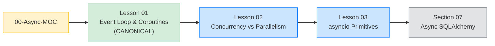

# Section 10: Async Python (Map of Content)

*The map of content for the three-lesson tour of why `Boardly`'s `async def` endpoints are not magic — what the event loop is, what a coroutine is, when asyncio is the wrong tool, and how to use the primitives correctly.*

**Welcome to Section 10.**

You have written `async def` endpoints. You have used `await`. You may have even used `asyncio.gather` to fetch three URLs concurrently. But you have not yet seen the model that makes it all work — the single-threaded scheduler that swaps between coroutines at their `await` points. Once you see the model, every "my async server isn't actually concurrent" bug becomes obvious. Three lessons, one growing mental model, no surprises. Pull up a chair.

#async #event-loop #moc

## What this section is, in one paragraph

Async Python is a single-threaded scheduler (the **event loop**) that interleaves **coroutines** at their `await` points. The crucial property: only one coroutine is executing Python code at any instant; the loop achieves concurrency by swapping, not by running in parallel. The model is brilliant for I/O-bound workloads — one process, one core, thousands of concurrent connections — and catastrophic for CPU-bound work or blocking I/O, because the loop cannot swap away from a coroutine that is not `await`-ing. The three lessons in this section teach the model, the comparison with alternatives, and the primitives you will use every day.

Why does the single-threaded property matter so much? Because it means the loop has no preemption: nothing forces a coroutine to yield. The instant one coroutine calls `time.sleep(5)` instead of `await asyncio.sleep(5)`, every other coroutine on the loop is frozen for those five seconds — including the heartbeat, the healthcheck, and the WebSocket pings. Threads get pre-empted by the OS scheduler; coroutines do not. The trade-off is that coroutines are cheaper than threads (no kernel context switch, no stack allocation) and easier to reason about (no data races on shared state), but only if every coroutine cooperates by `await`-ing. That cooperation is what Lesson 01's "cost of `await` on blocking code" section is about — and it is the section the rest of this track rests on.

## The three lessons at a glance

| Lesson | What it teaches | The Boardly code that drives it |
|---|---|---|
| [[Event-Loop-and-Coroutines]] | The single-threaded scheduler, `async def` / `await`, `asyncio.run`, tasks vs coroutines, `asyncio.gather` vs `asyncio.create_task`, why a "synchronously slow" function inside `async def` blocks the whole loop. | A `boardly/clients/health.py` module that fans out to N service URLs concurrently with `httpx.AsyncClient` + `asyncio.gather`. |
| [[Concurrency-vs-Parallelism]] | Concurrency (interleaved) vs parallelism (simultaneous), threads vs asyncio vs multiprocessing, when each wins, GIL primer, `run_in_executor` for blocking work, comparison table. | A `boardly/routers/reports.py` endpoint that fetches an external API (async) *and* computes a CPU-bound summary (offloaded to a process pool) concurrently. |
| [[asyncio-Primitives]] | `Lock`, `Event`, `Semaphore`, `Queue`, `TaskGroup` (PEP 654), `timeout()`, cancellation semantics (`CancelledError` inherits `BaseException`), exception groups (`except*`), practical patterns. | A `boardly/routers/lookup.py` endpoint that fans out to N URLs bounded by a `Semaphore` and gathers them with a `TaskGroup`. |

## Lesson dependency graph

Read the three lessons in order. Each one assumes the model of the previous one.

## The canonical lessons taught here

This section registers **two** canonical concepts — both first taught in [[Event-Loop-and-Coroutines]]:

- **Event loop** — `first_taught_in: "10-Async-Python/Event-Loop-and-Coroutines"`. Reused in [[Concurrency-vs-Parallelism]] (Lesson 02 frames the loop against threads and processes), [[asyncio-Primitives]] (Lesson 03's `Lock` / `Event` / `Semaphore` / `Queue` / `TaskGroup` / `timeout()` all run on the loop), [[07-SQLAlchemy/07-Async-SQLAlchemy]], [[12-Testing-and-Quality/Async-Testing]], [[14-Caching-and-Background-Processing/Background-Tasks-vs-Workers]], [[02-Web-and-HTTP/ASGI-Starlette-Uvicorn]].
- **Coroutine** — `first_taught_in: "10-Async-Python/Event-Loop-and-Coroutines"`. Reused in [[Concurrency-vs-Parallelism]], [[asyncio-Primitives]], [[07-SQLAlchemy/07-Async-SQLAlchemy]], [[12-Testing-and-Quality/Async-Testing]], [[14-Caching-and-Background-Processing/Background-Tasks-vs-Workers]].

Every later lesson that uses the terms "event loop" or "coroutine" links back to that lesson instead of re-explaining. The full canonical record is in [[Concept-Registry]].

## How this section relates to the rest of the vault

| Concern | Lives in |
|---|---|
| The ASGI stack FastAPI runs on (an event loop, driven by Uvicorn) | [[02-Web-and-HTTP/ASGI-Starlette-Uvicorn]] |
| The FastAPI lifespan (a coroutine run by the event loop at startup/shutdown) | [[03-FastAPI-Core/Application-and-Lifespan]] |
| Async SQLAlchemy (coroutines consuming the database) | [[07-SQLAlchemy/07-Async-SQLAlchemy]] |
| Async testing (testing coroutines without surprising the loop) | [[12-Testing-and-Quality/Async-Testing]] |
| Background tasks vs workers (when to move work off the loop) | [[14-Caching-and-Background-Processing/Background-Tasks-vs-Workers]] |
| N+1 queries and slow queries (the concurrency comparison table is the reference) | [[13-Performance-and-Observability/N-plus-1-and-Slow-Queries]] |

## Registered concepts reused here

This section registers `Event loop` and `Coroutine` (above) and *reuses* these concepts from earlier sections:

- **ASGI** — first taught in [[02-Web-and-HTTP/ASGI-Starlette-Uvicorn]]. Reused here as the protocol Uvicorn uses to talk to FastAPI; the ASGI lifespan protocol runs on the event loop.
- **FastAPI lifespan** — first taught in [[03-FastAPI-Core/Application-and-Lifespan]]. Reused here as a coroutine that the event loop runs at startup and shutdown.
- **Exceptions (Python)** — first taught in [[01-Python-Foundations/Exceptions-Done-Right]]. Reused in Lesson 03 for cancellation (`CancelledError`) and exception groups (`ExceptionGroup`).

## Verified versions (October 2026)

| Tool | Version | Verified date | Why it matters |
|---|---|---|---|
| Python | 3.12 | 2026-10-19 | `asyncio.TaskGroup` (3.11+), `asyncio.timeout()` (3.11+), and `except*` (3.11+) are all stable. Free-threaded CPython (no-GIL) is experimental in 3.13 — plan around the GIL. |
| `asyncio` | stdlib, latest | 2026-10-19 | The `asyncio.run`, `asyncio.gather`, `asyncio.create_task` API is stable across 3.11–3.13. |
| `httpx` | 0.28.x | 2026-10-19 | The async HTTP client used in examples (`httpx.AsyncClient`). |
| Uvicorn | 1.9.0 | 2026-10-19 | The ASGI server that drives the event loop for FastAPI. |

**Why these versions matter**

Python 3.11 introduced `asyncio.TaskGroup` and `asyncio.timeout()` — the modern primitives for structured concurrency and bounded awaits. If you are on Python 3.10 or older, you must use the older `asyncio.gather` and `asyncio.wait_for` APIs (which still work, but are less safe). Python 3.12 fixes several async-gen finalization bugs. Python 3.13 has an experimental free-threaded build (no GIL) — do not depend on it for production; the mainstream CPython you will deploy in 2026 still has the GIL.

## How to read this section

1. **Read [[Event-Loop-and-Coroutines]] in full.** It is the canonical lesson for the event loop and the coroutine. Every later async lesson — async SQLAlchemy, async testing, async primitives — is an application of this model. Do not skip.
2. **Read [[Concurrency-vs-Parallelism]] carefully.** The most common async bug is choosing asyncio when you should have chosen threads or processes. The comparison table is the reference you should re-read every time you start a new project.
3. **Skim [[asyncio-Primitives]] once**, then come back to it as a reference when you need a primitive. The lesson is dense — `Lock`, `Event`, `Semaphore`, `Queue`, `TaskGroup`, `timeout`, cancellation, exception groups — and you do not need to memorise it. You need to know it exists.

**Tip — The 20-minute rule**

If a concept does not click after 20 minutes, step back. Read [[01-Python-Foundations/Iterators-Generators-Context-Managers]] again — most "I don't get async" questions are actually "I don't get generators and `yield`" questions, because `async def` builds on the same frame-suspension machinery.

## What this section is not

This section is **not** a tutorial on async SQLAlchemy. That is [[07-SQLAlchemy/07-Async-SQLAlchemy]]. This section is the model that makes async SQLAlchemy make sense — what an `await session.execute(...)` does, why you must use `AsyncSession` not `Session`, why a sync driver inside `async def` blocks the whole loop.

This section is **not** a tutorial on async testing. That is [[12-Testing-and-Quality/Async-Testing]]. This section gives you the model; that lesson gives you the testing patterns (e.g. `pytest-asyncio`, `anyio`).

This section is **not** a tutorial on FastAPI's async endpoints. That is [[03-FastAPI-Core/Path-Query-Header-Cookie-Body]] (which uses `async def` everywhere). This section explains *why* those endpoints are `async def` and what happens when they are not.

**Warning — The dominant production bug in async FastAPI projects**

An `async def` route that calls a synchronous library — `requests.get`, `psycopg2`, `time.sleep`, or a CPU-bound helper — blocks the entire event loop. The route is "async" in name only; concurrent requests stall behind it. The Lesson 01 section "The cost of `await` on blocking code" is the single most important read in this section. If you read nothing else, read that.

**Student asks: If `async def` is so dangerous, why doesn't FastAPI just run everything in a thread pool?**

FastAPI *does* run `def` (non-async) route handlers in a thread pool automatically — so if you write `def healthz(): ...`, FastAPI uses Starlette's `run_in_threadpool` to run it off the event loop. The danger is specifically the `async def` route that *looks* async but internally calls blocking code: FastAPI trusts the `async def` declaration and runs the coroutine on the loop, and the loop has no way to swap away. The fix is one of: declare the route as `def` (let FastAPI threadpool it), or `await asyncio.to_blocking(...)` / `await anyio.to_thread.run_sync(...)` for the specific blocking call, or — best — use the async-native version of the library (`httpx.AsyncClient` instead of `requests`, `asyncpg` instead of `psycopg2`). The Lesson 01 cost-of-await section walks through each fix.

**Student asks: This section registers `Event loop` and `Coroutine` as canonicals. Why both? Aren't they the same thing?**

They are not. The **event loop** is the scheduler — the object that holds a queue of ready coroutines, polls for I/O readiness (via `select`/`epoll`/`kqueue`), and advances whichever coroutine's I/O just completed. A **coroutine** is the suspended computation — the `async def` function's frame, frozen at an `await`, waiting for the loop to resume it. You can have a coroutine without an event loop (you can call `coro.send(None)` by hand, as you would with a generator). You can have an event loop without coroutines (you can drive I/O with callbacks alone). In practice they come together: `asyncio.run(coro)` builds a loop, schedules `coro` on it, and runs until `coro` completes. We register both as canonicals because each has its own failure modes (the loop has the blocking-call trap; the coroutine has the `MissingGreenlet` trap when it tries to do I/O without a loop) and each is reused in different later sections.

**Why does this section come *after* Section 03 (FastAPI Core)?**

Two reasons. (1) Pragmatic: you wrote `async def` endpoints in Section 03 before knowing what an event loop was, and that worked because FastAPI handles the loop for you. Now you go back and learn the model. (2) Pedagogical: the model is more meaningful when you have already written async code that did something. The lesson "a synchronously slow function inside `async def` blocks the whole loop" lands differently after you have written a route that calls `requests.get` and watched your server hang.

## Exercises for this section

Hands-on exercises live in [[20-Exercises-and-Labs/00-Exercises-MOC]]. Specifically:

- The "intentionally block the event loop" lab (Lesson 01 — demonstrates why a blocking call inside `async def` is catastrophic).
- The "fan-out with TaskGroup" lab (Lesson 03 — bounded fan-out with a Semaphore and a TaskGroup).

## What's next

After [[asyncio-Primitives]], the next stops are:

- [[07-SQLAlchemy/07-Async-SQLAlchemy]] — applying the event-loop model to database access.
- [[12-Testing-and-Quality/Async-Testing]] — testing coroutines without surprising the event loop.
- [[14-Caching-and-Background-Processing/Background-Tasks-vs-Workers]] — when to move work off the loop entirely.

---

**Tags:** #async #event-loop #moc #review
**Previous:** [[09-Alembic-Migrations/00-Alembic-MOC]]
**Next:** [[Event-Loop-and-Coroutines]] →
