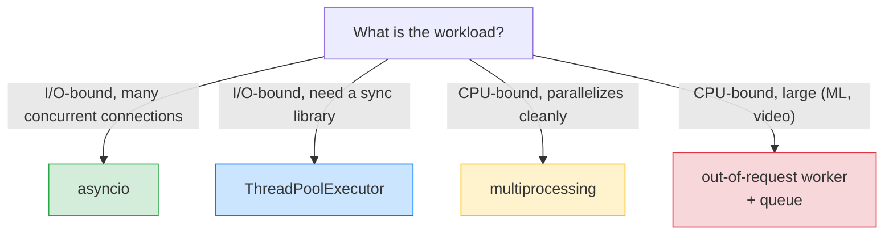
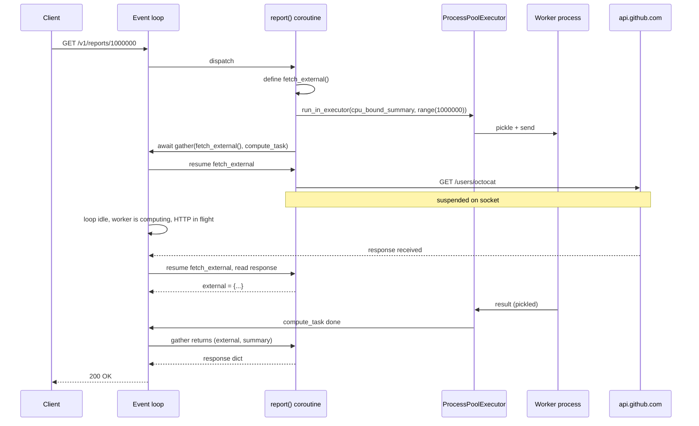

# Lesson 02: Concurrency vs Parallelism

*Concurrency (interleaved) vs parallelism (simultaneous), threads vs asyncio vs multiprocessing, when each wins, the CPython GIL primer and its effect on CPU-bound async tasks, blocking in async contexts, and `run_in_executor` for blocking work — with a `boardly/routers/reports.py` endpoint that fans out to an external API (async) and computes a CPU-bound summary (offloaded to a process pool), line by line.*

**You have the event-loop model now.**

Lesson 01 taught you the loop is a single thread that swaps between coroutines at `await` points. Today you learn when that model is the right one — and when it is the wrong one. The dominant failure mode in FastAPI projects is choosing asyncio when you should have chosen multiprocessing (your "async" route does CPU work and stalls the loop). The second is choosing threads when you should have chosen asyncio (you write a thousand-line threading codebase that could have been a hundred-line asyncio one). The third is choosing multiprocessing when you should have chosen asyncio (you spawn a process per request and watch your box swap to death). This lesson gives you the framework to pick correctly. Take your time. The comparison table is the reference you should re-read every time you start a new project.


#async #concurrency #parallelism #gil

## Learning Objectives

By the end of this lesson you will be able to:

1. **Define concurrency and parallelism** precisely and distinguish them.
2. **Compare threads, asyncio, and multiprocessing** on the axes that matter: cost, scale, I/O vs CPU, debugging.
3. **Explain what the CPython GIL is** and what its effect is on CPU-bound async tasks.
4. **Recognize blocking calls** inside async contexts and choose between three fixes (async library, executor, separate process).
5. **Use `loop.run_in_executor`** correctly for blocking work — both with `ThreadPoolExecutor` and `ProcessPoolExecutor`.
6. **Write a `boardly/routers/reports.py` endpoint** that fetches an external API (async) *and* computes a CPU-bound summary (offloaded to a process pool) concurrently.
7. **Decide for a given workload** whether asyncio, threads, or multiprocessing is the right tool.

## Prerequisites

Before starting, you need:

- **The Event-Loop lesson** — [[Event-Loop-and-Coroutines]]. You must understand what the event loop does and why blocking it is bad.
- **Comfortable with the idea of a process and a thread** at the OS level. We will recap, but we will not teach from zero.
- **The FastAPI lifespan lesson** — [[03-FastAPI-Core/Application-and-Lifespan]]. The example endpoint creates a process pool in the lifespan; you need to know what a lifespan is.
- **About 90 minutes of focused time.** The code is small; the comparison is conceptually dense.

**The most common gap: the GIL.**

The Global Interpreter Lock is the single most misunderstood feature of CPython. Half of the async bugs in production are GIL bugs in disguise — "I have 4 worker processes, why is my CPU-bound route still slow?" or "I added threads, why did my CPU-bound route not speed up?" If you have never read what the GIL actually does, this lesson's section on it is the prerequisite to making any concurrency decision.


## The Problem

Async, threads, multiprocessing — three concurrency tools, each with a use case, each with a way to misuse it. The dominant failure modes:

1. **Choosing asyncio when you should have chosen multiprocessing** — your "async" route does CPU work (bcrypt, image processing, ML inference) and stalls the loop. Other concurrent requests stall too. The server is "async" in name only.
2. **Choosing threads when you should have chosen asyncio** — you write a thousand-line threading codebase for an I/O-bound workload that could have been a hundred-line asyncio one. The threading code has race conditions; the asyncio code would not.
3. **Choosing multiprocessing when you should have chosen asyncio** — you spawn a process per request and watch your box swap to death. Process startup is expensive (tens of ms); you should have used a coroutine.

This lesson gives you the framework to pick correctly. It is the comparison table you should re-read every time you start a new project.



## The Code

This lesson produces a `boardly/routers/reports.py` endpoint that fans out to an external API (async) and a CPU-bound summary (offloaded to a process pool), running them concurrently. The pieces:

1. The mental model: concurrency vs parallelism.
2. The CPython GIL primer.
3. The comparison table for threads vs asyncio vs multiprocessing.
4. `boardly/routers/reports.py` — the endpoint.
5. The execution trace.

### `boardly/routers/reports.py`: the example

```python
# boardly/routers/reports.py
"""Boardly — reports router (async I/O + CPU-bound offload)."""
from __future__ import annotations

import asyncio
from concurrent.futures import ProcessPoolExecutor
from contextlib import asynccontextmanager
from typing import Annotated

from fastapi import APIRouter, FastAPI, Request
import httpx


router = APIRouter(prefix="/v1/reports", tags=["reports"])


def cpu_bound_summary(numbers: list[int]) -> dict[str, int]:
 """Pure-CPU computation. No awaits possible."""
 return {
 "count": len(numbers),
 "sum": sum(numbers),
 "sum_squares": sum(n * n for n in numbers),
 }


@asynccontextmanager
async def lifespan(app: FastAPI):
 # Process pool for CPU-bound work. Created once, shared.
 app.state.proc_pool = ProcessPoolExecutor(max_workers=4)
 # HTTP client for outbound calls.
 app.state.http = httpx.AsyncClient(timeout=10.0)
 try:
 yield
 finally:
 await app.state.http.aclose()
 app.state.proc_pool.shutdown(wait=True, cancel_futures=True)


@router.get("/{n}")
async def report(n: int, request: Request) -> dict[str, object]:
 """Return a report combining an external API call and a CPU summary.

 The external call is async (yields to the loop).
 The CPU summary is offloaded to a process pool (parallelism).
 Both run concurrently; total time ~= max(call, summary).
 """
 async def fetch_external() -> dict[str, object]:
 resp = await request.app.state.http.get(
 "https://api.github.com/users/octocat"
 )
 return resp.json()

 loop = asyncio.get_running_loop()
 compute_task = loop.run_in_executor(
 request.app.state.proc_pool, cpu_bound_summary, list(range(n))
 )

 external, summary = await asyncio.gather(fetch_external(), compute_task)
 return {"external_login": external.get("login"), "summary": summary}
```

That is the entire lesson. The rest of this file explains every block, every primitive, and the failure modes.

## Line-by-Line Deep Dive

This section is the heart of the lesson. Read it twice. Do not skim.

### The module header

```python
from __future__ import annotations

import asyncio
from concurrent.futures import ProcessPoolExecutor
from contextlib import asynccontextmanager
from typing import Annotated

from fastapi import APIRouter, FastAPI, Request
import httpx
```

**What it does:** Pulls in the standard library pieces and FastAPI/httpx.

**Why each:**

- `asyncio` — for `asyncio.get_running_loop()` and `asyncio.gather`.
- `from concurrent.futures import ProcessPoolExecutor` — the process pool we will use for CPU-bound work. (`ThreadPoolExecutor` is the alternative, for blocking I/O.)
- `from contextlib import asynccontextmanager` — the decorator that turns `async def lifespan(...)` into an async context manager. See [[03-FastAPI-Core/Application-and-Lifespan]].
- `from typing import Annotated` — for `Annotated[T, ...]` form (which we use in `Request` annotation, though `Request` does not strictly need `Annotated`).
- `from fastapi import APIRouter, FastAPI, Request` — the router, the app class, and the `Request` object (we use `Request` to read `app.state`).
- `httpx` — the async HTTP client.

### The CPU-bound function: `cpu_bound_summary`

```python
def cpu_bound_summary(numbers: list[int]) -> dict[str, int]:
 """Pure-CPU computation. No awaits possible."""
 return {
 "count": len(numbers),
 "sum": sum(numbers),
 "sum_squares": sum(n * n for n in numbers),
 }
```

**What it does:** A pure synchronous function that computes three aggregates over a list of integers.

**Why is this defined at module scope, not as a method?** Because `ProcessPoolExecutor` works by *pickling* the function and its arguments and sending them to a worker process. Module-level functions are picklable; closures and lambdas are not. If you defined this as a nested function inside `report`, you would get a `PicklingError`.

**What is pickling?**

Pickling is Python's serialization format. `pickle.dumps(obj)` produces a bytes representation; `pickle.loads(bytes)` reconstructs the object. `ProcessPoolExecutor` pickles the function and its arguments, sends the pickle to a worker process over a pipe, the worker unpickles and calls the function, pickles the return value, and sends it back. The restriction: only picklable objects can cross the process boundary. Module-level functions, simple data types, and most classes work. Lambdas, closures, and some file handles do not.


**Warning — Debugging a `PicklingError`**

The traceback names the *outermost* unpicklable object, not the field that broke it — `Can't pickle <class 'function'>.<lambda>` is the symptom, the cause is a closure or lambda captured one frame up. The fastest path to the root: `uv run python -c "import pickle; pickle.dumps(your_fn)"` reproduces the error in isolation, and `uv run --with cloudpickle python -c "import cloudpickle; cloudpickle.dumps(your_fn)"` tells you whether you have a *picklability* problem or a *multiprocessing-strict-mode* problem (stdlib `multiprocessing` is stricter than `cloudpickle`, which can pickle lambdas). In a running FastAPI process, add a startup hook that `pickle.dumps` every callable you hand to the pool — the first one that raises is the offender. See [[01-Python-Foundations/Exceptions-Done-Right]] for reading tracebacks that point at the wrong frame.


### The lifespan: process pool creation

```python
@asynccontextmanager
async def lifespan(app: FastAPI):
 app.state.proc_pool = ProcessPoolExecutor(max_workers=4)
 app.state.http = httpx.AsyncClient(timeout=10.0)
 try:
 yield
 finally:
 await app.state.http.aclose()
 app.state.proc_pool.shutdown(wait=True, cancel_futures=True)
```

**What it does:** Creates a process pool and an HTTP client at startup; closes them at shutdown.

**Line by line:**

- `@asynccontextmanager` — the decorator that turns `async def lifespan(app)` into an async context manager. The body before `yield` is startup; the body after `yield` is shutdown. See [[03-FastAPI-Core/Application-and-Lifespan]].
- `app.state.proc_pool = ProcessPoolExecutor(max_workers=4)` — creates a process pool with 4 workers. The pool is created *once* at startup, shared by every request. Creating a fresh pool per request would be a disaster — process startup is tens of ms.
- `app.state.http = httpx.AsyncClient(timeout=10.0)` — creates the async HTTP client. Same story: created once, shared.
- `try: yield` — the yield point. Traffic is now accepted.
- `finally: await app.state.http.aclose(); app.state.proc_pool.shutdown(wait=True, cancel_futures=True)` — cleanup. `aclose()` closes the connection pool. `shutdown(wait=True, cancel_futures=True)` waits for in-flight tasks to finish (or cancels them if `cancel_futures=True`). The `finally` block runs whether the `yield` is reached normally or an exception is raised during traffic.

**Warning — Forgetting to shut down the pool**

If you create a `ProcessPoolExecutor` and never shut it down, the worker processes leak. On a long-running server, the process count grows until you hit a limit. Always put `shutdown()` in the lifespan's `finally` block.


**Sizing the process pool against Uvicorn's pre-fork model**

Uvicorn with `--workers 4` runs four *master* processes, each with its own event loop and its own copy of `app.state.proc_pool`. A `ProcessPoolExecutor(max_workers=4)` created in the lifespan therefore multiplies: 4 Uvicorn workers times 4 pool workers = 16 worker processes on a box that may have 8 cores. The production sizing rule is `total_workers = uvicorn_workers * pool_workers <= 1.5 * os.cpu_count()` (the 1.5x headroom covers the parent processes' overhead); on an 8-core box, that means `--workers 2` with `max_workers=6`, or `--workers 4` with `max_workers=3`. Memory caps it harder than CPU: each pool worker is a fresh Python interpreter (~30-60 MB RSS before your code runs), so `16 workers * 60 MB = ~1 GB` just for the pool on a 2 GB box — the OOM killer is the next incident. The diagnostic: `ps -o rss,cmd --ppid $(pgrep -d, uvicorn) | sort -n | tail` shows per-worker RSS; if it grows over time, the worker is leaking (check for un-closed file handles and `ctypes` allocations). The fix: pin `max_workers` from a Pydantic-Settings env var (`BOARDLY_PROC_POOL_SIZE`, default `min(4, os.cpu_count())`) so you can tune without a code change — see [[04-Pydantic/Pydantic-Settings]].


### The endpoint: `report`

```python
@router.get("/{n}")
async def report(n: int, request: Request) -> dict[str, object]:
 async def fetch_external() -> dict[str, object]:
 resp = await request.app.state.http.get(
 "https://api.github.com/users/octocat"
 )
 return resp.json()

 loop = asyncio.get_running_loop()
 compute_task = loop.run_in_executor(
 request.app.state.proc_pool, cpu_bound_summary, list(range(n))
 )

 external, summary = await asyncio.gather(fetch_external(), compute_task)
 return {"external_login": external.get("login"), "summary": summary}
```

**What it does:** Defines a `GET /v1/reports/{n}` endpoint that fetches an external API and computes a CPU-bound summary concurrently.

**Line by line:**

- `@router.get("/{n}")` — registers a route. The `{n}` is a path parameter; FastAPI parses it as `int` (because of the `n: int` annotation).
- `request: Request` — FastAPI injects the `Request` object. We use it to read `app.state` (the process pool and HTTP client). The alternative is to use `Depends` for typed access; for brevity, we use `Request` here.
- `async def fetch_external()` — an inner async function. Calling it returns a coroutine object; we will `gather` it. The body awaits `request.app.state.http.get(...)`, which yields to the loop.
- `loop = asyncio.get_running_loop()` — returns the currently-running event loop. Inside an `async def`, the loop is already running; you cannot call `asyncio.get_event_loop()` (deprecated) or `asyncio.new_event_loop()` (you would create a second loop). `get_running_loop()` is the right call.
- `compute_task = loop.run_in_executor(request.app.state.proc_pool, cpu_bound_summary, list(range(n)))` — the heart. Schedules `cpu_bound_summary(list(range(n)))` to run in the process pool, returns an awaitable Future. The loop is free to run other coroutines while the worker process is busy.
- `external, summary = await asyncio.gather(fetch_external(), compute_task)` — runs both concurrently. Total time ≈ max(call, summary), not sum.
- `return {"external_login": external.get("login"), "summary": summary}` — combines the results.

**Student asks: why `list(range(n))` and not `range(n)`?**

Because `range(n)` is not picklable in older Python versions (it is in 3.x, but the convention is to materialize the list for clarity). More importantly: the process pool will pickle the argument; pickling a `range` is small but unpickling and iterating it is the same cost as pickling the list. The convention is to materialize once at the call site. In production, you would not pass a million-element list — you would pass a small instruction ("compute the summary for the first n integers") and let the worker process generate the range.


### `loop.run_in_executor` in detail

```python
result = await loop.run_in_executor(executor, fn, *args)
```

**What it does:** Schedules `fn(*args)` to run in `executor` (a `concurrent.futures.Executor`). Returns an awaitable that resolves to `fn`'s return value.

**The two forms:**

- `loop.run_in_executor(None, fn, *args)` — uses the default thread pool (a small pool — `min(32, os.cpu_count() + 4)` by default). Best for blocking I/O where you have no async alternative.
- `loop.run_in_executor(ProcessPoolExecutor(), fn, *args)` — uses a process pool. Best for CPU-bound work where the GIL would serialize the work in a thread.

**Warning — `run_in_executor` with a lambda or closure**

```python
# WRONG — lambda is not picklable
await loop.run_in_executor(pool, lambda x: x * 2, 5)
```
`ProcessPoolExecutor` pickles the function. Lambdas are not picklable in standard multiprocessing. Use a module-level function. For `ThreadPoolExecutor`, lambdas work — but the convention is to use module-level functions everywhere for consistency.


**Danger — `ProcessPoolExecutor` runs `pickle.loads` on worker arguments — never accept pickled bytes from the network**

The process-pool boundary is a pickle boundary in both directions: the parent pickles the callable and args, the worker unpickles them, runs, and pickles the return value. `pickle.loads` is *arbitrary code execution* — a crafted pickle can invoke `__reduce__` on any class with a side-effecting constructor and run arbitrary Python in the worker process, which on Linux is the same UID as the Uvicorn master. If a request handler ever feeds *user-controlled* bytes into `ProcessPoolExecutor` (e.g. a "submit a pre-serialized job" endpoint that takes `application/octet-stream` and passes it to a worker), an attacker gets RCE in the worker. The rule: only ever pass primitives (int/str/bytes/list/dict) and module-level callables across the pool boundary; if you must accept serialized work, switch to a message-broker + worker architecture (see [[14-Caching-and-Background-Processing/Background-Tasks-vs-Workers]]) with a schema-validated message format (JSON + Pydantic — see [[04-Pydantic/BaseModel-and-Validation]]), never raw pickle. The defense-in-depth layer: run the worker pool under a separate systemd unit / Kubernetes Deployment with `DropAll` capabilities and a read-only root filesystem, so even an RCE in the worker cannot pivot to the database. See [[11-Authentication-and-Security/Threat-Model-First]] for the threat model.


### What the CPython GIL is

The Global Interpreter Lock is a mutex that protects CPython's internal data structures. Only one thread may hold the GIL at a time, which means only one thread may execute Python bytecode at a time. The practical effects:

- **For CPU-bound Python code**, threads do not give you parallelism. A 4-thread CPU-bound Python program runs at the speed of one thread, plus a small overhead from GIL contention.
- **For I/O-bound code**, threads release the GIL while waiting on the OS (a socket read, a file read, a sleep). Other threads can run Python during the wait. So threads work fine for I/O concurrency.
- **Some C extensions release the GIL** during long operations. NumPy, for example, releases the GIL during heavy array math, so a NumPy-heavy threaded program can achieve real parallelism. This is the exception, not the rule.

Why does CPython have a GIL at all, when most other language runtimes do not? Because CPython's primary internal data structure — the reference-counted object — is not thread-safe without either per-object locks or a global lock. Per-object locks would slow down every attribute access in every program; a global lock slows down only CPU-bound multithreaded programs, which were rare when the GIL was designed (1995). The trade-off favoured the common case (single-threaded or I/O-bound multithreaded) at the cost of the rare case (CPU-bound multithreaded). Removing the GIL — which PEP 703 does, with a per-object lock and a new garbage collector — is a multi-year project because every C extension that assumed "I am the only thread mutating Python objects" has to be re-audited. As of Python 3.13 the free-threaded build is experimental; mainstream CPython in 2026 still has the GIL.

PEP 703 (the no-GIL CPython, accepted for a future version) changes this picture. As of Python 3.13 there is an experimental free-threaded build. The free-threaded build removes the GIL; for CPU-bound threaded Python, it can deliver real parallelism. **The mainstream CPython you will deploy in 2026 still has the GIL**, so plan around it.

**Student asks: if I run Uvicorn with `--workers 4`, am I getting parallelism or concurrency?**

You are getting parallelism *across* requests and concurrency *within* each worker. `uvicorn --workers 4` launches four worker processes (one per CPU core, typically), each running its own event loop on its own thread. So four in-flight requests — one served by worker A, one by worker B, one by C, one by D — run on four cores in parallel, with no GIL contention between them (they are separate processes, not separate threads). But within one worker, two in-flight requests interleave at `await` points on the same thread under the same GIL; they are concurrent, not parallel. The pattern that breaks: a single CPU-bound request that runs for 500 ms on worker A blocks every other connection assigned to worker A for that 500 ms, even though workers B, C, D are idle. That is why "how many Uvicorn workers should I run?" and "should I offload this CPU work to a process pool?" are different questions, not the same question.


**Warning — Diagnosing "the loop is stuck" with `py-spy`**

The symptom of a CPU-bound coroutine hogging the loop is "every other request hangs for the duration of one slow one" — a single `/v1/reports/1000000` request that takes 300 ms makes 1000 concurrent `/healthz` requests take 300 ms each. The naive `time.monotonic()` instrumentation lies: the wall clock moves, but the loop is single-threaded so you cannot tell which coroutine is hogging. `uv run --with py-spy py-spy dump --pid $(pgrep -f uvicorn)` prints the C-level stack of every thread in the process — if the worker is in a pure-Python loop, the top frame is your `cpu_bound_summary`; if it is in a C extension that *should* release the GIL but doesn't, the top frame is the C function. The continuous view is `uv run --with py-spy py-spy top --pid $(pgrep -f uvicorn)` (a `top`-like view of Python frames); the retrospective view is `uv run --with py-spy py-spy record --pid $(pgrep -f uvicorn) -o profile.svg --duration 30` (a flamegraph you open in a browser). The discipline: when a route is "slow under load", reach for `py-spy` *before* you reach for `asyncio.gather` — half the time the fix is "offload to a process pool", not "add more concurrency". `py-spy` needs `ptrace` permissions on Linux (run the worker with `cap_add: [SYS_PTRACE]` in Docker, or set `ptrace_scope = 0` in `/proc/sys/kernel/yama/ptrace_scope`).


### The effect of the GIL on CPU-bound async tasks

Inside an event loop, all your coroutines share one thread. The GIL is irrelevant *within* that thread — there is nothing to lock against. The problem is different: a CPU-bound coroutine does not `await`, so the loop cannot swap away from it. Other coroutines starve. Adding more worker processes (Uvicorn `--workers N`) does not help a single in-flight CPU-bound request; it helps you serve N such requests at once across N cores, but each individual request still blocks its worker.

```python
import asyncio
import time

def cpu_work(n: int) -> int:
 # 200ms of CPU, no awaits.
 total = 0
 for i in range(n):
 total += i * i
 return total

async def route_a() -> int:
 return cpu_work(5_000_000) # blocks the loop

async def route_b() -> str:
 await asyncio.sleep(0.001)
 return "b"

async def main() -> None:
 # route_a hogs the loop for ~200ms; route_b can't run during that window.
 await asyncio.gather(route_a(), route_b())
```

### Blocking in async contexts

A "blocking" call inside `async def` is one that:

- Does I/O without yielding (sync sockets, sync file reads, sync database drivers).
- Does CPU-bound work without yielding.
- Calls `time.sleep` instead of `asyncio.sleep`.

You have three fixes, in order of preference:

1. **Use an async-native library.** `httpx.AsyncClient`, `asyncpg`, `redis.asyncio`, `aiofiles`. The library yields to the loop at await points, so other coroutines can run. Best when an async alternative exists.
2. **Run the blocking call in an executor.** `await loop.run_in_executor(None, blocking_fn, arg)` runs `blocking_fn(arg)` in a thread pool, freeing the loop. Best when no async alternative exists and the work is I/O-bound or short.
3. **Run CPU-bound work in a process pool.** `await loop.run_in_executor(ProcessPoolExecutor(), cpu_fn, arg)` runs the work in a separate process, where the GIL doesn't matter. Best for CPU-bound work that genuinely parallelizes.

**Warning — Catching blocking calls before they ship: `asyncio` debug mode**

The standard library event loop has a built-in blocking-call detector: `loop.slow_callback_duration = 0.1` makes the loop log a `RuntimeWarning` for any callback that runs longer than 100 ms without yielding. Enable it with `PYTHONASYNCIODEBUG=1 BOARDLY_SECRET=foo uv run uvicorn boardly.main:app` — the env var flips `asyncio.get_event_loop().set_debug(True)`, which turns on slow-callback logging *and* coroutine source-line attribution. The output is `Executing <Handle ...> took 0.243 seconds` with the frame's file and line — pointing you straight at the `time.sleep(0.5)` or the `requests.get(...)` someone added "just for testing". The production convention: run staging with `PYTHONASYNCIODEBUG=1` as a canary deploy; if the slow-callback log fires, block the release. The CI equivalent is `BOARDLY_ASYNC_DEBUG=1 uv run pytest tests/ -W error::RuntimeWarning` — any blocking call in a test becomes a test failure. See [[12-Testing-and-Quality/Async-Testing]] for the fixture that sets this up, and [[13-Performance-and-Observability/Structured-Logging-and-Request-IDs]] for piping the warning into your SIEM.


### Comparison table

| Axis | asyncio | threading | multiprocessing |
|------|----------|-----------|-----------------|
| Concurrency model | single-threaded, cooperative, interleaved at await points | multi-threaded, preemptive OS scheduling | multi-process, OS-level isolation |
| Parallelism (CPU) | no (one thread, one core) | no (GIL serializes Python bytecode) | yes (each process has its own GIL) |
| Concurrency (I/O) | excellent | good | good but expensive |
| Memory per unit of concurrency | small (~10 KB per coroutine stack) | medium (~1 MB per thread default stack) | large (~10+ MB per process) |
| Startup cost | negligible (coroutine object) | medium (OS thread) | high (fork + import) |
| Communication cost | in-process, very fast | in-process, shared memory | IPC (queues, pipes) |
| Failure isolation | none — one exception can crash the loop | partial — a thread crash does not kill the process, but state is shared | strong — a process crash does not kill others |
| Debugging | hard — stack traces span awaits | harder — race conditions, deadlocks | hard — IPC, no shared state |
| Best for | I/O-bound concurrent workloads with many connections | I/O-bound with a few blocking libraries you can't change | CPU-bound work that parallelizes cleanly |
| Worst for | CPU-bound work, blocking libraries | CPU-bound Python, scale beyond a few hundred threads | I/O-bound workloads, fine-grained parallelism, shared mutable state |
| Examples | Web servers, API clients, scrapers | Calling sync libraries from async code, simple I/O concurrency | Image processing, ML inference, batch data transforms |

### When each wins

**asyncio wins when:**

- You have many (100s to 1000s) concurrent I/O-bound operations per process.
- You can use async-native libraries for your I/O.
- Your per-task work is small relative to the I/O wait.
- Typical: a FastAPI service that proxies external APIs, a websocket server, a scraper.

**Threading wins when:**

- You need to use a sync library that has no async alternative (some SDKs, some database drivers).
- The blocking calls are I/O-bound (so the GIL releases during the wait).
- You have a small number of concurrent tasks (a few dozen).
- Typical: calling a third-party SDK that only exposes sync methods from a FastAPI route via `run_in_executor`.

**Multiprocessing wins when:**

- Your work is CPU-bound and parallelizes cleanly (each chunk is independent).
- The work per chunk is large enough to amortize the process startup and IPC costs.
- You need true parallelism and the GIL is in your way.
- Typical: image resizing, video transcoding, ML inference, large data transformations.

**Student asks: Why not just use threads everywhere?**

Four reasons, each costing real production incidents. **(1) GIL contention on CPU-bound work.** Threads in CPython cannot run Python bytecode in parallel — the GIL is held by one thread at a time. For I/O-bound work the GIL releases during the wait, so threads work; for CPU-bound work the GIL is held and you get *no speedup* from threading — your 8-thread hash compute is the same speed as single-threaded. Use a `ProcessPoolExecutor` for CPU-bound work. **(2) Race conditions on shared state.** Threads share memory; any `dict` or `list` they touch is a concurrency bug waiting to happen unless every access is guarded by a `Lock`. Asyncio coroutines share state too, but only one runs at a time per thread, so the surface area for races is much smaller. **(3) Debugging difficulty.** A thread deadlock is hard to reproduce; the GDB backtrace is on the wrong thread; the failure mode is "intermittent slowness under load" rather than a clean traceback. Asyncio tracebacks tell you exactly which coroutine was suspended where; thread tracebacks tell you what each thread was doing when the deadlock hit, with no causal link. **(4) Code length.** For I/O-bound work, the asyncio version is typically 3–5× shorter than the threading version — `async with httpx.AsyncClient() as c: r = await c.get(url)` vs a `ThreadPoolExecutor` with a `submit`/`result` dance. Less code means fewer bugs. The reason we *do* use threads in a FastAPI app is narrow: a sync library that has no async alternative (a vendor SDK, an old DB driver). For everything else — async I/O, async DB, async HTTP — asyncio is the right default.


### Picking for FastAPI

A typical FastAPI service:

- The HTTP layer is async — you wrote it that way; FastAPI is async-first.
- The database layer is async — `asyncpg` or async SQLAlchemy.
- The HTTP client (for calling other services) is async — `httpx.AsyncClient`.
- The queue layer is async — `redis.asyncio` or an async messaging client.

The CPU-bound work that comes up: password hashing (bcrypt), file processing (Pillow, pypdf), ML inference (transformers, scikit-learn), large JSON / XML parsing. For these:

- **bcrypt** is short and CPU-bound; offload with `run_in_executor` with a thread pool. The cost is small enough that threads are fine.
- **Pillow / pypdf** is CPU-bound and may be large; offload with a process pool. Or move it out of the request path entirely with a background worker (see [[14-Caching-and-Background-Processing/Background-Tasks-vs-Workers]]).
- **ML inference** is large and CPU-bound (or GPU-bound); do not do this in a request handler. Move it to a worker process or a dedicated service.

## Execution Trace

For the `report` endpoint:

1. Request arrives. The event loop dispatches to your coroutine.
2. `fetch_external()` is created (coroutine object, not yet scheduled).
3. `loop.run_in_executor(pool, cpu_bound_summary, ...)` schedules the CPU work in a separate process; the loop is free.
4. `asyncio.gather(fetch_external(), compute_task)` starts both.
5. The loop runs `fetch_external` until `await client.get(...)` — suspended on a socket.
6. The loop is idle. The external HTTP request is in flight; the worker process is computing.
7. The OS notifies the loop that the HTTP response is in. The loop resumes `fetch_external`, which reads the response and returns.
8. The worker process finishes computing and sends the result back to the loop via a Future.
9. `gather` returns both results. Your coroutine returns the response.

What did not happen: the loop did not block on the CPU work; other requests could be served during the ~100ms the worker process was busy.



## Common Mistakes

### Mistake 1: `async def` everywhere with sync I/O inside

```python
# WRONG
import requests
@app.get("/proxy")
async def proxy():
 resp = requests.get(url) # blocks the loop
 return resp.json()
```

You wrote `async def proxy()`, but you call `requests.get` inside. The route is async in name only; it blocks the loop. This is the dominant production bug. Use `httpx.AsyncClient`.

**Danger — Sync I/O in an `async def` is a slowloris amplifier**

A route that does `requests.get(external_url)` inside `async def` blocks the worker's event loop for the full TCP round-trip — and the loop is shared with every other in-flight request on that worker. An attacker who sends 100 concurrent requests to that route holds the worker's loop hostage for `100 * RTT` wall-clock seconds; the `/healthz` endpoint (which the load balancer uses for readiness) stops responding, and the orchestrator kills the pod for "failing health checks" — turning a single slow endpoint into a worker restart loop. The attack is a variant of slowloris: instead of holding connections open with slow request bodies, the attacker holds the loop open with slow upstream responses. The defense has three layers. (1) Use `httpx.AsyncClient` (the fix the mistake recommends) so the loop yields at the socket `recv`. (2) Set a per-request timeout (`httpx.AsyncClient(timeout=10.0)`) so a slow upstream cannot hold the loop indefinitely. (3) Run Uvicorn with `--limit-concurrency 100` so a flood of slow requests is rejected at the ASGI layer (HTTP 503) before it can starve the loop — see [[02-Web-and-HTTP/ASGI-Starlette-Uvicorn]]. The audit: any `import requests` in a file that also has `async def` is a code smell; a CI lint that fails on `import requests` in a module path matching `boardly/routers/**` is the gate. See [[11-Authentication-and-Security/OWASP-API-Top-10]] for the API DoS threat model.


### Mistake 2: CPU-bound work in a request handler with no offload

A 200ms `bcrypt` call in a request handler blocks the worker for 200ms; if you have 10 concurrent users hashing, you serve 5/s. Offload to a thread or process pool, or move to a background job.

### Mistake 3: Using a thread pool for CPU-bound work and expecting parallelism

The GIL serializes. Use a process pool.

### Mistake 4: Spawning a process per request

Process startup is expensive (tens of ms). Use a long-lived pool, not a fresh process per request.

### Mistake 5: `ProcessPoolExecutor` with lambdas or closures

These are not picklable; you get `PicklingError`. Use module-level functions.

### Mistake 6: Forgetting to shut down the pool

A leaked pool leaks processes. Put cleanup in the lifespan shutdown handler.

### Mistake 7: Assuming free-threaded CPython is here

It is experimental in 3.13. Plan around the GIL for now.

### Mistake 8: Mixing `asyncio.get_event_loop()` and `asyncio.get_running_loop()`

`get_event_loop()` is deprecated and creates a new loop if none is running — which is almost never what you want. Inside an `async def`, use `asyncio.get_running_loop()`. At the top level, use `asyncio.run(coro)`.

## Engineering Trade-Offs

### Async vs sync framework

Async wins for I/O-bound workloads with many concurrent connections. Sync (Flask, Django sync views) wins for simplicity and a smaller learning curve, and is fine for low-concurrency services.

### Threads vs asyncio for I/O concurrency

Threads are simpler to reason about (no `async`/`await`); asyncio scales to more concurrent connections. Use asyncio when you need to scale; use threads when you do not.

### Process pool size

More processes = more parallelism but more memory. Match to your CPU cores: `os.cpu_count()` is a reasonable starting point.

**Danger — A process pool is a fork bomb waiting to happen — cap it with cgroups**

`ProcessPoolExecutor(max_workers=4)` in the lifespan is a *ceiling*, not a guarantee — if the parent process is OOM-killed mid-shutdown, the worker processes can be orphaned and re-parented to PID 1, where they sit forever holding their memory. On a box that auto-scales, this means the next autoscale event spawns *more* workers on top of the orphans, and the count grows monotonically until the box is unresponsive. The production defense is *not* in Python — it is in the orchestrator. Run the worker pool under a `cgroup` with `pids.max` set (`systemd-run --scope -p pids.max=8 uv run uvicorn ...` on bare metal; `podman run --pids-limit 100` in a container; the Kubernetes equivalent is a `LimitRange` with a `pods` quota). The cgroup kills *new* forks past the limit, not the parent — so the parent gets a `BlockingIOError` from `os.fork()` and can degrade gracefully. The complementary defense: `app.state.proc_pool.shutdown(wait=True, cancel_futures=True)` in the lifespan `finally` (the lesson's pattern) plus a `signal.SIGTERM` handler that calls it explicitly — `atexit` alone does not fire under SIGTERM. The audit: `ps -eo ppid,pid,cmd | grep $(pgrep -d, -f uvicorn)` should show the workers' parent is the Uvicorn master, not PID 1; if any worker's PPID is 1, the pool has been orphaned and you have a leak. See [[16-Deployment-and-DevOps/Docker-Multi-Stage-Non-Root]] for the non-root, cgroup-bounded container pattern.


### Move CPU work out of the request path entirely

For really heavy work (ML, video), the right architecture is a queue + worker process. See [[14-Caching-and-Background-Processing/Background-Tasks-vs-Workers]].

**The right architecture for ML/video is a queue, not a process pool**

The lesson's `run_in_executor` pattern is correct for *short* CPU work (a 100 ms summary, a 200 ms bcrypt). For work measured in seconds or minutes — ML inference, video transcoding, large PDF rendering — the in-request process pool is the wrong shape, for three production reasons. (1) **The HTTP client times out before the work finishes.** A 60-second inference blows past the 30-second gateway timeout (AWS ALB, Cloud Run, nginx `proxy_read_timeout`) and the client gets a 504 even though the worker is still computing. (2) **Retries multiply the load.** The client's retry policy (e.g. `urllib3`'s default) re-submits the request, and the worker pool — which cannot tell the retry from a new request — runs the inference *again*, doubling the GPU bill. (3) **There is no durability.** If the Uvicorn worker restarts (deploy, OOM, crash), the in-flight pool task is lost; the client never gets a result. The right architecture is a transactional outbox + queue + worker (see [[14-Caching-and-Background-Processing/Transactional-Outbox]] and [[14-Caching-and-Background-Processing/Background-Tasks-vs-Workers]]): the request enqueues a job and returns a 202 with a job ID; a separate worker process picks up the job, runs the inference, writes the result to the database, and the client polls `/jobs/{id}`. The retries are bounded, the work survives a worker restart, and the gateway timeout is never hit. Use `arq` (async Redis queue), `dramatiq` (RabbitMQ/Redis), or `Celery` depending on your stack — the pattern is the same regardless of the broker.


### free-threaded CPython

Plan for it; do not depend on it. Code you write today against the GIL will continue to work; code that assumes no GIL may break on the standard build.

**Deploying the free-threaded build: do not migrate the existing service — start a new one**

PEP 703's free-threaded build (`python3.13t`) is the long-term future, but the migration path is *not* "rebuild the same image with `python3.13t` and roll out". C extensions that assumed "I am the only thread mutating Python objects" (which is most of them — every `cryptography`, `numpy`, `psycopg` release before ~2025) have to be re-audited and re-compiled against the free-threaded ABI; running the old wheel on `python3.13t` either imports with a warning ("module compiled against GIL build") or segfaults under contention. The production-safe path is a *new* service: stand up `python3.13t` with a *pinned* set of wheels that explicitly declare free-threaded support (`pip install --only-binary=:all:` to refuse source builds), run it behind a feature flag for a workload you can afford to lose (a read-only reporting endpoint, not the auth service), and watch for the `cryptographic`-style bugs that only surface under real concurrency. Do not flip the auth service to free-threaded until at least one C extension you depend on has shipped a free-threaded release *and* you have run the full test suite under `PYTHONUNBUFFERED=1 python3.13t -X dev -m pytest`. See [[11-Authentication-and-Security/Password-Hashing]] for why bcrypt is the *first* place this matters (it releases the GIL today; on free-threaded it has to be re-validated for thread-safety).


**Student asks: where exactly does the GIL release, and how do I tell from a function's source whether it releases?**

The GIL releases at well-defined points inside the CPython interpreter, not at points you write yourself. Three categories, in order of practical importance. **(1) I/O syscalls.** Any `read`/`write`/`select`/`poll`/`recv`/`send` on a file, pipe, or socket drops the GIL while the kernel services the syscall. So `socket.recv()`, `os.read()`, `time.sleep()` all release the GIL; another thread can run Python during the wait. This is why threads work for I/O-bound work even though they hold the GIL while computing. **(2) C-extension explicit releases.** A C extension that does CPU-bound work and wants to be thread-friendly calls `Py_BEGIN_ALLOW_THREADS` / `Py_END_ALLOW_THREADS` around the heavy region. NumPy, Pillow, lxml, and most cryptographic libraries (bcrypt, argon2) release the GIL around their inner loops. So `bcrypt.hashpw(...)` in a thread *does* achieve parallelism — the GIL is released. The Python source code will not tell you this; you have to look at the C extension's source (or test empirically: time 4 hashes in 4 threads; if it is 4× slower than 1, GIL is held; if it is ~1×, GIL is released). **(3) CPython-internal scheduled releases.** Before Python 3.2 the interpreter released the GIL every 100 bytecode instructions ("tick count"). Since 3.2 the release interval is time-based: default 5 ms (`sys.setswitchinterval(0.005)`). So a long pure-Python loop releases the GIL every 5 ms — which means another thread gets a 5 ms slice, then yields. For a long pure-Python computation, threads do *not* achieve parallelism (the GIL is held ~99% of the time), but they do *interleave*, which is why long-running pure-Python loops do not completely freeze the rest of the program. The practical takeaway: do not guess from Python source — measure. If 4 threads run a function 4× faster than 1 thread, the GIL is released; if they run at the same speed, it is held, and you want a process pool.


## Exercises

**Tip — The 20-minute rule**

If you are stuck on an exercise for more than 20 minutes, re-read the relevant section above, then move on and come back. Learning is not linear.


**Exercise 1 — Demonstrate the GIL.** Time a CPU-bound function (`sum(i*i for i in range(10**7))`) called directly inside an `async def`. Then call it via `run_in_executor` with a `ProcessPoolExecutor`. Confirm the second does not block other coroutines.

**Exercise 2 — Run `boardly/routers/reports.py`.** Save the file from this lesson. Wire it into `boardly/main.py` with `app.include_router(reports.router)` and the lifespan from this lesson. Run `uv run uvicorn boardly.main:app --reload`. Visit `http://127.0.0.1:8000/v1/reports/1000000`. Confirm the response combines the external API login with the summary.

**Exercise 3 — Thread pool vs process pool.** Write a script that runs the same CPU-bound function 8 times in a thread pool, then 8 times in a process pool. Time both. Confirm the process pool is ~N-times faster and the thread pool is ~1x.

**Exercise 4 — Blocking call inside `async def`.** Write an `async def` route that calls `time.sleep(0.5)`. Make a concurrent request that calls `await asyncio.sleep(0.001)`. Confirm the second request does not return for 500ms.

**Exercise 5 — `run_in_executor` with a lambda.** Try `await loop.run_in_executor(pool, lambda x: x * 2, 5)` with a `ProcessPoolExecutor`. Confirm the `PicklingError`. Fix it by using a module-level function.

**Exercise 6 — Pick the right tool.** For each workload below, pick asyncio / threads / multiprocessing and explain:
- A websocket server that maintains 10,000 connections.
- A password-hashing route in a web app.
- A video transcoder for user uploads.
- A web scraper that fetches 1000 URLs.

**Exercise 7 — Spot the bug.** This route is supposed to compute a SHA-256 of the response body. What is wrong?

```python
@app.get("/hash")
async def hash_url(url: str):
 resp = await httpx.AsyncClient().get(url)
 import hashlib
 return {"hash": hashlib.sha256(resp.content).hexdigest()}
```

(Answer: nothing is *wrong*, but if `resp.content` is huge (100 MB), the `hashlib.sha256(...)` call is CPU-bound and blocks the loop. For a small response, fine; for a large one, offload to a process pool.)

**Exercise 8 — `asyncio` debug mode catches a blocking call.** Write an `async def` route that calls `time.sleep(0.3)`. Start the app with `PYTHONASYNCIODEBUG=1 BOARDLY_SECRET=foo uv run uvicorn boardly.main:app`. Hit the route with `curl`. Confirm the worker logs a `RuntimeWarning: ... took 0.3 seconds` with the file and line of the `time.sleep`. Verify with `BOARDLY_ASYNC_DEBUG=1 uv run pytest tests/test_slow_callback.py -W error::RuntimeWarning -k blocks_loop` exiting 0.

**Exercise 9 — `py-spy` on a CPU-bound coroutine.** Install `py-spy` as a dev dependency (`uv add --dev py-spy`). Start the app, hit `/v1/reports/10000000` (a large N that runs ~1 s), and while it is running dump the worker's stack. Confirm the dump shows the worker's top frame inside `cpu_bound_summary` (or `run_in_executor`'s IPC wait). Verify with `uv run py-spy dump --pid $(pgrep -f uvicorn) | rg cpu_bound_summary` returning a match.

**Exercise 10 — `ProcessPoolExecutor` pickle boundary.** Write a module-level function `square(x)` and a lambda `lambda x: x * 2`. Write a test that calls `loop.run_in_executor(ProcessPoolExecutor(), square, 5)` (succeeds) and `loop.run_in_executor(ProcessPoolExecutor(), lambda x: x * 2, 5)` (raises `PicklingError`). Verify with `uv run pytest tests/test_proc_pool_pickling.py -k pickling_rejected` exiting 0.

**Exercise 11 — Pool shutdown leak detector.** Write a test that starts the app, hits `/v1/reports/1000000` 20 times, then shuts down. Count the surviving `python` worker processes (`pgrep -c -f 'boardly.*spawn'`). Without the `finally: shutdown(...)` line, the count grows; with it, the count returns to baseline. Verify with `uv run pytest tests/test_pool_shutdown_leak.py -k no_orphan_workers` exiting 0.

**Exercise 12 — SSRF allowlist.** Modify `fetch_external` to accept a `target` query param (a URL). Add an allowlist that rejects URLs whose host resolves to a private IP (`ipaddress.ip_address` + `socket.getaddrinfo`, reject `is_private`). Verify an internal URL (`http://169.254.169.254/`) returns 400. Verify with `uv run pytest tests/test_ssrf_allowlist.py -k private_ip_rejected` exiting 0.

**Exercise 13 — Move CPU to a worker.** Replace the in-request `run_in_executor` with an arq-style enqueue: `POST /v1/reports` returns `{"job_id": "...", "status": "pending"}` (202); a background worker picks up the job and writes the summary to the database; `GET /v1/reports/{job_id}` polls the status. Verify the enqueue returns a job ID and the poll eventually returns `{"status": "complete", "summary": {...}}`. Verify with `uv run pytest tests/test_report_enqueue.py -k returns_job_id` and `uv run pytest tests/test_report_poll.py -k complete_after_worker` both exiting 0.

## Verification

```bash
# 1. Run the app
uv run uvicorn boardly.main:app --reload

# 2. Hit the endpoint
curl http://127.0.0.1:8000/v1/reports/1000000
# expected: {"external_login":"octocat","summary":{"count":1000000,"sum":499999500000,"sum_squares":333332833333500000}}

# 3. Demonstrate thread vs process pool
uv run python -c "
import asyncio, time
from concurrent.futures import ProcessPoolExecutor, ThreadPoolExecutor

def work(n):
 s = sum(i*i for i in range(n))
 return s

async def main():
 loop = asyncio.get_running_loop()
 N = 5_000_000

 # 4 in thread pool: ~4x time (no parallelism due to GIL).
 start = time.monotonic()
 with ThreadPoolExecutor(max_workers=4) as p:
 await asyncio.gather(*(loop.run_in_executor(p, work, N) for _ in range(4)))
 print('threads (4):', round(time.monotonic() - start, 3))

 # 4 in process pool: ~1x time (real parallelism).
 start = time.monotonic()
 with ProcessPoolExecutor(max_workers=4) as p:
 await asyncio.gather(*(loop.run_in_executor(p, work, N) for _ in range(4)))
 print('processes (4):', round(time.monotonic() - start, 3))

asyncio.run(main())
"
# expected: threads ~4x the per-call time; processes ~1x.
```

## Previously Learned Here

- **Event loop** — [[Event-Loop-and-Coroutines]]. First taught in this section; reused here as the thing the GIL pins. The crucial fact: the loop is single-threaded, so the GIL is irrelevant *within* the loop — the problem is CPU-bound coroutines that do not `await`.
- **FastAPI lifespan** — [[03-FastAPI-Core/Application-and-Lifespan]]. Reused here as the place to create the process pool and HTTP client.
- **Classes / structural typing** — [[01-Python-Foundations/Classes-Protocols-Structural-Typing]]. Reused here as the prerequisite for understanding `ProcessPoolExecutor` and `ThreadPoolExecutor` (both are classes with a `submit` method).

## What's Next

In [[asyncio-Primitives]] you will:

- Learn the toolkit you compose inside async code: `Lock`, `Event`, `Semaphore`, `Queue`, `TaskGroup` (PEP 654), `timeout()`.
- Learn cancellation semantics: `CancelledError` inherits `BaseException`, and what survives a cancellation.
- Read an `ExceptionGroup` and write `except*` handlers.
- Apply two practical patterns: rate-limiting with `Semaphore`, fan-out with `TaskGroup`.

By the end of Lesson 03, you will have the full toolkit for writing correct async code under concurrency — not just "it works on my machine" but "it is correct under a thousand concurrent requests with failures and cancellations."

## Sources

- Python documentation — `concurrent.futures` — <https://docs.python.org/3/library/concurrent.futures.html> — accessed 2026-10-19 — `ThreadPoolExecutor`, `ProcessPoolExecutor`, the `run_in_executor` underlying API.
- Python documentation — `asyncio` — `loop.run_in_executor` — <https://docs.python.org/3/library/asyncio-eventloop.html#asyncio.loop.run_in_executor> — accessed 2026-10-19.
- PEP 703 — Making the Global Interpreter Lock Optional in CPython — <https://peps.python.org/pep-0703/> — accessed 2026-10-19 — the no-GIL proposal, accepted.
- PEP 684 — A Per-Interpreter GIL — <https://peps.python.org/pep-0684/> — accessed 2026-10-19 — sub-interpreter parallelism.
- Python documentation — `multiprocessing` — <https://docs.python.org/3/library/multiprocessing.html> — accessed 2026-10-19 — direct process API.
- Dave Beazley — "Python Concurrency From the Ground Up" (PyGotham 2015) — accessed 2026-10-19 — the canonical talk on the GIL and async; search YouTube for the talk video.
- free-threaded CPython documentation — <https://docs.python.org/3.13/whatsnew/3.13.html#free-threaded-cpython> — accessed 2026-10-19 — the experimental no-GIL build.

## What We Learned

Let's recap. In this lesson you:

- **Defined concurrency and parallelism** precisely: concurrency is *managing* multiple tasks at once; parallelism is *executing* them at the same instant.
- **Compared threads, asyncio, and multiprocessing** on the axes that matter: cost, scale, I/O vs CPU, debugging.
- **Explained what the CPython GIL is** and what its effect is on CPU-bound async tasks — the loop is single-threaded so the GIL is irrelevant within the loop; the problem is CPU-bound coroutines that do not `await`.
- **Recognized blocking calls** inside async contexts and chose between three fixes (async library, executor, separate process).
- **Used `loop.run_in_executor`** correctly for blocking work — both with `ThreadPoolExecutor` and `ProcessPoolExecutor`.
- **Wrote a `boardly/routers/reports.py` endpoint** that fetches an external API (async) *and* computes a CPU-bound summary (offloaded to a process pool) concurrently.
- **Decided for a given workload** whether asyncio, threads, or multiprocessing is the right tool.

Here's the mental model to walk away with: *asyncio is for I/O-bound concurrency. Threads are for I/O-bound concurrency when you must use a sync library. Multiprocessing is for CPU-bound parallelism. The GIL is the reason threads do not give you CPU parallelism in CPython. The free-threaded build is experimental; plan around the GIL.*

---

> A note from your teacher
You now have the framework to pick the right concurrency tool for any workload. The comparison table is the reference you should re-read at the start of every project. Most "async is slow" bugs are "I picked asyncio when I should have picked multiprocessing" bugs. Next we will look at the toolkit you compose inside async code — Lock, Semaphore, TaskGroup, timeout — and the patterns you will use every day. See you in Lesson 03.


---

**Tags:** #async #concurrency #parallelism #gil #review
**Previous:** [[Event-Loop-and-Coroutines]]
**Next:** [[asyncio-Primitives]] →
