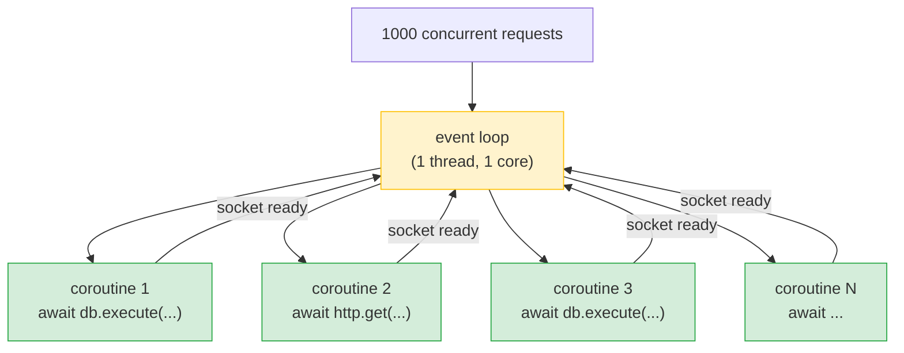
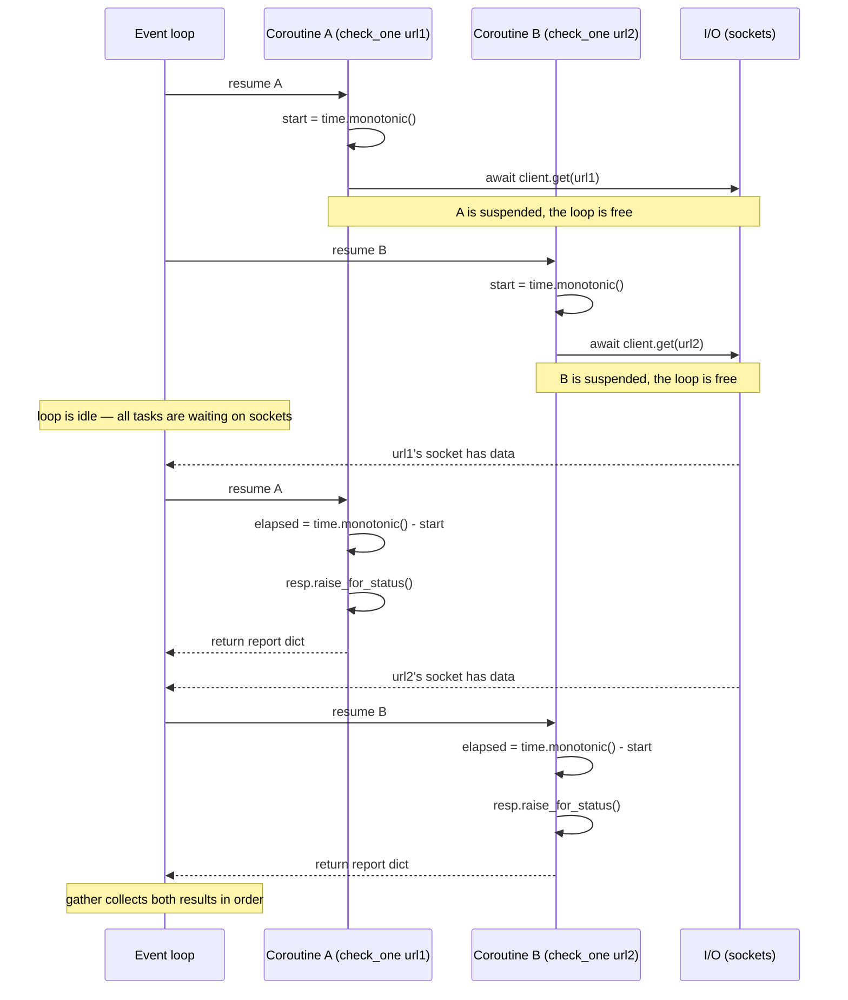
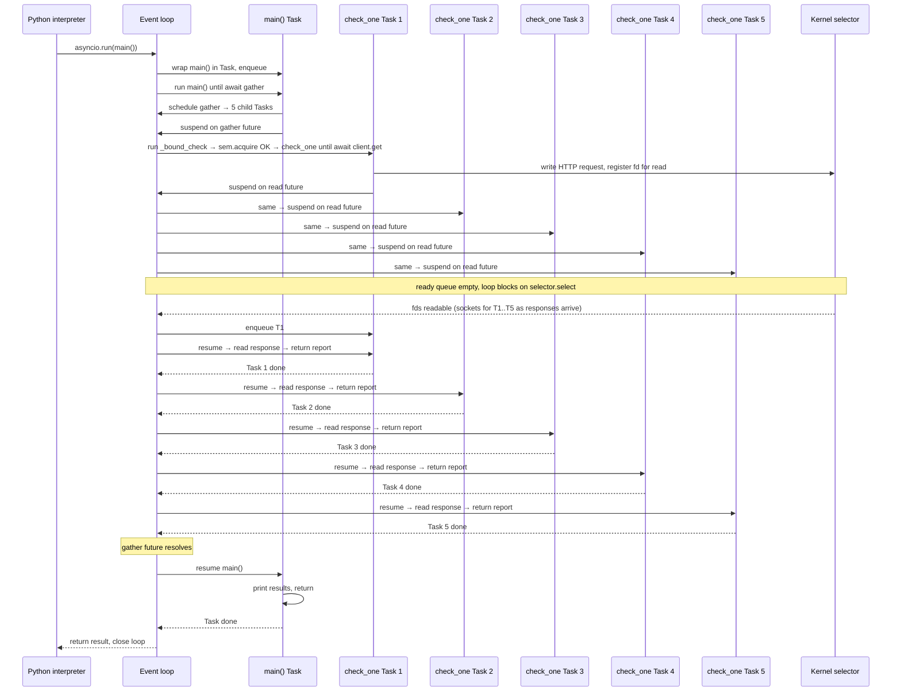

# Lesson 01: Event Loop and Coroutines

*The single-threaded scheduler, `async def` / `await`, `asyncio.run`, tasks vs coroutines, `asyncio.gather` vs `asyncio.create_task`, and the cost of `await`-ing blocking code — with a `boardly/clients/health.py` module that fans out to N service URLs concurrently, line by line.*

**You are at the start of Section 10.**

You have written `async def` endpoints. You have used `await`. You may have even used `asyncio.gather`. Today you learn the model that makes all of it work — the event loop, a single-threaded scheduler that swaps between coroutines at their `await` points. The model is brilliant for I/O-bound work and catastrophic for blocking I/O or CPU-bound work. By the end of this lesson, every "my async server isn't actually concurrent" bug will be obvious to you. Take your time. Run every example. Read the tracebacks. That is how you learn.


#async #event-loop #coroutine #canonical

## Learning Objectives

By the end of this lesson you will be able to:

1. **Describe an event loop** as a single-threaded scheduler that swaps between coroutines at `await` points.
2. **Explain the difference** between a coroutine object, a coroutine function, and a Task.
3. **Use `asyncio.run`, `asyncio.create_task`, and `asyncio.gather`** correctly and predict their behavior.
4. **Articulate the cost** of calling blocking code inside `async def` and identify blocking calls by inspection.
5. **Explain why a "synchronously slow" function inside `async def` blocks the whole loop**, and how to fix it.
6. **Read a Mermaid sequence** of two coroutines interleaved and explain which lines run when.
7. **Write a `boardly/clients/health.py` module** that fans out to N service URLs concurrently with `httpx.AsyncClient` + `asyncio.gather`.

## Prerequisites

Before starting, you need:

- **Python 3.12** (verified Oct 2026). `asyncio.TaskGroup`, `asyncio.timeout()`, and `except*` are stable.
- **The generators lesson** — [[01-Python-Foundations/Iterators-Generators-Context-Managers]]. Coroutines build on the same frame-suspension machinery that generators use (the `yield` keyword and the frame-suspension mechanism). If `yield` is still mysterious, go back.
- **The functions/scope/closures/decorators lesson** — [[01-Python-Foundations/Functions-Scope-Closures-Decorators]]. `async def` is a decorator-friendly function definition.
- **The ASGI lesson** — [[02-Web-and-HTTP/ASGI-Starlette-Uvicorn]]. FastAPI runs on top of an event loop driven by Uvicorn; you need to know what ASGI is to understand why the loop matters.
- **About 90 minutes of focused time.** The code is small; the explanations are long.

**The most common gap: generators and `yield`.**

If you have never written a generator with `yield`, the `async def` / `await` model looks magical. It is not. The frame-suspension mechanism is the same: a generator function with `yield` produces a generator object that can be resumed; a coroutine function with `await` produces a coroutine object that can be resumed. The difference is that `await` is the resume point inside an `async def`, and the event loop is the thing that resumes it. Re-read [[01-Python-Foundations/Iterators-Generators-Context-Managers]] if any of this is shaky.


## The Problem

Async Python is the foundation FastAPI is built on. The whole point of using FastAPI for an I/O-bound service is that one process, on one CPU core, can handle thousands of concurrent requests — but only if you understand what the event loop is doing. When you do not, you will write "async" code that calls a synchronous database driver or a CPU-bound helper, and your "concurrent" server will handle one request at a time. Worse, you will not realize it until load testing, because in dev with one user, everything is fast.

This lesson explains the model. Once you have it, every other async lesson — async SQLAlchemy, async testing, async primitives — is an application.



The loop is the center of the universe. Every coroutine is a recipe that runs to its next `await`, suspends, and lets the loop pick another recipe to run.

## The Code

This lesson produces a `boardly/clients/health.py` module that fans out to N service URLs concurrently and returns the slowest response time as a header. The pieces, in the order they appear:

1. The mental model: what an event loop is, what a coroutine is, what `await` does.
2. The four primitives: `asyncio.run`, `asyncio.create_task`, `asyncio.gather`, and the difference between a coroutine object and a Task.
3. The cost of `await` on blocking code — the single most important point in the lesson.
4. The `boardly/clients/health.py` module.
5. The execution trace and the Mermaid sequence diagram.

### `boardly/clients/health.py`: the example

```python
# boardly/clients/health.py
"""Boardly — concurrent health-checks for downstream services."""
from __future__ import annotations

import asyncio
import time
from collections.abc import Iterable

import httpx


DOWNSTREAM_SERVICES: tuple[str, ...] = (
 "https://api.github.com/users/octocat",
 "https://api.github.com/users/tiangolo",
 "https://api.github.com/users/encode",
 "https://httpbin.org/anything?from=boardly",
 "https://httpbin.org/status/200",
)


async def check_one(client: httpx.AsyncClient, url: str) -> dict[str, object]:
 """Fetch one URL and return a small report dict."""
 start = time.monotonic()
 resp = await client.get(url, timeout=5.0)
 elapsed = time.monotonic() - start
 resp.raise_for_status()
 return {
 "url": url,
 "status": resp.status_code,
 "elapsed_ms": round(elapsed * 1000, 1),
 }


async def check_all(
 urls: Iterable[str],
 *,
 concurrency: int = 10,
 timeout: float = 5.0,
) -> list[dict[str, object]]:
 """Fan out to every URL concurrently, bounded by `concurrency`.

 Total wall time ~= the slowest request, not the sum.
 """
 sem = asyncio.Semaphore(concurrency)

 async def _bound_check(client: httpx.AsyncClient, url: str) -> dict[str, object]:
 async with sem:
 return await check_one(client, url)

 async with httpx.AsyncClient(timeout=timeout) as client:
 results = await asyncio.gather(
 *(_bound_check(client, u) for u in urls),
 return_exceptions=True,
 )
 # `gather` returns exceptions as objects in the list when return_exceptions=True.
 # Coerce them into a uniform shape for the caller.
 coerced: list[dict[str, object]] = []
 for url, result in zip(urls, results):
 if isinstance(result, BaseException):
 coerced.append({"url": url, "error": repr(result)})
 else:
 coerced.append(result)
 return coerced


async def main() -> None:
 start = time.monotonic()
 results = await check_all(DOWNSTREAM_SERVICES, concurrency=5)
 elapsed = time.monotonic() - start
 print(f"checked {len(results)} services in {elapsed:.2f}s")
 for r in results:
 print(r)


if __name__ == "__main__":
 asyncio.run(main())
```

That is the entire lesson. The rest of this file explains every block, every primitive, and the failure modes.

## Line-by-Line Deep Dive

This section is the heart of the lesson. Read it twice. Do not skim.

### The module header: `from __future__ import annotations` and the imports

```python
from __future__ import annotations

import asyncio
import time
from collections.abc import Iterable

import httpx
```

**What it does:** Pulls in the standard library pieces and the `httpx` async HTTP client.

**Why each:**

- `from __future__ import annotations` makes every type annotation a string at runtime, so `Iterable[str]` and `dict[str, object]` work even on Python 3.9 (we target 3.12, but this future-import is harmless and future-proofs the file).
- `asyncio` is the standard library's event loop and primitive toolkit.
- `time` is for `time.monotonic()` — the wall-clock measurement that does not go backwards (unlike `time.time()` which can jump on NTP sync).
- `from collections.abc import Iterable` — the modern, recommended import for the `Iterable` protocol. Avoid `from typing import Iterable` (deprecated for runtime use since Python 3.9).
- `httpx` is the async HTTP client we use. It is a third-party library; install with `uv add httpx`.

**Tip — Why `time.monotonic()` and not `time.time()`?**

`time.time()` returns the wall clock — which can jump backwards if NTP adjusts the system clock. `time.monotonic()` returns a monotonically increasing clock that never goes backwards. For measuring elapsed time, always use `monotonic` (or `perf_counter` for sub-microsecond precision). For logging timestamps that humans will read, `time.time()` is fine.


### The constant: `DOWNSTREAM_SERVICES`

```python
DOWNSTREAM_SERVICES: tuple[str, ...] = (
 "https://api.github.com/users/octocat",
 "https://api.github.com/users/tiangolo",
 "https://api.github.com/users/encode",
 "https://httpbin.org/anything?from=boardly",
 "https://httpbin.org/status/200",
)
```

**What it does:** Defines the list of downstream service URLs to check.

**Why a `tuple` and not a `list`?** A constant — it never changes — should be immutable. `tuple` is the standard for "this is a constant sequence." The `tuple[str, ...]` type hint means "a tuple of strings of any length" (the `...` is the "arbitrary length" marker).

### `async def check_one`: the unit coroutine

```python
async def check_one(client: httpx.AsyncClient, url: str) -> dict[str, object]:
 """Fetch one URL and return a small report dict."""
 start = time.monotonic()
 resp = await client.get(url, timeout=5.0)
 elapsed = time.monotonic() - start
 resp.raise_for_status()
 return {
 "url": url,
 "status": resp.status_code,
 "elapsed_ms": round(elapsed * 1000, 1),
 }
```

**What it does:** Defines an async function that fetches one URL and returns a report dict.

**Line by line:**

- `async def check_one(...)` — the `async` keyword marks this as a **coroutine function**. Calling it does not run the body; it returns a **coroutine object**. The body runs only when you `await` it (or schedule it with `asyncio.create_task`, or pass it to `asyncio.run`).

**Coroutine function vs coroutine object vs Task**

Three terms you must keep straight:
- A **coroutine function** is the `async def` definition. It is a callable.
- A **coroutine object** is what you get when you call a coroutine function: `coro = check_one(client, url)`. The body has not run yet. It is a recipe.
- A **Task** is a coroutine object that the event loop has been told to schedule. Once you wrap a coroutine in a Task, the loop runs it concurrently with whatever else is on the ready queue.

The distinction matters because each of the three is a different kind of object. You `await` a coroutine object to get its result. You `create_task` a coroutine object to schedule it without waiting. You `gather` a sequence of coroutine objects (or Tasks) to run them concurrently.


**Senior engineer's mental model:** Don't think of a coroutine as "an async function that's running." Think of it as a **suspended computation with three states**: `CORO_CREATED` (you called the function but haven't awaited it — the body hasn't started), `CORO_SUSPENDED` (it hit an `await` and yielded control back to the loop), and `CORO_CLOSED` (it returned, raised, or was cancelled — the frame is gone). A `Task` is just a coroutine plus a *scheduler slot* — the loop knows about it, will resume it when its awaited future completes, and will collect its result or exception. The senior engineer's question, every time you write `something_async(...)`, is: "which of these three states is the resulting object in, and who is responsible for moving it to the next state?" If the answer is "I don't know who's going to drive it," you've just written a coroutine leak — see Common Mistake #6 below.

**What happens inside: the three-state coroutine machine.**

When Python sees `async def f(): ...`, the resulting `f` is a *coroutine function* — calling it does NOT execute the body. Calling `f()` returns a *coroutine object* (`types.CoroutineType`), which is essentially a stateful generator with a frame pointer, a code object, and a `cr_last_exc` slot. The body doesn't run until you `await` it (which calls `coro.send(None)` internally) or until you wrap it in a `Task` and the loop calls `.send()`. A senior engineer who forgets this writes `f()` without `await` and wonders why the body never executed — the coroutine object was created in `CORO_CREATED` state, never driven, and got garbage-collected. The garbage collector, on collection, emits `RuntimeWarning: coroutine 'f' was never awaited` — that warning is your only signal that you forgot. The state machine is the same one generators use (see [[01-Python-Foundations/Iterators-Generators-Context-Managers]]) — `async def` and `yield` are two syntaxes for the same frame-suspension mechanism.


- `start = time.monotonic()` — captures the start time. This line runs *immediately* — there is no `await` before it, so the loop does not have a chance to swap.
- `resp = await client.get(url, timeout=5.0)` — the **await point**. `client.get(...)` returns a coroutine (because `AsyncClient.get` is an `async def`). `await` tells the event loop: "I am waiting on this coroutine; feel free to run other coroutines while I wait." The loop suspends `check_one` and runs something else. When the HTTP response arrives, the loop resumes `check_one` with the response as the value of the `await` expression.
- `elapsed = time.monotonic() - start` — computes the elapsed wall-clock time. Note this includes the time the coroutine was suspended waiting for the response — which is the whole point of the measurement.
- `resp.raise_for_status()` — raises `HTTPStatusError` if the status code is 4xx or 5xx. This propagates up; in `check_all`, we catch it via `return_exceptions=True`.
- `return {...}` — returns the dict. The coroutine completes; the `await` expression in the caller evaluates to this dict.

**Student asks: why is `raise_for_status()` *after* the await? Why not before?**

Because `raise_for_status()` is a method on the *response* object, which we only have after the `await client.get(...)` completes. Before the await, there is no response yet — the request is in flight. The order is: send the request (the `await client.get(...)`), wait for the response, then check the status.


### `async def check_all`: the fan-out coordinator

```python
async def check_all(
 urls: Iterable[str],
 *,
 concurrency: int = 10,
 timeout: float = 5.0,
) -> list[dict[str, object]]:
 sem = asyncio.Semaphore(concurrency)

 async def _bound_check(client: httpx.AsyncClient, url: str) -> dict[str, object]:
 async with sem:
 return await check_one(client, url)

 async with httpx.AsyncClient(timeout=timeout) as client:
 results = await asyncio.gather(
 *(_bound_check(client, u) for u in urls),
 return_exceptions=True,
 )
 # ...
```

**What it does:** Fans out to every URL concurrently, bounded by a Semaphore, and gathers the results.

**Line by line:**

- `urls: Iterable[str]` — accepts any iterable of strings (list, tuple, generator). We do not need to materialise the list; we just iterate.
- `*, concurrency: int = 10, timeout: float = 5.0` — keyword-only arguments (after the `*`). The `*` forces the caller to use keyword syntax: `check_all(urls, concurrency=5)`, not `check_all(urls, 5)`. This makes call sites readable.
- `sem = asyncio.Semaphore(concurrency)` — creates a Semaphore with the given concurrency limit. The Semaphore allows at most `concurrency` coroutines to be inside its `async with` block at once. We cover Semaphore in depth in [[asyncio-Primitives]] — for now, treat it as "limits how many `check_one` calls are in flight at once."

**Why a Semaphore?**

Without one, `asyncio.gather(*(_bound_check(client, u) for u in urls))` would start *all* the requests at once. If `urls` is 1000 entries, you would have 1000 HTTP requests in flight simultaneously — which would exhaust your local file descriptors, overwhelm the downstream service, or both. The Semaphore bounds concurrency to a safe number (5 in our example). For more on the pattern, see [[asyncio-Primitives]].


- `async def _bound_check(client, url)` — an inner function that wraps `check_one` in the Semaphore. Each call to `_bound_check` acquires the Semaphore, calls `check_one`, and releases the Semaphore on exit (even on exception, thanks to `async with`).
- `async with httpx.AsyncClient(timeout=timeout) as client:` — creates an `AsyncClient` and ensures it is closed on exit. The `AsyncClient` holds a connection pool; creating one per request would be wasteful. Creating one and reusing it across all the requests in `check_all` is the standard pattern.
- `results = await asyncio.gather(*(_bound_check(client, u) for u in urls), return_exceptions=True)` — the heart. We unpack the generator expression into positional arguments to `gather`. `gather` schedules all the coroutine objects concurrently and returns their results as a list, in order. `return_exceptions=True` means: if a coroutine raises, do not cancel the others; capture the exception as an element of the result list.

### The coercion block

```python
 coerced: list[dict[str, object]] = []
 for url, result in zip(urls, results):
 if isinstance(result, BaseException):
 coerced.append({"url": url, "error": repr(result)})
 else:
 coerced.append(result)
 return coerced
```

**What it does:** Walks the results in parallel with the input URLs (using `zip`); for each result, if it is an exception, coerces it into a uniform "error" dict; otherwise appends the result as-is.

**Why `isinstance(result, BaseException)` and not `Exception`?** Because `return_exceptions=True` can return `CancelledError` (which inherits `BaseException`, not `Exception`) and `KeyboardInterrupt` (also `BaseException`). If we used `Exception`, we would miss these. `BaseException` is the right base to check.

**Warning — Why `return_exceptions=True`?**

Without it, if *one* coroutine raises, `gather` propagates the first raised exception immediately — but the other coroutines are *not* cancelled; they keep running to completion, and their results are silently discarded. That is the wrong behavior for `check_all` — a slow service should not have its response discarded because a sibling service errored. `return_exceptions=True` says: "let every coroutine complete (success or failure); give me all the results, including the exceptions." We then handle the exceptions in the coercion block. For new code, prefer `asyncio.TaskGroup` (Python 3.11+) which *does* cancel the remaining tasks on first failure and is safer — see [[asyncio-Primitives]].


### `async def main`: the entry point

```python
async def main() -> None:
 start = time.monotonic()
 results = await check_all(DOWNSTREAM_SERVICES, concurrency=5)
 elapsed = time.monotonic() - start
 print(f"checked {len(results)} services in {elapsed:.2f}s")
 for r in results:
 print(r)


if __name__ == "__main__":
 asyncio.run(main())
```

**What it does:** Defines the entry point and runs it.

**Line by line:**

- `async def main() -> None:` — the top-level coroutine. This is what `asyncio.run` will run.
- `start = time.monotonic()` — captures the start time.
- `results = await check_all(DOWNSTREAM_SERVICES, concurrency=5)` — calls `check_all` with concurrency=5 (so all 5 downstream URLs are in flight at once; the Semaphore still bounds the fan-out, but with 5 permits and 5 URLs no task ever blocks on `sem.acquire()`).
- `print(...)` — prints the summary.
- `if __name__ == "__main__": asyncio.run(main())` — the **entry point**. `asyncio.run(coro)` is the canonical way to run a top-level coroutine. It creates a new event loop, schedules `main()` as the main task, runs the loop until `main` completes, cancels any remaining tasks, and closes the loop. You call it once, at the top level of a script. You do not call it from inside an existing event loop — that raises `RuntimeError`.

**What `asyncio.run` actually does**

1. Creates a new event loop.
2. Schedules the coroutine as the main task.
3. Runs the loop until the main task completes.
4. Cancels any remaining tasks (with a warning).
5. Closes the loop and the async generators.

Inside FastAPI, the event loop already exists (Uvicorn creates it). You just `await` — never call `asyncio.run` inside a route. `asyncio.run` is for the top level of a script.


### The cost of `await` on blocking code: the single most important point in the lesson

A "blocking call" is one that holds the calling thread until it completes — a `time.sleep`, a `requests.get`, a synchronous database driver, a CPU-bound calculation. Inside `async def`, blocking calls are catastrophic because the event loop cannot swap away from them.

```python
import asyncio
import time

async def bad() -> None:
 # This is a blocking call. The whole event loop is stuck for 5 seconds.
 time.sleep(5)

async def good() -> None:
 # This is an async sleep. The loop can run other coroutines during the wait.
 await asyncio.sleep(5)

async def other() -> None:
 print("other ran")

async def main() -> None:
 # With bad(): "other" cannot run until bad() finishes.
 # With good(): "other" runs while good() is sleeping.
 await asyncio.gather(bad(), other())
```

The rule: **inside `async def`, every `await` point must be on something that genuinely yields control** (an async I/O call, an `asyncio.sleep`, a future). A `time.sleep` or a `requests.get` does not yield; it blocks the OS thread; the loop is stuck.

### Why a synchronously slow function blocks the whole loop

This is the same point, restated, because it is the cause of most "my async server isn't actually concurrent" bugs.

```python
import asyncio
import time

def cpu_heavy(n: int) -> int:
 # Pure CPU work; no await points.
 total = 0
 for i in range(n):
 total += i * i
 return total

async def route_a() -> int:
 return cpu_heavy(10_000_000) # 200ms of CPU, no awaits

async def route_b() -> str:
 await asyncio.sleep(0.001) # yields immediately
 return "b"

async def main() -> None:
 # Even though route_b is async-sleeping, route_a is hogging the loop.
 # route_b doesn't run until route_a finishes.
 await asyncio.gather(route_a(), route_b())
```

`route_a` is `async def`, but its body has no `await` — it calls `cpu_heavy(10_000_000)` directly. That call is 200ms of pure CPU work. The event loop cannot swap away from it because `cpu_heavy` never yields. `route_b`, which is just `await asyncio.sleep(0.001)`, does not get a chance to run until `route_a` returns. The "concurrent" call to `gather` is, in fact, serial.

Why doesn't Python preempt long-running coroutines the way the OS preempts long-running threads? Because Python's `asyncio` is a *cooperative* scheduler, not a pre-emptive one. Pre-emption requires either an OS-level timer interrupt (which threads have and coroutines do not) or periodic instrumentation of every bytecode (which CPython does not do for `async def` code). Cooperative scheduling is the trade-off: coroutines give up the loop *only* at explicit `await` points, which means a coroutine that does not `await` does not give up the loop. The upside is that the scheduler is user-space, single-threaded, and free of data races — you do not need locks because two coroutines never truly run at the same time. The downside is the trap you just saw: a single misbehaving coroutine freezes the whole loop. Threads tolerate a CPU-hogging thread by pre-empting it; coroutines do not.

**Senior engineer's mental model:** Async Python's "single thread" property is a *discipline*, not a guarantee. The loop trusts every coroutine to `await` promptly and to keep its non-`await`-ing stretches under a few milliseconds. A senior engineer reading any `async def` for the first time scans it for the *longest synchronous stretch* — the section between two `await`s — because that's the section where the loop is stuck. If the longest stretch is 1 ms, you're fine at any scale. If it's 200 ms (a regex on a 10 MB string, a `json.loads` on a 50 MB body, a synchronous `psycopg2` query), you've just capped your service at 5 requests per second on that route, regardless of how many workers you run. The mental model to internalise: **throughput = 1 / (longest non-awaiting stretch in any hot route)**. Measure it. Profile it in CI. Treat a 50 ms stretch with the same urgency you'd treat a 50 ms DB query without an index — both cap your throughput at the same place.

**Warning — When this breaks: "everything is fast in dev, slow in prod."**

The classic symptom: a route that calls `requests.get(...)` (synchronous) tests fine in your dev environment with one user — 200 ms response time, no problem. In production with 50 concurrent users, the same route's p99 jumps to 5+ seconds. The diagnosis is *not* "the downstream service is slow" — it's "the event loop is blocked." While one request is in `requests.get(...)`, the other 49 are queued behind it, each waiting for the loop to be free. The senior engineer's debugging path: (1) `py-spy top --pid <uvicorn-worker-pid>` — if the loop thread is 100% in `socket.recv` from a sync library, you've found it; (2) check the route signature — if it's `async def` but the body calls a sync library (`requests`, `psycopg2`, `boto3` without `aioboto3`), that's the bug; (3) the fix is one of: use the async equivalent (`httpx.AsyncClient`, `asyncpg`, `aioboto3`), or wrap the call in `await asyncio.to_thread(sync_call, ...)` so it runs on a threadpool and the loop stays free. Do not "fix" it by making the route `def` instead of `async def` — that just moves the problem from blocking the loop to consuming a threadpool slot, and you've lost the explicit marker that this route is I/O-bound.


**Danger — How an attacker thinks: blocking the event loop is a self-DoS.**

An attacker who can reach a route with a 200 ms synchronous stretch doesn't need a botnet — they need 10 requests per second aimed at that route to keep the loop permanently blocked. While the loop is blocked, *every other route* on the same worker is also blocked, including unrelated endpoints and the `/healthz` the load balancer pings. The classic exploit: send 20 concurrent requests to the slow route; the load balancer's health checks start timing out; the load balancer marks the worker unhealthy and drains it; repeat across workers; the cluster is down. The senior engineer's defence is layered: (1) keep every `async def` route's longest synchronous stretch under ~10 ms — profile in CI, fail the build if it regresses; (2) put a per-IP rate limit in front of any route whose stretch you can't shrink (e.g. a CPU-bound image-resize endpoint); (3) if a route must do CPU-bound work, run it in `asyncio.to_thread(...)` so the loop stays free even when the route is busy. The bug class is "amplification" — one request blocking many is the same shape as the Slowloris HTTP attack, except you're doing it to yourself.


The fix depends on the workload:

- For I/O blocking: use an async library (`httpx.AsyncClient`, `asyncpg`, `redis.asyncio`, `aiofiles`).
- For CPU-bound work: move it to a process pool via `loop.run_in_executor` or `concurrent.futures.ProcessPoolExecutor`. See [[Concurrency-vs-Parallelism]].
- For unavoidable blocking I/O in a sync library: use `loop.run_in_executor` with a `ThreadPoolExecutor`. This is acceptable when you have no async alternative.

### Reading code for blocking

Train your eye to spot blocking calls inside `async def`:

| Blocking call | Use instead |
|---|---|
| `time.sleep(N)` | `await asyncio.sleep(N)` |
| `requests.get(url)` | `await httpx.AsyncClient().get(url)` |
| `psycopg2` (sync driver) | `asyncpg` or `psycopg` (async mode) |
| `redis-py` sync client | `redis.asyncio` |
| `open(...).read()` on a large file | `aiofiles` or `await loop.run_in_executor(None, ...)` |
| `subprocess.run(...)` / `os.popen(...)` | `asyncio.create_subprocess_exec(...)` |
| Heavy CPU work (regex on huge strings, large JSON parsing) | move to a process pool |

The reverse footgun: do not sprinkle `async` on synchronous code expecting it to become concurrent. `async def f(): return 1 + 1` is async by signature but synchronous in behavior. `async` is not magic; it is a marker that the function *may* `await`. If it does not `await`, it is synchronous in effect.

### Tasks vs coroutines: the subtlety

A **coroutine object** is a recipe. It does not run on its own.

A **Task** is a coroutine object that the event loop has been told to schedule. Once you wrap a coroutine in a Task, the loop runs it concurrently with whatever else is on the ready queue.

```python
import asyncio

async def slow(name: str, seconds: float) -> str:
 await asyncio.sleep(seconds)
 return f"{name} done after {seconds}s"

async def main() -> None:
 # Coroutine object: not yet scheduled.
 c1 = slow("a", 1.0)
 c2 = slow("b", 1.0)

 # Wrong: serial. ~2 seconds total.
 # await c1; await c2

 # Right: schedule both, then wait. ~1 second total.
 t1 = asyncio.create_task(c1)
 t2 = asyncio.create_task(c2)
 r1 = await t1
 r2 = await t2
 print(r1, r2)

asyncio.run(main())
```

The subtle point: `asyncio.create_task(coro)` schedules `coro` to run *as soon as possible* — but "as soon as possible" means "the next time the loop is free, which may be the next await point in the calling coroutine." If you `create_task` then immediately run a long synchronous stretch, your task does not get a chance.

### `asyncio.gather` vs `asyncio.create_task`: two patterns

`asyncio.gather(*coros)` schedules all the coroutines concurrently and returns their results as a list, in order. It is the idiomatic way to fan out and fan in.

```python
# Pattern 1: gather takes coroutine objects and schedules them itself.
await asyncio.gather(slow("a", 1), slow("b", 1))

# Pattern 2: explicitly create tasks first, then gather them.
# This is useful when you want to start the coroutines now and await them later.
tasks = [asyncio.create_task(slow(n, 1)) for n in ["a", "b"]]
# ...do something else...
results = await asyncio.gather(*tasks)
```

Pattern 1 is more common and more readable. Use it unless you have a specific reason to start the tasks early.

`gather` has a footgun: by default (`return_exceptions=False`), the moment one child raises, `gather` marks its outer future done with that exception and propagates it — but it does *not* cancel the other children. They keep running to completion (consuming sockets, CPU, downstream quota) and their results are silently discarded. To get every result, including the exceptions, pass `return_exceptions=True` (which is what `check_all` does above). For new code, prefer `asyncio.TaskGroup` (Python 3.11+) which *does* cancel the remaining tasks on first failure and is safer — see [[asyncio-Primitives]].

**Senior engineer's mental model:** The relationship between `gather` and `create_task` is *not* "do the same thing differently." It is "different temporal shapes of the same primitive." `asyncio.create_task(coro)` is a *non-blocking* call — it returns immediately with a `Task` handle that the loop will run concurrently with whatever you do next. `await asyncio.gather(*coros)` is a *blocking-until-all-done* call — it schedules all the coroutines and suspends the caller until they all finish. The senior engineer's question, every time you reach for one or the other, is: "do I need the work started *now* and the result *later* (`create_task` then `await`), or do I need the work started and finished *as a unit* (`gather`)?" Most fan-out patterns are `gather`; the rare `create_task`-then-`await` pattern is when you want to start a slow fetch *before* doing some unrelated computation, so the fetch overlaps with the computation. Confusing the two is the cause of Mistake 6 below.

**Production reality: `gather` at scale.**

At 100 concurrent requests/second, `asyncio.gather(*tasks)` with a few hundred tasks works fine. At 10,000 requests/second with the same pattern, you exhaust memory — each `Task` allocates a coroutine frame (~1 KB on CPython 3.12) plus any captured closures, plus the `gather` outer future holds a list of all the results simultaneously. A 10,000-element `gather` with average 2 KB per result is 20 MB held in a single list while the `gather` completes — and 10,000 concurrent sockets is well past the default `ulimit -n` 1024 file-descriptor cap on most Linux deployments. The senior engineer's response: use `asyncio.Semaphore` to bound concurrency (as `check_all` does), or use an `asyncio.Queue` with N worker tasks that pull from it (the "worker pool" pattern). The semaphore is simpler; the queue is what you reach for when the work is producer-driven (e.g. consuming from a Kafka topic) rather than consumer-driven (e.g. fanning out to N known URLs).


**Danger — How an attacker thinks: unbounded `gather` is a self-DoS.**

An attacker who can influence the size of the `urls` list passed to `check_all` (without a `Semaphore`) controls your memory budget. A 100,000-element list of URLs becomes 100,000 in-flight HTTP connections, 100,000 coroutine frames, and 100,000 sockets — the worker OOM-kills within seconds. The same shape applies wherever user input drives the cardinality of a `gather`: batch endpoints, search-with-many-filters, "fetch all my subscriptions" dashboards. The senior engineer's defence is structural: (1) never let user input directly size a `gather` — always route through a `Semaphore` with a sane cap (10–100 depending on the downstream); (2) bound the *input* — reject lists longer than N at the validation layer; (3) for endpoints that *must* handle large fan-outs, switch from `gather` to a queue-and-worker-pool pattern with a fixed number of workers (8–32) so memory is bounded regardless of input size. The bug class is "unbounded resource consumption from user input" — same family as the billion-laughs XML expansion attack, except you're expanding coroutine frames instead of entity references.


**Student asks: What is the difference between `asyncio.create_task` and `asyncio.gather`?**

They are two different layers of the same machinery. **`asyncio.create_task(coro)`** wraps a single coroutine object in a `Task` and *schedules* it on the running loop. It returns immediately with a `Task` handle — the coroutine has not finished, it is just queued to run. You can `await` that `Task` later to get its result. Use `create_task` when you want to start work now and await it later (e.g. start a fetch, do something else, then await the fetch). **`asyncio.gather(*coros)`** is a higher-level helper: it takes any number of awaitables (coroutine objects *or* Tasks), schedules the unscheduled ones, awaits them all concurrently, and returns their results as a list in argument order. `gather` is *concurrent* — total wall-clock is the slowest of its inputs, not the sum. The two patterns compose: `tasks = [asyncio.create_task(c) for c in coros]; results = await asyncio.gather(*tasks)` is the canonical "start them now, wait for them together" form. **The subtlety:** if you write `await c1; await c2` you get serial execution (~2s); if you write `await asyncio.gather(c1, c2)` you get concurrent execution (~1s). The `await` keyword alone does not concurrency make — it just suspends until the awaitable resolves. Concurrency comes from *scheduling multiple awaitables before awaiting them*, and `gather` is the idiomatic way to express that.


### The Mermaid sequence: two coroutines interleaved



This is the "interleaving" picture. Two coroutines, one thread, taking turns at await points. The crucial property: only one coroutine is executing Python code at any instant; the loop achieves concurrency by interleaving, not by running in parallel.

## Execution Trace

What actually happens when you press Enter on `uv run python -m boardly.clients.health`. This section is a full end-to-end walkthrough, from `asyncio.run(main())` at the top to the final `gather` return. (The nine-step summary later in this section compresses the same machinery into a shorter form.)

### Step 0: Python starts, `asyncio.run(main())` is called

When the interpreter hits `asyncio.run(main())`, Python does the following in order:

1. **`asyncio.run` creates a fresh event loop** for the current thread. There was no loop before; there is one now. (If you call `asyncio.run` from inside another loop, you get `RuntimeError: asyncio.run() cannot be called from a running event loop` — see Common Mistake #1.) The loop is created with a fresh selector (epoll on Linux, kqueue on macOS, IOCP on Windows).
2. **`asyncio.run` wraps `main()` in a `Task`.** A `Task` is the loop's bookkeeping object for a coroutine: it tracks the coroutine's state (pending, running, suspended, done), holds its result or exception once it finishes, and is what `gather` and `create_task` and the loop's scheduler all refer to. Wrapping `main()` in a Task is what *schedules* the coroutine to run on the next loop iteration.
3. **`asyncio.run` enters the loop's run-until-complete driver.** This is the canonical `while True: poll selector; run ready callbacks; run ready timers` body of the loop. The loop will keep spinning until the `main` Task is done (or until it raises). When `main` is done, `asyncio.run` cancels any still-pending tasks (with a `CancelledError`), waits for them to wind down, closes the loop, and returns `main`'s result (or re-raises its exception).

### Steps 1–4: `main` runs, schedules child Tasks, hits its first `await`

4. **The loop's first iteration picks up the `main` Task.** `main`'s coroutine starts running synchronously on the loop's thread. It opens an `httpx.AsyncClient` (which registers its sockets with the loop's selector, but doesn't send anything yet).
5. **`main` constructs the `_bound_check` coroutines.** Calling `_bound_check(client, url)` for each of the 5 URLs returns five coroutine objects — the bodies of the functions have *not* run yet. Calling a coroutine function only constructs the coroutine object; the body runs only when the coroutine is awaited or scheduled.
6. **`main` hits `await asyncio.gather(...)`.** `gather` immediately wraps each coroutine argument in a `Task` (using the loop that is currently running — `get_running_loop()`). Each Task is added to the loop's ready queue. (This is *scheduling*; the coroutines are now ready to run but not yet running.) `gather` itself returns a future that will resolve when all five child Tasks are done.
7. **`main` suspends on `await gather`.** Control returns to the loop. The `main` Task's state changes from "running" to "suspended on the gather future." The loop's ready queue now contains the five child Tasks; the `main` Task is not on it.
8. **The loop picks the first child Task off the ready queue.** It runs the body of `_bound_check` synchronously until the body hits its first `await` — which is `await sem.__aenter__()` (the semaphore acquire inside `async with sem:`). With `concurrency=5` and 5 URLs, the acquire succeeds immediately, so the Task proceeds to its next `await` — `await client.get(url)`. At that point `client.get` initiates the HTTP request (the socket is created, the request bytes are written, and the socket is registered with the loop's selector for read-readiness), and then `client.get` returns a future. The `await` in `check_one` suspends the child Task on that future.

### Steps 5–7: All child Tasks are suspended on sockets; loop is idle

9. **The loop picks the second, third, fourth, and fifth child Tasks in turn.** Each runs the body of `_bound_check`, acquires the semaphore (still has free permits), calls `check_one`, and hits `await client.get(...)` — same suspension as step 8. After this step, all five child Tasks are suspended on socket-read futures; `main` is suspended on the gather future; the ready queue is empty.
10. **The loop polls the selector.** With nothing ready to run, the loop calls `selector.select(timeout)` — this is the *only* line in the entire program where the thread actually blocks. On Linux this is an `epoll_wait` syscall; on macOS it is `kevent`. The kernel puts the thread to sleep until one of the registered file descriptors has data. (For a health-check hitting `https://api.github.com`, this is typically a few hundred milliseconds.)
11. **The OS notifies the loop that the first socket is readable.** The kernel wakes `select` and reports "fd #7 has data." The loop looks up which Task is waiting on fd #7 — it is the first child Task. The loop adds that Task back to the ready queue. (Other sockets may become readable in the same `select` batch; the loop adds each one's Task back to the queue.)

### Steps 8–10: Tasks wake, complete, `gather` collects

12. **The loop picks the first child Task off the ready queue.** The `await client.get(url)` call resumes — the socket-read completes, the HTTP response is parsed, the function returns its report dict. The child Task exits the `async with sem:` block (releasing one permit, though no waiter is queued in this run) and is now "done"; `client.get`'s future resolves with the report.
13. **`gather` notices the first child finished.** `gather`'s own future is still pending (it needs all five to finish), so `main` stays suspended.
14. **Steps 10–13 repeat for the second, third, fourth, and fifth child Tasks.** Each wakes when its socket is readable, completes its `await client.get(url)`, returns its report. If one child raises, `gather` propagates the first raised exception immediately (in the default configuration); the other children are *not* cancelled and continue running to completion, with their results discarded. With `return_exceptions=True` set, `gather` collects exceptions as values instead.
15. **All five child Tasks are done.** `gather`'s future resolves with a list of the five results, in the order they were passed in. The `await asyncio.gather(...)` call in `main` returns. `main`'s Task is back on the ready queue.
16. **The loop picks `main`'s Task off the ready queue.** `main` resumes after `await gather`. It iterates the results, prints them, and exits the function. `main`'s Task is now "done" with the report list as its result.
17. **`asyncio.run` sees `main`'s Task is done.** It cancels any still-pending tasks (there are none — the child Tasks all completed), cancels any registered async generators (Python 3.12 does this for you), closes the loop, and returns the report list.

The total wall time is approximately the slowest single request (because all five requests ran concurrently, suspended on five sockets at once). Compare: with five sequential `await check_one(...)` calls, the wall time would be the *sum* of the five round-trips. That is the payoff of the event loop: concurrency without threads, without processes, without locks.

### The trace, end to end



The asyncio machinery is where the *interleaving* lives — only one coroutine runs at a time, but the loop swaps them at `await` points.

For `await asyncio.gather(check_one(c, u1), check_one(c, u2), check_one(c, u3))`:

1. `gather` wraps each coroutine in a Task and adds them to the loop's ready queue.
2. The loop runs task 1 until its `await client.get(...)` — at which point task 1 is suspended waiting on a socket.
3. The loop runs task 2 until its `await client.get(...)` — same.
4. Task 3 same.
5. The loop is now idle (all tasks are waiting on sockets).
6. The OS notifies the loop that task 1's socket is readable.
7. The loop resumes task 1, which reads the response and returns its JSON.
8. Same for tasks 2 and 3.
9. `gather` collects all three results and returns them in order.

Total elapsed time ≈ slowest request, not sum of all requests.

```bash
uv run python -m boardly.clients.health
# checked 5 services in 1.42s
# {'url': 'https://api.github.com/users/octocat', 'status': 200, 'elapsed_ms': 412.3}
# {'url': 'https://api.github.com/users/tiangolo', 'status': 200, 'elapsed_ms': 478.1}
# {'url': 'https://api.github.com/users/encode', 'status': 200, 'elapsed_ms': 501.7}
# {'url': 'https://httpbin.org/anything?from=boardly', 'status': 200, 'elapsed_ms': 1421.9}
# {'url': 'https://httpbin.org/status/200', 'status': 200, 'elapsed_ms': 1405.2}
```

With `concurrency=5` and 5 services, all five requests are in flight at once and the wall time is the slowest single request (~1.42s — the slowest httpbin response). If you dropped `concurrency` to 3, you'd have batching: 3 in the first batch (~0.5s slowest) + 2 in the second batch (~1.4s slowest) ≈ 1.9s total. Tune `concurrency` to your downstream service's tolerance and your own file-descriptor budget.

**The crucial property: only one coroutine runs at a time.**

Steps 8, 9, 12, 14, 16 — each is a single coroutine executing Python bytecode on the loop's thread. The loop achieves concurrency by *interleaving* at await points, not by running in parallel. The parallelism is in the I/O (the five sockets are simultaneously in flight at the kernel level, between steps 8 and 11), not in the Python.


**Student asks: where is the "blocking" `select` call?**

Step 10. Between steps 9 and 11, the loop's only line of work is `selector.select(timeout)` — a syscall that puts the thread to sleep until the kernel reports activity. Before step 9 (while there are still ready Tasks in the queue), the loop does *not* block on `select`; it spins through the ready queue first, polling the selector with `timeout=0`. After step 9, with the ready queue empty, the loop blocks on `select` with the next timer's deadline as the timeout. That single syscall is the only place the thread truly waits.


**Warning — If you call `time.sleep(5)` inside a coroutine, the entire loop is blocked for 5 seconds.**

Step 10 (the `select` syscall) is what lets the loop multiplex. But between Tasks, the loop's thread runs each Task's Python code directly — there is no preemption. A long CPU-bound operation inside a coroutine (a regex compile, a JSON serialize, a `time.sleep`) blocks the loop, which blocks every other Task. The rule: every CPU-bound operation must be offloaded with `asyncio.to_thread(...)` or `run_in_executor(...)`; every `time.sleep` must become `await asyncio.sleep`.


**Tip — Watch the trace with `PYTHONASYNCIODEBUG=1`.**

Set this environment variable and run your script. The loop will log every Task creation, every `await` suspension, and every Task completion with timestamps. You'll see steps 4–17 of the trace above, with your own coroutine names. The output is verbose — pipe it through `grep` for your function names — but it is the most direct way to see "what is the loop actually doing."


**That is the entire event loop in seventeen steps.**

One thread. One selector. Many Tasks. The loop's only blocking call is `select`; everything else is interleaving at `await` points. Every async framework you'll ever use — Starlette, FastAPI, httpx, asyncpg, aiohttp — runs on this same loop, with this same seventeen-step skeleton. The abstractions differ; the loop does not.


## Common Mistakes

### Mistake 1: `asyncio.run` inside an `async def`

```python
# WRONG
async def route():
 asyncio.run(some_other_coro())
```

**Symptom:** `RuntimeError: asyncio.run() cannot be called from a running event loop`.

**Why:** `asyncio.run` creates a new event loop. There is already one running (Uvicorn started it, or your outer `asyncio.run` did). You cannot nest event loops.

**Fix:** Inside an `async def`, just `await some_other_coro()`.

### Mistake 2: Forgetting to `await` a coroutine

```python
# WRONG
async def route():
 check_one(client, url) # missing await!
```

**Symptom:** `RuntimeWarning: coroutine 'check_one' was never awaited` and your code does not actually run.

**Why:** Calling a coroutine function returns a coroutine object. Without `await` (or `create_task`, or `gather`), the body never executes. Python detects this and warns; in some configurations it raises.

**Fix:** Add `await`. Or wrap with `asyncio.create_task(...)` to schedule without waiting.

### Mistake 3: Calling `time.sleep` instead of `await asyncio.sleep` inside `async def`

```python
# WRONG
async def route():
 time.sleep(5) # blocks the whole loop
```

**Symptom:** Other coroutines do not run for 5 seconds.

**Why:** `time.sleep` is a synchronous blocking call. It does not yield to the loop.

**Fix:** `await asyncio.sleep(5)`.

### Mistake 4: Using `requests` inside `async def`

```python
# WRONG
import requests
async def route():
 resp = requests.get(url) # blocks the whole loop
```

**Symptom:** The route is "async" in name only; it blocks the loop for the duration of the request. Other concurrent requests stall.

**Why:** `requests` is a synchronous HTTP client. It does not yield.

**Fix:** Use `httpx.AsyncClient`. Or, if you have no choice, `await loop.run_in_executor(None, requests.get, url)`.

### Mistake 5: `asyncio.gather(coro)` instead of `asyncio.gather(*coros)`

```python
# WRONG (typo)
results = await asyncio.gather(check_one(c, u1)) # one coroutine, not unpacked

# Often what you meant:
results = await asyncio.gather(check_one(c, u1), check_one(c, u2))

# Or with a list:
results = await asyncio.gather(*[check_one(c, u) for u in urls])
```

**Why:** `gather` expects awaitables as positional args. Passing a single coroutine object as the only arg works (it returns a list of one element) but is a common typo. Passing a list (not unpacked) returns the list itself, not the elements.

### Mistake 6: Mixing `asyncio.create_task` and immediate awaiting

```python
# Subtle bug
async def route():
 task = asyncio.create_task(check_one(c, url)) # created
 # ... do something ...
 # `task` is no longer referenced anywhere — the loop may GC it mid-flight!
 return "ok"
```

**Symptom:** the asyncio module's logger emits `Task was destroyed but it is pending!` at WARNING level (CPython 3.11+). Note: this is a `logging` warning, not a `warnings.warn` `RuntimeWarning` — the two channels look alike in the terminal but are surfaced differently (filter the asyncio logger, not the `warnings` filter, to silence it).

**Why:** If you do not keep a reference to a Task, the garbage collector may collect it. The loop is still running it; on collection, it gets cancelled.

**Fix:** Keep the reference. Or `await` the task before returning.

**Warning — When this breaks: the asyncio logger is filtered in most deployments.**

The `Task was destroyed but it is pending!` message is emitted at WARNING level on the `asyncio` logger. In a typical production deployment, the asyncio logger is not explicitly configured — which means it inherits the root logger's level. If your root logger is at `WARNING` or above, you'll see the message. If your root logger is at `INFO` (common in FastAPI deployments that ship every request log) but the asyncio logger is *explicitly* silenced (`logging.getLogger("asyncio").setLevel(logging.ERROR)` — some boilerplate does this to suppress asyncio's "using slow selector" Windows warning), you will not see the destroyed-task message even though the leak is real. The senior engineer's response: (1) in dev, set `PYTHONASYNCIODEBUG=1` and watch for the warning at startup; (2) in prod, never silence the asyncio logger below WARNING; (3) hold a strong reference to every `create_task` result for as long as you need the work done — a `tasks: set[asyncio.Task]` set on `self` (with `task.add_done_callback(tasks.discard)` to auto-clean) is the canonical pattern; (4) for fan-out patterns, prefer `asyncio.TaskGroup` (Python 3.11+) which holds the references internally and surfaces failures as an `ExceptionGroup`.


### Mistake 7: Not handling exceptions in `gather`

```python
# WRONG (default behavior)
results = await asyncio.gather(check_one(c, u1), check_one(c, u2))
# If u2 raises, the exception propagates immediately. u1 is NOT cancelled —
# it keeps running to completion, and its result is silently discarded.
```

**Symptom:** One failing coroutine's exception is surfaced, but the other coroutines' results are lost (they kept running in the background and their output was discarded).

**Fix:** `return_exceptions=True` (as in `check_all`). Or use `asyncio.TaskGroup` for new code.

### Mistake 8: Spawning thousands of concurrent requests

```python
# DANGEROUS
results = await asyncio.gather(*(check_one(c, u) for u in urls))
# urls has 10000 entries → 10000 in-flight requests
```

**Symptom:** Local file descriptors exhausted; downstream service rate-limits you; or your outbound IP gets banned.

**Fix:** Use a `Semaphore` to bound concurrency. See [[asyncio-Primitives]] and the `check_all` function above.

## Engineering Trade-Offs

### `gather` vs `TaskGroup`

`TaskGroup` (PEP 654, Python 3.11+) is safer: it cancels all tasks on first failure and propagates an `ExceptionGroup`. `gather` is older and more flexible but easier to misuse. For new code, prefer `TaskGroup`. Use `gather` only when you specifically want `return_exceptions=True` semantics or you need to support Python < 3.11.

### `create_task` immediately vs `gather` directly

`gather` is more readable; explicit `create_task` lets you start the work before you actually need the results. Use the latter only when you have a reason — e.g. starting a slow request before computing something that does not depend on it.

### Async everywhere vs mixed

Going async-only is simpler; mixing async and sync code in one codebase forces you to remember which is which. But "async everything" can mean rewriting or replacing libraries that work fine in sync mode. Pragmatic middle ground: keep the HTTP layer async, keep CPU-bound batch jobs sync.

**Student asks: if I have a 4-core machine, can I run 4 event loops in 4 processes for 4× the throughput?**

Yes, and that is exactly how production FastAPI services scale. One event loop per process, one process per CPU core (Uvicorn with `--workers 4` on a 4-core box). Each process has its own event loop, its own connection pool, its own memory — they do not share state. The operating system preempts between processes (so a slow process cannot starve the others) and the GIL is per-process (so a CPU-bound task in one process does not block the others). The trade-off vs threads: process startup is heavier (memory copy, re-importing modules), and IPC is more expensive (no shared memory). For FastAPI, the 4-process pattern is the standard; see [[10-Async-Python/Concurrency-vs-Parallelism]] for the threads-vs-asyncio-vs-multiprocessing matrix and the `run_in_executor` bridge between them.


### `asyncio.run` vs the older `loop.run_until_complete`

`asyncio.run` is the recommended modern API. The `get_event_loop()` pattern is deprecated and produces subtle bugs; do not use it.

**Interview question: what does `asyncio.run(main())` actually do, step by step?**

Five things, in order: (1) it creates a fresh `asyncio.Runner` and a new event loop bound to the main thread; (2) when the loop's `run_forever()` starts (called transitively by `run_until_complete(main())`), it sets itself as the running loop for this thread via `events._set_running_loop`; (3) it runs `loop.run_until_complete(main())` — which enters the loop, resumes `main()` at its first `await`, and keeps cycling until `main` returns; (4) on `main` returning, it cancels any still-pending tasks the loop's `all_tasks()` set exposes (so a forgotten `asyncio.create_task` does not leak); (5) it shuts down async generators (calls `loop.shutdown_asyncgens()`), shuts down the loop's default executor (calls `loop.shutdown_default_executor()`), clears the running-loop binding, and closes the loop. The implication: `asyncio.run` is *the* correct entry point for an async program — calling it from *inside a running event loop* will raise `RuntimeError: asyncio.run() cannot be called from a running event loop`. Sequential `asyncio.run(...)` calls in the same thread are fine (the previous call's loop was closed before the next starts); what is forbidden is nesting — `asyncio.run` inside an `async def` whose outer loop is still running. Inside a FastAPI handler, the loop is already running (Starlette started it), so you call `await coro` directly; you do not call `asyncio.run` from inside a handler.


## Exercises

**Tip — The 20-minute rule**

If you are stuck on an exercise for more than 20 minutes, re-read the relevant section above, then move on and come back. Learning is not linear.


**Exercise 1 — Sequential vs concurrent.** Write a script that runs two `asyncio.sleep(1)` coroutines sequentially (one after the other) and times it. Then make them concurrent with `gather`. Confirm the time difference (2s vs 1s).

**Exercise 2 — Run `boardly/clients/health.py`.** Save the file from this lesson. Install `httpx` (`uv add httpx`). Run `uv run python -m boardly.clients.health`. Confirm the output. Try `concurrency=1` (serial) and `concurrency=5` (all in flight) and observe the wall time.

**Exercise 3 — Spot the blocking.** This route is "async" but blocks the loop. Why? Fix it.

```python
import time
import requests

@app.get("/sync-http")
async def sync_http():
 start = time.monotonic()
 resp = requests.get("https://httpbin.org/anything?boardly=1", timeout=5)
 elapsed = time.monotonic() - start
 return {"status": resp.status_code, "elapsed_ms": round(elapsed * 1000, 1)}
```

(Answer: `requests.get` is synchronous. Use `httpx.AsyncClient`. Or `await loop.run_in_executor(None, requests.get, ...)`.)

**Exercise 4 — The CPU-bound trap.** Write an `async def` route that calls a CPU-bound function (`sum(i*i for i in range(10**7))`) directly. Confirm that other concurrent requests stall while it runs. (Use `asyncio.gather` with the CPU-bound route and an `asyncio.sleep(0.01)` route; the sleep should finish much faster than the CPU work, but it does not.)

**Exercise 5 — `return_exceptions`.** Modify `check_all` to remove `return_exceptions=True`. Run it against a URL that returns 404 (which `raise_for_status` will raise on). Confirm the whole `gather` aborts. Restore `return_exceptions=True`. Confirm the failed URL is in the result list as an error dict.

**Exercise 6 — 1000 concurrent.** Modify `check_all` to fetch 1000 URLs (use `https://httpbin.org/anything?i={i}` for i in range(1000)). Without a Semaphore, observe what happens (you may exhaust file descriptors; you may get a warning). With `concurrency=20`, confirm it completes safely.

**Exercise 7 — `asyncio.run` inside `async def`.** Try writing `asyncio.run(main())` inside an `async def` function. Confirm the `RuntimeError`. Fix it by replacing `asyncio.run(main())` with `await main()`.

## Verification

```bash
# 1. Install httpx
uv add httpx

# 2. Run the module
uv run python -m boardly.clients.health
# expected: checked 5 services in ~1.4s with concurrency=5
# expected: each service printed with its status and elapsed_ms

# 3. Demonstrate blocking (the bad case)
uv run python -c "
import asyncio, time
async def bad(): time.sleep(0.5)
async def good(): await asyncio.sleep(0.5)
async def other(): print('other ran')
async def main_bad(): await asyncio.gather(bad(), other())
async def main_good(): await asyncio.gather(good(), other())
asyncio.run(main_good()) # 'other ran' prints during the wait
asyncio.run(main_bad()) # 'other ran' only prints after bad returns
"
# expected: 'other ran' appears immediately for main_good; after 0.5s for main_bad

# 4. Demonstrate concurrency
uv run python -c "
import asyncio, time
async def work(n): await asyncio.sleep(0.1); return n
async def main():
 start = time.monotonic()
 r = await asyncio.gather(*(work(i) for i in range(10)))
 print('gather 10 sleeps in', round(time.monotonic() - start, 3), 's, results', r[:3])
asyncio.run(main())
"
# expected: gather 10 sleeps in ~0.1 s, results [0, 1, 2]
```

## Previously Learned Here

We touched on async functions in [[01-Python-Foundations/Iterators-Generators-Context-Managers|generators and context managers]]. The frame-suspension mechanism is the same; `async def` and `yield` both suspend frames. This lesson is where we teach the scheduler that drives them. We also touched on the ASGI stack in [[02-Web-and-HTTP/ASGI-Starlette-Uvicorn|ASGI, Starlette, Uvicorn]] — the ASGI lifespan protocol runs on the event loop taught here.

## What's Next

In [[Concurrency-vs-Parallelism]] you will:

- Define concurrency and parallelism precisely and distinguish them.
- Compare threads, asyncio, and multiprocessing on the axes that matter: cost, scale, I/O vs CPU, debugging.
- Learn what the CPython GIL is and what its effect is on CPU-bound async tasks.
- Recognize blocking calls inside async contexts and choose between three fixes (async library, executor, separate process).
- Use `loop.run_in_executor` correctly for blocking work.

By the end of Lesson 02, you will know when asyncio is the right tool — and when threads or multiprocessing would serve you better.

## Sources

- Python documentation — `asyncio` — <https://docs.python.org/3/library/asyncio.html> — accessed 2026-10-19 — the canonical reference for `asyncio.run`, `gather`, `create_task`, etc.
- PEP 492 — Coroutines with async and await syntax — <https://peps.python.org/pep-0492/> — accessed 2026-10-19 — the introduction of `async def`/`await`.
- PEP 525 — Asynchronous Generators — <https://peps.python.org/pep-0525/> — accessed 2026-10-19 — `async def` with `yield`.
- PEP 654 — Exception Groups and `except*` — <https://peps.python.org/pep-0654/> — accessed 2026-10-19 — the foundation for `TaskGroup` semantics (used in Lesson 03).
- Real Python — "Async IO in Python: A Complete Walkthrough" — <https://realpython.com/async-io-python/> — accessed 2026-10-19 — accessible companion to the official docs.
- httpx documentation — Async support — <https://www.python-httpx.org/async/> — accessed 2026-10-19 — the async HTTP client used in examples.

## What We Learned

Let's recap. In this lesson you:

- **Described an event loop** as a single-threaded scheduler that swaps between coroutines at `await` points.
- **Distinguished** a coroutine function, a coroutine object, and a Task — and learned when each is what you want.
- **Used `asyncio.run`, `asyncio.create_task`, and `asyncio.gather`** correctly and predicted their behavior.
- **Articulated the cost** of calling blocking code inside `async def` and identified blocking calls by inspection.
- **Explained why a "synchronously slow" function inside `async def` blocks the whole loop** — because `cpu_heavy` never yields, the loop cannot swap — and how to fix it (async library, executor, or process pool).
- **Read a Mermaid sequence** of two coroutines interleaved and explained which lines run when.
- **Wrote a `boardly/clients/health.py` module** that fans out to N service URLs concurrently with `httpx.AsyncClient` + `asyncio.gather`, bounded by a `Semaphore`.

Here's the mental model to walk away with: *the event loop is a single thread that swaps between coroutines at their `await` points. Concurrency comes from interleaving, not from parallelism. A coroutine that does not `await` blocks the loop — and therefore blocks every other coroutine. The discipline of async Python is: only `await` things that genuinely yield (async I/O, `asyncio.sleep`, futures); never `await` blocking calls; offload CPU-bound work to a process pool.*

---

> A note from your teacher
You have just learned the model that makes every `async def` you have ever written make sense. The event loop is a single thread. The coroutines are recipes that suspend at `await`. The loop swaps between them. That is it. The next time someone says "async Python is hard," you can say: it is not hard, it is just a single-threaded scheduler with a discipline — only await things that yield. Next we will look at when asyncio is the wrong tool entirely, and how to choose between threads, asyncio, and multiprocessing. See you in Lesson 02.


---

**Tags:** #async #event-loop #coroutine #canonical #review
**Previous:** [[00-Async-MOC]]
**Next:** [[Concurrency-vs-Parallelism]] →
