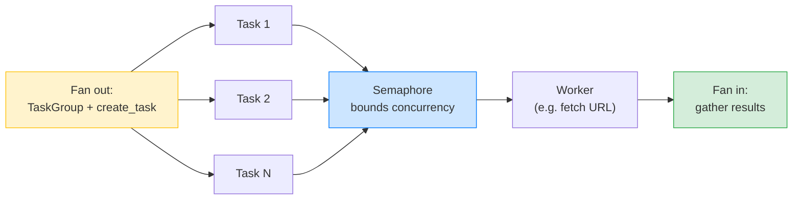
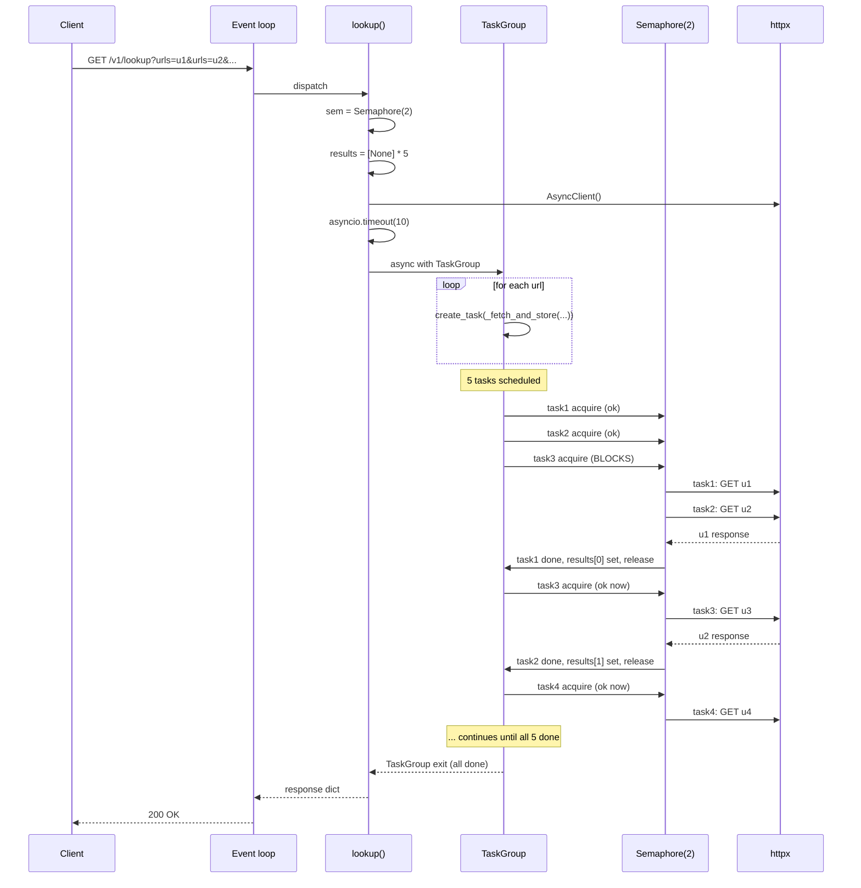

# Lesson 03: asyncio Primitives

*`Lock`, `Event`, `Semaphore`, `Queue`, `TaskGroup` (PEP 654), `timeout()`, cancellation semantics, exception groups (`except*`), and the two practical patterns you will use every day — rate-limiting with `Semaphore` and fan-out with `TaskGroup` — with a `boardly/routers/lookup.py` endpoint that fans out to N URLs bounded by a Semaphore and gathered by a TaskGroup, line by line.*

**You have the model and the framework.**

Lesson 01 taught you the event loop. Lesson 02 taught you when to use asyncio, threads, or multiprocessing. Today you learn the toolkit you compose inside async code — the primitives that turn ad-hoc patterns (sleep-polling flags, manual dicts of futures) into one-line idioms that are correct under concurrency. By the end of this lesson you will be able to write a `boardly/routers/lookup.py` endpoint that fans out to N URLs bounded by a Semaphore, gathered by a TaskGroup, with a timeout, and with `except*` handlers for any failure. Take your time. The primitives are dense; the patterns are small.


#async #asyncio #primitives

## Learning Objectives

By the end of this lesson you will be able to:

1. **Use `asyncio.Lock`, `asyncio.Event`, `asyncio.Semaphore`, and `asyncio.Queue`** correctly.
2. **Use `asyncio.TaskGroup`** (Python 3.11+) for safe fan-out with structured concurrency.
3. **Use `asyncio.timeout()`** to bound the wall-clock time of an awaitable.
4. **Explain the semantics of cancellation** in asyncio: `CancelledError` inherits `BaseException`, propagation, and what survives.
5. **Read an `ExceptionGroup`** and write `except*` handlers.
6. **Apply two practical patterns**: rate-limiting with `Semaphore`, fan-out with `TaskGroup`.
7. **Write a `boardly/routers/lookup.py` endpoint** that fans out to N URLs bounded by a Semaphore, gathered by a TaskGroup, with a timeout.

## Prerequisites

Before starting, you need:

- **The Event-Loop lesson** — [[Event-Loop-and-Coroutines]]. You must know how coroutines and Tasks work.
- **The Concurrency lesson** — [[Concurrency-vs-Parallelism]]. You must know why blocking the loop is bad.
- **The Exceptions lesson** — [[01-Python-Foundations/Exceptions-Done-Right|Exceptions done right]]. We will discuss cancellation and exception groups.
- **About 90 minutes of focused time.** The primitives are dense; the patterns are small.

**The most common gap: `except*` syntax.**

PEP 654 introduced `ExceptionGroup` and the `except*` syntax in Python 3.11. If you have never seen `except* ValueError as eg:`, it looks weird. It is the syntax for matching exceptions *inside* an `ExceptionGroup`. We cover it in detail below; if it is the only thing you take from this lesson, take that.


## The Problem

Once you understand the event loop, the natural next question is: how do I coordinate coroutines? How do I limit concurrency to N at a time, signal between coroutines, share a queue, cancel a long-running task, fan out and gather results safely? `asyncio` ships a small set of primitives for exactly this. Knowing them turns ad-hoc patterns (sleep-polling flags, manual dicts of futures) into one-line idioms that are correct under concurrency.

This lesson covers `Lock`, `Event`, `Semaphore`, `Queue`, `TaskGroup` (PEP 654), `timeout()`, cancellation semantics, and exception groups. It ends with two practical patterns: rate-limiting with `Semaphore` and fan-out with `TaskGroup`.



## The Code

This lesson produces a `boardly/routers/lookup.py` endpoint that fans out to N URLs bounded by a Semaphore, gathered by a TaskGroup, with a timeout. The pieces, in the order they appear:

1. The mental model: cooperative primitives.
2. `asyncio.Lock`, `asyncio.Event`, `asyncio.Semaphore`, `asyncio.Queue` — the four core primitives.
3. `asyncio.TaskGroup` (PEP 654) — structured concurrency.
4. `asyncio.timeout()` — bounded wall-clock time.
5. Cancellation semantics — `CancelledError` inherits `BaseException`.
6. Exception groups and `except*`.
7. `boardly/routers/lookup.py` — the example.
8. The execution trace.

### `boardly/routers/lookup.py`: the example

```python
# boardly/routers/lookup.py
"""Boardly — lookup router: bounded concurrent fan-out with TaskGroup."""
from __future__ import annotations

import asyncio
from typing import Annotated

import httpx
from fastapi import APIRouter, HTTPException, Query


router = APIRouter(prefix="/v1/lookup", tags=["lookup"])


async def _fetch_one(
 client: httpx.AsyncClient,
 sem: asyncio.Semaphore,
 url: str,
) -> dict[str, object]:
 async with sem:
 try:
 resp = await client.get(url, timeout=5.0)
 resp.raise_for_status()
 return {"url": url, "status": resp.status_code, "body": resp.json()}
 except httpx.HTTPError as exc:
 return {"url": url, "error": repr(exc)}


@router.get("")
async def lookup(
 urls: Annotated[list[str], Query()],
 *,
 concurrency: Annotated[int, Query(ge=1, le=50)] = 5,
 overall_timeout: Annotated[float, Query(gt=0, le=30)] = 10.0,
) -> dict[str, object]:
 """Fan out to every URL, bounded by `concurrency`, with a wall-clock timeout.

 Uses asyncio.TaskGroup for structured concurrency. If any task raises
 something other than HTTPError (e.g. CancelledError), the TaskGroup
 cancels the rest and raises an ExceptionGroup — which we unpack.
 """
 sem = asyncio.Semaphore(concurrency)
 results: list[dict[str, object] | None] = [None] * len(urls)

 async with httpx.AsyncClient(timeout=overall_timeout) as client:
 try:
 async with asyncio.timeout(overall_timeout):
 async with asyncio.TaskGroup() as tg:
 for i, url in enumerate(urls):
 tg.create_task(
 _fetch_and_store(client, sem, url, results, i)
 )
 except* TimeoutError:
 # The overall timeout fired. Any tasks not yet finished were cancelled.
 # The partial results we collected are still valid; URLs that did not
 # complete will be `None` in `results`. Fill them with an error.
 for i, r in enumerate(results):
 if r is None:
 results[i] = {"url": urls[i], "error": "overall timeout"}

 coerced = [r if r is not None else {"error": "unknown"} for r in results]
 return {"count": len(coerced), "results": coerced}


async def _fetch_and_store(
 client: httpx.AsyncClient,
 sem: asyncio.Semaphore,
 url: str,
 out: list[dict[str, object] | None],
 index: int,
) -> None:
 """Fetch one URL and store the result at `out[index]`."""
 out[index] = await _fetch_one(client, sem, url)


# Convenience route for a smoke test
@router.get("/smoke")
async def smoke() -> dict[str, object]:
 """Quick smoke test: fetch one URL."""
 async with httpx.AsyncClient(timeout=5.0) as client:
 sem = asyncio.Semaphore(1)
 return await _fetch_one(client, sem, "https://httpbin.org/anything?from=boardly")
```

That is the entire lesson. The rest of this file explains every block, every primitive, and the failure modes.

## Line-by-Line Deep Dive

This section is the heart of the lesson. Read it twice. Do not skim.

### The mental model: cooperative primitives

The asyncio primitives are mostly async analogues of `threading` primitives, with one key difference: they are **cooperative**. A `Lock` does not preempt; it works only because coroutines `await lock.acquire()` instead of `lock.acquire()`. There is no scheduler that will yank control from a coroutine that does not await.

This means:

- If you do not `await`, the primitive cannot do its job. A coroutine that holds a lock and runs CPU work without awaiting blocks every other coroutine waiting for the lock.
- Deadlocks are easier to write (you forget to release the lock) but also easier to reason about: there is one thread, so a deadlock trace is reproducible.

Most of these primitives should be used inside `async with` blocks so the release happens on exit, even if the body raises.

### `asyncio.Lock`: a mutex for coroutines

```python
import asyncio

lock = asyncio.Lock()

async def critical_section(item: str) -> None:
 async with lock:
 # Only one coroutine at a time inside this block.
 print(f"start {item}")
 await asyncio.sleep(0.1) # yields to the loop; lock still held
 print(f"end {item}")

async def main() -> None:
 await asyncio.gather(
 critical_section("a"),
 critical_section("b"),
 critical_section("c"),
 )

asyncio.run(main())
# Output is serialized: start a / end a / start b / end b / start c / end c
```

**What it does:** A mutex for coroutines. Only one coroutine holds it at a time.

**Line by line:**

- `lock = asyncio.Lock()` — creates the lock. The lock starts unheld.
- `async with lock:` — acquires the lock on entry, releases on exit (even on exception). The body runs only when this coroutine holds the lock.
- `await asyncio.sleep(0.1)` — yields to the loop. The lock is *still held* by this coroutine; other coroutines that try to acquire it block in their `async with lock:` line. The yield is for other coroutines that do *not* need the lock.

**When to use it:** When you have a shared mutable resource (a dict, an in-memory list) that must be modified atomically. If you find yourself using `Lock` heavily, ask whether the underlying resource should be a `Queue` instead — queues compose better.

**Warning — Using `threading.Lock` inside `async def`**

`threading.Lock` blocks the OS thread — which blocks the event loop. Inside `async def`, always use `asyncio.Lock`. The two have similar APIs but very different behavior. The full symmetric comparison — including the inverse footgun (using `asyncio.Lock` across threads) and the `to_thread` escape hatch — is in `### When to use which: asyncio.Lock vs threading.Lock` under `## Engineering Trade-Offs` below.


**Warning — When this breaks: lock-ordering deadlock between two `asyncio.Lock` objects**

A coroutine that acquires `lock_a` then `await`s while trying to acquire `lock_b` deadlocks against a second coroutine that acquires `lock_b` then `await`s for `lock_a`. Both park forever; the loop keeps running other coroutines, so the bug is invisible until the affected resources stop updating — a stale cache, a frozen counter, a queue that never drains. The traceback is empty (the coroutines are suspended, not crashed), and `py-spy` or `aiomonitor` is the only tool that surfaces "two coroutines parked on `async with lock` for 10 minutes". The fix is the same lock-ordering discipline as in `threading`: pick a global acquisition order for every lock in the process (typically by lock identity, or by the resource id the lock protects) and never acquire `lock_b` while holding `lock_a` if any other coroutine ever holds `lock_b` while trying to acquire `lock_a`. For most async codebases the rule reduces to "hold one lock at a time"; when you must hold two, document the order in a comment on the second `async with`. The debugging discipline is to dump the held-locks state under a signal handler (`SIGUSR1`: walk the list of `asyncio.Lock` objects the app owns and print their `locked()` status) — a deadlock shows up as two locks both `locked()` with no coroutine making progress between snapshots. See [[01-Python-Foundations/Exceptions-Done-Right]] for the broader pattern of "the bug is not a crash, it is a stop".


### `asyncio.Event`: a flag for signaling

```python
import asyncio

ready = asyncio.Event()

async def waiter(name: str) -> None:
 await ready.wait()
 print(f"{name} saw the signal")

async def setter() -> None:
 await asyncio.sleep(0.5)
 ready.set() # all waiters are unblocked

async def main() -> None:
 await asyncio.gather(waiter("a"), waiter("b"), setter())

asyncio.run(main())
```

**What it does:** A flag that one coroutine sets and others wait for.

**Line by line:**

- `ready = asyncio.Event()` — creates the event. The event starts *unset*.
- `await ready.wait()` — suspends the coroutine until the event is set. Multiple coroutines can wait on the same event; all are unblocked when `set()` is called.
- `ready.set()` — sets the event. All waiters are unblocked.

**When to use it:** For "ready" signaling — "the cache is warm", "the database is connected", "the config has been loaded". Not for protecting resources (use `Lock`); not for limiting concurrency (use `Semaphore`).

**Tip — Reusing an `Event`**

`Event` is a one-shot signal across many waiters. To reuse it, call `clear()` — this resets the event to unset, and future `wait()` calls block until the next `set()`. The pattern is: `set()` when ready, `clear()` when becoming unready, `wait()` to block until ready.


### `asyncio.Semaphore`: a concurrency limiter

```python
import asyncio
import httpx

sem = asyncio.Semaphore(10) # at most 10 concurrent acquires

async def fetch(client: httpx.AsyncClient, url: str) -> dict:
 async with sem:
 resp = await client.get(url, timeout=10.0)
 return resp.json()

async def main() -> None:
 urls = [f"https://httpbin.org/anything?i={i}" for i in range(1000)]
 async with httpx.AsyncClient() as client:
 results = await asyncio.gather(*(fetch(client, u) for u in urls))
 print(f"got {len(results)}")

asyncio.run(main())
```

**What it does:** A counter that limits concurrent acquires.

**Line by line:**

- `sem = asyncio.Semaphore(10)` — creates a semaphore with an internal counter of 10.
- `async with sem:` — acquires one slot. If the counter is > 0, decrements and proceeds. If the counter is 0, suspends until another coroutine releases.
- On exit, releases one slot (increments the counter).

**When to use it:** To bound concurrency: rate-limit an outbound HTTP call, cap parallel database queries, prevent fan-out from overwhelming a downstream.

`Semaphore` is the workhorse primitive. Almost every "I have N things to do" pattern is `Semaphore + gather` (or `Semaphore + TaskGroup`).

**Student asks: what is `BoundedSemaphore`?**

`BoundedSemaphore` is a `Semaphore` that raises `ValueError` if you call `release()` more times than you have called `acquire()`. This catches reference-count bugs. The default `Semaphore` silently goes negative. Use `BoundedSemaphore` by default — the extra safety is worth nothing in cost.


**Danger — How an attacker thinks: weaponizing unbounded concurrency into a downstream DoS**

An attacker who can submit `?urls=u1&urls=u2&...&urls=u10000` to the `lookup` endpoint (no `concurrency` cap, or `Query(le=50)` raised to `Query(le=100000)` by a refactor that did not consider downstream capacity) can fan out 10 000 simultaneous `httpx` connections in a single request. The victim is not your process — it survives because `asyncio` parks coroutines cheaply — it is the downstream. The downstream rate-limits at 100 RPS; your single request sends 10 000 concurrent calls, 9 900 get 429'd, your retry logic (if any) backs off, the user sees 30-second latency. Worse: if the downstream is a paid API, that single request consumes a month's quota in one call. The Semaphore is the *defense*, not just a performance optimization — `concurrency=5` is the contract with the downstream that you will not exceed its rate. The `Query(ge=1, le=50)` cap on `concurrency` is the contract with the operator that the user cannot override the Semaphore to 10 000. Both contracts are load-bearing — the `le=50` is a security control, not a UX preference. The senior question for every fan-out endpoint: *can a client set `concurrency` to a value that exceeds the downstream's rate, and is there an upper bound the operator controls?* If the answer is "yes the client can, and no there is no operator cap", the endpoint is a downstream-DoS primitive. See [[11-Authentication-and-Security/Threat-Model-First]] for the threat model that names this as API4 (Unrestricted Resource Consumption) and [[15-External-Integrations/HTTP-Clients-Timeouts-Retries]] for the per-call timeout that bounds each individual request.


### `asyncio.Queue`: producer-consumer

```python
import asyncio

queue: asyncio.Queue[int] = asyncio.Queue(maxsize=10)

async def producer() -> None:
 for i in range(100):
 await queue.put(i) # blocks if queue is full
 await queue.put(-1) # sentinel

async def consumer(name: str) -> int:
 total = 0
 while True:
 item = await queue.get()
 if item == -1:
 await queue.put(-1) # pass the sentinel on
 return total
 total += item

async def main() -> None:
 producers = [asyncio.create_task(producer())]
 consumers = [asyncio.create_task(consumer(f"c{i}")) for i in range(4)]
 await asyncio.gather(*producers)
 results = await asyncio.gather(*consumers)
 print("consumer totals:", results)

asyncio.run(main())
```

**What it does:** A FIFO queue for producer-consumer patterns.

**Line by line:**

- `queue = asyncio.Queue(maxsize=10)` — creates a queue with a maximum of 10 items. `put` blocks when the queue is full; `get` blocks when it is empty.
- `await queue.put(i)` — adds an item. If the queue is full, suspends until a consumer removes an item.
- `await queue.get()` — removes and returns an item. If the queue is empty, suspends until a producer adds an item.

**When to use it:** When you want decoupled producers and consumers — e.g., a webhook ingestion route that enqueues items and a background worker that drains them. For finer-grained patterns (priority, delay, retry), use a real queue system (Redis, RabbitMQ) — see [[14-Caching-and-Background-Processing/Transactional-Outbox]].

**Production reality: in-memory queue loss on process crash**

Every item in an `asyncio.Queue` lives in the process's RAM. When the process dies — `SIGKILL` from the OOM killer, a container restart from the orchestrator, a segfault in a C extension — the queue and all its pending items vanish. The producer that `await queue.put(item)`-ed has already returned 200 OK to the client; the item is gone. For a webhook ingestion flow this is "we lost the webhook and the third-party will not retry it for 24 hours"; for a billing flow this is "we lost the invoice event and the customer was not charged". The fix is not "make `asyncio.Queue` durable" (you cannot) — it is to recognise that the queue's role is bounded by the process lifetime, and to escalate to a durable transport the moment the work has business value. The pattern is the transactional outbox: write the item to a database table inside the request's transaction, then have a background worker drain that table to the real downstream; the table is the durable queue, the `asyncio.Queue` is the in-memory fast path. The senior question for every "we enqueue and return 200" endpoint: *if the process dies between the `put` and the worker draining the queue, is the work lost, and is that loss acceptable for this flow?* If the answer is "the work is lost and that is not acceptable", you need the outbox, not the in-memory queue. See [[14-Caching-and-Background-Processing/Transactional-Outbox]] for the full pattern, and [[03-FastAPI-Core/Background-Tasks-Streaming-Uploads]] for the simpler in-process background task that is *not* durable (it has the same crash-loss semantics as the in-memory queue).


### `asyncio.TaskGroup` (PEP 654, Python 3.11+): structured concurrency

```python
import asyncio

async def task_ok(name: str) -> str:
 await asyncio.sleep(0.1)
 return f"{name} ok"

async def task_fail(name: str) -> None:
 await asyncio.sleep(0.05)
 raise ValueError(f"{name} failed")

async def main() -> None:
 try:
 async with asyncio.TaskGroup() as tg:
 t1 = tg.create_task(task_ok("a"))
 t2 = tg.create_task(task_fail("b"))
 t3 = tg.create_task(task_ok("c"))
 # On exit, all tasks have completed (or been cancelled).
 print(t1.result(), t3.result())
 except* ValueError as eg:
 # `except*` matches exceptions inside the ExceptionGroup.
 print("caught:", [str(e) for e in eg.exceptions])

asyncio.run(main())
```

**What it does:** Structured concurrency. A `TaskGroup` is an async context manager that schedules tasks and waits for all of them on exit.

**Line by line:**

- `async with asyncio.TaskGroup() as tg:` — creates a task group. The `async with` block is the scope of the group's tasks; the group cannot escape.
- `tg.create_task(coro)` — schedules `coro` and returns a `Task`. The task is part of the group.
- On exit: the group waits for all tasks. If any task raised, the group cancels the others and raises an `ExceptionGroup` containing the original exceptions.

**Why `TaskGroup` is better than `gather`:**

- On first failure, it cancels the other tasks. `gather` does too (with `return_exceptions=False`, the default), but `TaskGroup` also waits for the cancellations to complete before raising.
- It raises an `ExceptionGroup`, which preserves the original exceptions even if multiple tasks failed.
- It enforces structured concurrency: tasks cannot escape the `async with` block. You always know when the group's tasks are done.

Why does `TaskGroup` cancel the other tasks on failure, rather than letting them finish and report their own results? Because the moment one task in a fan-out fails, the *reason* you fanned out is probably gone — you were fetching three URLs to merge into one response; one URL returned a 500; the merge can no longer produce a useful response, so the other two fetches are wasted work. Letting them run to completion wastes resources (CPU, bandwidth, downstream API quota) and lengthens the time until the caller sees the error. Cancelling the survivors as soon as one fails is the structured-concurrency contract: the `async with` block is the scope of the fan-out, and leaving the block early on failure (after cancelling survivors) means the caller's `await` returns promptly with the error, not after the slowest task in the group has finished. The trade-off is that a survivor task that was about to commit a side effect (a database write, an email send) gets cancelled mid-flight — so your survivors must be cancellation-safe (use `try/finally` for cleanup, never swallow `CancelledError`, keep transactions short). `TaskGroup` does not invent this discipline; it forces it.

**Warning — When this breaks: survivor task cancelled mid-database-transaction**

A survivor task that is inside `async with session.begin():` when the TaskGroup cancels it receives `CancelledError` at the next `await` — typically mid-`session.execute(...)`. SQLAlchemy's `AsyncSession` rolls back the transaction on `CancelledError` *if* the `CancelledError` propagates out of the `async with session.begin():` block; if your code catches `CancelledError` (e.g. a `try/except BaseException` that swallows it for "cleanup"), the transaction is left open, the connection is not returned to the pool, and the next request that needs that connection blocks. The debugging surface is "every Nth request to the affected endpoint hangs for 30 seconds then 503s" with no traceback — the connection pool slowly drains as each cancelled task leaks one connection, and the failure only surfaces when the pool is exhausted. The fix is the rule from the Cancellation semantics section below: never swallow `CancelledError`, always re-raise. The defense-in-depth is to keep transactions short (one `begin():` block per logical write, not a long-running saga) so the cancellation window is small and a survivor cancelled mid-flight cannot leave a half-committed write behind. The senior question for every `async with session.begin():` block inside a `TaskGroup`: *if the TaskGroup cancels this task at the `await session.execute(...)` line, does the transaction roll back, and does the connection return to the pool?* If the answer is not a clean yes for both, the task is not cancellation-safe and the next pool-exhaustion incident will trace back to this block. See [[07-SQLAlchemy/05-Session-and-Transaction-Management]] for the rollback-on-`CancelledError` semantics and [[07-SQLAlchemy/07-Async-SQLAlchemy]] for the connection-pool-exhaustion failure mode.


For new code, prefer `TaskGroup`. Use `gather` only when you specifically want `return_exceptions=True` semantics or you need to support Python < 3.11.

### `asyncio.timeout()` (Python 3.11+): bounded wall-clock time

```python
import asyncio

async def slow() -> str:
 await asyncio.sleep(10)
 return "done"

async def main() -> None:
 try:
 async with asyncio.timeout(0.5):
 result = await slow()
 print(result)
 except TimeoutError:
 print("timed out")

asyncio.run(main())
```

**What it does:** Bounded wall-clock time for an awaitable. On expiry, it cancels the inner task and raises `TimeoutError` (specifically, `asyncio.TimeoutError`, which is now an alias for the builtin `TimeoutError`).

**Why prefer `asyncio.timeout()` over the older `asyncio.wait_for(coro, timeout)`?**

- It is a context manager, so it composes with cleanup. `wait_for` was a function call that wrapped a coroutine; you could not use it around arbitrary `async with` blocks.
- It cancels the inner coroutine cleanly, which `wait_for` did imperfectly.
- It is the modern API; `wait_for` is not deprecated but is no longer the recommended form.

**`TimeoutError` and `asyncio.TimeoutError`**

Before Python 3.11, `asyncio.TimeoutError` was a distinct exception class, separate from the builtin `TimeoutError`. In 3.11+, they are the same — `asyncio.TimeoutError` is an alias for `TimeoutError`. Either name works; the convention is to use the builtin `TimeoutError`.


**Danger — How an attacker thinks: slowloris-style slow body uploads against an async endpoint**

An attacker who can submit a request body that takes 30 seconds to send (e.g. a `POST /upload` that sends 1 byte per second) holds an event-loop slot, an httpx connection, and a uvicorn worker thread for the full duration. With 100 such clients, all 100 worker slots are pinned, the 101st request gets a 503, and the service is down for the cost of 100 TCP connections — a DoS for the price of a single laptop and a script. The defense is `async with asyncio.timeout(N):` around the body-read — if the body is not fully read in N seconds, the coroutine is cancelled, the connection is closed, the worker is freed. This is the slow-body variant of the slowloris attack (the original targeted HTTP headers; this targets bodies, which `asyncio.timeout()` covers because `await request.body()` is an awaitable). The default uvicorn/Starlette config does *not* apply a body-read timeout — it relies on the reverse proxy (nginx's `client_body_timeout`, Envoy's `idle_timeouts`) for the defense. The application-level `asyncio.timeout()` is the second layer; the reverse proxy is the first. Both are necessary because the attacker only needs one layer to fail. The senior question for every endpoint that reads a request body: *is there a wall-clock bound on the body-read, and is it shorter than the worker-exhaustion threshold?* If the answer is no, the endpoint is a slowloris primitive. See [[15-External-Integrations/HTTP-Clients-Timeouts-Retries]] for the corresponding outbound-timeout discipline and [[03-FastAPI-Core/Background-Tasks-Streaming-Uploads]] for the streaming-upload pattern that does *not* hold the connection for the full body (and so is not a slowloris surface).


### Cancellation semantics

When a task is cancelled, the loop injects `CancelledError` into the coroutine at its next await point. The coroutine can catch `CancelledError` (rare), do cleanup, and re-raise it; or it can let it propagate. Catching `CancelledError` and swallowing it is almost always wrong — it defeats the cancellation contract.

`CancelledError` inherits from `BaseException`, not `Exception`, since Python 3.8. The practical effect: a bare `except Exception:` will not catch it, which is what you want — you do not accidentally swallow a cancellation.

```python
async def worker() -> None:
 try:
 await asyncio.sleep(60)
 except asyncio.CancelledError:
 # Clean up: close files, release locks, etc.
 print("cleanup")
 raise # re-raise so cancellation propagates
```

Cancellation is cooperative. If your coroutine does not `await`, cancellation cannot be injected. A coroutine stuck in a `time.sleep(60)` is unkillable by `task.cancel()`.

**Danger — Swallowing `CancelledError`**

```python
async def worker() -> None:
try:
await asyncio.sleep(60)
except asyncio.CancelledError:
pass # WRONG — defeats cancellation
```
If you swallow `CancelledError`, the caller's `task.cancel()` call has no effect. The task continues to run. This breaks `asyncio.timeout()`, `TaskGroup` cancellation-on-failure, and any caller that expects to be able to cancel. **Always re-raise `CancelledError`.**


### Exception groups and `except*`

PEP 654 introduced `ExceptionGroup` and the `except*` syntax for matching exceptions inside a group. `TaskGroup` raises an `ExceptionGroup` if any sub-task raised. You match with `except*`:

```python
async def main() -> None:
 try:
 async with asyncio.TaskGroup() as tg:
 tg.create_task(fail_with(ValueError("a")))
 tg.create_task(fail_with(KeyError("b")))
 tg.create_task(fail_with(TimeoutError("c")))
 except* ValueError as eg:
 print("ValueErrors:", [str(e) for e in eg.exceptions])
 except* KeyError as eg:
 print("KeyErrors:", [str(e) for e in eg.exceptions])
 # Unmatched exceptions propagate as a remaining ExceptionGroup.
```

**What it does:** Each `except*` clause matches a subset of the exceptions inside the `ExceptionGroup`. The matched exceptions are removed from the group; the rest propagate as a smaller `ExceptionGroup` to the next `except*` clause.

**Why is this more verbose than `except (ValueError, KeyError):`?** Because `ExceptionGroup` preserves information: you know which exception types were raised and how many of each. With `except`, multiple exceptions of the same type collapse into one; with `except*`, you get all of them.

**Student asks: when does `TaskGroup` raise `ExceptionGroup` vs a single exception?**

`TaskGroup` always raises `ExceptionGroup` (or its subclass `BaseExceptionGroup` if a `BaseException` was raised, like `CancelledError` or `KeyboardInterrupt`). The shape is consistent. You always write `except*` to match. This is a feature: a single exception from a single task is still wrapped in a group, so your handler code is the same whether one task failed or ten did.


### `boardly/routers/lookup.py`: the example, in detail

```python
async def _fetch_one(
 client: httpx.AsyncClient,
 sem: asyncio.Semaphore,
 url: str,
) -> dict[str, object]:
 async with sem:
 try:
 resp = await client.get(url, timeout=5.0)
 resp.raise_for_status()
 return {"url": url, "status": resp.status_code, "body": resp.json()}
 except httpx.HTTPError as exc:
 return {"url": url, "error": repr(exc)}
```

**What it does:** Fetches one URL, bounded by the Semaphore, returning a result dict (or an error dict).

**Line by line:**

- `async with sem:` — acquires the semaphore (limits concurrency to the value set when `sem` was created, default 5 in `lookup`).
- `resp = await client.get(url, timeout=5.0)` — the HTTP call, with a 5-second per-call timeout.
- `resp.raise_for_status()` — raises `HTTPStatusError` for 4xx/5xx responses.
- `return {...}` — on success, return the result.
- `except httpx.HTTPError as exc: return {...}` — on any HTTP error (timeout, connection error, status error), return an error dict instead of raising. The caller (`TaskGroup`) sees no exception; the result is in the list.

**Why catch `httpx.HTTPError` and not `Exception`?**

Because we want *expected* failures (HTTP errors) to be captured per-URL, not to abort the whole fan-out. But we want *unexpected* failures (a `ValueError` from a bug in our code, a `CancelledError` from the overall timeout) to propagate up and abort the fan-out. `httpx.HTTPError` is the base class for all httpx-specific errors; broader exceptions should propagate.


```python
@router.get("")
async def lookup(
 urls: Annotated[list[str], Query()],
 *,
 concurrency: Annotated[int, Query(ge=1, le=50)] = 5,
 overall_timeout: Annotated[float, Query(gt=0, le=30)] = 10.0,
) -> dict[str, object]:
 sem = asyncio.Semaphore(concurrency)
 results: list[dict[str, object] | None] = [None] * len(urls)

 async with httpx.AsyncClient(timeout=overall_timeout) as client:
 try:
 async with asyncio.timeout(overall_timeout):
 async with asyncio.TaskGroup() as tg:
 for i, url in enumerate(urls):
 tg.create_task(
 _fetch_and_store(client, sem, url, results, i)
 )
 except* TimeoutError:
 for i, r in enumerate(results):
 if r is None:
 results[i] = {"url": urls[i], "error": "overall timeout"}

 coerced = [r if r is not None else {"error": "unknown"} for r in results]
 return {"count": len(coerced), "results": coerced}
```

**What it does:** The endpoint. Fans out to every URL, bounded by `concurrency`, with a wall-clock timeout, gathered by a TaskGroup.

**Line by line:**

- `urls: Annotated[list[str], Query()]` — a query parameter that is a list of strings. `?urls=a&urls=b` becomes `["a", "b"]`. See [[03-FastAPI-Core/Path-Query-Header-Cookie-Body]].
- `concurrency: Annotated[int, Query(ge=1, le=50)] = 5` — a query parameter constrained to 1–50, default 5. `Query(ge=1, le=50)` enforces `concurrency >= 1` and `concurrency <= 50`.
- `overall_timeout: Annotated[float, Query(gt=0, le=30)] = 10.0` — a query parameter constrained to (0, 30], default 10.0.
- `sem = asyncio.Semaphore(concurrency)` — creates the semaphore.
- `results: list[dict[str, object] | None] = [None] * len(urls)` — pre-allocates the result list. We write by index, so the order matches the input even though tasks complete in arbitrary order.
- `async with httpx.AsyncClient(timeout=overall_timeout) as client:` — creates the HTTP client.
- `async with asyncio.timeout(overall_timeout):` — bounds the wall-clock time of the fan-out. If the overall timeout fires, the inner coroutines are cancelled and a `TimeoutError` is raised inside the `TaskGroup`. The `except* TimeoutError` catches it.
- `async with asyncio.TaskGroup() as tg:` — schedules the fan-out. Each task calls `_fetch_and_store`, which stores its result at `results[i]`.
- `tg.create_task(_fetch_and_store(client, sem, url, results, i))` — schedules one task per URL.
- `except* TimeoutError:` — on overall timeout, the partial results we collected are still valid; URLs that did not complete have `None` in `results`. We fill them with an error.
- `coerced = [r if r is not None else {"error": "unknown"} for r in results]` — final coercion; replace any remaining `None` with an error.

**Warning — Why `_fetch_and_store` is a separate function**

We could write the inner block as:
```python
async def _inner(i: int, url: str) -> None:
results[i] = await _fetch_one(client, sem, url)
for i, url in enumerate(urls):
tg.create_task(_inner(i, url))
```
But `TaskGroup.create_task` returns a `Task` whose `.result()` you might want. By writing `_fetch_and_store` as a separate function that writes to `results`, we keep the TaskGroup's API simple and the result-collection logic clear. Pre-allocating `results` and writing by index is the standard pattern when order matters and tasks complete in arbitrary order.


**Production reality: per-process Semaphore across N uvicorn workers**

The `sem = asyncio.Semaphore(concurrency)` in `lookup` is created once per request, so within one uvicorn worker it correctly bounds the fan-out to `concurrency`. But uvicorn in production runs N workers (typically `--workers 4`, one per CPU core), and each worker has its own `asyncio.Lock`/`Semaphore` set — they do not coordinate across processes. If the downstream rate-limits at 100 RPS and you run 4 workers each allowing `concurrency=50`, the actual peak outgoing rate is 4 x 50 = 200 concurrent requests — twice the downstream's limit, with 429s as the predictable result. The fix is a shared limiter: a Redis-backed token-bucket (or a `redis.incr`-based counter with `TTL`) that all workers decrement from. The cost is one Redis round-trip per acquire (a few milliseconds) — measurable but acceptable for the correctness gain. The pattern in Boardly is a `RedisSemaphore(concurrency, key="lookup:sem")` dependency that wraps the same `async with sem:` API as the in-process `asyncio.Semaphore`, so the handler code is unchanged. The debugging surface is "we set `concurrency=5` but the downstream is seeing 200 concurrent requests" — the answer is always "you have N workers, the Semaphore is per-process, multiply your setting by the worker count to get the real outgoing concurrency". The senior question for every per-process limiter in front of a rate-limited downstream: *does the downstream's rate limit assume one process or N processes, and does the operator know to divide the per-process setting into the downstream's rate?* If the answer is no, the operator will set `concurrency` to the downstream's rate and get N-times overshoot in production. See [[14-Caching-and-Background-Processing/Redis-Cache-Aside]] for the Redis-backed-counter pattern and [[15-External-Integrations/Circuit-Breaker-vs-Bulkhead-vs-Timeout]] for the bulkhead pattern that bounds the total in-flight calls per downstream.


## Execution Trace

For a `lookup` call with `urls=[u1, u2, u3, u4, u5]`, `concurrency=2`, `overall_timeout=10`:

1. Request arrives. The event loop dispatches to `lookup`.
2. `sem = asyncio.Semaphore(2)` — at most 2 fetches in flight.
3. `results = [None, None, None, None, None]` — pre-allocated.
4. `httpx.AsyncClient` is created.
5. `asyncio.timeout(10)` starts the wall-clock countdown.
6. `TaskGroup` is created. Five tasks are scheduled.
7. The loop picks the first two tasks (semaphore allows 2). They start fetching u1 and u2.
8. Tasks 3, 4, 5 block on `async with sem:` until a slot frees.
9. u1's response arrives first. Task 1 stores `results[0]`, releases the slot. Task 3 acquires the slot, starts fetching u3.
10. u2's response arrives. Task 2 stores `results[1]`, releases. Task 4 acquires, starts u4.
11. ... and so on until all five are done.
12. The TaskGroup exits (all tasks complete). `asyncio.timeout(10)` had not fired (we finished in time).
13. `coerced` is built; the response is returned.

If the overall timeout fires at step 8 (say u1 and u2 are slow):

8'. The timeout fires. The TaskGroup's tasks are cancelled (they receive `CancelledError` at their next `await`). The TaskGroup raises an `ExceptionGroup` containing the `TimeoutError`.
9'. The `except* TimeoutError` catches it.
10'. `results[0]` and `results[1]` are `None` (u1 and u2 did not finish). `results[2..4]` are also `None` (those tasks never started). We fill all `None` slots with `{"error": "overall timeout"}`.
11'. The response is returned with the partial results and the timeout errors.



## Common Mistakes

### Mistake 1: Using `threading.Lock` inside `async def`

It blocks the loop. Use `asyncio.Lock`.

### Mistake 2: Forgetting to release a `Lock` or `Semaphore`

Always use `async with lock:` / `async with sem:`. Manual `acquire()` / `release()` is error-prone — if the body raises, you leak the lock.

### Mistake 3: Catching `CancelledError` and swallowing it

Defeats cancellation. Re-raise.

### Mistake 4: Creating one `Semaphore` per task instead of sharing one

A semaphore per task has no shared state; nothing is rate-limited. Create one Semaphore, share it across all tasks.

### Mistake 5: `asyncio.gather` without `return_exceptions=True` when one failure should not abort the rest

Use `TaskGroup` instead; the cancellation behavior is more predictable.

### Mistake 6: Using `asyncio.wait_for` for new code

Use `asyncio.timeout()`; cancellation is cleaner.

### Mistake 7: Pre-allocating a list of results by index and getting the order wrong

Verify the index mapping; use `gather` if order does not matter.

### Mistake 8: Spawning thousands of unbounded tasks

A Semaphore bounds concurrency; without it, you can exhaust file descriptors, sockets, or downstream capacity.

### Mistake 9: Holding a `Lock` across an `await` that takes seconds

Other waiters stall. Restrict the critical section to the smallest scope.

### Mistake 10: Writing `except Exception:` when you mean `except* Exception:`

`except Exception:` does not match exceptions inside an `ExceptionGroup`. Use `except*`. (And `except*` does not match `BaseException` subclasses like `CancelledError` — use `except* asyncio.CancelledError:` for those.)

## Engineering Trade-Offs

### `TaskGroup` vs `gather`

`TaskGroup` for new code; `gather` for `return_exceptions=True` semantics or older Python.

### `asyncio.Queue` vs an external queue (Redis, RabbitMQ)

The in-process queue is fine for fan-out within one process. The moment you need durability, cross-process flow, or retry semantics, switch to an external queue.

### `Semaphore` vs `BoundedSemaphore`

`BoundedSemaphore` raises if you release more than you acquire; safer for catching reference-count bugs. Use it by default.

### `async with asyncio.timeout(N)` vs per-call `client.get(url, timeout=N)`

The context manager is more general — it bounds any awaitable, not just HTTP. Use it for compound operations.

### Inline rate-limiting vs an external limiter

Inline is fine for one process; once you scale to N processes, you need a shared limiter or you will exceed your downstream's rate.

### When to use which: `asyncio.Lock` vs `threading.Lock`

Both are mutexes. Both have an `acquire()` / `release()` API. Both protect a shared mutable resource from concurrent mutation. And yet they live in completely different parallelism universes — picking the wrong one is the single most common concurrency bug in mixed sync/async codebases. The earlier `### asyncio.Lock — a mutex for coroutines` section touched this; here we make the choice explicit.

#### The decision matrix

| Axis | `asyncio.Lock` | `threading.Lock` |
|---|---|---|
| **Parallelism model** | Cooperative — works *only* inside a single event loop on one thread | Preemptive — works across OS threads scheduled by the kernel |
| **API surface** | `async with lock:` (the `await lock.acquire()` form is rare in modern code) | `with lock:` (or `lock.acquire()` / `lock.release()`); also has the non-blocking `lock.acquire(blocking=False)` and `RLock` variants |
| **What "blocked" means** | The coroutine is suspended at an `await` point; the event loop is free to run *other* coroutines on the same thread | The OS thread is parked by the kernel; no Python on that thread runs until the lock is released |
| **Use when** | You are inside `async def` and the shared resource is mutated only by coroutines on the same event loop | You are inside `def` (a sync function) and the shared resource is mutated by multiple OS threads (e.g. a thread pool, `concurrent.futures.ThreadPoolExecutor`, or `run_in_executor` callers) |
| **Footgun if swapped** | `asyncio.Lock` acquired in thread B (not the loop thread) does not coordinate with coroutines on the loop — the lock object is bound to one event loop and acquiring it from another thread raises `RuntimeError: no running event loop` or silently desyncs | `threading.Lock` acquired inside `async def` blocks the OS thread — which *is* the event loop's thread. The loop is frozen for the duration of the wait; no other coroutines run. Throughput collapses to single-threaded with extra overhead |
| **Cancellation interplay** | `asyncio.Lock.acquire()` is cancellable — a `CancelledError` raised during `await lock.acquire()` unwinds cleanly; the lock is not held | `threading.Lock.acquire()` is *not* cancellable — a coroutine that hits it during shutdown just hangs until the lock is released or the process is killed |

#### When `asyncio.Lock` is the right choice

Reach for `asyncio.Lock` when **all** of these are true:

- The code is in `async def` (or an `async with` block).
- The shared resource lives in the same process and is touched only by coroutines on the same event loop.
- You need atomic access — exactly one coroutine mutates the resource at a time.

The mental model is *interleaving, not parallelism*. An `asyncio.Lock` does not stop two coroutines from running "at the same time" in any wall-clock sense — it stops them from being *inside the critical section* at the same time. While coroutine A holds the lock and `await`s inside the critical section, the event loop is free to run coroutine B, C, and D; they just block at their `async with lock:` line until A releases. That is the entire point of cooperative concurrency: many coroutines, one thread, one lock, no kernel context switches.

**`asyncio.Lock` is bound to the running event loop.**

When you construct `lock = asyncio.Lock()` inside `async def`, the lock captures the currently running event loop (via `asyncio.get_running_loop()`). If you later try to `async with lock:` from a *different* event loop (in a different thread, or after `asyncio.run()` has finished and a new one has started), you will get a `RuntimeError` or a silent desync. Construct locks inside the coroutine that uses them, or pass them in via a dependency that runs on the loop.


#### When `threading.Lock` is the right choice

Reach for `threading.Lock` when **any** of these are true:

- The code is in `def` (a sync function), not `async def`, and the shared resource is mutated by multiple OS threads.
- You are calling the critical section via `loop.run_in_executor(None, fn)` or `asyncio.to_thread(fn)` — the function runs on a worker thread, not the event loop. If two such calls can run at once, they need a `threading.Lock` (or a `threading.RLock`), not an `asyncio.Lock`.
- You are integrating with a C extension or a third-party library that hands you a `threading.Lock` (or a `queue.Queue`, which is internally `threading`-locked). Do not try to "modernize" it to `asyncio.Lock` — the lock has to coordinate with the threads the library spawns, not with your event loop.

The mental model here is *true parallelism with kernel scheduling*. Two OS threads can be inside Python at the same time (subject to the GIL), and the `threading.Lock` ensures only one is in the critical section. The wait is real — the OS thread sleeps until the lock is released; the kernel wakes it. That is more expensive than a coroutine `await`, but it is the only correct option when threads are the parallelism unit.

#### The two footguns, in code

**Footgun 1 — using `threading.Lock` inside `async def`**

```python
import asyncio, threading
lock = threading.Lock()  # WRONG for use inside async code

async def bad_update(shared: dict) -> None:
    with lock:                      # blocks the OS thread
        shared["count"] += 1
        await asyncio.sleep(0.01)   # the event loop is frozen here
        shared["last"] = "ok"

async def main() -> None:
    await asyncio.gather(bad_update({"count": 0}) for _ in range(100))
    # Throughput collapses: each call holds the lock for the full 10ms sleep,
    # so 100 calls take 1 second instead of 10ms.
```

The fix is mechanical: replace `threading.Lock()` with `asyncio.Lock()` and `with lock:` with `async with lock:`. Now the `await asyncio.sleep(0.01)` yields back to the loop while the lock is held — but other coroutines that try to acquire this same lock still block at their `async with lock:` line. *Only the lock holder is suspended at the await; non-acquirers stay parked.*

**Footgun 2 — using `asyncio.Lock` across threads**

```python
import asyncio, threading
lock = asyncio.Lock()  # bound to whatever loop is running when constructed

def thread_fn() -> None:
    # WRONG — this thread has no running event loop
    asyncio.run(_acquire_and_use(lock))  # new loop != the loop the lock was bound to

async def _acquire_and_use(lock: asyncio.Lock) -> None:
    async with lock:  # RuntimeError or silent desync
        ...

# Main thread constructs the lock under loop A; the worker thread runs loop B
threading.Thread(target=thread_fn).start()
```

This rarely "raises" cleanly — more often it silently desyncs: the worker thread acquires "the lock" (a different lock object on its loop) and mutates the shared resource while the main loop's coroutines also hold "the lock" (the original). The resource is now corrupt. The fix is structural: if threads are touching the resource, use `threading.Lock`. Period. If you need cross-thread *async* coordination, the pattern is `asyncio.run_coroutine_threadsafe(coro, loop)` from the worker thread — but that is a last resort; usually the right fix is to redesign so the resource lives on one loop and threads send messages to it via a `queue.Queue`.

**Warning — `threading.Lock` inside `async def` blocks the event loop.**

A `threading.Lock` acquired in `async def` freezes the entire event loop for the duration of the wait. Other coroutines do not run; the loop's selector does not poll; timers do not fire; the loop's "I am responsive" guarantee is broken. If you must call sync code that takes a `threading.Lock` (e.g. a legacy library), wrap it with `await asyncio.to_thread(sync_fn)` so it runs on a worker thread, not on the loop's thread. The event loop stays responsive; the sync library's `threading.Lock` coordinates among the worker threads (and any other threads that touch the same resource); the loop's `asyncio.Lock`s coordinate among coroutines.


**Student asks: can I use `asyncio.Lock` to protect a resource shared between coroutines *and* a thread that runs sync code?**

Not directly. `asyncio.Lock` only coordinates among coroutines on its own event loop. A thread that holds a sync `with` block has no way to acquire or release an `asyncio.Lock` (its `acquire()` is a coroutine, which requires a running loop). The correct pattern is: pick one parallelism model for the resource. If the resource is async-owned, threads must not touch it directly — they post messages to it via `loop.call_soon_threadsafe(...)` or `asyncio.run_coroutine_threadsafe(coro, loop)`, and the loop's coroutine acquires the `asyncio.Lock` and mutates the resource. If the resource is sync-owned (e.g. a C extension with its own threading), coroutines must `await asyncio.to_thread(sync_fn)` to call into it, and the sync code uses `threading.Lock` internally. Mixing the two on the same resource is the path to a silent corruption bug that takes a week to diagnose.


**Student asks: my codebase has a sync function with a `threading.Lock` and I am wrapping it with `await asyncio.to_thread(fn)`. Do I need to change the lock?**

No. `asyncio.to_thread` runs the sync function on a worker thread from the default `ThreadPoolExecutor`. The `threading.Lock` inside the sync function coordinates among worker threads exactly as it should — `to_thread` does not break that. What you must *not* do is call the sync function directly from `async def` without `to_thread` — then the `threading.Lock.acquire()` blocks the event loop. The rule: `threading.Lock` is fine inside `async def` *as long as the function that uses it runs on a worker thread, not on the loop's thread*. `await asyncio.to_thread(sync_fn)` is the standard way to ensure that.


**Tip — Heuristic: the lock type follows the parallelism, not the function signature.**

A common mistake is to think "this is `async def`, so it must use `asyncio.Lock`." The correct question is: *what parallelism unit is mutating the shared resource?* If the unit is a coroutine on this event loop, use `asyncio.Lock`. If the unit is an OS thread (even if the function that spawns the thread is `async def`), use `threading.Lock`. The function's `def` vs `async def` tells you which API to *call* the lock with (`with` vs `async with`); the parallelism unit tells you which lock *type* to construct.


**Two mutexes, two parallelism models, one rule.**

`asyncio.Lock` coordinates coroutines on one event loop — interleaving, not parallelism. `threading.Lock` coordinates OS threads — kernel-scheduled parallelism. The footguns are symmetric and severe: `threading.Lock` inside `async def` blocks the loop; `asyncio.Lock` across threads desyncs silently. The rule that prevents both: pick the lock whose parallelism model matches the unit that is mutating the shared resource. If coroutines on the loop mutate it, use `asyncio.Lock`. If OS threads mutate it (via `to_thread`, `run_in_executor`, a thread pool, or a sync library), use `threading.Lock`. When in doubt, ask: "what is the smallest thing that can be inside the critical section at the same time as another thing?" A coroutine? `asyncio.Lock`. A thread? `threading.Lock`.


## Exercises

**Tip — The 20-minute rule**

If you are stuck on an exercise for more than 20 minutes, re-read the relevant section above, then move on and come back. Learning is not linear.


**Exercise 1 — `Semaphore` bounds concurrency.** Use `asyncio.Semaphore(5)` to limit an `asyncio.gather` of 20 `asyncio.sleep(0.1)` calls. Verify that the elapsed time is ~0.4s (4 batches of 5), not 0.1s (all at once).

**Exercise 2 — Replace `gather` with `TaskGroup`.** Take a working fan-out with `gather` and rewrite it with `TaskGroup`. Add a task that raises and confirm you catch an `ExceptionGroup`.

**Exercise 3 — Run `boardly/routers/lookup.py`.** Save the file from this lesson. Wire it into `boardly/main.py` with `app.include_router(lookup.router)`. Run `uv run uvicorn boardly.main:app --reload`. Visit `http://127.0.0.1:8000/v1/lookup?urls=https://httpbin.org/anything?i=1&urls=https://httpbin.org/anything?i=2&concurrency=2`. Confirm the response.

**Exercise 4 — Overall timeout.** Modify the `lookup` endpoint to set `overall_timeout=0.5`. Make a request with `urls=https://httpbin.org/delay/2` (which sleeps 2 seconds before responding). Confirm the response includes `{"error": "overall timeout"}` after 0.5s.

**Exercise 5 — `Lock` for shared state.** Write an `async def` that maintains a shared counter. Ten coroutines increment the counter 100 times each. Without a `Lock`, the final count may be wrong (race condition in async code? Not quite — see the answer). With a `Lock`, the final count is correct. (Trick question: in CPython, `await` is the only yield point, and a simple `count += 1` has no `await` — so it is atomic. To make the race visible, add an `await asyncio.sleep(0)` between the read and the write.)

**Exercise 6 — `Queue` producer-consumer.** Implement the producer-consumer example from the lesson. Run it. Confirm the consumer totals sum to the producer's output.

**Exercise 7 — `except*` syntax.** Write a `TaskGroup` that schedules three tasks: one raises `ValueError`, one raises `KeyError`, one succeeds. Catch with `except* ValueError` and `except* KeyError`. Print the matched exceptions. Confirm both handlers run.

**Exercise 8 — Spot the bug.** This worker swallows cancellation. Why is it wrong?

```python
async def worker() -> None:
 try:
 await asyncio.sleep(60)
 except asyncio.CancelledError:
 print("cleanup, but did not re-raise")
```

(Answer: swallowing `CancelledError` means the caller's `task.cancel()` has no effect. Always re-raise: `raise`.)

**Exercise 9 — Lock-ordering deadlock.** Write two coroutines: `t1` acquires `lock_a` then `lock_b`, `t2` acquires `lock_b` then `lock_a`. Insert `await asyncio.sleep(0)` between the two `async with` blocks to widen the race window. Run them under `asyncio.gather` with a 1-second outer `asyncio.timeout` — confirm the timeout fires (deadlock). Add a `loop.add_signal_handler(signal.SIGUSR1, ...)` that prints `lock_a.locked()` and `lock_b.locked()` to confirm both are held simultaneously. Fix by reordering `t2` to acquire `lock_a` first; confirm the fixed version returns. See [[01-Python-Foundations/Exceptions-Done-Right]].

**Exercise 10 — Per-worker Semaphore overshoot.** Run `uvicorn boardly.main:app --workers 4`. Write a load test that sends 20 concurrent requests to `/v1/lookup?urls=https://httpbin.org/delay/1&concurrency=5`. Instrument the downstream (count concurrent in-flight requests to `httpbin.org`) — confirm the peak concurrent outgoing rate is 20-25 (each worker allows 5), not 5. Then replace the in-process `asyncio.Semaphore` with a Redis-backed `RedisSemaphore(5, key="lookup:sem")` (use `redis.incr` with `TTL`); confirm the peak drops to 5. See [[14-Caching-and-Background-Processing/Redis-Cache-Aside]].

**Exercise 11 — Cancellation-safe transaction.** Write an async `transfer_money(session, from_id, to_id, amount)` that uses `async with session.begin():` to atomically debit one account and credit another. Schedule three transfers under a `TaskGroup`; inject a `ValueError` in the third transfer's credit step (after the debit). Confirm the `ExceptionGroup` contains the `ValueError`, the survivor transfers' transactions were rolled back (not partially committed), and the connection was returned to the pool (`engine.pool.status()` shows no checked-out connections). Then add `try/except BaseException: pass` (the bug) around the credit step and confirm the pool leaks a connection. See [[07-SQLAlchemy/05-Session-and-Transaction-Management]] and [[07-SQLAlchemy/07-Async-SQLAlchemy]].

**Exercise 12 — Body-read timeout (slowloris defense).** Write a `POST /upload` endpoint that reads the request body with `await request.body()` and writes it to disk. Add `async with asyncio.timeout(2.0):` around the body read. Write a malicious client (use `socket` directly) that sends the headers and 100 bytes, then sleeps 10 seconds before sending the rest. Confirm the endpoint cancels the body read after 2 seconds and returns 408. Without the timeout, confirm the same client pins the worker for 10 seconds and a 100th concurrent such client gets a 503. See [[15-External-Integrations/HTTP-Clients-Timeouts-Retries]] and [[03-FastAPI-Core/Background-Tasks-Streaming-Uploads]].

**Exercise 13 — `except*` with `BaseExceptionGroup`.** Schedule three tasks under a `TaskGroup`: one raises `ValueError`, one raises `KeyboardInterrupt` (a `BaseException` subclass), one raises `TimeoutError`. Confirm the TaskGroup raises a `BaseExceptionGroup` (not `ExceptionGroup`) because `KeyboardInterrupt` is a `BaseException`. Catch with `except* ValueError` and `except* TimeoutError` (both run), then catch the remaining group with `except BaseExceptionGroup as beg:` and print the residual exceptions. The takeaway: `except*` matches `Exception` subclasses only; for `BaseException` subclasses like `KeyboardInterrupt` and `CancelledError`, catch the residual `BaseExceptionGroup` with `except BaseExceptionGroup`.

**Exercise 14 — Production debugging: parked-coroutine snapshot.** A production endpoint returns 503 intermittently; `htop` shows CPU at 5%, memory normal, no errors in logs — the classic "stuck on a lock" symptom. Write a `SIGUSR1` handler (via `loop.add_signal_handler(signal.SIGUSR1, dump_tasks)`) that calls `asyncio.all_tasks()` and prints each task's `get_name()`, `get_coro().cr_frame.f_code.co_filename`, `cr_frame.f_lineno`, and `cr_frame.f_code.co_name`. Trigger the bug by writing an endpoint that creates 995 tasks parked on `await sem.acquire()` (a `Semaphore(5)`) and 1000 tasks parked on `await asyncio.sleep(60)`. Send a request, send `SIGUSR1`, confirm the snapshot shows ~995 tasks at `acquire` and ~1000 at `sleep`. The fix is to identify the bottleneck Semaphore and either raise its capacity or rate-limit at ingress. See [[12-Testing-and-Quality/Async-Testing]].

## Verification

```bash
# 1. Semaphore bounds concurrency
uv run python -c "
import asyncio, time
async def work(sem, i):
 async with sem:
 await asyncio.sleep(0.1)
 return i
async def main():
 sem = asyncio.Semaphore(5)
 start = time.monotonic()
 r = await asyncio.gather(*(work(sem, i) for i in range(20)))
 print('elapsed', round(time.monotonic() - start, 2), 's')
 print('count', len(r))
asyncio.run(main())
"
# expected: elapsed ~0.4 s, count 20

# 2. TaskGroup with failure
uv run python -c "
import asyncio
async def ok(i):
 await asyncio.sleep(0.01)
 return i
async def bad():
 raise ValueError('boom')
async def main():
 try:
 async with asyncio.TaskGroup() as tg:
 tg.create_task(ok(1))
 tg.create_task(bad())
 tg.create_task(ok(2))
 except* ValueError as eg:
 print('caught:', [str(e) for e in eg.exceptions])
asyncio.run(main())
"
# expected: caught: ['boom']

# 3. The lookup endpoint
uv run uvicorn boardly.main:app --reload
curl 'http://127.0.0.1:8000/v1/lookup?urls=https://httpbin.org/anything?i=1&urls=https://httpbin.org/anything?i=2&concurrency=2'
# expected: a JSON response with 2 results
```

## Previously Learned Here

- **Event loop** — [[Event-Loop-and-Coroutines]]. The primitives run on the loop. The crucial fact: the loop is single-threaded, so the primitives are cooperative — they only work if you `await`.
- **Concurrency vs Parallelism** — [[Concurrency-vs-Parallelism]]. The comparison table is the reference for when to use asyncio primitives vs threads vs processes.
- **Exceptions (Python)** — [[01-Python-Foundations/Exceptions-Done-Right]]. Reused here for cancellation (`CancelledError` inherits `BaseException`) and exception groups (`ExceptionGroup` + `except*`).

## What's Next

You have finished Section 10. The next stops are:

- [[07-SQLAlchemy/07-Async-SQLAlchemy]] — applying the event-loop model to database access. `AsyncSession`, `AsyncEngine`, and why a sync driver inside `async def` blocks the loop.
- [[12-Testing-and-Quality/Async-Testing]] — testing coroutines without surprising the event loop. `pytest-asyncio`, `anyio`, and the patterns for testing `TaskGroup` and `timeout`.
- [[14-Caching-and-Background-Processing/Background-Tasks-vs-Workers]] — when to move work off the loop entirely (background tasks vs workers vs queues).

By the end of the next section, you will be able to write async code that is correct under a thousand concurrent requests with failures and cancellations — not just "it works on my machine" but "it is correct under load."

## Sources

- Python documentation — `asyncio` synchronization primitives — <https://docs.python.org/3/library/asyncio-sync.html> — accessed 2026-10-19 — `Lock`, `Event`, `Semaphore`, `Condition`, `BoundedSemaphore`.
- Python documentation — `asyncio` queues — <https://docs.python.org/3/library/asyncio-queue.html> — accessed 2026-10-19 — `Queue`, `PriorityQueue`, `LifoQueue`.
- Python documentation — `asyncio` task groups — <https://docs.python.org/3/library/asyncio-task.html#asyncio.TaskGroup> — accessed 2026-10-19 — `TaskGroup` API.
- Python documentation — `asyncio.timeout` and `asyncio.timeout_at` — <https://docs.python.org/3/library/asyncio-task.html#asyncio.timeout> — accessed 2026-10-19.
- PEP 654 — Exception Groups and `except*` — <https://peps.python.org/pep-0654/> — accessed 2026-10-19.
- PEP 686 — Python 3.11 Preview: Task Groups — <https://docs.python.org/3.11/whatsnew/3.11.html#asyncio-task-groups> — accessed 2026-10-19.
- PEP 525 — Asynchronous Generators — <https://peps.python.org/pep-0525/> — accessed 2026-10-19.

## What We Learned

Let's recap. In this lesson you:

- **Used `asyncio.Lock`, `asyncio.Event`, `asyncio.Semaphore`, and `asyncio.Queue`** correctly — and learned when each is the right primitive.
- **Used `asyncio.TaskGroup`** for safe fan-out with structured concurrency — and learned why it is better than `gather` for new code.
- **Used `asyncio.timeout()`** to bound the wall-clock time of an awaitable — and learned why it is the modern API over `asyncio.wait_for`.
- **Explained the semantics of cancellation** in asyncio: `CancelledError` inherits `BaseException`, so a bare `except Exception:` does not swallow it; swallowing it is wrong — always re-raise.
- **Read an `ExceptionGroup`** and wrote `except*` handlers — the syntax for matching exceptions inside a group.
- **Applied two practical patterns**: rate-limiting with `Semaphore`, fan-out with `TaskGroup`.
- **Wrote a `boardly/routers/lookup.py` endpoint** that fans out to N URLs bounded by a Semaphore, gathered by a TaskGroup, with a wall-clock timeout, with `except* TimeoutError` handling.

Here's the mental model to walk away with: *asyncio primitives are cooperative — they only work if you `await`. `Semaphore` bounds concurrency; `TaskGroup` enforces structured concurrency; `timeout()` bounds wall-clock time; `CancelledError` inherits `BaseException` so you do not accidentally swallow it. The two patterns you will use every day are `Semaphore + gather` (or `Semaphore + TaskGroup`) for bounded fan-out, and `asyncio.timeout()` for bounded awaits.*

---

> A note from your teacher
You have finished Section 10. You now have the model (event loop), the framework (concurrency vs parallelism), and the toolkit (primitives). Every `async def` you write from now on is built on these three. The patterns are small; the discipline is what makes them correct under load. Next we go back to the database — async SQLAlchemy — and apply the model to `await session.execute(...)`. See you in Section 07.


---

**Tags:** #async #asyncio #primitives #review
**Previous:** [[Concurrency-vs-Parallelism]]
**Next:** [[07-SQLAlchemy/07-Async-SQLAlchemy]] →
