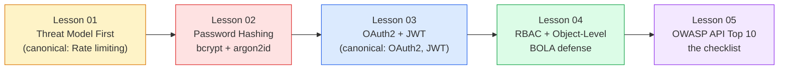

# 11: Authentication and Security

*Where `Boardly` stops being a public scratchpad and starts being a system people trust with their email, their org's data, and the audit trail that says who did what.*

**Hello, friend. Pull up a chair.**

Security is not a feature you bolt on at the end. It is a property of design decisions made early: where the trust boundary sits, what an attacker can reach, what the failure mode is when a token leaks. This section is the one most engineers skip because "we'll do security later" — and it is the one most public breaches come from. We are going to do it right, in order, with a threat model first and crypto second. Take your time. The crypto is the easy part.

#security #authentication #authorization #threat-modeling #moc

## What this section is

A five-lesson walk through authentication and authorization in FastAPI, taught in the only order that makes sense: **threat model first**, then **password storage**, then **token issuance**, then **authorization**, then the **OWASP Top 10** checklist that ties it together. Each lesson continues the `Boardly` app from Section 03 — we add a `User` model, a login endpoint, JWT access + opaque refresh tokens (Engineering Decision D-004), a role/scope authorization layer, and a rate limiter on `/auth/login`. By the end of the section `Boardly` is a real, defensible API — not just one that returns `{"status":"ok"}`.

The five lessons are listed below in the order to read them. Then we cover what we build on, what's outbound, and how to read the section if you are short on time.

The colors are not decoration: yellow is the *thinking* layer (threat model), red is the *storage* layer (passwords), blue is the *transport* layer (tokens), green is the *enforcement* layer (RBAC), and purple is the *audit* layer (OWASP). A breach in any one layer is contained by the layers above and below it.

## Lessons in order

| # | Lesson | Canonical concept | Adds to `Boardly` | Time |
|---|---|---|---|---|
| 01 | [[Threat-Model-First]] | **Rate limiting** | `boardly/security/rate_limit.py` + `Depends(rate_limit(...))` on `/auth/login` | 90 min |
| 02 | [[Password-Hashing]] | — | `boardly/security/passwords.py` (bcrypt cost=12) + `boardly/routers/password.py` (reset flow with TTL + breach response) | 90 min |
| 03 | [[OAuth2-JWT-Access-Refresh]] | **OAuth2**, **JWT** | `boardly/security/jwt.py` (HS256 access, 15 min) + `boardly/security/auth.py` (login, refresh, rotation, reuse detection) + `boardly/routers/auth.py` | 120 min |
| 04 | [[RBAC-and-Object-Level-Auth]] | — | `boardly/security/deps.py` (`get_current_user` → `get_current_active_user` → `require_scope("projects:write")`) + `boardly/services/orgs.py` (object-level check in the service) + `tests/test_rbac.py` | 90 min |
| 05 | [[OWASP-API-Top-10]] | — | (no new code) — the checklist you revisit every quarter; each OWASP category mapped to a `Boardly` anti-example and the fix | 60 min |

**The "canonical" badge**

Lessons marked **canonical** are the **first-taught** home of a concept registered in [[00-Start-Here/Concept-Registry]]. When other lessons (in this section or anywhere in the vault) need to reference `OAuth2`, `JWT`, `Rate limiting`, or `Dependency overrides`, they link back to the canonical lesson instead of re-explaining. If you change the canonical, you change the vocabulary of the whole vault.

## How to read this section

You have three reading paths depending on what you are doing.

**Path A — "I am building auth from scratch."**
Read 01 → 02 → 03 → 04 → 05, in order, typing every code line into your own copy of `Boardly`. This is the way the section was written; it is also the only path that actually teaches you the field. Plan 8 hours of focused time. Take the exercises seriously — the threat-model exercise in Lesson 01 is the one that pays rent for the rest of your career.

**Path B — "I have an app and I just need JWT."**
Skim 01 (read the STRIDE table and the rate-limiter section), skim 02 (read the "Why salts don't save fast hashes" subsection and the breach-response runbook), then read 03 in full. You will be tempted to skip 04 — don't. Most production auth bugs are BOLA, not broken crypto. Read 04 too.

**Path C — "I am doing a quarterly security review."**
Read 01's STRIDE table, 04's "Common Mistakes" section, and 05 in full. That is the cheapest 90 minutes of security work you will do this quarter, and it is the one that catches regressions.

**Tip — If you are short on time, read these three.**

Lesson 01's closing "What We Learned" bullet on JWT's missing security properties (5 min). Lesson 04's "Lines 40–47: `get_org`, the BOLA check" subsection (15 min). Lesson 05 in full (60 min). That is the minimum viable security literacy for a FastAPI engineer.

## What we build on

The auth section is not self-contained. It composes on top of the rest of the vault:

- **`Depends`** from [[03-FastAPI-Core/Dependency-Injection]] — `get_current_user`, `require_scope`, and `rate_limit` are all `Depends`-able callables. The whole enforcement layer is dependency injection.
- **`Annotated[T, Depends(...)]`** — the modern FastAPI 0.95+ form, used everywhere in this section. See [[01-Python-Foundations/Type-Hints-and-Annotations]] for `Annotated` and [[03-FastAPI-Core/Dependency-Injection]] for how it slots into FastAPI.
- **`AsyncSession`** from [[07-SQLAlchemy/05-Session-and-Transaction-Management]] — the user repository and refresh-token table both go through an async session. We assume you can write `select(User).where(User.email == email)` and commit.
- **`BaseModel`** from [[04-Pydantic/BaseModel-and-Validation]] — `UserCreate`, `TokenClaims`, and `UserRead` are all Pydantic v2 models. The 422 validation errors we test in Lesson 04 are Pydantic surfaced.
- **Pydantic `Field` and validators** from [[04-Pydantic/Fields-Annotated-Reusable-Annotations]] and [[04-Pydantic/Validators-Strict-vs-Coercive]] — the password-strength check in Lesson 02 lives in a `field_validator`, before hashing.
- **`Pydantic Settings`** from [[04-Pydantic/Pydantic-Settings]] — `JWT_SECRET`, `ACCESS_TOKEN_TTL`, `BCRYPT_ROUNDS` all live in a `Settings` class driven by environment variables. We never hard-code secrets.
- **`Middleware`** from [[03-FastAPI-Core/Middleware-and-Request-Order]] — a global rate limiter would be middleware; we use a `Depends`-factory instead because we need the parsed body, but the ordering logic (last-added-is-outermost) applies if you mount a global limiter.
- **CORS** from [[02-Web-and-HTTP/CORS-Caching-Headers-Conditional-Requests]] — the trust boundary at the browser. We configure it deliberately in Lesson 05 (API8:2023).
- **Exceptions** from [[01-Python-Foundations/Exceptions-Done-Right]] — the 401/403 translation layer is an exception-to-HTTP mapping. We translate `InvalidToken`, `InsufficientScope`, and `ObjectNotAuthorized` to 401, 403, and 404 respectively.

**Note — What this section does *not* re-teach**

`OAuth2` flows other than the Resource Owner Password Credentials flow (§4.3 of RFC 6749) are out of scope. The Authorization Code flow with PKCE — what you need for third-party clients — is mentioned in Lesson 03 as a "when to use something else" callout, but not implemented. Same for OpenID Connect, SAML, and WebAuthn. We teach the foundations; the variants are reference-library material.

## What's new in 02b-Backend-Foundations

A sibling section is being written in parallel that teaches the **foundations** this section builds on. If those lessons are not yet present when you read this, they will resolve when both agents finish; the wikilinks are stable.

- [[02b-Backend-Foundations/HTTP-Cookies-Deep-Dive]] — the `Set-Cookie` header, `HttpOnly`, `SameSite=Strict`, `Secure`, and the cookie scope rules. Lesson 03 here assumes you understand why a refresh token stored in an `HttpOnly; SameSite=Strict; Secure` cookie is better than one stored in `localStorage`. That lesson is the *why*.
- [[02b-Backend-Foundations/CSRF-Protection]] — the threat model for state-modifying requests from a cross-origin context, and the double-submit cookie / `SameSite=Strict` / custom-header defenses. Lesson 03 references this when it explains why our `/auth/refresh` endpoint requires either a non-simple header or a `SameSite=Strict` cookie, not just any cookie.
- [[02b-Backend-Foundations/Authentication-State-Storage]] — the design space of where to put the session: `localStorage`, `sessionStorage`, `HttpOnly` cookie, or split access-token-in-memory + refresh-in-cookie. Lesson 03 implements the backend half of "access JWT + opaque refresh"; that lesson implements the frontend half. They are designed to compose.

**Danger — Do not ship the cookie patterns in Lesson 03 without reading 02b-Backend-Foundations.**

Lesson 03 teaches the *token issuance* logic. The *cookie storage* logic — `HttpOnly`, `SameSite`, `Secure`, the `__Host-` prefix, the `Path` scoping — is what turns "a refresh token exists" into "a refresh token cannot be stolen by an XSS or a CSRF". Those patterns live in 02b. This section forward-links to them.

## Outbound links

- [[12-Testing-and-Quality/Testing-FastAPI-Endpoints]] — Lesson 04's security tests use `app.dependency_overrides[get_current_user] = _fake` to test authorization without issuing real JWTs. That canonical pattern lives there.
- [[12-Testing-and-Quality/Testing-Database-Logic]] — the `User`, `RefreshToken`, and `PasswordResetToken` tables are tested with the transaction-rollback pattern from there.
- [[13-Performance-and-Observability/Structured-Logging-and-Request-IDs]] — security events (failed login, scope rejection, refresh-token reuse detection) must be logged with the request ID. We log them in Lesson 03's `rotate_refresh` and Lesson 04's `require_scope`.
- [[15-External-Integrations/Webhooks-and-Signature-Verification]] — HMAC signing for inbound webhooks is a sibling concern to JWT signing. Same primitives (`hmac`, `secrets.compare_digest`), different protocol.
- [[16-Deployment-and-DevOps/Docker-Multi-Stage-Non-Root]] — the API8:2023 fix in Lesson 05 is "run as a non-root user in a minimal image". That lesson builds the Dockerfile this section's defense depends on.
- [[21-Reference-Library/Engineering-Decision-Log]] — D-004 ("JWT access + opaque refresh") is the load-bearing auth choice taught in Lesson 03. D-003 ("Alembic is the source of truth, not `Base.metadata.create_all`") affects how we test the user table in Lesson 02.

## The Engineering Decision Log entry you must read

Before Lesson 03, open [[21-Reference-Library/Engineering-Decision-Log]] and read entry D-004. The short version: **access tokens are JWT (stateless, 15-minute TTL, HS256); refresh tokens are opaque random strings stored in a database row (stateful, 30-day TTL, rotatable, revocable)**. We do not use JWT for refresh, because JWT refresh tokens are unrevocable without a `jti` denylist, and a denylist on every refresh undoes the stateless-verification benefit. Lesson 03 teaches this design from scratch; the decision log is the *why* in one paragraph.

## Verified Versions (October 2026)

| Tool | Version | Verified |
|---|---|---|
| FastAPI | 0.148.0 | 2026-10-19 |
| Starlette | 1.9.0 | 2026-10-19 |
| Pydantic | v2.14.1 | 2026-10-19 |
| `bcrypt` (PyPI) | latest (4.x) | 2026-10-19 |
| `argon2-cffi` | latest (23.x) | 2026-10-19 |
| `passlib` | 1.7.4 (unmaintained — see Lesson 02 § "passlib caveats") | 2026-10-19 |
| `pyjwt` | latest (2.10.x) | 2026-10-19 |
| `redis` (asyncio) | latest (5.x) | 2026-10-19 |
| Python | 3.12 / 3.13 | 2026-10-19 |

If a version above has a "latest" entry and you are reading this in 2027 or later, verify against the canonical URLs in each lesson's `Sources` section. We cite the official docs, not the package version you happen to have installed.

## What's next

Start with [[Threat-Model-First]]. It is the lesson that makes every other lesson in this section make sense — because security without a threat model is just features that happen to use cryptography.

---

**Tags:** #moc #security #authentication #authorization #threat-modeling #index #home
**Previous:** [[03-FastAPI-Core/Background-Tasks-Streaming-Uploads]] (the last lesson before auth in the curriculum)
**Start:** [[Threat-Model-First]] →
