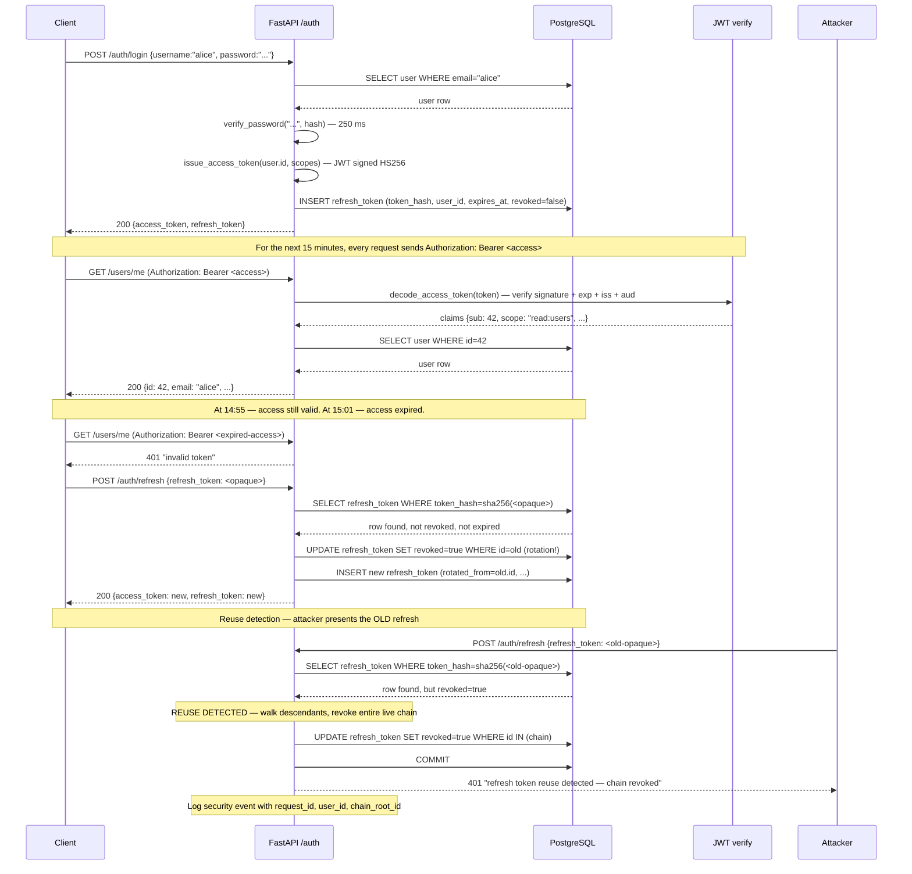
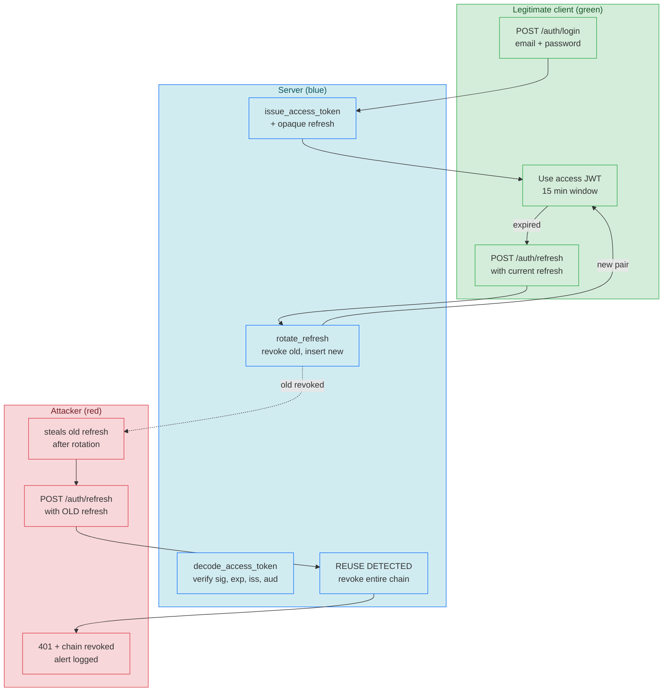

# Lesson 03: OAuth2, JWT, Access and Refresh Tokens

*Where `Boardly` gets a login endpoint, an access token, a refresh token, and the rotation that makes a leaked refresh token useful for at most one request.*

**This is the canonical home for `OAuth2` and `JWT`.**

The asset is credentials: refresh tokens. The threat is a leaked refresh token, used before the legitimate client refreshes. The defense is rotation + reuse detection — every refresh issues a new token and revokes the old one; if a revoked token is presented again, the chain is compromised and the whole chain is revoked. That triple is the framing for the rest of this lesson.

Authentication on the web is three problems at once: how a client proves who it is, how the server stays stateless (or doesn't), and how a leaked credential gets revoked. The combination you pick determines how your system behaves under breach, how it scales, and what happens when the user clicks "log out everywhere". This lesson builds the OAuth2 password flow with JWT access tokens and opaque refresh tokens — the combination that gives you stateless verification, cheap revocation, and rotation, without the unfixable weaknesses of pure-JWT or pure-opaque designs.


#security #authentication #oauth2 #jwt #canonical

## Learning Objectives

By the end of this lesson you will be able to:

1. **Implement the OAuth2 password flow** with `OAuth2PasswordBearer` and `OAuth2PasswordRequestForm`.
2. **Decode and verify a JWT**, including the `alg`, `exp`, `iss`, `aud`, `sub`, `iat`, `jti` claims — and explain why each is mandatory.
3. **Choose between HS256 and RS256** and know when each is wrong.
4. **Implement short-lived access tokens (15 min)** and **opaque, stored, rotatable refresh tokens (30 days)**, per Engineering Decision D-004.
5. **Implement refresh-token rotation** with **reuse detection** — if a rotated token is presented again, the chain is compromised and every token in it is revoked.
6. **Pin the JWT algorithm** (`algorithms=["HS256"]`) to defend against `alg: none` and algorithm-confusion attacks.
7. **Explain why JWT is not magic**: no revocation without a denylist, no authorization, size matters, key rotation has propagation delay, algorithm downgrade is a real attack.

## Prerequisites

Before starting, you need:

- **Pydantic `BaseModel`** — [[04-Pydantic/BaseModel-and-Validation]]. `TokenClaims` is a `BaseModel` so we can `.model_validate` the JWT payload and get type-checked claims.
- **Pydantic Settings** — [[04-Pydantic/Pydantic-Settings]]. `JWT_SECRET`, `JWT_ISS`, `JWT_AUD`, `ACCESS_TOKEN_TTL`, `REFRESH_TOKEN_TTL` all live in a `Settings` class.
- **`Depends`** — [[03-FastAPI-Core/Dependency-Injection]]. `get_current_user` is the canonical `Depends`-able callable that everything else layers on (see Lesson 04).
- **Password hashing** — [[Password-Hashing]]. `verify_password` from Lesson 02 is reused here. The login flow calls it; we do not re-explain it.
- **The threat model** — [[Threat-Model-First]]. The asset/threat/defense triple for refresh tokens is stated in the opening callout above. Lesson 01 is also the canonical home for `rate_limit` (the Redis-backed `Depends` factory), which this lesson wires onto `/auth/login` and `/auth/refresh` to defend against credential-stuffing and refresh-rotation-abuse respectively.

**The single most common gap: "I'll just use JWT for everything".**

If you issue a single long-lived JWT (e.g. 30 days), you have two problems: (1) it cannot be revoked without a denylist (Redis-backed `jti` denylist, checked on every request — undoing JWT's whole stateless-verification value); (2) if it leaks, it is useful for 30 days. The fix is *not* "make the JWT short" alone — a 5-minute JWT means the user has to log in every 5 minutes. The fix is **two tokens**: a short-lived JWT for stateless verification (no DB read), plus an opaque, stored, rotatable refresh token (one DB read on refresh, which happens every 15 min, not on every request). That is D-004.


**Which OAuth2 flow when?**

This lesson teaches the **Resource Owner Password Credentials (ROPC)** flow — the client posts `{username, password}` to `/auth/login`, gets `{access_token, refresh_token}`. ROPC is the simplest flow, and the right one for first-party backends where you control the client. **ROPC is deprecated in OAuth 2.1** because it exposes the user's password to the client; do not use it for third-party clients.

The full OAuth2 flow menu, with the "when to use which" rule:

| Flow | When to use | When to avoid |
|---|---|---|
| **ROPC** (this lesson) | First-party backends with trusted clients; e.g. `Boardly`'s own SPA talking to `Boardly`'s own API | Third-party clients; OAuth 2.1 (deprecated); any client where you don't control the secret store |
| **Authorization Code (with PKCE)** | SPAs and mobile/desktop apps where you cannot safely store a client secret; the user is redirected through the provider's login UI | Confidential server-side clients where the secret can be stored; m2m service-to-service |
| **Authorization Code (without PKCE)** | Confidential server-side web apps (Django/Flask/FastAPI-with-server-rendered views) where a `client_secret` can be stored server-side | Any public client (SPA, mobile, desktop) — must use PKCE to defend the code-interception attack |
| **Client Credentials** | Service-to-service, machine-to-machine. No user involvement. e.g. `Boardly`'s billing worker calling Stripe's API as itself. | Any flow where a user is involved; you'd lose the user context entirely |

ROPC and Client Credentials are the "simple" flows (no redirect dance, no PKCE). Authorization Code is the "real" flow for user-facing apps where the client is untrusted. We teach ROPC here because it lets us focus on the JWT + refresh mechanics; for a full Authorization Code + PKCE implementation, see [[18-Portfolio-Projects/06-RealTime-Collaboration-Notifications|Project 06 — Real-Time Collaboration & Notifications]] (which integrates with an external OAuth2 provider using Auth Code + PKCE).


## The Problem

`Boardly` now has a `User` table with real password hashes (Lesson 02). The next step: when a user submits `POST /auth/login` with email and password, we verify the password and issue a credential that says "this is Alice, until 14:30 UTC". The credential has to be:

1. **Stateless to verify** — every request should not hit the DB to confirm the token is valid. Otherwise, the auth check is the hot path's bottleneck.
2. **Cheap to revoke** — when Alice clicks "log out everywhere" (or the breach-response runbook runs), every existing credential must die.
3. **Bounded in time** — if it leaks, the window of usefulness is small.
4. **Rotatable** — a leaked refresh token should be useful for at most one request, because the legitimate client's next refresh reveals the theft.

These four requirements are mutually contradictory if you pick one token type. A pure JWT solves (1) and (3) (with a short TTL) but breaks (2) (no revocation without a denylist). A pure opaque token solves (2) and (4) but breaks (1) (every request is a DB read). The D-004 design — **JWT access + opaque refresh** — solves all four by using each token for what it is good at.

Why does "cheap to revoke" appear in the same breath as "stateless to verify"? The stateless-verification property of JWT (no DB lookup at decode time) and the cheap-revocation property of opaque tokens (one `UPDATE` to revoke) are mutually exclusive *for a single credential*: stateless means "we cannot check anything", which means "we cannot check revocation either". The D-004 design splits the credential into two halves — the access half is stateless and short-lived (so we accept that we cannot revoke it, because it dies on its own); the refresh half is stateful and long-lived (so we can revoke it, because we hit the DB on refresh anyway). The two tokens are not "two of the same thing"; they are two *different* credentials for two *different* threat models, designed to share a single user-id binding.

**Note — Engineering Decision D-004**

The full D-004 entry lives in [[21-Reference-Library/Engineering-Decision-Log]]. The short version: **access tokens are JWT (stateless, 15-minute TTL, HS256); refresh tokens are opaque random strings stored in a database row (stateful, 30-day TTL, rotatable, revocable)**. We do not use JWT for refresh, because JWT refresh tokens are unrevocable without a `jti` denylist, and a denylist on every refresh undoes the stateless-verification benefit.


## The Senior Engineer's Mental Model

Before the code, one frame of mind. Don't think of a JWT as "a token." Think of it as a **bearer credential** — whoever holds it can act as the user, with no server-side session to revoke. The senior engineer's question, on every line of auth code, is always: *if this token is stolen, how quickly can I invalidate it?* If the answer is "I can't — it's valid until expiry," your access-token TTL must be SHORT (15 minutes, not 30 days). If the answer is "I can't, but the user is inconvenienced for only one refresh cycle," that credential must be a REVOCABLE refresh token — stored server-side, not stateless. These two answers, taken together, are the design property the rest of this lesson implements. They are not properties of "JWT" as a library feature; they are properties of the D-004 design — JWT access + opaque refresh — that uses each token for what it is good at.

Notice the symmetry of the threat models. The access token defends against the **interceptor** — an attacker who reads the wire, the log file, or the `localStorage` slot once, then tries to act as the user for as long as the token lives. The refresh token defends against the **thief** — an attacker who has the credential persistently (a leaked DB dump, a stolen cookie jar, an exfiltrated secrets file) and would otherwise act as the user for the full 30-day TTL. The access token's defense is **short TTL** — it dies on its own, no revocation needed. The refresh token's defense is **rotation + reuse detection** — the next refresh invalidates the stolen credential, and the next presentation of the now-invalid credential is the signal that theft occurred. The two tokens defend different attackers with different mechanisms; that is the point of having two.

The senior engineer's reflex, on every line of code in this lesson, is to ask: *which attacker does this line stop, and what would change in the breach window if this line were absent?* If the answer is "nothing changes," the line is decorative; if the answer is "the breach window extends," the line is load-bearing. The code that follows is mostly load-bearing. The decoration — comments, type hints, the `BaseModel` — is for the next engineer who reads it, not for the attacker.

## The Code

Here is the complete `boardly/security/jwt.py` we will write. It is the token issuance and verification primitives.

```python
# boardly/security/jwt.py
"""JWT issuance and verification for Boardly access tokens.

Lesson 11.03: HS256 (single-service), pinned algorithm, full claim set
(sub, exp, iat, iss, aud, jti, scope). Refresh tokens are NOT JWT —
they are opaque (see boardly/security/auth.py).
"""
import secrets
from datetime import datetime, timedelta, timezone
from typing import Any

import jwt
from pydantic import BaseModel

from boardly.config import Settings

settings = Settings()


class TokenClaims(BaseModel):
 """The claim set we issue and verify. Mirrors the JWT payload."""
 sub: str # subject — user id, as a string (JWT spec requires string)
 exp: int # expiration time — unix timestamp, seconds
 iat: int # issued at — unix timestamp, seconds
 iss: str # issuer — our service identifier (e.g. "boardly")
 aud: str # audience — the intended recipient (e.g. "boardly-api")
 jti: str # JWT ID — unique per token; the denylist key for revocation
 scope: str = "" # space-separated scopes, e.g. "read:users write:users"


def issue_access_token(user_id: int | str, scopes: list[str]) -> str:
 """Issue a short-lived JWT access token (15 min by default)."""
 now = datetime.now(timezone.utc)
 claims: dict[str, Any] = {
 "sub": str(user_id), # spec requires string
 "iat": int(now.timestamp()),
 "exp": int((now + settings.access_token_ttl).timestamp()), # timedelta(minutes=15)
 "iss": settings.jwt_iss, # "boardly"
 "aud": settings.jwt_aud, # "boardly-api"
 "jti": secrets.token_urlsafe(16), # 128 bits — enough for uniqueness
 "scope": " ".join(scopes),
 }
 return jwt.encode(claims, settings.jwt_secret, algorithm="HS256")


def decode_access_token(token: str) -> TokenClaims:
 """Verify and decode a JWT access token.

 Raises on any failure: wrong signature, expired, wrong iss/aud,
 missing claims, algorithm mismatch.
 """
 payload = jwt.decode(
 token,
 settings.jwt_secret,
 algorithms=["HS256"], # PINNED — see Common Mistake #1
 issuer=settings.jwt_iss,
 audience=settings.jwt_aud,
 options={"require": ["exp", "iat", "iss", "aud", "sub", "jti"]},
 )
 return TokenClaims.model_validate(payload)
```

And here is the full auth flow in `boardly/security/auth.py` — login, refresh, rotation, reuse detection, `get_current_user`. Read both files; we dissect every line after.

```python
# boardly/security/auth.py
"""OAuth2 password flow + JWT access + opaque refresh, with rotation.

Lesson 11.03: implements D-004. The refresh token is a 43-char
`secrets.token_urlsafe(32)` string, stored hashed (SHA-256 — threat
model is DB-read, 256 bits of entropy is unbruteforceable).
"""
import secrets
from datetime import datetime, timedelta, timezone

from fastapi import Depends, HTTPException, status
from fastapi.security import OAuth2PasswordBearer
import jwt
from pydantic import ValidationError
from sqlalchemy import select
from sqlalchemy.ext.asyncio import AsyncSession

from boardly.config import Settings
from boardly.db import get_session
from boardly.models import RefreshToken, User
from boardly.security.jwt import decode_access_token, issue_access_token
from boardly.security.passwords import verify_password

settings = Settings()
oauth2_scheme = OAuth2PasswordBearer(tokenUrl="/auth/login", auto_error=True)


async def authenticate_user(
 session: AsyncSession, email: str, password: str
) -> User | None:
 """Verify email+password. Returns None on any failure.

 Runs a dummy bcrypt verify when the user is not found, to equalize
 response time and defeat user enumeration by timing.
 """
 user = await session.scalar(select(User).where(User.email == email))
 if not user:
 # Dummy verify — same ~250 ms cost as a real verify.
 verify_password(password, "$2b$12$" + "x" * 53)
 return None
 if not verify_password(password, user.password_hash):
 return None
 return user


async def issue_token_pair(
 session: AsyncSession, user: User, scopes: list[str]
) -> dict:
 """Issue an access JWT + an opaque refresh token. Stores the refresh."""
 access = issue_access_token(user.id, scopes)

 # Refresh token: 256 bits of CSPRNG entropy, base64url-encoded.
 refresh_plaintext = secrets.token_urlsafe(32)
 from hashlib import sha256
 refresh_hash = sha256(refresh_plaintext.encode()).hexdigest()

 rt = RefreshToken(
 token_hash=refresh_hash,
 user_id=user.id,
 expires_at=datetime.now(timezone.utc) + settings.refresh_token_ttl,
 revoked=False,
 rotated_from=None,
 )
 session.add(rt)
 await session.commit()

 return {
 "access_token": access,
 "token_type": "bearer",
 "refresh_token": refresh_plaintext, # return plaintext; store hash
 }


async def rotate_refresh(session: AsyncSession, refresh_plaintext: str) -> dict:
 """Exchange a refresh token for a new access + new refresh.

 Rotation: old → revoked, new → inserted with rotated_from=old.id.
 Reuse detection: if the presented token is already revoked, the
 chain is compromised — revoke the entire chain.
 """
 from hashlib import sha256
 refresh_hash = sha256(refresh_plaintext.encode()).hexdigest()

 rt = await session.scalar(
 select(RefreshToken)
 .where(RefreshToken.token_hash == refresh_hash)
 .with_for_update() # row lock — serializes concurrent refreshes of the same token
 )
 now = datetime.now(timezone.utc)

 # REUSE DETECTION: if the presented token is already revoked, the
 # chain is compromised. The legitimate client always presents the
 # newest token in the chain. An already-rotated token presented
 # again means someone else has it too.
 if not rt or rt.expires_at < now:
 raise HTTPException(status.HTTP_401_UNAUTHORIZED, "invalid refresh token")

 if rt.revoked:
 # Compromise detected. Walk DOWN (descendants): the live token
 # is a child of the presented (already-revoked) one, since rotation
 # sets new.rotated_from = old.id, so a child's rotated_from points
 # back at us. Walking rotated_from would walk UP to ancestors
 # (already revoked by construction) and miss the live descendant —
 # the attacker would keep access. (In production, use the recursive
 # CTE in the danger callout below.)
 current = rt
 while current is not None:
 current.revoked = True
 current = await session.scalar(
 select(RefreshToken).where(RefreshToken.rotated_from == current.id)
 )
 await session.commit()
 # Alert: this is a probable compromise. Log it with the request ID.
 raise HTTPException(
 status.HTTP_401_UNAUTHORIZED,
 "refresh token reuse detected — chain revoked",
 )

 user = await session.scalar(select(User).where(User.id == rt.user_id))
 if not user:
 raise HTTPException(status.HTTP_401_UNAUTHORIZED, "invalid refresh token")

 # Rotation: revoke old, insert new with rotated_from=old.id
 rt.revoked = True
 new_plaintext = secrets.token_urlsafe(32)
 new_hash = sha256(new_plaintext.encode()).hexdigest()
 session.add(RefreshToken(
 token_hash=new_hash,
 user_id=user.id,
 expires_at=now + settings.refresh_token_ttl,
 revoked=False,
 rotated_from=rt.id,
 ))
 await session.commit()

 access = issue_access_token(user.id, user.scopes_list())
 return {
 "access_token": access,
 "token_type": "bearer",
 "refresh_token": new_plaintext,
 }


async def get_current_user(
 token: str = Depends(oauth2_scheme),
 session: AsyncSession = Depends(get_session),
) -> User:
 """The canonical auth dependency. Decodes the JWT, loads the user.

 Used by every protected route, directly or via `require_scope` (Lesson 04).
 """
 try:
 claims = decode_access_token(token)
 # `sub` is a string in the JWT spec; we cast to int for the DB lookup.
 # A malformed `sub` (e.g. `"abc"`) raises ValueError — narrow, not broad.
 user_id = int(claims.sub)
 except (jwt.PyJWTError, ValidationError, ValueError):
 raise HTTPException(status.HTTP_401_UNAUTHORIZED, "invalid token")
 user = await session.scalar(select(User).where(User.id == user_id))
 if not user:
 raise HTTPException(status.HTTP_401_UNAUTHORIZED, "invalid token")
 return user
```

And here is `boardly/routers/auth.py` — the routes.

```python
# boardly/routers/auth.py
"""POST /auth/login + POST /auth/refresh.

Both routes are rate-limited via Lesson 01's `rate_limit` Depends-factory:
- `/auth/login`  is per-IP+username (defends against credential stuffing).
- `/auth/refresh` is per-IP         (defends against refresh-rotation abuse).
"""
from fastapi import APIRouter, Depends, HTTPException, Request, status
from fastapi.security import OAuth2PasswordRequestForm
from pydantic import BaseModel, Field
from sqlalchemy.ext.asyncio import AsyncSession

from boardly.db import get_session
from boardly.models import User
from boardly.security.auth import (
 authenticate_user,
 issue_token_pair,
 rotate_refresh,
)
from boardly.security.rate_limit import rate_limit

router = APIRouter(prefix="/auth", tags=["auth"])


def _key_by_username_or_ip(request: Request) -> str:
 """Per-username + per-IP composite key for /auth/login.

 The credential-stuffing threat: a botnet with 10 000 IPs spraying
 one password at `alice@example.com`. Per-IP alone lets each botnet IP
 get N attempts (10 000 × N total); per-username caps the targeted
 email at N attempts regardless of how many IPs point at it. The
 composite ip+username bucket also bounds the per-attacker cost:
 one IP, one username, N attempts — then 429.

 `request.state.username` is stashed by a small body-peeking
 middleware (the same one Lesson 01's `_key_by_email` reads as
 `request.state.email`). The OAuth2PasswordRequestForm is form-encoded;
 FastAPI parses it inside the route, not in the limiter, so the
 limiter peeks `request.state` instead of awaiting `form.username`.
 """
 username = getattr(request.state, "username", None)
 ip = request.client.host if request.client else "unknown"
 return f"{username or 'anon'}:{ip}" if username else ip


class RefreshRequest(BaseModel):
 """Body for POST /auth/refresh — refresh token in a JSON body,
 not a URL query param (the query-param form is logged in URLs)."""
 refresh_token: str = Field(min_length=20)


@router.post(
 "/login",
 dependencies=[Depends(rate_limit(10, 60, _key_by_username_or_ip))],
)
async def login(
 form: OAuth2PasswordRequestForm = Depends(),
 session: AsyncSession = Depends(get_session),
) -> dict:
 user = await authenticate_user(session, form.username, form.password)
 if not user:
 raise HTTPException(
 status.HTTP_401_UNAUTHORIZED,
 "invalid credentials",
 headers={"WWW-Authenticate": "Bearer"},
 )
 return await issue_token_pair(session, user, user.scopes_list())


@router.post(
 "/refresh",
 dependencies=[Depends(rate_limit(20, 60))], # per-IP default key
)
async def refresh(
 body: RefreshRequest,
 session: AsyncSession = Depends(get_session),
) -> dict:
 return await rotate_refresh(session, body.refresh_token)
```

That is ~240 lines of code. Read it twice. Then read the dissection below — every line gets a *what* / *why* / *what-Python-or-the-framework-does-internally*.

## Line-by-Line Deep Dive

### Lines 1–10 of `jwt.py`: Docstring, imports

```python
"""JWT issuance and verification for Boardly access tokens.

Lesson 11.03: HS256 (single-service), pinned algorithm, full claim set
(sub, exp, iat, iss, aud, jti, scope). Refresh tokens are NOT JWT —
they are opaque (see boardly/security/auth.py).
"""
import secrets
from datetime import datetime, timedelta, timezone
from typing import Any

import jwt
from pydantic import BaseModel

from boardly.config import Settings
```

**What it does:** Pulls in `secrets` (CSPRNG), `datetime` and `timedelta` (TTL arithmetic), `Any` (typing for the claims dict), `jwt` (PyJWT — the canonical Python JWT library), `BaseModel` (Pydantic), and the app's `Settings`.

**Why `jwt` (PyJWT) and not `python-jose`:** Both are fine. PyJWT is more popular and simpler, supports HS256/RS256/EdDSA/ES256, and is well-maintained. `python-jose` supports more algorithms (JWE encryption, JWS) but adds complexity. Pick PyJWT unless you need JWE — most services do not.

**Why `from typing import Any`:** The `claims` dict we build has heterogeneous value types — strings, ints, lists. We annotate it `dict[str, Any]` to be honest. Python 3.12+ supports the lowercase `dict[str, Any]` form; no need for `Dict` from `typing`.

### Lines 18–26: `TokenClaims`

```python
class TokenClaims(BaseModel):
 """The claim set we issue and verify. Mirrors the JWT payload."""
 sub: str # subject — user id, as a string (JWT spec requires string)
 exp: int # expiration time — unix timestamp, seconds
 iat: int # issued at — unix timestamp, seconds
 iss: str # issuer — our service identifier (e.g. "boardly")
 aud: str # audience — the intended recipient (e.g. "boardly-api")
 jti: str # JWT ID — unique per token; the denylist key for revocation
 scope: str = "" # space-separated scopes, e.g. "read:users write:users"
```

**What it does:** Defines a Pydantic model that mirrors the JWT payload. The model gives us type-checked claims at decode time — `TokenClaims.model_validate(payload)` raises `ValidationError` if a claim is missing or wrong-typed.

**Why each claim is mandatory:**

| Claim | Meaning | Why we require it |
|---|---|---|
| `sub` | Subject (user id) | The identity the token represents. Use a stable internal id, not email — email can change. |
| `exp` | Expiration time | Mandatory. Reject tokens past `exp` (PyJWT does this for us). |
| `iat` | Issued at | For audit and rotation policies — "tokens issued before timestamp X are suspect". |
| `iss` | Issuer | Our service's identifier. Reject tokens whose `iss` is not ours — defends against tokens minted by another service using the same key (in multi-service HS256). |
| `aud` | Audience | The intended recipient. A token minted for the billing service should not be accepted by the notifications service. |
| `jti` | JWT ID | Unique per token. The denylist key for revocation (if we ever need to revoke a single access token before `exp`). |
| `scope` | Scopes | Space-separated scope strings (`read:users write:users`). Lesson 04's `require_scope` reads this. |

**Why `sub` is a string, not an int**

The JWT spec (RFC 7519 §4.1.2) says `sub` MUST be a string. Our DB stores user id as an int (`User.id`), so we cast at issuance: `"sub": str(user_id)`. At decode, we parse it back: `int(claims.sub)` in `get_current_user`. The cast is the price of spec compliance.


### Lines 29–43: `issue_access_token`

```python
def issue_access_token(user_id: int | str, scopes: list[str]) -> str:
 """Issue a short-lived JWT access token (15 min by default)."""
 now = datetime.now(timezone.utc)
 claims: dict[str, Any] = {
 "sub": str(user_id),
 "iat": int(now.timestamp()),
 "exp": int((now + settings.access_token_ttl).timestamp()),
 "iss": settings.jwt_iss,
 "aud": settings.jwt_aud,
 "jti": secrets.token_urlsafe(16),
 "scope": " ".join(scopes),
 }
 return jwt.encode(claims, settings.jwt_secret, algorithm="HS256")
```

**What it does:** Builds the claims dict, signs it with HS256, returns the encoded JWT string (`header.payload.signature`).

**Why each line:**

- `datetime.now(timezone.utc)` — current time in UTC, timezone-aware. Always use UTC for tokens; a token issued at "14:30 local" is ambiguous (which timezone?).
- `int(now.timestamp())` — POSIX timestamp, integer seconds. JWT `exp` and `iat` are numeric, not ISO strings. PyJWT accepts `datetime` objects too, but explicit ints are clearer.
- `now + settings.access_token_ttl` — `timedelta(minutes=15)` by default. The TTL lives in settings, not in code — bumping it to 30 min is an env var change, not a deploy.
- `secrets.token_urlsafe(16)` — 128 bits of entropy for `jti`. 128 bits is enough for global uniqueness — collision probability is negligible (10³⁸ possible values).
- `" ".join(scopes)` — RFC 6749 §3.3 specifies space-separated scope strings. The client sends `scope: "read:users write:users"`; we parse with `.split()` at decode.
- `jwt.encode(claims, settings.jwt_secret, algorithm="HS256")` — HS256 means HMAC-SHA-256 with a shared secret. The secret is on the issuer and the verifier (both us, in this single-service design). The encoded JWT is three base64url strings joined by `.`.

**Student asks: Why is `secrets.token_urlsafe(16)` (128 bits) enough for `jti` uniqueness when Lesson 02's reset tokens use `secrets.token_urlsafe(32)` (256 bits)?**

Different threat models demand different entropies. A `jti` is a *collision-avoidance* identifier — its only job is "no two access tokens from this issuer ever share a `jti`". For collision avoidance, 128 bits is comfortable even at JWT's extreme issuance rates: at 1 MM tokens/sec sustained for a century, you'd issue ~3 × 10¹⁵ tokens, and the birthday-bound collision probability at 128 bits is ~10⁻¹⁸ — effectively zero. A reset token (or a refresh token, here in `issue_token_pair`) is a *credential* — its job is "an attacker who has the hash cannot brute-force the plaintext before the TTL". For a credential, the entropy budget must exceed the attacker's compute budget for the lifetime of the token. 256 bits gives a ~10⁵⁸ headroom over any conceivable brute-force budget for a 30-day window — that is the difference between "negligible collision" and "no path to recovery". The two numbers feel close (16 vs 32 bytes) but they defend against different things: `jti` defends against *your own future tokens colliding* (a self-inflicted bug), the refresh-token entropy defends against *an external attacker recovering the plaintext* (an adversarial brute force). One is a uniqueness guarantee, the other is a one-way-function pre-image resistance guarantee — the latter needs more bits because the attacker chooses the inputs.


**What the JWT looks like**

`eyJhbGciOiJIUzI1NiIsInR5cCI6IkpXVCJ9.eyJzdWIiOiIxMjM0NSIsImV4cCI6MTcwMDAwMDAwMH0.signature`
- **Header** (`eyJhbGci...`): `{"alg": "HS256", "typ": "JWT"}`.
- **Payload** (`eyJzdWIi...`): `{"sub": "12345", "exp": 1700000000}`.
- **Signature** (`signature`): `HMAC-SHA-256(header + "." + payload, key)`.
The header and payload are base64url, *not encrypted*. Anyone with the token can read the payload. JWT's security property is *integrity* (the signature prevents tampering), not *confidentiality* (the payload is plain base64). Never put PII in a JWT.


**Danger — How an attacker thinks**

An attacker who intercepts a JWT does not need to break the signature to learn from it — base64 is not encryption. Their first move is to paste the token into `jwt.io` (or the local equivalent: `python -c "import jwt; print(jwt.decode(token, options={'verify_signature': False}))"`), read every claim, and ask three questions: (1) **who is this user?** — `sub` gives the internal id, useful for pivoting to other endpoints that accept the id as a path parameter; (2) **what can they do?** — `scope` reveals the privilege set, useful for targeting high-value routes instead of probing blindly; (3) **when does this token die, and who minted it?** — `exp`, `iss`, and `aud` reveal the service topology and the leak window. The senior engineer's defense is never to put data in the JWT that the holder does not need *to be the holder*. The JWT is an *assertion of identity* and nothing else — not a secure container, not a session, not a profile. If you would not print it on a paper badge clipped to the user's shirt in a public lobby, do not put it in a JWT. The signature protects *integrity* (the attacker cannot change `sub` from `42` to `1`); it does not protect *confidentiality* (the attacker can read `sub: 42` freely). Those are different properties; conflating them is the most common JWT mistake in the field.


### Lines 46–58: `decode_access_token`

```python
def decode_access_token(token: str) -> TokenClaims:
 """Verify and decode a JWT access token."""
 payload = jwt.decode(
 token,
 settings.jwt_secret,
 algorithms=["HS256"],
 issuer=settings.jwt_iss,
 audience=settings.jwt_aud,
 options={"require": ["exp", "iat", "iss", "aud", "sub", "jti"]},
 )
 return TokenClaims.model_validate(payload)
```

**What it does:** Verifies the signature, checks `exp` (rejects past expiry), checks `iss` and `aud` (rejects tokens from other issuers or for other audiences), and requires all six mandatory claims to be present. Returns the parsed payload as a `TokenClaims` model.

**Why each argument:**

- `algorithms=["HS256"]` — **pinned to one algorithm**. The most critical line in this file. See "Common Mistake #1" below.
- `issuer=settings.jwt_iss` — PyJWT compares the `iss` claim to this string; mismatch raises `InvalidIssuerError`. Defends against tokens minted by another service using the same secret.
- `audience=settings.jwt_aud` — PyJWT compares the `aud` claim to this string; mismatch raises `InvalidAudienceError`. A token minted for "boardly-api" is not accepted by a hypothetical "boardly-billing" service that shares the secret.
- `options={"require": [...]}` — requires all six claims to be present. Without this, PyJWT accepts tokens that omit `iss`/`aud`/`jti` — useful during migration but a footgun for new projects.

**Danger — Always pin the algorithm.**

If you let `jwt.decode` accept any algorithm (`algorithms=None` or `algorithms=["none", "HS256", "RS256", ...]`), an attacker who finds your RS256 public key (which is, by definition, public — that is the point of RS256) can submit a token signed with **HS256 using the public key as the HMAC secret**. The library sees `alg: HS256`, treats the public key as the HMAC secret, verifies successfully. This is the classic `alg: none` / algorithm-confusion attack. **Always pass `algorithms=["<the one algorithm you use>"]`.**


**Danger — How an attacker thinks**

The algorithm-confusion attack is the #1 JWT vulnerability, and the attacker's recipe is mechanical. Step 1: obtain your RS256 public key — it is, by definition, public, served at `/.well-known/jwks.json` or in your documentation; if you have ever published it for a third-party verifier, it is in the Internet Archive forever. Step 2: decode the JWT header, replace `"alg": "RS256"` with `"alg": "HS256"`, and re-sign the modified payload using the public key *as the HMAC secret* (the attacker has the public key; they do not need the private key). Step 3: submit the forged token to your verifier. If your verifier accepts `algorithms=["HS256", "RS256"]` (or `algorithms=None`, or `algorithms=["none", ...]`), it sees `alg: HS256`, treats the public key as the HMAC secret, and the signature verifies — because the attacker did know the public key. The senior engineer's defense is one line: `algorithms=["RS256"]` *or* `algorithms=["HS256"]`, never both, never `None`, never `"none"`. Pinning one algorithm is the JWT equivalent of `verify=True` in TLS — there is no good reason to ever turn it off, and the moment you do, the attacker has a working exploit. PyJWT 2.10+ rejects `algorithms=None` with `InvalidAlgorithmError`, but the *multi-algorithm* list (e.g. `["HS256", "RS256"]`) is still legal in the API — the library cannot tell that *you* did not mean to accept both. The defense is yours to write; the library does not save you from yourself.


### Lines 1–17 of `auth.py`: Imports and the OAuth2 scheme

```python
import secrets
from datetime import datetime, timedelta, timezone

from fastapi import Depends, HTTPException, status
from fastapi.security import OAuth2PasswordBearer
import jwt
from pydantic import ValidationError
from sqlalchemy import select
from sqlalchemy.ext.asyncio import AsyncSession

from boardly.config import Settings
from boardly.db import get_session
from boardly.models import RefreshToken, User
from boardly.security.jwt import decode_access_token, issue_access_token
from boardly.security.passwords import verify_password

settings = Settings()
oauth2_scheme = OAuth2PasswordBearer(tokenUrl="/auth/login", auto_error=True)
```

**What it does:** Pulls in `secrets`, datetime types, FastAPI bits, SQLAlchemy bits, the app's `Settings`, the DB session dependency, the `User` and `RefreshToken` models, and Lesson 02's `verify_password` plus Lesson 03's `issue_access_token` / `decode_access_token`.

**Why `OAuth2PasswordBearer`:** This is FastAPI's helper for the OAuth2 password flow. It:

1. Documents the flow in the OpenAPI schema (the `/docs` Swagger UI gets an "Authorize" button that submits `username`/`password`).
2. Reads the `Authorization: Bearer <token>` header on protected routes.
3. Returns the token as a string to the dependency.

`tokenUrl="/auth/login"` is the URL the Swagger UI's Authorize button POSTs to. It does not have to match the actual login endpoint name — but if it doesn't, the "Authorize" button in `/docs` won't work. Match it.

`auto_error=True` means the scheme raises 401 if the `Authorization` header is missing. Set to `False` if you want a route to be optionally-authenticated (e.g. "show public data, or more data if authenticated"). Lesson 04 covers this pattern.

### Lines 20–32: `authenticate_user`

```python
async def authenticate_user(
 session: AsyncSession, email: str, password: str
) -> User | None:
 """Verify email+password. Returns None on any failure."""
 user = await session.scalar(select(User).where(User.email == email))
 if not user:
 # Dummy verify — same ~250 ms cost as a real verify.
 verify_password(password, "$2b$12$" + "x" * 53)
 return None
 if not verify_password(password, user.password_hash):
 return None
 return user
```

**What it does:** Looks up the user by email; if found, verifies the password; returns the `User` on success, `None` on any failure.

**Why the dummy verify when the user is not found:** Defeat user enumeration by timing. Without the dummy, "user not found" returns in ~1 ms (just the SELECT); "wrong password" returns in ~250 ms (SELECT + bcrypt). An attacker measuring response time can distinguish the two — and learns which emails have accounts. The dummy verify equalizes both paths to ~250 ms.

**Tip — Why `"$2b$12$" + "x" * 53`**

That is a syntactically-valid but content-nonsensical bcrypt hash string. The format is `$2b$<cost>$<22-char-salt><31-char-hash>` — total 53 chars after the `$2b$12$`. We pass `"x" * 53` for the salt+hash portion, which `bcrypt.checkpw` will parse and run a real bcrypt verify against (which fails — the password does not match the dummy hash). The work is the same ~250 ms as a real verify. The user is not found, so the function returns `None` — but the response time is identical to "user found, wrong password".


### Lines 35–56: `issue_token_pair`

```python
async def issue_token_pair(
 session: AsyncSession, user: User, scopes: list[str]
) -> dict:
 """Issue an access JWT + an opaque refresh token. Stores the refresh."""
 access = issue_access_token(user.id, scopes)

 refresh_plaintext = secrets.token_urlsafe(32)
 from hashlib import sha256
 refresh_hash = sha256(refresh_plaintext.encode()).hexdigest()

 rt = RefreshToken(
 token_hash=refresh_hash,
 user_id=user.id,
 expires_at=datetime.now(timezone.utc) + settings.refresh_token_ttl,
 revoked=False,
 rotated_from=None,
 )
 session.add(rt)
 await session.commit()

 return {
 "access_token": access,
 "token_type": "bearer",
 "refresh_token": refresh_plaintext,
 }
```

**What it does:** Issues an access JWT (stateless, 15 min) and an opaque refresh token (stored hashed, 30 days). Returns both in the response.

**Why two tokens:**

- **Access JWT** is short-lived (15 min). Stateless verification — no DB read on every request. The trade-off: it cannot be revoked without a denylist. We mitigate by keeping it short. (See D-004.)
- **Opaque refresh** is long-lived (30 days) but stored. Revocation is one `UPDATE`. Rotation is `INSERT` new + `UPDATE` old. Cost: one DB read on refresh — acceptable for the security property.

**Why the refresh token is stored hashed:** Same threat model as Lesson 02's reset tokens. The threat is "DB-read". The token has 256 bits of entropy, so brute force on the hash is hopeless — but defense in depth. The lookup at `/auth/refresh` is `WHERE token_hash = sha256(input)`.

**Why the response returns the plaintext refresh token but the DB stores the hash:** The plaintext is the credential the client uses. The DB never needs to know the plaintext — it just needs to verify the client's input matches what was issued, which it can do by comparing hashes.

**Why not return the access token in an HttpOnly cookie?**

For browser clients, the right storage is `HttpOnly; SameSite=Strict; Secure` cookie — not `localStorage` (XSS-readable) or a JS-readable cookie. We cover this in [[02b-Backend-Foundations/Authentication-State-Storage]]. For Lesson 03, the response is a JSON body so the client can decide where to put it. Lesson 03 is the *issuance* logic; the *storage* logic is the sibling lesson in 02b.


**Protecting user data**

The refresh-token row stores `token_hash`, `user_id`, `expires_at`, `revoked`, and `rotated_from` — none of which is PII on its own. But the row *links* to the `users` table via `user_id`, and an attacker with read access to `refresh_tokens` can join to `users` and walk away with every user's id, which combined with one more BOLA bug elsewhere becomes a full PII exfiltration. The senior engineer's rule for at-rest secrets is **defense in depth, layered**: (a) the refresh-token plaintext is never persisted (only the SHA-256 hash, which has 256 bits of entropy and is unbruteforceable in any plausible compute budget); (b) the `users` table's PII columns beyond what auth needs (`email` is needed for login, but `phone`, `address`, `date_of_birth` are not) are encrypted at rest with PostgreSQL's `pgcrypto` extension — `CREATE EXTENSION pgcrypto; INSERT INTO users (email, phone) VALUES ('user@example.com', pgp_sym_encrypt('+15551234567', current_setting('app.encryption_key')))` — so a raw `SELECT phone FROM users` returns ciphertext, not plaintext; (c) the encryption key lives in your secrets manager (AWS KMS, HashiCorp Vault, GCP Secret Manager), *not* in a `.env` file or a process environment variable that could leak via `ps`, `/proc/<pid>/environ`, or a container inspection command. The hash defends the credential; the column encryption defends the PII; the secrets manager defends the key. Three layers, three different attackers (DB-read, SQL-injection-with-UNION-SELECT, container-compromise), three different controls.


### Lines 59–105: `rotate_refresh` with reuse detection

```python
async def rotate_refresh(session: AsyncSession, refresh_plaintext: str) -> dict:
 """Exchange a refresh token for a new access + new refresh."""
 from hashlib import sha256
 refresh_hash = sha256(refresh_plaintext.encode()).hexdigest()

 rt = await session.scalar(
 select(RefreshToken)
 .where(RefreshToken.token_hash == refresh_hash)
 .with_for_update() # row lock — serializes concurrent refreshes of the same token
 )
 now = datetime.now(timezone.utc)

 if not rt or rt.expires_at < now:
 raise HTTPException(status.HTTP_401_UNAUTHORIZED, "invalid refresh token")

 if rt.revoked:
 # REUSE DETECTION: the chain is compromised. Walk DOWN to
 # descendants (the live token is a child of the presented
 # revoked one — rotation sets new.rotated_from=old.id, so a
 # child's rotated_from points back at us; ancestors are
 # already revoked by construction and would be a no-op walk).
 current = rt
 while current is not None:
 current.revoked = True
 current = await session.scalar(
 select(RefreshToken).where(RefreshToken.rotated_from == current.id)
 )
 await session.commit()
 raise HTTPException(
 status.HTTP_401_UNAUTHORIZED,
 "refresh token reuse detected — chain revoked",
 )

 user = await session.scalar(select(User).where(User.id == rt.user_id))
 if not user:
 raise HTTPException(status.HTTP_401_UNAUTHORIZED, "invalid refresh token")

 # Rotation: revoke old, insert new with rotated_from=old.id
 rt.revoked = True
 new_plaintext = secrets.token_urlsafe(32)
 new_hash = sha256(new_plaintext.encode()).hexdigest()
 session.add(RefreshToken(
 token_hash=new_hash,
 user_id=user.id,
 expires_at=now + settings.refresh_token_ttl,
 revoked=False,
 rotated_from=rt.id,
 ))
 await session.commit()

 access = issue_access_token(user.id, user.scopes_list())
 return {
 "access_token": access,
 "token_type": "bearer",
 "refresh_token": new_plaintext,
 }
```

**What it does:** Exchanges a refresh token for a new access JWT + a new refresh token. Detects reuse (a revoked token presented again) and revokes the entire chain on detection.

**Why `.with_for_update()` on the SELECT:** This is `SELECT ... FOR UPDATE` at the SQL level — Postgres acquires a row lock on the matching `refresh_token` row for the duration of the transaction, *released at `COMMIT`*. Without the lock, two concurrent refreshes with the *same* token can both pass the `if not rt.revoked` check (both read `revoked=False` before either writes), both insert a new token, and both mark the old as revoked — the result is a *chain fork*: two live refresh tokens for one user, both with `rotated_from` pointing at the same old. The row lock serializes concurrent refreshes of the same token: the second request blocks at the SELECT until the first COMMITs (and flips `revoked=True`); the second then sees `revoked=True` and trips the reuse-detection branch. The cost of the lock is one extra wait (in the rare concurrent-refresh case), which is exactly the case we want to serialize. The Engineering Trade-Offs section below mentions `FOR UPDATE` in prose; the teaching code now uses it.

**Why rotation:** Every refresh issues a new refresh token, the old one is revoked. The benefit: if a refresh token leaks, when the legitimate client next refreshes (presenting the *newest* token), the server sees the old (leaked) token is already revoked when the *attacker* presents it — and revokes the entire chain.

**Why reuse detection:** Without it, a stolen-and-rotated refresh is silently invalidated when the legitimate user refreshes, but the server does not know it happened. With reuse detection, the server sees the already-rotated token presented again — and can alert (security event log, force re-login, etc.). The chain is revoked; the attacker and the user both lose their sessions — but the compromise is contained.

Why is the chain *fully* revoked on reuse, not just the one stolen token? Because once an attacker has presented a token from the chain, you must assume they have *every* token in the chain — you do not know which link they intercepted or how. Revoking just the presented token leaves the rest of the chain live, which leaves the attacker with a fresh starting point. Revoking the whole chain is a "scorched earth" response, but it is the only response that closes the breach window cleanly. The user-facing cost is one re-login; the security gain is "we know with certainty there are no live tokens from before the compromise". That certainty is what makes the runbook actionable.

**Student asks: If I refresh on two devices at nearly the same instant (both have the same refresh token), does the second one trigger reuse detection?**

It depends on which device holds *the* current token. Two devices sharing one refresh token is a misconfiguration — by design, every refresh mints a new token and revokes the old, so only the device that refreshes *first* gets a new token; the second device is left holding a now-revoked token. In the trivial race (both fire `/auth/refresh` within the same millisecond), `SELECT ... FOR UPDATE` serializes them: whichever request takes the row lock first proceeds through rotation, commits, and flips `revoked=True`; the second requestor blocks on the lock, then sees `revoked=True` on re-read, and trips the reuse-detection branch. From the user's perspective, that looks like "my second device logged me out everywhere" — which is the *correct* response, because the server cannot distinguish "two legitimate devices with a shared credential" from "a legitimate user and an attacker racing the same stolen token". The pattern refuses to guess. If you need true multi-device sessions, the answer is *per-device* refresh chains — issue a separate chain per device, store a `device_id` on the `RefreshToken` row, and rotate within the chain, not across devices. That design is a deliberate divergence from single-chain rotation and is left as a learner-led extension once you have the single-chain rotation in this lesson working end-to-end.


**Danger — The chain-revocation is a `while` loop in this teaching code.**

The loop walks descendants one at a time (the live token is a child of the presented, already-revoked one — rotation sets `new.rotated_from = old.id`, so a child's `rotated_from` points back at the current row). In production with a long chain (a user who has refreshed hundreds of times), this is N DB reads — slow. Use a recursive CTE that walks the same direction:
```sql
WITH RECURSIVE chain AS (
SELECT id, rotated_from FROM refresh_token WHERE id = ?
UNION ALL
SELECT r.id, r.rotated_from FROM refresh_token r
JOIN chain c ON r.rotated_from = c.id
)
UPDATE refresh_token SET revoked = true WHERE id IN (SELECT id FROM chain);
```
The `JOIN chain c ON r.rotated_from = c.id` finds rows whose `rotated_from` matches a chain row — i.e., children of the chain so far. One query, the whole live chain. (Ancestors of the presented token are already revoked by construction — every rotation marks its parent revoked — so there is no need to walk up.) The teaching loop is for clarity.


**Danger — How an attacker thinks**

An attacker who sees your refresh-token rotation will try to **reuse a rotated token** — that is the attack rotation was designed to detect. But the attacker also has a second move, subtler: *race* the legitimate user. If the attacker has intercepted a refresh token and the legitimate client refreshes within the same millisecond, the `SELECT ... FOR UPDATE` row lock in `rotate_refresh` is what prevents the chain from forking into two live descendants. Without the lock, both requests read `revoked=False`, both insert a new token, both flip the old `revoked=True` — and the attacker's new token is just as live as the user's, with the server unable to tell them apart (the attacker has the `user_id`-scoped access token; the user has a different access token for the same `user_id`; both verify). With the lock, the second request blocks until the first commits, then sees `revoked=True` on re-read and trips the reuse-detection branch. The senior engineer's defense is to *serialize the contention case explicitly*: the row lock is not a performance optimization, it is the security control that makes the rotation thread-safe under the exact adversarial pattern the attacker will attempt. Lock-acquisition timeout, not lock absence, is the failure mode to alert on — a refresh request that times out waiting for the row lock is itself a reuse-detection signal worth paging on.


### Lines 108–118: `get_current_user`, the canonical auth dependency

```python
async def get_current_user(
 token: str = Depends(oauth2_scheme),
 session: AsyncSession = Depends(get_session),
) -> User:
 """The canonical auth dependency. Decodes the JWT, loads the user."""
 try:
 claims = decode_access_token(token)
 # `sub` is a string in the JWT spec; we cast to int for the DB lookup.
 # A malformed `sub` (e.g. `"abc"`) raises ValueError — narrow, not broad.
 user_id = int(claims.sub)
 except (jwt.PyJWTError, ValidationError, ValueError):
 raise HTTPException(status.HTTP_401_UNAUTHORIZED, "invalid token")
 user = await session.scalar(select(User).where(User.id == user_id))
 if not user:
 raise HTTPException(status.HTTP_401_UNAUTHORIZED, "invalid token")
 return user
```

**What it does:** Decodes the JWT (verifying signature, expiry, issuer, audience, required claims), parses `sub` to an int, loads the user from the DB, returns the `User` object. Raises 401 on any token failure.

**Why a DB read here, even though JWT is stateless:** The JWT verifies *who the token says the user is*. The DB read verifies *the user still exists* (e.g. has not been deleted) and loads the *current* scopes (in case they have changed since the JWT was issued — see Lesson 04's "JWT-carried scopes vs DB-checked scopes"). This is the one DB read per request that pure-JWT tries to avoid — we accept it because it catches deleted users, scope changes, and active-flag changes.

**Why the exception is narrowed to `(jwt.PyJWTError, ValidationError, ValueError)`:** A broad `except Exception` swallows programming errors (`AttributeError`, `TypeError`, `KeyError`, etc.) as 401s — masking real bugs as "the token was bad". The narrowed set covers the *expected* failure modes: `jwt.PyJWTError` is PyJWT's base class for all token-verification failures (bad signature, expired, wrong `iss`/`aud`, missing required claim, wrong algorithm — see Mistake 1); `ValidationError` is what Pydantic raises when `TokenClaims.model_validate(payload)` rejects a structurally-malformed payload (e.g. `exp` is a string instead of an int); `ValueError` is what `int("abc")` raises when a *signature-valid* token has a malformed `sub` (only possible if the secret leaked — but defense in depth). An `AttributeError` from `settings.jwt_secret` being unexpectedly `None`, or a `TypeError` from a refactor that changed `decode_access_token`'s return type, propagates as a 500 — visible in logs, not silently swallowed as a 401. Masking bugs as 401s is itself a security antipattern: an attacker probing "what error does the verifier throw" gets a uniform 401 either way (which is good); a developer debugging "why does this token fail" gets no signal (which is bad). The narrowed exception gives the developer the signal.

Does that not undo the "stateless verification" claim of JWT? Yes, partially. The stateless-verification property of JWT means "no DB lookup to verify the *signature and the claims*". The DB read in `get_current_user` is not "verifying the JWT" — it is "loading the user the JWT points to". A signature-valid token for a deleted user is still a signature-valid token; we read the DB to find out the user is gone. If your service can tolerate up to 15 min of stale user data (until the access token's `exp`), you can skip the DB read and trust the JWT fully. The trade-off is documented in the next callout. Boardly chooses to do the DB read on protected endpoints because the latency cost is ~1 ms per request on a hot Postgres connection, and the freshness of scope changes (security-relevant) is worth it. A service with 10× the QPS would likely flip the trade-off.

**Avoiding the DB read in `get_current_user`**

If you are willing to accept up-to-15-min stale user data (until the access token expires), you can skip the DB read and trust the JWT fully. The trade-off: scope changes take 15 min to propagate (the user has to wait for their access token to expire before their new scopes take effect). For most apps, the DB read is cheap and the freshness is worth it. For very-high-throughput APIs, skip it and rely on the refresh cadence to propagate changes.


### Lines 1–40 of `routers/auth.py`: The login and refresh routes

```python
@router.post(
 "/login",
 dependencies=[Depends(rate_limit(10, 60, _key_by_username_or_ip))],
)
async def login(
 form: OAuth2PasswordRequestForm = Depends(),
 session: AsyncSession = Depends(get_session),
) -> dict:
 user = await authenticate_user(session, form.username, form.password)
 if not user:
 raise HTTPException(
 status.HTTP_401_UNAUTHORIZED,
 "invalid credentials",
 headers={"WWW-Authenticate": "Bearer"},
 )
 return await issue_token_pair(session, user, user.scopes_list())


@router.post(
 "/refresh",
 dependencies=[Depends(rate_limit(20, 60))], # per-IP default key
)
async def refresh(
 body: RefreshRequest,
 session: AsyncSession = Depends(get_session),
) -> dict:
 return await rotate_refresh(session, body.refresh_token)
```

**What it does:** The two auth endpoints, both rate-limited. `POST /auth/login` takes a form (username, password), returns the token pair; the limiter uses a per-IP+username bucket (10 attempts per 60s per IP+username pair) to defend against credential stuffing. `POST /auth/refresh` takes a JSON body (`RefreshRequest`), returns a new token pair; the limiter uses a per-IP bucket (20 attempts per 60s per IP) to defend against refresh-token rotation abuse — a single IP hammering `/auth/refresh` with rotated-and-stolen tokens would otherwise fork many chains before reuse detection catches it.

**Why `OAuth2PasswordRequestForm`:** This is the standard form for the OAuth2 password flow. It expects `application/x-www-form-urlencoded` with `username` and `password` fields. (OAuth2 spec mandates form-encoded, not JSON — for backwards compat with the OAuth2 ecosystem.) The `form.username` is the email in our case.

**Why `headers={"WWW-Authenticate": "Bearer"}` on the 401:** RFC 6750 §3 requires 401 responses to include `WWW-Authenticate: Bearer` so the client knows the auth scheme expected. Without it, well-behaved clients cannot retry correctly.

**Why `rate_limit` is wired via `dependencies=[...]` and not via a function arg:** The limiter is a *cross-cutting* concern — it does not need to be visible to the route body. FastAPI runs dependencies declared in `dependencies=[...]` before resolving the route's own parameters, so a 429 short-circuits the request before `OAuth2PasswordRequestForm` is even parsed (saving the bcrypt cost). The same pattern was used in Lesson 01's wiring: `@router.post("/login", dependencies=[Depends(rate_limit(5, 60, _key_by_email))])`. We re-use it here with a `_key_by_username_or_ip` helper because Lesson 03's login uses `form.username` (the email) as the principal identifier.

**Why the limiter peeks `request.state.username` instead of awaiting `form.username`:** The limiter runs *before* the route body. `OAuth2PasswordRequestForm = Depends()` is resolved by FastAPI for the route body, but the limiter is itself a dependency that runs *before* the route body resolves its own deps. To get the username into the limiter key without duplicating the form-parse logic, a small body-peeking middleware (the same one Lesson 01 uses for `_key_by_email`) stashes the parsed username onto `request.state.username` early in the request pipeline. The limiter reads it; falls back to client IP if the middleware has not stashed it (e.g. malformed body — in which case the rate-limit bucket is `anon:<ip>` and the 422 from form validation fires next).

**Why the per-IP+username composite bucket for `/auth/login`:** The threat is credential stuffing — a botnet with 10 000 IPs spraying one password at `alice@example.com`. Per-IP alone lets each botnet IP get 10 attempts (100 000 total against the one email); per-username alone lets one IP hammer at 10 attempts (but a botnet distributing across IPs would each get 10 fresh buckets). The composite `username:ip` bucket caps the per-IP-against-one-email attack at 10 attempts, *and* caps a single IP's spray across many emails at 10 attempts per email — both attackers hit 429 after 10 tries. The trade-off: a legitimate user behind a corporate NAT with 50 colleagues all logging in within one minute could collectively hit the bucket — but 10 attempts per IP+email per minute is enough for normal use, and the `Retry-After` header from Lesson 01's limiter tells the client when to back off.

**Why per-IP (no `key_fn`) for `/auth/refresh`:** The threat is different: an attacker who has stolen many rotated refresh tokens and is racing to fork chains before reuse detection catches them. The refresh token itself is the credential being brute-forced (256-bit hash, so brute force is hopeless — but the *relay* cost is the threat: each successful rotation issues a new chain). Per-IP caps one attacker at 20 refreshes per minute — well above the legitimate client cadence (one refresh per 15 min) and below the abuse threshold. Per-username would not help here: the attacker does not yet know which user a refresh token belongs to (they are opaque), so the limiter cannot key on username.

**Danger — Do not accept the refresh token in a URL query param.**

The route above takes `body: RefreshRequest` (a Pydantic `BaseModel`), so the refresh token arrives as a JSON body. The query-param version (`refresh_token: str` as a bare parameter) is logged in URLs — server access logs, proxy logs, browser history, and any HTTP-tracing debug tool that captures the URL. The JSON-body version is fine for first-party clients; for browser clients, the right answer is an `HttpOnly; SameSite=Strict; Secure` cookie (the route then reads `request.cookies["refresh_token"]`). See [[02b-Backend-Foundations/Authentication-State-Storage]] for the storage decision tree. The `min_length=20` floor on `RefreshRequest.refresh_token` rejects accidentally-truncated tokens (a `secrets.token_urlsafe(32)` is 43 chars) at the validation layer — a 422, not a 401, so the client sees "request body invalid" rather than "token not found".


**Warning — When security breaks**

You discover that a user's refresh token was stolen — maybe from a browser extension that scraped `localStorage`, maybe from a logging system that captured the URL query param (Mistake 8's nightmare), maybe from a backup misconfigured into a public bucket. Don't panic. The senior engineer's runbook: (1) **identify the chain root** — the `refresh_tokens` row whose `token_hash = sha256(stolen_plaintext)`; walk descendants with the recursive CTE in the danger callout above to enumerate every live token in the chain. (2) **revoke the entire chain** — one `UPDATE refresh_token SET revoked = true WHERE id IN (<chain>)`. The stolen token, the rotated descendants, every live credential descended from the original issuance is now invalid. (3) **the access token is still live for up to 15 minutes** — there is nothing you can do about this except wait, *or* fall back to a `jti` denylist for the affected user only (the one case where Mistake 6's denylist is worth the cost, scoped to one `sub` for one TTL window). (4) **audit the affected user's actions during the compromise window** — pull every request log for `sub=<user_id>` between the earliest plausible theft time and the revocation; flag any write that does not match the user's normal pattern (new IP, new user-agent, unusual route). (5) **force a password reset and invalidate all other sessions** — the refresh-token chain is dead, but the attacker may have set up a *parallel* chain via `issue_token_pair` if they had the password; rotate the password to close that path. (6) **post-mortem the root cause** — *how was the token stolen?* Fix the browser extension, the log file, the bucket policy — not just the symptom. A stolen refresh token is a *symptom*; the root cause is wherever the plaintext leaked from. The runbook contains the symptom; the post-mortem closes the root cause.


## Execution Trace

A login, a request, a refresh, and a reuse-detection event.



The diagram shows the rotation as a single `UPDATE old + INSERT new` — that is one transaction. If either fails, both fail (atomic). The reuse-detection path is also a transaction — the chain-revocation `UPDATE` and the 401 response are atomic.

The same flow can be drawn as a colour-coded topology. Green is the legitimate client, blue is the server (issuance and verification logic), red is the attacker presenting a stolen-and-already-rotated token. The structural insight this diagram makes visible: the rotation step is *the* security boundary. Everything before it is the happy path; everything after the attacker's presentation is the breach-containment path. Rotation without reuse detection is half a defense — the legitimate user's next refresh invalidates the stolen token silently, but the server has no signal. Reuse detection is what turns the silent invalidation into an alert.



**Student asks: Why not store JWTs in `localStorage`?**

Because `localStorage` is JavaScript-readable by design. Any script running on the page — your code, a third-party widget, a compromised npm dependency — can call `localStorage.getItem('access_token')` and exfiltrate it. A single stored-XSS bug in a dependency becomes a full account takeover for every logged-in user, lasting until the access token's `exp` (15 min, by our design — short enough to limit but not zero) plus however long the refresh token stays valid (30 days, by D-004 — long enough to be a real problem). The right storage for a browser client is an `HttpOnly; Secure; SameSite=Strict` cookie: JavaScript cannot read it, the browser only sends it over HTTPS, and the browser only sends it on same-site requests. Lesson 02b covers the storage decision tree in detail; Lesson 03's role is to make sure the issuance logic does not assume any particular storage.


**Student asks: Why does the access token expire so fast — 15 minutes feels aggressive?**

Because the access token is the credential the server trusts without a database lookup, and "without a database lookup" means "without a revocation check". The 15-minute TTL is the *maximum* leak window for an access token that we cannot revoke. If an access token leaks at 14:29 and we have no denylist (and we deliberately do not, per D-004 — adding one undoes JWT's stateless-verification value), the token is useful until 14:44. That is the cost of stateless verification. Below 5 minutes the refresh churn dominates (every API call soon becomes `/auth/refresh`); above 60 minutes the leak window grows past what is acceptable for a sensitive operation. 15 minutes is the conventional sweet spot — long enough that the user is not constantly refreshing, short enough that a leaked access token dies on its own.


**Student asks: What does the `alg` claim actually prevent — surely an attacker cannot forge a signature without the secret?**

Correct on the literal claim — an attacker without the secret cannot forge an HS256 signature. The `alg` claim prevents a *different* attack: the algorithm-confusion attack. The scenario: you start with RS256 (asymmetric, public key is published). An attacker takes your public key, submits a token with `alg: HS256` signed using your *public key* as the HMAC secret. If your verifier accepts any algorithm (`algorithms=None` or `algorithms=["HS256", "RS256"]`), it sees `alg: HS256`, treats the public key as the HMAC secret, and verifies successfully — because the attacker does know the public key. Pinning `algorithms=["HS256"]` (or whichever single algorithm you use) refuses to even consider an RS256-forged token. The `alg` claim is not a defence against forgery; it is a defence against the library being tricked into using the wrong verification routine. That distinction matters because both teams and tools conflate the two.


**Student asks: Why rotate refresh tokens on every use — is that not just churn?**

Because rotation is what makes reuse detection meaningful. Without rotation, a stolen refresh token lives for its full 30-day TTL — there is no event that says "this token was used twice, by two different clients, from two different IPs, therefore one of them is the thief." With rotation, every refresh issues a new token and revokes the old one; the *next* time the old token is presented (by the legitimate user or by the thief, we cannot tell which), the server sees `revoked=True` and treats it as a compromise signal — revoke the whole chain, alert the user, force a re-login. The defence is not the rotation itself (rotation alone just shortens the average stolen-token lifetime); the defence is the reuse-detection signal that rotation enables. Without rotation you have no signal; with rotation you have one. The churn cost is one `INSERT` + one `UPDATE` per refresh — invisible at any realistic QPS.


**Student asks: What is the difference between OAuth2 and OpenID Connect — are they not the same thing?**

They are not, and conflating them is the most common authentication mistake in API design. **OAuth2 is an *authorization* framework** — it defines how a user delegates *access to a resource* to a client without giving the client their password (the four-grant flow, the `client_id`/`client_secret`, the `redirect_uri`, the `scope` parameter). What OAuth2 produces is an *access token* — a bearer credential that says "the holder may call the billing API for `scope=billing:read`." What OAuth2 deliberately does **not** produce is a statement about *who the user is*. **OpenID Connect (OIDC) is an *identity* layer on top of OAuth2** — it adds an `id_token` (a JWT with `iss`, `sub`, `aud`, and standard claims like `email`, `name`), the `openid` scope, and the `/.well-known/openid-configuration` discovery document. The `id_token` is the proof-of-identity that plain OAuth2 lacks. Boardly's `OAuth2PasswordRequestForm` + `issue_token_pair` flow is OAuth2-as-owner-credentials-grant with JWT access tokens and opaque refresh tokens — it does *not* implement OIDC, because Boardly is a first-party service that already knows who its users are and does not need a federated identity provider. If Boardly later accepts "log in with Google", that flow is OIDC, not OAuth2 — and the lesson that covers it is `02b-Backend-Foundations/Authentication-State-Storage`.


## Common Mistakes

### Mistake 1: `algorithms=None` or accepting `none`

```python
# WRONG
payload = jwt.decode(
    token,
    JWT_SECRET,
    algorithms=None,        # ← accepts "none" silently
)
```

**Attack:** An attacker intercepts any JWT issued by your service (a login response, a leaked Authorization header from a logging system, a refresh-tokens dump). They decode the header, see `{"alg":"HS256"}`. They re-craft the token as `{"alg":"none"}` with no signature, swap the `sub` claim from `42` to `1` (your admin user), and submit it to any protected endpoint. `jwt.decode(..., algorithms=None)` accepts the forged token. The attacker is now admin. They did not need the secret.

**Symptom:** An attacker submits a JWT with `{"alg": "none"}` in the header and no signature. PyJWT (in older versions, or with `algorithms=None`) verifies it. The attacker forges any user.

**Why:** The `alg: none` attack was a 2015-era vulnerability in many JWT libraries. PyJWT has since required `algorithms=[...]` to be passed explicitly, but if you pass `algorithms=None` or include `"none"` in the list, you re-introduce the vulnerability.

**Fix:** Always pass `algorithms=["HS256"]` (or whichever single algorithm you use). Never `algorithms=None`, never `algorithms=["none", ...]`, never accept multiple algorithms. One algorithm, pinned.

```python
# RIGHT
payload = jwt.decode(
    token,
    JWT_SECRET,
    algorithms=["HS256"],    # ← pinned
    issuer="boardly",
    audience="boardly-api",
)
```

**Example — In the wild: a 2015 JWT-library class disclosure.**

In mid-2015, a class of JWT libraries across multiple languages (JS, Python, Java, Ruby) were disclosed to accept `alg: none` tokens by default or with insufficient pinning. Several high-profile auth providers had to ship emergency patches and invalidate outstanding tokens. The class of attack is not theoretical — it has been used against real services in production. The single line `algorithms=["HS256"]` (or whichever single algorithm you pin) is the line that prevents it. Algorithm pinning is the JWT equivalent of `verify=False` in TLS — there is no good reason to ever turn it off.


### Mistake 2: No `iss` / `aud`

**Symptom:** A token minted by your billing service (using the same `JWT_SECRET`) is accepted by your notifications service. The billing service's tokens should not unlock notifications.

**Why:** Without `iss` and `aud`, the verifier accepts any token signed with the right secret. In a multi-service setup with shared secrets (common — one team, one secret), this means tokens cross services.

**Fix:** Always set `iss` and `aud` at issuance. Always require them at decode. PyJWT does this if you pass `issuer=` and `audience=` to `jwt.decode`.

### Mistake 3: Long-lived access tokens (e.g. 30 days)

```python
# WRONG
ACCESS_TOKEN_TTL = datetime.timedelta(days=30)   # ← 30-day access token
```

**Attack:** An attacker gets a single read of a user's `Authorization` header — a logging system that captures the full header, a misconfigured reverse proxy that mirrors request bodies into an access log, an XSS that exfiltrates a token from a JS-readable `localStorage`. With a 30-day access token, the attacker has a free month of access. Rotation (which only happens on `/auth/refresh`) is irrelevant because the access token does not rotate. Revocation requires a per-token denylist (see Mistake 6). The 30-day window is the leak window.

**Symptom:** A JWT with 30-day TTL leaks. It is useful for 30 days. There is no way to revoke it without a denylist.

**Why:** JWT's value is stateless verification — no DB read on every request. That same property is its weakness: you cannot unsign a token. The only mitigation is a short TTL.

**Fix:** 5–60 minute TTL on access tokens. 15 min is the conventional sweet spot. Below 5 min, the refresh churn dominates (the client is constantly hitting `/auth/refresh`). Above 60 min, the leak window grows.

```python
# RIGHT
ACCESS_TOKEN_TTL = datetime.timedelta(minutes=15)
```

**Tip — Production security reality**

In production, the 15-minute TTL is a *trade-off with the user-experience team*, not a number you set in isolation. The access token is the credential the server trusts without a database lookup, and "without a database lookup" means "without a revocation check" — the 15-minute TTL is the *maximum leak window* for a stolen access token that you cannot revoke. Below 5 minutes, the refresh churn dominates: every API call soon becomes `/auth/refresh` (a DB write per refresh, a Redis hit per refresh, a network round-trip per refresh), and the user perceives the app as slow. Above 60 minutes, the leak window grows past what is acceptable for a sensitive operation (changing a password, authorizing a payment, deleting an org). The senior engineer's move is to **split the difference by route class, not by token**: keep the access token at 15 minutes for read-only routes, and require *step-up authentication* (a fresh password entry that re-issues a 2-minute access token with an `auth_time` claim) for sensitive routes — `POST /billing/transfer`, `DELETE /orgs/{id}`, `POST /users/{id}/roles`. The step-up token's short TTL means a stolen step-up token dies before the attacker can pivot; the long-lived 15-minute token means the user does not have to log in to read their dashboard. Two TTLs, two threat models, one user. The step-up `auth_time` claim is also your audit signal for non-repudiation — "this destructive action was authorized by a password entered at <timestamp>, not just a bearer token that may have been stolen."


### Mistake 4: Storing refresh tokens plaintext in DB

```python
# WRONG
rt = RefreshToken(
    user_id=user.id,
    token=refresh_plaintext,    # ← stored plaintext
)
session.add(rt)
```

**Attack:** An attacker with read access to the `refresh_tokens` table (an SQL injection on an unrelated endpoint that exfiltrates tables in a `UNION SELECT`, an insider with `psql` access, a backup misconfigured into a public bucket) picks any row, presents the `token` value as `POST /auth/refresh { refresh_token: ... }`, and is now logged in as that user. Rotation does not matter — the attacker has the rotated token, not the rotated-away one. Reuse detection does not matter — the attacker rotates first, the legitimate user's next refresh fails, but the attacker already has the new access token and a new refresh token. The defense in depth (hashed tokens at rest) collapses to zero.

**Symptom:** An attacker reads the `refresh_tokens` table. Every refresh token is plaintext. The attacker picks one and presents it — logged in as that user, no rotation needed.

**Why:** Same threat model as Lesson 02's reset tokens — "DB-read". Plaintext storage defeats the entire hashing defense.

**Fix:** Store `token_hash = sha256(plaintext).hexdigest()`. The lookup at `/auth/refresh` is `WHERE token_hash = sha256(input)`. The token has 256 bits of entropy; brute force is hopeless.

```python
# RIGHT
import hashlib
rt = RefreshToken(
    user_id=user.id,
    token_hash=hashlib.sha256(refresh_plaintext.encode()).hexdigest(),
)
session.add(rt)
# Return the plaintext to the client exactly once; never persist it.
return {"refresh_token": refresh_plaintext, ...}
```

### Mistake 5: No reuse detection

```python
# WRONG — rotation is on, but a reused-then-revoked token silently 401s
rt = await session.scalar(
    select(RefreshToken).where(RefreshToken.token_hash == input_hash)
)
if rt is None or rt.revoked:
    raise HTTPException(401, "invalid refresh token")   # ← no signal of theft
new = await rotate_refresh(session, rt)
return {"access_token": ..., "refresh_token": new.token}
```

**Attack:** An attacker steals a refresh token from the user's `localStorage`. They wait for the user to log in again (so the legitimate user refreshes, rotates the chain, revokes the stolen token). The attacker then presents the stolen token. With no reuse detection, the server just `401`s — and the attacker tries again with a fresh stolen token. With reuse detection, the server sees the revoked-but-presented-again token, treats it as proof of theft, and revokes the entire chain — so the attacker loses access immediately and the legitimate user is forced to re-authenticate (and is told why). Without reuse detection, the attacker has unlimited retries against an unlimited supply of stolen tokens.

**Symptom:** Rotation is on (the old token is revoked when refreshed), but the server does not check `revoked` on the incoming token. Or it does, but silently returns 401 without alerting. A stolen-and-rotated refresh is silently invalidated when the legitimate user refreshes, but the server does not know it happened.

**Why:** Rotation without reuse detection is half a defense. The legitimate user's next refresh invalidates the stolen token, but the server has no signal that a theft occurred. Reuse detection is the signal.

**Fix:** When the incoming token's `revoked=True`, treat it as a compromise. Revoke the entire chain. Log a security event. Alert the user.

```python
# RIGHT — the canonical rotate_refresh() above already implements all of
# this; Mistake 5's point is that you *cannot* silently 401 on a revoked
# token. You must treat that case as a theft signal, walk DOWN to
# descendants, revoke the entire live chain, log the security event, and raise.
rt = await session.scalar(
    select(RefreshToken)
    .where(RefreshToken.token_hash == input_hash)
    .with_for_update()  # block, not skip_locked — we *want* the reuse signal
)
if rt is None:
    raise HTTPException(401, "invalid refresh token")
if rt.revoked:
    # Reuse of a revoked token → theft. Walk DOWN (descendants) and
    # revoke the entire live chain — the live token is a child of the
    # presented revoked one (rotation sets new.rotated_from = old.id,
    # so a child's rotated_from points back at us). Walking rotated_from
    # would walk UP to ancestors (already revoked by construction) and
    # miss the live descendant. (In production, use the recursive CTE
    # from the danger callout above for a one-query bulk revoke.)
    current = rt
    while current is not None:
        current.revoked = True
        current = await session.scalar(
            select(RefreshToken).where(RefreshToken.rotated_from == current.id)
        )
    logger.warning("refresh-token reuse detected",
                   chain_root=rt.id, user_id=rt.user_id)
    await session.commit()
    raise HTTPException(401, "refresh token reuse detected — chain revoked")
# Not-revoked path: hand off to the canonical rotate_refresh() above
# for the revoke-old + insert-new + issue-access-token body.
return await rotate_refresh(session, refresh_plaintext)
```

**Warning — When security breaks**

The reuse-detection branch in `rotate_refresh` is a **signal**, not a defense — by the time it fires, the theft has already happened. The senior engineer treats a reuse-detection event as a P1 security incident and runs the stolen-token runbook from the warning callout earlier in this lesson verbatim, plus one extra step: **the attacker's IP at the moment of reuse is the strongest attribution signal you will ever get** — log it, route it to your abuse team, and add it to the fail2ban set in the rate limiter (Exercise 4 in Lesson 01) so the attacker's next request from the same IP gets a 429 before it reaches `/auth/refresh`. The mistake to avoid is treating reuse detection as a 401 like any other 401 — silently returning "invalid refresh token" to the attacker and moving on. The signal is the value; the 401 is just the wrapper. A reuse-detection event that does not page anyone is a reuse-detection feature that does not exist. Wire the `logger.warning` above to your PagerDuty or equivalent; do not let it sit in a log file nobody reads.


### Mistake 6: `jti` denylist for access tokens

**Symptom:** You add a Redis denylist of `jti`s for access-token revocation. Every request does a Redis `GET` to check the denylist — undoing JWT's whole stateless-verification value.

**Why:** The temptation is real — "I want to revoke a single access token before its `exp`". But the cost is a Redis lookup on every request, which means you might as well use opaque tokens and save the JWT complexity.

**Fix:** Keep access tokens short (15 min). Revoke by `exp` (wait it out). For urgent revocation (the user clicked "log out everywhere"), revoke the *refresh* token — the access token dies in 15 min, the user cannot refresh. The denylist is only worth it for very-high-stakes tokens (admin tokens, billing tokens).

### Mistake 7: Putting PII in the JWT

```python
# WRONG
payload = {
    "sub": str(user.id),
    "email": user.email,          # ← PII in a base64 payload
    "name": user.full_name,      # ← PII
    "phone": user.phone,         # ← PII
    "scope": user.scopes_list(),
    "iat": ..., "exp": ..., "iss": ..., "aud": ..., "jti": ...,
}
token = jwt.encode(payload, JWT_SECRET, algorithm="HS256")
```

**Attack:** Anyone with read access to the token reads it without the secret — JWT is base64, not encrypted. Three attack surfaces: (a) the user themselves (fine, it's their data); (b) anyone who intercepts the token in transit (TLS terminates that on the wire, but inside your own infra — logging systems, reverse proxies, debug endpoints — the `Authorization` header is often captured); (c) anyone who logs it (an upstream proxy that logs full request headers, a misstructured-log payload that includes the token as a field, a debug toolbar that echoes `request.headers`). The PII is now in the logs of three systems, indexed by query, and there for as long as the log retention policy allows. The signature prevents *tampering*; it does not prevent *reading*.

**Symptom:** The JWT payload includes `email`, `name`, `phone`. Anyone with the token (the user, anyone who intercepts it, anyone who logs it) can read it. The JWT is base64, not encrypted.

**Why:** JWT's security property is *integrity* (the signature prevents tampering), not *confidentiality* (the payload is plain base64). Putting PII in the payload leaks it.

**Fix:** Put only `sub`, `scope`, and timestamps in the JWT. The `User` table is the source of truth for PII; the protected endpoint can load it from the DB via `get_current_user`. (You can add `email` if you really need it on every request without a DB read — but weigh the leak risk.)

```python
# RIGHT
payload = {
    "sub": str(user.id),
    "scope": " ".join(user.scopes_list()),
    "iat": int(now.timestamp()),
    "exp": int((now + ACCESS_TOKEN_TTL).timestamp()),
    "iss": "boardly",
    "aud": "boardly-api",
    "jti": secrets.token_hex(16),
}
```

**Protecting user data**

The senior engineer's rule for PII is **minimum needed for auth, encrypted at rest for the rest.** The `User` table stores `email` (needed for login) in plaintext, and stores `phone`, `address`, `date_of_birth` (not needed for auth) encrypted at rest with `pgcrypto`. The encryption key is fetched at process start from the secrets manager and stashed on `app.state.encryption_key` — never read from a `.env` file, never set as a process environment variable, because both leak via `ps`, `/proc/<pid>/environ`, and `docker inspect`. The lookup is one read per process lifetime, so the secrets-manager latency is invisible. The decrypt happens in the service layer at the moment PII is needed (e.g. when sending a password-reset email, when rendering a profile page), not in the model — that way, a `SELECT * FROM users WHERE id = ?` returns ciphertext, and only the explicit `pgp_sym_decrypt(phone, current_setting('app.encryption_key'))` call reveals the plaintext. The audit log records every decrypt call with the calling user and the target user — so a spike in decrypts from one operator is itself a signal worth alerting on. The JWT, by contrast, carries *no PII at all* — only `sub`, `scope`, and timestamps. The token is an assertion of identity; the database is the source of truth for everything else, and the database is encrypted.


### Mistake 8: JWT in `localStorage`

```javascript
// WRONG (client-side, browser)
fetch("/auth/login", {...}).then(r => r.json()).then(({access_token}) => {
  localStorage.setItem("access_token", access_token);  // ← JS-readable
});
```

**Attack:** A single XSS in any third-party dependency of your SPA (a chart library, an analytics snippet, a moment.js polyfill that gets compromised in a supply-chain attack) runs with the page's JavaScript context. It reads `localStorage.getItem("access_token")`, sends it to `https://attacker.example/collect`, and the attacker has the user's full API access for the access token's TTL. The user never sees anything — the page renders normally. `HttpOnly` cookies are not readable by JavaScript; the XSS exfiltrates nothing useful from a cookie store.

**Symptom:** A JWT in `localStorage` is readable by any JavaScript running on the page. An XSS exfiltrates the token. The attacker has the user's full access until `exp`.

**Why:** `localStorage` is JS-readable by design — that is its purpose. XSS is a real threat (a single compromised dependency gives the attacker JS execution on your page).

**Fix:** Use `HttpOnly; SameSite=Strict; Secure` cookies for browser clients. JavaScript cannot read `HttpOnly` cookies. The XSS exfiltrates nothing. (For first-party mobile clients, `localStorage` is fine — no XSS surface.) See [[02b-Backend-Foundations/Authentication-State-Storage]] for the storage decision tree.

```python
# RIGHT (server-side, browser clients)
response.set_cookie(
    key="access_token",
    value=access_token,
    httponly=True,        # ← JS cannot read
    secure=True,          # ← HTTPS only
    samesite="strict",   # ← no cross-site send
    max_age=900,         # ← 15 min
)
```

## Engineering Trade-Offs

### HS256 vs RS256 vs ES256 vs EdDSA

| Algorithm | Key model | Signature size | When to use |
|---|---|---|---|
| **HS256** | One symmetric secret. Both issuer and verifier have it. | 32 bytes (HMAC-SHA-256) | Single service, or services that share a secret. Simplest. |
| **RS256** | Asymmetric (RSA). Private key signs, public key verifies. | 256 bytes (2048-bit RSA modulus) | Many verifiers, you do not want to share the private key. The public key can be published at `/.well-known/jwks.json` so anyone can verify without contacting you. |
| **ES256** | Asymmetric (ECDSA P-256 SHA-256). Private key signs, public key verifies. | 64 bytes (r ‖ s, 32 bytes each) | When you want RS256's "public-key verification" property but at a smaller signature size — useful for cookie-stored JWTs where the 4 KiB cookie budget matters. NIST-approved curve. |
| **EdDSA** (Ed25519) | Asymmetric (Edwards-curve). Private key signs, public key verifies. | 64 bytes | When you want the smallest, fastest modern signature and can take the dependency on a libsodium-compatible backend. Not NIST-approved; preferred by the security-hardcore community. |

For a single FastAPI service, HS256 is fine. For a fleet of microservices or for accepting third-party-issued tokens (e.g. Auth0 minting tokens your service verifies), RS256 — publish the JWKS, keep the private key. Use ES256 when you're carrying the JWT in a cookie and the 256-byte RSA signature pushes you past your header budget. Use EdDSA when you're greenfield and want the modern primitive.

**Why signature size matters.**

The full JWT wire size is `len(base64url(header)) + 1 + len(base64url(payload)) + 1 + len(base64url(signature))`. For a typical 200-byte payload (sub, exp, iat, iss, aud, jti, scope), the JWT is roughly `50 + 1 + 270 + 1 + signature_size` bytes. With HS256 the signature is 32 bytes (~43 base64url); with RS256 it is 256 bytes (~342 base64url); with ES256/EdDSA it is 64 bytes (~86 base64url). The RSA-vs-EC gap (~256 base64url bytes per token) is invisible in an `Authorization: Bearer` header but starts to bite when you stack the JWT into a cookie — especially with the 4 KiB-per-cookie and ~180 KiB-per-domain browser limits (see [[02b-Backend-Foundations/Authentication-State-Storage]]'s matrix size-cost column for the storage trade-off).


### JWT access + opaque refresh vs JWT access + JWT refresh

The latter is "fully stateless" but loses revocation. D-004 says opaque refresh. The DB cost is one read per refresh (every 15 min per active user) — tiny. The benefit: revocation is one `UPDATE`, rotation is `INSERT` + `UPDATE`, reuse detection is `SELECT ... FOR UPDATE` on the chain. All cheap, all real.

### TTL on access

Shorter = more secure, more refresh calls. 15 min is the conventional sweet spot. Below 5 min, the refresh churn dominates. Above 60 min, the leak window grows. The trade-off is security vs. infrastructure cost (refresh-token storage, refresh-endpoint QPS).

### Refresh rotation

On by default. Off (long-lived non-rotating refresh) only when the client cannot store a new token easily (e.g. some legacy hardware clients). The rotation cost is one `INSERT` + one `UPDATE` per refresh — invisible.

**Tip — Production security reality**

In production, the rate limiter on `/auth/login` will be tested by a distributed botnet with 10 000 IPs, and the per-IP+username composite key is the *floor* of the defense — not the ceiling. The senior engineer's full stack is: (a) **edge WAF + rate limit** (Cloudflare, AWS WAF) absorbs the bulk of the spray before it reaches your origin; (b) **per-IP+username composite limiter** (the one in this lesson) caps each `(ip, email)` pair at 10 attempts per minute, *regardless of how many IPs spray the same email*; (c) **per-username limiter** (a second `rate_limit` with a `key_fn` that returns just the email) caps the email at, say, 20 attempts per minute *across all IPs* — so a botnet with 10 000 IPs spraying one email gets 20 attempts, not 100 000; (d) **fail2ban-style escalation** (Exercise 4 in [[11-Authentication-and-Security/Threat-Model-First|Lesson 01]]) — five failures from one IP bans that IP for an hour; (e) **per-user alerting** — if a single user's fail counter crosses 50 in an hour, page the on-call. All backed by Redis (not in-memory), so all four Uvicorn workers see the same counters. And every `429 Too Many Requests` response includes `Retry-After: <seconds>` so legitimate clients know when to retry — the botnet ignores it, which is fine, because the botnet's 429s are the signal that the defense is working. The composite key is not "the answer"; it is layer (b) in a five-layer stack. Skip a layer and the botnet finds the gap.


## Exercises

**Tip — The 20-minute rule**

If you're stuck on an exercise for more than 20 minutes, re-read the relevant section above, then move on.


**Exercise 1 — Decode your own JWT.** Issue a token with `issue_access_token(42, ["read:users"])`. Decode it without verification: `python -c "import jwt; print(jwt.decode(token, options={'verify_signature': False}))"`. Confirm you can read all claims without the secret. This is the "JWT is base64, not encrypted" demonstration.

**Exercise 2 — Add a `jti` denylist.** Implement logout: revoke the current access token by adding its `jti` to a Redis denylist with TTL = `exp - now`. Measure the per-request latency added by the lookup. Compare to the cost of opaque access tokens (one DB read per request).

**Exercise 3 — RS256 with a JWKS endpoint.** Implement RS256. Publish the public key at `/.well-known/jwks.json`. Have a second "verifier" service accept tokens issued by your issuer without sharing the private key. (Hint: `jwt.PyJWKClient` in PyJWT fetches and caches the JWKS.)

**Exercise 4 — Spot the bug.** This refresh endpoint is broken. Why?

```python
@router.post("/refresh")
async def refresh(refresh_token: str, session = Depends(get_session)):
 rt = await session.scalar(select(RefreshToken).where(RefreshToken.token == refresh_token))
 if not rt:
 raise HTTPException(401, "token not found")
 if rt.revoked:
 raise HTTPException(401, "token revoked")
 access = issue_access_token(rt.user_id, scopes=[])
 return {"access_token": access, "refresh_token": refresh_token} # same refresh
```

(Answer: (a) refresh token stored plaintext (Mistake 4). (b) different errors for "not found" vs "revoked" — enumerates (Mistake 5 logic). (c) no rotation — same refresh returned, so a stolen refresh is useful for 30 days (Mistake 6 logic — no rotation). (d) no reuse detection. (e) scopes hardcoded to `[]` — the user loses their scopes on refresh.)

**Exercise 5 — Implement logout.** Add `POST /auth/logout` that revokes the *current* refresh token. (The access token cannot be revoked without a denylist — it dies in 15 min.) What is the user's experience for the next 15 min if they log out on one device but stay logged in on another?

**Exercise 6 — Threat-model the refresh token storage.** Write down: where does the client store the refresh token? `localStorage`? Cookie? Memory? What is the threat model for each? What is the right answer for a browser client? For a mobile client? For a server-to-server client?

## Verification

```bash
# Issue a token, decode it, watch it expire.
uv run python -c "
import jwt, time, datetime
key = 'test-secret-do-not-use-in-prod-min-32-bytes!'
now = datetime.datetime.now(datetime.timezone.utc)
exp = int((now + datetime.timedelta(seconds=2)).timestamp())
token = jwt.encode({'sub':'1','exp':exp,'iss':'t','aud':'t','iat':int(now.timestamp()),'jti':'abc'}, key, algorithm='HS256')
print('verify immediately:', jwt.decode(token, key, algorithms=['HS256'], issuer='t', audience='t'))
time.sleep(3)
try:
 jwt.decode(token, key, algorithms=['HS256'], issuer='t', audience='t')
except jwt.ExpiredSignatureError:
 print('expired, as expected')
"

# Confirm algorithm pinning rejects alg:none
uv run python -c "
import jwt
token = jwt.encode({'sub':'1'}, '', algorithm='none') # unsigned
try:
 jwt.decode(token, 'whatever', algorithms=['HS256'])
 print('FAIL: alg:none was accepted')
except jwt.InvalidAlgorithmError:
 print('OK: alg:none rejected')
"

# Run the auth flow end-to-end
uv run pytest tests/test_auth.py -v
# Expect: test_login_returns_200_with_token_pair
# test_login_wrong_password_returns_401
# test_login_unknown_email_returns_401_with_same_timing
# test_refresh_rotates_and_revokes_old
# test_refresh_reuse_revokes_entire_chain
# test_protected_endpoint_requires_bearer
```

## Previously Learned Here

These concepts were taught in earlier lessons. We link back instead of re-explaining:

- **`BaseModel`** — [[04-Pydantic/BaseModel-and-Validation]]. `TokenClaims` is a `BaseModel` so we can `.model_validate` the JWT payload and get type-checked claims.
- **Pydantic Settings** — [[04-Pydantic/Pydantic-Settings]]. `JWT_SECRET`, `ACCESS_TOKEN_TTL`, etc. are environment-driven settings.
- **`Depends`** — [[03-FastAPI-Core/Dependency-Injection]]. `get_current_user` is the canonical `Depends`-able callable that everything else layers on (see Lesson 04 — `require_scope` calls it).
- **Password hashing** — [[Password-Hashing]]. `verify_password` from Lesson 02 is reused here. The login flow calls it. The dummy-verify-for-timing-equalization pattern comes from Lesson 02's "Common Mistake #3".

## What's Next

In [[RBAC-and-Object-Level-Auth]] we move from "who is this user" (authentication) to "what are they allowed to do to *this* row" (authorization). The first question is answered; the second is where most production auth bugs live. We will:

- Implement `boardly/security/deps.py` with the `Depends` chain: `get_current_user` → `get_current_active_user` → `require_scope("projects:write")`.
- Implement `boardly/services/orgs.py` with object-level access control in the service layer — not just the router.
- Write the security-test matrix: unauthenticated, missing scope, valid scope but wrong object, valid scope and right object, valid scope right object but inactive.
- Cover the `404 vs 403` choice (use 404 — no information disclosure), the admin override, and the scopes-from-JWT vs scopes-from-DB trade-off.

By the end of Lesson 04, `Boardly` will have a complete authorization layer — the application of BOLA and BFLA mitigation.

## Sources

- **RFC 6749 (OAuth 2.0)** — <https://www.rfc-editor.org/rfc/rfc6749> — accessed 2026-10-19 — the framework; §4.3 is the password flow.
- **RFC 7519 (JWT)** — <https://www.rfc-editor.org/rfc/rfc7519> — accessed 2026-10-19 — token format and claim semantics.
- **RFC 7517 (JWK) and RFC 8414 (JWKS via `.well-known`)** — <https://www.rfc-editor.org/rfc/rfc8414> — accessed 2026-10-19 — for RS256 + multi-service.
- **RFC 6750 (Bearer Token Usage)** — <https://www.rfc-editor.org/rfc/rfc6750> — accessed 2026-10-19 — `Authorization: Bearer` and the `WWW-Authenticate` header.
- **OWASP JWT Cheat Sheet** — <https://cheatsheetseries.owasp.org/cheatsheets/JSON_Web_Token_for_Java_Cheat_Sheet.html> — accessed 2026-10-19 — `alg: none` and algorithm-confusion attacks.
- **PyJWT documentation** — <https://pyjwt.readthedocs.io/> — accessed 2026-10-19 — Python library reference, including `PyJWKClient` for JWKS.
- **FastAPI Security Tutorial** — <https://fastapi.tiangolo.com/tutorial/security/oauth2-jwt/> — accessed 2026-10-19 — `OAuth2PasswordBearer` + `Depends` chain, the official tutorial pattern.
- **"Refresh Token Rotation" draft** — <https://datatracker.ietf.org/doc/html/draft-ietf-oauth-refresh-token-rotation> — accessed 2026-10-19 — emerging standard for what we built.

## What We Learned

Let's recap. In this lesson you:

- **Built `boardly/security/jwt.py`** with `pyjwt` — HS256 access tokens, 15-minute TTL, full claim set (`sub`, `exp`, `iat`, `iss`, `aud`, `jti`, `scope`).
- **Built `boardly/security/auth.py`** with the OAuth2 password flow, the `authenticate_user` function (with timing-equalization dummy verify), the `issue_token_pair` function, the `rotate_refresh` function with reuse detection, and the `get_current_user` canonical auth dependency.
- **Built `boardly/routers/auth.py`** with `POST /auth/login` and `POST /auth/refresh`.
- **Learned why we use opaque refresh tokens** (not JWT refresh) — JWT refresh is unrevocable without a `jti` denylist, and a denylist on every refresh undoes the stateless-verification benefit. D-004.
- **Learned why the algorithm must be pinned** — `alg: none` and algorithm-confusion attacks are real; `algorithms=["HS256"]` is the line that prevents them.
- **Learned why refresh tokens are stored hashed** — threat model is DB-read; 256 bits of entropy makes brute force hopeless, but defense in depth.
- **Learned why rotation + reuse detection** is the defense against leaked refresh tokens — a leaked refresh is useful for at most one request.
- **Hit and fixed the eight classic JWT mistakes** — `algorithms=None`, no `iss`/`aud`, long-lived access, plaintext refresh storage, no reuse detection, `jti` denylist for access, PII in JWT, JWT in `localStorage`.

Here's the mental model to walk away with: *JWT is a tool for one job: short-lived, verifiable identity for a previously-authenticated principal. The rest of security — authorization, rate limiting, audit, key rotation — still has to be designed. JWT is not magic. The D-004 design — JWT access + opaque refresh — gives you stateless verification on the hot path, cheap revocation on the cold path, and rotation with reuse detection on the threat path. None of those is a property of "JWT" alone; all of them are properties of the design.*

---

> A note from your teacher
You just built the auth layer of every production FastAPI service you'll ever ship. Sit with that. Two files, and `Boardly` now issues HS256 access tokens, rotates opaque refresh tokens with reuse detection, pins the algorithm to prevent `alg: none`, stores refresh tokens hashed, and translates a 401 into a redirect to `/auth/login`. The next lesson adds the other half of auth — *what is this user allowed to do* — with scopes in `Depends` and object-level checks on top of function-level. See you in Lesson 04.


---

**Tags:** #security #authentication #oauth2 #jwt #canonical #review
**Previous:** [[Password-Hashing]]
**Next:** [[RBAC-and-Object-Level-Auth]] →