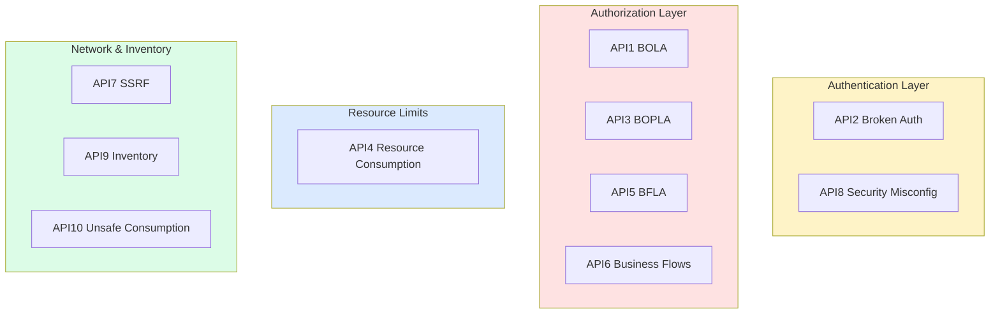

# Lesson 05: OWASP API Top 10 (2023)

*Where `Boardly` gets the checklist you revisit every quarter — the field's periodic consensus on the most common ways real APIs get breached, each category mapped to a concrete `Boardly` anti-example and the fix.*

**Note — Status: checklist-lesson.**

This lesson departs from the standard 14-section spine used by Lessons 01–04. The Code, Line-by-Line Deep Dive, and Execution Trace sections are *intentionally* replaced by the per-category `### API1:2023` … `### API10:2023` subsections below — each one carries its own `**Anti-example.**` (vulnerable code) and `**Fix.**` (fixed code) blocks, which together serve the same role as `The Code` and `Line-by-Line Deep Dive`. The closing `## The 30-minute quarterly security review` section serves as the Execution Trace (it walks an engineer through running the review against a live repo). Do not re-add the three sections as separate headings — it would duplicate the per-category code blocks and inflate the lesson without adding information. The departure is the design.


**The index of mistakes.**

The previous four lessons teach specific defenses: hashing (Lesson 02), JWT (Lesson 03), RBAC + object-level (Lesson 04), threat modeling (Lesson 01). This lesson is the **index of mistakes** — what happens when those defenses are missing or wrong. Each category below is a class of vulnerability you will be tempted to write under deadline pressure, each has a single-line fix that prevents a multi-month incident, and each is the entry on a checklist you must be able to defend in a security review.


#security #owasp #reference

## Learning Objectives

By the end of this lesson you will be able to:

1. **Recognize each of the 10 OWASP API categories** in FastAPI code, on sight.
2. **Apply the canonical fix** for each — and link the fix to the lesson in this section that teaches it.
3. **Map each category to a defense layer** (auth, authorization, rate limit, configuration, inventory).
4. **Run the 30-minute quarterly security review** — the cheap check that catches 80% of regressions.

## Prerequisites

Before starting, you need:

- The threat model framing — [[Threat-Model-First]]. The Top 10 is the *checklist of mistakes*; the *thinking* is the threat model. Read Lesson 01 first.
- Auth storage (API2) — [[Password-Hashing]].
- Tokens (API2, API5) — [[OAuth2-JWT-Access-Refresh]].
- Object-level and function-level authorization (API1, API3, API5) — [[RBAC-and-Object-Level-Auth]].

**The Top 10 is the *index*, not the *thinking*.**

Treating the Top 10 as a checklist to memorize is the wrong approach. The Top 10 is a checklist of mistakes; the *thinking* is the threat model in Lesson 01. Read this lesson as a review of Lessons 01–04, indexed by category.


## The Problem

You are about to ship a feature. You have written the code, the tests pass, the type checker is happy. You are about to merge. Before you merge, you should be able to answer: "Have I introduced any of the OWASP Top 10?" If you cannot, you have not done a security review.

This lesson is the cheat-sheet for that review. Each category has: the threat in one sentence, a `Boardly` anti-example, the fix, and a link to the lesson that teaches the fix.

Why a *checklist* for a security lesson, when Lessons 01–04 went deep on each defense? Because the threat changes faster than the defense does. Bcrypt has been the right answer since 1999; OWASP API Top 10 has shifted twice since 2019 (the 2019 list had "Insufficient Logging and Monitoring" as #10, replaced in 2023 by "Unsafe Consumption of APIs"). The defense lessons teach *things that stay true*; this lesson teaches *things that drift*. The checklist is the cheapest way to stay aligned with the drift — you re-read it every quarter, you cross-check your OpenAPI spec against it, you ship. The deep lessons are the substrate; the checklist is the cadence.

## The Mental Model



The four boxes are the four layers where the defenses live. Every OWASP category maps to one or two layers. The categorization is a thinking aid: when you find a new endpoint, ask "which layer's defenses apply here?" — and apply them.

## Each Category

### API1:2023 – Broken Object Level Authorization (BOLA)

**Threat.** A user with a valid token requests `GET /api/users/{id}` for an `id` that is not their own. The route checks the JWT is valid and the user has the `read:users` scope. It does not check the `id` matches the JWT's `sub`. Returns 200 with another user's data.

**Anti-example.**

```python
@router.get("/users/{user_id}", dependencies=[Depends(require_scope("read:users"))])
async def get_user(user_id: int, session: AsyncSession = Depends(get_session)):
 return await session.get(User, user_id) # NO BOLA CHECK
```

**Fix.** Object-level check, in the service — see [[RBAC-and-Object-Level-Auth]].

```python
@router.get("/users/{user_id}", dependencies=[Depends(require_scope("read:users"))])
async def get_user(
 user_id: int,
 current_user: User = Depends(get_current_user),
 service: UserService = Depends(get_user_service),
):
 return await service.get_user(user_id, requester=current_user)

# UserService
async def get_user(self, user_id: int, requester: User) -> User:
 user = await self.session.get(User, user_id)
 if not user:
 raise HTTPException(404, "user not found")
 if user.id != requester.id and not requester.is_admin:
 raise HTTPException(404, "user not found") # 404, not 403
 return user
```

The check is in the service, not the router — so non-router callers cannot bypass it.

**Danger — BOLA is the #1 cause of public API breaches.**

The 2018 USPS Informed Visibility breach (60 MM records), the 2019 Facebook phone-number lookup (419 MM), the 2021 LinkedIn scrape (700 MM) — all BOLA. The fix is two lines of code (`if user.id != requester.id: raise 404`). The mistake is forgetting those two lines, repeatedly, across endpoints.


**Warning — When this breaks: the debugging riddle of the "missing" record**

The BOLA fix returns `404` (not `403`) on a cross-user access — the record does not exist *for this requester*. The debugging consequence: a support ticket "I cannot see user 42, but I know they exist" reaches an engineer who logs in with admin, calls `GET /users/42`, sees the user, and concludes the user-facing client is buggy. The client is not buggy; the BOLA check correctly returned 404 because the support engineer's JWT is admin-scoped and the user's JWT is not. The "bug" is the user's expectation that the record is visible to them. The fix is operational, not code: the support runbook must include "verify the role of the requester and the `tenant_id`/`owner_id` of the target before concluding the record is missing". The deeper debugging riddle is when a service-to-service caller (e.g. a billing job that runs with a service-account JWT) gets a 404 on a user it should be able to read — the BOLA check uses `requester.id` (the service account's id) instead of `requester.is_service_account` or `requester.scopes`. The fix is to design the BOLA check around *what the requester is allowed to see* (scopes, roles, tenant membership), not *who the requester is* (id). The senior question for every `if user.id != requester.id` check: *does this check still pass when the requester is a service account that is not a `User` row, and does the 404-vs-403 distinction leak existence to the support engineer who debugs with admin?* See [[11-Authentication-and-Security/RBAC-and-Object-Level-Auth]] for the matrix that makes this explicit.


### API2:2023 – Broken Authentication

**Threat.** The login endpoint discloses whether an email exists (404 vs 401). Passwords are stored with `sha256`. Reset tokens never expire. Tokens are unsigned.

**Anti-example.**

```python
@router.post("/login")
async def login(email: str, password: str, session: AsyncSession = Depends(get_session)):
 user = await session.scalar(select(User).where(User.email == email))
 if not user:
 raise HTTPException(404, "user not found") # EMAIL ENUMERATION
 if hashlib.sha256(password.encode()).hexdigest() != user.password_hash: # WRONG HASH
 raise HTTPException(401)
 return {"token": jwt.encode({"sub": email}, "", algorithm="HS256")} # EMPTY SECRET
```

**Fix.** See [[Password-Hashing]] and [[OAuth2-JWT-Access-Refresh]]. The full fix:

- Generic error: `401 invalid credentials` for both wrong-email and wrong-password (with timing-equalization dummy verify).
- `bcrypt`/`argon2id` for storage, with salt and cost.
- Reset tokens with `expires_at` and `used` (single-use).
- JWT signed with a real secret, with `exp`, `iss`, `aud`, `sub`, `jti`.
- Access + opaque refresh per D-004.

### API3:2023 – Broken Object Property Level Authorization (BOPLA)

**Threat.** A `PUT /users/{id}` accepts a JSON body that includes `is_admin: true`. The endpoint mass-assigns the body to the model. The user makes themselves admin. This category also covers exposing `password_hash` in a `GET` response because the response model is `User` (the ORM model), not a hand-picked response schema.

**Anti-example.**

```python
@router.put("/users/{id}")
async def update_user(id: int, body: User, session: AsyncSession = Depends(get_session)):
 user = await session.get(User, id)
 for k, v in body.model_dump().items(): # MASS ASSIGNMENT
 setattr(user, k, v)
 await session.commit()

@router.get("/users/{id}", response_model=User) # ORM model as response_model
async def get_user(id: int, session: AsyncSession = Depends(get_session)):
 return await session.get(User, id) # LEAKS password_hash
```

**Fix.** Separate request and response schemas. Never bind the ORM model directly as the request body.

```python
class UserUpdate(BaseModel): # request schema — explicit allow-list
 email: EmailStr | None = None
 name: str | None = None
 # no is_admin, no password_hash

class UserRead(BaseModel): # response schema — explicit allow-list
 id: int
 email: EmailStr
 name: str
 is_active: bool
 model_config = {"from_attributes": True}
 # no password_hash, no is_admin

@router.put("/users/{id}")
async def update_user(id: int, body: UserUpdate, session: AsyncSession = Depends(get_session)):
 user = await session.get(User, id)
 data = body.model_dump(exclude_unset=True)
 for k, v in data.items():
 setattr(user, k, v)
 await session.commit()

@router.get("/users/{id}", response_model=UserRead)
async def get_user(id: int, session: AsyncSession = Depends(get_session)):
 return await session.get(User, id)
```

`exclude_unset=True` means "only update fields the client explicitly sent" — so a `PUT` with `{"name": "Alice"}` does not null out the email. Pydantic v2's `model_dump(exclude_unset=True)` is the precise tool.

**Student asks: why not just use `response_model_exclude={"password_hash"}`?**

You can, but it is fragile. If you add a new sensitive field (e.g. `mfa_secret`), you have to remember to add it to every `response_model_exclude` in the codebase. A separate response schema (e.g. `UserRead` with an explicit allow-list of fields) means "this is what we expose" — adding a new sensitive field to the model does not leak it; you would have to add it to `UserRead` explicitly. Allow-list beats deny-list for security.


**Student asks: Why does BOLA keep happening — the fix is two lines of code?**

Because the two-line fix has to be remembered, in the right order, on every endpoint, by every engineer, every time. Code review without a security-test matrix cannot catch a missing BOLA check — the diff "looks fine". The fix is not really two lines of code; it is the *architectural* property that the service refuses to run without a `requester` argument (Lesson 04), *plus* the matrix in `tests/test_rbac.py`. The two lines are the surface; the matrix is the contract that proves the two lines ran. Without the matrix, BOLA keeps happening because there is no automated check that "every protected endpoint has the requester-arg pattern".


**Student asks: Why are API9 (Inventory) and API10 (Unsafe Consumption) in the Top 10 — they sound like operational, not code, problems?**

Because the OWASP API Top 10 is the *field's consensus on the most common ways real APIs get breached*, not "the most common code bugs". An EC2 instance with port 5432 open to the internet, forgotten, has caused more breaches than every SQL injection in the last five years — even though no line of code in your repo is wrong. API9 and API10 acknowledge that *code correctness* is not the same as *operational correctness*. A repo with perfect BOLA checks and perfect rate limiting still breaches if a staging subdomain still has prod credentials. The lesson teaches both the code fix and the operational fix because that is what real API security is.


### API4:2023 – Unrestricted Resource Consumption

**Threat.** `POST /search` accepts a `limit` query parameter. No cap. A client sends `?limit=10000000` and exhausts the DB pool. Or: no rate limit on `POST /auth/login`, allowing 10⁹ password guesses/sec.

**Anti-example.**

```python
@router.get("/search")
async def search(q: str, limit: int = 10, session: AsyncSession = Depends(get_session)):
 return await session.scalars(select(User).limit(limit)) # no cap
```

**Fix.** Three layers:

1. Cap `limit` with Pydantic `Field(le=100)`.
2. Rate-limit (see [[Threat-Model-First]]).
3. Cap request body size at the reverse proxy (e.g. `client_max_body_size 1m` in nginx).

```python
from typing import Annotated
from pydantic import Field

@router.get("/search", dependencies=[Depends(rate_limit(60, 60))])
async def search(
 q: str,
 limit: Annotated[int, Field(le=100, ge=1)] = 10,
 session: AsyncSession = Depends(get_session),
):
 return await session.scalars(select(User).limit(limit))
```

**Student asks: Why isn't a per-IP rate limit enough against a credential-stuffing botnet?**

Because a credential-stuffing botnet does not look like "one IP hammering the login endpoint" — it looks like "10 000 IPs each sending one request, every minute, forever". A per-IP rate limit at 10 attempts/min/IP sees 10 000 IP buckets each at 1/10 capacity — every single request is allowed through, because the limit is per-IP, not per-identity. The botnet's whole design is to fit under per-IP limits by distributing the work. The fix is the composite key from Lesson 03's `/auth/login`: rate-limit on `username:ip` (so the one email being sprayed hits the bucket from each IP, but the bucket is per-IP+email — one botnet IP can only try that email 10 times) *and* on `username` alone (so the same email being sprayed across 10 000 IPs hits a global-per-email cap that the botnet cannot dodge by rotating IPs). The two limits compose: the per-IP+email catches the small botnet, the per-email catches the large botnet, and together they cover the threat. A per-IP limit alone is the textbook anti-stuffing control that the textbook threat model already defeats — which is why API4's defense is *layered* (Pydantic cap + rate limit + body-size cap), not single-layer.


**Danger — How an attacker thinks: walking the table with cursor pagination under a per-IP rate limit**

An attacker who can call `GET /search?q=alice&limit=100&cursor=...` 100 times walks the entire `users` table (10 000 records) in 100 requests, each within any reasonable per-IP rate limit (60 req/min allows the walk in under 2 minutes). The `limit=100` cap (Pydantic `Field(le=100)`) is a *per-request* cap, not a *per-identity* or *per-query* cap — it bounds one request, not the cumulative walk. The defense is a per-query rate limit (`rl:q:{q_hash}` with `TTL=60`, cap 60) so the same `q` cannot be paginated more than 60 times per minute, *plus* an export-volume cap (a per-identity daily ceiling on total records returned across all queries, e.g. 1 000/day for free tier). The attacker's move when they hit a per-query limit is to vary `q` ("alice", "alice1", "alice2") to get fresh buckets — the per-identity daily ceiling catches that. The lesson is that pagination is a feature for legitimate clients (show me 100 at a time) and an extraction tool for attackers (walk 10 000 in 100 requests); the rate limit must be on the *resource* (the table) not just the *call* (the endpoint). The senior question for every paginated search endpoint: *what stops an attacker from walking the entire table by varying the query, and is the cap per-request, per-query, or per-identity-per-day?* If the answer is "per-request only", the endpoint is an extraction primitive. See [[02b-Backend-Foundations/Pagination-Deep-Dive]] for the cursor design and [[11-Authentication-and-Security/Threat-Model-First]] for the threat-model entry that names this.


### API5:2023 – Broken Function Level Authorization (BFLA)

**Threat.** `DELETE /admin/users/{id}` is enforced only by the router having `/admin` prefix — there is no scope check, no role check. A user with any valid token hits it.

**Anti-example.**

```python
@router.delete("/admin/users/{id}")
async def delete_user(id: int, session: AsyncSession = Depends(get_session)):
 # no Depends(require_scope("admin:users:delete")) — relies on URL prefix
 await session.execute(delete(User).where(User.id == id))
 await session.commit()
```

**Fix.** Explicit `Depends(require_scope(...))` on every admin endpoint; do not rely on a URL prefix or a middleware that "checks admin paths" (middleware drift is real).

```python
@router.delete(
 "/admin/users/{id}",
 dependencies=[Depends(require_scope("admin:users:delete"))],
)
async def delete_user(id: int, session: AsyncSession = Depends(get_session)):
 ...
```

See [[RBAC-and-Object-Level-Auth]].

**Danger — "The URL prefix is the auth" is a BFLA waiting to happen.**

Any future router that mounts at `/admin/...` without a scope check inherits the admin role by URL. Middleware that "checks admin paths" drifts — the next refactor changes the path regex. The fix is per-route `Depends(require_scope(...))`. The URL is documentation; the dependency is enforcement.


### API6:2023 – Unrestricted Access to Sensitive Business Flows

**Threat.** The "buy one-year subscription for $0.99" endpoint is rate-limited at 100 req/min per user, but a botnet of 1 000 accounts each buys 100 subscriptions in the same minute. The flow itself is not sensitive per-request, but at scale it drains inventory or accumulates credits.

**Anti-example.** No counter-measures on the business-flow rate.

**Fix.** Business-flow rate limits: per-user *and* global caps on sensitive flows; bot detection (e.g. Cloudflare Turnstile, hCaptcha) for new signups; require email verification before the flow; per-IP *and* per-account limits on `/checkout`. The threat model in [[Threat-Model-First]] is where you list these flows.

**API6 is the "you cannot solve this with one control" category.**

BOLA, BFLA, BOPLA — each has a clean code-level fix. API6 does not. The defense is a combination of per-account limits, global caps, bot detection, and email verification. The threat model is where you list the sensitive flows and the combination of controls you apply.


**Production reality: bot-detection false positives on legitimate power users**

Every bot-detection control (Cloudflare Turnstile, hCaptcha, device-fingerprint heuristics) has a false-positive rate against legitimate users — and the legitimate users it false-positives on are the *power users* (the ones with non-standard browsers, privacy extensions, headless automation for legitimate testing, corporate proxies that strip headers). The operational cost is not "we blocked 1% of bot traffic" — it is "we blocked the customer who pays us $10k/year because their corporate VPN trips the bot heuristic". The defense is *not* "lower the sensitivity" (that defeats the control); it is (a) an allow-list of customer account IDs that bypass bot detection entirely (the customer success team owns the list, the list has a documented owner per entry), (b) a fallback flow ("if bot detection blocks you, click here to verify via email") that does not silently fail, (c) a dashboard of false-positive reports that the security team reviews weekly. The business-flow rate limit (per-account + global) is the *deterministic* control that catches the botnet regardless of false positives; bot detection is the *probabilistic* control that catches the long tail. Both are necessary because the deterministic control cannot distinguish "1 000 legitimate users" from "1 000-botnet-as-one-account" without the per-account ceiling. The senior question for every bot-detection rollout: *what is the false-positive rate against the top 1% of paying customers, and is there a bypass flow that does not require a support ticket?* See [[11-Authentication-and-Security/Threat-Model-First]].


### API7:2023 – Server Side Request Forgery (SSRF)

**Threat.** `POST /webhooks/import` accepts `{"url": "https://..."}` and the server fetches it with `httpx`. A client submits `{"url": "http://169.254.169.254/latest/meta-data/"}` — the AWS metadata endpoint. The server returns the instance's IAM credentials in the response.

**Anti-example.**

```python
@router.post("/import")
async def import_url(url: str):
 async with httpx.AsyncClient() as client:
 r = await client.get(url) # SSRF
 return r.json()
```

**Fix.**

1. Validate URL scheme (only `https`).
2. Validate the resolved IP is not in private ranges (`10/8`, `172.16/12`, `192.168/16`, `127/8`, `169.254/16`, `::1/128`).
3. Forbid redirects to private ranges.
4. Run the fetch in a network namespace that has no route to private ranges (defense in depth).

Why four layers of SSRF defense when any one of them seems to stop the textbook attack? Because each layer stops a *different* evasion. Scheme-validation stops `http://` and `file://` (the obvious ones). IP-range validation stops `http://169.254.169.254/...` (the AWS metadata attack). Redirect-rejection stops the attacker who submits a safe-looking `https://partner.example.com/redir` that returns a 302 to `http://169.254.169.254/...`. The network namespace stops DNS rebinding, where the hostname resolves to a safe IP at validation time and to the metadata IP at fetch time. Each layer is necessary because the attacker only needs *one* layer to fail; the defense needs *all four* to hold. That is the asymmetry of security in one sentence: the attacker wins on a single failure, the defender wins on a complete coverage.

```python
import ipaddress
import socket
import urllib.parse

ALLOWED_SCHEMES = {"https"}
BLOCKED_NETWORKS = [
 ipaddress.ip_network("10.0.0.0/8"),
 ipaddress.ip_network("172.16.0.0/12"),
 ipaddress.ip_network("192.168.0.0/16"),
 ipaddress.ip_network("127.0.0.0/8"),
 ipaddress.ip_network("169.254.0.0/16"),
 ipaddress.ip_network("::1/128"),
 ipaddress.ip_network("fc00::/7"), # IPv6 ULA
 ipaddress.ip_network("fe80::/10"), # IPv6 link-local
]


def assert_safe_url(url: str) -> str:
 parsed = urllib.parse.urlparse(url)
 if parsed.scheme not in ALLOWED_SCHEMES:
 raise HTTPException(400, "scheme not allowed")
 try:
 infos = socket.getaddrinfo(parsed.hostname, None)
 except socket.gaierror:
 raise HTTPException(400, "invalid host")
 for info in infos:
 ip = ipaddress.ip_address(info[4][0])
 for net in BLOCKED_NETWORKS:
 if ip in net:
 raise HTTPException(400, "host in blocked range")
 return url


@router.post("/import")
async def import_url(url: str):
 safe = assert_safe_url(url)
 async with httpx.AsyncClient(follow_redirects=False) as client:
 r = await client.get(safe)
 return r.json()
```

**Danger — DNS rebinding defeats application-level URL validation.**

The validation above resolves the hostname once via `getaddrinfo`. A determined attacker uses DNS rebinding — the resolved IP at validation differs from the resolved IP at fetch (the DNS record changes between the two calls). For real production defense, run the fetch in a sandboxed network namespace or use a service that resolves once and pins the IP. Application-level validation is necessary but not sufficient.


**Example — In the wild: a major financial-services breach (2019).**

A 2019 breach of a major financial-services company exposed ~100 M customer records. The attacker's entry point was an SSRF in a misconfigured web-application firewall — the WAF was reachable from the internet, was configured to introspect internal endpoints, and an attacker could direct it to fetch from the cloud metadata service at `169.254.169.254`. The metadata response contained the IAM role credentials the WAF ran as, which had read access to the customer-data S3 bucket. The breach was not a code bug in the application; it was an SSRF + IMDSv1 combination that allowed the metadata service to hand out live IAM credentials. The fix, applied industry-wide afterward: enforce IMDSv2 (which requires a session-token fetch before any metadata read), restrict IAM roles to least-privilege, and add network-namespace isolation to anything that fetches user-supplied URLs.


**Student asks: Why does "resolve once and pin the IP" actually defeat DNS rebinding — does it not just move the race?**

It moves the race *out of the application*, where the attacker controls the input, and into the network layer, where the attacker does not. DNS rebinding works by submitting a hostname whose DNS TTL is 0 seconds — the attacker's authoritative server hands out a safe IP on the first resolution (so your validation passes), then a metadata IP on the second resolution (so your fetch hits the metadata service). The window between the two resolutions is the attacker's race surface. "Resolve once and pin the IP" closes that window: you resolve at validation, store the resolved IP, and fetch *that IP* with `Host: <original-hostname>` in the request — the fetch never re-resolves, so the attacker's second-resolution trick has nothing to talk to. The application's role becomes "verify the IP is not in a blocked range, then use that IP for the fetch"; the network namespace's role becomes "even if the IP-range check has a gap, the fetch cannot reach 169.254.169.254 because the namespace has no route to it". The two defenses compose: pinning closes the *application-layer* race (DNS rebinding), the namespace closes the *network-layer* race (any IP-range check bug). Neither alone is enough; both together raise the attacker's cost past what most adversaries will pay. That is why the four-layer SSRF defense is a stack, not a menu.


### API8:2023 – Security Misconfiguration

**Threat.** CORS is `*`. Debug mode is on in prod. Swagger UI is exposed. Default DB credentials. `Server: uvicorn` reveals version. Directory listing on a static files mount.

**Anti-example.**

```python
app = FastAPI()
app.add_middleware(
 CORSMiddleware,
 allow_origins=["*"], # WRONG
 allow_credentials=True, # CANNOT be True with allow_origins=["*"]
)
app.mount("/static", StaticFiles(directory=".", html=True), name="static") # directory listing
```

**Fix.**

- Allow-list specific origins.
- `docs_url=None` and `redoc_url=None` in prod (or guard with auth).
- Disable debug in prod.
- Run as a non-root user (see [[16-Deployment-and-DevOps/Docker-Multi-Stage-Non-Root]]).
- Use environment-driven settings (see [[04-Pydantic/Pydantic-Settings]]).

```python
settings = Settings()
app = FastAPI(
 docs_url="/docs" if settings.env == "dev" else None,
 redoc_url=None,
)
app.add_middleware(
 CORSMiddleware,
 allow_origins=settings.cors_origins, # list of specific origins
 allow_credentials=True,
 allow_methods=["GET", "POST", "PATCH", "DELETE"],
 allow_headers=["Authorization", "Content-Type"],
)
```

**Why `allow_origins=["*"]` + `allow_credentials=True` is forbidden**

If you allow any origin *and* send credentials (cookies), then any website can make authenticated requests to your API. A user logged in to your service visits `evil.com`; `evil.com`'s JavaScript makes a `fetch("https://your-api.com/users/me", {credentials: "include"})` request; the browser sends the user's cookies; your API returns the user's data; `evil.com` reads it. The CORS spec forbids this combination; Starlette's `CORSMiddleware` will refuse to send `Access-Control-Allow-Credentials: true` if `allow_origins=["*"]`. But the *intent* to misconfigure is the threat; the framework's refusal is the safety net.


**Warning — When this breaks: the empty `cors_origins` deploy**

A deploy ships with `BOARDLY_CORS_ORIGINS=` (the env var is set but empty) — the `Settings` model parses it as an empty list, `CORSMiddleware` mounts with `allow_origins=[]`, and the browser's preflight `OPTIONS` request gets an `Access-Control-Allow-Origin:` (empty) header. The frontend's `fetch("https://api.boardly.com/users/me", {credentials: "include"})` is blocked by the browser's CORS policy; the user sees a blank page; the backend logs show no errors (the request never reached the app). The debugging surface is "the backend works in curl but not in the browser" — the giveaway is the browser's console error: "Access-Control-Allow-Origin cannot be empty". The fix is a `@field_validator("cors_origins")` on the `Settings` model that raises in `env == "prod"` if the list is empty, plus a CI test (`test_settings_prod_requires_cors_origins`) that loads `Settings(env="prod")` with an empty `BOARDLY_CORS_ORIGINS` and asserts `ValidationError`. The deeper rule: every production-critical env var must have a `Settings`-level validator that catches the "set but empty" failure mode, because the orchestrator's health check passes (the process started) and the liveness probe passes (the route returns 200) — only the application-level validator catches the misconfiguration before the user does. The senior question for every prod-critical config: *if the env var is set to empty, does the app fail to start, or does it start and silently misbehave?* See [[04-Pydantic/Pydantic-Settings]] and [[16-Deployment-and-DevOps/GitHub-Actions-CI]].


### API9:2023 – Improper Inventory Management

**Threat.** An old `staging.` subdomain still has the prod DB connection string in its env. A retired `/v1/users` endpoint is still mounted because nobody deleted the router. An EC2 instance with port 5432 open to the internet, forgotten. The breach happens on a thing you forgot existed.

**Anti-example.** No inventory, no env hygiene.

**Example — In the wild: forgotten infrastructure (2019, 2022).**

A 2019 breach of a major consultancy's cloud environment exposed ~340 M records. The entry point was a misconfigured Elasticsearch cluster that had been provisioned for a single analysis in 2018 and never torn down — no auth, public IP, internet-routable. In 2022, a major telco disclosed a breach traced to a retired API endpoint still mounted on a staging subdomain whose env vars still pointed at the production database. The common root cause is operational drift: the inventory of "what we run and where" does not match the inventory of "what we think we run and where". The OpenAPI-snapshot test below catches the code side; the cloud-inventory audit catches the infrastructure side. Both are necessary because the breach happens on either side.


**Danger — How an attacker thinks: the staging subdomain is the #1 recon target**

A staging subdomain (`staging.boardly.com`) is more valuable to an attacker than the production subdomain, for three reasons: (1) it typically has *prod* credentials in its env (the dev who set it up reused the prod `DATABASE_URL` to "test against real data"), so a single SSRF or RCE on staging yields prod-data access; (2) it typically has *weaker* security controls (no rate limit, no WAF, no auth on `/docs`, debug mode on) because "it's just staging"; (3) it typically has *no monitoring* (no alerts on 429s, no SIEM ingestion, no anomaly detection) because the security team monitors prod. The attacker's recon workflow is commodity: `subfinder -d boardly.com` enumerates every subdomain from certificate transparency logs in 30 seconds; `httpx -status-code -title` filters for live 200s; `nuclei -t exposed-panels/` runs known-vuln templates against each. The defense is the inventory: every subdomain must have a documented owner, a documented env tier (staging/prod/dev), and a documented teardown date. The OpenAPI-snapshot test catches the code side; the cloud-inventory audit (`aws resourcegroupstaggingapi get-resources` weekly) catches the infrastructure side; the certificate-transparency-log monitor (`crt.sh` or a cloud watch on CT logs) catches the *unknown* side — a subdomain provisioned by an engineer who did not update the inventory. The senior question for every quarterly security review: *is there a subdomain in the CT logs that is not in the inventory, and if so, who provisioned it and does it have prod credentials?* See [[11-Authentication-and-Security/Threat-Model-First]] and [[16-Deployment-and-DevOps/Deployment-Targets-When-To-Use-What]].


**Fix.**

- Maintain an API inventory (OpenAPI is the source of truth — generate it on every build).
- Stale endpoint audit: any route not in the OpenAPI spec for the current version is killed or moved.
- Cloud inventory: `aws resourcegroupstaggingapi get-resources` weekly; alert on anything new.
- `staging.` and `prod.` envs must have separate secrets; rotate prod secrets on access pattern anomalies.

```python
# CI step: assert the OpenAPI spec matches what the app actually exposes
def test_openapi_snapshot():
 spec = app.openapi()
 expected = json.load(open("openapi.snapshot.json"))
 # Compare only paths and methods — version, servers, etc. are noisy.
 actual_paths = {p: set(m.keys()) for p, m in spec["paths"].items()}
 snapshot_paths = {p: set(m.keys()) for p, m in snapshot["paths"].items()}
 assert actual_paths == snapshot_paths, (
 f"API surface drifted:\n"
 f" added: {actual_paths.keys() - snapshot_paths.keys()}\n"
 f" removed: {snapshot_paths.keys() - actual_paths.keys()}\n"
 )
```

The snapshot test (taught in [[12-Testing-and-Quality/Testing-FastAPI-Endpoints]]) catches "an endpoint was added or removed". The cloud inventory catches "a resource was created that nobody documented".

### API10:2023 – Unsafe Consumption of APIs

**Threat.** Your app calls a third-party API. That API is compromised or malicious. It returns a redirect to `http://169.254.169.254/...` — your `httpx` client follows it. Or: the third-party returns a 10 GB response, your parser OOMs. Or: the third-party lies about TLS — your client does not verify.

**Anti-example.**

```python
async def fetch_user_info(uid: str):
 async with httpx.AsyncClient(timeout=None) as client:
 r = await client.get(f"https://partner.example.com/users/{uid}", follow_redirects=True)
 return r.json()
```

**Fix.**

- Set a timeout. Always.
- Set `follow_redirects=False`, validate redirects yourself.
- Cap response size (read with `iter_bytes`, abort past N bytes).
- Verify TLS (the default in `httpx` — never override).
- Validate the response against a Pydantic schema — do not `r.json()` into a `dict` and trust it.

```python
class PartnerUser(BaseModel):
 id: str
 email: EmailStr | None = None


async def fetch_user_info(uid: str) -> PartnerUser:
 async with httpx.AsyncClient(timeout=5.0, follow_redirects=False) as client:
 async with client.stream("GET", f"https://partner.example.com/users/{uid}") as r:
 if r.status_code != 200:
 raise HTTPException(502, "upstream error")
 size = 0
 chunks: list[bytes] = []
 async for chunk in r.aiter_bytes():
 size += len(chunk)
 if size > 1_000_000:
 raise HTTPException(413, "response too large")
 chunks.append(chunk)
 data = b"".join(chunks)
 return PartnerUser.model_validate_json(data)
```

See [[15-External-Integrations/HTTP-Clients-Timeouts-Retries]] for the full picture.

**Production reality: the silent contract change that breaks every request**

A third-party API you depend on ships a contract change without notice (they renamed `email` to `emailAddress` in the response, or changed `id` from `int` to `str`, or moved the user object from `data.user` to `data.results[0]`). Your `PartnerUser.model_validate_json(data)` raises `ValidationError` on every request; the partner's uptime is 100% (their endpoint returns 200), your service is down (every call raises). The debugging surface is "the partner is up, we're down, what changed" — the answer is in the partner's changelog (if they have one) or in a `git diff` of the partner's OpenAPI spec (if you snapshot it). The defense is the circuit breaker: after N consecutive `ValidationError`s (5 is a reasonable threshold), open the breaker and return a cached fallback or a 503 fast — do not keep calling the partner and raising. The deeper defense is a contract-monitoring job: nightly, call the partner with a known input, validate the response with the schema, alert if validation fails — catch the contract change before your users do. The senior question for every outbound third-party call: *if the partner silently renames a field tonight, what fails first — our Pydantic validation, our circuit breaker, or our monitoring?* If the answer is "the users notice first", you have no defense. See [[15-External-Integrations/Circuit-Breakers]] for the breaker pattern and [[15-External-Integrations/HTTP-Clients-Timeouts-Retries]] for the timeout that bounds each individual call.


## The 30-minute quarterly security review

This is the cheap check that catches 80% of regressions. Run it every quarter, or before any major release.

1. **Pull the OpenAPI spec.** Any endpoint you don't recognize → API9. (Run `uv run python -c "from boardly.main import app; import json; print(json.dumps(app.openapi(), indent=2))" > /tmp/openapi.json`, then read it.)
2. **For each endpoint, check:** BOLA test exists? Scope check in `Depends`? Rate limit on the noisy ones? The security-test matrix from Lesson 04 — does it exist for this endpoint?
3. **`rg "allow_origins.*\*"`** in the repo → API8. (Or `rg` for `CORSMiddleware` and read the config.)
4. **`rg "sha256.*password|md5\(" app/`** → API2. (These are fast hashes; if they appear near a password, it's broken.)
5. **`rg "httpx.get|client.get" app/`** with no `timeout=` → API10.
6. **`rg "follow_redirects=True"`** on outbound calls → API10.
7. **Check the CI** for: lint, type-check, tests, **deps audit** (`uv pip list --audit` or `pip-audit`). The deps audit catches CVEs in your dependencies — and it is the most-skipped step.
8. **Review cloud inventory** for new resources. Anything new must have a documented owner and a documented reason for existing.

**Tip — The 30-minute rule**

This review is *not* a comprehensive audit. It is the cheap check that catches the regressions — the things that slipped in since the last review. A real audit takes a week; this takes 30 minutes. Run it every quarter; run the audit every year.


## Common Mistakes

### Mistake 1: Treating the Top 10 as a checklist to memorize

**Why:** The Top 10 is a checklist of mistakes; the *thinking* is the threat model in [[Threat-Model-First]]. Memorizing the Top 10 without the threat model means you can recite the categories but cannot apply them to a new endpoint.

**Fix:** Read the Top 10 as a review of Lessons 01–04, indexed by category. Run the 30-minute review every quarter. The threat model is the design; the Top 10 is the audit.

### Mistake 2: Fixing one category, breaking another

**Symptom:** "We added mass-assignment protection by stripping `is_admin` from incoming bodies" — fine for API3, but if you forgot the rate limit (API4) on the same endpoint, the botnet still wins.

**Why:** Each category has a single-line fix, but the categories overlap. A new endpoint needs *all* the relevant categories reviewed, not just the one you remember.

**Fix:** The 30-minute review's step 2 ("for each endpoint, check BOLA, scope, rate limit, matrix") is the multi-category check. Apply all relevant categories per endpoint.

### Mistake 3: "We're behind a WAF, we're fine"

**Symptom:** Cloudflare's WAF blocks SQL injection patterns; you conclude BOLA is also blocked. It is not.

**Why:** WAFs catch patterns (SQLi fingerprints, XSS, common attack signatures). They do not catch "this endpoint lets the user read another user's rows" — that is application logic. The WAF does not know which rows the user is supposed to see.

**Fix:** The application is the source of truth for authorization. WAF for pattern attacks; application checks for authorization. Both, not one or the other.

### Mistake 4: "We're a startup, we'll do this later"

**Symptom:** You sign up users without HTTPS on the login form, without rate limiting, without BOLA checks, planning to "add security after we raise". The breach happens before you raise.

**Why:** The Top 10 is *most* of the security work. If you don't have time for it, you don't have time for the users you're signing up.

**Fix:** Do the Top 10 from day one. The 30-minute review, the BOLA check, the rate limiter, the bcrypt cost=12 — these are not "advanced security", they are "minimum viable security". A startup that ships BOLA is a startup that breaches.

## Engineering Trade-Offs

### Defense in depth vs simplicity

More layers = more code = more bugs. The right line is: auth + authz + rate limit + input validation + least-privilege DB role. Anything more is situational. A WAF, a SIEM, an IDS — these are *operational* defenses, applied when the threat model names an attacker that the code-level defenses do not cover.

### WAF vs application checks

Use a WAF for known-pattern attacks (SQLi fingerprints, XSS, common signatures). Do not rely on it for authorization — that's an application concern. The WAF is the first line; the application is the last line.

### Strict schemas vs velocity

Separate request/response schemas (the BOPLA fix) is more typing. It is also the cleanest fix for a class of bugs that takes down companies. Pay the cost. The schema is a one-time write; the bug is a multi-month incident.

## Exercises

**Tip — The 20-minute rule**

If you're stuck on an exercise for more than 20 minutes, re-read the relevant section above, then move on.


**Exercise 1 — Audit a repo.** Run `rg "password.*sha256|md5\(" app/` on a repo of your choice. List any matches and the file:line. (If you find any, the password storage is broken — file a ticket.)

**Exercise 2 — Write the BOPLA test.** Write the test that proves the BOPLA anti-example allows `is_admin` mass-assignment, then write the test that proves the fix (separate `UserUpdate` schema) blocks it. The tests are the contract.

**Exercise 3 — Build SSRF defense in depth.** Build the application-level URL validation (as in API7) *plus* a network namespace that has no route to RFC 1918 ranges. Document the operational cost (the namespace setup, the test environment, the CI config).

**Exercise 4 — Write the 30-minute review as a script.** Codify the 8-step review as a shell script: `rg` commands, OpenAPI dump, CI config check, cloud inventory query. Run it against `Boardly`. Fix anything it finds.

**Exercise 5 — Threat-model the 10.** For each OWASP category, write down: which lesson in this section teaches the fix? Which asset on the threat-model document does this category defend? Which attacker from the threat model would exploit this category if undefended?

**Exercise 6 — BOLA debugging riddle.** Write a `GET /users/{user_id}` endpoint with the BOLA fix. Seed two tenants (Alice and Bob) each with a few users scoped by `tenant_id`. Use Alice's JWT to call `GET /users/{bob_user_id}`. Confirm the response is 404 (not 403 — the BOLA fix returns 404 to avoid leaking existence). Then introduce a bug: change the `if user.id != requester.id and not requester.is_admin` check to use `requester.tenant_id` instead of `requester.id`. Re-run the same request. Confirm the response is now 200 with Bob's user data — the BOLA regression. The test is the contract: write `test_bola_cross_tenant_returns_404` and confirm it fails on the bug, passes on the fix. See [[11-Authentication-and-Security/RBAC-and-Object-Level-Auth]].

**Exercise 7 — Cursor-pagination table walk.** Write a `GET /search?q=...&limit=...` endpoint that uses cursor pagination (cursor is an opaque base64 of `last_id`). Cap `limit` at 100 with `Field(le=100)`. Write a test that sets `limit=100` and walks the cursor 100 times — confirm it returns 10 000 records (the full table) in 100 requests, well within any per-IP rate limit. Now add a global rate limit on `/search` keyed on `q` (not per-IP) at 60 req/min — confirm the 100-request walk now hits the rate limit at request 60. The takeaway: per-IP rate limits do not bound a determined walker who can rotate IPs; you need a per-identity (or per-query) limit on the expensive endpoints. See [[11-Authentication-and-Security/Threat-Model-First]] and [[02b-Backend-Foundations/Pagination-Deep-Dive]].

**Exercise 8 — CORS-env regression CI check.** Write a `Settings` model with `cors_origins: list[str]`. Mount `CORSMiddleware` with `allow_origins=settings.cors_origins`. Write a CI test that asserts `settings.cors_origins` is non-empty and contains no `"*"` (run with `env | grep -v BOARDLY_CORS_ORIGINS` to simulate the missing env var). Confirm the test fails when the env var is missing. Then add a `@field_validator("cors_origins")` that raises if the list is empty in prod (`env == "prod"`). Confirm the app fails to start with a clear error in prod but allows empty in dev. See [[04-Pydantic/Pydantic-Settings]] and [[16-Deployment-and-DevOps/GitHub-Actions-CI]].

**Exercise 9 — Recon-tool staging-subdomain scan.** Run `subfinder -d yourcompany.com` (or `amass enum -d yourcompany.com`) against a domain you control. List every subdomain discovered. For each, run `curl -sI https://$sub/` and grep for `Server:` and `X-Powered-By` headers. Document any subdomain that returns `200` (live) but is not in your team's `inventory.yaml`. For each undocumented subdomain: (a) check if it has prod DB credentials in its env (`env | grep DATABASE_URL`), (b) check if its `docs_url` is exposed (`curl https://$sub/docs`). File a ticket for each finding. The takeaway: reconnaissance tools are commodity; the defense is documented inventory + the OpenAPI-snapshot test from API9. See [[11-Authentication-and-Security/Threat-Model-First]] and [[16-Deployment-and-DevOps/Deployment-Targets-When-To-Use-What]].

**Exercise 10 — Third-party contract change circuit breaker.** Write a `fetch_partner_user(uid)` that calls `https://partner.example.com/users/{uid}` and validates the response with a `PartnerUser` Pydantic model. Inject a contract change: mock the partner to return `{"id": "abc", "emailAddress": "alice@example.com"}` (renamed `email` to `emailAddress`). Confirm `PartnerUser.model_validate_json` raises `ValidationError` on every call. Add a circuit breaker (use `pybreaker` or a hand-rolled counter) that opens after 5 consecutive `ValidationError`s and returns a 503 fast without calling the partner. Confirm the 6th request returns 503 in under 1ms (no partner call). The takeaway: Pydantic validation is the canary that catches silent contract changes; the circuit breaker prevents the partner's contract change from cascading into your service. See [[15-External-Integrations/Circuit-Breakers]] and [[15-External-Integrations/HTTP-Clients-Timeouts-Retries]].

**Exercise 11 — Composite rate-limit key.** Implement the `username:ip` and `username` composite rate-limit from the API4 fix. Use Redis with two keys: `rl:uip:{username}:{ip}` with `TTL=60` and `rl:u:{username}` with `TTL=60`. Each `/auth/login` request: `INCR` both keys, set `EXPIRE` if first increment. Reject (429) if either exceeds 10. Test: simulate a credential-stuffing botnet of 100 IPs each trying one password against one username. Without the per-username limit, confirm 100 IPs each get 1 attempt (all allowed). With the per-username limit, confirm only 10 attempts succeed across all 100 IPs. Then test a single IP spraying 100 usernames — confirm the per-IP+username limit caps each `username:ip` to 10, but the per-username limit alone would not catch this. Both limits are necessary. See [[14-Caching-and-Background-Processing/Redis-Cache-Aside]].

## Verification

```bash
# Each OWASP fix should be testable. Sample tests:
uv run pytest tests/test_owasp.py -v
# Expect:
# test_bola_cross_user_returns_404
# test_login_unknown_email_returns_401_not_404
# test_mass_assignment_cannot_set_is_admin
# test_search_limit_capped_at_100
# test_admin_endpoint_requires_scope
# test_import_url_rejects_private_range

# Run the 30-minute review as a script
uv run scripts/security_review.sh
# Expect: green checkmarks or a list of findings

# Spot-check the rg patterns the review script runs, by hand:
rg "allow_origins.*\*" src/
# Expect: zero matches (CORSMiddleware allow_origins must be a list, never ["*"]).

rg "sha256.*password|md5\(" app/
# Expect: zero matches in app/ (a hit is a broken password column — file a ticket).

rg "httpx.get|client.get" app/ | rg -v "timeout"
# Expect: zero matches (every httpx call must have an explicit timeout — API10).

rg "follow_redirects=True" app/
# Expect: zero matches, or matched only on a call with a pinned allow-list (API10).
```

## Previously Learned Here

These concepts were taught in earlier lessons. We link back instead of re-explaining:

- **`Rate limiting`** — [[Threat-Model-First]]. The API4 defense.
- **`OAuth2` and `JWT`** — [[OAuth2-JWT-Access-Refresh]]. The API2 defense.
- **`BaseModel`** — [[04-Pydantic/BaseModel-and-Validation]]. The API3 defense — separate request and response schemas.
- **`Depends`** — [[03-FastAPI-Core/Dependency-Injection]]. The API5 defense — `require_scope` on every admin route.
- **`Depends` chains** — [[RBAC-and-Object-Level-Auth]]. The API1 and API5 fix — function-level and object-level authorization.
- **Password hashing** — [[Password-Hashing]]. The API2 defense for storage.

## What's Next

The next section is [[12-Testing-and-Quality/00-Testing-MOC|12-Testing-and-Quality]]. The auth section is done; the testing section teaches how to *verify* everything we built. We will:

- Build the test pyramid and fixture design ([[12-Testing-and-Quality/Test-Pyramid-and-Fixtures]]) that keeps a 2000-test suite running in 5 seconds.
- Build the endpoint tests ([[12-Testing-and-Quality/Testing-FastAPI-Endpoints]]) with `app.dependency_overrides` — the framework-level seam for testing auth without issuing real JWTs.
- Build the database tests ([[12-Testing-and-Quality/Testing-Database-Logic]]) with the transaction-rollback pattern.
- Build the async tests ([[12-Testing-and-Quality/Async-Testing]]) — `pytest-asyncio`, `MissingGreenlet`, and the three error patterns that account for 90% of async test failures.
- Build the CI pipeline ([[12-Testing-and-Quality/CI-Pipelines]]) — GitHub Actions with service containers for PostgreSQL and Redis, matrix on Python 3.12 / 3.13, the lint→types→unit→integration→build→push order.

By the end of Section 12, you will have a complete test and CI suite for `Boardly` — the substrate that lets you refactor, ship, and sleep.

## Sources

- **OWASP API Security Top 10 (2023)** — <https://owasp.org/API-Security/editions/2023/en/0x11-t10/> — accessed 2026-10-19 — the canonical list.
- **OWASP API Security Top 10 (2019, archived)** — <https://owasp.org/www-project-api-security/editions/2019/> — accessed 2026-10-19 — historical reference for what changed.
- **OWASP Cheat Sheet Series** — <https://cheatsheetseries.owasp.org/> — accessed 2026-10-19 — concrete defenses per category.
- **PortSwigger Web Security Academy** — <https://portswigger.net/web-security> — accessed 2026-10-19 — lab exercises for SSRF, BOLA, BFLA.
- **"Mass assignment in frameworks"** — <https://cheatsheetseries.owasp.org/cheatsheets/Mass_Assignment_Cheat_Sheet.html> — accessed 2026-10-19 — BOPLA deep-dive.
- **OWASP API Security Top 10 (2023) — API7:2023 SSRF** — <https://owasp.org/API-Security/editions/2023/en/0x11-t10/> — accessed 2026-10-19 — the SSRF section's discussion of why application-level validation alone is insufficient (DNS rebinding, IPv6 mapping, redirect chains).

## What We Learned

Let's recap. In this lesson you:

- **Walked each of the 10 OWASP API categories** (2023) with a concrete `Boardly` anti-example and the fix.
- **Mapped each category to a defense layer** — authentication, authorization, resource limits, network and inventory.
- **Linked each fix to the lesson** in this section that teaches it — BOLA and BFLA to Lesson 04, broken auth to Lessons 02 and 03, BOPLA to Lesson 03 + the schemas, resource consumption to Lesson 01.
- **Built the 30-minute quarterly security review** — `rg` patterns, OpenAPI dump, CI config check, cloud inventory query.
- **Hit and fixed the four meta-mistakes** — treating the Top 10 as a memorization list, fixing one category and breaking another, relying on a WAF for authorization, deferring security to "after we raise".

Here's the mental model to walk away with: *the Top 10 is the field's periodic consensus on how real APIs get breached. It is the index of mistakes — the audit you run every quarter. The thinking is the threat model in Lesson 01. The defenses are the code in Lessons 02 (hashing), 03 (JWT), and 04 (RBAC). The 30-minute review catches the regressions; the year-long audit catches the drift; the threat model prevents the next category from forming. All three. Every quarter.*

---

> A note from your teacher
You just walked the field's quarterly consensus. Sit with that. Ten categories, ten `Boardly` anti-examples, ten fixes — and a 30-minute review that catches regressions before a researcher does. Run that review every quarter; the next section is testing, where you will write the security-test matrix that locks these fixes in code. See you in Section 12.


---

**Tags:** #security #owasp #reference #review
**Previous:** [[RBAC-and-Object-Level-Auth]]
**Next:** [[12-Testing-and-Quality/00-Testing-MOC]] →