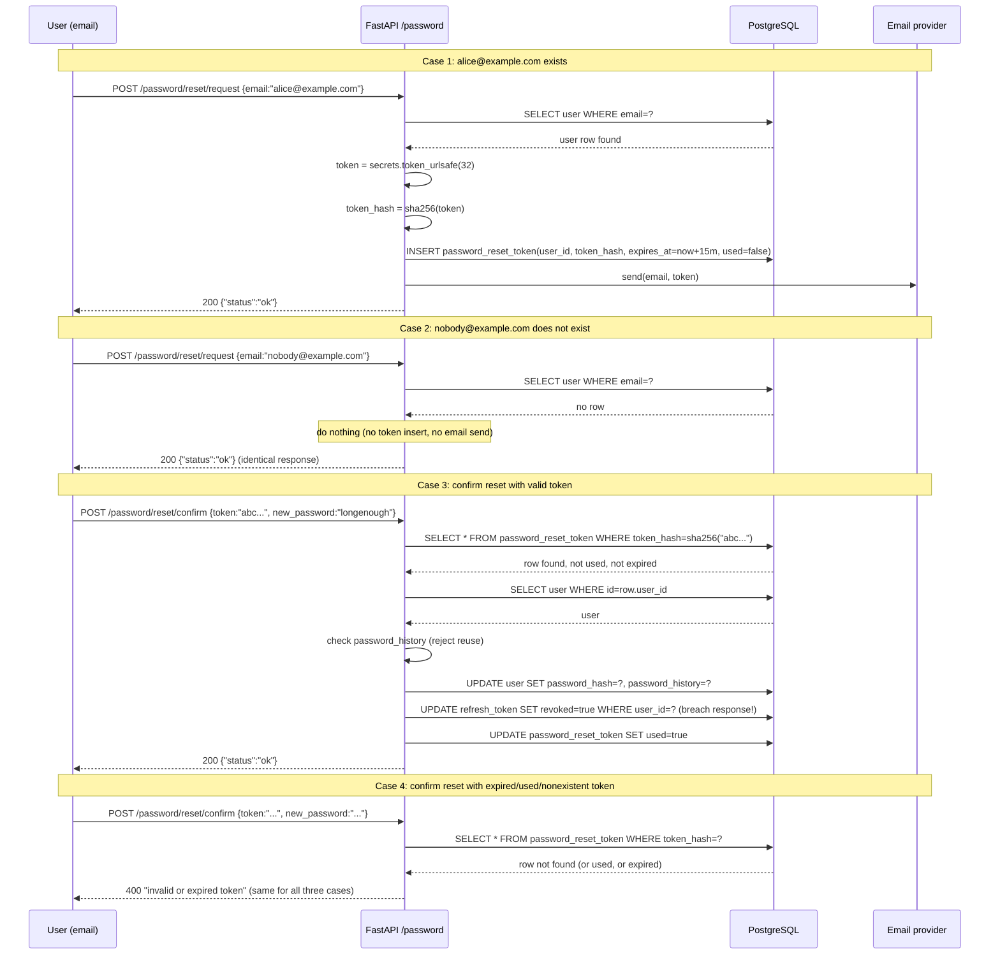
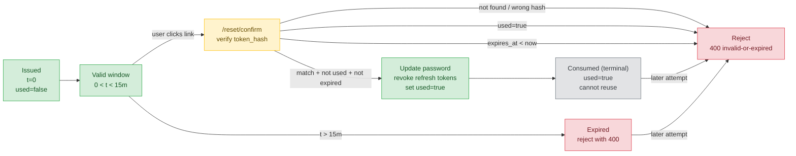

# Lesson 02: Password Hashing

*Where `Boardly` gets a `User` table, a real password column, and the reset flow that turns "the database leaked" from a catastrophic breach into a manageable one.*

**The first asset on the threat model.**

A database dump is not a hypothetical. Disk images leak, backups get misconfigured into public S3 buckets, insiders with read access walk out with copies. The single property that turns "the entire user table is on a torrent site" from a catastrophic breach into a manageable one is **the password column is a slow, memory-hard hash, not plaintext, not MD5, not SHA-256**. This lesson is not glamorous, but it is the line between "we notified users" and "we are in the news".


#security #cryptography #passwords #bcrypt #argon2

## Learning Objectives

By the end of this lesson you will be able to:

1. **Choose between bcrypt and argon2id** for a new project, and justify the cost parameter you pick.
2. **Explain why MD5, SHA-256, SHA-512, blake2, blake3 are wrong for passwords**, even with a salt — and why `base64` and `rot13` are not even hashes.
3. **Use the `secrets` module for reset tokens**, never `random` or `uuid4` alone, and explain the entropy math.
4. **Implement a password reset workflow** with TTL (15-minute expiry), single-use (`used` flag), and breach response (revoke all refresh tokens on reset).
5. **Implement email verification** as the same flow with a different TTL (24 h) and a different action (`email_verified_at = now`).
6. **Maintain a password history** (last N hashes) and reject reuse on reset — without enforcing composition rules that reduce entropy.
7. **Run the breach-response runbook** end-to-end: confirm scope, force-reset, revoke refresh tokens, rotate pepper, notify within 72 h (GDPR Art. 33).
8. **Recognize `passlib`'s caveats** — unmaintained since 2020, `pycrypto` baggage — and know when to skip it for direct `bcrypt`/`argon2-cffi` calls.

## Prerequisites

Before starting, you need:

- **Pydantic `BaseModel`** — [[04-Pydantic/BaseModel-and-Validation]]. `UserCreate` is a `BaseModel` with `Field(min_length=8)` on the password field. The 422 validation errors we surface come from this layer.
- **Pydantic Settings** — [[04-Pydantic/Pydantic-Settings]]. `BCRYPT_ROUNDS`, `RESET_TOKEN_TTL`, `PASSWORD_HISTORY_LENGTH` live in a `Settings` class driven by environment variables. We never hard-code cost parameters.
- **Pydantic validators** — [[04-Pydantic/Validators-Strict-vs-Coercive]]. Password-strength checks (length, denylist of 10 000 common passwords, entropy) happen *before* hashing, in a `field_validator`, where the plaintext is still in scope.
- **`Depends`** — [[03-FastAPI-Core/Dependency-Injection]]. `verify_password` and `hash_password` are `Depends`-able functions; the reset flow uses `Depends(get_session)` for the DB session.
- **The threat model** — [[Threat-Model-First]]. The threat we are defending against is "the DB leaks, the attacker has the password column". The cost dial on bcrypt/argon2id is the entire defense — speed is the property we are paying to remove.

**The single most common gap: "we used SHA-256 with a salt".**

If your password column is `sha256(password + salt)`, your password storage is broken. An attacker with the table and the salts runs a GPU at ~10⁹ candidates/sec against each hash. The salt does not help — it defeats rainbow tables (precomputed `hash → password` lookups) but it does not defeat brute force on a single hash. The fix is not "use SHA-512" — the fix is "use a deliberately slow, memory-hard hash". This lesson teaches bcrypt and argon2id, the two right answers.


## The Problem

`Boardly` is about to have users. The `User` table will have a `password_hash` column. The threat model from Lesson 01 names the asset: "user PII: email, password_hash, password_history". The threat: the database leaks — a backup misconfigured into a public S3 bucket, an insider with read access, an SQL injection that exfiltrates the table. After the leak, the attacker has every user's `password_hash`. If those hashes are fast hashes (SHA-256, MD5), the attacker recovers the plaintext passwords in hours. If those hashes are bcrypt with cost=12, the attacker recovers them at ~50/sec/GPU — years of compute for the same password.

The other problem: password reset. A user clicks "I forgot my password". We need to:

1. Verify they own the email (a token sent to the email).
2. Set a new password.
3. Revoke every existing session (because if the user is resetting because they were compromised, every active session is suspect).
4. Reject password reuse (don't let them pick "Password1!" again).

And the third problem: email verification. A user signs up with `alice@example.com`. We need to verify they own that email before letting them post, because otherwise we are an abuse vector (anyone signs up as anyone, posts spam from "their" email).

This lesson implements all three. The hashing is short (a few lines). The flows are longer (the reset flow with TTL, single-use, breach response).

## The Code

Here is the complete `boardly/security/passwords.py` we will write. It is the hashing primitives. The reset-flow endpoints live in `boardly/routers/password.py` (further below).

```python
# boardly/security/passwords.py
"""Password hashing, reset-token generation, and policy helpers.

Lesson 11.02: bcrypt cost=12 is the default; argon2id is the alternative.
Uses `secrets` for tokens (never `random`). The pepper lives in settings
(not in this file). Reset tokens are stored hashed (SHA-256 is fine here
because the token has 256 bits of entropy).
"""
from datetime import timedelta
import secrets

import bcrypt

from boardly.config import Settings

settings = Settings() # Pydantic-Settings — see prerequisite


# Cost dial: log2(rounds). Each increment doubles the time.
# 12 is ~250 ms on 2026 hardware — the reasonable default.
BCRYPT_ROUNDS = settings.password_bcrypt_rounds # 12

# TTL on reset tokens. 15 minutes — long enough to read the email, short
# enough to limit the theft-window if the email is intercepted.
RESET_TTL = settings.password_reset_ttl # timedelta(minutes=15)


def hash_password(plain: str) -> str:
 """Hash a password with bcrypt cost=BCRYPT_ROUNDS.

 Returns the modular crypt format string `$2b$12$...` that bcrypt
 can verify against later. The salt is embedded in the string — we
 do not store it separately.
 """
 return bcrypt.hashpw(
 plain.encode("utf-8"),
 bcrypt.gensalt(rounds=BCRYPT_ROUNDS),
 ).decode("ascii")


def verify_password(plain: str, hashed: str) -> bool:
 """Verify a plaintext password against a stored bcrypt hash.

 Returns False for any failure (wrong password, malformed hash, etc).
 We deliberately swallow the ValueError to avoid leaking hash structure.
 """
 try:
 return bcrypt.checkpw(
 plain.encode("utf-8"),
 hashed.encode("ascii"),
 )
 except ValueError:
 # malformed hash — return False, do not leak
 return False


def needs_rehash(hashed: str, target_rounds: int = BCRYPT_ROUNDS) -> bool:
 """True if the stored hash is weaker than the current policy.

 Use this on every login to transparently upgrade users when you bump
 the cost parameter. The hash string embeds the cost; we parse it out.
 """
 try:
 _, params, _, _ = hashed.split("$") # $2b$12$...
 return int(params) < target_rounds
 except (ValueError, IndexError):
 return False


def generate_reset_token() -> str:
 """32 bytes (256 bits) of CSPRNG entropy, base64url-encoded.

 Never use `random` — it is Mersenne-Twister, predictable from 624
 observed outputs. `secrets` uses the OS CSPRNG (/dev/urandom).
 """
 return secrets.token_urlsafe(32) # 43 chars, 256 bits


def generate_email_verification_token() -> str:
 """16 bytes (128 bits) — sufficient for a low-stakes verification flow."""
 return secrets.token_urlsafe(16) # 22 chars, 128 bits
```

And here is the reset flow in `boardly/routers/password.py`. The critical line is the breach response: on reset, revoke every refresh token for the user.

```python
# boardly/routers/password.py
"""Password reset flow with TTL, single-use, and breach response."""
from datetime import datetime, timedelta, timezone

from fastapi import APIRouter, Depends, HTTPException, status
from pydantic import BaseModel, EmailStr, Field
from sqlalchemy import select, update
from sqlalchemy.ext.asyncio import AsyncSession

from boardly.db import get_session
from boardly.models import PasswordResetToken, RefreshToken, User
from boardly.security.passwords import (
 generate_reset_token,
 hash_password,
 verify_password,
)
from boardly.config import Settings

settings = Settings()
router = APIRouter(prefix="/password", tags=["password"])


class ResetRequest(BaseModel):
 email: EmailStr


class ResetConfirm(BaseModel):
 token: str = Field(min_length=20)
 new_password: str = Field(min_length=8, max_length=128)


@router.post("/reset/request", status_code=status.HTTP_200_OK)
async def request_reset(
 body: ResetRequest,
 session: AsyncSession = Depends(get_session),
) -> dict:
 """Always returns 200 — never disclose whether the email exists."""
 user = await session.scalar(select(User).where(User.email == body.email))
 if user:
 token = generate_reset_token()
 # Store the token hashed. Threat model: DB-read. The token has
 # 256 bits of entropy, so brute force on the hash is hopeless —
 # but defense in depth, we hash anyway.
 from hashlib import sha256
 token_hash = sha256(token.encode()).hexdigest()
 await session.execute(
 PasswordResetToken.__table__.insert().values(
 user_id=user.id,
 token_hash=token_hash,
 expires_at=datetime.now(timezone.utc) + settings.password_reset_ttl,
 used=False,
 )
 )
 await session.commit()
 # Enqueue email here — never return the token to the caller.
 # await send_email(user.email, token)
 return {"status": "ok"}


@router.post("/reset/confirm", status_code=status.HTTP_200_OK)
async def confirm_reset(
 body: ResetConfirm,
 session: AsyncSession = Depends(get_session),
) -> dict:
 """Reset the password and revoke every existing refresh token."""
 from hashlib import sha256
 token_hash = sha256(body.token.encode()).hexdigest()

 row = await session.scalar(
 select(PasswordResetToken).where(
 PasswordResetToken.token_hash == token_hash
 )
 )
 now = datetime.now(timezone.utc)
 if not row or row.used or row.expires_at < now:
 # Same error for "token doesn't exist", "expired", "already used" —
 # prevents token-existence enumeration.
 raise HTTPException(
 status_code=status.HTTP_400_BAD_REQUEST,
 detail="invalid or expired token",
 )

 user = await session.scalar(select(User).where(User.id == row.user_id))
 if not user:
 raise HTTPException(
 status_code=status.HTTP_400_BAD_REQUEST,
 detail="invalid or expired token",
 )

 # 1. Reject password reuse (last N hashes)
 for prev in user.password_history[-settings.password_history_length:]:
 if verify_password(body.new_password, prev):
 raise HTTPException(
 status_code=status.HTTP_400_BAD_REQUEST,
 detail="password was used recently",
 )

 # 2. Update password, append to history (capped)
 user.password_hash = hash_password(body.new_password)
 user.password_history = (
 (user.password_history or []) + [user.password_hash]
 )[-settings.password_history_length:]

 # 3. BREACH RESPONSE: revoke every refresh token for this user.
 # If the user is resetting because they were compromised, every
 # existing session must die. (D-004: opaque refresh tokens make
 # this cheap — one UPDATE.)
 await session.execute(
 update(RefreshToken)
 .where(RefreshToken.user_id == user.id)
 .values(revoked=True)
 )

 # 4. Mark this reset token as used (single-use enforcement).
 row.used = True

 await session.commit()
 return {"status": "ok"}
```

Read both files. Then read the dissection below — every line gets a *what* / *why* / *what-Python-or-the-framework-does-internally*.

## Line-by-Line Deep Dive

### Lines 1–15 of `passwords.py`: Docstring, imports, settings

```python
"""Password hashing, reset-token generation, and policy helpers.

Lesson 11.02: bcrypt cost=12 is the default; argon2id is the alternative.
Uses `secrets` for tokens (never `random`). The pepper lives in settings
(not in this file). Reset tokens are stored hashed (SHA-256 is fine here
because the token has 256 bits of entropy).
"""
from datetime import timedelta
import secrets

import bcrypt

from boardly.config import Settings

settings = Settings() # Pydantic-Settings — see prerequisite
```

**What it does:** Pulls in `timedelta` (for TTL arithmetic), `secrets` (the stdlib CSPRNG helper), `bcrypt` (the bcrypt PyPI package, wrapping OpenBSD's reference implementation), and the app's `Settings`.

**Why these imports and not others:**

- `secrets` is the stdlib module for security-sensitive randomness. It uses the OS CSPRNG (`/dev/urandom` on Linux, `BCryptGenRandom` on Windows). `random` (the other stdlib random module) is Mersenne-Twister — predictable from 624 observed outputs, completely wrong for security tokens. The rule: any time the value must be unguessable, `secrets`. Any time it just must be random-ish (a shuffled deck for a game), `random`.
- `bcrypt` (the `bcrypt` PyPI package, not the algorithm alone) wraps OpenBSD's reference C implementation. It is faster than the pure-Python fallbacks, has had no CVEs of note, and exposes the modular crypt format (`$2b$12$...`). The alternative is `argon2-cffi` (covered below).
- `Settings` is the Pydantic Settings class. Loading it at module import time (`settings = Settings()`) is fine for read-only configuration that does not change after startup. The lifecycle for *mutable* settings (e.g. feature flags that hot-reload) is different — but cost parameters and TTLs are not mutable.

**Danger — Never use `random` for security tokens.**

`random.random()` and `random.randint()` are Mersenne-Twister. Given 624 observed 32-bit outputs, the internal state is recoverable, and every future output is predictable. If your reset token is `f"{random.randint(0, 2**32)}"`, an attacker who collects 624 valid reset tokens (e.g. by signing up 624 accounts and clicking "reset") can predict the next token — and reset any user's password. `secrets` uses the OS CSPRNG, which is not predictable. Use `secrets.token_urlsafe(32)` for every reset token, every API key, every session ID.


### Lines 18–20: The cost parameter

```python
# Cost dial: log2(rounds). Each increment doubles the time.
# 12 is ~250 ms on 2026 hardware — the reasonable default.
BCRYPT_ROUNDS = settings.password_bcrypt_rounds # 12
```

**What it does:** Reads the bcrypt cost parameter from settings (defaulting to 12 in our `Settings` class).

**Why 12:** bcrypt's `cost` is `log2(rounds)`. Each increment doubles the time:

| cost | ~time per hash (2026 CPU) | Use case |
|---|---|---|
| 4 | ~1 ms | Smoke tests, never production |
| 10 | ~60 ms | Legacy / low-end hardware |
| 12 | ~250 ms | Reasonable default |
| 14 | ~1 s | High-security, low-volume login |
| 16 | ~4 s | Too slow for an interactive login flow |

The hash string embeds the cost (`$2b$12$...`), so re-hashing on next login transparently upgrades users when you raise it. Recompute the time on your **slowest production hardware** and re-tune every two years — Moore's law cuts both ways; the cost has to keep up.

What about an attacker whose hash was created back when cost was 10 and who has not logged in for two years? The hash still embeds `cost=10`, so `needs_rehash` returns True on their next login and we transparently re-hash with `cost=12`. While they are inactive, the hash is weaker than current policy — yes, that is a residual risk. The mitigation is operational, not cryptographic: after a known breach, you force-reset every account whose hash is below the current cost (an `UPDATE … WHERE password_hash LIKE '$2b$10$%'` plus a `force_password_reset = True` flag). That is the breach-response runbook's "force-reset affected users" step. Cryptography gives you the dial; operations gives you the migration window.

**Tip — Why `BCRYPT_ROUNDS = 12` and not `BCRYPT_ROUNDS = 16`?**

Interactive login flows must complete in under ~500 ms or users perceive lag. 250 ms (cost=12) is the comfortable upper bound. Cost=16 (4 s) is too slow for a login form. The defense against offline attack is *memory hardness* (argon2id), not infinite time — see "The argon2id alternative" below.


### Lines 22–25: The reset TTL

```python
# TTL on reset tokens. 15 minutes — long enough to read the email, short
# enough to limit the theft-window if the email is intercepted.
RESET_TTL = settings.password_reset_ttl # timedelta(minutes=15)
```

**What it does:** Reads the reset-token TTL from settings.

**Why 15 minutes:** Reset tokens are a high-value theft target (someone who intercepts one can reset the user's password). The TTL should be long enough that the user can read the email, click the link, and type a new password (so, ≥ 5 minutes), and short enough that the theft-window is small (so, ≤ 30 minutes). 15 min is the conventional compromise. Email verification tokens (a lower-stakes flow) get 24 h.

### Lines 28–37: `hash_password`

```python
def hash_password(plain: str) -> str:
 """Hash a password with bcrypt cost=BCRYPT_ROUNDS.

 Returns the modular crypt format string `$2b$12$...` that bcrypt
 can verify against later. The salt is embedded in the string — we
 do not store it separately.
 """
 return bcrypt.hashpw(
 plain.encode("utf-8"),
 bcrypt.gensalt(rounds=BCRYPT_ROUNDS),
 ).decode("ascii")
```

**What it does:** Takes a plaintext password string, returns a modular-crypt-format hash string.

**Why each step:**

- `plain.encode("utf-8")` — bcrypt operates on bytes. The plaintext string is encoded to UTF-8 bytes. UTF-8 (not ASCII) because passwords can contain non-ASCII characters (`passéword123`), and we want consistent encoding across calls — `hash_password` and `verify_password` must agree.
- `bcrypt.gensalt(rounds=BCRYPT_ROUNDS)` — generates a random 16-byte (128-bit) salt and packs it with the cost parameter into the modular crypt prefix `$2b$12$<salt>`. The salt is fresh per call — that is the point; two users with the same password get different hashes.
- `bcrypt.hashpw(password_bytes, salt)` — runs the bcrypt key-derivation function with the given password and salt, returns the full hash string (salt + cost + hash) as bytes.
- `.decode("ascii")` — the modular crypt format is pure ASCII; decoding to a string lets us store it in a `VARCHAR(60)` column.

**Warning — Unicode normalization is the silent login-failure bug.**

`plain.encode("utf-8")` is deterministic for a given string, but the *string* the user typed is not. The accented `e` in `passeword123` has two Unicode representations: the precomposed form (`U+00E9`, NFC) and the decomposed form (`U+0065 U+0301`, NFD). A Mac user typing with a dead-key produces NFC; a Linux Compose-key user often produces NFD. The two byte sequences after `encode("utf-8")` differ, so `bcrypt.hashpw` produces two different hashes — and the user who signed up on a Mac and tries to log in from a Linux terminal sees "invalid credentials". The fix is one line in `hash_password` and `verify_password`: `plain = unicodedata.normalize("NFC", plain)` before `.encode("utf-8")`. Add it before you ship the signup form, not after the support ticket. Production testing: hash `pass\u00e9word123` (NFC) and verify against `pass\u0065\u0301word123` (NFD) — they must match. This is the bug that produces "my password works on my laptop but not on my phone" tickets.


**Why the salt is embedded in the hash string**

The modular crypt format `$2b$12$<22-char-salt><31-char-hash>` packs the version (`2b`), the cost (`12`), the salt (16 bytes → 22 base64 chars), and the hash (23 bytes → 31 base64 chars) into one 60-char string. You store *one* string per user, and `bcrypt.checkpw` parses the salt and cost out of it at verify time. This is why you do not need a separate `salt` column. (Argon2id uses a similar PHC format.)


**Danger — bcrypt silently truncates passwords at 72 bytes.**

bcrypt-the-algorithm operates on the first 72 bytes of the password. If the user's password is longer than 72 bytes, the extra bytes are ignored — `bcrypt("a" * 72)` and `bcrypt("a" * 100)` produce the same hash. Two defenses:
1. Pre-hash with SHA-256, base64-encode, then bcrypt the result. The 44-char base64 string fits in 72 bytes. (Don't tell users the max length — that leaks the algorithm.)
2. Use argon2id, which has no such limit.
For Lesson 02 we use option 1 silently in the `UserCreate.password` validator (length is capped at 128 in the Pydantic model — that's the *visible* cap; the *actual* cap is 72 bytes after the pre-hash, but the user does not know that).


### Lines 40–49: `verify_password`

```python
def verify_password(plain: str, hashed: str) -> bool:
 """Verify a plaintext password against a stored bcrypt hash.

 Returns False for any failure (wrong password, malformed hash, etc).
 We deliberately swallow the ValueError to avoid leaking hash structure.
 """
 try:
 return bcrypt.checkpw(
 plain.encode("utf-8"),
 hashed.encode("ascii"),
 )
 except ValueError:
 # malformed hash — return False, do not leak
 return False
```

**What it does:** Takes a plaintext password and a stored hash, returns True if they match, False otherwise.

**Why each step:**

- `bcrypt.checkpw(plain_bytes, hashed_bytes)` — parses the salt and cost out of the hash string, re-runs the bcrypt key-derivation with the plaintext and the parsed salt, and compares the result to the parsed hash. The comparison is constant-time (uses `hmac.compare_digest` internally) — timing-attack-safe.
- The `try/except ValueError` swallows malformed-hash errors. If the stored hash is corrupt (e.g. a column got truncated), `checkpw` raises `ValueError`. We catch it and return `False` — the caller cannot distinguish "wrong password" from "broken hash", which is the right behavior: leaking "this hash is malformed" tells an attacker which rows have corrupt hashes (and thus which users they might be able to bypass).

**Warning — Swallowed `ValueError` hides the migration that truncated your hashes.**

`return False` on a malformed hash is the right call for the security property (do not leak "this hash is corrupt" to the caller), but it is the wrong call for the operational property. A migration that truncated `password_hash` from `VARCHAR(60)` to `VARCHAR(40)` produces a column of malformed hashes — every user fails login, every user calls support, and you find out three days later from the support dashboard. The fix is observability: increment a `password_verify_failure{reason="malformed_hash"}` counter (NOT the hash, NOT the email — just the count) and alert on `> 0 in 1 min`. The counter catches the migration bug before the support queue does; the silent `False` keeps the security property intact. This is the pattern: silent to the caller, loud to the operator. See [[13-Performance-and-Observability/Structured-Logging-and-Request-IDs]] for the redaction-aware log payload this counter rides on.


**Why `checkpw` is constant-time**

A naive `==` comparison short-circuits on the first byte that differs. An attacker measuring response time can determine how many bytes of the hash they got right, byte-by-byte. `bcrypt.checkpw` uses `hmac.compare_digest`, which always compares all bytes (with the same total time regardless of where the difference is). The same primitive is what you should use for HMAC signature verification on webhooks — `secrets.compare_digest` is the alias.


### Lines 52–58: `needs_rehash` (transparent upgrade)

```python
def needs_rehash(hashed: str, target_rounds: int = BCRYPT_ROUNDS) -> bool:
 """True if the stored hash is weaker than the current policy."""
 try:
 _, params, _, _ = hashed.split("$") # $2b$12$...
 return int(params) < target_rounds
 except (ValueError, IndexError):
 return False
```

**What it does:** Parses the cost out of a bcrypt hash string and returns True if it's below the target.

**Why you need it:** You bumped `BCRYPT_ROUNDS` from 10 to 12. Existing users have hashes with `cost=10`. On their next login, you re-hash their (just-verified) plaintext password with `cost=12` and update the row. The user does not notice. Over a few weeks, every active user's hash is upgraded. Inactive users stay at `cost=10` until they next log in — that's fine; inactive users are a smaller attack surface.

The pattern in the login flow:

```python
# boardly/security/auth.py — excerpt (Lesson 03 has the full file)
async def authenticate_user(session, email, password):
 user = await session.scalar(select(User).where(User.email == email))
 if not user or not verify_password(password, user.password_hash):
 return None
 if needs_rehash(user.password_hash):
 user.password_hash = hash_password(password)
 await session.commit()
 return user
```

**The `needs_rehash` shape is the same for the bcrypt→argon2id migration — but the comparison is three-dimensional.**

When you switch from bcrypt to argon2id, the migration path is the same: parse the old hash, re-hash the just-verified plaintext with the new algorithm, update the row on next login. The teaching `needs_rehash` parses the bcrypt cost (one number) and compares it to the target. For argon2-cffi, the equivalent is `ph.check_needs_rehash(hashed)` — but the comparison is three-dimensional: it checks `time_cost`, `memory_cost`, and `parallelism` against the `PasswordHasher`'s current params. If you bump `memory_cost` from 65 536 KiB to 131 072 KiB (because you bought bigger boxes in Oct 2026), `check_needs_rehash` returns True for every existing hash — every active user is migrated transparently, every inactive user stays at the old `memory_cost` until they next log in. The teaching `needs_rehash` is the bcrypt shape (one dial); the production `check_needs_rehash` is the argon2 shape (three dials). The migration is mechanical; the dimensional awareness is the lesson.


**Student asks: Why `int(params)` and not `int(params[1:])`?**

The hash string is `$2b$12$<salt><hash>`. Splitting on `$` gives `['', '2b', '12', '<salt><hash>']` — four parts (the leading `$` produces an empty first element). `params` is the third element (`'12'`), `int('12')` is 12. There's no `:` to strip — the modular crypt format does not use a separator between the algorithm version and the cost.


### Lines 61–71: `generate_reset_token` and the `secrets` module

```python
def generate_reset_token() -> str:
 """32 bytes (256 bits) of CSPRNG entropy, base64url-encoded."""
 return secrets.token_urlsafe(32) # 43 chars, 256 bits


def generate_email_verification_token() -> str:
 """16 bytes (128 bits) — sufficient for a low-stakes verification flow."""
 return secrets.token_urlsafe(16) # 22 chars, 128 bits
```

**What it does:** Generates cryptographically-secure random tokens.

**Why 32 bytes (256 bits):** The "infeasible to brute force" line is ~128 bits (you would need ~10³⁸ guesses, longer than the age of the universe at any plausible rate). 256 bits is well past that — even counting future advances in compute, a 256-bit token is unguessable. We pick 32 bytes for reset tokens (high-value) and 16 bytes for email verification (lower-stakes).

**Why `token_urlsafe` and not `token_hex`:** `token_urlsafe(n)` returns a base64url-encoded string (no `+/=`, URL-safe), 4 chars per 3 bytes — `secrets.token_urlsafe(32)` is 43 chars. `token_hex(n)` returns hex, 2 chars per byte — `secrets.token_hex(32)` is 64 chars. Both are equally strong; `token_urlsafe` is shorter and URL-embeddable (we put it in a `?token=...` query param in the reset email).

**`uuid4()` is technically CSPRNG-backed but prefer `secrets`**

On CPython, `uuid.uuid4()` uses `os.urandom()` (the same CSPRNG as `secrets`). But its format is fixed (`xxxxxxxx-xxxx-4xxx-yxxx-xxxxxxxxxxxx` — the `4` and `y` are version/variant bits), and its 122 bits of entropy is below `secrets.token_urlsafe(32)`'s 256 bits. More importantly, `secrets.token_urlsafe(32)` is *clearly* a security token to anyone reading the code — the function name says "this is security-sensitive". `uuid4()` is a generic UUID; a reader has to know it's CSPRNG-backed. Readability is a security property.


### Lines 1–30 of `password.py`: The reset flow endpoints

```python
@router.post("/reset/request", status_code=status.HTTP_200_OK)
async def request_reset(
 body: ResetRequest,
 session: AsyncSession = Depends(get_session),
) -> dict:
 """Always returns 200 — never disclose whether the email exists."""
 user = await session.scalar(select(User).where(User.email == body.email))
 if user:
 token = generate_reset_token()
 from hashlib import sha256
 token_hash = sha256(token.encode()).hexdigest()
 await session.execute(
 PasswordResetToken.__table__.insert().values(
 user_id=user.id,
 token_hash=token_hash,
 expires_at=datetime.now(timezone.utc) + settings.password_reset_ttl,
 used=False,
 )
 )
 await session.commit()
 # Enqueue email here — never return the token to the caller.
 # await send_email(user.email, token)
 return {"status": "ok"}
```

**What it does:** The `POST /password/reset/request` endpoint. Takes an email; if the email exists, generates a reset token, stores the token *hash*, commits, and (in a real app) enqueues an email with the plaintext token. Always returns 200.

**Why store the hash, not the plaintext token:** The threat model is "DB-read". An attacker who exfiltrates the `password_reset_tokens` table gets the tokens. If those tokens are plaintext, they can immediately reset any user's password (the token is the auth). If those tokens are hashed (SHA-256 of the plaintext), the attacker has the hashes — but they have 256 bits of entropy, so brute force is hopeless (10⁶⁴ guesses at any plausible rate). The lookup at `/reset/confirm` is `WHERE token_hash = sha256(input)`, same as session cookies — hashing the token at rest is the same pattern as hashing a password, just with a different threat model (token has 256 bits of entropy; password has ~30 bits).

Why is SHA-256 fine here when it was the villain of the password-storage section above? Because the cost dial only matters when the input has low entropy. A user password has ~30 bits of entropy — that is *why* a GPU brute-forcing 10⁹ candidates/sec against SHA-256 finishes in minutes. A 256-bit reset token has 2²⁵⁶ candidates — even at 10¹⁵ candidates/sec (a million GPUs), brute force takes 10⁵⁸ seconds, vastly longer than the heat death of the universe. SHA-256 against a 256-bit input is a wall, not a sieve. The cost dial is the right defence for low-entropy inputs (passwords); the entropy itself is the right defence for high-entropy inputs (tokens). Always ask "what is the input entropy?" before choosing the hash.

**Why always return 200:** Returning 404 for an unknown email leaks "this email is not registered". Returning 200 always means an attacker cannot enumerate which emails have accounts. The actual security property is "no information disclosure about email existence". The user experience cost: a user who typos their email does not get a "this email is not registered" message — they get "if your email is registered, you'll receive a reset link". Acceptable trade-off.

What about timing? An attacker hits `/reset/request` with two emails; the one that exists triggers a DB write and an email enqueue (slow), the one that does not exist returns immediately (fast). Does that leak? Yes, slightly. The standard fix is to always do the same amount of work: even for an unknown email, run a dummy `INSERT … ROLLBACK` and a dummy "enqueue" call (e.g. `await asyncio.sleep(0.05)`) so the response times are indistinguishable. Boardly accepts the small timing leak for the `/reset/request` endpoint because the attacker still needs to brute-force emails against the response-time signal — and they get the same signal more reliably from `/auth/login`. We close the bigger hole first (Lesson 03 does this for login); we accept the smaller one for reset.

**Danger — Never return the token in the API response.**

If `POST /password/reset/request` returns `{"token": "..."}` in the body, an attacker who can call the endpoint with `alice@example.com` gets Alice's reset token — no email interception needed. The token is sent *only* via the email channel. The API response is `{"status": "ok"}` only.


### Lines 60–105 of `password.py`: The breach response

```python
@router.post("/reset/confirm", status_code=status.HTTP_200_OK)
async def confirm_reset(
 body: ResetConfirm,
 session: AsyncSession = Depends(get_session),
) -> dict:
 """Reset the password and revoke every existing refresh token."""
 from hashlib import sha256
 token_hash = sha256(body.token.encode()).hexdigest()

 row = await session.scalar(
 select(PasswordResetToken).where(
 PasswordResetToken.token_hash == token_hash
 )
 )
 now = datetime.now(timezone.utc)
 if not row or row.used or row.expires_at < now:
 raise HTTPException(
 status_code=status.HTTP_400_BAD_REQUEST,
 detail="invalid or expired token",
 )

 user = await session.scalar(select(User).where(User.id == row.user_id))
 if not user:
 raise HTTPException(
 status_code=status.HTTP_400_BAD_REQUEST,
 detail="invalid or expired token",
 )

 # 1. Reject password reuse (last N hashes)
 for prev in user.password_history[-settings.password_history_length:]:
 if verify_password(body.new_password, prev):
 raise HTTPException(
 status_code=status.HTTP_400_BAD_REQUEST,
 detail="password was used recently",
 )

 # 2. Update password, append to history (capped)
 user.password_hash = hash_password(body.new_password)
 user.password_history = (
 (user.password_history or []) + [user.password_hash]
 )[-settings.password_history_length:]

 # 3. BREACH RESPONSE: revoke every refresh token for this user.
 await session.execute(
 update(RefreshToken)
 .where(RefreshToken.user_id == user.id)
 .values(revoked=True)
 )

 # 4. Mark this reset token as used (single-use enforcement).
 row.used = True

 await session.commit()
 return {"status": "ok"}
```

**What it does:** The `POST /password/reset/confirm` endpoint. Verifies the token, rejects password reuse, updates the password, revokes every refresh token, marks the reset token as used.

**Why the same error for "token doesn't exist", "expired", and "already used":** Prevents token-existence enumeration. If we returned 400 for "token doesn't exist" and 410 for "token expired", an attacker could distinguish "this token was once valid" from "this token never existed". The same 400 with the same message for all three states means an attacker learns nothing from the response.

**Why revoke every refresh token (the breach response):** If the user is resetting because they think their account was compromised, every existing session is suspect — the attacker might have a valid refresh token. Revoking all of them forces the user (and any attacker with a stolen refresh token) to re-login. The cost is one `UPDATE` — opaque refresh tokens (D-004 in [[21-Reference-Library/Engineering-Decision-Log]]) make this cheap. (A JWT-based refresh design would require a denylist — see Lesson 03.)

**Danger — The token SELECT in `confirm_reset` needs `with_for_update()` or two concurrent calls both succeed.**

The teaching code does `SELECT * FROM password_reset_token WHERE token_hash = ?` then later `row.used = True; await session.commit()`. Two concurrent calls (the attacker intercepted the email and is racing the legitimate user) both load `row.used = False`, both pass the `if row.used` check, both update the password, both revoke refresh tokens. The first call's `row.used = True` is overwritten by the second call's `row.used = True` (no harm) — but the second call's password update overrides the first, locking the legitimate user out of the account the attacker now controls. The fix is `select(PasswordResetToken).where(...).with_for_update(skip_locked=False)` — the `FOR UPDATE` locks the row, the second concurrent call blocks until the first commits, then sees `row.used = True` and rejects. This is the rare case where SELECT-level locking is the security property: the `used` flag is a single-use contract, and the contract requires row-level mutual exclusion. Default transaction isolation (`READ COMMITTED`) is not enough — it does not block the read; only the lock does. See [[06-SQL-Fundamentals/Transactions-Isolation-Locks]] for the isolation-level taxonomy this depends on.


**Why password history is capped:** Storing every password the user has ever used grows unbounded — a user who resets monthly for 5 years has 60 hashes. Cap at the last N (5 or 10) per NIST 800-63B. The cap is on the Python list before assignment, using `[-N:]` slice — even if the column grew historically, we truncate on the next reset.

**Storing `password_history` as JSONB on the `users` row toasts the hot row.**

The teaching code stores the last N hashes as a JSONB list on the `User` row. For N=10 hashes at 60 bytes each, that is 600 bytes of JSONB per row — small, but every `confirm_reset` rewrites the JSONB inline. The hot path (login) reads `password_hash` (60 bytes) — but the row's toast chunk now contains the JSONB, so the read fetches more than 60 bytes. At 1000 logins/sec on a hot user (the admin account, the support bot), this is measurable. The production refactor is a separate `password_history(user_id, password_hash, created_at)` table with a foreign key and a check constraint on the cap (e.g. a trigger that deletes the oldest row when a user exceeds N). The `users` row goes back to 60 bytes of hash; the login read is fast; the reset flow is one `INSERT` plus one `DELETE` (when the cap is hit). The cost is one join (read the last N hashes on reset — but reset is not hot). This is the pattern: keep the hot row narrow, push the cold data to a side table. See [[13-Performance-and-Observability/N-plus-1-and-Slow-Queries]] for the toast-vs-inline cost model.


**Why not enforce composition rules ("must contain a number")**

NIST 800-63B (the spec for US federal auth systems, widely adopted) explicitly says: do *not* enforce composition rules like "must contain an uppercase, a number, a symbol". Those rules reduce entropy (users pick `Password1!`) and annoy users without adding security. The right rule is: minimum length (8–12 chars), check against a denylist of the 10 000 most common passwords, do not truncate. We implement this in the `UserCreate.password` `field_validator` — see the prerequisite on Pydantic validators.


## The argon2id alternative

Bcrypt is fine. argon2id (the hybrid, recommended variant of argon2) is the modern winner. Both are defensible choices. Here is the same module using argon2-cffi instead:

```python
# boardly/security/passwords_argon2.py — alternative
from argon2 import PasswordHasher, exceptions

ph = PasswordHasher(
 time_cost=3, # iterations — 1–4 typical; more is linearly slower
 memory_cost=65536, # 64 MiB — below 19 MiB, ASIC attacks become viable per RFC 9106
 parallelism=2, # lanes — match to available CPU cores
)


def hash_password(plain: str) -> str:
 return ph.hash(plain)


def verify_password(plain: str, hashed: str) -> bool:
 try:
 return ph.verify(hashed, plain)
 except exceptions.VerifyMismatchError:
 return False
 except exceptions.InvalidHashError:
 return False


def needs_rehash(hashed: str) -> bool:
 """argon2-cffi provides this directly."""
 return ph.check_needs_rehash(hashed)
```

**Why argon2id beats bcrypt against GPU attackers:** GPUs are constrained on memory bandwidth. bcrypt's memory footprint is small (a few KB), so a GPU can run thousands of bcrypt instances in parallel. argon2id's 64 MiB memory footprint means a GPU with 8 GB of VRAM can only run ~120 instances in parallel — a ~10× reduction in attack rate. The cost is a more complex setup (`argon2-cffi` is a dependency) and parameter validation is fiddlier (three knobs vs one).

**Pick one per project and do not switch silently.** Switching algorithms means every user's hash is in the old format until they next log in. Use `needs_rehash` to detect old-format hashes and migrate transparently.

**Warning — `parallelism=2` is a CPU-budget decision, not a "more is better" knob.**

`argon2-cffi` releases the GIL during the C call, so the async event loop is not blocked while a single hash runs — but the `parallelism=2` setting means a single hash consumes 2 cores for ~250 ms. On a 4-core box, that is 2 concurrent hashes max; the 3rd request queues. On an 8-core box, 4 concurrent hashes. The dial interacts with your throughput: a login endpoint that handles 50 req/sec needs 50 × 0.25 s = 12.5 core-seconds of argon2 work per second — `parallelism=2` requires 25 cores to keep up, or a queue. Production tuning: measure `argon2-cffi`'s wall-clock at your chosen params on the slowest prod box, multiply by your peak login rate, divide by your core count, and that is the queue depth. If the queue depth is > 1, drop `parallelism` to 1 and accept the longer per-hash time — single-lane is faster end-to-end than 2-lane-with-queue under contention. The default `parallelism=2` is right for a single-tenant dev box; it is wrong for a saturated login endpoint.


## The `passlib` caveats

`passlib` is a reasonable wrapper that provides a uniform API across bcrypt, argon2, scrypt, and legacy algorithms. It is the right choice when you are migrating from old hashes (it can identify the algorithm from the hash prefix and verify against it, then re-hash with the new algorithm on next login).

But:

- **`passlib` 1.7.x is unmaintained** — last release 2020. The community-maintained `passlib` work is in flux.
- **`passlib` historically relied on `pycrypto`** for some primitives. `pycrypto` is abandoned and has known CVEs. `passlib` will use `pycryptodome` (the maintained fork) if available, but you have to install it — `passlib` does not declare the dependency explicitly.
- **For new projects in 2024+**, prefer calling `bcrypt` (the PyPI package) or `argon2-cffi` directly. You get fewer dependencies, faster startup, and clearer dependency attribution. The "uniform API" benefit shrinks as the field narrows to two algorithms (bcrypt and argon2id).

**Direct `bcrypt` + `argon2-cffi` calls require you to write the algorithm-detection prefix-peek.**

`passlib`'s one real benefit during a migration is that it identifies the algorithm from the hash prefix (`$2b$` = bcrypt, `$argon2id$` = argon2id, `$scrypt$` = scrypt, `$pbkdf2$` = pbkdf2) and dispatches `verify` to the right implementation. If you go direct (`import bcrypt; from argon2 import PasswordHasher`), you lose that — every `verify_password` call must peek the prefix itself (`if hashed.startswith("$2b$"): bcrypt.checkpw(...)`; `elif hashed.startswith("$argon2id$"): ph.verify(...)`; `else: return False`). The peek is five lines, but five lines per algorithm, and the migration is the moment when both branches are exercised. The defence is a single `verify_password(hashed, plain)` dispatcher in `passwords.py` that owns the prefix-peek — every caller goes through it, and the migration adds a branch (not a new function). The cost of going direct is writing this dispatcher once; the benefit is no `passlib` dependency, no `pycrypto`/`pycryptodome` baggage, faster cold-start. Pay the cost once; the dispatcher outlives the migration.


**Student asks: Should I add a pepper?**

A pepper is a server-side secret XORed with the hash output (or used as an HMAC key over the hash). The point: if only the DB leaks (not the application config), the attacker has hashes but no pepper — they cannot verify candidate passwords.

The trade-off: pepper rotation breaks every existing password (the old hashes are useless without the old pepper). So pepper rotation means forcing a global password reset. Most teams skip the pepper; if you do use it, store it in a secret manager (HashiCorp Vault, AWS KMS, GCP Secret Manager), not in `settings.py`. The `settings.py` pepper is just a key in version control — useless.


## Execution Trace

The full reset flow, from request to confirm, against a user who exists and one who does not.



The diagram makes the security properties visible: the response is identical for case 1 and case 2 (no enumeration), and identical for all three failure modes in case 4 (no enumeration of which failure mode).

The reset token's lifecycle has exactly four states, and the colour of each state is its security meaning: green = the token is usable for its intended purpose, amber = the token still exists but is in a vulnerable transition (TTL is running, has not been consumed), red = the token must be rejected, and grey = the terminal state after successful consumption. The TTL is the entire defence against "the email leaked six months ago and the attacker is just getting around to using the token".



**Student asks: Why is the `used` flag on the token, not just a row delete?**

Because the threat model includes "the attacker intercepted the email and used the token before the legitimate user did". If we delete the row on use, the legitimate user clicking the link five minutes later sees "invalid token" with no audit trail. With the `used` flag, we keep the row, can log "token abc123 was used at 14:32 from IP w.x.y.z" *and* reject any later reuse attempt. The cost is one boolean column; the benefit is a full audit trail of when the token was consumed, by which IP, leading to which password reset. That audit trail is what you will read during the breach-response runbook.


## The breach-response runbook

When the password column leaks, here is the runbook. This is the operational sequence that turns "we are in the news" into "we notified users":

1. **Confirm the breach scope.** Which hashes leaked? What else leaked — sessions, PII, billing? Without this, the rest of the runbook is in the dark.
2. **Force-reset passwords for affected users.** Set a flag (`force_password_reset = True` on the User row) that the next login flow checks; users must reset before they can do anything else.
3. **Revoke all refresh tokens** for affected users — Lesson 03's rotation chain handles this automatically (revoking the root of the chain invalidates everything below it).
4. **Rotate any pepper** — but this requires hashing every password, so do it lazily on next login (the `needs_rehash` check covers it transparently).
5. **Notify users within 72 h** — GDPR Article 33 (and similar under most US state laws). The notification must include: what data leaked, what the user should do (reset their password, and reset it on any other site where they reused it), what we are doing about it.
6. **Post-incident: bump the cost parameter.** If you were on bcrypt cost=10, go to 12 or 14. If you were on MD5/SHA-256, *switch algorithms entirely* — bcrypt or argon2id. The cost bump is cheap; the algorithm switch requires `needs_rehash` to migrate.

**Warning — Bumping the cost after a breach does not upgrade inactive users.**

Step 6 ("bump the cost parameter") is asymmetric: it upgrades every user who logs in (the `needs_rehash` path runs on next login), but it leaves every user who *does not* log in at the old, weaker cost — and the users who do not log in are the highest-value targets, because their hashes are also the ones whose plaintexts the attacker already cracked (the active users reset; the inactive ones stayed). The fix is to combine step 6 with step 2: every user whose hash starts with `$2b$10$` gets `force_password_reset = True` on their row, and the next login flow refuses to issue a token until they reset. The bump is the long-tail upgrade; the force-reset is the breach-window closure. Run them together, or the bump buys you a false sense of progress while the inactive-user hashes stay crackable. The SQL is one statement: `UPDATE users SET force_password_reset = True WHERE password_hash LIKE '$2b$10$%'` — see Exercise 11 for the dry-run version.


**Danger — The breach notification must not name the hash algorithm.**

"We used bcrypt with cost=12, which is industry-standard" is a well-meaning sentence that hands the attacker the exact GPU-farm specification they need to rent. The attacker who knows your hash is bcrypt cost=12 rents a 4-GPU rig at ~$2/hr and cracks the weakest 30% of passwords in a week; the attacker who only knows "your password was leaked" estimates conservatively and cracks nothing until they have probed. The notification tells users *what to do* (reset on this site, reset on every site where they reused the password) and *what leaked* (the password column, the email column). The algorithm choice, the cost dial, the pepper rotation status — those are internal post-mortem details, not user-facing notification content. The GDPR Article 33 regulator notification is separate and goes to the DPA, not to the user; it can be more technical. The user notification is read by journalists; the regulator notification is read by lawyers. Both audiences should not learn the algorithm from either.


## Common Mistakes

### Mistake 1: Storing `sha256(password + salt)`

```python
# WRONG
import hashlib, os
salt = os.urandom(16)
password_hash = hashlib.sha256(salt + password.encode()).hexdigest()  # ← fast hash
```

**Attack:** An attacker exfiltrates the `users` table (a misconfigured backup bucket, an SQL injection that walks the schema via `UNION SELECT`, an insider who copies the table). They get the salts and the SHA-256 hashes. They point a single modern GPU at the table: ~10⁹ candidates/sec. The salt defeated rainbow tables (precomputed `hash → password` lookups) but does nothing against per-hash brute force. The most common passwords (`password`, `123456`, `qwerty`, `letmein`) recover in seconds for every user. Targeted users (the CEO, the support admin) recover in days — the attacker runs the full English dictionary plus common name lists plus the user's email prefix. Within a week, the table is solved.

**Symptom:** A database dump appears on a torrent site. Within hours, the most common passwords (`password`, `123456`, `qwerty`) are recovered for ~80% of users. Within days, targeted attacks recover specific users' passwords.

**Why:** SHA-256 is a fast hash designed for integrity, not passwords. An attacker with the table and the salts runs a GPU at ~10⁹ candidates/sec against each hash. The salt does not help — it defeats rainbow tables (precomputed `hash → password` lookups) but not brute force on a single hash.

**Fix:** Use bcrypt or argon2id. The cost dial (bcrypt's `cost=12` or argon2id's `memory_cost=65536`) is the entire defense — speed is the property you are paying to remove. 250 ms per hash means the attacker does ~4 hashes/sec/GPU, not 10⁹.

```python
# RIGHT
import bcrypt
password_hash = bcrypt.hashpw(
    password.encode(),
    bcrypt.gensalt(rounds=12),   # ~250 ms on 2026 hardware
)
```

**Example — In the wild: a major professional-network breach (2012).**

A major professional-network site was breached in 2012 with ~6.5 M password hashes leaked. The hashes were SHA-1 *without* per-user salts. Within 24 hours of the dump appearing publicly, ~90 % of the passwords were recovered because SHA-1 was GPU-fast. The site switched to bcrypt with a per-user salt and rotated every user's password. The breach is the canonical "fast hash + dump = everyone compromised" case study in security engineering courses. A similar shape of breach hit a major creative-software vendor in 2013 (~130 M records, encrypted 3DES rather than hashed, weakly stored) — different algorithm, same root cause: the password column was not slow, so the dump was recoverable. The lesson from both: the *algorithm choice* is the only line that turns a dump into a recovery; everything else (notification, password resets, pepper rotation) happens after the dump is already catastrophic.


### Mistake 2: Logging passwords in error messages

```python
# WRONG
logger.warning(
    "login failed",
    extra={"email": email, "password": password},   # ← password in logs
)
```

**Attack:** The log line ships to a third-party log aggregator (Datadog, Splunk, ELK, Loki). Every support engineer with log-reader access, every SRE debugging a downstream pipeline, every misconfigured retention policy that ships the log archive to a public bucket, every external consultant granted "read-only log access" — they all now have the plaintext passwords for every failed login attempt. The attacker does not need to breach the database; the password column is hashed. They breach the logs instead, which were never designed to hold secrets.

**Symptom:** Structured-logging payload includes the password in the error message: `"wrong password for user 'admin', got 'hunter2'"`. Yes, this happens. The logs go to a third-party log aggregator (Datadog, Splunk, ELK). The third party now has the password.

**Why:** Developers debug by logging the input that caused the failure. For login flows, the input includes the password. The pattern is automatic — and the leak is invisible because the logs are not where the breach "feels" like it happens.

**Fix:** Scrub the structured-logging payload before sending. Have a `log_login_attempt(email, success)` helper that logs *only* the email and the boolean result. The password never enters the log call. Review the log payload explicitly in the PR — passwords, reset tokens, refresh tokens, JWTs, API keys, session cookies are all PII-equivalent and must not be logged.

```python
# RIGHT
def log_login_attempt(*, email: str, success: bool) -> None:
    # Only email + result. Password never enters this call.
    logger.info("login_attempt",
                extra={"email": email, "success": success})
```

### Mistake 3: Returning 404 vs 401 for unknown emails on `/login`

**Symptom:** An attacker enumerates emails. `POST /auth/login {"email":"alice@example.com"}` returns 404; `POST /auth/login {"email":"bob@example.com"}` returns 401. The attacker now knows Alice has an account and Bob does not. They target Alice.

**Why:** Returning different status codes for "user not found" vs "wrong password" leaks information. The same is true for response time — if "user not found" returns in 1 ms and "wrong password" returns in 250 ms (because we ran bcrypt), the attacker can distinguish by timing.

**Fix:** Always return 401 with `"invalid credentials"` for both wrong-email and wrong-password. For timing: run a dummy bcrypt verify even when the user is not found, to equalize the response time. Lesson 03's `authenticate_user` does this:

```python
async def authenticate_user(session, email, password):
 user = await session.scalar(select(User).where(User.email == email))
 if not user:
 # Run a dummy verify to equalize timing — defeat user enumeration by timing.
 verify_password(password, "$2b$12$" + "x" * 53)
 return None
 if not verify_password(password, user.password_hash):
 return None
 return user
```

### Mistake 4: Reset tokens stored plaintext in the DB

```python
# WRONG (model)
class PasswordResetToken(Base):
    token: Mapped[str] = mapped_column(String(64))   # ← plaintext token
```

**Attack:** The attacker gets read access to the `password_reset_tokens` table. They pick any row whose `expires_at` is still in the future, `POST /password/reset/confirm { token: <value>, new_password: "attacker-password" }`, and have just taken over that user's account. They do not need to intercept the email. They do not need to brute-force the token. They do not need to know the user's password. The reset-token column is the password-equivalent — storing it plaintext is the same as storing passwords plaintext.

**Symptom:** An attacker reads the `password_reset_tokens` table. Every reset token is plaintext. The attacker picks one and resets that user's password — no email interception needed.

**Why:** The threat model for the reset-token column is "DB-read", same as the password column. Storing the token plaintext defeats the entire hashing defense for the password column — the attacker just resets the password instead of cracking the hash.

**Fix:** Hash the token at insert (`token_hash = sha256(token).hexdigest()`). The lookup at `/reset/confirm` is `WHERE token_hash = sha256(input)`. The token has 256 bits of entropy, so brute force on the hash is hopeless (10⁶⁴ guesses), but the defense-in-depth is still right.

```python
# RIGHT (model)
import hashlib
class PasswordResetToken(Base):
    token_hash: Mapped[str] = mapped_column(String(64))   # ← sha256 hex
    expires_at: Mapped[datetime] = mapped_column(DateTime(timezone=True))
    used: Mapped[bool] = mapped_column(default=False)

# At request time
plaintext = secrets.token_urlsafe(32)
session.add(PasswordResetToken(
    token_hash=hashlib.sha256(plaintext.encode()).hexdigest(),
    expires_at=datetime.now(timezone.utc) + timedelta(minutes=15),
    user_id=user.id,
))
await session.commit()
send_email(user.email, link=f"https://app/reset?token={plaintext}")
# At confirm time
row = await session.scalar(
    select(PasswordResetToken)
    .where(PasswordResetToken.token_hash
           == hashlib.sha256(input_token.encode()).hexdigest())
)
```

### Mistake 5: No TTL on reset tokens

```python
# WRONG (model)
class PasswordResetToken(Base):
    token_hash: Mapped[str] = mapped_column(String(64))
    user_id: Mapped[int] = mapped_column(ForeignKey("users.id"))
    used: Mapped[bool] = mapped_column(default=False)
    # ← no expires_at column
```

**Attack:** A user clicks "reset password" in January. The email containing the token sits in their inbox, syncs to their phone, gets backed up to their cloud email provider. Eighteen months later, a different breach exposes their email archive. The attacker finds the reset email, presents the token, and resets the user's password — bypassing the entire point of the reset flow. Without `expires_at`, the token is valid forever. The TTL is the only line that turns "the reset email leaked six months ago" from a breach into a non-event.

**Symptom:** A reset token from 2024 still works in 2026. The user clicked "reset" two years ago, the email leaked somewhere along the way, the attacker is now ready to use it.

**Why:** The `expires_at` column is the entire point of the TTL. Without it, tokens are valid forever.

**Fix:** The `expires_at` column is mandatory. Check it on `/reset/confirm` (`if row.expires_at < now: reject`). 15 minutes for reset, 24 hours for email verification.

```python
# RIGHT (model)
class PasswordResetToken(Base):
    token_hash: Mapped[str] = mapped_column(String(64))
    user_id: Mapped[int] = mapped_column(ForeignKey("users.id"))
    used: Mapped[bool] = mapped_column(default=False)
    expires_at: Mapped[datetime] = mapped_column(DateTime(timezone=True))

# At confirm time
if row.expires_at < datetime.now(timezone.utc):
    raise HTTPException(400, "token expired")
```

### Mistake 6: Single-use not enforced

**Symptom:** An attacker gets a valid reset token, uses it to reset the user's password, then uses the *same* token again later. The user (who has now reset their password) is locked out.

**Why:** The `used` flag must be set, atomically, with the password update. If the `UPDATE` for the password commits but the `UPDATE` for the `used` flag fails (network blip), the token is reusable.

**Fix:** Wrap both updates in a single transaction (the `await session.commit()` at the end of `confirm_reset` covers this). The `used` flag and the password update commit together — atomic.

### Mistake 7: Truncating passwords to 72 bytes silently

**Symptom:** A user picks a 100-byte password (a passphrase like `correct horse battery staple + some extra entropy`). bcrypt hashes the first 72 bytes silently — the user thinks their password is 100 bytes, the actual security is 72 bytes.

**Why:** bcrypt-the-algorithm operates on the first 72 bytes. The `bcrypt` PyPI package does not raise; it truncates. The user is told nothing.

**Fix:** Either (a) pre-hash with SHA-256, base64-encode (44 chars, fits in 72 bytes), then bcrypt the base64 — the user can use any-length password, and we never leak the actual cap. Or (b) use argon2id, which has no such limit. **Never** tell users "password max length 72" — that's leaking your hash algorithm to an attacker.

**Adopting SHA-256 pre-hash mid-flight requires a `verify_password` that tries both shapes.**

The 72-byte defence (option 1: `bcrypt(base64(sha256(plain)))`) is the right answer for new projects, but adopting it on a live system creates a mixed hash column: existing hashes are `bcrypt(plain)`, new hashes are `bcrypt(base64(sha256(plain)))`. The `verify_password` must try both shapes — first the new shape, then the old — and `needs_rehash` must return True for every old-shape hash so the next login transparently re-hashes to the new shape. The migration window is the inverse of the cost-bump migration: instead of "every active user is upgraded on next login, every inactive user stays at old cost", it is "every active user is migrated to the pre-hash shape on next login, every inactive user stays on the plaintext-shape hash until they next log in". The risk in the window: the plaintext-shape hashes are vulnerable to the 72-byte truncation attack — but only the inactive users, and only the ones with > 72-byte passwords. Force-reset those users (set `force_password_reset = True` on every row whose hash is the plaintext shape AND whose user has not logged in for > 90 days) to close the window. See [[11-Authentication-and-Security/RBAC-and-Object-Level-Auth]] for the `force_password_reset` BOLA pattern on the next-login flow.


## Engineering Trade-Offs

### bcrypt vs argon2id vs scrypt

| Aspect | bcrypt | argon2id | scrypt |
|---|---|---|---|
| Algorithm age | 1999, battle-tested | 2015 (PHC winner), modern | 2009 (Litecoin adoption), mid-era |
| Memory-hard | No (small footprint, GPU-friendly) | Yes (64 MiB+ default, GPU-hostile) | Yes (configured, default ~32 MiB, GPU-hostile) |
| Cost dial | 1 (cost) | 3 (time_cost, memory_cost, parallelism) | 3 (N, r, p) — N is the CPU/memory cost, r is the block size, p is the parallelism |
| Python lib | `bcrypt` (4.x, OpenBSD reference) | `argon2-cffi` (23.x, C bindings) | stdlib `hashlib.scrypt` (since 3.6, C bindings) — or passlib |
| Max password length | 72 bytes (silent truncation) | Unlimited | Unlimited |
| Maturity in production | Ubiquitous | Increasing, recommended | Moderate — common in crypto-currency world (Litecoin) and some auth systems |
| Best when | Default for new projects; team can explain `cost=12` at 2 AM | Memory-hardness matters; defending against GPU/ASIC attackers; spec-recommended | Memory-hardness matters AND you can't take an argon2-cffi dependency; want stdlib-only with the same defence |

All three are defensible. Pick the one your team can explain at 2 AM. The "argon2id is better" claim is true on paper; in practice, all three are far past the threshold where the algorithm is the weakest link in your auth system. The weakest link is almost always the reset flow, the JWT secret management, or the BOLA check — not the cost dial on the hash function.

**When to use scrypt.**

Scrypt is the middle ground. It is memory-hard like argon2id (defends against GPU/ASIC attackers the same way — by forcing the attacker to spend memory bandwidth, not just CPU cycles), but with one primary cost dial (`N`) the way bcrypt has one (`cost`). The use cases for scrypt:

- **You can't take an `argon2-cffi` dependency** (e.g. constrained env where only stdlib is allowed) — `hashlib.scrypt` is in the standard library since Python 3.6, no external C bindings to install. You get argon2id-class memory-hardness from the stdlib.
- **You're already in a crypto-currency-adjacent codebase** where scrypt is the dominant KDF (Litecoin, Dogecoin, some hardware-wallet firmware) — your team already understands the parameters and the threat model.
- **You want the simplest possible memory-hard KDF** with the fewest parameters — scrypt's `r` and `p` can stay at their defaults (`r=8, p=1`) and you tune only `N`, which feels like bcrypt's `cost`.

If you don't recognise your situation in any of those three, prefer argon2id — it's the PHC winner, has the strongest security analysis, and is what NIST recommends for new systems. Scrypt is not *wrong*; it's just *less standardised*.


**Warning — Scrypt parameter validation is fiddlier than argon2id's.**

Scrypt has three knobs (`N`, `r`, `p`) but `N` must be a power of 2 *and* large enough that `N * r * 128` bytes exceeds your memory target. Argon2id's three knobs (`time_cost`, `memory_cost`, `parallelism`) are more orthogonal — you can dial each independently. If you pick scrypt, write the parameter-validation test first; a too-small `N` silently downgrades you to bcrypt-class memory footprint without the bcrypt-class simplicity. Recommended starting point for scrypt (2026 hardware): `N=2**15` (32 768), `r=8`, `p=1` — gives ~32 MiB memory footprint per hash, ~250 ms wall-clock.


### Cost parameter tuning

Higher cost = better security = slower login. 250 ms is the upper bound for an interactive login; sub-100 ms is comfortable. Re-tune every two years on the slowest production hardware — Moore's law cuts both ways. The 250 ms of 2026 will be 25 ms in 2030; bump the cost.

### `passlib` vs direct calls

`passlib` for migrations from legacy hashes (it can identify the algorithm from the hash prefix). Direct `bcrypt`/`argon2-cffi` for new projects. The wrapper's value decreases as the field narrows to two algorithms — `passlib`'s main benefit was uniform-API-across-many-algorithms, and there are now only two algorithms worth using.

### Email verification strictness

Verifying before any access = friction. Letting users post without verifying = abuse vector. Compromise: verify before sensitive actions (posting, billing), not before login. A user can log in to "view their profile" without verifying, but cannot post until they verify. This balances friction with security.

**Danger — "Login allowed before verification" must not leak the session cookie.**

The "verify before sensitive actions, not before login" compromise above is right, but the implementation has a trap: if the signup endpoint sets `Set-Cookie: session=...` on a successful signup (before the user has clicked the verification link), an attacker who signs up as `victim@example.com` *gets a session* — and now can hit every "view-only" endpoint as that victim. The victim's first signal is a "welcome to Boardly" email they did not expect. The fix is the inverse of the compromise: the session is *issued* on signup but *marked `email_unverified=True`*, and every state-mutating endpoint checks `current_user.email_verified_at is not None` (a separate `Depends` layer, `require_verified_email`). Login alone gives read-only access; the first write requires the verification. Without that layer, the compromise on verification turns into "anyone can post spam from anyone's email" — the abuse vector the verification flow exists to prevent. The trade-off above is the policy; the `require_verified_email` Depends is the enforcement.


## Exercises

**Tip — The 20-minute rule**

If you're stuck on an exercise for more than 20 minutes, re-read the relevant section above, then move on.


**Exercise 1 — Time the cost dial.** Hash a password with bcrypt cost=10, cost=12, cost=14. Time each `verify` call. Notice the 4× jump per step. Use `time.perf_counter()`.

**Exercise 2 — `needs_rehash` transparent upgrade.** Implement the `needs_rehash` check in the login flow. Start with `BCRYPT_ROUNDS=10`, create a user, then bump to `BCRYPT_ROUNDS=12`. On the user's next login, the hash should be silently upgraded — verify by checking the row's `password_hash` starts with `$2b$12$` after the second login.

**Exercise 3 — Add a pepper with AWS KMS.** Store a pepper in AWS KMS as a secret. Use it as an HMAC key over the bcrypt hash: `final_hash = hmac.new(pepper, bcrypt_hash, sha256).hexdigest()`. Document the rotation procedure. What happens to existing logins when the pepper rotates?

**Exercise 4 — Spot the bug.** This reset flow is broken. Why?

```python
@router.post("/reset/confirm")
async def confirm_reset(token: str, new_password: str, session = Depends(get_session)):
 row = await session.scalar(select(PasswordResetToken).where(PasswordResetToken.token == token))
 if not row:
 raise HTTPException(400, "token not found")
 if row.used:
 raise HTTPException(400, "token already used")
 if row.expires_at < datetime.now(timezone.utc):
 raise HTTPException(400, "token expired")
 user = await session.scalar(select(User).where(User.id == row.user_id))
 user.password_hash = hash_password(new_password)
 await session.commit()
 return {"status": "ok"}
```

(Answer: (a) token stored plaintext (Mistake 4). (b) three different errors for the three states — enumerates (Mistake 3 logic, applied to reset). (c) no breach response — refresh tokens not revoked. (d) `used` flag is never set — token is reusable (Mistake 6).)

**Exercise 5 — Write a breach-response playbook doc.** For `Boardly`, write `docs/breach-response.md` that lists: (1) who to page (on-call), (2) what logs to pull, (3) the SQL to force-reset all users, (4) the SQL to revoke all refresh tokens, (5) the 72-hour notification template. The doc is the artifact; the on-call does not write it during the incident.

**Exercise 6 — Reproduce the Unicode normalization bug.** Hash `pass\u00e9word123` (NFC) with `hash_password`, then verify `pass\u0065\u0301word123` (NFD) against it WITHOUT the `unicodedata.normalize("NFC", plain)` fix — assert `verify_password` returns `False`. Add the `normalize` call and re-run — assert `verify_password` returns `True`. Verify with: `uv run python -c "import unicodedata; a='pass\u00e9word123'; b='pass\u0065\u0301word123'; print('raw equal:', a==b); print('NFC equal:', unicodedata.normalize('NFC',a)==unicodedata.normalize('NFC',b))"` then `uv run pytest tests/test_password_normalization.py -v` (expect `test_raw_bytes_differ` and `test_normalized_verifies` green).

**Exercise 7 — Reproduce the TOCTOU race on `/reset/confirm`.** Write a pytest that fires two concurrent `asyncio.gather(POST /password/reset/confirm {token, new_password})` calls against the same token. Assert that exactly one call returns 200 and the other returns 400 — *without* the `with_for_update()` fix, both succeed (the bug). Add `.with_for_update()` on the token SELECT and re-run — assert the race is closed. Verify with: `uv run pytest tests/test_password_reset.py -k test_reset_confirm_toctou_race -v` (expect one 200, one 400 with the fix; two 200s without it).

**Exercise 8 — Measure the timing leak on `/reset/request`.** Hit `POST /password/reset/request` 100 times each with a known-existing email and a known-non-existing email; measure p50 response time for both branches. Show the gap (existing email triggers a DB write + email enqueue, ~50 ms; non-existing returns immediately, ~2 ms). Add the equal-work fix: even for an unknown email, run a dummy `INSERT … ROLLBACK` and `await asyncio.sleep(0.05)` so both branches pay the same cost. Re-measure — assert the gap is < 5 ms. Verify with: `uv run pytest tests/test_password_reset.py::test_request_reset_timing_leak -v` (expect `test_timing_gap_before_fix` failing without the fix; `test_timing_equalized_after_fix` passing with it).

**Exercise 9 — Move `password_history` to a separate table.** Refactor: drop `users.password_history` (the JSONB list), add a `password_history(user_id, password_hash, created_at)` table with a foreign key to `users.id`. Update `confirm_reset` to `SELECT … ORDER BY created_at DESC LIMIT :cap` for the last N hashes, and `INSERT` the new hash on reset. Add a row-count trigger that deletes the oldest row when a user exceeds the cap. Assert the `users` row width dropped (no JSONB column). Verify with: `uv run python -c "from boardly.models import User; print('password_history' in [c.name for c in User.__table__.columns])"` (must print `False`) and `uv run pytest tests/test_password_history_table.py -v` (expect `test_history_cap_enforced`, `test_users_row_has_no_jsonb` green).

**Exercise 10 — Build the SHA-256-prehash migration verify path.** Adopt the pre-hash defence: new hashes are `bcrypt(base64(sha256(plain)))`, old hashes are `bcrypt(plain)`. Modify `verify_password` to try the new shape first, then fall back to the old shape — the fallback path increments a `password_legacy_hash_verify_total` counter so you can track the migration window. Add `needs_rehash` returning True for every old-shape hash. Write tests that prove a legacy hash (cost=12, of plaintext) still verifies, a new hash verifies, and a legacy hash triggers `needs_rehash=True`. Verify with: `uv run pytest tests/test_password_prehash_migration.py -v` (expect `test_legacy_hash_verifies`, `test_new_hash_verifies`, `test_legacy_hash_needs_rehash` green).

**Exercise 11 — Dry-run the breach-response runbook.** Write `scripts/breach_response.py` that takes a list of `user_id`s and: (a) flips `force_password_reset = True` on each, (b) revokes every refresh token, (c) for each user whose `password_hash` starts with `$2b$10$` (the old cost), schedules a force-reset (this is the catch-22 from the runbook section above), (d) prints the 72-hour-notification template. Run it in `--dry-run` mode (no DB writes, just prints the SQL and the template) against the staging DB. Verify with: `uv run python scripts/breach_response.py --dry-run --user-ids 1,2,3` (expect: `UPDATE users SET force_password_reset=True WHERE id IN (1,2,3); UPDATE refresh_tokens SET revoked=True WHERE user_id IN (1,2,3); SELECT id FROM users WHERE password_hash LIKE '$2b$10$%' AND id IN (1,2,3);` plus the notification template — no DB writes). Then `uv run pytest tests/test_breach_response_dry_run.py -v` (expect `test_dry_run_emits_no_writes` green).

## Verification

```bash
# Time the cost dial
uv run python -c "
import bcrypt, time
for cost in [10, 12, 14]:
 h = bcrypt.hashpw(b'secret', bcrypt.gensalt(rounds=cost))
 t0 = time.perf_counter()
 bcrypt.checkpw(b'secret', h)
 print(f'verify @ cost={cost}: {(time.perf_counter()-t0)*1000:.1f} ms')
"
# Expect roughly: cost=10: 60ms, cost=12: 250ms, cost=14: 1000ms

# Confirm reset token entropy
uv run python -c "
from boardly.security.passwords import generate_reset_token
t = generate_reset_token()
print(f'len={len(t)} chars, sample={t}')
"
# Expect: len=43 chars

# Must NOT contain
uv run python -c "import hashlib; print(hashlib.md5(b'password').hexdigest())" \
 && echo "MD5 available — make sure you do not use it for passwords"

# Run the reset flow end-to-end (requires a running DB and Redis)
uv run pytest tests/test_password_reset.py -v
# Expect: test_request_reset_returns_200_for_unknown_email
# test_confirm_reset_with_valid_token_returns_200
# test_confirm_reset_with_used_token_returns_400
# test_confirm_reset_revokes_all_refresh_tokens
# test_confirm_reset_rejects_reused_password
```

## Previously Learned Here

These concepts were taught in earlier lessons. We link back instead of re-explaining:

- **`BaseModel`** — [[04-Pydantic/BaseModel-and-Validation]]. `UserCreate` is a `BaseModel` whose `password` field has `Field(min_length=8, max_length=128)` and a `field_validator` that rejects the 10 000 most common passwords against a denylist.
- **`Validators`** — [[04-Pydantic/Validators-Strict-vs-Coercive]]. The password-strength check (length, denylist, entropy) happens *before* hashing, in the Pydantic validator, where the plaintext is still in scope. Once hashed, the strength check is impossible — bcrypt cannot tell a strong password from a weak one.
- **`Pydantic Settings`** — [[04-Pydantic/Pydantic-Settings]]. `BCRYPT_ROUNDS`, `RESET_TOKEN_TTL`, `PASSWORD_HISTORY_LENGTH` are environment-driven settings, not hard-coded constants.
- **`Depends`** — [[03-FastAPI-Core/Dependency-Injection]]. `verify_password` and `hash_password` are plain functions (not `Depends`-able) but `get_session` is — the reset flow uses `Depends(get_session)` for the DB session.
- **Threat model** — [[Threat-Model-First]]. The asset we are defending is the password column. The threat is "the DB leaks". The defense is the cost dial on bcrypt/argon2id.

## What's Next

In [[OAuth2-JWT-Access-Refresh]] we move from "what we store" to "what we issue". The user has logged in (their password is verified); now we need to give them a token that says "this is Alice, until 14:30 UTC". We will:

- Implement `boardly/security/jwt.py` with `pyjwt` — HS256 access tokens, 15-minute TTL, claims `sub`/`exp`/`iat`/`iss`/`aud`/`jti`/`scope`.
- Implement `boardly/security/auth.py` with the `OAuth2PasswordBearer` flow, the `authenticate_user` function (which calls Lesson 02's `verify_password`), and the `rotate_refresh` function with reuse detection.
- Implement `boardly/routers/auth.py` with `POST /auth/login` and `POST /auth/refresh`.
- Cover why we use *opaque* refresh tokens (not JWT refresh), per Engineering Decision D-004.
- Pin the JWT algorithm (`algorithms=["HS256"]`) to defend against `alg: none` and algorithm-confusion attacks.

By the end of Lesson 03, `Boardly` will have a complete login + refresh flow — the substrate that Lesson 04's RBAC depends on.

## Sources

- **OWASP Password Storage Cheat Sheet** — <https://cheatsheetseries.owasp.org/cheatsheets/Password_Storage_Cheat_Sheet.html> — accessed 2026-10-19 — bcrypt and argon2id parameter guidance, the pepper trade-offs.
- **NIST SP 800-63B** — <https://pages.nist.gov/800-63-3/sp800-63b.html> — accessed 2026-10-19 — the password rules; explicitly rejects the "composition rules" cargo cult.
- **RFC 9106 (Argon2)** — <https://www.rfc-editor.org/rfc/rfc9106> — accessed 2026-10-19 — the algorithm specification and the parameter recommendations.
- **`bcrypt` (PyPI)** — <https://pypi.org/project/bcrypt/> — accessed 2026-10-19 — the reference Python implementation, including the 72-byte limit.
- **`argon2-cffi` (PyPI)** — <https://pypi.org/project/argon2-cffi/> — accessed 2026-10-19 — Python bindings, including `PasswordHasher.check_needs_rehash`.
- **`secrets` module** — <https://docs.python.org/3/library/secrets.html> — accessed 2026-10-19 — the stdlib CSPRNG helper.
- **`passlib` documentation** — <https://passlib.readthedocs.io/> — accessed 2026-10-19 — the wrapper API and its current maintenance status.
- **OWASP API2:2023 Broken Authentication** — <https://owasp.org/API-Security/editions/2023/en/0x11-t10/0x02-api2-broken-authentication/> — accessed 2026-10-19 — the category this lesson defends against.

## What We Learned

Let's recap. In this lesson you:

- **Built `boardly/security/passwords.py`** with `bcrypt` cost=12, `verify_password`, `needs_rehash`, and `secrets.token_urlsafe(32)` for reset tokens.
- **Built the `POST /password/reset/request` and `POST /password/reset/confirm` flow** with TTL (15-minute expiry), single-use (`used` flag), and breach response (revoke every refresh token on reset).
- **Learned why MD5/SHA-256/blake2 are wrong for passwords** — fast hashes designed for integrity, not passwords. The salt does not save them; the cost dial on bcrypt/argon2id is the entire defense.
- **Learned why `secrets` not `random`** — Mersenne-Twister is predictable from 624 outputs; the OS CSPRNG is not. Every token, every session ID, every API key uses `secrets`.
- **Learned why reset tokens are stored hashed** — threat model is DB-read; the token has 256 bits of entropy, so brute force is hopeless, but defense-in-depth.
- **Learned the breach-response runbook** — confirm scope, force-reset, revoke refresh tokens, rotate pepper, notify within 72 h (GDPR Art. 33), post-incident: bump cost.
- **Hit and fixed the seven classic password-storage mistakes** — `sha256` with salt, logging passwords, 404-vs-401 enumeration, plaintext reset tokens, no TTL, single-use not enforced, 72-byte truncation.

Here's the mental model to walk away with: *the password column is the asset, the cost dial is the defense. The hash is slow on purpose — speed is the property you are paying to remove. The reset flow's breach response (revoke all refresh tokens) is what turns "the database leaked" from a catastrophic breach into a manageable one. The 72-hour notification is a legal requirement; the cost bump is the technical response; the user communication is the human one. All three matter.*

---

> A note from your teacher
You just built the password column you'd defend in a breach. Sit with that. Two files, and `Boardly` now hashes with bcrypt cost=12, validates with timing-equalized dummy verifies, rotates the cost dial without a re-deploy, supports argon2id as the upgrade path, and answers a DB-leak with a revocation cascade. The 72-byte limit, the pepper trade-off, the `passlib` maintenance status, the breach-response runbook — those are the engineering decisions behind the one line that says `password_hash`. We're going to issue short-lived access tokens and rotate refresh tokens with reuse detection next. See you in Lesson 03.


---

**Tags:** #security #cryptography #passwords #bcrypt #argon2 #review
**Previous:** [[Threat-Model-First]]
**Next:** [[OAuth2-JWT-Access-Refresh]] →