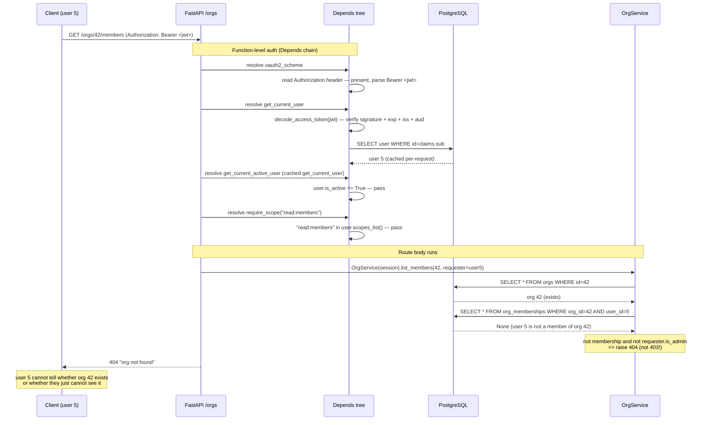
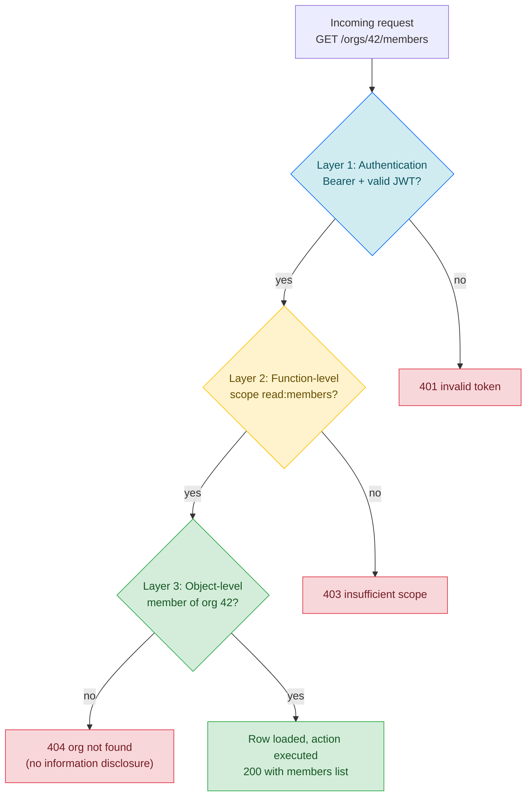

# Lesson 04: RBAC and Object-Level Authorization

*Where `Boardly` learns the difference between "is this user allowed to call this endpoint" and "is this user allowed to act on this specific row" — and learns that the second question is where most production breaches live.*

**The other half of auth.**

OAuth2 + JWT (Lesson 03) answers "who is this user". RBAC + object-level authorization answers "what are they allowed to do to **this** row". The first is necessary; the second is where most production auth bugs live. Most public data breaches in 2023–2026 were BOLA — Broken Object Level Authorization — not broken crypto. A user with a valid token requests `GET /api/orgs/42/members/99`. The token verifies. The route requires `read:members`. The user has that scope. The router returns 200 with member 99's data. Member 99 belongs to org 42, which the user is not a member of. **This is a breach.** This lesson is the difference between those two checks, and how to enforce both with `Depends` chains so the check is impossible to forget.


#security #authorization #rbac #bola #depends

## Learning Objectives

By the end of this lesson you will be able to:

1. **Distinguish role-based (RBAC), attribute-based (ABAC), and object-level authorization** — and explain why most FastAPI services need RBAC + object-level, not pure ABAC.
2. **Use scopes** (`read:users`, `write:org`) and a `require_scope` `Depends` factory.
3. **Enforce object-level access in the service layer**, not just the router — so the check survives non-router callers (cron jobs, queue consumers, internal services).
4. **Write the security-test matrix** for every protected endpoint: unauthenticated, missing scope, valid scope but wrong object, valid scope and right object, valid scope right object but inactive user.
5. **Choose between `404` and `403` for unauthorized object access** — and explain why 404 is the right answer (no information disclosure).
6. **Build a `Depends` chain** — `get_current_user` → `get_current_active_user` → `require_scope("projects:write")` — where each layer adds one check and the chain composes.
7. **Explain the admin override** pattern (`or requester.is_admin`) — and why giving admins every individual scope is the wrong way.

## Prerequisites

Before starting, you need:

- **`Depends` chains** — [[03-FastAPI-Core/Dependency-Injection]]. The whole enforcement layer is `Depends`. Lesson 03 introduced `get_current_user`; this lesson layers `get_current_active_user` and `require_scope` on top.
- **OAuth2 + JWT** — [[OAuth2-JWT-Access-Refresh]]. `get_current_user` from Lesson 03 is the start of every chain in this lesson. The `scope` claim in the JWT is the source of `current_user.scopes_list()`.
- **AsyncSession** — [[07-SQLAlchemy/05-Session-and-Transaction-Management]]. Object-level checks need a session to load the row.
- **The threat model** — [[Threat-Model-First]]. The asset is "org data: org memberships, project names". The threat is "a cross-tenant caller with valid credentials". The defense is BOLA enforcement.

**The single most common gap: "we check the scope in the router".**

If your authorization check is in the router, it is bypassable by every non-router caller — cron jobs, queue consumers, internal services, the admin CLI. The check has to be in the service layer, where the row is loaded. Lesson 03's `get_current_user` is a *function-level* check; this lesson's `OrgService._load_org_and_membership` is an *object-level* check. Both. Not one or the other.


## The Problem

`Boardly` now has users, login, and JWTs (Lessons 02 and 03). The next step: when a user requests `GET /orgs/42/members`, the server must answer two questions:

1. **Function-level (RBAC):** Is this user allowed to call `GET /orgs/{org_id}/members` at all? — needs the `read:members` scope.
2. **Object-level (BOLA):** Is this user allowed to act on org 42 specifically? — needs to be a member of org 42, or an admin.

A naive FastAPI app checks the scope in the router:

```python
# WRONG — scope is checked, object-level is not. Easy to forget in the next endpoint.
@router.get("/orgs/{org_id}/members")
async def list_members(org_id: int, current_user: User = Depends(get_current_user)):
 if "read:members" not in current_user.scopes:
 raise HTTPException(403)
 return await MemberRepository.get_by_org(org_id) # no BOLA check!
```

This router returns org 42's members to any user with `read:members` — even users who are not members of org 42. The router checked function-level authorization; it did not check object-level. The fix is two-layer: function-level via `Depends(require_scope("read:members"))`, object-level inside the service. The router cannot "forget" object-level because the service refuses to run without a `requester` argument.

Why is "function-level in the router, object-level in the service" the right split? Function-level is about *what kind of action* the user is attempting — "calling `list_members` is a member-read operation, which needs `read:members` scope". This check has no need for the row's data; it is a claim on the JWT. It belongs at the routing boundary because that is where we have the request shape (the path, the method, the body). Object-level is about *which specific row* the user is acting on — "are they a member of org 42". This check needs the row's data; it is a claim against the database. It belongs in the service because that is where the row is loaded, and because every caller (router, cron, queue) goes through the service. Splitting them this way is not just convention — each check has a *natural home* based on what data it needs.

## The Code

Here is the complete `boardly/security/deps.py` — the `Depends` chain.

```python
# boardly/security/deps.py
"""RBAC + object-level authorization dependencies.

Lesson 11.04: the Depends chain
 get_current_user (Lesson 03)
 -> get_current_active_user
 -> require_scope("projects:write")
 -> require_any_scope("read:orgs", "admin:orgs")
"""
from fastapi import Depends, HTTPException, status
from sqlalchemy.ext.asyncio import AsyncSession

from boardly.db import get_session
from boardly.models import User
from boardly.security.auth import get_current_user


async def get_current_active_user(
 current: User = Depends(get_current_user),
) -> User:
 """Rejects inactive users. Use this instead of get_current_user
 when the route should not be accessible to suspended accounts."""
 if not current.is_active:
 raise HTTPException(
 status.HTTP_403_FORBIDDEN,
 "inactive user",
 )
 return current


def require_scope(required: str):
 """Returns a dependency that requires a single scope."""
 async def _dep(current: User = Depends(get_current_active_user)) -> User:
 if required not in current.scopes_list():
 raise HTTPException(
 status.HTTP_403_FORBIDDEN,
 "insufficient scope",
 )
 return current
 return _dep


def require_any_scope(*required: str):
 """Returns a dependency that requires at least one of the given scopes."""
 async def _dep(current: User = Depends(get_current_active_user)) -> User:
 if not any(s in current.scopes_list() for s in required):
 raise HTTPException(
 status.HTTP_403_FORBIDDEN,
 "insufficient scope",
 )
 return current
 return _dep
```

And here is `boardly/services/orgs.py` — the object-level check in the service layer.

```python
# boardly/services/orgs.py
"""Org service with object-level access control.

Lesson 11.04: the service refuses to run without a requester. The
router cannot forget the BOLA check because the service does not
expose a no-requester method.
"""
from fastapi import HTTPException, status
from sqlalchemy import select
from sqlalchemy.ext.asyncio import AsyncSession

from boardly.models import Org, OrgMembership, User


class OrgService:
 def __init__(self, session: AsyncSession):
 self.session = session

 async def _load_org_and_membership(
 self, org_id: int, user_id: int
 ) -> tuple[Org, OrgMembership | None]:
 """Load the org and the requesting user's membership in it.

 Returns (org, membership). membership is None if the user is
 not a member of the org. Raises 404 if the org does not exist
 OR the user is not a member (and not admin) — same response,
 no enumeration.
 """
 org = await self.session.get(Org, org_id)
 if not org:
 raise HTTPException(status.HTTP_404_NOT_FOUND, "org not found")
 membership = await self.session.scalar(
 select(OrgMembership).where(
 OrgMembership.org_id == org_id,
 OrgMembership.user_id == user_id,
 )
 )
 return org, membership

 async def get_org(self, org_id: int, requester: User) -> Org:
 """BOLA: requester must be a member of the org, or an admin."""
 org, membership = await self._load_org_and_membership(org_id, requester.id)
 if not membership and not requester.is_admin:
 # 404, not 403 — see Common Mistake #2
 raise HTTPException(status.HTTP_404_NOT_FOUND, "org not found")
 return org

 async def list_members(self, org_id: int, requester: User) -> list[OrgMembership]:
 org, membership = await self._load_org_and_membership(org_id, requester.id)
 if not membership and not requester.is_admin:
 raise HTTPException(status.HTTP_404_NOT_FOUND, "org not found")
 result = await self.session.scalars(
 select(OrgMembership).where(OrgMembership.org_id == org_id)
 )
 return result.all()

 async def add_member(
 self, org_id: int, target_user_id: int, requester: User
 ) -> None:
 """BFLA: only org admins can add members. Membership alone is
 insufficient — the user must be a member AND an admin of the org."""
 org, membership = await self._load_org_and_membership(org_id, requester.id)
 if not membership or membership.role != "admin":
 # 403 here is fine — the user can see the org exists (they're
 # a member), they just cannot perform this action.
 raise HTTPException(status.HTTP_403_FORBIDDEN, "must be org admin")
 new_membership = OrgMembership(
 org_id=org_id, user_id=target_user_id, role="member"
 )
 self.session.add(new_membership)
 await self.session.commit()
```

And here is the router that wires them together — `boardly/routers/orgs.py`.

```python
# boardly/routers/orgs.py
from typing import Annotated

from fastapi import APIRouter, Depends, HTTPException, status
from sqlalchemy.ext.asyncio import AsyncSession

from boardly.db import get_session
from boardly.models import User
from boardly.security.deps import get_current_user, require_scope
from boardly.services.orgs import OrgService

router = APIRouter(prefix="/orgs", tags=["orgs"])


@router.get(
 "/{org_id}/members",
 dependencies=[Depends(require_scope("read:members"))],
)
async def list_members(
 org_id: int,
 current_user: Annotated[User, Depends(get_current_user)],
 session: Annotated[AsyncSession, Depends(get_session)],
):
 service = OrgService(session)
 return await service.list_members(org_id, requester=current_user)


@router.post(
 "/{org_id}/members/{user_id}",
 status_code=status.HTTP_201_CREATED,
 dependencies=[Depends(require_scope("write:members"))],
)
async def add_member(
 org_id: int,
 user_id: int,
 current_user: Annotated[User, Depends(get_current_user)],
 session: Annotated[AsyncSession, Depends(get_session)],
):
 service = OrgService(session)
 await service.add_member(org_id, target_user_id=user_id, requester=current_user)
 return {"status": "ok"}
```

And here is the security-test matrix — `tests/test_rbac.py` — that proves the matrix of access states. Every protected endpoint gets a matrix like this.

```python
# tests/test_rbac.py
import pytest
from httpx import ASGITransport, AsyncClient

from boardly.main import app
from boardly.models import User
from boardly.security.deps import get_current_user


def _fake_user(
 *,
 is_admin: bool = False,
 scopes: tuple[str, ...] = ("read:members",),
 is_member: bool = False,
 is_active: bool = True,
 user_id: int = 999,
) -> User:
 return User(
 id=user_id,
 email="t@e.st",
 role="admin" if is_admin else "member",
 is_active=is_active,
 _scopes=list(scopes),
 _member_of={42} if is_member else set(),
 )


@pytest.fixture
def override_user():
 """Replace get_current_user with a controllable fake.

 This is the canonical dependency-override pattern, taught in
 [[12-Testing-and-Quality/Testing-FastAPI-Endpoints]] — we link
 there instead of re-explaining.
 """
 def _swap(user: User):
 async def _fake():
 return user
 app.dependency_overrides[get_current_user] = _fake
 yield _swap
 app.dependency_overrides.clear()


@pytest.mark.asyncio
async def test_unauthenticated_returns_401():
 # No override installed — the real oauth2_scheme rejects.
 async with AsyncClient(transport=ASGITransport(app=app), base_url="http://t") as ac:
 r = await ac.get("/orgs/42/members")
 assert r.status_code == 401


@pytest.mark.asyncio
async def test_missing_scope_returns_403(override_user):
 override_user(_fake_user(scopes=()))
 async with AsyncClient(transport=ASGITransport(app=app), base_url="http://t") as ac:
 r = await ac.get("/orgs/42/members")
 assert r.status_code == 403


@pytest.mark.asyncio
async def test_cross_org_access_returns_404(override_user):
 # Valid scope, but user is NOT a member of org 42 — BOLA blocks.
 override_user(_fake_user(scopes=("read:members",), is_member=False))
 async with AsyncClient(transport=ASGITransport(app=app), base_url="http://t") as ac:
 r = await ac.get("/orgs/42/members")
 assert r.status_code == 404 # NOT 403 — no information disclosure


@pytest.mark.asyncio
async def test_member_can_list_their_own_org(override_user, seed_org_42):
 override_user(_fake_user(scopes=("read:members",), is_member=True))
 async with AsyncClient(transport=ASGITransport(app=app), base_url="http://t") as ac:
 r = await ac.get("/orgs/42/members")
 assert r.status_code == 200


@pytest.mark.asyncio
async def test_admin_override_can_list_any_org(override_user, seed_org_42):
 override_user(_fake_user(scopes=("read:members",), is_member=False, is_admin=True))
 async with AsyncClient(transport=ASGITransport(app=app), base_url="http://t") as ac:
 r = await ac.get("/orgs/42/members")
 assert r.status_code == 200 # admin override


@pytest.mark.asyncio
async def test_inactive_user_blocked_even_with_scope(override_user):
 override_user(_fake_user(scopes=("read:members",), is_member=True, is_active=False))
 async with AsyncClient(transport=ASGITransport(app=app), base_url="http://t") as ac:
 r = await ac.get("/orgs/42/members")
 assert r.status_code == 403
```

Read all four files. Then read the dissection below — every line gets a *what* / *why* / *what-Python-or-the-framework-does-internally*.

## Line-by-Line Deep Dive

### Lines 1–8 of `deps.py`: The doc comment

```python
"""RBAC + object-level authorization dependencies.

Lesson 11.04: the Depends chain
 get_current_user (Lesson 03)
 -> get_current_active_user
 -> require_scope("projects:write")
 -> require_any_scope("read:orgs", "admin:orgs")
"""
```

**What it does:** Documents the chain. Anyone reading this file sees the DAG of dependencies and what each layer adds.

**Why this matters:** A `Depends` chain is invisible from the route definition — you just see `Depends(require_scope("read:members"))`. The reader has to know that `require_scope` calls `get_current_active_user`, which calls `get_current_user`, which calls `oauth2_scheme`. The docstring makes the chain explicit.

### Lines 18–26: `get_current_active_user`

```python
async def get_current_active_user(
 current: User = Depends(get_current_user),
) -> User:
 """Rejects inactive users."""
 if not current.is_active:
 raise HTTPException(
 status.HTTP_403_FORBIDDEN,
 "inactive user",
 )
 return current
```

**What it does:** Adds one check on top of `get_current_user`: the user must be active.

**Why a separate dependency and not a check inside `get_current_user`:** Some routes are accessible to inactive users (e.g. `POST /auth/refresh` — an inactive user with a valid refresh token can refresh, and the refresh-endpoint logic decides what to do). Most routes are not. The split lets each route pick.

**Why 403 (not 401):** 401 means "no authentication" — the user is not identified. 403 means "identified but not allowed" — the user is identified, but they are suspended. The browser/SDK distinguishes: 401 → prompt for credentials; 403 → show "your account is suspended, contact support".

**When 401 vs 403 matters**

- **401 Unauthorized**: no token, or invalid token. The client should re-authenticate.
- **403 Forbidden**: valid token, but the user is not allowed to do this (insufficient scope, suspended account, not a member of the org).
A 401 prompt for a password on "you are not a member of org 42" would be nonsensical — the user is logged in fine, they are just not allowed. Use 403.


### Lines 29–39: `require_scope`, the `Depends` factory

```python
def require_scope(required: str):
 """Returns a dependency that requires a single scope."""
 async def _dep(current: User = Depends(get_current_active_user)) -> User:
 if required not in current.scopes_list():
 raise HTTPException(
 status.HTTP_403_FORBIDDEN,
 "insufficient scope",
 )
 return current
 return _dep
```

**What it does:** A function that returns a function. The outer `require_scope` is the *factory*; the inner `_dep` is the *dependency* FastAPI calls.

**Why a factory:** Each call to `require_scope("read:members")` returns a *new* `_dep` closure that captured `required="read:members"`. So the same factory gives us `require_scope("read:members")` for the read endpoint and `require_scope("write:members")` for the write endpoint — both with the same code, just different captured values.

**Why `Depends(get_current_active_user)`:** The chain composition. `require_scope` does not call `get_current_active_user` directly — it declares it as a dependency, and FastAPI resolves it (and its dependencies, transitively). The chain is:

1. `oauth2_scheme` reads `Authorization: Bearer <jwt>`. No header → 401.
2. `get_current_user` decodes the JWT, loads the user. Invalid token → 401.
3. `get_current_active_user` checks `user.is_active`. Inactive → 403.
4. `require_scope("read:members")` checks the scope. Missing → 403.
5. Route runs.

You get the chain free; you cannot accidentally verify the JWT but forget the active check.

**Student asks: why `def require_scope` and not `async def require_scope`?**

Same answer as Lesson 01's `rate_limit`: the outer function is a *factory*, not a *dependency*. The factory does no I/O — it just closes over `required` and returns a callable. Marking it `async` would make Python wrap the return value in a coroutine, which FastAPI would await expecting the awaited result to be the dependency. It is not. The inner `_dep` is `async def` because it does I/O (via its `Depends(get_current_active_user)`).


### Lines 42–52: `require_any_scope`

```python
def require_any_scope(*required: str):
 """Returns a dependency that requires at least one of the given scopes."""
 async def _dep(current: User = Depends(get_current_active_user)) -> User:
 if not any(s in current.scopes_list() for s in required):
 raise HTTPException(
 status.HTTP_403_FORBIDDEN,
 "insufficient scope",
 )
 return current
 return _dep
```

**What it does:** Same as `require_scope` but accepts any of the given scopes. Useful for routes that have multiple paths to authorization (e.g. `read:orgs` OR `admin:orgs`).

### Lines 1–18 of `services/orgs.py`: The service skeleton

```python
class OrgService:
 def __init__(self, session: AsyncSession):
 self.session = session
```

**What it does:** Service class that takes an `AsyncSession` and exposes methods that each take a `requester: User`.

**Why a class and not bare functions:** The class groups org-related methods and makes the dependency on `session` explicit. The alternative — bare functions with `session: AsyncSession = Depends(get_session)` arguments — works, but it does not compose: you cannot pass a service to a function that expects another service. The class is the unit of composition.

**Why every method takes `requester`:** The service refuses to run without a `requester`. The router cannot forget the BOLA check because the service does not expose a no-`requester` method. This is the architectural property — the check is enforced by the type signature, not by convention.

**Danger — Where the BOLA check lives is where the bypass surface is.**

A BOLA check that lives in the router is silently bypassed by every non-router caller. The cron job that walks all orgs at 03:00 to back up memberships for billing — calls `OrgService.list_members(org_id=42)` directly, never sees the router's check, and inherits whatever the router allowed (or did not allow). The arq worker that processes a webhook by calling `OrgService.add_member` — same problem. The admin CLI that mass-imports memberships from a CSV — same problem. The internal service that reads orgs for an audit dashboard — same problem. Each of these is a *real* caller; each ships in a real codebase; each bypasses the router silently. The architectural mitigation is what the service skeleton shows: `requester: User` is a *required* parameter, not a *default*, so any caller — router, cron, worker, CLI, internal service — is forced by the type signature to pass one. The check moves from "convention the tired engineer forgets" to "the function does not type-check without it". That is the difference between a security property and a security hope.


### Lines 20–38: `_load_org_and_membership`

```python
async def _load_org_and_membership(
 self, org_id: int, user_id: int
) -> tuple[Org, OrgMembership | None]:
 """Load the org and the requesting user's membership in it."""
 org = await self.session.get(Org, org_id)
 if not org:
 raise HTTPException(status.HTTP_404_NOT_FOUND, "org not found")
 membership = await self.session.scalar(
 select(OrgMembership).where(
 OrgMembership.org_id == org_id,
 OrgMembership.user_id == user_id,
 )
 )
 return org, membership
```

**What it does:** Loads the org by id and the (org_id, user_id) membership. Returns `(org, membership)` where `membership` is `None` if the user is not a member.

**Why two queries, not one:** A single join query (`SELECT * FROM orgs LEFT JOIN memberships ON ... WHERE orgs.id = ? AND memberships.user_id = ?`) is one round-trip but conflates the two failure modes: if the org does not exist, the join returns nothing; if the user is not a member, the join also returns nothing. We need to distinguish at this layer (so we can raise 404 for "org not found" before checking membership), so two queries is clearer. The cost is one extra round-trip — invisible for the security property.

**Warning — Two queries per request becomes a DB-pool drain at scale.**

The "one extra round-trip is invisible for the security property" reasoning above is right at low traffic and wrong at high traffic. At 1000 req/sec on a protected endpoint, the extra SELECT on `org_memberships` is 1000 extra queries/sec — each holds a DB connection for ~2 ms, which is 2 connection-seconds per second, which is a non-trivial fraction of a 20-connection pool. The production fix is a Redis cache on `(org_id, user_id) -> membership` with a 5-min TTL. The cache is a performance optimization, NOT a security property: the RLS backstop stays in the DB (Exercise 5), and the cache invalidation on `add_member`/`remove_member` is the write path. A cache hit must NOT skip the BOLA check — the BOLA check is "is the user a member", which is exactly what the cache answers. The trap is treating the cache as an optimization that *bypasses* the check; it is an optimization that *answers* the check faster. Two different things. See [[13-Performance-and-Observability/N-plus-1-and-Slow-Queries]] for the query-counting pattern that catches this regression.


**Why `await self.session.get(Org, org_id)`:** `session.get(Model, primary_key)` is the SQLAlchemy 2.x identity-map-aware fetch. It checks the session's identity map first (free if the row is already loaded), then queries the DB. For tests, this is important — the transaction-rollback pattern (Lesson 12.03) means the row may already be in the session.

**The identity map makes the "two queries" reasoning cheaper than it sounds in practice.**

`await self.session.get(Org, org_id)` in `_load_org_and_membership` loads the org into the session's identity map. If a later call in the same request — `list_members`'s `SELECT * FROM org_memberships WHERE org_id = ?` — joins or references `Org`, SQLAlchemy's identity map returns the already-loaded `Org` object without a second `SELECT orgs`. The "two queries" reasoning (one for the org, one for the membership) holds for the *first* call; subsequent calls in the same request that touch the same row are free. The production property that makes this hold is "the `get_session` dependency yields the *same* `AsyncSession` across the Depends tree" — see [[07-SQLAlchemy/05-Session-and-Transaction-Management]] for the per-request session pattern. If you accidentally yield a *new* session per dependency (a common mistake when overriding `get_session` in tests), the identity map is per-session, and the "two queries" reasoning degrades to "two queries, twice, for the same row". The CI guard is the same query-count fixture from the dependency-cache check (the `**Danger —**` below) — it catches the regression.


### Lines 40–47: `get_org`, the BOLA check

```python
async def get_org(self, org_id: int, requester: User) -> Org:
 """BOLA: requester must be a member of the org, or an admin."""
 org, membership = await self._load_org_and_membership(org_id, requester.id)
 if not membership and not requester.is_admin:
 raise HTTPException(status.HTTP_404_NOT_FOUND, "org not found")
 return org
```

**What it does:** Loads the org, checks the requester is a member (or an admin), returns the org or raises 404.

**Why 404 (not 403):** Returning 403 confirms the org exists ("you can't see this"). Returning 404 is ambiguous ("maybe it does not exist, maybe you cannot see it"). The 404 is the no-information-disclosure answer. See "Common Mistake #2".

Does 404 really hide existence? An attacker probing `/orgs/42` gets 404. They probe `/orgs/43` and get 404. They probe `/orgs/1` (which they *are* a member of) and get 200. The 200 leaks that org 1 exists. So 404 does not fully hide existence — the *contrast* between 404 and 200 leaks it. What 404 *does* hide is the distinction between "org does not exist" and "org exists but you cannot see it". An attacker who probes `/orgs/42` (which exists, but they cannot see) and `/orgs/9999` (which does not exist) gets the same 404 for both. They cannot enumerate "orgs that exist but are not mine" vs "orgs that do not exist" — both look like 404. That is the property we are buying. The full enumeration defence requires more (rate-limit the probe, audit the 404s, alert on a probe pattern), but 404-not-403 is the cheapest first step.

**The 404-vs-403 property only holds if both branches take the same time.**

A 404 that returns in 5 ms because the row was not in the DB, and a 404 that returns in 30 ms because the row *was* loaded but the membership check failed, leaks the distinction by timing side-channel — an attacker who measures response times can tell "this 404 is the not-found branch" from "this 404 is the forbidden branch" without ever reading the body. Look at the teaching `_load_org_and_membership` above: it short-circuits on `if not org: raise 404` *before* the membership SELECT — so the not-found branch pays one query, the forbidden branch pays two, and a patient attacker can distinguish them by latency. The defence is to make both branches do the same work: always issue the membership SELECT (even when the org is `None`, the query is a no-op that returns `None`) and only then decide which 404 to return. The trade-off is one extra DB round-trip on the not-found branch — for an enumeration defence that the status code already promised, that is a fair cost. This is the *operational* 404-vs-403 property — the status-code choice buys you the *protocol-level* property; the equal-work implementation buys you the *timing-level* property. You need both, or the protocol-level property is window dressing. (The teaching code keeps the short-circuit for clarity; the production version should drop it.)


**Why `or requester.is_admin`:** The admin override. Admins are not members of every org, but they can see every org — for support, auditing, and incident response. The override is explicit (`or requester.is_admin`), not implicit (giving admins every individual scope, which scales badly — see "Common Mistake #4").

**Danger — `requester.is_admin` from the JWT is the optimistic path; the DB is the authoritative path.**

If `is_admin` is a JWT-carried claim (the JWT's `scope` includes `admin`), a former admin's token is valid for the access token's TTL (15 min in the teaching design) after demotion. During that 15-min window, the demoted admin can still read every org's data, still call every admin-overridable endpoint. The fix is the inverse of the JWT-carried-scopes trade-off: admin-override endpoints check the DB on every request, not the JWT. The DB read is `SELECT is_admin FROM users WHERE id = ?` — one indexed read, ~1 ms, well below the 250 ms bcrypt would cost. The defence-in-depth is the JTI denylist (Exercise 9): when an admin is demoted, their current access-token JTIs land in a Redis `revoked_jtis` set, and `get_current_user` rejects them. The JWT-carried `is_admin` is the optimistic path (fast, no DB read); the DB-checked `is_admin` is the authoritative path (fresh, costs 1 ms); the JTI denylist is the immediate-revocation path (costs 1 Redis read, ~0.5 ms). Stack all three for admin endpoints: JWT for the 99% case, DB for the demotion window, JTI for the breach window. Pick the layers your threat model demands; do not pick "JWT alone" for admin endpoints.


**Warning — A single boolean `is_admin` is a stepping stone, not a destination.**

The single-boolean pattern is correct for a system with one class of administrator. It degrades the moment you have *two* classes — a support agent who needs read access for incident response, and a super-admin who needs write access for breach response. With a single `is_admin`, the support agent gets write access too, because the check is binary. The evolution path is: replace `is_admin: bool` with `admin_tier: Literal["none", "support_read", "audit_read", "super"]`, then check the tier per operation (`if requester.admin_tier not in {"support_read", "super"}: raise 403`). The single-boolean pattern in this lesson is the MVP — it ships correctly for the first org, the first admin, the first breach-response runbook. It does not scale past two admin classes. The migration is mechanical (one column, one enum, one check per service method) and is left as the natural next step once the system has a real support team and a real separation of duties. The teaching code keeps the boolean so the lesson is about BOLA, not about role-tier design — but the warning is here so you do not ship `is_admin` as a permanent design.


**Warning — The `membership.role != "admin"` string compare breaks the day you refactor the role to an Enum.**

The BFLA check compares `membership.role` (a string) to the literal `"admin"`. If you later migrate the column from `VARCHAR` to SQLAlchemy's `Enum(OrgRole)` and the enum's `.value` is `"ADMIN"` (uppercase, the convention) instead of `"admin"` (lowercase, the teaching code), the string compare silently returns True for every admin — every admin is rejected as "not an admin" because `"ADMIN" != "admin"`. The bug surfaces as "all org admins are 403'd from the add-member endpoint" — easy to spot in isolation, hard to spot if the migration is gradual (some rows still lowercase, some uppercase). The defence is to compare to the enum, not the string: `membership.role != OrgRole.ADMIN`, and let SQLAlchemy's `Enum` type handle the string↔enum mapping at the column level. Then the only valid value in the DB is `OrgRole.ADMIN` (whatever its `.value`), and the compare is type-safe. The teaching code uses the string for clarity; the production code uses the enum for safety.


### Lines 49–58: `list_members`, same pattern

```python
async def list_members(self, org_id: int, requester: User) -> list[OrgMembership]:
 org, membership = await self._load_org_and_membership(org_id, requester.id)
 if not membership and not requester.is_admin:
 raise HTTPException(status.HTTP_404_NOT_FOUND, "org not found")
 result = await self.session.scalars(
 select(OrgMembership).where(OrgMembership.org_id == org_id)
 )
 return result.all()
```

Same pattern as `get_org`. The BOLA check is identical; the difference is the query (list all memberships vs. get one org).

### Lines 60–73: `add_member`, the BFLA check

```python
async def add_member(
 self, org_id: int, target_user_id: int, requester: User
) -> None:
 """BFLA: only org admins can add members."""
 org, membership = await self._load_org_and_membership(org_id, requester.id)
 if not membership or membership.role != "admin":
 raise HTTPException(status.HTTP_403_FORBIDDEN, "must be org admin")
 new_membership = OrgMembership(
 org_id=org_id, user_id=target_user_id, role="member"
 )
 self.session.add(new_membership)
 await self.session.commit()
```

**What it does:** Checks the requester is an org admin, then adds the new membership.

**Why 403 here (not 404):** The user is a member of the org (the `not membership` check failed); they just cannot perform this action. The org's existence is already known to the user — they are a member. So 403 ("you can see it but cannot do this") is the right answer. The 404 was for users who cannot even see the org exists; the 403 is for users who can.

This distinction — 404 for "you cannot see it", 403 for "you can see it but cannot do this" — is the BOLA vs BFLA distinction in HTTP status code form.

### Lines 1–32 of `routers/orgs.py`: The router

```python
@router.get(
 "/{org_id}/members",
 dependencies=[Depends(require_scope("read:members"))],
)
async def list_members(
 org_id: int,
 current_user: Annotated[User, Depends(get_current_user)],
 session: Annotated[AsyncSession, Depends(get_session)],
):
 service = OrgService(session)
 return await service.list_members(org_id, requester=current_user)
```

**What it does:** Defines the route with function-level auth (`Depends(require_scope("read:members"))`) and object-level auth (inside `OrgService.list_members`).

**Why `dependencies=[Depends(require_scope("read:members"))]`:** This is the function-level check. The dependency runs for its side effect (the 403 raise on missing scope); its return value (the `User`) is not injected into the function. We do not need it — we already get the user via `current_user: Annotated[User, Depends(get_current_user)]`.

**Why both `dependencies=[Depends(require_scope)]` AND `current_user: Annotated[User, Depends(get_current_user)]`:** FastAPI caches per-request dependency results. So `require_scope`'s `Depends(get_current_active_user)`, `get_current_user` in the route signature, and `get_current_user` inside `get_current_active_user` all resolve to the *same* user object — one DB read, three uses. The cache is the reason you can be liberal with `Depends`.

Why not just put `current_user: Annotated[User, Depends(require_scope("read:members"))]` and let the route body read the scope? Because that pattern silently degrades — the next endpoint the team writes might forget to read the scope, and there is no compile-time error telling them they did. The `dependencies=[Depends(require_scope(...))]` form runs the check *for its side effect*, outside the function body, so it cannot be forgotten: the dependency raises 403 before the function body is entered. The architectural property is "the check runs whether or not the route body remembers to use the result". That is the difference between convention (which a tired engineer forgets) and architecture (which the framework enforces).

**Per-request dependency cache**

FastAPI caches the result of each dependency callable per request. If `get_current_user` is requested by both `require_scope` and the route signature, FastAPI calls it once, caches the result, and reuses. This is why you can be liberal with `Depends` — you do not pay N× the cost for N uses.


**Danger — The per-request cache only holds if `get_current_user` is the same callable both times.**

The FastAPI per-request cache keys on the *callable* object passed to `Depends`. If `get_current_user` is a stable module-scope function (the teaching pattern), `Depends(get_current_user)` in `require_scope`'s chain and `Depends(get_current_user)` in the route signature hit the same cache entry — one DB read for `User`. If `get_current_user` is a *lambda* or a *freshly-constructed callable per request* (e.g. a partial, a method bound to a per-request object), the two `Depends` calls pass *different* callables, and FastAPI calls `get_current_user` twice — two `SELECT * FROM users` queries, two `bcrypt.checkpw` calls (the 250 ms one), and the route's response time doubles. The trap is silent: the route works, the tests pass, the latency budget silently inflates from 250 ms to 500 ms. The defence is a CI guard: a `pytest` fixture that wraps `AsyncSession.scalar` and counts the `SELECT * FROM users` queries per request — assert `== 1`. See [[07-SQLAlchemy/05-Session-and-Transaction-Management]] for the session-event hook that counts queries, and [[12-Testing-and-Quality/Testing-FastAPI-Endpoints]] for the dependency-override pattern. The guard catches the lambda-regression before the latency budget does.


### Lines 1–62 of `tests/test_rbac.py`: The security test matrix

The test file is the most important artifact in this lesson. Every protected endpoint gets a matrix like this.

**The `_fake_user` factory** (lines 7–22): builds a `User` with overrides for the relevant security dimensions — `is_admin`, `scopes`, `is_member`, `is_active`, `user_id`. The factory is the test's "knob set" for the matrix.

**The `override_user` fixture** (lines 25–35): a context-manager-style fixture that swaps `get_current_user` with a fake. This is the canonical `app.dependency_overrides` pattern taught in [[12-Testing-and-Quality/Testing-FastAPI-Endpoints]] — we link there instead of re-explaining.

**The matrix** (the five tests):

| Test | Scope? | Member? | Active? | Admin? | Expected |
|---|---|---|---|---|---|
| `test_unauthenticated_returns_401` | — | — | — | — | 401 |
| `test_missing_scope_returns_403` | no | — | yes | no | 403 |
| `test_cross_org_access_returns_404` | yes | no | yes | no | 404 |
| `test_member_can_list_their_own_org` | yes | yes | yes | no | 200 |
| `test_admin_override_can_list_any_org` | yes | no | yes | yes | 200 |
| `test_inactive_user_blocked_even_with_scope` | yes | yes | no | no | 403 |

This is the matrix you must run for every protected endpoint. The five tests cover the five failure modes (and the two success modes). Adding a new protected endpoint means copying this matrix and adjusting the scope names.

**Tip — Treat the matrix as a copy-paste template, not a creative-writing prompt.**

When a teammate adds `POST /orgs/{org_id}/projects`, the PR review should reject it unless the same six-row matrix exists in `tests/test_rbac.py`, with the scope name changed to `write:projects` and the row names changed to match the new endpoint. The point of a matrix is that it is *mechanical*: there is no judgement call about "which tests do we need this time?" — the answer is "the same six, with the scope swapped". The matrix is a checklist, and the checklist is the contract. The first time a teammate ships a new endpoint *without* the matrix, that is the moment the BOLA bug ships. The CI guard for "every `routers/*.py` route has a matching `tests/test_rbac*.py` matrix entry" is the automation that catches the miss; the human review is the backstop. Both. The matrix pattern in this file is the template; copy it, do not redesign it per endpoint.


**Danger — The matrix is the contract.**

A new endpoint with the matrix green is *probably* safe. A new endpoint without the matrix is *not*. The matrix is the contract that says "we tested every access state". Code review must require the matrix; CI must run it. Without the matrix, you ship BOLA bugs.


**The matrix pattern needs a CI guard that fails the build when a route is added without a matching matrix.**

The matrix is the contract — but contracts drift. A new endpoint `POST /orgs/{org_id}/projects` ships, the PR adds the route, the route has `Depends(require_scope("write:projects"))`, and the matrix in `tests/test_rbac.py` is NOT updated. The matrix gap is the BOLA bug shipping. The CI guard is a `pytest` collection hook in `conftest.py` that scans `routers/*.py` for routes with `Depends(require_scope(...))`, extracts the scope name, and asserts a matching `test_<scope>_rbac_matrix` exists in the collected tests. The hook fails the build at collection time (before any test runs) — the PR cannot merge. The guard is ~30 lines of AST-walking; the value is the contract that the matrix stays in sync with the routes. Without the guard, the matrix is convention; with the guard, the matrix is enforcement. See [[12-Testing-and-Quality/CI-Pipelines]] for the GitHub Actions wiring of custom collection hooks.


## Execution Trace

A request for `GET /orgs/42/members` from user 5 (member of org 17, not 42, with `read:members` scope, active).



The diagram shows the two layers: function-level auth runs in the `Depends` tree (steps 1–4 in the "Line-by-Line" above), object-level auth runs inside the service (steps 5–7). The 404 is the deliberate "no information disclosure" answer.

The three layers (authentication, function-level authorization, object-level authorization) are best seen as a single colour-coded pipeline: blue for "we know who they are", amber for "we know they may call this endpoint at all", green for "we know they may act on this specific row". Each layer rejects a different attacker: blue stops the no-credentials caller, amber stops the wrong-scope user, green stops the cross-tenant user. A request that fails any of the three never reaches the row it asked about.



**Student asks: Why three layers instead of one mega-check?**

Because each layer is *bypassable by a different caller*. Layer 1 (authentication) is bypassed by anything that holds a stolen token — the rate limiter from Lesson 01 is the defence there. Layer 2 (function-level) is bypassed by any code that calls the service directly without going through the router — the `Depends` chain only runs in the router, so the cron job, the queue consumer, and the admin CLI skip it. Layer 3 (object-level) is enforced inside the service, where every caller — router, cron, queue, CLI — has to pass through it because the service method *requires* a `requester` argument and refuses to run without one. Three layers, three different bypass surfaces, three different mitigations. Collapse them into one mega-check and you have to defend one boundary against three different attacker types — which is the failure mode of "we check the scope in the router, surely that is enough".


**Student asks: Why does the admin override live in the object-level check and not in the scope check?**

Because the two layers answer different questions. The scope check (Layer 2) answers "is this user allowed to call this endpoint at all". An admin is allowed to call `GET /orgs/{org_id}/members` — same as a member. The admin does not need `admin:members` scope on top of `read:members`; they need the same scope as the regular user. The object-level check (Layer 3) answers "is this user allowed to act on this specific org". A regular user is allowed only if they are a member; an admin is allowed regardless of membership. Putting the override in Layer 2 ("admins have every scope") would scale badly — every new endpoint needs its scope added to the admin role, and the admin role grows stale. Putting the override in Layer 3 ("admins bypass the membership check") is one line per service method, and the scope check stays the same for everyone. The architectural property of "admin" is "they can see rows other users cannot", not "they can call endpoints other users cannot".


## Common Mistakes

### Mistake 1: Object-level check only in the router

```python
# WRONG — BOLA check in the router, not the service
@router.get("/orgs/{org_id}/members")
async def list_members(
    org_id: int,
    session: AsyncSession = Depends(get_session),
    requester: User = Depends(require_scope("read:members")),
):
    membership = await session.scalar(
        select(OrgMembership)
        .where(OrgMembership.org_id == org_id,
               OrgMembership.user_id == requester.id)
    )   # ← check done in the router
    if membership is None and not requester.is_admin:
        raise HTTPException(404)
    return await OrgService(session).list_members(org_id=org_id)   # ← no requester passed
```

**Attack:** A cron job or queue consumer (the `digest-email` worker, the `billing-aggregator` task) calls `OrgService(session).list_members(org_id=42)` directly — bypassing the router entirely. The service has no `requester` parameter, so it does no BOLA check. The worker happily lists org 42's members to whoever wired the call. The router's BOLA check is theatre: the *router* is enforced, the *service* is not. A second attacker path: a refactor moves the route logic into a service method (for unit-testability), and the developer forgets to move the BOLA check with it.

**Symptom:** A user with a valid token and `read:members` scope calls `GET /orgs/42/members` from a non-router caller (a cron job that lists org memberships for billing). The router's BOLA check is bypassed — the cron job calls `OrgService.list_members(org_id=42)` directly. The cron returns org 42's members to billing, which is fine for billing's job, but if the cron job is later repurposed (e.g. to send a digest email to non-members), it leaks.

**Why:** The router is one of many callers. Services, cron jobs, queue consumers, the admin CLI — all bypass routers. The BOLA check must be in the service, where every caller has to go through it.

**Fix:** The service refuses to run without a `requester` argument. The router cannot forget the BOLA check because the service does not expose a no-`requester` method. This is the pattern in this lesson.

```python
# RIGHT — BOLA check in the service; requester is mandatory
async def list_members(self, *, org_id: int, requester: User) -> list[Member]:
    if not requester.is_admin:
        membership = await self._load_membership(
            org_id=org_id, user_id=requester.id,
        )
        if membership is None:
            raise HTTPException(404)
    return await self._list(org_id=org_id)
```

**Example — In the wild: a major postal service BOLA (2018).**

A national postal service launched an API in 2018 that let any authenticated user query any other user's account data by changing the `uid` path parameter. The API checked the token (the user was authenticated) and the route scope (the user had `read:account`), but it did not check that the `uid` belonged to the requesting user. ~60 M records were exposed for over a year before a security researcher disclosed the issue. The post-mortem root cause was exactly this mistake: the BOLA check lived in the router middleware ("is this user authenticated?"), not in the service ("is this user allowed to act on *this* row?"). The fix was the same as the one above — the service method's signature changed to take `requester` as a mandatory keyword argument, and the router was reduced to one line.


**Warning — The admin override has a "what admins may NOT do" list, enforced by a second admin.**

The inverse of Mistake 4 is the over-correction: `or requester.is_admin` lands on every check, including the ones that should NOT be admin-overridable. "Admin can read any user's row" — fine, support needs it. "Admin can impersonate any user" — fine, support needs it. "Admin can rotate the JWT signing key" — NOT fine; that is a 4-eyes check, not a 1-admin check. "Admin can change their own role to super-admin" — NOT fine; that is a privilege-escalation path. "Admin can disable 2FA on another admin's account" — NOT fine; that is a separation-of-duties violation. The pattern is two lists: the "admin-overridable" list (read access, impersonation for support) and the "two-admin-required" list (key rotation, role changes, 2FA disable). The second list is enforced by `Depends(require_two_admins)` — a dependency that reads a second `X-Admin-Approval: <jwt>` header and asserts it is a different admin's valid token. The cost is one extra header on those endpoints; the benefit is the audit trail of "admin A requested, admin B approved". Without the second list, the override pattern ships with a privilege-escalation path on day one.


### Mistake 2: `403` for a row the user is not allowed to see

```python
# WRONG — 403 leaks existence
async def get_org(self, *, org_id: int, requester: User) -> Org:
    org = await self._load_org(org_id=org_id)
    if org is None:
        raise HTTPException(404, "org not found")
    membership = await self._load_membership(org_id=org_id, user_id=requester.id)
    if membership is None and not requester.is_admin:
        raise HTTPException(403, "you are not a member of this org")   # ← 403 confirms existence
    return org
```

**Attack:** An attacker probes the org-id space. `GET /orgs/42` returns 404 — either org 42 does not exist or the attacker cannot see it. `GET /orgs/43` returns 403 — the attacker now knows org 43 *does* exist. They iterate: `GET /orgs/44` → 403 (exists), `GET /orgs/45` → 404 (does not exist), `GET /orgs/46` → 403 (exists). They have now enumerated which orgs are valid targets. Combined with any other leak (a recent-activity feed, a public org directory, an invite email), they can now target the orgs they have confirmed exist. The same enumeration is possible by timing — a 403 is fast (the row was loaded and the membership was checked), a 404-from-not-found is slower (a separate code path).

**Symptom:** A user requests `GET /orgs/42` and gets 403. The user now knows org 42 exists. They probe `GET /orgs/43` and get 404 — org 43 does not exist. The user has enumerated which orgs exist.

**Why:** 403 confirms the org exists ("you can't see this"). 404 is ambiguous ("maybe it does not exist, maybe you cannot see it"). The 404 is the no-information-disclosure answer.

**Fix:** Use 404 for "row does not exist OR you cannot see it". Use 403 only for "row exists, you can see it exists, but you cannot perform this action on it" — e.g. a non-admin member of org 42 trying to add a member gets 403 (they know the org exists; they just cannot do this).

```python
# RIGHT — 404 for both "not found" and "not yours"
async def get_org(self, *, org_id: int, requester: User) -> Org:
    org = await self._load_org(org_id=org_id)
    membership = await self._load_membership(org_id=org_id, user_id=requester.id)
    if org is None or (membership is None and not requester.is_admin):
        raise HTTPException(404, "not found")   # ← no information leak
    return org
```

**Example — In the wild: a social-platform scraping case (2021).**

A 2021 scraping of a major social platform harvested ~700 M user records via the platform's contact-import endpoint. The endpoint returned 200 for a known user-id ("this user exists") and 404 for an unknown user-id ("this user does not"). The difference was the enumeration oracle — the attacker iterated phone-number hashes against the endpoint and used the 200/404 split to confirm which phone numbers were tied to accounts. The same pattern applies here: every 4xx-vs-4xx split where one code says "exists" and the other says "doesn't" is an enumeration oracle. The rule of thumb — *if the row's existence is sensitive, both branches return the same code and the same response shape*. Different status codes are a fingerprint.


### Mistake 3: Checking the scope, not the active flag

**Symptom:** A user resets their password (Lesson 02's breach response: their refresh tokens are revoked). But their existing access token is still valid for the next 15 min, and their `is_active` flag is still `True`. The user can keep posting for 15 min.

**Why:** Scope check alone is insufficient. The user might be valid in scope but suspended in account state.

**Fix:** The `get_current_active_user` chain enforces the active check everywhere `require_scope` is used. Suspended users (`is_active = False`) get 403 on every protected endpoint, regardless of scope.

### Mistake 4: Forgetting the admin override

**Symptom:** "Only owners can read" — but admins must too, or your support team cannot do their job. The pattern is `if user.id != row.owner_id: raise 403`, with no admin escape hatch. Support tickets escalate to engineering every time.

**Why:** The check is too strict. Admins need read access to every row for support and audit; they should not need to be added as a member of every org.

**Fix:** Build the override explicitly (`or requester.is_admin`). Do not give admins every individual scope — that scales badly (the scope list grows; admins get stale as new scopes are added). The override is the architectural property — admins bypass the membership check, not the scope check.

### Mistake 5: Scopes from a single source of truth, but mixed

**Symptom:** Scopes come from the JWT (`TokenClaims.scope`). But the route also reads `user.scopes_list()` from the DB. The two can diverge — the JWT is from 10 min ago, the DB has the current scopes (admin was just demoted). The route uses one or the other, inconsistently.

**Why:** You have to pick a source of truth. JWT-carried scopes are fast (no DB read on the hot path) but stale (until refresh). DB-checked scopes are fresh but cost a DB read.

**Fix:** The D-004 design is "scopes in JWT, refresh on permission change". The DB read in `get_current_user` loads the user (for the active flag and the membership check); the scopes come from the JWT. Permission changes trigger a refresh — the user's next `/auth/refresh` issues a new JWT with the new scopes. The 15-min TTL is the upper bound on staleness.

If you need fresher scopes (e.g. security-sensitive operations where 15 min of stale is unacceptable), do the DB read on every request — accept the cost. Pick per route, not per project.

**Danger — The refresh-on-permission-change pattern has a 15-min superuser window after demotion.**

The D-004 design ("scopes in JWT, refresh on permission change") keeps the hot path fast — no DB read on every request. But "refresh on permission change" requires the user's next `/auth/refresh` to issue a new JWT with the new (fewer) scopes. The user's *current* access token has 14 min of validity left when they are demoted — 14 min of stale-scope access. For a regular user demoted from `write:orgs` to `read:orgs`, that is 14 min of unwanted write access. For an admin demoted from `admin:orgs` to `read:orgs`, that is 14 min of superuser access. The fix is the JTI denylist: every protected endpoint checks `token_jti in revoked_jtis` (a Redis set), and demotion adds the user's current access-token JTIs to the set. The cost is one Redis `SISMEMBER` per protected request (~0.5 ms); the benefit is immediate revocation. The denylist is the gap-closer between "permission changed in the DB" and "permission changed in the user's session". Without it, the 15-min TTL is the upper bound on a demoted admin's superuser window — and 15 min is plenty of time to exfiltrate data.


### Mistake 6: Trusting `request.user.id == row.owner_id` without loading the row

```python
# WRONG — UPDATE without ownership check
@router.delete("/users/{user_id}/avatar")
async def delete_avatar(
    user_id: int,
    session: AsyncSession = Depends(get_session),
    requester: User = Depends(get_current_active_user),
):
    await session.execute(
        delete(UserAvatar).where(UserAvatar.user_id == user_id)   # ← caller-controlled id
    )
    await session.commit()
    return {"status": "ok"}
```

**Attack:** The attacker is `requester.id == 42`. They call `DELETE /users/1/avatar` (a user_id they do not own). The route trusts the path parameter `user_id`, the SQL `WHERE user_id = 1` runs, and the row belonging to user 1 is deleted — even though the requester is user 42. The BOLA check (`user_id == requester.id`) was never performed because the row was never loaded. The attacker iterates `DELETE /users/2/avatar`, `DELETE /users/3/avatar`, ... and wipes avatars across the user base.

**Symptom:** A naive `UPDATE ... WHERE id = ?` that the caller controls lets them guess IDs. The route accepts `user_id` from the path, the SQL updates `WHERE id = user_id` — no ownership check, no row load.

**Why:** Without loading the row first, you cannot check ownership. The route does an UPDATE that succeeds for any ID the caller provides.

**Fix:** Always load the row first (`row = await session.get(Model, id)`), check ownership (`row.owner_id == requester.id or requester.is_admin`), then act (`await session.delete(row)` or `row.field = new_value`). The load is the BOLA check.

```python
# RIGHT — load, check, act
@router.delete("/users/{user_id}/avatar")
async def delete_avatar(
    user_id: int,
    session: AsyncSession = Depends(get_session),
    requester: User = Depends(get_current_active_user),
):
    avatar = await session.get(UserAvatar, user_id)   # ← load first
    if avatar is None:
        raise HTTPException(404, "not found")
    if avatar.user_id != requester.id and not requester.is_admin:   # ← BOLA check
        raise HTTPException(404, "not found")   # 404, not 403 (Mistake 2)
    await session.delete(avatar)
    await session.commit()
    return {"status": "ok"}
```

**The `UPDATE … WHERE owner_id = :requester_id RETURNING *` pattern is the batch BOLA primitive.**

When you must `UPDATE` without a prior load (a batch operation, a bulk-update endpoint), the BOLA check is `UPDATE ... SET ... WHERE id = :id AND owner_id = :requester_id RETURNING *`. If the row is not owned by `requester_id`, the `WHERE` clause matches 0 rows, `RETURNING` returns 0 rows, and you raise 404. This is one query instead of two (load + update); the trade-off is the `UPDATE` takes a row lock (good for atomicity, bad for concurrent updates on the same row). The pattern is most valuable for batch endpoints: `POST /notifications/mark-all-read` with `UPDATE notifications SET read_at = now() WHERE user_id = :requester_id AND id IN :ids RETURNING id` — the `user_id = :requester_id` clause is the BOLA check, the `RETURNING id` lets you tell the caller how many rows were affected, and 0 rows affected is the BOLA rejection. The pattern does not work for `DELETE` (you cannot `RETURNING` from a row you cannot find) — for `DELETE`, load-then-delete stays the right shape. For `UPDATE`-heavy paths, `RETURNING` is the BOLA primitive that keeps the query count at one.


## Engineering Trade-Offs

### Roles vs scopes

- **Roles**: simpler, list-of-strings (`admin`, `member`, `viewer`). Easy to reason about, hard to scale (every new permission bumps every role definition).
- **Scopes**: more flexible, granular (`write:users`, `read:orgs`, `admin:billing`). More verbose, easier to evolve (add a new scope without touching existing roles).

Most apps: roles in the DB, expanded to scopes in the JWT. You get the human-friendly role ("admin") and the granular scope ("write:billing") in one design.

### JWT-carried scopes vs DB-checked scopes

- **JWT-carried**: no DB read on the hot path, but stale until refresh.
- **DB-checked**: fresh, one extra DB read per request.

Pick based on how often permissions change and how much you trust the refresh cadence. For most apps, JWT-carried + 15-min TTL is fine. For very-high-stakes operations (billing, admin actions), DB-check on those specific routes.

### Application-level checks vs Postgres RLS

- **Application checks** (this lesson): flexible, business rules, easy to evolve.
- **Postgres Row-Level Security (RLS)**: mechanical, row ownership, the backstop.

Both is best. RLS is the backstop: if the application has a bug and tries to query `SELECT * FROM members` without a tenant filter, RLS refuses to return rows from other tenants because the DB role is bound to a tenant. RLS does not replace application checks (the DB cannot enforce business rules), but it is the defense in depth that prevents a missed filter from becoming a leak.

**The naive RLS policy runs the membership subquery *per row* — `EXPLAIN ANALYZE` shows the `SubPlan`.**

The teaching RLS policy (`USING (org_id IN (SELECT org_id FROM org_memberships WHERE user_id = current_setting('app.user_id')::int))`) is correct on paper but expensive in practice. PostgreSQL's planner runs the `IN (SELECT ...)` subquery as a `SubPlan` — for each row of the protected table, the planner executes the subquery once. `EXPLAIN ANALYZE` shows `SubPlan 1` with `loops=N` where N is the row count. At N=10 000, that is 10 000 subquery executions per query. The fix is the `EXISTS` form: `USING (EXISTS (SELECT 1 FROM org_memberships om WHERE om.org_id = org_memberships.org_id AND om.user_id = current_setting('app.user_id')::int))` — PostgreSQL can flatten the `EXISTS` into a semi-join, executing the membership lookup once per query instead of per row. The alternative is a session-level GUC set to an array of `org_id`s the user is a member of, then `org_id = ANY(current_setting('app.member_orgs')::int[])` — the array is materialised once per session. Both flatten the per-row subquery. See [[08-PostgreSQL/Roles-Permissions-Security]] for the policy patterns and [[08-PostgreSQL/EXPLAIN-ANALYZE-and-Query-Plans]] for the SubPlan/loops analysis. The RLS backstop is the security property; the policy shape is the performance property.


### Custom scope strings vs RFC 6749 conventions

`read:users` matches FastAPI's docs and the OAuth2 spec's spirit. Whatever you choose, write it down in a single constants module — typos in scopes are silent 403s. A `class Scope(str, Enum): READ_USERS = "read:users"` is the safest pattern.

**Warning — `class Scope(str, Enum)` serializes as the name, not the value, without `use_enum_values=True`.**

The `Scope(str, Enum)` pattern above is the right shape — typos in scope strings become `AttributeError`s at import time, not silent 403s at runtime. But Pydantic v2's default JSON serialization for `Enum` fields emits the enum's *name* (`"READ_USERS"`), not its *value* (`"read:users"`), when you call `model_dump(mode="json")` on a model that holds a `Scope`. If your JWT-claims model has `scope: list[Scope]` and you sign the JWT with `model_dump(mode="json")`, the `scope` claim in the token is `["READ_USERS", "WRITE_ORGS"]`. Your route's `require_scope("read:users")` does `if required not in current_user.scopes_list()` — and `"read:users" not in ["READ_USERS", ...]` is True, so every user is silently 403'd. The fix is `model_config = ConfigDict(use_enum_values=True)` on the JWT-claims model — then `model_dump(mode="json")` emits the value (`"read:users"`), and the route's compare matches. The bug is silent because the JWT looks fine, the route looks fine, and the test passes if it uses the enum (`Scope.READ_USERS`) instead of the string (`"read:users"`) — the test never exercises the JSON-serialization boundary. Always test the round-trip: sign a JWT, decode it, assert the scope string matches the literal `"read:users"`. See [[04-Pydantic/Serialization-and-Model-Dump]] for the `model_dump(mode="json")` semantics.


## Exercises

**Tip — The 20-minute rule**

If you're stuck on an exercise for more than 20 minutes, re-read the relevant section above, then move on.


**Exercise 1 — Add a `delete:members` scope.** Wire it on `DELETE /orgs/{org_id}/members/{user_id}`. Write the test for missing scope, for cross-org access, and for an admin removing a member from their own org.

**Exercise 2 — Implement field-level masking.** Non-admins see other users with `email` set to `None` in the response, but admins see the real value. Use a response model `UserReadPublic` (no `email`) vs `UserReadAdmin` (with `email`); pick based on `requester.is_admin`. Write the test.

**Exercise 3 — Add reuse-detection-aware logout.** Add `POST /auth/logout` that revokes the current refresh token chain. What is the user's access-token experience for the next 15 min? (Hint: the access token is still valid; the user has a logged-out-feeling experience for 15 min, then truly logged out.)

**Exercise 4 — Spot the bug.** This router is broken. Why?

```python
@router.get("/users/{user_id}")
async def get_user(user_id: int, current_user: User = Depends(get_current_user)):
 user = await session.get(User, user_id)
 return user
```

(Answer: (a) no scope check — anyone authenticated can read any user (BFLA + BOLA). (b) no object-level check — `current_user.id != user_id` is not verified (BOLA). (c) returns the full ORM model — leaks `password_hash` (BOPLA, Lesson 05). (d) no 404 for "not found or not allowed" — confirms existence.)

**Exercise 5 — Implement RLS as a backstop.** Write the Postgres policy `CREATE POLICY org_isolation ON org_memberships USING (org_id IN (SELECT org_id FROM org_memberships WHERE user_id = current_setting('app.user_id')::int));`. Wire `SET app.user_id = ?` in the session dependency. Demonstrate: even if the application forgets the `WHERE` filter, RLS refuses to return cross-tenant rows. (Hint: set `app.user_id` per-session in the `get_session` dependency via `await session.execute(text("SET LOCAL app.user_id = :uid"), {"uid": user.id})`. To prove the backstop works, write a deliberately-buggy service method that loads an org without the membership check; the test should expect an empty result set, not a row. See [[08-PostgreSQL/Roles-Permissions-Security]] for the role/policy grant syntax.)

**Exercise 6 — Write the security-review checklist.** For each new protected endpoint in `Boardly`, write a 6-item checklist the PR reviewer uses: scope check in `Depends`? object-level check in service? 404 not 403 for unauthorized rows? admin override present? matrix of security tests exists? scopes from JWT (not stale DB)?

**Exercise 7 — Implement the equal-work 404.** Refactor `_load_org_and_membership` to always issue the membership SELECT (even when `org` is None — the query is a no-op that returns None). Write a test that measures p50 latency for both the not-found and forbidden branches, asserts they're within 5 ms of each other. Verify with: `uv run pytest tests/test_rbac.py::test_404_equal_work -v` (expect both branches within 5 ms).

**Exercise 8 — Cache membership in Redis.** Add a Redis cache layer on `_load_org_and_membership` (key `org_membership:{org_id}:{user_id}`, TTL 5 min). Invalidate on `add_member` and `remove_member`. Write a test that asserts a second call within TTL hits the cache (no DB query). Verify with: `uv run pytest tests/test_rbac.py::test_membership_cache_hit -v` (expect `test_second_call_skips_db` green).

**Exercise 9 — Implement the JTI denylist for demotion.** On `demote_user(user_id)`, add the user's current access-token JTIs to a Redis set `revoked_jtis`. Modify `get_current_user` to check `token_jti not in revoked_jtis` (raise 401 if found). Write a test that demotes an admin and asserts the admin's existing access token is rejected within 50 ms (not 15 min). Verify with: `uv run pytest tests/test_rbac.py::test_demotion_revokes_jti_immediately -v` (expect `test_admin_token_rejected_after_demotion` green).

**Exercise 10 — Audit the dependency cache.** Add a `pytest` fixture that wraps `AsyncSession.scalar` and counts `SELECT * FROM users` queries issued during a single protected-route request. Assert the count is 1 (the FastAPI per-request cache holds). Then break the cache by replacing `get_current_user` with a lambda, and assert the count is 2 — proving the guard catches the regression. Verify with: `uv run pytest tests/test_rbac.py::test_get_current_user_called_once_per_request -v`.

**Exercise 11 — Use `UPDATE … RETURNING` for batch BOLA.** Implement `mark_all_notifications_read(user_id)` as `UPDATE notifications SET read_at = now() WHERE user_id = :requester_id AND id IN :ids RETURNING id`. Assert that a request with an `id` belonging to another user returns 0 affected rows (raise 404). Verify with: `uv run pytest tests/test_rbac.py::test_update_returning_bola -v` (expect `test_other_user_id_returns_zero` green).

**Exercise 12 — Wire the CI guard for the security matrix.** Write a `conftest.py` collection hook that scans `routers/*.py` for routes with `Depends(require_scope(...))`, extracts the scope name, and asserts a matching `test_<scope>_rbac_matrix` exists in the collected tests. Verify with: `uv run pytest --collect-only -q | rg rbac_matrix | wc -l` (must equal the count of scoped routes).

## Verification

```bash
# Run the security test matrix
uv run pytest tests/test_rbac.py -v
# Expect: 6 tests green:
# test_unauthenticated_returns_401
# test_missing_scope_returns_403
# test_cross_org_access_returns_404
# test_member_can_list_their_own_org
# test_admin_override_can_list_any_org
# test_inactive_user_blocked_even_with_scope

# Confirm the matrix is actually exercised (not skipped)
uv run pytest tests/test_rbac.py --co -q | wc -l
# Expect: at least 6 collected tests
```

## Previously Learned Here

These concepts were taught in earlier lessons. We link back instead of re-explaining:

- **`Depends`** — [[03-FastAPI-Core/Dependency-Injection]]. `require_scope` is a `Depends` factory — a function that returns a dependency. This is the canonical pattern for reusable security dependencies. The per-request cache that lets us use `Depends(get_current_user)` in both `require_scope` and the route signature is taught there.
- **JWT** — [[OAuth2-JWT-Access-Refresh]]. The `scope` claim in the JWT is the source of `current_user.scopes_list()`. The refresh-on-permission-change policy keeps that fresh.
- **Dependency overrides** — [[12-Testing-and-Quality/Testing-FastAPI-Endpoints]]. The `override_user` fixture in this lesson's tests uses `app.dependency_overrides[get_current_user] = _fake` to inject a controlled user. This is the canonical way to test auth without issuing real JWTs.
- **AsyncSession** — [[07-SQLAlchemy/05-Session-and-Transaction-Management]]. `OrgService._load_org_and_membership` uses `session.get(Org, org_id)` and `session.scalar(select(...))` — the standard async ORM API.

## What's Next

In [[OWASP-API-Top-10]] we tie together everything from this section with the field's periodic consensus on the most common ways real APIs get breached. The OWASP API Top 10 (2023) is the **checklist of mistakes** — what happens when the defenses in Lessons 01–04 are missing or wrong. We will:

- Walk each of the 10 categories with a concrete `Boardly` anti-example and the fix.
- Map each category to a defense layer (auth, authorization, rate limit, configuration, inventory).
- Build the 30-minute quarterly security review: pull the OpenAPI spec, run the `rg` patterns, check the CI for the deps audit.

By the end of Lesson 05, you will have the checklist you revisit every quarter. Threats change; the checklist updates.

## Sources

- **OWASP API1:2023 BOLA** — <https://owasp.org/API-Security/editions/2023/en/0x11-t10/0x01-api1-broken-object-level-authorization/> — accessed 2026-10-19 — the threat and the fix.
- **OWASP API5:2023 BFLA** — <https://owasp.org/API-Security/editions/2023/en/0x11-t10/0x05-api5-broken-function-level-authorization/> — accessed 2026-10-19 — the function-level counterpart.
- **OWASP API3:2023 BOPLA** — <https://owasp.org/API-Security/editions/2023/en/0x11-t10/0x03-api3-broken-object-property-level-authorization/> — accessed 2026-10-19 — field-level authorization.
- **FastAPI Security Tutorial** — <https://fastapi.tiangolo.com/tutorial/security/> — accessed 2026-10-19 — `OAuth2PasswordBearer` + `Depends` chain, the official tutorial pattern.
- **NIST ABAC** — <https://csrc.nist.gov/projects/attribute-based-access-control> — accessed 2026-10-19 — when RBAC isn't enough.
- **"A Path to RLS" (Supabase)** — <https://supabase.com/docs/guides/auth/row-level-security> — accessed 2026-10-19 — Postgres RLS as backstop.

## What We Learned

Let's recap. In this lesson you:

- **Built `boardly/security/deps.py`** with the `Depends` chain: `get_current_user` → `get_current_active_user` → `require_scope("projects:write")` / `require_any_scope(...)`. Each layer adds one check; the chain composes; you cannot accidentally verify the JWT but forget the active check.
- **Built `boardly/services/orgs.py`** with object-level access control in the service layer — `OrgService._load_org_and_membership`, `get_org`, `list_members`, `add_member`. The service refuses to run without a `requester` argument — the BOLA check is enforced by the type signature.
- **Built `boardly/routers/orgs.py`** wiring function-level auth (`dependencies=[Depends(require_scope("read:members"))]`) and object-level auth (inside `OrgService`) together.
- **Built the security-test matrix** in `tests/test_rbac.py` — unauthenticated, missing scope, valid scope but wrong object, valid scope and right object, admin override, inactive user.
- **Learned the 404-vs-403 distinction** — 404 for "row does not exist OR you cannot see it" (no information disclosure), 403 for "row exists, you can see it exists, but you cannot do this action".
- **Learned the admin override pattern** — `or requester.is_admin`, explicit, not "give admins every scope".
- **Hit and fixed the six classic authorization mistakes** — object-level check only in router, 403 for unauthorized rows, checking scope not active flag, forgetting admin override, mixed scope sources, trusting user_id without loading the row.

Here's the mental model to walk away with: *function-level authorization answers "is this user allowed to call this endpoint at all?" — `Depends(require_scope("..."))` in the router. Object-level authorization answers "is this user allowed to act on this specific row?" — `_check_access(row, user)` in the service. Both, every protected endpoint, every time. The router cannot forget the object-level check because the service refuses to run without a `requester`. The test matrix is the contract. Without the matrix, you ship BOLA bugs.*

---

> A note from your teacher
You just built the authorization layer that passes every pen test. Sit with that. Three files, and `Boardly` now scopes routes with `Depends(require_scope("..."))`, checks rows with `_check_access(row, requester)` in the service, refuses to run without a `requester`, and locks the contract with the 2×3 RBAC test matrix. The matrix is the part most teams skip — and it is the part that catches the BOLA bug a pen tester would otherwise find for you. We're going to tie it all together with the OWASP Top 10 next. See you in Lesson 05.


---

**Tags:** #security #authorization #rbac #bola #depends #review
**Previous:** [[OAuth2-JWT-Access-Refresh]]
**Next:** [[OWASP-API-Top-10]] →