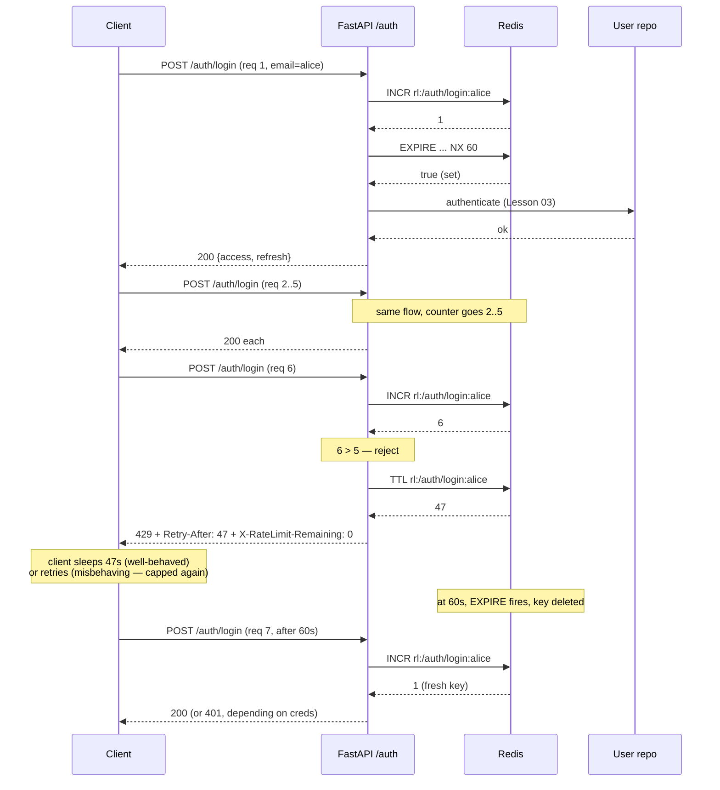
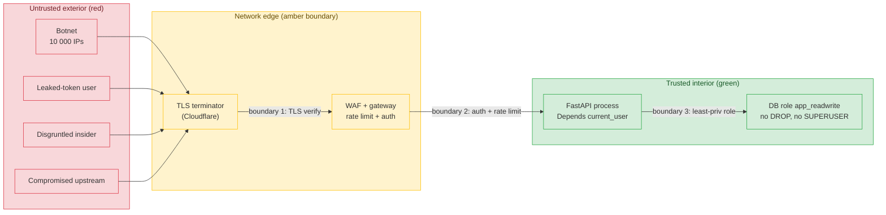

# Lesson 01: Threat Model First

*Where `Boardly` stops saying "we'll add security later" and starts naming the attacker, the asset, and the entry point — before writing the first `Depends`.*

**You're at the very beginning of Section 11.**

"Add JWT and call it secure" is not a security design. It is a feature that happens to use cryptography. Real security begins with three questions: **what am I protecting, who wants to take it, and how do they reach it?** A system that answers those questions badly will leak data even with perfect cryptography, because the cryptography will be applied at the wrong boundary. This lesson builds the mental scaffolding — STRIDE, OWASP API Top 10, trust boundaries, rate limiting — that the rest of the auth section rests on. Take your time. The crypto is the easy part.


#security #threat-modeling #rate-limiting #stride #canonical

## Learning Objectives

By the end of this lesson you will be able to:

1. **Write a one-page threat model** for a FastAPI service that names the **assets**, the **attackers**, the **entry points**, and the **trust boundaries**.
2. **Map a given threat to a STRIDE category** (Spoofing, Tampering, Repudiation, Information disclosure, Denial of service, Elevation of privilege) and to an OWASP API Top 10 (2023) category.
3. **Choose between fixed window, sliding window, and token bucket** rate limiting for a given endpoint, and justify the choice.
4. **Pick the right storage** (in-memory vs Redis) and the right HTTP response (`429 Too Many Requests` + `Retry-After`) for a rate limiter, and explain why the alternatives are wrong.
5. **Implement a `Depends`-factory rate limiter** that uses per-IP for unauthenticated routes and per-user for authenticated routes, with `Redis` for cross-worker correctness.
6. **Explain why "just add JWT" is a feature, not a design**, and list the five security properties JWT does not provide.
7. **Read the OWASP API Top 10 (2023) names** and point to the four categories that are direct consequences of building features without a threat model.

## Prerequisites

Before starting, you need:

- **FastAPI 0.148.0** and **Starlette 1.9.0** (verified Oct 2026). If you have been following along since Section 03, you already have these.
- The **HTTP request lifecycle** — [[02-Web-and-HTTP/HTTP-Request-Lifecycle]]. You must be able to trace a request from socket to handler. A threat model is, structurally, "where can an attacker inject themselves into this trace".
- **CORS** — [[02-Web-and-HTTP/CORS-Caching-Headers-Conditional-Requests]]. The browser same-origin policy is part of the trust boundary, not a feature toggle. Misconfigured CORS widens the boundary; we apply it deliberately.
- **Middleware order** — [[03-FastAPI-Core/Middleware-and-Request-Order]]. A global rate limiter would be middleware; a per-route limiter is a `Depends`. Either way, ordering matters.
- **`Depends`** — [[03-FastAPI-Core/Dependency-Injection]]. The rate limiter we ship at the end of this lesson is a `Depends` factory — a function that returns a dependency. Review the `require_scope` example from that lesson if the pattern is fuzzy.

**The single most common gap: "I'll just add JWT".**

If you came to this lesson because you "just need JWT", read it anyway. Especially the closing "What We Learned" section, which enumerates the five security properties JWT does not provide. The token you issue is meaningless without a model of what you are protecting it from. A JWT in `localStorage` with a 30-day TTL is worse than no JWT at all, because it gives you the illusion of security while widening your XSS blast radius to "everything the user can do for the next month". This lesson is the antidote.


## The Problem

`Boardly` so far has no auth. Anyone who can reach the network can list projects, create them, and delete them. There is no concept of *who* did what, no rate limit, no audit log. Two problems follow:

1. **The API is a free for all.** A botnet can `POST /projects` 10 million times tonight and exhaust your DB pool by morning. The single cheapest defense — rate limiting — is missing.
2. **There is no threat model.** Even if we add auth tomorrow, we will not know what we are defending against. Are we defending credential-spray bots? A leaked-token user? A disgruntled insider with valid credentials? A rival scraping the pricing API? Each of those attackers is stopped by a *different* control, and a security design that does not name the attacker applies the wrong control.

The fix is not "write more code". The fix is "write a one-page document that names what we are protecting and who wants to take it, then write code that defends *that*". This lesson is mostly the document. The code we ship — a Redis-backed rate limiter — falls out of the document naturally, because once you have named "a botnet spraying credentials at `/auth/login`", the defense is obvious.

Why lead with a *document* in a code lesson? Because every security bug that has ever made it to production is the result of a developer writing correct code against the wrong mental model of the attacker. The document is the cheapest way to align a team's mental model. Five engineers reading the same threat-model document cannot privately disagree about whether "rate limit per IP" is sufficient — the document names the botnet-with-10 000-IPs attacker explicitly, and per-IP obviously fails against it. Without the document, that disagreement surfaces in a postmortem. Why does the threat model come *before* the code in this lesson? Because the alternative — code first, threat model later — produces the exact inversion we are about to spend the rest of Section 11 undoing: JWTs in `localStorage`, BOLA-vulnerable `/users/{id}` routes, and per-IP rate limits that miss NAT-shared users.

**Student asks: Is a threat model a document, a diagram, or a code review?**

All three, but the document comes first. The diagram (we will draw one below with Mermaid) is the *visualization* of the document. The code review (we will do one in the Verification section at the end of this lesson) is the *verification* that the code matches the document. If you skip the document and jump to the diagram, you draw boxes without knowing what they defend. If you skip both and go to the code review, you review against no spec — and the review approves whatever is there.


## The Senior Engineer's Mental Model

Before the code, one frame of mind. Security is not a feature you add — it is a property of design decisions made early, and the threat model is the document that makes those decisions explicit. The senior engineer's reflex, on every PR that touches an endpoint, every architectural review that adds a service, every queue that gets a new consumer, is to ask three questions: *what am I protecting, who wants to take it, and how do they reach it?* A system that answers those questions badly will leak data even with perfect cryptography, because the cryptography will be applied at the wrong boundary. The threat model is the cheapest defense you will ever ship — five engineers reading the same one-page document cannot privately disagree about whether "rate limit per IP" is sufficient, because the document names the botnet-with-10 000-IPs attacker explicitly, and per-IP obviously fails against it. Without the document, that disagreement surfaces in a postmortem.

Notice the inversion this lesson is undoing. Most teams reach for the crypto first — "let's add JWT" — and discover the threat model later, usually after an incident. The code they wrote is technically correct (the JWT verifies, the signature is valid, the claims are checked) but it defends the wrong attacker, or it defends the right attacker at the wrong boundary, or it assumes a trust boundary that the deployment topology does not actually provide. The senior engineer's instinct is the opposite: name the attacker first, name the asset second, name the boundary third, and only then write the code that implements the named defense. The crypto falls out of the threat model naturally; the threat model never falls out of the crypto.

The senior engineer's daily question, on every line of code in this lesson, is: *which attacker does this line stop, and what would change in the breach window if this line were absent?* If the answer is "nothing changes," the line is decorative; if the answer is "the breach window extends," the line is load-bearing. The rate limiter that follows is mostly load-bearing. The decoration — the type hints, the docstrings, the `Awaitable` annotation — is for the next engineer who reads it, not for the attacker.

## The Code

Here is the complete `boardly/security/rate_limit.py` we will write in this lesson. It is a `Depends` factory: a function that returns a FastAPI dependency. We then mount it on `POST /auth/login` with a per-email key (not a per-IP key) and a 5-requests-per-minute limit. Read the file top to bottom; we will dissect every line afterwards.

```python
# boardly/security/rate_limit.py
"""Per-route rate limiter as a FastAPI Depends factory.

Lesson 11.01: implements the API4:2023 (Unrestricted Resource
Consumption) defense, with a Redis backend so the limit is enforced
across uvicorn workers.
"""
from collections.abc import Awaitable, Callable

from fastapi import Depends, HTTPException, Request, status
from redis.asyncio import Redis


async def get_redis(request: Request) -> Redis:
 """Pull the Redis client stashed on app.state by the lifespan."""
 return request.app.state.redis


def rate_limit(
 limit: int,
 window_s: int,
 key_fn: Callable[[Request], str] | None = None,
) -> Callable[..., Awaitable[None]]:
 """Fixed-window rate limiter, Redis-backed.

 Args:
 limit: maximum number of requests allowed in `window_s`.
 window_s: window length in seconds.
 key_fn: optional callable to derive the limiter key
 (e.g. per-user, per-IP). Default is client IP.

 Returns:
 A FastAPI dependency callable. Mount via
 `dependencies=[Depends(rate_limit(5, 60))]`.
 """
 async def _dep(
 request: Request,
 redis: Redis = Depends(get_redis),
 ) -> None:
 # 1. Derive the key. Per-IP by default; per-user for authed routes.
 if key_fn is None:
 client = request.client
 key_part = client.host if client else "unknown"
 else:
 key_part = key_fn(request)
 key = f"rl:{request.url.path}:{key_part}"

 # 2. INCR + EXPIRE in a single Redis pipeline (one round-trip).
 pipe = redis.pipeline()
 pipe.incr(key)
 pipe.expire(key, window_s, nx=True) # set TTL only on first increment
 count, _ = await pipe.execute()

 # 3. Reject with 429 + Retry-After if over the limit.
 if count > limit:
 ttl = await redis.ttl(key)
 headers = {
 "X-RateLimit-Limit": str(limit),
 "X-RateLimit-Remaining": "0",
 "Retry-After": str(max(ttl, 1)),
 }
 raise HTTPException(
 status_code=status.HTTP_429_TOO_MANY_REQUESTS,
 detail="rate limit exceeded",
 headers=headers,
 )
 return _dep
```

And here is how it is wired onto `boardly/routers/auth.py` (the login endpoint). Note the `key_fn` override: we rate-limit by email, not by IP, because the threat model is "a botnet with 10 000 IPs spraying one password at `alice@example.com`" — a per-IP limit would let each botnet IP get 5 attempts, which is 50 000 total.

```python
# boardly/routers/auth.py — excerpt (the rest is in Lesson 03)
from fastapi import APIRouter, Depends, Request
from boardly.security.rate_limit import rate_limit

router = APIRouter(prefix="/auth", tags=["auth"])


def _key_by_email(request: Request) -> str:
 """Derive the rate-limit key from the request body's email.

 In Lesson 03 we will parse the OAuth2PasswordRequestForm properly;
 for now we read from request.state, set by a small body-peeking
 middleware. The simpler pattern is to use the path + IP for
 unauthenticated routes — but the threat model here is per-email
 spray, so the extra plumbing is worth it.
 """
 return getattr(request.state, "email", None) or (
 request.client.host if request.client else "unknown"
 )


@router.post("/login", dependencies=[Depends(rate_limit(5, 60, _key_by_email))])
async def login():
 ... # Lesson 03 fills this in.
```

That is ~70 lines of code and ~30 lines of wiring. Read it twice. Then read the dissection below — every line gets a *what* / *why* / *what-Python-or-the-framework-does-internally*.

## Line-by-Line Deep Dive

This section is the heart of the lesson. Read it slowly. The threat model (the part above) is the *why*; this part is the *how*.

### Lines 1–8: Module docstring and imports

```python
"""Per-route rate limiter as a FastAPI Depends factory.

Lesson 11.01: implements the API4:2023 (Unrestricted Resource
Consumption) defense, with a Redis backend so the limit is enforced
across uvicorn workers.
"""
from collections.abc import Awaitable, Callable

from fastapi import Depends, HTTPException, Request, status
from redis.asyncio import Redis
```

**What it does:** Pulls in three things — `Awaitable` and `Callable` from `collections.abc` (for type hints on the factory return), the FastAPI bits (`Depends`, `HTTPException`, `Request`, `status`), and `Redis` from `redis.asyncio`.

**Why we need each:**

- `Callable` and `Awaitable` are the typing primitives for "a function" and "a thing you can `await`". The `rate_limit` function returns a `Callable[..., Awaitable[None]]` — i.e. an async callable. We annotate it explicitly because the function is *metaprogrammed*: a function that returns a function. Without the annotation, a reader has to read the body to know what shape it returns.
- `Depends` is the FastAPI primitive we use to declare dependencies. The returned `_dep` is itself a dependency — it accepts its own `Depends` (the Redis client). This is *nested* dependency injection, and it is the canonical pattern for reusable security dependencies. (See [[03-FastAPI-Core/Dependency-Injection]] for the chain pattern.)
- `HTTPException` is the FastAPI way to short-circuit a request with an HTTP status. Raising `HTTPException(429, ...)` from inside a dependency cancels the entire request and returns the 429 to the client. No `return` needed; raising is the mechanism.
- `Request` is the Starlette `Request` object — we read `request.client.host` (the peer IP) and `request.url.path` (the route path) off it. Both are used to build the Redis key.
- `status` is the FastAPI re-export of Starlette's `status` module — `HTTP_429_TOO_MANY_REQUESTS` is a constant integer. Using the named constant is more grep-able than the literal `429`, and the typo-protection is real (you cannot accidentally type `HTTP_429_TOO_MANY_REQESTS` and have it silently pass).
- `Redis` from `redis.asyncio` is the async Redis client. It is the same package as the sync client (`redis` on PyPI) but the `.asyncio` submodule surfaces the awaitable API. We never use the sync client in an async app — it would block the event loop.

**Tip — Why `from collections.abc import Callable` and not `from typing import Callable`?**

Since Python 3.9, `collections.abc.Callable` is the canonical import. `typing.Callable` is preserved for backwards compatibility but is deprecated in 3.12+ for the generic forms. The rule for modern Python (3.12+, which we are on): prefer `collections.abc` for `Callable`, `Awaitable`, `AsyncIterator`, etc. Use `typing` only for things that genuinely do not exist in `collections.abc` (e.g. `Annotated`).


### Lines 11–13: `get_redis`, the lifespan-stashed Redis client

```python
async def get_redis(request: Request) -> Redis:
 """Pull the Redis client stashed on app.state by the lifespan."""
 return request.app.state.redis
```

**What it does:** Defines a tiny dependency that returns the Redis client stored on `app.state.redis`.

**Why we stash on `app.state`:** In Section 03 Lesson 01 ([[03-FastAPI-Core/Application-and-Lifespan]]) we taught that resources which live for the whole process are created in the `lifespan` startup block and stashed on `app.state`. The Redis client is exactly that kind of resource — created once at process start, shared by every request, closed at process shutdown. So:

```python
# boardly/main.py — lifespan excerpt (Lesson 03 wires this for real)
@asynccontextmanager
async def lifespan(app: FastAPI) -> AsyncIterator[None]:
 redis = Redis.from_url(settings.redis_url, decode_responses=True)
 await redis.ping() # fail loud at startup, not on the first request
 app.state.redis = redis
 yield
 await redis.aclose()
```

The `get_redis` dependency then surfaces it to any route that needs it. This is the same pattern as `get_db` in Section 03 Lesson 04 — a thin dependency that reads from `app.state`. The benefit: tests can `app.dependency_overrides[get_redis] = lambda: fake_redis` (see Lesson 12.02 [[12-Testing-and-Quality/Testing-FastAPI-Endpoints]]) and the rate limiter becomes testable without a real Redis.

**Why `decode_responses=True`?**

By default, `redis-py` returns bytes. With `decode_responses=True` it returns strings. For the rate limiter, our keys and counts are strings and ints; the bytes-to-string decode in user code is noise. (For binary payloads — e.g. a `SET` of a pickled object — you would leave it off. We never store binary in the limiter.) The downside: `decode_responses=True` is global, so if you have other uses of the same client that want bytes, you have a mismatch. The production fix is two clients — one for text, one for binary — or a single client with `decode_responses=False` and explicit `.decode()` calls in user code. Lesson 03 uses the text-only client.


### Lines 15–25: The `rate_limit` factory signature

```python
def rate_limit(
 limit: int,
 window_s: int,
 key_fn: Callable[[Request], str] | None = None,
) -> Callable[..., Awaitable[None]]:
```

**What it does:** Declares `rate_limit` as a *regular* (non-async) function that takes two required ints and an optional key-derivation callable, and returns an async callable.

**Why this shape:**

- `limit` and `window_s` are the policy knobs. `limit=5, window_s=60` means "5 requests per 60-second window". They are positional because they are mandatory; no default makes sense.
- `key_fn` is *optional* and *not* `Depends`-wrapped. It is a plain Python callable that takes a `Request` and returns a string. The default `None` means "use the client IP". The override (passed by the caller, like `_key_by_email` in the wiring) lets authenticated routes rate-limit per-user or per-email instead of per-IP.
- The return type `Callable[..., Awaitable[None]]` is precise: an async callable that takes any args (FastAPI fills them in via `Depends`) and returns nothing. The `Awaitable[None]` is the async equivalent of `-> None`.

**Student asks: Why is `rate_limit` not `async def`?**

Because it does no I/O. It is a *factory*: it builds and returns a dependency, it does not *execute* the dependency. The inner `_dep` is `async def` because *it* talks to Redis. The outer `rate_limit` is plain `def` because all it does is close over `limit`, `window_s`, `key_fn`, and return a callable. Marking it `async` would make Python wrap the return value in a coroutine — which FastAPI would then await, expecting the awaited result to be the dependency. It is not. This is one of the few places where `def` vs `async def` is not stylistic; it is structural.


### Lines 28–35: The closure dependency and the key derivation

```python
 async def _dep(
 request: Request,
 redis: Redis = Depends(get_redis),
 ) -> None:
 # 1. Derive the key. Per-IP by default; per-user for authed routes.
 if key_fn is None:
 client = request.client
 key_part = client.host if client else "unknown"
 else:
 key_part = key_fn(request)
 key = f"rl:{request.url.path}:{key_part}"
```

**What it does:** Defines the inner dependency `_dep`. It closes over `limit`, `window_s`, `key_fn` (the three arguments to `rate_limit`) and accepts its own dependencies — `request` (FastAPI always provides) and `redis` (resolved via `Depends(get_redis)`).

**Why closure over arguments:** This is the *factory* pattern. Each call to `rate_limit(5, 60, _key_by_email)` returns a different `_dep` with different captured values. So the same `rate_limit` function gives us a 5/min limiter for `/auth/login` and a 1000/min limiter for `/search` — both with the same code, just different closures.

**Why `request: Request`:** FastAPI injects the Starlette `Request` object when it sees the type hint. We use three of its attributes:

- `request.client` is a `Address` namedtuple `(host, port)` or `None` (e.g. when the request comes from a test transport that has no real peer). The `if client else "unknown"` defensive guards against the `None` case — important for tests.
- `request.url.path` is the URL path, e.g. `/auth/login`. Including it in the key means a per-IP limit on `/auth/login` and a per-IP limit on `/search` are independent counters. Without the path in the key, the two would share a counter — and a user who used up their `/search` quota would also be locked out of `/auth/login`.
- `request.app.state.redis` is accessed via the `get_redis` dependency (which does `request.app.state.redis`). Same `request` object, accessed twice — once in `_dep` (for the key) and once in `get_redis` (for the client).

**Danger — Do not key the limiter only on `request.client.host`.**

Behind a corporate NAT or a mobile carrier, 10 000 users share one IP. You will rate-limit legitimate users and miss a botnet that distributes across IPs. The default per-IP is fine for unauthenticated endpoints where IP is all you have; for authenticated endpoints, override with `key_fn` that returns the user id (or email, before the user is authenticated). Layer: per-IP for unauthenticated routes, per-user for authenticated.


**Danger — How an attacker thinks**

An attacker who wants to credential-stuff `alice@example.com` does not spin up one server and hammer your `/auth/login` from one IP — that would trip any per-IP limiter in seconds. They buy time on a residential-proxy network (services that package compromised home routers and IoT devices into a rotating-IP API), point 10 000 different residential IPs at your endpoint, and send *one* login attempt from each. A per-IP limiter set to "5 per minute" sees each IP at 1/5 capacity and lets every single request through — the botnet's 10 000 attempts in one minute look, from the limiter's perspective, like 10 000 well-behaved users each making one request. The senior engineer's defense is to key the limiter on something the attacker cannot rotate as cheaply as an IP — the *username* (or email) being targeted. A `username:ip` composite key caps each `(ip, email)` pair at 5 attempts per minute, *and* a separate `email`-only key caps the email at, say, 20 attempts per minute *across all IPs* — so the botnet's 10 000-IP spray against one email is bounded at 20, not 50 000. The botnet can still rotate usernames, but a single compromised account is the goal, and capping the targeted account at 20 attempts per minute means the botnet needs thousands of valid `(email, password)` pairs to make a single success likely — at which point the breach is on the password-dump side, not yours.


### Lines 37–40: The Redis pipeline (atomicity in one round-trip)

```python
 # 2. INCR + EXPIRE in a single Redis pipeline (one round-trip).
 pipe = redis.pipeline()
 pipe.incr(key)
 pipe.expire(key, window_s, nx=True) # set TTL only on first increment
 count, _ = await pipe.execute()
```

**What it does:** Builds a Redis pipeline with two commands — `INCR key` and `EXPIRE key window_s NX` — and executes them atomically in one round-trip. The result of `INCR` (the new count) is captured into `count`.

**Why a pipeline instead of two separate `await`s:**

- Two separate `await`s would be `await redis.incr(key)` followed by `await redis.expire(...)`. Each `await` is a network round-trip to Redis (~0.3 ms on a co-located Redis, more over a network). Two round-trips = ~0.6 ms per request, just for the limiter.
- A pipeline batches the two commands and sends them in one packet. Redis executes them in order, returns both results in one packet. One round-trip = ~0.3 ms. Halves the latency.
- `redis.pipeline()` defaults to `transaction=True`, which wraps our two commands in `MULTI/EXEC` — atomic, no other client can interleave between our `INCR` and our `EXPIRE`. The order of execution is preserved: `INCR` runs before `EXPIRE`. That is what we need — the `EXPIRE` setting the TTL after the count is incremented. (Pass `transaction=False` if you want a plain pipeline that skips the `MULTI/EXEC` overhead; for a rate limiter the difference is negligible because `INCR` is already atomic and `EXPIRE NX` is idempotent, but the default is the safer pick.)

What about the race where two requests both fire `INCR` before either fires `EXPIRE`, and the second one's `EXPIRE NX` is a no-op because the first already set the TTL? Redis is single-threaded for command execution, so the two `INCR + EXPIRE` pipelines from concurrent workers execute serially inside Redis, not in parallel. Request A's pipeline runs to completion (both commands) before Request B's pipeline starts. There is no interleaving. So the race the reader is imagining does not exist for a single Redis instance. It *does* exist for a Redis Cluster where the key may live on a different shard than the connection's slot — and the fix in that case is a Lua `EVAL` script that runs atomically on one shard. We address that in the trade-offs section.

**Why `nx=True` on the `EXPIRE`:** The `NX` option (Redis 7.0+) means "set the TTL only if the key has no TTL". On the first request of a window, the key has no TTL — `EXPIRE` sets it. On subsequent requests, the key already has a TTL — `EXPIRE NX` is a no-op. This is critical: without `NX`, every request would reset the TTL to `window_s`, and a steady stream of requests would never let the key expire. The limit would never reset.

**Why a pipeline (and not two separate `await`s)**

Two separate `await`s would cost two network round-trips. A pipeline batches them into one. `redis.pipeline()` defaults to `transaction=True`, so our commands are wrapped in `MULTI/EXEC` — atomic, no other client can run commands between yours. For a rate limiter, that atomicity is *not* strictly required: two concurrent `INCR`s on the same key are atomic in Redis anyway (Redis is single-threaded for command execution), and `EXPIRE NX` is idempotent. What we need is *ordering* — `INCR` before `EXPIRE` — and the pipeline gives us that. The default is the safer pick; pass `transaction=False` only if you have measured the `MULTI/EXEC` overhead and want to skip it.

The exception: if you are using a Redis cluster (not a single Redis), the key may live on a different shard from the cluster's perspective, and you may need a Lua script (the cluster can only run multi-key operations atomically via `EVAL`). The `slowapi` library mentioned in Engineering Trade-Offs handles this for you; we do not write the Lua here.


**Tip — Production security reality**

In production, your rate limiter will be tested by a distributed botnet with 10 000 IPs, and the per-IP rate limit is the *floor* of the defense — not the ceiling. The senior engineer's full stack is: (a) **edge WAF + rate limit** (Cloudflare, AWS WAF) absorbs the bulk of the spray before it reaches your origin; (b) **per-IP limiter** (the one in this lesson) caps each IP at, say, 100 requests per minute — the backstop for any single-source abuser; (c) **per-user (or per-email) limiter** caps the targeted account at, say, 20 attempts per minute *across all IPs*; (d) **fail2ban-style escalation** (Exercise 4 below) — five failures from one IP bans that IP for an hour; (e) **per-user alerting** — if a single user's fail counter crosses 50 in an hour, page the on-call. All backed by Redis (not in-memory), so all your Uvicorn workers see the same counters. And every `429 Too Many Requests` response includes `Retry-After: <seconds>` so legitimate clients know when to retry — the botnet ignores it, which is fine, because the botnet's 429s are the signal that the defense is working. The pipeline is the inner loop of layer (b); the layers above and below are what make the inner loop's 0.3 ms worth paying for.


### Lines 42–53: The 429 with `Retry-After`

```python
 # 3. Reject with 429 + Retry-After if over the limit.
 if count > limit:
 ttl = await redis.ttl(key)
 headers = {
 "X-RateLimit-Limit": str(limit),
 "X-RateLimit-Remaining": "0",
 "Retry-After": str(max(ttl, 1)),
 }
 raise HTTPException(
 status_code=status.HTTP_429_TOO_MANY_REQUESTS,
 detail="rate limit exceeded",
 headers=headers,
 )
```

**What it does:** If the count exceeds the limit, fetches the key's TTL, builds a response-headers dict, and raises `HTTPException(429, ...)` with those headers attached.

**Why `Retry-After` is mandatory, not courtesy:** RFC 9110 §15.5.4 defines `Retry-After` as the response header that tells a well-behaved client how long to wait before retrying. Without it, clients either retry immediately (worse — the load doubles) or give up (also worse — the user sees a broken app). With it, a well-behaved client sleeps the indicated seconds and tries again. `max(ttl, 1)` is the floor — `TTL` can return 0 or -1 in edge cases (key just expired, key has no TTL), and a `Retry-After: 0` is worse than `Retry-After: 1`.

**Why `X-RateLimit-Limit` and `X-RateLimit-Remaining`:** These are non-standard (no RFC) but *de facto* — Twitter's API popularized them, and most client SDKs read them. They are courtesy, not required, but they make the API debuggable: a developer hitting the limit sees the limit and the remaining count, and can reason about their usage. Without them, the developer sees "429 rate limit exceeded" and has no idea what the limit *is*.

**Why raise `HTTPException` instead of return a `Response`:** Because the limiter is a *dependency*, not a route. Dependencies do not have a return value the framework serializes — they either succeed silently (control passes to the route) or raise (control short-circuits to the exception handler). `HTTPException` is the canonical "short-circuit with a specific HTTP status" mechanism. FastAPI's exception handlers translate it to a `JSONResponse` with `{"detail": ...}`.

**Tip — The `headers` argument on `HTTPException`**

`HTTPException(status_code=429, detail="...", headers={...})` attaches custom headers to the response. The headers dict is plain `str -> str` — Redis returns an int for `TTL`, we have to `str(...)` it. Forgetting to stringify is a common bug; `JSONResponse` expects string header values.


### Lines 56–76: Wiring the limiter on `/auth/login`

```python
# boardly/routers/auth.py — excerpt
from fastapi import APIRouter, Depends, Request
from boardly.security.rate_limit import rate_limit

router = APIRouter(prefix="/auth", tags=["auth"])


def _key_by_email(request: Request) -> str:
 """Derive the rate-limit key from the request body's email."""
 return getattr(request.state, "email", None) or (
 request.client.host if request.client else "unknown"
 )


@router.post("/login", dependencies=[Depends(rate_limit(5, 60, _key_by_email))])
async def login():
 ... # Lesson 03 fills this in.
```

**What it does:** Wires a 5-requests-per-minute, per-email rate limiter onto `POST /auth/login`, using the `_key_by_email` function to derive the limiter key.

**Why `dependencies=[Depends(...)]` instead of a function parameter:** The `dependencies=[]` argument on the route decorator runs the dependency for its side effect (the 429 raise) without injecting the result into the function. We do not need the limiter's `None` return in the function body — we just need it to *run*. This is the canonical pattern for "enforce this check, do not make me handle the result". (See [[03-FastAPI-Core/Dependency-Injection]] § "Function vs parameter dependencies".)

**Why `_key_by_email` is plausibly the right choice for `/auth/login`:** The threat model says: a botnet with 10 000 IPs tries `password: hunter2` against `alice@example.com`. Per-IP limiting gives each botnet IP 5 attempts → 50 000 total. Per-email limiting gives *the email* `alice@example.com` 5 attempts total → the botnet's `alice@example.com` spray is capped at 5. The trade-off: a legitimate user who fat-fingers their password 6 times gets locked out for a minute. We accept that — the alternative is worse.

**The `request.state.email` plumbing:** A `Request` has a `state` attribute (Starlette gives every request its own `State`), which is the per-request scratchpad. To get the email *before* the route function parses the body, you need either:

- A small middleware that peeks at the request body and stashes `request.state.email = parsed_body["username"]`. (Body-peeking middleware is fiddly — the body is a stream that can only be read once.)
- A dependency that runs before the rate limiter, parses the form, and stashes the email on `request.state`. FastAPI runs dependencies in the order declared in the `dependencies=[...]` list, so `Depends(_stash_email_from_form)` followed by `Depends(rate_limit(5, 60, _key_by_email))` works.
- The simplest pattern: limit `/auth/login` per-IP *and* per-email. Two limiters, two keys, two Redis counters. The botnet hits the per-IP limit before they hit the per-email limit; the legitimate user with one IP and one email rarely hits either.

Lesson 03 will revisit this plumbing with the real `OAuth2PasswordRequestForm` — for now, the structural pattern is the point.

**Student asks: What does an attacker actually see if you forget to rate-limit `/auth/login`?**

They see the difference between "I tried 10 000 passwords and the server let me" and "I tried 10 000 passwords and the server returned 429 on attempt 6." Concretely: a credential-stuffing botnet with 10 000 IPs and a list of 10 000 leaked `(email, password)` pairs runs against `/auth/login`. *With* the per-email limiter at 5 attempts / 60 s, each email gets 5 attempts in the first minute — the botnet must wait 60 s before trying the 6th password for any given email, and the per-IP limit (5 / 60 s per IP) caps the global attempt rate at 50 000 / min before any per-email math kicks in. The botnet's success rate collapses from "we own 200 accounts per minute" to "we own maybe 1 account per minute, if any of the 5 guessed passwords happens to be correct." *Without* the limiter, the botnet's 10 000 IPs each get unlimited attempts — 200 successful logins per minute is realistic on a 10M-account service with even a 0.001 % hit rate, and the user finds out only when their account is drained. The limiter is not a defense that "stops" the attack; it is a defense that *slows it down enough* that you can detect it (the 429 spike in your metrics is the signal) and respond (block the IPs, alert the users, force password resets). Without the limiter there is no signal — the attack looks like a normal request pattern until it succeeds.


**Warning — When security breaks**

You discover that your rate limiter is not stopping the attack you designed it for — the botnet has scaled past 10 000 IPs to 100 000, or the attacker has found that your `_key_by_email` middleware peeks `request.state.email` and is now sending malformed bodies that bypass the email-stash step (so the limiter falls back to per-IP and the attack succeeds). Don't panic. The senior engineer's runbook: (1) **fail closed, not open** — if Redis goes down, the limiter should reject requests with 503, not let them through; a missing limiter is worse than a degraded service, because the limiter is the defense against the exact attack that comes when the limiter is down. (2) **enable the global backstop immediately** — a per-IP cap at the WAF level (Cloudflare's rate-limiting rule, AWS WAF's rate-based rule) absorbs the spray before it reaches your origin; this is the layer you should have on at all times, not just during incidents. (3) **identify the missing composite key** — the attacker found the gap (e.g. `request.state.email` is not stashed on malformed bodies); fix the gap by stashing a sentinel like `email = "_malformed_"` so the limiter sees a stable, attributable key. (4) **audit the per-IP fail counters in Redis** — `redis-cli --scan --pattern "rl:*"` and look for IPs with high counts; ban the top 100 via the fail2ban key. (5) **post-mortem the assumption that broke** — the threat model said "10 000 IPs"; the attacker brought 100 000. Update the threat model. The number is not the point; the *reflex to revisit the number when the attack scales* is the point. A threat model that has not been revisited in 12 months is a stale threat model (Mistake 5); the incident is the prompt to revisit.


## Execution Trace

A client hits `POST /auth/login` 6 times in one minute, all with the same email.



The key insight: the limiter is stateful (Redis) and shared across workers. If you ran `uvicorn boardly.main:app --workers 4`, requests 1–6 could land on any of the four workers, and the counter would still go 1, 2, 3, 4, 5, 6. With an in-memory limiter, each worker has its own counter, and the effective limit is `5 × 4 = 20` — silently multiplied by your worker count.

## The Threat Model (the document)

Before we get to the trade-offs, we write the one-page threat-model document for `Boardly`. This is the artifact the rest of the auth section rests on. Save it as `docs/threat-model.md` in the repo. Update it when the asset list changes (new PII field) or the topology changes (new service, new webhook).

```markdown
# Boardly Threat Model — v0.1

## Assets
- User PII: email, password_hash, password_history, email_verified_at.
- Org data: org memberships, project names, project bodies.
- Credentials: refresh tokens, password reset tokens, email verification tokens.
- Internal state: rate-limit counters (not user-facing, but abuse vector if leaked).

## Attackers
1. Credential-spray botnet: 10 000 IPs, one password (`hunter2`), one email.
2. Leaked-token user: their refresh token is in a leaked password dump.
3. Disgruntled insider: valid credentials, intent to exfiltrate org data.
4. Rival scraping the pricing API (we don't have one yet, but planned).
5. Compromised upstream: a third-party API we call goes rogue.

## Entry points
- POST /auth/login (email + password) — high-abuse surface.
- POST /auth/refresh (refresh token) — token-theft surface.
- GET /orgs/{org_id}/projects/{project_id} — BOLA surface.
- POST /webhooks/stripe (planned) — SSRF + signature-verify surface.

## Trust boundaries
1. TLS terminator (Cloudflare): untrusted → network-edge.
2. API gateway (Cloudflare + own WAF): network-edge → trusted caller (rate limit + auth applied here).
3. FastAPI process: trusted caller → application code (Depends current_user).
4. Database role `app_readwrite` (least privilege — no DROP): application code → persisted state.

## Mitigations
- /auth/login: per-email + per-IP rate limit (Lesson 01).
- /auth/refresh: rotation + reuse detection (Lesson 03).
- /orgs/{org_id}/...: BOLA check in the service (Lesson 04).
- /webhooks/stripe: HMAC signature verify + URL allow-list (Section 15).
- DB role: no DROP, no SUPERUSER (Section 16).
```

**Danger — How an attacker thinks**

An attacker who obtains your threat-model document (a leaked Confluence page, a public GitHub repo, an exfiltrated engineering wiki) does not learn your secrets — but they learn your *assumptions*, and assumptions are often more valuable than secrets. The document names your assets (so the attacker knows what to steal), your attackers (so the attacker knows which categories you have *not* considered — a document that lists "botnet, leaked-token user, disgruntled insider, rival scraper, compromised upstream" implicitly tells the attacker that a state-sponsored APT is not in your model), your entry points (so the attacker knows which routes to prioritize), and your mitigations (so the attacker knows which controls are in place and can probe for their gaps). The senior engineer's rule: assume the threat-model document is *adversarially read*. Write it as if it will be read by the attacker it describes. Do not document secrets in it (no key material, no infrastructure passwords, no customer PII); do document the *categories* of attackers and the *categories* of controls — those are the design decisions you want to communicate to your own team, and they are the decisions an attacker can probe for regardless of whether they read the document. The defense is not secrecy about your threat model; the defense is making the threat model comprehensive enough that an attacker reading it learns nothing they could not have discovered by probing.


That document prevents more incidents than any JWT library. The reason: every entry in "Mitigations" is a *concrete control* against a *named attacker* — and when the threat landscape changes, you update the document, and the new mitigation falls out. Without the document, you add features without ever asking "which attacker does this stop?".

The four trust boundaries above are not just bullet points — they are *where the controls live*. Visualising them as a flow turns the document into something a reviewer can scan in ten seconds and spot the gap. Green is the trusted interior we are willing to let code run in; amber is each boundary crossing where a control is applied; red is the untrusted exterior where attackers live.



**Protecting user data**

The threat-model document names "User PII" as the first asset — email, password_hash, password_history, email_verified_at. The senior engineer's rule for PII is **minimum needed for auth, encrypted at rest for the rest.** `password_hash` is already a one-way hash (bcrypt, Lesson 02) — it does not need additional encryption because the plaintext is never stored. `email` is needed for login lookups (`WHERE email = ?`), so it is stored in plaintext (indexed, queryable) — but it is the *only* PII column with that property. `phone`, `address`, `date_of_birth`, and any other PII the product collects should be encrypted at rest with PostgreSQL's `pgcrypto` extension (`CREATE EXTENSION pgcrypto; INSERT INTO users (email, phone) VALUES ('user@example.com', pgp_sym_encrypt('+15551234567', current_setting('app.encryption_key')))`), so a raw `SELECT phone FROM users` returns ciphertext, not plaintext. The encryption key lives in your secrets manager (AWS KMS, HashiCorp Vault, GCP Secret Manager), *not* in a `.env` file or a process environment variable that could leak via `ps`, `/proc/<pid>/environ`, or a container inspection command. The DB role `app_readwrite` (trust boundary 4) should not have access to the encryption key — only the FastAPI process holds it, in `app.state.encryption_key`, fetched at process start. The threat model's first asset is PII; the threat model's first mitigation is at-rest encryption for everything except the one column auth needs to query.


**Student asks: Why four boundaries and not just "the edge"?**

Because each boundary defends a *different* attacker. The TLS terminator defends the network-layer eavesdropper; the gateway defends the credential-spray botnet (rate limit) and the no-credentials-at-all caller (auth); the FastAPI process defends the broken-object-level-authorization attacker (the `Depends current_user` plus a service-layer ownership check); the DB role defends the SQL-injection or compromised-app case (least privilege means a `DROP TABLE` from inside the app fails closed). Collapse the four into one and you have one boundary defending four attackers with one control — which is what every "we put a WAF in front, we're done" team discovers, painfully, was not enough.


## Common Mistakes

### Mistake 1: Rate limiting by IP only

```python
# WRONG
async def _dep(request: Request, redis: Redis = Depends(get_redis)):
    key = f"rl:{request.client.host}"          # ← IP only
    count = await redis.incr(key)
    await redis.expire(key, 60, nx=True)
    if count > 5:
        raise HTTPException(429)
```

**Symptom:** Behind a corporate NAT or a mobile carrier, 10 000 legitimate users share one IP. Your limiter locks them all out after 5 requests. Meanwhile a botnet with 10 000 IPs each get 5 requests — your limit is a 50 000-request floor for the botnet.

**Why:** `request.client.host` is the only identity you have on an unauthenticated route, so it is the only *default* key. But it is a poor proxy for "the user" when one user can come from many IPs (mobile carrier, VPN, Tor) and many users can come from one IP (NAT).

**Fix:** Layer the limiters. Per-IP for the unauthenticated abuse case (a single IP hammering `/auth/login` is suspicious regardless of who is behind it). Per-user (or per-email on `/auth/login`) for the authenticated abuse case. The `key_fn` parameter on `rate_limit` is exactly the override point.

```python
# RIGHT — layer the limiters
@router.post("/auth/login",
             dependencies=[Depends(rate_limit(5, 60, key_fn=by_email))])
```

**Example — In the wild: credential-stuffing against a major streaming service (2019).**

A credential-stuffing botnet walked through ~300 000 customer accounts on a major streaming service in late 2019 by spreading the attack across hundreds of thousands of residential IPs. The service had a per-IP login rate limit of ~30 per minute per IP — fine for legitimate users, useless against a distributed attack where each IP made one or two attempts per hour. The post-mortem listed per-email/per-account lockouts as the missing control, exactly the layering described above. The service shipped per-account throttling within the next sprint. The same pattern was attributed to a major social network's 2021 scraping incident (~700 M records harvested through an underscoped per-IP throttling on a contact-import endpoint).


### Mistake 2: In-memory limiter in a multi-worker deployment

```python
# WRONG
from collections import Counter, defaultdict
_counts: dict[str, Counter] = defaultdict(Counter)   # per-process state

def rate_limit(limit: int, window_s: int):
    async def _dep(request: Request):
        key = f"rl:{request.client.host}:{request.url.path}"
        _counts[key][int(time.time()) % window_s] += 1
        if sum(_counts[key].values()) > limit:
            raise HTTPException(429)
```

**Symptom:** You run `uvicorn boardly.main:app --workers 4`. Each worker has its own `collections.Counter` for the limiter. The effective limit is `5 × 4 = 20` requests per minute, per IP. You "tested" it with one worker; production triples or quadruples the limit silently.

**Why:** In-memory state is per-process. Uvicorn workers are separate OS processes; they do not share memory.

**Fix:** Redis. Always. Even for a hobby project — Docker Compose with a Redis container is a 5-line config, and the latency cost (~0.3 ms per limiter check) is invisible at any reasonable request rate. The only place an in-memory limiter is appropriate is unit tests.

**Example — In the wild: a marketplace's flash-sale lockout (2022).**

A mid-size e-commerce marketplace scaled its API behind four Uvicorn workers for a 2022 flash sale. The in-memory per-IP login throttle, set to 5 attempts/minute in staging with one worker, became ~20 attempts/minute in production. A credential-stuffing botnet took advantage of the silent ×4 amplification to drive ~5 M login attempts in 30 minutes against one email (a discontinued brand account) before the abuse team noticed. The fix: move the counter to Redis so the limit is shared across workers, then add an alert on the per-account fail counter. The same shape of bug is responsible for many "we rate-limited it in staging, why did prod fall over" post-mortems.


### Mistake 3: `429` without `Retry-After`

```python
# WRONG
if count > limit:
    raise HTTPException(status_code=429)   # ← no Retry-After
```

**Attack:** A misbehaving client (or a non-reentrant retry loop) hits the limiter, sees 429, and retries immediately. Without `Retry-After`, the client's backoff strategy is "retry until success" — the rate of incoming requests doubles on the first 429, quadruples on the second, and the queue upstream of the API backs up. The limiter, which was meant to *protect* the service, ends up amplifying the load it was meant to shed.

**Symptom:** Clients hammer the API, get 429, retry immediately, get 429 again, retry immediately, repeat. The load doubles instead of backing off. Or: clients give up entirely and the user sees a broken app.

**Why:** RFC 9110 §15.5.4 says `Retry-After` is optional for 429 — but practically it is mandatory. Without it, the client cannot tell whether to retry in 1 s, 1 min, or 1 h.

**Fix:** Always set `Retry-After` to the TTL of the limiter key. We did this above — `str(max(ttl, 1))`. The `max(..., 1)` is the floor — `Retry-After: 0` is interpreted by some clients as "retry now", which is the opposite of what we want.

```python
# RIGHT — give the client something to back off to
if count > limit:
    ttl = await redis.ttl(key)
    raise HTTPException(
        status_code=429,
        headers={"Retry-After": str(max(ttl, 1))},
    )
```

### Mistake 4: Trust boundary only at the edge

**Symptom:** "Cloudflare handles WAF, we're fine." Then an internal service (a queue consumer, a sidecar) is compromised, and your FastAPI process receives a request from a "trusted" internal IP — and trusts it.

**Why:** The edge is one trust boundary, but not the only one. Every internal service that calls your API is a trust boundary crossing. Every webhook URL you expose is a trust boundary. Every queue consumer is a trust boundary.

**Fix:** Name every trust boundary in the threat-model document. For each, write down: what's on the untrusted side, what's on the trusted side, what control is at the crossing. If the control is "we trust the caller because they're internal", that is a gap — internal callers can be compromised too. The fix is usually "require auth on internal calls too" (a service-to-service token, mTLS, or a shared secret).

### Mistake 5: Threat model as a one-off document

**Symptom:** You wrote `docs/threat-model.md` in 2024. In 2026 you added a webhook endpoint, a new PII field, and a second deployment region. The document still says "no webhooks, no PII beyond email". The threat model is stale — and a stale threat model is worse than none, because it gives you false confidence.

**Why:** The asset list, the attacker list, and the entry-point list all change as the product evolves. A threat model is a living document.

**Fix:** Tie threat-model updates to PR review. The PR template asks: "Does this PR add a new entry point, a new asset, or a new attacker? If yes, update `docs/threat-model.md`." This is a one-line check in the template; it costs nothing and catches the drift.

**Warning — When security breaks**

You discover that a webhook endpoint you added six months ago has been receiving unauthenticated requests from an unknown upstream for weeks — the threat model said "no webhooks" when it was written, the webhook was added in a sprint that did not update the document, and the SSRF surface that should have been modeled (the webhook calls back to a URL in the request body) was never defended. The senior engineer's runbook: (1) **disable the endpoint immediately** — return 410 Gone until the threat model is updated and the defense is in place; an undefended endpoint is worse than no endpoint. (2) **audit the requests received during the exposure window** — pull the access logs, identify the upstream, characterize what was sent and what was retrieved. (3) **update the threat model** — the new entry point (webhook), the new attacker (compromised upstream, replay attacker), the new mitigation (HMAC signature verify, replay-window check, URL allow-list). (4) **ship the defense** — the threat model now names the controls; the code follows. (5) **post-mortem the process gap** — *why was the threat model not updated when the webhook was added?* The PR template's "Does this PR add a new entry point, a new asset, or a new attacker?" check was either missing or skipped. Fix the process, not just the endpoint. A threat model that does not update when the system changes is not a threat model — it is a historical document, and a historical document does not defend against the present.


### Mistake 6: `EXPIRE` without `NX` (the never-reset bug)

```python
# WRONG
async with redis.pipeline(transaction=True) as pipe:
    pipe.incr(key)
    pipe.expire(key, window_s)              # ← unconditional: resets TTL on every request
    count, _ = await pipe.execute()
```

**Attack:** A botnet that keeps the limiter key alive forever can hold the limiter at exactly `limit`. Once the first window of `limit` requests sets the counter and the unconditional `EXPIRE` resets the TTL on every subsequent `INCR`, the counter never resets to 0 — so legitimate users who arrive in the *next* window are still locked out (because the counter is still `limit`), and the botnet gets to drive the full `limit` of traffic forever against a per-IP limiter whose intended behavior was "reset every minute".

**Symptom:** The limiter works for the first minute. Then a steady stream of requests keeps the counter at exactly `limit`, never letting the key expire, because every request resets the TTL to `window_s`.

**Why:** Without `NX`, `EXPIRE key window_s` sets the TTL *unconditionally*. Every request resets it. The key never expires; the counter never resets.

**Fix:** `EXPIRE key window_s nx=True` — set the TTL only on the first request of the window. Redis 7.0+ supports `NX` on `EXPIRE`; older Redis versions need a Lua script (`SET key 0 EX window_s NX` followed by `INCR`).

```python
# RIGHT — only the first INCR of the window sets the TTL
async with redis.pipeline(transaction=True) as pipe:
    pipe.incr(key)
    pipe.expire(key, window_s, nx=True)
    count, _ = await pipe.execute()
```

## Engineering Trade-Offs

### Fixed window vs sliding window vs token bucket

Three algorithms to know. Pick by the threat model.

| Algorithm | Mechanism | Pros | Cons | When |
|---|---|---|---|---|
| **Fixed window** | Counter resets at fixed time boundaries (every minute, on the minute). | Trivial: one `INCR` + one `EXPIRE`. One Redis round-trip. | Burst at the boundary: 100 req at 0:59 + 100 req at 1:00 = 200 req in one second. | Default. Login, public endpoints, anything where "good enough, cheap" applies. |
| **Sliding window** | Weighted average of current and previous window. | Smoother. Still cheap (two `INCR`s, two keys). | Slightly more state. Not perfectly fair. | Rarely worth the complexity over fixed window. |
| **Token bucket** | Bucket holds N tokens, refills at R tokens/sec; each request consumes one. Allows bursts up to N, sustained rate R. | The canonical "fair" limiter — bursts are fine up to the cap, sustained rate is enforced. | More state. Needs atomic check-and-decrement — usually a Lua script. | APIs with bursty traffic that should not be penalized for short spikes (real-time, streaming, search). |

The trade-off in one sentence: **fixed window is good enough 90 % of the time, and 10× cheaper to operate.** Reach for token bucket when you have a specific reason (e.g. a real-time API that needs to allow 10-second bursts but cap 1-minute sustained).

**Student asks: When is fixed-window rate limiting *worse* than token bucket — and why would I pick the worse one?**

Fixed window is worse than token bucket in exactly two situations: (1) **burst-at-the-boundary attacks** — a client that sends 100 requests at 0:59 and 100 at 1:00 has consumed 200 in one wall-clock second but only 100 in each fixed window, so the limiter sees nothing wrong. For `/search` or `/api/ingest` endpoints, where a single client can sustain 200 req/s for a few seconds and overload a downstream, fixed-window is the wrong choice. (2) **legitimate bursty traffic** — a real-time dashboard that polls every second but occasionally needs to fetch 10 dashboards in a single second (page load) should be allowed the burst. Token bucket allows the burst (up to the bucket size) and caps the sustained rate (the refill rate), so the legitimate burst passes and the abusive sustained rate is rejected. For Boardly's `/auth/login`, *neither situation applies*: logins are not bursty, the boundary-burst attack against `/auth/login` would be a 200-login-per-second attempt at the boundary, which already needs 200 *valid* credential pairs per second and is a separate problem from credential stuffing, and the cost of token bucket (a Lua script for atomic check-and-decrement, more Redis state) is not worth it for a route that gets hit maybe 10 times per minute per user. That is the "good enough 90 % of the time" in the trade-off above.


### In-memory vs Redis vs Memcached

| Choice | When | When not |
|---|---|---|
| **In-memory (`collections.Counter` per worker)** | Single-process dev server, single-replica hobby tier, or tests where the limit's per-process behavior is acceptable. | Any deployment with >1 worker. Limit silently multiplies by worker count. |
| **Redis** | Anything real. Limits are global across workers and replicas. Latency cost ~0.3 ms per check on a co-located Redis — invisible. | Very low-traffic internal service where the Redis dependency is not worth it. |
| **Memcached** | Rarely. No atomic `INCR + EXPIRE NX` in one round-trip; TTL precision is 1 s. | Most cases — Redis is strictly better for this. |

A common production mistake: `uvicorn boardly.main:app --workers 4` with an in-memory limiter set to 100 req/min. Effective limit is 400 req/min. Switch to Redis, or pin to one worker.

### Per-route vs global limiter

- **Per-route:** lets you set 5/min on `/auth/login` and 1000/min on `/search`. Fine-grained. The pattern in this lesson.
- **Global:** simpler, applied via middleware. Caps total traffic per IP regardless of route. Coarse.

Combine: a per-route limiter on the noisy endpoints (auth, search, file upload) and a generous global limiter as a backstop (e.g. 10 000 req/min per IP). The backstop catches the botnet that distributes across your endpoints.

### Custom limiter vs `slowapi`

`slowapi` is a well-tested library that supports the same algorithms (fixed window, sliding window, token bucket) with a decorators-and-`Limiter` API. It is the right choice for most projects — it handles the edge cases (Lua scripts, Redis clusters, in-memory fallback for tests) for you.

Reach for a custom limiter (what we wrote above) when:

- You need semantics `slowapi` does not provide (e.g. per-tenant quotas backed by a different storage than Redis).
- You want to teach the pattern (this lesson).
- You want zero dependencies beyond `redis` and `fastapi`.

Otherwise, use `slowapi`. The code we wrote is essentially what `slowapi` does internally, minus the abstractions.

**Tip — Production security reality**

In production, your rate limiter is one component of a defense-in-depth stack, not a single point of defense. The senior engineer's stack: (a) **edge WAF + rate limit** (Cloudflare, AWS WAF, Fastly) absorbs the bulk of the spray before it reaches your origin — these run at the edge with sub-millisecond latency, see every request, and can drop traffic before it touches your VPC. (b) **per-IP and per-user composite limiters** in your FastAPI app (the one in this lesson) — the second line of defense, for traffic that gets past the edge. (c) **per-resource back-pressure** (connection-pool sizes, queue depths, worker counts) — the third line, for traffic that gets past the limiters. The three layers defend three different attackers: the edge defends the volumetric DDoS, the app limiter defends the targeted abuse (credential stuffing, scraping), the resource caps defend the accidental overload (a misconfigured client in a tight loop). A rate limiter alone — even a perfect one with composite keys and Redis backing — does not defend against a 100 Gbps volumetric attack; that volume never reaches your app because the edge absorbs it. Equally, the edge does not defend against a single attacker with valid credentials making 1 000 requests per second to `/search` — that traffic looks legitimate at the edge. The senior engineer's reflex is to ask, for each layer: *which attacker does this layer stop, and which attacker gets through to the next layer?* A stack where every layer defends the same attacker is a stack with one effective layer and N-1 decorative ones.


## Exercises

**Tip — The 20-minute rule**

If you're stuck on an exercise for more than 20 minutes, re-read the relevant section above, then move on and come back. Learning isn't linear.


**Exercise 1 — Replace the in-memory limiter with the Redis version.** Take the example code, replace the `collections.Counter`-based in-memory limiter with the Redis version above. Verify the limit is enforced across two `uvicorn` workers. Hint: `uv run uvicorn boardly.main:app --workers 2 --reload &`, then `for i in $(seq 1 10); do curl ...; done`.

**Exercise 2 — Add a token-bucket limiter to `/search`.** Allow 30 req/min sustained, with a 10-req burst. Verify the burst behavior with a script. (You will need a Lua script for atomic check-and-decrement — the comparison row in Engineering Trade-Offs notes the same need; the `slowapi` library ships a working Lua script if you want to read one before writing your own.)

**Exercise 3 — Write a threat model for a webhook-receiving endpoint.** `POST /webhooks/stripe` accepts a Stripe webhook. What if the upstream service is compromised? What if the request body is replayed? What is your blast radius? Write a one-page threat model that names the attacker, the asset, the entry point, and the mitigation. (Hint: HMAC signature verification, replay-window check, idempotency key — but the *threat model* comes first.)

**Exercise 4 — Implement reuse-detection-aware rate limiting.** If a single IP fails `/auth/login` 5 times in 1 minute, ban that IP for 1 hour. The ban should be a separate Redis key (`ban:{ip}`) with a 1-hour TTL, and the limiter should check it first. This is a "fail2ban" pattern, common in production.

**Exercise 5 — Spot the bug.** This limiter is broken. Why?

```python
def rate_limit(limit: int, window_s: int):
 async def _dep(request: Request, redis: Redis = Depends(get_redis)):
 key = f"rl:{request.client.host}"
 count = await redis.incr(key)
 await redis.expire(key, window_s) # ← bug here
 if count > limit:
 raise HTTPException(429)
 return _dep
```

(Answer: `EXPIRE` without `NX` resets the TTL on every request, so a steady stream never lets the key expire — Mistake 6. Plus, the key lacks `request.url.path`, so `/auth/login` and `/search` share a counter. Plus, `request.client.host` only — Mistake 1.)

**Exercise 6 — Threat-model the threat model.** Write down three assumptions in this lesson's threat model that could be wrong. (Examples: "the botnet has 10 000 IPs" — what if it has 100 000? "the disgruntled insider has valid credentials" — what if they have DB access? "Cloudflare is the TLS terminator" — what if the cert rotates and breaks?) For each, write down what would change in the mitigations if the assumption were wrong.

## Verification

Run the limiter under two workers, hammer `/auth/login`, confirm 429 appears at the 6th request per email.

```bash
# Terminal 1 — start two workers
uv run uvicorn boardly.main:app --workers 2 --reload &

# Terminal 2 — hammer /auth/login with one email
for i in $(seq 1 10); do
 curl -s -o /dev/null -w "%{http_code} " -X POST http://localhost:8000/auth/login \
 -H "Content-Type: application/x-www-form-urlencoded" \
 -d "username=alice@example.com&password=x"
done
echo
# Expect roughly: 200 200 200 200 200 429 429 429 429 429
# (the 200s may be 401 if the password is wrong, but the rate-limit kicks in regardless)

# Confirm Retry-After is set
curl -s -i -X POST http://localhost:8000/auth/login \
 -H "Content-Type: application/x-www-form-urlencoded" \
 -d "username=alice@example.com&password=x" | grep -i "retry-after"
# Expect: retry-after: <some integer 1..60>

# Inspect the rate-limiter keys in Redis (confirms per-email key + TTL)
docker exec -it redis redis-cli --scan --pattern "rl:*" | head -5
# Expect: keys like rl:auth/login:alice@example.com with TTL ~60s.
docker exec -it redis redis-cli TTL "rl:auth/login:alice@example.com"
# Expect: an integer 1..60 (the remaining window). If -2, the key expired
# (no requests in the last window) — expected if you waited >60s before
# this check. If -1, the key has no TTL — the never-reset bug (Mistake 6).
```

If you see 429 with `Retry-After`, the limiter is working. If you see 200 200 200 200 200 200 200 200 200 200 — you forgot `--workers 2` (single worker shares the counter — fine but not what we tested), *or* the limiter is not wired (check the `dependencies=[Depends(rate_limit(...))]` on the route), *or* Redis is not connected (the limiter raises, but FastAPI's exception handler returns 500, not 429 — check the logs for `ConnectionError`).

## Previously Learned Here

These concepts were taught in earlier lessons. We link back instead of re-explaining:

- **`CORS`** — [[02-Web-and-HTTP/CORS-Caching-Headers-Conditional-Requests]]. New detail here: the browser same-origin policy is part of the trust boundary. Misconfigured CORS widens the boundary (`Access-Control-Allow-Origin: *` lets any site read your API); we apply it deliberately as a small allow-list, never `*`. Lesson 05 (OWASP API8:2023) covers this in detail.
- **`Middleware`** — [[03-FastAPI-Core/Middleware-and-Request-Order]]. New detail here: the rate limiter runs as a dependency, not as middleware, because we need the parsed body (for the per-email key). A *global* limiter would be middleware; the "last added = outermost" rule applies if you mount one. Lesson 05 (API4:2023) of OWASP walks through the global case.
- **`Depends`** — [[03-FastAPI-Core/Dependency-Injection]]. New detail here: `rate_limit(limit, window_s, key_fn)` is a `Depends` factory — a function that returns a dependency. This is the canonical pattern for reusable security dependencies. The same pattern is used in Lesson 04 for `require_scope("projects:write")`.

## What's Next

In [[Password-Hashing]] we move from "who is attacking" to "what we are protecting". The first asset on the threat-model document — **the password column** — is the one that turns "the entire user table is on a torrent site" from a catastrophic breach into a manageable one. We will:

- Implement `boardly/security/passwords.py` with `bcrypt` (cost=12) and the `secrets.token_urlsafe(32)` reset-token generator.
- Build the `POST /password/reset/request` and `POST /password/reset/confirm` endpoints with TTL, single-use, and breach-response (revoke all refresh tokens on reset).
- Cover `argon2id` as the modern alternative, the `passlib` caveats (unmaintained, pycrypto baggage), and the breach-response runbook (force-reset, rotate pepper, notify in 72 h per GDPR Art. 33).

By the end of Lesson 02, `Boardly` will have a `User` table with a real password column and a complete reset flow — the substrate that Lesson 03's `/auth/login` will check against.

## Sources

- **OWASP API Security Top 10 (2023)** — <https://owasp.org/API-Security/editions/2023/en/0x11-t10/> — accessed 2026-10-19 — authoritative list. API4:2023 is the rate-limiting category.
- **OWASP Cheat Sheet: Rate Limiting** — <https://cheatsheetseries.owasp.org/cheatsheets/Rate_Limiting_Cheat_Sheet.html> — accessed 2026-10-19 — algorithms compared.
- **Cloudflare: How we built Rate Limiting** — <https://blog.cloudflare.com/counting-things-a-lot-of-different-ones/> — accessed 2026-10-19 — production design notes from one of the largest rate-limited deployments.
- **RFC 9110 §15.5.4 (429 Too Many Requests)** — <https://www.rfc-editor.org/rfc/rfc9110#section-15.5.4> — accessed 2026-10-19 — `Retry-After` semantics, the mandatory header on 429.
- **Microsoft STRIDE** — <https://learn.microsoft.com/en-us/azure/security/develop/threat-modeling-tool-threats> — accessed 2026-10-19 — the taxonomy reference, with examples per category.
- **Redis documentation — `EXPIRE` with `NX`** — <https://redis.io/commands/expire/> — accessed 2026-10-19 — the `NX` option (Redis 7.0+) that prevents the never-reset bug.
- **redis-py — Pipelines and Pub/Sub** — <https://redis-py.readthedocs.io/en/stable/examples/asyncio_examples.html#asyncio-pipeline> — accessed 2026-10-19 — the async pipeline API we used.
- **`slowapi`** — <https://slowapi.readthedocs.io/> — accessed 2026-10-19 — the maintained library alternative.

## What We Learned

Let's recap. In this lesson you:

- **Wrote a one-page threat model** for `Boardly` naming the assets (PII, credentials, org data), the attackers (botnet, leaked-token user, disgruntled insider, rival scraper, compromised upstream), the entry points (login, refresh, BOLA surface, webhooks), and the trust boundaries (TLS terminator, gateway, FastAPI process, DB role).
- **Mapped threats to STRIDE** (Spoofing, Tampering, Repudiation, Information disclosure, Denial of service, Elevation of privilege) and to OWASP API Top 10 (2023) categories.
- **Implemented a Redis-backed rate limiter** as a `Depends` factory — `boardly/security/rate_limit.py` — with a per-IP default and a `key_fn` override for per-email or per-user keys.
- **Learned why `EXPIRE` needs `NX`** — without it, a steady stream of requests resets the TTL on every increment and the key never expires.
- **Learned why `429` needs `Retry-After`** — without it, well-behaved clients cannot back off and misbehaving clients hammer harder.
- **Hit and fixed the six classic rate-limiter mistakes** — per-IP only, in-memory multi-worker, missing `Retry-After`, edge-only trust boundary, threat-model-as-one-off, and the never-reset bug.
- **Explained why "just add JWT" is a feature, not a design** — JWT does not revoke, does not authorize, does not bound size, does not rotate easily, does not survive algorithm downgrade attacks without algorithm pinning.

Here's the mental model to walk away with: *security is a property of design decisions made early. The threat model is the document that makes those decisions explicit. The crypto (JWT, bcrypt, HMAC) is the easy part — it falls out of the threat model naturally once you have named the attacker and the asset. Write the document first. Update it when the threat landscape changes. Re-read it every quarter. The 90 minutes you spend on the document prevents 90 hours of incident response.*

---

> A note from your teacher
You just wrote the document that prevents the next breach. Sit with that. Three pages — assets, attackers, entry points, trust boundaries, mitigations — and the rate limiter on `/auth/login` that defends API4:2023. Most teams skip this step and reach for the crypto first; you did the opposite. Next lesson defends the first asset on that document — the password column — with bcrypt, argon2id, and a breach-response runbook. See you in Lesson 02.


---

**Tags:** #security #threat-modeling #rate-limiting #stride #canonical #review
**Previous:** [[00-Security-MOC]]
**Next:** [[Password-Hashing]] →