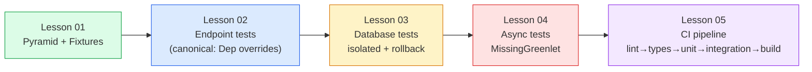

# 12: Testing and Quality

*Where `Boardly` gets the test suite and CI pipeline that lets you refactor, ship, and sleep.*

**Tests are not a tax on velocity.**

They are the substrate that lets you refactor, ship, and sleep. This section teaches the **test pyramid**, the **fixture design** that keeps a 2000-test suite fast, the **dependency overrides** that let you test FastAPI without a real database, the **isolated database** patterns that keep tests reliable, the **async testing** gotchas that take down junior engineers' first CI runs, and the **CI pipeline** that runs all of it on every push.

#testing #pytest #ci #moc

## What this section is

A five-lesson walk through testing a FastAPI + async SQLAlchemy app, in the only order that makes sense: **the pyramid first** (because the shape of your test suite is more important than the count), then **endpoint tests** (the most-used lesson — dependency overrides), then **database tests** (the transaction-rollback pattern), then **async tests** (the gotchas), then **CI** (the integration). Each lesson continues the `Boardly` app from Section 11 — we add a `tests/` directory with `conftest.py`, factory fixtures, the endpoint-test patterns that test the auth from Lesson 03 and the RBAC from Lesson 04, the database-test patterns that test the `User`/`RefreshToken`/`PasswordResetToken` tables, and the CI pipeline that runs all of it.

The colors are not decoration: green is the *shape* layer (the pyramid), blue is the *HTTP* layer (endpoint tests), yellow is the *storage* layer (database tests), red is the *gotchas* layer (async), and purple is the *integration* layer (CI). Each layer builds on the ones before it.

## Lessons in order

| # | Lesson | Canonical concept | Adds to `Boardly` | Time |
|---|---|---|---|---|
| 01 | [[Test-Pyramid-and-Fixtures]] | — | `tests/conftest.py` (session-scoped engine, function-scoped session, client fixture, factory fixtures) + `pyproject.toml` test config | 90 min |
| 02 | [[Testing-FastAPI-Endpoints]] | **Dependency overrides** | `tests/test_users.py`, `tests/test_rbac.py` (the matrix from Lesson 11.04 — re-tested through the framework here), `tests/test_contract.py` (OpenAPI snapshot) | 90 min |
| 03 | [[Testing-Database-Logic]] | — | `tests/test_org_service.py`, `tests/test_migrations.py` (CI runs `alembic upgrade head`) — the transaction-rollback pattern + the migration-drift defense | 90 min |
| 04 | [[Async-Testing]] | — | `pyproject.toml` `pytest-asyncio` config; `tests/test_async_endpoints.py` with `pytest.mark.asyncio`, `AsyncClient`, the three classic async-error patterns | 60 min |
| 05 | [[CI-Pipelines]] | — | `.github/workflows/ci.yml` — matrix on Python 3.12 / 3.13, PostgreSQL and Redis service containers, lint→type-check→unit→integration→build→push | 90 min |

**The "canonical" badge**

Lesson 02 is the canonical home of `Dependency overrides` (`app.dependency_overrides[dep] = fake`). When other lessons need to reference the testing-side of `Depends`, they link back to Lesson 02 instead of re-explaining.

## How to read this section

You have three reading paths depending on what you are doing.

**Path A — "I am building a test suite from scratch."**
Read 01 → 02 → 03 → 04 → 05, in order, copying the conftest patterns into your own project. This is the way the section was written; plan 7 hours of focused time. The exercises are real — the security-test matrix in Lesson 02 is the artifact that makes the auth section from Section 11 actually defensible.

**Path B — "I have a test suite and it's flaky."**
Skim 01 (the "session-scoped fixture that mutates" subsection — that is probably your bug). Read 03 in full (the transaction-rollback pattern is probably what you are missing). Skim 04 (the `MissingGreenlet` / "Event loop is closed" patterns — your flake is probably one of those).

**Path C — "I am setting up CI for the first time."**
Read 05 in full. Adapt the `.github/workflows/ci.yml` to your repo. The "service containers with healthchecks" subsection is the one that catches the `connection refused` intermittent failures.

**Tip — If you are short on time, read these two.**

Lesson 02 in full (dependency overrides are the most-used pattern in FastAPI testing). Lesson 05 in full (the CI pipeline is the artifact that ties everything together). Those two lessons cover 80% of the value of the section.

## What we build on

The testing section is not self-contained. It composes on top of the rest of the vault:

- **`Depends`** from [[03-FastAPI-Core/Dependency-Injection]] — `app.dependency_overrides` is the testing counterpart of `Depends`. The override is keyed on the function object, so it survives refactors (unlike `unittest.mock.patch`).
- **`AsyncSession`** from [[07-SQLAlchemy/05-Session-and-Transaction-Management]] — the transaction-rollback pattern uses the same session machinery as production. Tests get a per-test session wrapped in a transaction that rolls back at teardown.
- **`Annotated`** from [[01-Python-Foundations/Type-Hints-and-Annotations]] — the `Annotated[T, Depends(...)]` style is the override-key confusion point: you override the dependency callable, not the type alias.
- **Pydantic `BaseModel`** from [[04-Pydantic/BaseModel-and-Validation]] — test data factories build `BaseModel` instances; contract tests validate against Pydantic schemas.
- **`Pydantic Settings`** from [[04-Pydantic/Pydantic-Settings]] — the env vars the CI workflow sets (`DATABASE_URL`, `JWT_SECRET`) are read by the `Settings` class. This is the seam between CI config and the app.
- **Exceptions** from [[01-Python-Foundations/Exceptions-Done-Right]] — `MissingGreenlet`, `IntegrityError`, `ExpiredSignatureError` are all exceptions; reading them is the testing skill.
- **uv** from [[01-Python-Foundations/uv-Tooling-Workflows]] — CI runs `uv sync --frozen`. The `--frozen` flag is the lockfile-as-source-of-truth enforcement.

## Outbound links

- [[11-Authentication-and-Security/RBAC-and-Object-Level-Auth]] — the security tests at the end of that lesson use the override patterns from Lesson 02 here. The two lessons are a pair: Section 11.04 *defines* the matrix; Section 12.02 *runs* the matrix through the framework.
- [[16-Deployment-and-DevOps/GitHub-Actions-CI]] — the deployment-track companion to Lesson 05 here. Lesson 05 is the *testing* CI; that lesson is the *deployment* CI.
- [[13-Performance-and-Observability/N-plus-1-and-Slow-Queries]] — some integration tests double as perf regression tests; the two connect here.

## What's new in 02b-Backend-Foundations (the sibling section)

A sibling section is being written in parallel — it covers the backend foundations (cookies, headers, session, CSRF). Some test patterns in this section are designed to validate the patterns in 02b:

- [[02b-Backend-Foundations/HTTP-Cookies-Deep-Dive]] — if `Boardly` uses `HttpOnly` cookies for refresh-token storage, the tests in Lesson 02 will assert on `Set-Cookie` response headers and `Cookie` request headers. Lesson 02's `client.cookies` pattern (httpx's cookie jar) is what makes that work.
- [[02b-Backend-Foundations/CSRF-Protection]] — if `Boardly` uses double-submit cookies for CSRF protection, the tests in Lesson 02 will assert on the `X-CSRF-Token` request header and the `csrf` cookie. Lesson 02's header-override pattern (`client.headers["X-CSRF-Token"] = "..."`) is what makes that work.

## Verified Versions (October 2026)

| Tool | Version | Verified |
|---|---|---|
| FastAPI | 0.148.0 | 2026-10-19 |
| Starlette | 1.9.0 | 2026-10-19 |
| Pydantic | v2.14.1 | 2026-10-19 |
| pytest | 8.x (latest 8.4.x) | 2026-10-19 |
| pytest-asyncio | latest (0.24.x) | 2026-10-19 |
| pytest-cov | latest (6.x) | 2026-10-19 |
| coverage.py | latest (7.6.x) | 2026-10-19 |
| httpx | latest (0.27.x) | 2026-10-19 |
| anyio | latest (4.x) | 2026-10-19 |
| uv | 0.13.1 | 2026-10-19 |
| Python | 3.12 / 3.13 | 2026-10-19 |
| SQLAlchemy | 2.1.5 | 2026-10-19 |
| Alembic | 1.20.0 | 2026-10-19 |
| PostgreSQL | 17.x | 2026-10-19 |
| Redis | 7.x | 2026-10-19 |

If a version above has a "latest" entry and you are reading this in 2027 or later, verify against the canonical URLs in each lesson's `Sources` section.

## What's next

Start with [[Test-Pyramid-and-Fixtures]]. The fixture design philosophy underpins everything that follows; getting scope wrong makes a 2-second test suite take 30 seconds.

---

**Tags:** #moc #testing #pytest #ci #index #home
**Previous:** [[11-Authentication-and-Security/OWASP-API-Top-10]] (the last lesson in the security section, just before testing)
**Start:** [[Test-Pyramid-and-Fixtures]] →
