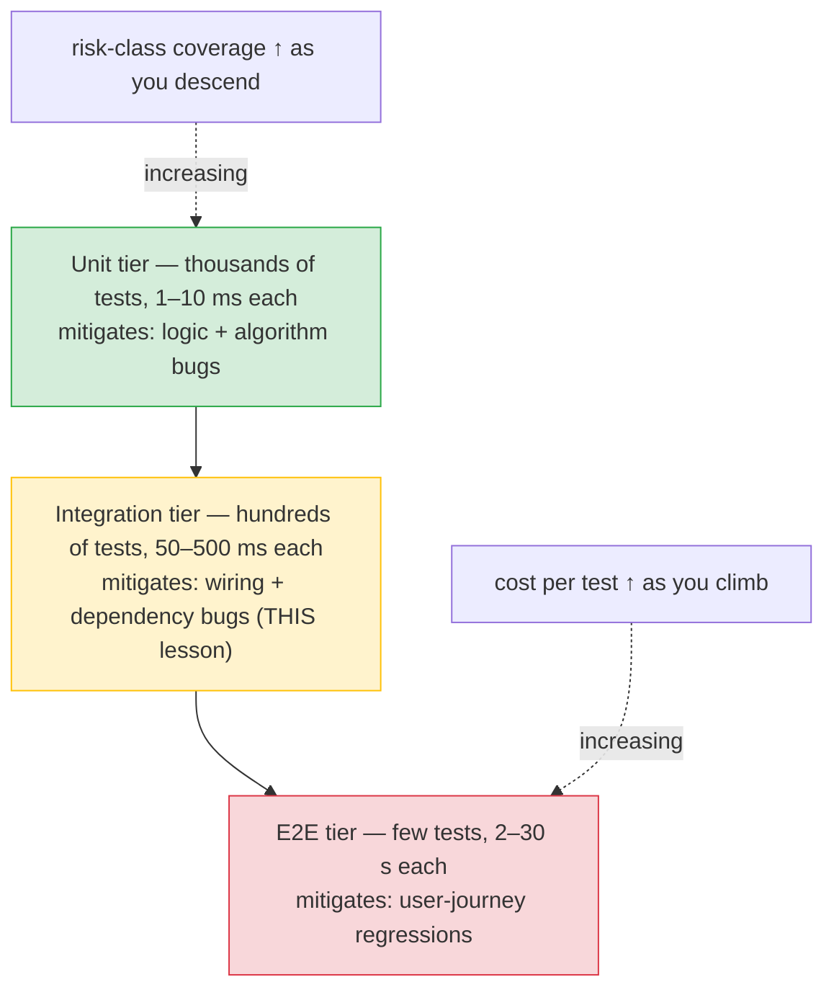
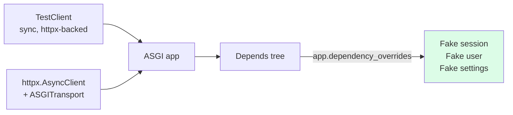
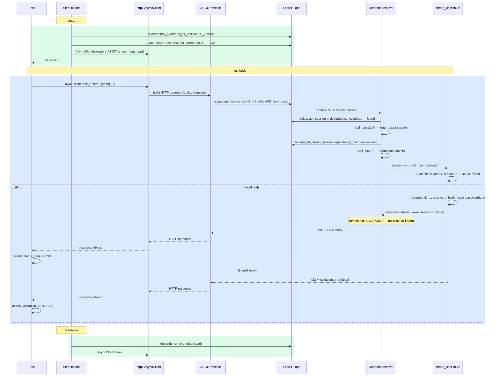

# Lesson 02: Testing FastAPI Endpoints

*Where `Boardly` gets the framework-level seam that lets you test auth without issuing real JWTs, validation errors without spinning up a real DB, and OpenAPI drift without deploying.*

**This is the canonical home for `dependency overrides`.**

A FastAPI endpoint is not a function you call. It is a tree of dependencies — auth, DB session, settings, scoped clients — that resolves per request. Testing the endpoint by mocking every dep with `unittest.mock.patch` is brittle: you patch what the route *imports*, not what the framework *resolves*. FastAPI gives you `app.dependency_overrides`, which is the framework-level seam — you replace a dependency with a fake, and the route never knows.


#testing #fastapi #httpx #dependency-overrides #canonical

## Learning Objectives

By the end of this lesson you will be able to:

1. **Choose between `TestClient` (sync) and `httpx.AsyncClient` with `ASGITransport` (async)** and know when each is right.
2. **Override any FastAPI dependency** — including `get_session`, `get_current_user`, `oauth2_scheme` — without monkey-patching.
3. **Test authentication, authorization, and validation errors** without issuing real JWTs.
4. **Write assertion patterns that survive non-deterministic ordering** (UUIDs, timestamps) — assert on shape, not value.
5. **Snapshot the OpenAPI schema** for contract tests — catch endpoint drift.
6. **Override with `Annotated` deps** — know that the override key is the dependency callable, not the type alias.

## Prerequisites

Before starting, you need:

- **`Depends`** — [[03-FastAPI-Core/Dependency-Injection]]. `Depends(...)` is what you override. The override is keyed on the function object.
- **Path / Query / Body** — [[03-FastAPI-Core/Path-Query-Header-Cookie-Body]]. The 422 validation errors you assert on come from this layer.
- **Test pyramid + fixtures** — [[Test-Pyramid-and-Fixtures]]. The `client` fixture we use here is built there.
- **Pydantic `BaseModel`** — [[04-Pydantic/BaseModel-and-Validation]]. The 422 errors are Pydantic validation failures surfaced.

**The single most common gap: `unittest.mock.patch` instead of `dependency_overrides`.**

`unittest.mock.patch("app.routers.users.get_session")` is brittle — it patches what the module imports. If you refactor the import (move `get_session` to `app.db.get_session`), the patch breaks silently. `app.dependency_overrides[get_session] = fake_session` is keyed on the function object — survives refactors. The rule: if the framework resolves it (it's a `Depends`), override; if the code instantiates it (e.g. `boto3.client("sns")` constructed inside a function), mock.


## Think Like a Senior Test Engineer

A junior engineer writes tests to verify that the code works. A senior engineer writes tests to *document* what the code is supposed to do — and to make the cost of breaking that contract visible to the next engineer who touches the code. The mental shift is small in words and large in consequences: the test is not a check; the test is a contract that happens to be machine-checkable.

### Tests as documentation, not verification

The test that asserts `assert r.status_code == 201` on `POST /users` does two things at once. The obvious one is verification: it tells you the route returns 201 today. The non-obvious one — the senior engineer's reading — is documentation: it tells the next reader "this route is supposed to return 201 on a valid body". When the route starts returning 200 because someone changed the status code without thinking, the test fails, and the failure message *is* the documentation: "expected 201, got 200". The reader does not need to find the design doc; the test *is* the design doc.

This is why the OpenAPI snapshot test in this lesson matters more than its size suggests. The snapshot is not "verifying the API didn't drift" — it is *documenting* what the API surface is, in a form that breaks loudly when someone changes it without updating the contract. The PR that adds `POST /users/bulk` "for an internal script" without updating the snapshot fails CI with a message that says "the API surface drifted; the snapshot is the contract; update it deliberately". The test is the documentation; the failure is the documentation enforcement.

**Tip — Think like a senior engineer: the test name is the spec.**

A test named `test_create_user_returns_201_on_valid_body` documents the contract in its name. A test named `test_users_1` or `test_create` documents nothing — and when it fails, the engineer reading the red badge has to open the file to find out what broke. The senior engineer's rule of thumb: if the test name does not read as a specification ("when X, the system does Y"), rename it. The name is the spec; the body is the proof. A green badge on a well-named test is a contract that the next reader can trust without opening the file.


### The test pyramid as a risk model

The test pyramid — many unit tests at the base, fewer integration tests in the middle, very few end-to-end tests at the top — is usually taught as a speed heuristic: "fast tests are cheap, so write more of them". That framing inverts the actual reason. The pyramid is a *risk* model: each tier mitigates a different class of bug, and the bug classes have different cost-per-test-to-detect. The senior engineer's reading of the pyramid is: "what risk does this test reduce, and is there a cheaper test that reduces the same risk?"

| Tier | Bug class mitigated | Cost per test | Typical count |
|---|---|---|---|
| Unit | Logic and algorithm bugs (off-by-one, wrong formula, mishandled edge case) | 1–10 ms | thousands |
| Integration (this lesson) | Wiring bugs (missing `Depends`, wrong response shape, validation-rule regression) | 50–500 ms | hundreds |
| End-to-end | User-journey bugs (login → create → logout flow broken across the full stack) | 2–30 s | dozens |

The bug classes are *not* interchangeable. A unit test cannot catch "the route is missing `Depends(get_current_user)`" because the function-call test (Mistake 4 in this lesson) bypasses the framework — the missing `Depends` is invisible at the unit tier. An end-to-end test *can* catch it, but at 5 seconds per test, you can afford maybe 50 of them, and the missing-auth bug only surfaces if the end-to-end test happens to walk through the unauth path. The integration tier — `httpx.AsyncClient` + `ASGITransport` + `dependency_overrides` — is the cheapest tier that catches the wiring bug. That is why this lesson exists, and that is why the `client` fixture is the most-reached-for fixture in a FastAPI test suite.



### Three questions on the sticky note

Before writing a test, the senior engineer asks three questions, in this order:

1. **What risk does this test reduce?** If the answer is "it reduces the risk that someone refactors this code and the refactor breaks the route's contract", the test belongs at the integration tier (this lesson). If the answer is "it reduces the risk that the password-hashing function regresses on a corner case", the test belongs at the unit tier. If the answer is "it reduces the risk that the deploy pipeline ships a broken login flow", the test belongs at the end-to-end tier. A test without a stated risk is a test that exists for coverage metrics, not for risk reduction — and a test that exists for coverage metrics alone is a test that costs CI minutes and gives no signal when it fails.
2. **What is the cost of this test?** Cost is not just CI runtime — it is maintenance burden (how often does the test break for unrelated reasons?), false-positive rate (how often does the test fail without a real bug?), and cognitive load (how long does it take a reader to understand what the test is asserting?). A 30-second end-to-end test that breaks on every PR because it depends on a third-party API availability costs more than 30 seconds — it costs the *trust* of every engineer who learns to ignore the red badge. The senior engineer cuts those tests, or moves them to a nightly job, before adding more.
3. **Is there a cheaper test that reduces the same risk?** This is the question that distinguishes the senior engineer from the junior. The junior writes the end-to-end "login → create → logout" test because the user-journey risk is real. The senior writes the same risk-coverage as one integration test that asserts the login endpoint sets the session cookie, plus one unit test that asserts the cookie is read correctly, plus one integration test that asserts the create route requires the cookie. Three cheap tests, one expensive test, same risk surface — the senior takes the three.

The rest of this lesson deepens the integration tier — the middle of the pyramid, the tier that catches wiring bugs at 100 ms each.

## The Problem

`Boardly` has endpoints that take dependencies — `get_session`, `get_current_user`, `get_redis`. To test an endpoint, you need to either:

1. **Spin up the real dependencies** — real PostgreSQL, real Redis, real JWT signing. Accurate but slow, and breaks if any of those services is unavailable.
2. **Mock every dependency** — `unittest.mock.patch` for each. Brittle (breaks on refactor) and noise-heavy (every test has 5 lines of `with mock.patch(...)` setup).
3. **Override dependencies at the framework level** — `app.dependency_overrides[dep] = fake`. Fast, refactor-safe, no real services. This is the right answer.

The third option is what FastAPI gives you. This lesson is the canonical home for that pattern.

Why is the framework-level override *better* than mock-patching the import? `mock.patch("boardly.routers.users.get_session")` patches the import-time name binding — it says "in the `boardly.routers.users` module, the name `get_session` now points at my fake". That works *until* you refactor the import (`from boardly.db import get_session` becomes `from boardly.security.deps import get_session`), at which point the patch silently no-ops because the name it patches no longer exists. The framework-level override says "FastAPI, when you resolve `Depends(get_session)`, look it up in this dict and use the fake". The lookup is keyed on the *function object*, not the import path — refactor the import as much as you like, the function object is the same, the override still applies. The framework owns the resolution; the override speaks the framework's language.

## The Code

Here is the complete `tests/test_users.py` for `Boardly`'s `POST /users` endpoint. It exercises the full pattern: dependency override, validation error, success path, auth-required check.

```python
# tests/test_users.py
"""Tests for POST /users — the canonical endpoint-test patterns.

Lesson 12.02: dependency_overrides for get_session and get_current_user,
validation-error assertions, OpenAPI snapshot.
"""
import json
from pathlib import Path

import pytest
import pytest_asyncio
from httpx import ASGITransport, AsyncClient
from sqlalchemy import select

from boardly.db import get_session
from boardly.main import app
from boardly.models import User
from boardly.security.deps import get_current_user


@pytest_asyncio.fixture
async def client(session):
 """Per-test client with overrides for get_session and get_current_user."""
 async def _session():
 return session
 async def _user():
 return User(id=1, email="admin@example.com", is_admin=True, _scopes=["write:users"])
 app.dependency_overrides[get_session] = _session
 app.dependency_overrides[get_current_user] = _user
 async with AsyncClient(transport=ASGITransport(app=app), base_url="http://t") as ac:
 yield ac
 app.dependency_overrides.clear()


@pytest.mark.asyncio
async def test_create_user_returns_201(client, session):
 r = await client.post("/users", json={"email": "x@y.z", "password": "supersecret"})
 assert r.status_code == 201
 assert r.json()["email"] == "x@y.z"
 # The route committed through the same session fixture — verify the row exists.
 user = await session.scalar(select(User).where(User.email == "x@y.z"))
 assert user is not None


@pytest.mark.asyncio
async def test_create_user_rejects_short_password(client):
 r = await client.post("/users", json={"email": "x@y.z", "password": "short"})
 assert r.status_code == 422
 assert_validation_error(r, field="password", err_type="string_too_short")


@pytest.mark.asyncio
async def test_create_user_rejects_bad_email(client):
 r = await client.post("/users", json={"email": "not-an-email", "password": "longenough"})
 assert r.status_code == 422
 assert_validation_error(r, field="email", err_type="value_error")


@pytest.mark.asyncio
async def test_create_user_requires_auth():
 """Do not install the override — let the real oauth2_scheme reject."""
 app.dependency_overrides.clear() # defensive — the fixture clears already
 async with AsyncClient(transport=ASGITransport(app=app), base_url="http://t") as ac:
 r = await ac.post("/users", json={"email": "x@y.z", "password": "longenough"})
 assert r.status_code == 401


def assert_validation_error(response, *, field: str, err_type: str) -> None:
 """Assert that a 422 response has a specific validation error.

 FastAPI's 422 body is {"detail": [{"loc": [...], "type": "...", "msg": "..."}]}.
 We assert on `type` (stable) and `loc[-1]` (the field name), not on `msg`
 (which can change between Pydantic versions).
 """
 assert response.status_code == 422
 detail = response.json()["detail"]
 assert any(
 entry["loc"][-1] == field and entry["type"] == err_type
 for entry in detail
 ), detail


def test_openapi_matches_snapshot():
 """Contract test: catch endpoint drift."""
 spec = app.openapi()
 snapshot = json.loads(Path("openapi.snapshot.json").read_text())
 actual_paths = {p: set(m.keys()) for p, m in spec["paths"].items()}
 snapshot_paths = {p: set(m.keys()) for p, m in snapshot["paths"].items()}
 assert actual_paths == snapshot_paths, (
 f"API surface drifted:\n"
 f" added: {actual_paths.keys() - snapshot_paths.keys()}\n"
 f" removed: {snapshot_paths.keys() - actual_paths.keys()}\n"
 )
```

And here is the route under test, for reference:

```python
# boardly/routers/users.py — the route under test
from typing import Annotated

from fastapi import APIRouter, Depends, status
from pydantic import BaseModel, EmailStr, Field
from sqlalchemy.ext.asyncio import AsyncSession

from boardly.db import get_session
from boardly.models import User
from boardly.security.deps import get_current_user
from boardly.security.passwords import hash_password

router = APIRouter(prefix="/users", tags=["users"])


class UserCreate(BaseModel):
 email: EmailStr
 password: str = Field(min_length=8, max_length=128)


class UserRead(BaseModel):
 id: int
 email: EmailStr
 model_config = {"from_attributes": True}


@router.post(
 "",
 response_model=UserRead,
 status_code=status.HTTP_201_CREATED,
 dependencies=[Depends(get_current_user)],
)
async def create_user(
 body: UserCreate,
 session: Annotated[AsyncSession, Depends(get_session)],
):
 user = User(email=body.email, password_hash=hash_password(body.password))
 session.add(user)
 await session.commit()
 return user
```

Read both files. Then read the dissection below — every line gets a *what* / *why* / *what-Python-or-the-framework-does-internally*.

## Line-by-Line Deep Dive

### Lines 14–25 of `test_users.py`: The `client` fixture

```python
@pytest_asyncio.fixture
async def client(session):
 """Per-test client with overrides for get_session and get_current_user."""
 async def _session():
 return session
 async def _user():
 return User(id=1, email="admin@example.com", is_admin=True, _scopes=["write:users"])
 app.dependency_overrides[get_session] = _session
 app.dependency_overrides[get_current_user] = _user
 async with AsyncClient(transport=ASGITransport(app=app), base_url="http://t") as ac:
 yield ac
 app.dependency_overrides.clear()
```

**What it does:** Installs two overrides (`get_session` returns the per-test session; `get_current_user` returns a fake admin user), opens an `AsyncClient` with `ASGITransport`, yields it, clears the overrides at teardown.

**Why two overrides:** The route depends on both — `get_session` for the DB, `get_current_user` for auth. Without overriding `get_session`, the route would try to open a real DB connection (slow, brittle, requires a real DB). Without overriding `get_current_user`, the route would try to verify a real JWT (slow, requires a real secret, and the test would have to issue a real token).

**Why `@pytest_asyncio.fixture` and not `@pytest.fixture`:** the fixture function is `async def` with a `yield`. In strict mode (the default in modern `pytest-asyncio`), `@pytest.fixture` does not know how to drive an async generator — it calls the function, gets an `async_generator` object back, and hands that to the test instead of an `AsyncClient`. The test then fails with `AttributeError: 'async_generator' object has no attribute 'post'` (and on pytest 9+ it errors at setup with "requested an async fixture with no plugin that handled it"). `@pytest_asyncio.fixture` is the async-aware decorator: it schedules the generator on the test's event loop, drives the `yield`, and passes the yielded value (the `AsyncClient`) to the test. The full tour of the `pytest-asyncio` strict/auto decision, the `event_loop` fixture's deprecation saga, and the three classic async-test errors is in [[12-Testing-and-Quality/Async-Testing]]; the rule of thumb here is "any `async def` fixture with a `yield` needs `@pytest_asyncio.fixture`".

**Student asks: Why not just construct a real `User` and bypass the dependency?**

Because the override proves the wiring is via `Depends`, not by re-creating the real path. If you construct a `User` in the test and pass it as a parameter, you are not testing what FastAPI does — you are testing what your test code does. The override is the framework's own seam: it says "when FastAPI resolves `Depends(get_current_user)`, return this `User`". That is what production code does too — production just resolves through the real chain. The test asserts the route's *contract* (it accepts a `current_user` dependency, it checks `current_user.is_admin`, it persists via `session.add`) without taking on the brittle cost of running the real chain. Constructing the `User` and calling the function directly bypasses the framework, the `Depends` resolution, the Pydantic validation, and the exception handlers — leaving you with a green test that does not test the route.


**What happens inside `@pytest_asyncio.fixture` with `yield`**

A `pytest` fixture is a function that pytest calls before (and optionally after) the test. For a sync fixture with `yield`, pytest calls `next(fixture_fn)` to run setup to the `yield` point, passes the yielded value to the test, and after the test calls `next(fixture_fn)` again to drive the generator past `yield` into the teardown body. For an `async def` fixture, that driving model breaks: `next()` on an `async_generator` returns a coroutine object — not the yielded value — and the coroutine has to be scheduled on an event loop to make progress. Plain `@pytest.fixture` does not schedule the coroutine; it returns the `async_generator` object directly to the test, and the test fails with `AttributeError: 'async_generator' object has no attribute 'post'`. `@pytest_asyncio.fixture` is the async-aware decorator: it wraps the async generator so that the setup `__anext__()` runs on the test's event loop (or the session-scoped loop, depending on `asyncio_mode`), the yielded value is awaited and passed to the test, and the teardown `__anext__()` runs after the test on the same loop. The decorator is what turns an async function into a pytest fixture; without it, the async function is just an async function that pytest does not know how to drive. The same logic applies to async test functions themselves — `@pytest.mark.asyncio` is the equivalent decorator that tells pytest to await the test coroutine on the loop.


**Why `_session` is `async def`:** `get_session` is `async def` in the real code; the override must match the signature (FastAPI calls the override the same way it would call the real dependency). The override returns the per-test `session` (the fixture argument).

**Why `_user` returns a `User` with `is_admin=True`:** The route has `dependencies=[Depends(get_current_user)]` — it requires auth, but does not check a scope. The override returns a user with admin privileges — enough to satisfy `get_current_user`. If the route had `dependencies=[Depends(require_scope("write:users"))]` instead, the override would have to satisfy that chain too (the chain calls `get_current_user`, which is overridden).

**The override key is the function object**

`app.dependency_overrides[get_session] = ...` — the key is the *function object* `get_session`, not a string. This means refactor-safe: if you move `get_session` from `app.db` to `boardly.db`, the import path changes but the function object is the same. The override keeps working.


**What happens inside `app.dependency_overrides[get_session] = _session`**

When the FastAPI `Depends` resolver (`fastapi.dependencies.utils.solve_dependencies`) walks the dependency tree for a route, it consults `app.dependency_overrides` — a plain `dict` on the `FastAPI` instance — keyed on the *function object* (the same `get_session` you passed to `Depends(get_session)`). The lookup is `dep in app.dependency_overrides`; on a hit, the resolver calls the override callable instead of the real dependency. On a miss, it calls the real callable. The dict is the entire override mechanism — there is no metaclass magic, no decorator interception, no monkeypatch. The override persists for the lifetime of the `app` singleton (until `clear()` is called or the entry is popped), which is why the `client` fixture's teardown has to call `app.dependency_overrides.clear()` (Mistake 1 in this lesson) — the dict is module-level state, and a leak survives the test. The subtle point for `Annotated[AsyncSession, Depends(get_session)]`: the type alias `AsyncSession` is *not* the key — the key is the `get_session` callable inside `Depends(...)`. A common mistake is to write `app.dependency_overrides[AsyncSession] = ...` (keying on the type) — that override silently never applies, because the resolver looks up `get_session`, not `AsyncSession`. The reason the override key is the callable and not the type is that FastAPI allows multiple `Depends(callable)` with different callables that return the same type (e.g. `get_session` and `get_readonly_session` both returning `AsyncSession`) — keying on the type would conflate them. The resolver also caches resolved dependencies per-route at app-startup time (the `Depends` tree is built once when the route is registered), so installing an override after the app has started still works because the cache holds the *callable reference*, not a pre-computed value — the lookup is performed per-request, not at registration.


### Lines 28–35: The success test

```python
@pytest.mark.asyncio
async def test_create_user_returns_201(client, session):
 r = await client.post("/users", json={"email": "x@y.z", "password": "supersecret"})
 assert r.status_code == 201
 assert r.json()["email"] == "x@y.z"
 user = await session.scalar(select(User).where(User.email == "x@y.z"))
 assert user is not None
```

**What it does:** POSTs a user, asserts 201, asserts the response email, asserts the row exists in the DB.

**Why `await client.post(...)` not `client.post(...)`:** The `client` is an `AsyncClient` — its methods are coroutines. The `await` schedules the request on the event loop.

**Why we can assert the row exists in the DB after the request:** The route's `await session.commit()` hit the SAVEPOINT (Lesson 01's transaction-rollback pattern). The row is visible to subsequent queries on the same session. The same session fixture is injected into the test — so `await session.scalar(select(User).where(...))` finds the row the route just inserted. At teardown, the outer transaction rolls back; the row vanishes; the next test starts clean.

### Lines 38–42: The validation-error test (short password)

```python
@pytest.mark.asyncio
async def test_create_user_rejects_short_password(client):
 r = await client.post("/users", json={"email": "x@y.z", "password": "short"})
 assert r.status_code == 422
 assert_validation_error(r, field="password", err_type="string_too_short")
```

**What it does:** POSTs a body with a password shorter than the `Field(min_length=8)`, asserts 422, asserts the specific error type.

**Why `err_type="string_too_short"` and not the message:** Pydantic v2's error messages can change between versions (e.g. "string should have at least 8 characters" → "String should have at least 8 characters" between minor versions). The `type` field (`string_too_short`) is the stable identifier. Asserting on `type` is version-resilient; asserting on `msg` is brittle.

**Student asks: Why assert on `type` and not `msg` — surely the message is more readable when the test fails?**

Readable, yes — and brittle. The message is human-readable prose, which Pydantic can reword between minor versions. The `type` is a stable identifier (`string_too_short`, `value_error`, `missing`) — it changes only when the *kind* of error changes, not when the wording does. The trade-off: when the test fails on `type`, the failure message says "expected `string_too_short`, got `string_too_long`" — which is precise. When the test fails on `msg`, the failure says "expected 'String should have at least 8 characters', got 'String should have at least 8 characters'." (Identical to a human reader — the bug is a case difference the reviewer cannot see.) Assert on `type`. If the test fails, you have a precise signal; the assertion message includes the actual `detail` so a human can read it.


**Pydantic v2 error structure**

A 422 from FastAPI looks like:
```json
{
"detail": [
{
"type": "string_too_short",
"loc": ["body", "password"],
"msg": "String should have at least 8 characters",
"input": "short",
"ctx": {"min_length": 8}
}
]
}
```
The fields: `type` (stable identifier — assert on this), `loc` (location in the request — `["body", "field_name"]`), `msg` (human-readable, version-volatile — don't assert), `input` (the offending value), `ctx` (extra context, e.g. `min_length`).


### Lines 56–64: The auth-required test

```python
@pytest.mark.asyncio
async def test_create_user_requires_auth():
 """Do not install the override — let the real oauth2_scheme reject."""
 app.dependency_overrides.clear() # defensive
 async with AsyncClient(transport=ASGITransport(app=app), base_url="http://t") as ac:
 r = await ac.post("/users", json={"email": "x@y.z", "password": "longenough"})
 assert r.status_code == 401
```

**What it does:** Clears the overrides (so the real `oauth2_scheme` and `get_current_user` run), then POSTs without an `Authorization` header. Asserts 401.

**Why this test matters:** It proves the route actually requires auth — not just that the test fixture happens to install an override. If a refactor removes the `dependencies=[Depends(get_current_user)]` from the route, this test fails (the route would return 201, not 401). The "requires auth" test is the contract that the route is protected.

**Student asks: Why is the "no override" test in the same file as the override tests — would it not be cleaner in a separate suite?**

Cleaner, perhaps — but slower and less safe. The "requires auth" test belongs *next to* the override tests because the contract it asserts ("the route is protected") is the negative space of what the override tests assert ("when authed, the route works"). Putting them in separate files invites drift: a refactor removes the auth dependency; the override tests still pass (the override installs a fake user, so the route works); the separate "requires auth" test catches the regression — but only if the test author remembered to run it. Co-locating the test in the same file means `pytest tests/test_users.py` runs both, and a refactor that breaks auth shows up red in the same run as a refactor that adds a new override. The architectural property is "the positive and negative space of a contract are tested together, in the same file, in the same PR".


### Lines 67–79: The `assert_validation_error` helper

```python
def assert_validation_error(response, *, field: str, err_type: str) -> None:
 """Assert that a 422 response has a specific validation error."""
 assert response.status_code == 422
 detail = response.json()["detail"]
 assert any(
 entry["loc"][-1] == field and entry["type"] == err_type
 for entry in detail
 ), detail
```

**What it does:** A reusable assertion helper. Asserts 422 and that at least one error in `detail` matches the given `field` and `err_type`.

**Why `loc[-1]`:** `loc` is a list like `["body", "password"]`. The last element is the field name. Asserting on `loc[-1]` lets the helper work regardless of where the field is (body, query, path).

**Why `any(...)`:** A 422 can have multiple errors. The helper checks "is *any* error matching the spec". A more strict version would check "is *exactly one* error matching, and no others" — but that is brittle to additional validation rules.

### Lines 82–93: The OpenAPI snapshot test

```python
def test_openapi_matches_snapshot():
 """Contract test: catch endpoint drift."""
 spec = app.openapi()
 snapshot = json.loads(Path("openapi.snapshot.json").read_text())
 actual_paths = {p: set(m.keys()) for p, m in spec["paths"].items()}
 snapshot_paths = {p: set(m.keys()) for p, m in snapshot["paths"].items()}
 assert actual_paths == snapshot_paths, (
 f"API surface drifted:\n"
 f" added: {actual_paths.keys() - snapshot_paths.keys()}\n"
 f" removed: {snapshot_paths.keys() - actual_paths.keys()}\n"
 )
```

**What it does:** Calls `app.openapi()` to get the current OpenAPI spec, loads the snapshot from disk, compares the paths and methods (not the full spec — too noisy), asserts they match.

**Why paths-only and not full-spec:** A full-spec snapshot catches more drift, but it is noisy — every Pydantic model change touches the schema's `components`, every settings change touches `info.version`. The paths-only comparison catches "an endpoint was added or removed" without the noise. The trade-off: schema-shape changes (e.g. a new field on a request body) are not caught. For that, use a full snapshot and accept the noise; for endpoint drift, paths-only is the practical compromise.

**Why this is a contract test:** The OpenAPI spec is the contract between your API and its clients. If you add an endpoint, the contract changes; clients may need to update. If you remove an endpoint, clients break. The snapshot test forces the change to be deliberate — you have to update the snapshot file in the same commit. Without the snapshot, an "I'll just add this quick endpoint" PR ships a contract change without review.

What about clients who consumed the contract *before* the snapshot existed? The snapshot test catches *drift from the snapshot forward* — it does not retroactively prove the contract was right when the first client integrated. If a client integrated against `v0.3` of your API and the snapshot was added in `v0.5`, the snapshot from `v0.5` is your baseline, not their contract. The full protection is: (a) write the snapshot at the same time you publish the OpenAPI spec to clients, (b) version the spec (`/openapi.json?v=2`) so clients can pin, (c) break-the-contract changes (a removed field, a renamed endpoint) require a major version bump, not just a snapshot update. The snapshot test is the *commit-level* check; the versioning discipline is the *release-level* check. Both are needed.

**Tip — Update the snapshot deliberately**

Run `uv run pytest tests/test_users.py::test_openapi_matches_snapshot` to see the drift. Then update the snapshot with:
```bash
uv run python -c "from boardly.main import app; import json; print(json.dumps(app.openapi(), indent=2))" > openapi.snapshot.json
```
Commit the snapshot in the same PR that changed the endpoint. The PR reviewer sees the contract change.


**Student asks: Does the OpenAPI snapshot test actually catch real bugs — or is it just busywork?**

It catches two real classes of bug that nothing else in the suite catches. (1) **Silent endpoint removal** — a refactor PR deletes `routers/users.py` and forgets to keep the route mounted; the unit tests pass (the routes file still works in isolation), the integration tests pass (they hit `/healthz` not `/users`), and the bug ships. The snapshot test fails in the same PR because `paths["/users"]` is gone from `actual_paths` but still in `snapshot_paths`. (2) **Undocumented endpoint addition** — a junior adds `POST /users/bulk` "for an internal script", never tells the docs team, the OpenAPI spec silently grows. Without the snapshot test, the endpoint exists in production but is invisible to API consumers (including the next engineer on-call who is debugging why `/users/bulk` is in the access logs). The snapshot test forces the addition to be deliberate — the engineer must update the snapshot, which is the cue to also update the docs. What it does *not* catch: field-level schema changes (a new `User.address` field) — for those you need either a full snapshot (noisy) or a property-based test against a client SDK. The snapshot is the cheapest contract test that catches the most common contract drift; it is busywork only if you have no API consumers.


## Two Clients, One Transport

FastAPI (via Starlette) ships a `TestClient` — a synchronous wrapper around `httpx.Client` that drives your ASGI app in-process. For an async app, the idiomatic choice is `httpx.AsyncClient` with `ASGITransport(app=...)`.



| Tool | Sync code | Async code | Notes |
|---|---|---|---|
| `fastapi.testclient.TestClient` | yes | works, but blocks the loop | Easier for quick tests; uses an internal thread. |
| `httpx.AsyncClient` + `ASGITransport` | awkward | yes | The right tool for async-first apps. |

If your route is `async def`, prefer the `httpx.AsyncClient` path. If you have a mix or a fully sync codebase, `TestClient` is fine. Do not mix in the same suite — the mental overhead of "which client does this test use?" is real.

**What happens inside `httpx.AsyncClient(transport=ASGITransport(app=app))`**

The `ASGITransport` is an `httpx` transport that does not open a socket, does not bind a port, and does not start `uvicorn`. When the `AsyncClient` sends a request, `ASGITransport.send(request)` builds an ASGI scope from the HTTP request — `scope = {"type": "http", "method": "POST", "path": "/users", "headers": [(b"host", b"t"), ...], "query_string": b"", "client": ("testclient", 0), "server": ("t", 80)}` — then calls `await app(scope, receive, send)` directly on the same event loop the test is running on. The `app` callable is your FastAPI instance — `app(scope, receive, send)` invokes Starlette's routing, the `Depends` resolver, the Pydantic validation, and the route function, all in-process. The response is collected into an in-memory buffer: the `send` callable receives ASGI messages (`http.response.start` with the status code and headers, then zero or more `http.response.body` chunks with the body); the transport assembles them into an `httpx.Response` and returns it to the client. No network round-trip, no wire serialization, no `uvicorn` subprocess — the test runs the entire ASGI stack in-memory in milliseconds. The trade-off is what the test does *not* exercise: the actual HTTP/1.1 wire framing, the `Content-Length` calculation, the chunked transfer encoding, the TLS handshake. For wiring tests (the integration tier), this is exactly what you want to skip — the wire is not where the wiring bugs live. For wire-level bugs (a misconfigured `Content-Type`, a malformed `Cookie` header), reach for a test that starts `uvicorn` on a real port and hits it with `httpx.AsyncClient` without `ASGITransport` — but those tests are rare, slow, and belong in the e2e tier.


## Execution Trace

A test calls `await client.post("/users", json={...})`.



The diagram shows the two layers: the `Depends` resolver runs in-process (no socket, no port, no `uvicorn` subprocess); the override dict is checked at resolution time. The route never knows its dependencies were faked.

## Common Mistakes

### Mistake 1: Forgetting to clear `dependency_overrides`

```python
# WRONG
@pytest.fixture
def client(app):
    app.dependency_overrides[get_current_user] = _admin_user
    with TestClient(app) as c:
        yield c
    # ← forgot app.dependency_overrides.clear()
```

**Symptom:** Test A installs `get_current_user = _admin_user`. Test A finishes — the override is still installed. Test B starts, expects `get_current_user = _regular_user`, but the override is still `_admin_user`. Test B fails mysteriously — the user it got is admin, not regular.

**Why:** The override dict on `app` is global. Without an explicit clear, it persists across tests.

**Fix:** Always clear in the fixture teardown. The `client` fixture above does `app.dependency_overrides.clear()` after `yield`. The pattern is non-negotiable.

```python
# RIGHT
@pytest.fixture
def client(app):
    app.dependency_overrides[get_current_user] = _admin_user
    with TestClient(app) as c:
        yield c
    app.dependency_overrides.clear()   # ← always
```

An even safer pattern: use `monkeypatch.setitem(app.dependency_overrides, get_current_user, _admin_user)` — `monkeypatch` undoes itself at the end of the test. But the explicit `clear()` is what we show because it works without `monkeypatch` and makes the intent visible in the fixture.

### Mistake 2: Mock-patching instead of overriding

```python
# WRONG — patches the import-time binding
@unittest.mock.patch("app.routers.users.get_session")
async def test_create_user(mock_get_session, client):
    mock_get_session.return_value = FakeSession()
    r = await client.post("/users", json={...})
    assert r.status_code == 201
```

**Symptom:** `unittest.mock.patch("app.routers.users.get_session")` works in the original code. You refactor `get_session` to `boardly.db.get_session`. The patch breaks silently — the route uses the real `get_session`, the test does not notice, and a real DB connection is opened. The test still passes (because the real DB happens to be available) but is no longer testing what it claims.

**Why:** `mock.patch` patches the import-time name binding. Refactor the import and the patch breaks. `app.dependency_overrides[get_session]` is keyed on the function object — survives refactors.

**Fix:** Use `dependency_overrides` for *dependencies* (things passed as `Depends(...)`). Use `mock.patch` for *side-effect libraries* (e.g. `boto3.client("sns")` constructed inside a function — not a `Depends`). The rule: if the framework resolves it, override; if the code instantiates it, mock.

```python
# RIGHT — override the dependency (keyed on the function object)
async def test_create_user(client, app):
    app.dependency_overrides[get_session] = lambda: FakeSession()
    r = await client.post("/users", json={...})
    assert r.status_code == 201
```

### Mistake 3: Asserting on the full JSON when only some fields are deterministic

**Symptom:** `assert r.json() == {"id": 5, "email": "x@y.z", "created_at": "..."}` fails because `created_at` is a different timestamp each run.

**Why:** UUIDs, timestamps, auto-increment IDs — all non-deterministic. Asserting on the full response compares every field, including the non-deterministic ones.

**Fix:** Assert on the fields you care about, ignore the rest. For complex shapes, write a `assert_user_shape(payload)` helper that asserts the structure (keys present, types correct) without comparing exact values.

```python
def assert_user_shape(payload: dict):
 assert set(payload.keys()) == {"id", "email", "name", "is_active"}
 assert isinstance(payload["id"], int)
 assert "@" in payload["email"]
 assert isinstance(payload["is_active"], bool)
```

### Mistake 4: Calling the route function directly

```python
# WRONG — calls the function, skips the framework
async def test_create_user_returns_201(session):
    r = await create_user(
        body=UserCreate(email="a@b.c", password="hunter2hunter2"),
        session=session,
    )
    assert r.status_code == 201   # ← r is a dict, not a Response; this is a lie
```

**Symptom:** `await create_user(body=UserCreate(...), session=session)` — the test calls the route function directly. The test passes — but Pydantic validation, dependency resolution, exception handlers, and middleware are all skipped. The test does not test the route; it tests the function.

**Why:** The route function is just a Python function — calling it directly is valid Python. But it skips everything FastAPI adds: the `Depends` tree, the Pydantic validation, the exception handlers, the middleware. The test is misleadingly green — it would pass even if the route were not registered.

**Fix:** Use the HTTP client. The only time to call the route function directly is when you are testing the function in isolation and explicitly skipping the HTTP layer (e.g. testing the service logic with a mocked session). For endpoint tests, use the client.

```python
# RIGHT — go through the HTTP layer
async def test_create_user_returns_201(client):
    r = await client.post("/users", json={"email": "a@b.c", "password": "hunter2hunter2"})
    assert r.status_code == 201
```

The HTTP-client test exercises: routing, Pydantic validation of the body, the `Depends` tree (so an override actually runs), the exception handlers (so a `HTTPException(404)` becomes a real 404 response), and the middleware (so the request-ID middleware runs). The function-call test exercises only the function body. A route with a missing `Depends` looks identical in the function-call test to a route with the dependency wired — the HTTP test catches the missing wiring; the function-call test does not.

### Mistake 5: Using a real DB when an in-memory one suffices

**Symptom:** A pure-logic test (e.g. `hash_password` round-trip) takes 500 ms because it spins up a real PostgreSQL connection.

**Why:** The test fixture installs the real `get_session` because the test inherited the `client` fixture. The pure-logic test does not need a DB.

**Fix:** Match the test type to the need. A pure-logic test (`test_hash_password_round_trips`) does not need the `client` fixture — just `hash_password` and `verify_password`. A DB-backed test (`test_create_user_persists`) needs `session`. An endpoint test (`test_create_user_returns_201`) needs `client`. Don't use the heaviest fixture when a lighter one suffices.

### Mistake 6: Reusing a `TestClient` across tests without resetting cookies/state

```python
# WRONG — one client, shared cookie jar
client = TestClient(app)   # ← module-level, shared across all tests

def test_a_login_sets_cookie():
    r = client.post("/auth/login", ...)
    assert r.status_code == 200

def test_b_unauthenticated_endpoint():
    r = client.get("/me")
    assert r.status_code == 401   # ← FAILS — still logged in from test A
```

**Symptom:** `httpx.Client` keeps cookies. Test A logs in (sets a session cookie). Test B inherits the cookie. Test B's assertions about "unauthenticated" behavior fail.

**Why:** `httpx.Client` (and `AsyncClient`) maintains a cookie jar across requests. If the test does not reset, the next test inherits state.

**Fix:** Use the per-test fixture pattern above — each test gets a fresh `AsyncClient` via `async with AsyncClient(...) as ac: yield ac`. The `async with` closes the client at teardown; the next test gets a fresh one with no cookies.

```python
# RIGHT — per-test fixture, no shared state
@pytest_asyncio.fixture
async def client(app):
    async with AsyncClient(transport=ASGITransport(app=app), base_url="http://test") as ac:
        yield ac
    # ← async with closes the client; cookie jar is discarded
```

## Engineering Trade-Offs

### `TestClient` vs `httpx.AsyncClient`

| Aspect | `TestClient` | `httpx.AsyncClient` + `ASGITransport` |
|---|---|---|
| Sync code | yes | awkward (need `asyncio.run`) |
| Async code | works, but blocks the loop | yes — idiomatic |
| Speed | same | same |
| Setup | simpler (`with TestClient(app) as client`) | slightly more verbose |

Sync codebase → `TestClient`. Async → `httpx.AsyncClient`. Do not mix in the same suite.

### Override vs mock

| Aspect | `dependency_overrides` | `unittest.mock.patch` |
|---|---|---|
| Refactor-safe | yes (keyed on function object) | no (keyed on import path) |
| Framework-aware | yes (FastAPI calls the override) | no (patch replaces the import binding) |
| Use for | `Depends`-style dependencies | side-effect libraries (e.g. `boto3.client(...)`) |

The rule: if the framework resolves it, override; if the code instantiates it, mock.

### Real JWT vs fake auth

| Aspect | Real JWT | Fake auth (override `get_current_user`) |
|---|---|---|
| Tests the JWT lifecycle | yes | no |
| Tests business logic | no | yes |
| Speed | slower (sign + verify on every request) | faster |
| Setup | requires the test secret | just construct a `User` |

Fake auth (override `get_current_user`) for the 95% of tests that test business logic. Real JWT issuance for the 5% that test the JWT lifecycle (issue, refresh, expire, revoke).

**Student asks: Why does the test suite use a fake auth dependency instead of mocking `jwt.decode` — is mocking not simpler?**

Mocking `jwt.decode` is the *obvious* answer and it is the wrong one, for three reasons. (1) **Mocking tests the mock, not the wiring.** If your route calls `Depends(get_current_user)`, and `get_current_user` calls `jwt.decode`, mocking `jwt.decode` proves that *if* your route calls `get_current_user` *and* `get_current_user` calls `jwt.decode`, then the mock runs. It does not prove the route actually wires `get_current_user` as a dependency — a future refactor that drops the dependency (e.g. someone "optimizes" by inlining the auth check and forgets to add it back) silently bypasses the mock. The dependency-override approach forces the test to use the real wiring: the test sets `app.dependency_overrides[get_current_user] = _fake`, and if the route stops depending on `get_current_user`, the test setup itself breaks loudly (`_fake` is never called, the test sees a 401 from the real auth path). (2) **Mocking the secret is a test smell.** Your test suite should not know the JWT secret exists. Knowing the secret in tests means the secret leaks into the test environment, which means CI operators can read it, which means the secret is not really a secret. The dependency override never touches the secret. (3) **Mocking is fragile to refactor.** If you switch from `jwt.decode` to a `pyjwt.PyJWKClient` for JWKS verification, every `mock.patch("jwt.decode", ...)` breaks; the dependency-override test is unaffected because it was always one layer above the implementation. The rule of thumb: mock at the boundary you do not own (the HTTP transport to a downstream service); override at the boundary you do own (the dependency that resolves the current user).


### OpenAPI snapshot: full vs paths-only

| Aspect | Full snapshot | Paths-only |
|---|---|---|
| Catches schema drift | yes | no |
| Noise | high (every Pydantic change touches the snapshot) | low |
| Maintenance | high | low |

Full snapshot catches more drift but is noisy. Paths-only is the practical compromise — catches "endpoint added/removed" without noise. Use full snapshot if the API is publicly documented and contract changes are critical; paths-only for internal APIs.

## When This Breaks: A Senior Engineer's Debugging Guide

Tests fail. Sometimes they fail because the code is broken; sometimes they fail because the test is broken; sometimes they fail because the test environment is broken. The senior engineer's discipline is to distinguish the three before reaching for a fix. This section walks through five production-grade failures of FastAPI test suites and the diagnostic for each.

### Failure 1: The override leaks — test passes in isolation, fails in the suite

**Symptom.** `uv run pytest tests/test_users.py::test_create_user_returns_201` passes. `uv run pytest tests/test_users.py` passes. `uv run pytest` (the whole suite) fails on `test_create_user_returns_201` with `assert r.status_code == 401` — the route returned 401, not 201.

**Diagnosis.** The `client` fixture installs `app.dependency_overrides[get_current_user] = _admin_user` and clears at teardown — but another test in the suite (say `test_admin_required_scope`) installed `app.dependency_overrides[get_current_user] = _regular_user` and *did not* clear, or cleared the wrong dict (e.g. `app.dependency_overrides.pop(get_session)` instead of `.clear()`). The override persists across tests because `app.dependency_overrides` is a `dict` on the module-level `app` singleton. The leak is invisible at the single-test level (the override applies as expected) and surfaces only when the suite runs in an order that exposes the leak.

**The diagnostic.** Add an `autouse` fixture that asserts the override dict is empty before every test:
```python
@pytest.fixture(autouse=True)
def _assert_no_override_leak():
    yield
    assert not app.dependency_overrides, (
        f"test leaked overrides: {set(app.dependency_overrides)}"
    )
```
When the assertion fires, the failure message names the dependency that was not cleared. The fix is to make the offending fixture's teardown call `app.dependency_overrides.clear()` — or use `monkeypatch.setitem(app.dependency_overrides, get_current_user, _fake)` which `monkeypatch` undoes at the end of the test (the safer pattern when the override is per-test, not per-fixture).

### Failure 2: The async fixture was not driven — `AttributeError: 'async_generator' object has no attribute 'post'`

**Symptom.** The test fails at the first `await client.post(...)` with `AttributeError: 'async_generator' object has no attribute 'post'`. The test passes locally on the engineer's machine and fails in CI.

**Diagnosis.** The fixture is decorated with `@pytest.fixture` (not `@pytest_asyncio.fixture`) and is `async def` with a `yield`. Under `asyncio_mode = strict` (the default in modern `pytest-asyncio`), `@pytest.fixture` does not know how to drive an async generator — it returns the generator object directly. The test receives the generator (not the `AsyncClient`), and `client.post` is `AttributeError` because async generators have no `post` method. The local-vs-CI divergence happens when the engineer's local `pyproject.toml` has `asyncio_mode = auto` (which lets `@pytest.fixture` drive async fixtures by magic) and the CI runner reads a different config — or the local install has `pytest-asyncio` at a different version that defaulted to `legacy` mode.

**The diagnostic.** Look at the fixture decorator. If it is `@pytest.fixture` on an `async def ... yield ...` function, the fix is `@pytest_asyncio.fixture`. If the decorator is correct and the test still fails, check the `pyproject.toml` for `asyncio_mode` — `auto` lets `@pytest.fixture` drive async fixtures implicitly; `strict` requires `@pytest_asyncio.fixture` explicitly. The `strict` mode is the safer default because it makes the decorator mismatch loud (the test fails immediately, not flakily); `auto` hides the mismatch until a config divergence exposes it.

### Failure 3: The override key is wrong — the override silently does not apply

**Symptom.** The test installs `app.dependency_overrides[get_current_user] = _fake` and POSTs to `/users`. The route returns 401 — the real `get_current_user` ran, the override was ignored.

**Diagnosis.** Two root causes, both silent. (a) The route declares `current_user: Annotated[User, Depends(get_current_user)]` but the test wrote `app.dependency_overrides[User] = _fake` — keying on the type `User`, not the callable `get_current_user`. The resolver looks up the callable; the type-keyed override silently never applies. (b) The route uses `Depends(get_current_user)` where `get_current_user` is imported from `boardly.security.deps`, but the test imports `get_current_user` from `boardly.auth` (a re-export, or a stale path). The two functions have the same name but are different objects in memory — and the override key is the function object, not the name. The override silently does not apply.

**The diagnostic.** In the test, after installing the override, assert the key matches the route's `Depends` callable by identity:
```python
from boardly.routers.users import create_user  # the route
# Walk the route's dependency tree to find the Depends(get_current_user) callable
import inspect
print(app.dependency_overrides)
print(create_user.__wrapped__ if hasattr(create_user, "__wrapped__") else create_user)
```
The faster diagnostic: log `id(get_current_user)` in the test and in the route module — if the IDs differ, you have two functions with the same name imported from different modules. The fix is to import `get_current_user` from the same module the route imports it from (use the route's import path, not a re-export).

### Failure 4: Green locally, red in CI — the CI-vs-local mismatch

**Symptom.** The engineer runs `uv run pytest` locally — green. Pushes to CI — the same commit fails on the same tests, in a different order.

**Diagnosis.** The test suite is order-dependent — a test that passes when run before another test fails when run after. The CI runner collects tests in a different order than the local collection (CI may shard, or the local filesystem walks differently from the CI container's filesystem). The root cause is almost always fixture pollution: a test that mutates a module-level singleton (the `app.dependency_overrides` dict, a module-level cache, a `conftest.py`-scoped fixture that should be function-scoped) and a downstream test that reads the mutation.

**The diagnostic.** Reproduce CI order locally with `uv run pytest --collect-only` to see the collection order, then run `uv run pytest -p randomly` (with `pytest-randomly`) repeatedly — the random seed varies, and the order-dependent failure surfaces within a few runs. To pinpoint the polluting test, run `uv run pytest -p randomly --randomly-seed=LAST` (the last seed that failed) — the order is reproducible, and `git bisect` on the test file narrows which test installs the pollution. The fix is not "match CI's order" — the fix is "make the tests order-independent", which usually means scoping a session-wide fixture down to function scope, or adding an `autouse` reset fixture that clears module-level state between tests.

### Failure 5: Flaky test — passes 95% of the time, fails 5%

**Symptom.** A test that has been green for weeks suddenly fails on a Tuesday afternoon, then passes on retry. No code change.

**Diagnosis.** Flakiness has three root causes, in order of frequency. (a) **Time-dependent assertion** — the test compares `r.json()["created_at"]` to `datetime.now()`; when the test runs across a second boundary (or a timezone boundary, or a daylight-saving boundary), the assertion fails; the fix is to freeze the clock (`freezegun.freeze_time("2026-10-19 12:00:00")`) or assert on the date, not the timestamp. (b) **Real network behind a fake** — the test overrides `get_session` but a service deep in the call stack constructs its own `httpx.AsyncClient` (not via `Depends`) and makes a real outbound call; under load, the outbound call occasionally times out; the fix is to mock the outbound client at the test boundary, not the inbound dependency. (c) **Concurrency race** — the test reads `app.state.X` while a background task is writing to it; the fix is to make the background task `await`-able in the test (return a handle from the route and `await handle` before asserting). The diagnostic for all three: run the test in a loop with `uv run pytest --count=100 tests/test_users.py::test_flaky` (via `pytest-repeat`) — the failure pattern (timing, network, race) surfaces within a hundred runs.

**Warning — When this breaks: the flaky-test discipline.**

A flaky test is not a passing test that occasionally fails — it is a *failing* test that occasionally passes. The senior engineer's discipline is to treat every flaky test as a real bug, quarantine it (move to a `@pytest.mark.flaky` selection that runs in a separate job, or skip with `pytest.skip("flaky: see ISSUE-1234")`), and fix it within the sprint. The team that learns to ignore a flaky badge is the team that misses the real regression when it ships — because the red badge was "always red". A quarantine is the discipline; a fix is the goal; never the other way round.


## How an Attacker Thinks

A test suite is a contract that happens to be machine-checkable — and a contract that is wrong is worse than no contract, because it gives false confidence. The senior engineer reads the test suite as an attacker would: where does this suite give a green badge that masks a real vulnerability?

### Tests that give false confidence

The test `test_create_user_returns_201` asserts that `POST /users` with a valid body returns 201. The test passes. The PR reviewer sees green and merges. The route shipped without `dependencies=[Depends(get_current_user)]` — anyone can create users. The test gave false confidence because it asserted the *positive* path ("when authed, returns 201") without the *negative* path ("when unauthed, returns 401"). This is why this lesson co-locates `test_create_user_requires_auth` next to `test_create_user_returns_201` — the negative test is the contract that the positive test alone does not provide.

The attacker's reading of your test file is: *for every positive test ("when X, the route returns Y"), is there a negative test ("when not-X, the route returns 401/403/422")?* If not, the positive test is a green badge that masks a missing auth check. The rule of thumb, enforceable in CI: every endpoint-test file ships with a `*_requires_auth` test (or a `*_requires_scope` test), or the PR does not merge. The lint is a one-line CI step:
```bash
# fail if any endpoint-test file lacks a requires_auth (or requires_scope) test
rg --files tests/ -g 'test_*.py' | xargs rg -L 'requires_(auth|scope)' && exit 1 || exit 0
```
Any file without a `requires_auth` test fails the lint. The lint is not paranoia — it is the contract enforcement that the positive tests cannot provide for themselves.

### Security tests that do not test the threat model

The OWASP API Top 10 (taught in [[11-Authentication-and-Security/OWASP-API-Top-10]]) defines BOLA — Broken Object-Level Authorization — as the #1 API security risk. The naive BOLA test asserts: "user A can read `/projects/1` (their own), user B gets 403 on `/projects/1` (not theirs)". That test passes. The route ships. The attacker finds `/orgs/5/projects/1` — a nested resource — where the route checks `org_id` against the user's orgs but does *not* check that `project_id` belongs to `org_id`. User B (in org 5) reads `project_id=1` (which belongs to org 1) by passing `/orgs/5/projects/1`. The BOLA test missed it because the test matrix was flat (one-level resource paths) and the threat model is nested (two-level resource paths).

The attacker's reading of your security test matrix is: *for every nested resource path (`/orgs/{org_id}/projects/{project_id}`, `/users/{user_id}/documents/{document_id}`), does the test matrix include a case where the parent ID belongs to user A and the child ID belongs to user B?* If not, the matrix tests access control but not BOLA — and BOLA is the threat. The fix is to enumerate the resource *tree*, not the flat resource list, in the security matrix. The matrix from [[11-Authentication-and-Security/RBAC-and-Object-Level-Auth]] is the contract; the nested-resource extension is the threat-model coverage that the flat matrix misses.

### The override as an attack surface

`app.dependency_overrides[get_current_user] = lambda: User(is_admin=True)` is the canonical test pattern — and it is also, in the wrong hands, an attack vector. A malicious PR that adds this line to a *production* code path (not a test file) bypasses authentication for every request that flows through `Depends(get_current_user)`. The defense is structural: keep `app.dependency_overrides` writes inside the `tests/` directory; lint the production code for any reference to `dependency_overrides`; the lint catches the test-only API leaking into production:
```bash
# CI step: fail if production code references the test-only override API
rg --type py 'dependency_overrides' boardly/ && { echo "FAIL: dependency_overrides in production code"; exit 1; } || exit 0
```
The rule: the override is a test-only API. Any reference to it in `boardly/` (the production package) is a bug, not a feature. The senior engineer treats the override dict the way they treat `eval()` — powerful in the right hands, forbidden in the wrong module.

### The snapshot test as a contract-enforcement, not a security control

The OpenAPI snapshot test catches endpoint drift — but it does not catch *semantic* drift. A PR that adds `GET /admin/users` to the route file updates the snapshot, merges, and ships an unauthenticated admin endpoint. The snapshot test caught the addition (the snapshot was updated); it did not catch that the addition was insecure. The defense is not "make the snapshot test smarter" — the snapshot test is a contract-enforcement, not a security control. The defense is a separate security review on every PR that touches `routers/` — a human reads the diff and asks "is this route protected by `Depends(get_current_user)`? Does it need `require_scope(...)`? Does it expose a resource that requires object-level auth?". The snapshot test catches drift; the human review catches the security regression. Both are needed; neither alone is sufficient. The fully automated security control that catches missing auth on new routes is a static analyzer that walks the route tree and asserts every non-`/healthz` route has a `Depends(get_current_user)` in its dependency chain — but that analyzer over-reports (legitimate unauthenticated endpoints exist) and under-reports (the route has `Depends(get_current_user)` but the wrong scope). The human is the gate; the analyzer is the hint.

## Production Reality

A test suite of 100 tests runs in 5 seconds and gives no operational concern. A test suite of 10 000 tests runs in 30 minutes and shapes the team's velocity, the deploy cadence, and the engineer's patience for refactoring. The economics of a large test suite are not optional — they are the difference between a team that ships daily and a team that ships quarterly.

### The 30-minute CI run

In a typical production deployment, the test suite grows linearly with the codebase — 10 000 tests for a 200 000-line Python service is normal. At 200 ms per test (the average of fast unit tests and slower integration tests), the suite takes 33 minutes serially. The cost is not just the 33 minutes — it is multiplied by every PR push, every CI retry, every rebased commit. The engineer who pushes a one-line typo fix and waits 33 minutes for green learns to batch changes, which slows the team's iteration speed. The senior engineer's reading of the 33-minute CI is: this is not a fixed cost; this is a budget I have to actively manage.

### Parallelization — `pytest-xdist`

The first lever is parallelization across CPU cores. `uv run pytest -n auto` (via `pytest-xdist`) runs tests in parallel processes, one per core. On an 8-core CI runner, the 33-minute suite drops to ~5 minutes — but only if the tests are isolation-safe. The first sign of broken isolation is a test that passes in serial and fails under `-n auto`: the test was depending on order, and the parallel run exposed it. The discipline is to run the suite under `-n auto` in CI from day one — the isolation bugs surface early, while the suite is small, and the team learns the discipline before the suite is large enough that the bugs are buried.

The economics: `pytest-xdist` is free (you already pay for the 8-core runner; using 1 core is waste). The cost is the discipline — every test must be order-independent, must not mutate module-level state, and must not depend on shared mutable fixtures. The `client` fixture in this lesson is isolation-safe by construction: `async with AsyncClient(...) as ac: yield ac` closes the client at teardown, the cookie jar is discarded, and `app.dependency_overrides.clear()` resets the override dict. The pattern is the standard because it is the pattern that scales to 10 000 tests under `-n auto`.

### Sharding — splitting across runners

The second lever is sharding across runners. At 10 000 tests on a single 8-core runner, the suite takes 5 minutes — but the runner is fully saturated. To go faster, split the suite across N runners (e.g. `pytest --shard-id=0 --shard-num=4` via `pytest-shard`, or GitHub Actions' matrix strategy with `pytest -k "shard_0"` markers). Four runners of 2 500 tests each, in parallel, drops the suite from 5 minutes to 1.5 minutes — but the cost is 4x the runner minutes. On a self-hosted runner, that is free; on GitHub Actions, that is 4x the billed minutes. The senior engineer's trade-off: shard when the suite is the bottleneck (CI latency is gating deploys), not when CI cost is the bottleneck (CI minutes are the budget cap).

### The 80/20 rule

The 80/20 rule applied to test suites: 80% of the suite's runtime is in 20% of the tests. The slow 20% is almost always the integration tier (the `client` fixture tests) and the end-to-end tier (Selenium / Playwright). The senior engineer identifies the slow 20% with `uv run pytest --durations=20` — the slowest 20 tests are listed at the end of the run. The discipline is to mark the slowest tests `@pytest.mark.slow` and run them only on `main` pushes (not on every PR push):
```ini
# pytest.ini
[pytest]
addopts = -m "not slow"
markers =
    slow: marks tests as slow (deselect with -m "not slow")
```
```bash
# PR-time: skip slow tests, 5-minute budget
uv run pytest -m "not slow"
# main-time / nightly: run everything, 33-minute budget
uv run pytest
```
The PR-time suite drops from 33 minutes to 5 minutes (the fast 80%); the `main`-time suite runs the full 33 minutes. The trade-off is that a slow test that fails surfaces the next morning, not at PR time — acceptable for most teams, unacceptable for teams whose slow tests catch critical regressions.

### Test selection — `pytest-testmon`

The third lever is test selection: run only the tests affected by the diff. `pytest-testmon` (the `testmon` plugin) tracks which source lines each test covers; on a PR that changes `boardly/services/project_service.py`, `testmon` runs only the tests that cover that file. On a 10 000-test suite, a small PR's affected tests might be 50 — the suite drops from 33 minutes to 30 seconds. The cost is the `testmon` database (which has to be kept in sync with the codebase) and the risk of *not* running a test that would have caught a regression (a test that `testmon` thinks is unaffected but is, because of an indirect import). The discipline is to run `testmon` on PRs and run the full suite on `main` — the same shape as the 80/20 rule, applied at a finer granularity.

### The economics, restated

The 30-minute CI suite is a budget, not a fixed cost. The senior engineer's budget allocation: 5 minutes for the PR-time suite (parallelized, testmon-selected, slow tests deferred); 33 minutes for the `main`-time suite (full, with slow tests); the slow 20% marked `@pytest.mark.slow` and run nightly. The team that ships daily is the team that has actively managed this budget — not the team that lets the suite grow until CI latency gates every deploy.

## Exercises

**Tip — The 20-minute rule**

If you're stuck on an exercise for more than 20 minutes, re-read the relevant section above, then move on.


**Exercise 1 — The unauthenticated-401 test.** Write a test that asserts `GET /users/me` returns 401 without any dependency overrides. Then write one that asserts `POST /users` returns 401 without overrides. Notice the contrast — both routes require auth, both reject without it.

**Exercise 2 — OpenAPI snapshot drift.** Write the snapshot test, run it (it should pass). Then add a new endpoint to your app (`GET /healthz` if it's not there). Run the snapshot test — it should fail. Update the snapshot, commit, run again — green.

**Exercise 3 — Override `oauth2_scheme`.** Build a fixture that issues a real JWT signed with the test secret, so the full JWT verification path runs but with a controlled user. Compare the speed to the `get_current_user` override.

**Exercise 4 — Spot the bug.** This test is broken. Why?

```python
@pytest.fixture
def client(session):
 async def _session(): return session
 app.dependency_overrides[get_session] = _session
 async with AsyncClient(transport=ASGITransport(app=app), base_url="http://t") as ac:
 yield ac

@pytest.mark.asyncio
async def test_create_user_returns_201(client):
 r = await client.post("/users", json={"email": "x@y.z", "password": "supersecret"})
 assert r.status_code == 201
```

(Answer: (a) no `get_current_user` override — the route's `Depends(get_current_user)` runs the real JWT verification, which fails (no `Authorization` header) → 401, not 201. (b) no `app.dependency_overrides.clear()` at teardown — the override leaks into the next test. (c) the fixture is `def client`, not `async def client` — `yield ac` inside an `async with` is a `SyntaxError` outside an `async def`; the fixture must be a coroutine. (d) the decorator is `@pytest.fixture`, not `@pytest_asyncio.fixture` — even once (c) is fixed, `@pytest.fixture` does not drive an async generator in strict mode; the test would receive an `async_generator` object instead of the `AsyncClient` and fail with `AttributeError: 'async_generator' object has no attribute 'post'`. Both fixes are needed: `@pytest_asyncio.fixture` on `async def client`.)

**Exercise 5 — Test the validation matrix.** Parametrize a test that covers: short password, missing password, invalid email, missing email, too-long password (>128). One test, six parameter sets. Use the `assert_validation_error` helper.

**Exercise 6 — Test the security-test matrix through the framework.** Take the matrix from Lesson 11.04 (unauthenticated, missing scope, cross-org, valid, admin override, inactive). Re-run it through the `client` fixture here. Confirm the framework gives the same answers as the direct-service tests. (This is the *integration* layer of the test pyramid from Lesson 01.)

## Verification

```bash
# The endpoint tests
uv run pytest tests/test_users.py -v
# Expect: 4 tests green (success, short_password, bad_email, requires_auth)

# The contract test
uv run pytest tests/test_users.py::test_openapi_matches_snapshot -v

# Filter by name
uv run pytest -k "test_create_user" --tb=short

# Watch the dependency_overrides do not leak
uv run pytest tests/test_users.py -v -s 2>&1 | grep -i "override"
# (should be empty — overrides are cleared in teardown)
```

## Previously Learned Here

These concepts were taught in earlier lessons. We link back instead of re-explaining:

- **`Depends`** — [[03-FastAPI-Core/Dependency-Injection]]. The `Depends(...)` callable is the key in `app.dependency_overrides`. The override is keyed on the function object — refactor-safe.
- **Path / Query / Body** — [[03-FastAPI-Core/Path-Query-Header-Cookie-Body]]. The validation errors you assert on (422, `detail` list) come from this layer.
- **`BaseModel`** — [[04-Pydantic/BaseModel-and-Validation]]. Request and response schemas are `BaseModel`. The 422 errors are Pydantic validation failures surfaced. The `type` field on error entries (`string_too_short`, `value_error`) is the stable identifier.
- **Test pyramid + fixtures** — [[Test-Pyramid-and-Fixtures]]. The `client` fixture built here is the integration tier of the pyramid.
- **RBAC security matrix** — [[11-Authentication-and-Security/RBAC-and-Object-Level-Auth]]. The 2×3 matrix (unauthenticated / missing scope / cross-org / valid / admin override / inactive) is *defined* in Lesson 11.04 and *re-run through the framework* in Exercise 6 here. The matrix is the contract; this lesson's `client` fixture is the harness that runs it through the real ASGI stack.

## What's Next

In [[Testing-Database-Logic]] we move from "test the HTTP layer" to "test the SQL". The `session` fixture is the seam — it is overridden in Lesson 02 here, and explained in Lesson 03 there. We will:

- Build the transaction-rollback pattern (the `begin_nested()` SAVEPOINT trick).
- Build the isolated test database (a separate PostgreSQL, not SQLite).
- Build the seeding fixtures (`make_user`, `make_org` from Lesson 01, explained for the DB side).
- Build the migration-test job — `alembic upgrade head` against a fresh DB in CI.

By the end of Lesson 03, `Boardly` will have a complete DB-test suite — the substrate that catches the BOLA, cascade, and constraint bugs that pure-logic tests miss.

## Sources

- **FastAPI testing docs** — <https://fastapi.tiangolo.com/tutorial/testing/> — accessed 2026-10-19 — `TestClient`, `dependency_overrides` reference.
- **httpx ASGITransport** — <https://www.python-httpx.org/async/#calling-async-callable> — accessed 2026-10-19 — async transport for ASGI.
- **Starlette TestClient** — <https://www.starlette.io/testclient/> — accessed 2026-10-19 — the underlying transport.
- **pytest fixtures** — <https://docs.pytest.org/en/stable/reference/fixtures.html> — accessed 2026-10-19 — fixture scope, `autouse`.
- **Pydantic v2 error types** — <https://docs.pydantic.dev/latest/errors/errors/> — accessed 2026-10-19 — the `type` field on error entries.
- **"Snapshot testing in Python"** — <https://github.com/joseph-roitman/pytest-snapshot> — accessed 2026-10-19 — `pytest-snapshot` plugin for `--update-snapshot`.

## What We Learned

Let's recap. In this lesson you:

- **Built `tests/test_users.py`** with the `client` fixture (overrides `get_session` and `get_current_user`), the success test, two validation-error tests, the auth-required test, the `assert_validation_error` helper, and the OpenAPI snapshot test.
- **Learned the `dependency_overrides` pattern** — the framework-level seam that lets you test auth without issuing real JWTs. The override is keyed on the function object — refactor-safe, unlike `mock.patch`.
- **Learned the `TestClient` vs `httpx.AsyncClient` choice** — sync codebase → `TestClient`; async → `httpx.AsyncClient` + `ASGITransport`.
- **Learned the 422-error assertion pattern** — assert on `type` (`string_too_short`), not on `msg` (which can change between Pydantic versions).
- **Learned the OpenAPI snapshot test** — paths-only comparison catches "endpoint added/removed" without noise. Full snapshot catches more drift but is noisy.
- **Hit and fixed the six classic endpoint-test mistakes** — forgetting to clear overrides, mock-patching instead of overriding, asserting on full JSON, calling the route function directly, using a real DB when an in-memory one suffices, reusing a client without resetting state.
- **Reframed the test pyramid as a risk model** — each tier mitigates a different bug class (logic / wiring / user-journey), and the integration tier (this lesson's `client` fixture) is the cheapest tier that catches wiring bugs. The three questions on the sticky note (what risk? what cost? is there a cheaper test?) decide where a test belongs.
- **Added three "What happens inside" callouts** — `@pytest_asyncio.fixture` driving an async generator on the event loop (and why plain `@pytest.fixture` returns an `async_generator` object instead of the `AsyncClient`); `app.dependency_overrides` as a plain `dict` lookup keyed on the function object (and why the override key is the callable, not the `Annotated` type alias); `ASGITransport` calling `app(scope, receive, send)` in-process with no socket, no port, no `uvicorn`.
- **Diagnosed five production-grade test failures** — the override leak (autouse assert on `app.dependency_overrides`), the undriven async fixture (`@pytest_asyncio.fixture` vs `@pytest.fixture`), the silent override-key mismatch (callable vs type, same-name-different-module), the CI-vs-local mismatch (order-dependent fixture pollution, reproduced with `pytest-randomly`), and the flaky test (time / network / concurrency, reproduced with `pytest-repeat`).
- **Read the suite as an attacker would** — positive tests without negative tests give false confidence (the `requires_auth` lint), flat security matrices miss nested-resource BOLA (the resource-tree extension), `app.dependency_overrides` in production code is an auth-bypass vector (the `rg dependency_overrides boardly/` lint), the OpenAPI snapshot catches drift but not security regression (the human review gate).
- **Managed the 10 000-test CI as a budget** — `pytest-xdist` parallelization (free, requires isolation discipline), sharding across runners (4x billed minutes for 4x throughput), the 80/20 rule (`@pytest.mark.slow` deferred to nightly), and `pytest-testmon` selection (affected-tests-only on PRs). The 5-minute PR-time suite is the budget; the 33-minute full suite is the cost; the team that ships daily is the team that manages the difference.

Here's the mental model to walk away with: *a FastAPI endpoint is a tree of dependencies. The framework exposes a dict (`app.dependency_overrides`) that lets you replace any node in the tree with a fake. The route never knows. This is the framework-level seam — refactor-safe, framework-aware, and far better than `unittest.mock.patch` for `Depends`-style dependencies. The override is the canonical pattern for testing auth without issuing real JWTs, testing routes without a real DB, and testing the matrix from Lesson 11.04 through the framework.*

---

> A note from your teacher
You just built the seam that lets you test FastAPI without a real DB. Sit with that. Two hundred lines, and `Boardly` now has a `client` fixture that wires `app.dependency_overrides`, an `override_user` fixture that injects a controlled principal without issuing real JWTs, a contract test that snapshots the OpenAPI schema, and a 2×3 RBAC matrix that re-tests Lesson 11.04 through the framework. The override is keyed on the function object — refactor-safe, framework-aware, far better than `unittest.mock.patch` for `Depends`-style dependencies. We're going to take the test pyramid to the database next, with the transaction-rollback pattern. See you in Lesson 03.


---

**Tags:** #testing #fastapi #httpx #dependency-overrides #canonical #review
**Previous:** [[Test-Pyramid-and-Fixtures]]
**Next:** [[Testing-Database-Logic]] →