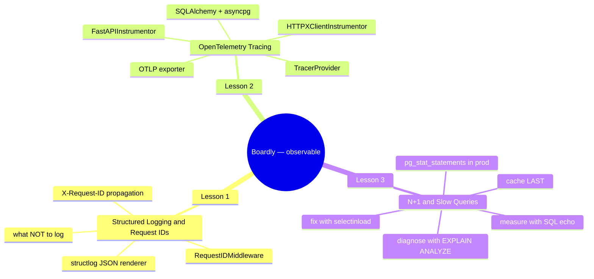
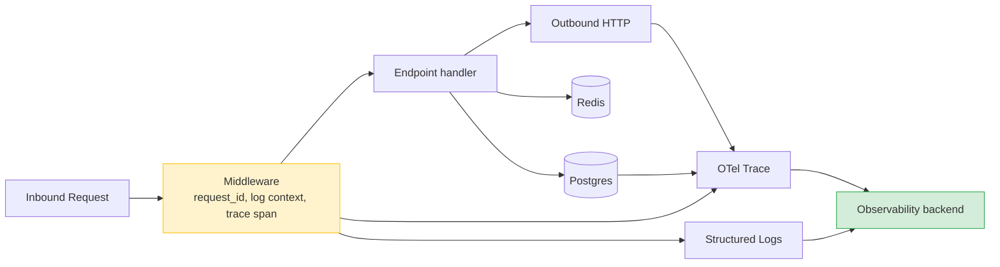
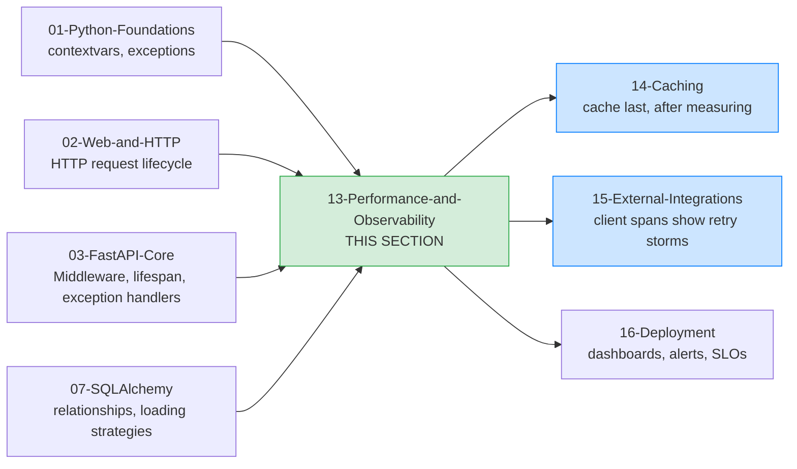

# Performance and Observability: Map of Content

**Bookmark this page.**

This is the **home base** for Section 13 — Performance and Observability. Every lesson in this folder, every concept, every cross-reference back to the rest of the vault — all reachable from here. When you get lost, come back to the MOC.

Hello, friend. Pull up a chair.

You've built the FastAPI skeleton. You can wire a lifespan, mount a router, write a dependency, place middleware in the right order, translate exceptions into a consistent JSON shape, and stream a CSV upload. `Boardly` runs. It serves traffic. The browser sends a request, your function returns a dict, FastAPI serialises it. By every measure that matters to a learner, you are done.

Now we ask the only question that matters to an engineer: *what is it actually doing in production?*

In the next three lessons we are going to take `Boardly` from "works on my laptop" to "behaves in production." We are going to give it **structured logging with request IDs that cross service boundaries**, **OpenTelemetry distributed tracing**, and **a measured, deliberate response to the N+1 query pathology**. The thread that runs through all three lessons is the SRE principle that opens every page of this section: **measure first, change second, ship third.** Performance work that skips measurement is gambling with the system's stability, and gambling with the system's stability is how you end up reading your own post-mortem at 4 AM.

**You're in the right place.**

If you've shipped a FastAPI service but the first time it went slow in production you logged in, eyeballed `top`, guessed at the cause, and shipped a "fix" that did nothing — this section was written for you. We'll go slow. We'll explain every line. You will build a real observability stack on top of `Boardly`, and you will leave with the discipline to never guess again.

---

## The Boardly Progression

Three lessons. One growing application. By Lesson 3 your `Boardly` API has:

- A `structlog` JSON logger and a `RequestIDMiddleware` that generates a request ID on the way in, stamps every log line with it, and propagates it on every outbound `httpx` call.
- An OpenTelemetry setup that emits spans for the inbound request, the outbound `httpx` calls, the SQLAlchemy queries, and the `asyncpg` round-trips — all sharing one `trace_id` across process boundaries.
- A measured, diagnosed, and fixed N+1 on the project-listing endpoint, with a `raiseload` test that fails if anyone re-introduces it.

And you'll know *why* every line is there.

---

## Lessons in Order

| # | Lesson | What you add to `Boardly` | Time |
|---|--------|---------------------------|------|
| 1 | [[Structured-Logging-and-Request-IDs]] | `boardly/logging.py`, `boardly/middleware.py` with `RequestIDMiddleware`, an `httpx` transport that propagates the request ID, a structlog JSON configuration, and a list of what NOT to log | 75–100 min |
| 2 | [[OpenTelemetry-Tracing]] | `boardly/otel.py` with `TracerProvider`, `BatchSpanProcessor`, OTLP exporter, `FastAPIInstrumentor`, `HTTPXClientInstrumentor`, `SQLAlchemyInstrumentor`, `AsyncPGInstrumentor`, plus a manual span around a hot block of business logic | 90–120 min |
| 3 | [[N-plus-1-and-Slow-Queries]] | The slow `GET /projects?with_tasks=true` endpoint, the SQL-echo diagnosis, the `selectinload` fix, the `raiseload` regression test, and a `pg_stat_statements`-shaped playbook for production | 75–100 min |

**Tip — How to read this section**

Read the lessons **in order**. Lesson 2's trace context propagation depends on Lesson 1's request-id middleware (both use the same `contextvars` mechanism, and both stamp their IDs into outbound headers). Lesson 3's diagnosis loop reads the OTel spans that Lesson 2 set up. If you skip ahead, you'll bring in pieces you haven't built yet.

Each lesson follows the same shape: **Learning Objectives -> Prerequisites -> The Problem -> The Code -> Line-by-Line Deep Dive -> Execution Trace -> Common Mistakes -> Engineering Trade-Offs -> Exercises -> Verification -> Previously Learned Here -> What's Next -> Sources -> What We Learned**. Open the lesson in one pane and the `boardly/` source in another, side by side. Type the code yourself. Don't copy-paste. Typing is what makes it stick.

---

## The Three Pillars (and a Fourth)

Observability is conventionally described as three signals:

| Signal | Answers | Lesson |
|---|---|---|
| **Logs** | What happened, in what order, with what context? | [[Structured-Logging-and-Request-IDs]] |
| **Traces** | Where did the time go, across which services? | [[OpenTelemetry-Tracing]] |
| **Metrics** | What is the aggregate behaviour over time? | (covered via OTel meters + Prometheus in [[16-Deployment-and-DevOps/00-Deployment-MOC]] and project work) |

A fourth pillar — **structured profiles** — gets honourable mention. When a trace says "this endpoint is slow" and the logs say "no errors," a CPU or heap profile tells you *why*. `py-spy` or Pyroscope cover that; it is out of scope here but worth knowing the name.

The same middleware that injects a request ID also opens the root OTel span. Logs and traces share the same `trace_id` and `request_id`, so a single Grafana / Datadog / Honeycomb query can pivot from a slow trace to the matching log lines. **This is the entire point of structured observability:** a correlated, queryable record of what happened.

---

## How This Section Fits in the Vault

The observability stack sits on top of FastAPI's middleware layer (Lesson 5 of Section 03). The OTel SQLAlchemy and asyncpg instrumentors assume you have a working SQLAlchemy setup (Section 07). The N+1 lesson assumes you understand lazy vs eager loading from [[07-SQLAlchemy/04-Relationships-and-Loading-Strategies]]. The lessons in 14 and 15 build on this section: caching is *only* defensible once you have measured (Lesson 3) and the external-integrations client propagates the request ID set up in Lesson 1.

---

## Concepts First Taught Here

One recurring concept is taught for the first time in this section:

- **`OpenTelemetry`** — first taught in [[OpenTelemetry-Tracing]]. The vendor-neutral specification and Python SDK that produce distributed traces (and metrics, and increasingly logs) as a single, pluggable signal. Reused in [[14-Caching-and-Background-Processing/Background-Tasks-vs-Workers]] (span propagation into jobs) and [[15-External-Integrations/HTTP-Clients-Timeouts-Retries]] (client spans show retry storms).

If a later section touches OpenTelemetry, it links back here instead of re-explaining. That is the rule from [[00-Start-Here/Concept-Registry]].

## Concepts Reused Here (not re-explained)

These were taught in earlier sections. We link back instead of repeating:

- `Middleware` — [[03-FastAPI-Core/Middleware-and-Request-Order]]. Lesson 1 writes a `RequestIDMiddleware` on top of that foundation.
- `Annotated` — [[01-Python-Foundations/Type-Hints-and-Annotations]].
- `BaseModel` — [[04-Pydantic/BaseModel-and-Validation]].
- `Session / AsyncSession` — [[07-SQLAlchemy/05-Session-and-Transaction-Management]].
- `Connection pool (SQLAlchemy)` — [[07-SQLAlchemy/02-Engines-Connections-Pools]].
- `Transactions (SQL)` — [[06-SQL-Fundamentals/Transactions-Isolation-Locks]].

---

## Reading Paths

Not everyone has three hours in one block. Pick a path:

### The Fast Path (2 hours)

Just want to add structured logs and a request ID today? Read Lesson 1. You'll have JSON logs with `request_id` on every line and an outbound `httpx` transport that propagates it. Come back for 2 and 3 when you need cross-service causality or you start chasing a slow query.

### The Thorough Path (5–7 hours)

Linear. The lessons deliberately build on each other: the OTel trace context propagation in Lesson 2 uses the same `contextvars` mechanism as Lesson 1's request-id middleware; the N+1 diagnosis loop in Lesson 3 reads the SQLAlchemy spans that Lesson 2's instrumentor emits. Skip none of it.

**Example — Which path are you on?**

Open a daily note and write down: which path, when you'll study each lesson, and a target completion date. Committing to a schedule beats willpower every time.

---

## Verified Versions (October 2026)

This section targets the following versions, all verified current as of 2026-10-19:

| Package | Version | Notes |
|---------|---------|-------|
| FastAPI | 0.148.0 | Released 2026-10-19. |
| Starlette | 1.9.0 | Pinned by FastAPI. |
| Python | 3.12 | The canonical learner version (3.13 also works). |
| `structlog` | latest stable | JSON renderer, `merge_contextvars`, `make_filtering_bound_logger`. |
| `opentelemetry-sdk` | latest stable | `TracerProvider`, `BatchSpanProcessor`, `OTLPSpanExporter`. |
| `opentelemetry-instrumentation-fastapi` | latest stable | `FastAPIInstrumentor.instrument_app`. |
| `opentelemetry-instrumentation-httpx` | latest stable | `HTTPXClientInstrumentor`. |
| `opentelemetry-instrumentation-sqlalchemy` | latest stable | `SQLAlchemyInstrumentor`. |
| `opentelemetry-instrumentation-asyncpg` | latest stable | `AsyncPGInstrumentor`. |
| SQLAlchemy | 2.1.5 | For Lesson 3. |
| PostgreSQL | 17.x | For Lesson 3's `pg_stat_statements`. |
| `uv` | 0.13.1 | The modern Python package runner. |

**Warning — Version pinning matters.**

The OTel Python SDK has had several breaking changes in its instrumentation API across 2024 and 2025. All the code in this section uses the modern import paths (`opentelemetry.exporter.otlp.proto.http.trace_exporter`, `opentelemetry.sdk.trace.export.BatchSpanProcessor`) and the `ParentBased(TraceIdRatioBased(...))` head sampler. If you are on an older OTel, the import paths differ; we will call out the diff when it matters.

---

## Reference Links

- OpenTelemetry Python documentation — <https://opentelemetry.io/docs/languages/python/>
- OpenTelemetry concepts — <https://opentelemetry.io/docs/concepts/>
- structlog documentation — <https://www.structlog.org/>
- PostgreSQL `pg_stat_statements` — <https://www.postgresql.org/docs/current/pgstatstatements.html>
- See [[21-Reference-Library/Source-Register]] for the full source list with dates accessed.

---

## The One Rule

> If a number matters to the business, it must be measured before it is changed.

Performance work that skips measurement is gambling with the system's stability. Every lesson in this section opens with the measurement, not with the fix. The fix is the *last* thing you reach for, and even then only after `EXPLAIN ANALYZE` agrees with you. The cache is the *last* of the last; we will say it three times in Lesson 3 and we will mean it.

---

**Your map is ready.**

Three lessons, one growing `Boardly` application, all reachable from this page. Pick a starting point and go. We'll see you on the other side.

---

**Tags:** #moc #observability #performance #opentelemetry #structlog #index #home
**Previous:** [[03-FastAPI-Core/00-FastAPI-MOC]]
**Start:** [[Structured-Logging-and-Request-IDs]] →
