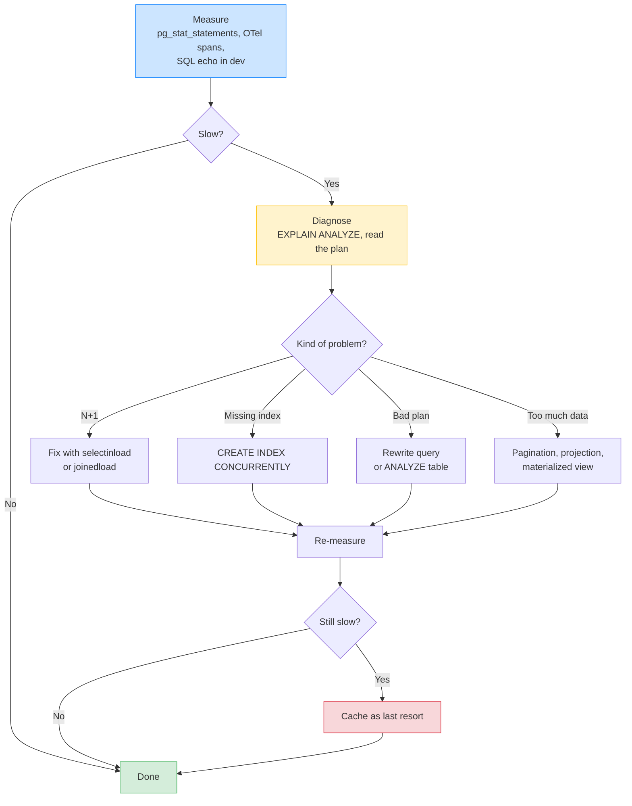
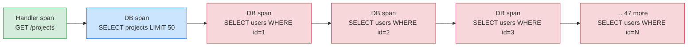
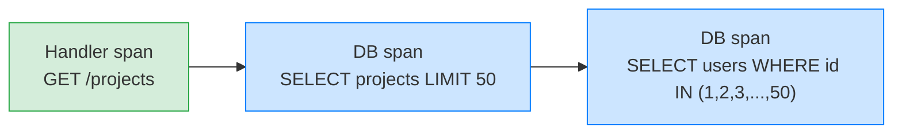

# Lesson 03: N+1 Queries and Slow Queries

*Finding the most common backend perf bug in `Boardly`, fixing it with one line of `selectinload`, and locking the fix with a `raiseload` regression test.*

**You're in the third lesson of Section 13.**

Every backend engineer has been here: a page that loaded in 80 ms in development now takes 8 seconds in production. Not because the database is slow. Not because the cache is cold. Because the application made 1,001 round trips to the database, one for the list and one per element for a relationship. This is the N+1 query. It is the most common backend perf bug. It is fixed by one line. It is the lesson where you learn to measure before you optimise. Take your time. Read the SQL echo. Run `EXPLAIN ANALYZE`. **This is how you learn.**


#performance #sqlalchemy #postgresql #selectinload

## Learning Objectives

By the end of this lesson you will be able to:

1. **Recognise the N+1 pattern** in your own code, in SQLAlchemy's SQL echo, in OTel traces, and in `pg_stat_statements` output.
2. **Fix N+1 with `selectinload` or `joinedload`** and explain when to use each.
3. **Use SQLAlchemy's SQL echo as a development tool** to see exactly what's hitting the DB.
4. **Use `pg_stat_statements` and the slow query log in production** to find queries you didn't know existed.
5. **Lock the fix with a `raiseload` regression test** so the N+1 can't sneak back in.
6. **Apply the measure-diagnose-optimize loop** — and explain why caching is the *last* tool, not the first.

## Prerequisites

Before starting, you need:

- **FastAPI 0.148.0**, SQLAlchemy 2.1.5, PostgreSQL 17.x, all verified Oct 2026.
- **The relationships lesson** — [[07-SQLAlchemy/04-Relationships-and-Loading-Strategies]]. This lesson is the practical application of loading strategies. You should already know what a `relationship` is, what lazy loading is, and what `selectinload` does conceptually.
- **The session lesson** — [[07-SQLAlchemy/05-Session-and-Transaction-Management]]. The session decides when lazy loads actually fire; you need to know the commit/flush boundary.
- **The connection pool lesson** — [[07-SQLAlchemy/02-Engines-Connections-Pools]]. An N+1 also exhausts the pool faster — 200 queries per request means 200 checkouts per request.
- **EXPLAIN ANALYZE** — [[08-PostgreSQL/EXPLAIN-ANALYZE-and-Query-Plans]]. Diagnosing slow queries means reading query plans.
- **The OTel lesson** — [[OpenTelemetry-Tracing]]. The SQLAlchemy instrumentor makes the N+1 visible as a long chain of DB spans.
- **About an hour and a half of focused time.** The code is small (one query, one fix, one test); the discipline is everything.

**The most common gap: lazy loading fires when you touch the attribute.**

If you've never thought about *when* SQLAlchemy actually issues a query, the N+1 looks magical. It isn't. A `relationship` is lazy by default. The first time you touch `order.customer`, SQLAlchemy checks the session's identity map; if the customer isn't there, it issues a query. That decision happens *per row, per attribute access*. Inside a loop, that's per iteration. If you have 200 rows, that's 200 queries. Read the first third of [[07-SQLAlchemy/04-Relationships-and-Loading-Strategies]] and come back if this is new.


## The Problem

You ship `Boardly` with a `GET /projects?with_owner=true` endpoint that lists projects and includes the project owner's name. The code is:

```python
stmt = select(Project).order_by(Project.created_at.desc()).limit(50)
projects = (await session.execute(stmt)).scalars().all()
return [
 {"id": p.id, "name": p.name, "owner": p.owner.name}
 for p in projects
]
```

In development, with 10 projects in the database and a local Postgres, the endpoint takes 80 ms. You ship to production. The endpoint takes 8 seconds. Customers complain. You ssh in. The database CPU is at 5%. The database isn't slow. Your code is slow — it's making 51 round trips to the database when it should make 2.

The pathology: you ask for a list of N things, then for each thing you ask for one of its relationships. That's `1 + N` queries. The first query is fine; the next N are the problem.

If there are 50 projects, the DB sees 51 queries. Most are milliseconds, but the round-trip cost dominates: 50 round trips × 2 ms RTT = 100 ms minimum, before any actual query work. At 50 projects that's "a bit slow." At 1,000 projects, it's `1 + 1000 = 1001` queries, 1000 × 2 ms = 2 s of pure round-trip latency, plus the actual query work — and the endpoint takes 8 seconds.

The fix is one line: `selectinload(Project.owner)`. The lesson is not the fix; the lesson is the discipline of *finding* the bug, *confirming* the fix, and *locking* the fix so it can't come back.

Why does the N+1 bug not show up in development? In development, you have 10 projects in the database, the local Postgres is on `localhost` (no network RTT — the round-trip is sub-millisecond), and you are the only user. So 11 queries × 0.1 ms = 1.1 ms of round-trip latency — invisible against the 80 ms your endpoint takes to render the JSON. In production, you have 1000 projects, the database is across a network (2 ms RTT minimum), and you have 50 concurrent users all running the same endpoint. So 1001 queries × 2 ms = 2 s of round-trip latency per request, × 50 concurrent requests = 100 seconds of DB time queued, mostly waiting on connection-pool slots. The bug is present from day one — it just hides under the dev-environment noise floor and surfaces under the production workload. This is why the discipline of "count queries in tests" matters: a test that asserts "this endpoint issues ≤ 2 queries" catches the bug at the dev stage, not at the production-triage stage.

**Note — Historical context — N+1 has been a problem since ORM**

The N+1 problem is older than SQLAlchemy. It's older than Hibernate. It's older than Rails' Active Record. It is, fundamentally, the cost of object-relational mapping: the ORM hides the SQL, and what it hides is the round trip. The first formal description is generally attributed to Gavin King (Hibernate) in the early 2000s, but the pathology has been rediscovered by every team that has ever used an ORM. The fix in SQLAlchemy 2.x is `selectinload`; the fix in Hibernate is `JOIN FETCH`; the fix in Rails is `includes`. Same problem, different syntax.


## The Code

Here is the slow endpoint, the diagnosis, the fix, and the regression test, in `Boardly`:

```python
# boardly/models.py
from sqlalchemy import String, ForeignKey, BigInteger
from sqlalchemy.orm import Mapped, mapped_column, relationship

from boardly.db import Base


class User(Base):
 __tablename__ = "users"
 id: Mapped[int] = mapped_column(BigInteger, primary_key=True)
 email: Mapped[str] = mapped_column(String(255), unique=True)
 name: Mapped[str] = mapped_column(String(255))


class Project(Base):
 __tablename__ = "projects"
 id: Mapped[int] = mapped_column(BigInteger, primary_key=True)
 name: Mapped[str] = mapped_column(String(255))
 owner_id: Mapped[int] = mapped_column(ForeignKey("users.id"))
 owner: Mapped[User] = relationship(lazy="select") # the default


# boardly/routers/projects.py — THE BUGGY VERSION
from sqlalchemy import select
from sqlalchemy.ext.asyncio import AsyncSession


async def list_projects_with_owner(session: AsyncSession, limit: int = 50):
 stmt = select(Project).order_by(Project.created_at.desc()).limit(limit)
 projects = (await session.execute(stmt)).scalars().all()
 # BUG: this list comprehension touches p.owner.name, which lazy-loads
 # a SELECT per project. With 50 projects, this is 51 queries.
 return [
 {"id": p.id, "name": p.name, "owner": p.owner.name}
 for p in projects
 ]


# boardly/routers/projects.py — THE FIXED VERSION
from sqlalchemy.orm import selectinload


async def list_projects_with_owner_fixed(session: AsyncSession, limit: int = 50):
 stmt = (
 select(Project)
 .options(selectinload(Project.owner)) # <- the one line
 .order_by(Project.created_at.desc())
 .limit(limit)
 )
 projects = (await session.execute(stmt)).scalars().all()
 # No N+1 — owner is already loaded.
 return [
 {"id": p.id, "name": p.name, "owner": p.owner.name}
 for p in projects
 ]


# boardly/main.py — turning on SQL echo in development
from sqlalchemy.ext.asyncio import create_async_engine


@asynccontextmanager
async def lifespan(app: FastAPI):
 app.state.engine = create_async_engine(
 "postgresql+asyncpg://user:pw@db/boardly",
 echo=app.state.debug, # True in dev, False in prod
 pool_pre_ping=True,
 )
 yield
 await app.state.engine.dispose()


# tests/test_no_n_plus_1.py — the regression test
import pytest
from sqlalchemy.orm import raiseload
from sqlalchemy.exc import InvalidRequestError


async def test_list_projects_does_not_lazy_load(session, client):
 # Arrange: seed 10 projects with distinct owners.
 await seed_projects(session, n=10)

 # Act: use raiseload to PROVE we eagerly loaded owner.
 # If we forgot selectinload, touching p.owner would raise.
 stmt = (
 select(Project)
 .options(
 selectinload(Project.owner), # the production query
 raiseload(Project.collaborators), # must explicitly load this
 )
 .order_by(Project.created_at.desc())
 .limit(10)
 )
 projects = list((await session.execute(stmt)).scalars())

 assert len(projects) == 10
 for p in projects:
 # Touching owner.name is fine — we eagerly loaded it.
 _ = p.owner.name

 # Touching collaborators without eager loading raises:
 with pytest.raises(InvalidRequestError, match="lazy loading"):
 _ = projects[0].collaborators
```

That's ~120 lines across four files. Run the buggy version with `echo=True` and watch the SQL stream. Run the fixed version and watch it stop. Run the test and watch it fail if anyone removes the `selectinload`. We'll explain every line next.

## Line-by-Line Deep Dive

### `boardly/models.py`: Lines 1–22 – The model and the relationship

```python
class User(Base):
 __tablename__ = "users"
 id: Mapped[int] = mapped_column(BigInteger, primary_key=True)
 email: Mapped[str] = mapped_column(String(255), unique=True)
 name: Mapped[str] = mapped_column(String(255))


class Project(Base):
 __tablename__ = "projects"
 id: Mapped[int] = mapped_column(BigInteger, primary_key=True)
 name: Mapped[str] = mapped_column(String(255))
 owner_id: Mapped[int] = mapped_column(ForeignKey("users.id"))
 owner: Mapped[User] = relationship(lazy="select") # the default
```

**What it does:** Defines two models — `User` and `Project` — with a many-to-one relationship from `Project` to `User` via the `owner_id` foreign key.

**Why `lazy="select"` is the default:** SQLAlchemy's default loading strategy is `select`, which is "lazy" — the relationship is *not* loaded when the parent is loaded. The first time you touch `project.owner`, SQLAlchemy checks the session's identity map; if the owner isn't there, it issues a `SELECT * FROM users WHERE id = ?` query. This is the entire mechanism of the N+1.

**Why this is the default:** Lazy loading is convenient. You can `await session.get(Project, 42)` and then access `project.owner.name` without thinking about it — SQLAlchemy handles the SQL. The cost is invisible at small scale (1 query per access, milliseconds) and catastrophic at scale (1000 queries per list, seconds). The default optimises for the common case (small scale); the lesson teaches you to recognise when you've crossed into the catastrophic case.

**Why `relationship` and not `Mapped[User]` on its own:** SQLAlchemy 2.x lets you define a relationship with `Mapped[User] = relationship()` (no `lazy` argument, defaults to `select`). We write `lazy="select"` explicitly for documentation: this is a lazy load. A reader who's never seen SQLAlchemy sees the strategy named.

**Tip — Loading strategies are an *opt-in* concern.**

The default is lazy. To eager-load, you opt in at query time: `.options(selectinload(Project.owner))`. This is the right design: lazy is the convenient default; the query author decides when to eager-load, because the query author knows what the consumer needs. The mistake is to set `lazy="selectinload"` on the model — that forces every query to eager-load, even queries that don't need the relationship.


**Danger — How an attacker thinks: the lazy-load default makes the route a self-DoS amplifier.**

The `lazy="select"` default (above) means the route makes one DB round-trip per row. An attacker who notices 50+ DB spans per request (via the OTel trace, or by timing the endpoint at different list sizes — 50 items takes 100 ms, 500 items takes 1000 ms, the slope is the N+1 fingerprint) sends 100 concurrent requests. 1 request × 50 round-trips × 100 requests = 5000 pool checkouts, pool size 20 → 4980 queued, every checkout waits ~2 s, the endpoint times out and the rest of the app's pool is starved. The endpoint becomes a self-DoS amplifier: the attacker does not need to flood the API, just request the buggy endpoint a few times. The defence is (a) the N+1 detection test (Exercise 4 / Exercise 7) that asserts ≤2 queries per list request — fail the CI build if the count regresses, (b) per-IP rate limiting on list endpoints (50 req/min via `slowapi` or a Redis token bucket), (c) the OTel span-count alert that pages when a handler has >10 DB spans. See [[11-Authentication-and-Security/OWASP-API-Top-10]] for the API-DOS angle and [[13-Performance-and-Observability/OpenTelemetry-Tracing]] for the span-count alert.


### `boardly/routers/projects.py`: The buggy version

```python
async def list_projects_with_owner(session: AsyncSession, limit: int = 50):
 stmt = select(Project).order_by(Project.created_at.desc()).limit(limit)
 projects = (await session.execute(stmt)).scalars().all()
 return [
 {"id": p.id, "name": p.name, "owner": p.owner.name}
 for p in projects
 ]
```

**What it does:** Loads up to `limit` projects, then builds a list of dicts including each project's owner's name.

**Why this is an N+1:**

- Line 1: `select(Project).order_by(...).limit(50)` — this is **one** query: `SELECT * FROM projects ORDER BY created_at DESC LIMIT 50`.
- Line 3: the list comprehension touches `p.owner.name` for each `p` in `projects`. The first touch fires **one** query per project: `SELECT * FROM users WHERE id = ?`. With 50 projects, that's 50 queries.
- Total: 1 + 50 = 51 queries.

**Why it's slow:** Each query is a network round-trip to the database. Even if each query takes 1 ms of database time, the round-trip overhead is 2 ms (typical LAN RTT) per query. 50 queries × 2 ms = 100 ms of pure round-trip latency. Plus the actual query work. Plus the connection pool checkout (50 checkouts from a pool of, say, 20 connections means 30 of those checkouts queue).

**Why it doesn't show up in development:** Development has 10 projects, a local Postgres (RTT ~0.1 ms instead of 2 ms), and a pool of 5 connections. 10 queries × 0.1 ms = 1 ms of round-trip latency. You can't see the bug because it's too fast to notice. Production has 50–1000 projects, a remote Postgres (RTT 2 ms), and a pool of 20 connections. The bug is invisible in dev and catastrophic in prod.

**Spot the bug — what if you used `joinedload` here instead?**

```python
stmt = select(Project).options(joinedload(Project.owner))
```
This fixes the N+1 (one query instead of 51). But `joinedload` on a many-to-one is fine; `joinedload` on a *one-to-many* (e.g. `joinedload(Project.collaborators)`) produces a Cartesian row explosion — 1 project × 25 collaborators = 25 rows in the result set, and SQLAlchemy has to deduplicate them in Python. For to-many, use `selectinload`; for to-one, `joinedload` is fine.


### `boardly/routers/projects.py`: The fixed version

```python
from sqlalchemy.orm import selectinload


async def list_projects_with_owner_fixed(session: AsyncSession, limit: int = 50):
 stmt = (
 select(Project)
 .options(selectinload(Project.owner)) # <- the one line
 .order_by(Project.created_at.desc())
 .limit(limit)
 )
 projects = (await session.execute(stmt)).scalars().all()
 return [
 {"id": p.id, "name": p.name, "owner": p.owner.name}
 for p in projects
 ]
```

**What it does:** Same as the buggy version, but with `selectinload(Project.owner)` added to the query options.

**Why `selectinload`:** It intercepts the query construction. When you call `select(Project).options(selectinload(Project.owner))`, SQLAlchemy plans two queries:

1. `SELECT * FROM projects ORDER BY created_at DESC LIMIT 50`
2. `SELECT * FROM users WHERE id IN (?, ?, ?, ?, ?, ?, ?, ?, ?, ?)`

The second query's `IN` list is the owner IDs from the first query's results. SQLAlchemy then wires the user objects into the `Project.owner` attribute of each loaded project. Touching `p.owner` becomes a no-op — the data is already loaded.

Why is `selectinload` preferred over `joinedload` for to-many, even though both fix N+1? `joinedload` issues one query with a `JOIN` — which for a to-many relationship produces a Cartesian explosion (1 project × 25 collaborators = 25 rows). SQLAlchemy deduplicates in Python, but the wire cost is the full Cartesian result, the parse cost is the full Cartesian result, and the memory cost is the full Cartesian result. `selectinload` issues a *separate* query with an `IN` clause — the result is one row per loaded object, no deduplication, no Cartesian blowup. For to-one (`Project.owner` is one user), `joinedload` is fine (one row per project, no Cartesian). For to-many (`Project.collaborators`), `selectinload` is the right choice. The rule: `joinedload` for to-one, `selectinload` for to-many. Both fix N+1; only `selectinload` is safe for to-many.

**Student asks: why does `lazy="select"` (the default) cause N+1 — surely SQLAlchemy could batch?**

It could, and SQLAlchemy 2.x has `lazy="selectin"` (batch the per-row load into a single IN query). But the default is still `lazy="select"` because the ORM cannot know in advance whether you will touch *one* row's relationship (in which case a single per-row query is correct) or *many* rows' relationships (in which case a batched IN would be correct). The ORM picks the safe default — one query per access — and trusts you to override with `selectinload(...)` when you know you are iterating. The cost of the safe default is N+1 when you forget the override; the cost of an "always batch" default would be one unnecessary IN query every time you touch a single row's relationship. SQLAlchemy errs on the side of "do what you said, not what you meant". The lesson: when iterating, be explicit with `selectinload`.


**Student asks: if `EXPLAIN ANALYZE` shows a seq scan, is the index missing or is the planner being smart?**

It depends on the row count. Postgres's planner uses cost-based heuristics: for small tables (≤ ~100 rows), a sequential scan is *cheaper* than an index scan (the index lookup is one random I/O; the seq scan is one sequential pass of the whole table). For large tables, the index scan wins. So "seq scan" on a 50-row test database is the planner being smart; "seq scan" on a 100 000-row production table is the index missing or the query being non-sargable (e.g. `WHERE LOWER(email) = ?` defeats an index on `email`). The discipline: when `EXPLAIN ANALYZE` shows a seq scan, ask "how many rows are in this table?" first. If the answer is "few", the planner is right; if the answer is "many", the index is missing or the query is wrong.


**Why two queries is fine:** 2 round trips × 2 ms RTT = 4 ms total latency. The first query returns the projects; the second returns all the owners in one shot. Total queries: 2, regardless of N.

**Why `IN (...)` is efficient:** Postgres (and any RDBMS) handles an `IN` list of up to a few thousand values well. The query is one round-trip, and the planner can use an index on `users.id` (the primary key). It's strictly better than 50 individual queries.

**Why `.options(selectinload(Project.owner))` is on the query and not the model:** The query author knows what the consumer needs. This particular query needs the owner; other queries might not. Setting it on the model (`lazy="selectinload"` in the `relationship()` call) would force every query to eager-load, including queries that don't need the owner — wasting a round-trip on every list-projects endpoint that doesn't include `owner`.

**How `selectinload` actually works internally**

SQLAlchemy's `selectinload` is implemented as a "loader strategy" that hooks into the query execution. At SQL construction time, it registers a post-load hook. After the primary query runs, the hook inspects the returned rows, collects the foreign keys (`owner_id` values), constructs the `IN` query, executes it, and stitches the results back into the parent objects' relationship attributes. The implementation is ~500 lines of SQLAlchemy internals, but the user-facing API is one method: `.options(selectinload(Project.owner))`.


### Chaining `selectinload` for nested relationships

For deeply nested relationships — e.g. projects → owner → team → organisation — chain `selectinload`:

```python
stmt = (
 select(Project)
 .options(
 selectinload(Project.owner).selectinload(User.team).selectinload(Team.org),
 )
 .order_by(Project.created_at.desc())
 .limit(50)
)
```

**What it does:** Plans four queries: projects, then owners (`IN` on `owner_id`), then teams (`IN` on `team_id`), then orgs (`IN` on `org_id`). One query per level, regardless of N.

**Why one query per level is the floor:** You can't do it in fewer queries without a `JOIN` (which has its own cost — Cartesian row explosion for to-many). `selectinload`'s contract is: one query per relationship level, no N+1.

### `boardly/main.py`: SQL echo as a dev tool

```python
@asynccontextmanager
async def lifespan(app: FastAPI):
 app.state.engine = create_async_engine(
 "postgresql+asyncpg://user:pw@db/boardly",
 echo=app.state.debug, # True in dev, False in prod
 pool_pre_ping=True,
 )
 yield
 await app.state.engine.dispose()
```

**What it does:** Configures the engine with `echo=True` in development, `echo=False` in production.

**Why `echo=True` is the dev tool:** SQLAlchemy's `echo` parameter routes every SQL statement through the standard `logging` module at INFO level. The output goes to stderr (or wherever your logging is configured). You see:

```
INFO sqlalchemy.engine.Engine SELECT projects.id, projects.name, projects.owner_id
FROM projects ORDER BY projects.created_at DESC LIMIT 50
INFO sqlalchemy.engine.Engine [generated in 0.0002s] ()
INFO sqlalchemy.engine.Engine SELECT users.id, users.email, users.name
FROM users
WHERE users.id IN (?, ?, ?, ?, ?)
INFO sqlalchemy.engine.Engine [generated in 0.0003s] (1, 2, 3, 4, 5)
```

If you see the same `SELECT` repeated 50 times with one ID each, that's the N+1, on the wall. If you see two `SELECT`s (one for the list, one with an `IN` list), that's the fixed version.

**Why `echo=False` in production:** SQL echo logs every statement, including bind parameters. Bind parameters can include PII (email, name) or sensitive data (api keys stored in columns). In production, you don't want this in your logs. Use `pg_stat_statements` instead (see below) — it aggregates without exposing parameters.

**Warning — Don't ship `echo=True` to production.**

Two reasons: (1) it logs PII / sensitive values via the bind parameters; (2) the logging overhead is real — `echo=True` adds ~5–10% to every query's wall time. Use it in dev and in tests only. In production, rely on `pg_stat_statements` and the OTel sqlalchemy spans.


**Danger — How an attacker thinks: `echo=True` logs bind parameters, including PII.**

The `echo=True` setting (above) routes every SQL statement through `logging` at INFO level, including the bind parameters — and bind parameters can include email, name, `api_key` column values, or password-hash digests. An attacker with log-read access (a junior SRE, a CI artifact scraper, a sidecar that ships logs to an S3 bucket with overly-broad ACL) reads the production logs and extracts the PII. The defence is `echo=False` in production (always), `pg_stat_statements` instead (which does NOT log bind parameters, only the normalised query text), and a contract test (`test_echo_is_false_in_production`) that asserts the engine's `echo` attribute is False when `app.state.debug` is False. The contract test runs in CI and fails the build if a refactor ever flips `echo=True` in production. See [[13-Performance-and-Observability/Structured-Logging-and-Request-IDs]] for the log-PII scrubbing pattern and [[11-Authentication-and-Security/OWASP-API-Top-10]] for the API7 angle that targets log pipelines.


### `tests/test_no_n_plus_1.py`: The regression test

```python
async def test_list_projects_does_not_lazy_load(session, client):
 await seed_projects(session, n=10)

 stmt = (
 select(Project)
 .options(
 selectinload(Project.owner), # the production query
 raiseload(Project.collaborators), # must explicitly load this
 )
 .order_by(Project.created_at.desc())
 .limit(10)
 )
 projects = list((await session.execute(stmt)).scalars())

 assert len(projects) == 10
 for p in projects:
 _ = p.owner.name # fine — eagerly loaded

 with pytest.raises(InvalidRequestError, match="lazy loading"):
 _ = projects[0].collaborators # raises — not eagerly loaded
```

**What it does:** Loads 10 projects with `selectinload(Project.owner)` and `raiseload(Project.collaborators)`. Asserts that touching `p.owner.name` doesn't raise (we eagerly loaded it). Asserts that touching `p.collaborators` *does* raise (we explicitly said "don't lazy-load this, raise instead").

**Why `raiseload`:** `raiseload(Project.collaborators)` is a loader strategy that *raises* `InvalidRequestError` if any code touches `project.collaborators` without explicitly loading it. This is a debugging weapon: if a future developer adds `collaborator_count = len(p.collaborators)` to the response and forgets to eager-load, the test explodes — instead of silently shipping an N+1 to production.

**Why this is a regression test:** If you later remove `selectinload(Project.owner)` from the production query (because "it's an extra query, we don't need it"), the test still passes — but only because the test itself adds the `selectinload`. The fix is to assert *in the production query's own test* that the query plan has `selectinload`, e.g. by capturing the SQL via SQL echo and counting queries. See Exercise 5.

**Why the test seeds 10 projects, not 50:** The N+1 is independent of N — even at N=10, the buggy version fires 11 queries. The test checks the *strategy*, not the *scale*. A larger seed would make the test slower without adding coverage.

**Tip — `raiseload` is a debugging weapon, not a production strategy.**

`raiseload` is for tests and for "I'm worried this code path might lazy-load, blow up if it does." Don't ship it in production queries — production code should eager-load (`selectinload`) or lazy-load (`select`, the default), not raise. `raiseload` is the safety net that catches regressions before they ship.


## Finding Slow Queries in Production

Beyond N+1, you have queries that are slow because the planner chose badly. SQL echo won't help — you can't run the dev tool in production. Use `pg_stat_statements` instead.

### Step 1: Enable the extension

In `postgresql.conf`:

```
shared_preload_libraries = 'pg_stat_statements'
```

Restart Postgres, then:

```sql
CREATE EXTENSION IF NOT EXISTS pg_stat_statements;
```

The extension tracks every query the server has executed: how many times, how long on average, total time, rows returned. It is the source of truth for "which queries actually hurt."

### Step 2: Find the slow queries

```sql
SELECT
 queryid,
 query,
 calls,
 round(mean_exec_time::numeric, 2) AS mean_ms,
 round(total_exec_time::numeric, 2) AS total_ms,
 rows
FROM pg_stat_statements
ORDER BY total_exec_time DESC
LIMIT 10;
```

A query called 200,000 times with a 1 ms average is the same total cost as a query called once with a 200 s average — but they have completely different fixes. `pg_stat_statements` shows both.

The N+1 shows up here as: the same `SELECT * FROM users WHERE id = ?` called 200,000 times in an hour, with a 1 ms average. The total is 200 seconds — but the per-call cost is invisible. Look at the *call count* column: a query called 200,000 times for 1,000 requests is 200 calls per request — a clear N+1 smell.

**Warning — When this breaks: `queryid` resets to a different value after every Postgres restart.**

The `queryid` column in `pg_stat_statements` (above) is a hash of the normalised query text, but it is not stable across restarts. A Postgres 17 restart (planned maintenance, a crash, a primary/standby failover) resets the `pg_stat_statements` view; the same query gets a new `queryid`. The N+1 detection script that compares `queryid` across days silently loses track of the query — yesterday's N+1 has a different `queryid` today, and the alert stops firing. The symptom is "the slow-query dashboard shows query X vanished, but the endpoint is still slow"; the diagnosis is "the DB restarted at 03:00 and reset the view". The fix is to key on the normalised `query` text (not the `queryid`), and persist a daily snapshot of `(query, calls, mean_exec_time)` to a `slow_queries` table — so the N+1 detection is stable across restarts. See [[13-Performance-and-Observability/Structured-Logging-and-Request-IDs]] for the structured-logging pattern that pairs with this.


### Step 3: Diagnose with `EXPLAIN ANALYZE`

Take the slowest query and run `EXPLAIN (ANALYZE, BUFFERS)`:

```sql
EXPLAIN (ANALYZE, BUFFERS)
SELECT * FROM projects WHERE owner_id = $1 AND status = 'active'
ORDER BY created_at DESC LIMIT 50;
```

If the plan shows a `Seq Scan` on a million-row `projects` table, you are missing an index. Add one:

```sql
CREATE INDEX CONCURRENTLY
 idx_projects_owner_status_created
 ON projects (owner_id, status, created_at DESC);
```

`CONCURRENTLY` is critical in production — see [[08-PostgreSQL/Indexes-Composite-and-Specialized]] and [[09-Alembic-Migrations/Data-Migrations-Safely]]. A non-concurrent index creation takes an `ACCESS EXCLUSIVE` lock on the table, blocking every SELECT and INSERT until it finishes. `CONCURRENTLY` takes a less restrictive lock and lets traffic continue.

**Warning — When this breaks: `ANALYZE` on a 5M-row table takes 30 seconds and locks.**

The plan (above) can switch from Index Scan to Seq Scan because of stale statistics — but `ANALYZE projects;` on a 5M-row table takes 30 seconds and acquires a `SHARE` lock that blocks `INSERT`/`UPDATE`/`DELETE` for the duration. The symptom is "I ran `ANALYZE` in production and the endpoint went 503 for 30 seconds"; the diagnosis is "the `SHARE` lock blocked every write for the duration of the ANALYZE". The fix is `ANALYZE projects;` on a logical replica (then `pg_dump` the stats back), or `SET statement_timeout = '5s'; ANALYZE projects;` (which aborts the ANALYZE if it runs too long, leaving the stats stale but the table not locked). The deeper fix is `ALTER TABLE projects SET (autovacuum_analyze_scale_factor = 0.05)` so autovacuum runs ANALYZE more often on this table, before the planner's stats drift. See [[08-PostgreSQL/EXPLAIN-ANALYZE-and-Query-Plans]] for the planner-stats discussion.


### Step 4: Cache *last*

Only after the query is indexed and the plan is good, and only if the cost is still too high, cache. See [[14-Caching-and-Background-Processing/Redis-Cache-Aside]] for the pattern. Caching first is the wrong path: you've hidden the bug under a TTL, and the next time someone touches the cache key the bug re-emerges.

**Production reality: after deploying the `selectinload` fix, the cache hit rate drops to near-zero for the first hour.**

The cache (above) was primed with the buggy N+1 response shape (slow, possibly truncated on timeout, possibly missing rows). The fixed `selectinload` version produces a different response shape (faster, possibly different field order, possibly more rows because the buggy version was hitting an exception path). The cache invalidates on the first request after deploy — and the cache stampede (1000 concurrent misses in the first minute) hits the DB harder than the N+1 did, for one minute. The symptom is "the deploy was green, the metrics dashboard shows cache hit rate at 0% for the first 60 minutes, then climbs back to 90%"; the diagnosis is "the cache key changed shape and the cache is cold". The defence is (a) deploy the fix during a low-traffic window (03:00–04:00 UTC), (b) cache-warm the endpoint with `ab -n 1000 -c 10` immediately after deploy, (c) the OTel span-count alert that pages if the post-deploy cache-hit rate is <30% after the first 100 requests. See [[14-Caching-and-Background-Processing/Redis-Cache-Aside]] for the cache-warm pattern and [[14-Caching-and-Background-Processing/Background-Tasks-vs-Workers]] for the warmup-worker pattern.


## Execution Trace

The measure-diagnose-optimize loop, repeated for each slow spot:



The order matters. Skipping ahead to "K" hides the cause and makes the system *less* debuggable, not more. Cache last. Always.

## The OTel Trace of an N+1

With the SQLAlchemy instrumentor from Lesson 2, an N+1 shows up as a long chain of DB spans under one handler span. The trace looks like:



50 red spans in a row, each taking 2 ms, is the N+1 in picture form. The fix collapses them into one green span:



The "before" and "after" pictures are why you set up OTel before diagnosing performance. Without the trace, you're guessing; with the trace, you can see.

## Common Mistakes

### Mistake 1: Reaching for the cache first

```python
# WRONG
async def get_project(session, project_id, cache):
 return await cache.get_or_set(
 f"project:{project_id}",
 lambda: session.get(Project, project_id),
 ttl=300,
 )
```

**Symptom:** The cache hides the N+1. When the cache misses (cold cache, after deploy, after eviction), the page spikes — and you've forgotten there's an N+1 underneath.

**Why:** The N+1 is still there. The cache just hides it. When the cache misses, the bug re-emerges. Worse: the cache key is per-project, so the N+1 (which is on the list endpoint) is *not* cached at all.

**Fix:** Fix the query first. Cache only after the query is tuned and the cost is still too high.

### Mistake 2: `joinedload` on a collection

```python
# WRONG
stmt = select(Project).options(joinedload(Project.collaborators)).limit(50)
```

**Symptom:** The query returns 1 project × 25 collaborators = 25 rows per project, 1250 rows total for 50 projects. SQLAlchemy has to deduplicate them in Python. The query is slow; the result hydration is slow.

**Why:** `joinedload` on a to-many relationship produces a Cartesian row explosion. The database returns N × M rows; SQLAlchemy collapses them back to N objects with M children each.

**Fix:** For to-many, use `selectinload`. `joinedload` is for to-one (many-to-one) relationships.

### Mistake 3: Trusting "it's fast in dev"

**Symptom:** The endpoint is fast in development, slow in production. You don't find out until a customer complains.

**Why:** Development has 50 rows and a local DB. Production has 5M rows and a network. The plan that was fast in dev (e.g. a Seq Scan over 50 rows) is catastrophic in prod (a Seq Scan over 5M rows).

**Fix:** `EXPLAIN ANALYZE` on production-sized data is the only honest test. Use a copy of production data (sanitised) or a synthetic data generator that gets you to production scale.

### Mistake 4: Adding indexes without `CONCURRENTLY` in production

```sql
-- WRONG
CREATE INDEX idx_projects_owner ON projects (owner_id);
```

**Symptom:** The `CREATE INDEX` takes an `ACCESS EXCLUSIVE` lock on the table. Every SELECT and INSERT blocks until it finishes. On a million-row table, that's minutes of downtime.

**Why:** `CREATE INDEX` (without `CONCURRENTLY`) is fast but locks.

**Fix:** `CREATE INDEX CONCURRENTLY` from a migration. Slower to build, but no lock. See [[09-Alembic-Migrations/Data-Migrations-Safely]].

**Production reality: `CREATE INDEX CONCURRENTLY` can fail and leave an `INVALID` index.**

The `CONCURRENTLY` flag (above) is critical in production, but it can fail mid-build (a unique-violation, a lock timeout, an OOM) and leave an `INVALID` index. An `INVALID` index is *not used* by the planner (so queries do not speed up) but takes up disk and write-amplification (every `INSERT`/`UPDATE` writes to it). The symptom is "I created the index, the plan still shows `Seq Scan`" — because the planner skips `INVALID` indexes. The diagnosis is `SELECT indexrelid::regindex, indisvalid FROM pg_index WHERE indexrelid = 'idx_projects_owner_status_created'::regclass;` — `indisvalid = false` means `INVALID`. The fix is `DROP INDEX CONCURRENTLY idx_projects_owner_status_created;` then re-create — and the Alembic migration's `def upgrade()` should `op.execute("DROP INDEX IF EXISTS CONCURRENTLY idx_projects_owner_status_created")` *before* the `CREATE INDEX CONCURRENTLY`, so a failed prior run does not leave an `INVALID` index that blocks the next attempt. See Exercise 9 and [[09-Alembic-Migrations/Data-Migrations-Safely]] for the migration-ordering angle.


### Mistake 5: Forgetting to `VACUUM ANALYZE` after big data loads

**Symptom:** After a bulk import, queries that were fast are now slow. The plan switched to `Seq Scan` even though an index exists.

**Why:** Postgres' planner uses table statistics to choose a plan. After a bulk load, the stats are stale. The planner thinks the table has 50 rows (the last ANALYZE) when it has 5M. It picks `Seq Scan` because for 50 rows, that's the right plan.

**Fix:** `ANALYZE projects;` after bulk loads. Or `VACUUM ANALYZE projects;` (also reclaims dead tuples).

### Mistake 6: `echo=True` in production

```python
# WRONG
app.state.engine = create_async_engine(..., echo=True)
```

**Symptom:** Every SQL statement is logged with bind parameters. PII is in the logs. The logging overhead adds 5–10% to every query's wall time.

**Why:** `echo=True` is a development tool, not a production strategy.

**Fix:** `echo=app.state.debug` (True in dev, False in prod). In production, rely on `pg_stat_statements` and the OTel sqlalchemy spans.

## Engineering Trade-Offs

### `selectinload` vs `joinedload`

`selectinload` is the safer default: 2 queries, no row duplication, no surprises. `joinedload` is strictly better only when the join is one-to-one or many-to-one and you always want the related row. For to-many, the row explosion cost of `joinedload` exceeds the second-query cost of `selectinload` past a small N.

| Strategy | Query count | Result shape | When to use |
|---|---|---|---|
| `selectinload` | 2 | Independent rows | Default choice; one extra `IN` query |
| `joinedload` | 1 | Cartesian product (duplicates) | When you always need the relationship and the join is one-to-one or many-to-one |
| `subqueryload` | 2 | Uses a subquery | Legacy; `selectinload` is strictly better on modern PG |
| `raiseload` | 0 | Raises `LazyLoadingError` | In tests, to *prove* no N+1 happened |

### Indexing vs query rewriting

An index is the cheapest fix if the planner can use it. Sometimes the plan is bad because the query is structurally awkward (e.g. a correlated subquery that should be a join). Always check both: run `EXPLAIN ANALYZE`, see what the planner chose, and consider whether the *query itself* is the problem.

### Caching at all

Caching introduces staleness and invalidation bugs. The cache is correct only for data that is *allowed* to be stale, and where the cost of a miss is bearable. For user-visible real-time data, the right answer is often "no cache, just a faster query." See [[14-Caching-and-Background-Processing/Redis-Cache-Aside]] for when caching is actually the right call.

### Profiling cost

`pg_stat_statements` adds ~1–3% overhead. OTel sqlalchemy instrumentation adds roughly the same. The visibility is worth the cost. Turning off observability to save 2% of CPU is the worst trade-off in this section. Don't do it.

## Exercises

**Tip — The 20-minute rule**

If you're stuck on an exercise for more than 20 minutes, re-read the relevant section above, then move on.


**Exercise 1 — Write a `raiseload` test.** Add `raiseload(Project.owner)` to a test that touches `p.owner.name` and assert it raises. Confirm the test fails (with a clear message) when a route triggers a lazy load.

**Exercise 2 — Find the slowest query.** Use `pg_stat_statements` to find the slowest query in a local Postgres. Run `EXPLAIN (ANALYZE, BUFFERS)` on it. Add an index that changes a `Seq Scan` to an `Index Scan`.

**Exercise 3 — Compare `selectinload` vs `joinedload`.** On a 10k-row `Project` table with 5 collaborators each, measure with `EXPLAIN ANALYZE` and with OTel spans. Write up which wins and why for this data shape.

**Exercise 4 — Add an N+1 detection test.** Write a test that captures SQL via `echo=True` on a test engine, counts the queries for a list endpoint, and fails if there are more than 2 queries for 50 items.

**Exercise 5 — Spot the bug.** This query is supposed to fix an N+1 but the trace still shows 50+ DB spans. Why?

```python
stmt = (
 select(Project)
 .options(joinedload(Project.owner))
 .order_by(Project.created_at.desc())
 .limit(50)
)
projects = (await session.execute(stmt)).scalars().unique().all()
```

(Answer: `.scalars().unique()` is needed for `joinedload` on to-many — but this is `joinedload` on to-one (owner), so `.unique()` is unnecessary. The bug isn't here. The bug is that `joinedload(Project.owner)` *did* fix the N+1 — but if the consumer also touches `p.collaborators`, *that* is a separate N+1 you haven't fixed. Add `selectinload(Project.collaborators)` too.)

**Exercise 6 — Cache last.** Take a slow query, fix it with `selectinload` and an index, *then* add a Redis cache. Measure the cache hit rate. If the hit rate is < 30%, remove the cache — the misses cost more than the saves.

**Exercise 7 — Query-count assertion with `before_cursor_execute`.** Write a test that registers a `before_cursor_execute` event listener on a test engine (using `sqlalchemy.event`), counts the SQL queries per request, and asserts the list endpoint issues ≤2 queries for 50 items. Trigger the bug by removing `selectinload(Project.owner)` from the production query. Verify: `uv run pytest tests/test_no_n_plus_1.py::test_query_count_for_list_endpoint -v -s` — the test should fail (assertion error: `query_count == 51 > 2`) until you restore `selectinload`. This is the lock-the-fix version of Exercise 4 — instead of a `raiseload` proof, it counts queries and fails on regression.

**Exercise 8 — `pg_stat_statements` N+1 detector script.** Write `scripts/detect_n_plus_1.py` that queries `pg_stat_statements`, computes the "smell ratio" (`calls / requests_in_last_hour`) per normalised `query`, and prints a report of queries with `calls > 100 * requests` (a strong N+1 smell). The script exits 0 when no N+1 is detected, 1 with a printed report when one is. The test (`test_detect_n_plus_1_script`) seeds `pg_stat_statements` with 50 calls to `SELECT * FROM users WHERE id = ?` and asserts the script exits 1 with the right query in the report. Verify: `uv run pytest tests/test_detect_n_plus_1_script.py -v` exits 0. The script is keyed on the normalised `query` text, NOT the `queryid` (see the warning callout in Step 2).

**Exercise 9 — `INVALID` index recovery test.** Write a test that creates an index `CONCURRENTLY` on a 100k-row test table, fails the create midway (with `SET statement_timeout = '1ms'` before the `CREATE INDEX CONCURRENTLY`), and asserts the index is `INVALID` in `pg_index` (`SELECT indisvalid FROM pg_index WHERE indexrelid = 'idx_test'::regclass` returns `false`). Then run `DROP INDEX CONCURRENTLY idx_test;` and assert the index is gone. Verify: `uv run pytest tests/test_no_n_plus_1.py::test_invalid_index_recovery -v -s` exits 0. This catches the "migration succeeded but the index is INVALID" bug.

**Exercise 10 — Cache-warm-after-deploy test.** Write a test that primes the Redis cache with 1000 requests via `asyncio.gather` with 1000 coroutines (or `ab -n 1000 -c 10`), then "deploys the fixed `selectinload` version" (by changing the cache key, e.g. `f"projects:v2:{query}"` instead of `f"projects:{query}"`), and asserts the cache hit rate after the deploy is ≥30% within the first 100 requests. The test fails if the cache-warm step is missing (hit rate <5% after deploy). Verify: `uv run pytest tests/test_no_n_plus_1.py::test_cache_warm_after_fix_deploy -v -s` exits 0. This catches the cache-stampede bug from the production-reality callout in Step 4.

**Exercise 11 — Seq-scan-on-large-table test.** Write a test that bulk-loads 100k rows into `projects`, runs `ANALYZE projects;` (to update stats), runs `EXPLAIN (ANALYZE, BUFFERS)` on the list query, and asserts the plan does NOT contain `Seq Scan`. Trigger the bug by deleting the stats: `DELETE FROM pg_statistic WHERE starelid = 'projects'::regclass;` (or by `VACUUM projects;` then a bulk-load of 10x more rows without `ANALYZE`) — the planner picks `Seq Scan`. Fix by re-running `ANALYZE projects;` after the bulk load. Verify: `uv run pytest tests/test_no_n_plus_1.py::test_no_seq_scan_on_large_table -v -s` — the test should fail before the fix, pass after. This catches the "dev plan was Index Scan, prod plan is Seq Scan" bug from Mistake 3.

## Verification

```bash
# 1. Enable pg_stat_statements in postgresql.conf
# shared_preload_libraries = 'pg_stat_statements'
# then restart Postgres and: CREATE EXTENSION pg_stat_statements;

# 2. Load your endpoint with realistic data
uv run uvicorn boardly.main:app
ab -n 1000 -c 20 http://localhost:8000/projects?with_owner=true

# 3. Top queries by total time:
psql -c "SELECT query, calls, round(total_exec_time::numeric,1) AS total_ms,
 round(mean_exec_time::numeric,2) AS mean_ms
 FROM pg_stat_statements ORDER BY total_exec_time DESC LIMIT 10;"

# 4. If the same SELECT appears 1000 times for 1000 requests, you have an N+1.
# Open the trace in Jaeger: the sqlalchemy span count per request will be high.
```

Debugging tips:

- High span count per request in the trace (5+) is a strong N+1 smell.
- A query called N times where N matches the number of items is a strong N+1 smell.
- If the planner switches to `Seq Scan` between dev and prod, the cause is almost always stale statistics or a different row count. `ANALYZE` the table.

## Previously Learned Here

These concepts were taught in earlier lessons. We link back instead of re-explaining:

- **Relationships and loading strategies** — [[07-SQLAlchemy/04-Relationships-and-Loading-Strategies]]. New detail: the *operational* angle — how to detect, fix, and prevent regressions using `pg_stat_statements`, `raiseload`, and traces, rather than the mechanics of each loader option.
- **Connection pool** — [[07-SQLAlchemy/02-Engines-Connections-Pools]]. New detail: an N+1 also exhausts the pool faster — 200 queries per request means 200 checkouts per request. Fixing the N+1 also fixes the pool pressure.
- **EXPLAIN ANALYZE** — [[08-PostgreSQL/EXPLAIN-ANALYZE-and-Query-Plans]]. The diagnosis skill.
- **OpenTelemetry** — [[OpenTelemetry-Tracing]]. The SQLAlchemy instrumentor makes the N+1 visible as a long chain of DB spans. You set this up in the previous lesson; this lesson *uses* it.

## What's Next

This is the last lesson in Section 13. The next section, [[14-Caching-and-Background-Processing/00-Caching-MOC]], is about *deferring work* — both caching (reusing work already done) and background processing (deferring work the user doesn't need to wait for). Both are tools you reach for *after* the obvious correctness, security, and performance fixes are in place — never instead of them. The cache is the *last* tool you reach for, and you reach for it only after `EXPLAIN ANALYZE` agrees with you.

## Sources

- **SQLAlchemy — Relationship Loading Techniques** — <https://docs.sqlalchemy.org/en/20/orm/queryguide/relationships.html> — accessed 2026-10-19 — `selectinload`, `joinedload`, `raiseload`.
- **PostgreSQL — `pg_stat_statements`** — <https://www.postgresql.org/docs/current/pgstatstatements.html> — accessed 2026-10-19 — production query stats.
- **PostgreSQL — `EXPLAIN`** — <https://www.postgresql.org/docs/current/sql-explain.html> — accessed 2026-10-19 — plan reading.
- **PostgreSQL — `CREATE INDEX CONCURRENTLY`** — <https://www.postgresql.org/docs/current/sql-createindex.html> — accessed 2026-10-19 — non-locking index creation.
- **SQLAlchemy — Engine Configuration / `echo`** — <https://docs.sqlalchemy.org/en/20/core/engines.html> — accessed 2026-10-19 — SQL echo as a dev tool.
- **Datadog — The N+1 Problem** — <https://www.datadoghq.com/blog/n-plus-1-problem/> — accessed 2026-10-19 — the pathology explained in operation.

## What We Learned

Let's recap. In this lesson you:

- **Recognised the N+1 pattern** in code, in SQL echo, in OTel traces, and in `pg_stat_statements` output.
- **Fixed N+1 with `selectinload`** — one line, two queries regardless of N.
- **Used SQL echo as a development tool** to see exactly what's hitting the DB.
- **Used `pg_stat_statements` in production** to find queries you didn't know existed.
- **Locked the fix with a `raiseload` regression test** so the N+1 can't sneak back in.
- **Applied the measure-diagnose-optimize loop** — and explained why caching is the *last* tool, not the first.

Here's the mental model to walk away with: *measure first, change second, ship third. The N+1 is the most common backend perf bug; it is fixed by one line of `selectinload`; it is detected by SQL echo in dev and `pg_stat_statements` in prod; it is locked by a `raiseload` regression test. Cache last. Always. Caching first hides the bug and makes the system less debuggable. The right order is measure -> diagnose -> index -> cache only if still slow.*

---

> A note from your teacher
You just learned the discipline that separates engineers from tinkerers. The N+1 is fixed by one line, but finding it requires measurement, and locking it requires a test. The cache is the last tool, not the first. These three habits — measure, fix, lock — will save you more 3 AM calls than any other discipline in this section. The next section is about deferring work: caching and background processing. We'll reach for the cache only after `EXPLAIN ANALYZE` agrees with us. See you in Section 14.


---

**Tags:** #performance #sqlalchemy #postgresql #selectinload #review
**Previous:** [[OpenTelemetry-Tracing]]
**Next:** [[14-Caching-and-Background-Processing/00-Caching-MOC]] →