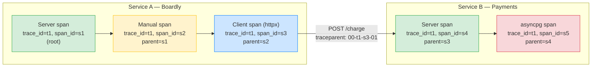
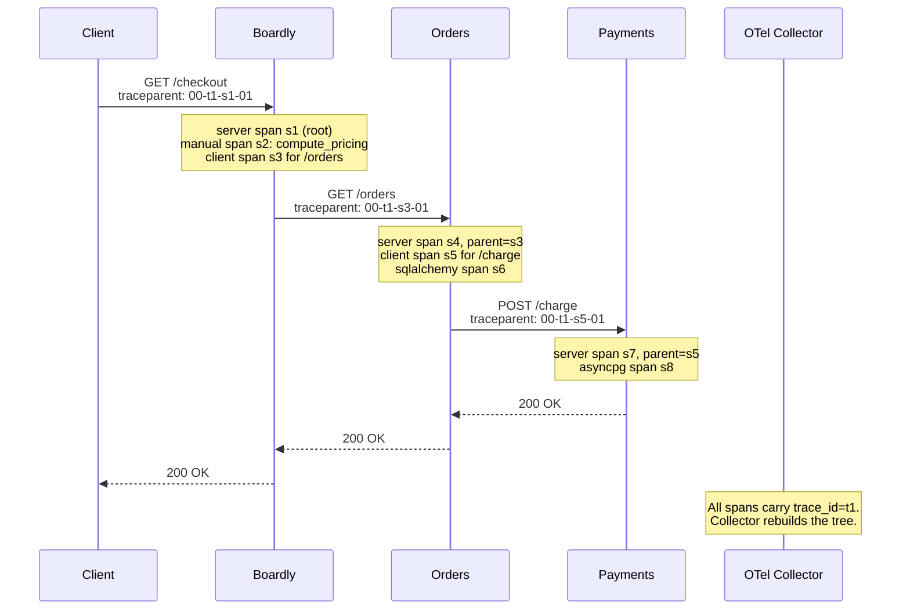

# Lesson 02: OpenTelemetry Tracing

*Giving `Boardly` a vendor-neutral distributed tracing stack that sees the request across services, across the database, and across the outbound HTTP call.*

**You're in the second lesson of Section 13.**

Every distributed system you'll ever operate — the tiny service with one downstream, the production fleet with thirty microservices, the open-source library that ships its own OTel exporter — was once exactly where you are now: staring at a Jaeger trace for the first time and wondering what a "span" actually is. Take your time. Wire up the SDK. Send a request. Click the trace. **This is how you learn.**


#observability #opentelemetry #tracing #otlp #canonical

## Learning Objectives

By the end of this lesson you will be able to:

1. **Explain the difference between a span, a trace, and a metric** — and why logs are not a substitute for any of them.
2. **Configure the OpenTelemetry SDK in Python** with a `TracerProvider`, a `Resource` (service identity), a `BatchSpanProcessor`, and an OTLP exporter.
3. **Use `FastAPIInstrumentor`** to emit a server span on every inbound request automatically.
4. **Instrument `httpx`, `sqlalchemy`, and `asyncpg`** automatically so the trace continues across the outbound HTTP call and the database round-trip.
5. **Propagate context across process boundaries** via the W3C `traceparent` header, and explain why breaking that propagation splits a trace into two islands.
6. **Bridge traces and logs** by stamping `trace_id` and `span_id` into every log line via a structlog processor.
7. **Pick a head sampler** (`ParentBased(TraceIdRatioBased(0.1))`) and explain why tail sampling at the collector is usually better.

## Prerequisites

Before starting, you need:

- **FastAPI 0.148.0** (verified Oct 2026), with `uv` 0.13.1 and Python 3.12.
- **The previous lesson** — [[13-Performance-and-Observability/Structured-Logging-and-Request-IDs]]. The request-id middleware and the structlog configuration are still in place; we're adding a second signal on top of them.
- **The Middleware lesson** — [[03-FastAPI-Core/Middleware-and-Request-Order]]. The root OTel span is opened by middleware-equivalent instrumentation (the `FastAPIInstrumentor`), before the handler runs.
- **Async SQLAlchemy** — [[07-SQLAlchemy/07-Async-SQLAlchemy]]. We're using `asyncpg` as the driver; the OTel `AsyncPGInstrumentor` wraps the round-trips.
- **About two hours of focused time.** The OTel SDK is more machinery than the structlog configuration; the code is small, but the concepts (spans, context propagation, sampling) take time to settle.

**The most common gap: what "context propagation" actually means.**

OpenTelemetry's context propagation is the thing that makes a "trace" a trace rather than a pile of independent spans. It's the same `contextvars` mechanism from the previous lesson, plus an HTTP header (`traceparent`) that carries the context across the wire. If you haven't read [[10-Async-Python/Event-Loop-and-Coroutines]] on `contextvars`, go read the first third and come back. The mental model is the same: a per-request value, set in middleware, read everywhere.


## The Problem

Logs tell you *what a single process thought happened*. They don't tell you *where the time went across services*. When a checkout request is slow, the log might say "calling payments" and "payments responded" — but it can't tell you whether the 3.8 of 4.2 seconds were spent in `payments.charge` or in the `httpx` retry loop that followed a 503. The trace can. The trace shows the parent-child causality: this span called that span, which called that span, which took 3.8 s.

Without traces, "the API is slow" is a guessing game. With traces, "the API is slow" is a fact with a single clickable cause. OpenTelemetry (OTel) is the vendor-neutral specification and SDK that makes traces — and metrics, and increasingly logs — a single, pluggable signal. You emit OTel; you point it at any backend (Jaeger, Tempo, Honeycomb, Datadog, AWS X-Ray) by swapping the exporter. That vendor-neutrality is the whole point of OTel: your observability investment is not held hostage to a single vendor.

Why is *tracing* the answer to "where did the time go" when we already have logs with timestamps? Logs give you timestamps on each process's view of itself — "Boardly logged `calling_payments` at 03:14:07.001" and "Payments logged `charge_started` at 03:14:07.050". From those two timestamps you can infer "the httpx call took 49 ms" by subtracting — but only if the two services' clocks are in sync (NTP drift is real), only if you can find both log lines (which request was this?), only if the log on each side has the right event names. A trace replaces all three assumptions with a single structural fact: a parent span and a child span, both carrying the same `trace_id`, with the parent's duration being the wall-clock time from start-of-parent to end-of-parent and the child's duration being the wall-clock time from start-of-child to end-of-child. The latency of the hop is `(child.end - child.start)` minus `(child.start - parent.start)` (the outbound time) minus `(parent.end - child.end)` (the inbound time) — and the backend computes it for you. Logs require you to *reconstruct* the timeline; traces give you the timeline directly.

**Note — Historical context — from Jaeger client to OpenTelemetry**

Before OTel, every backend had its own client library: Jaeger's `jaeger-client`, Zipkin's `py_zipkin`, Datadog's `dd-trace-py`. Each had its own API; switching backends meant rewriting every `tracer.start_span(...)` call. OpenTelemetry (formed in 2019 from the merger of OpenTracing and OpenCensus) provides one API that every backend can consume via the OTLP protocol. By 2024, every major backend supported OTLP ingestion. By Oct 2026, the Jaeger and Zipkin client libraries are deprecated; OTel is the only reasonable choice for new code. The migration is essentially complete.


## The Code

Here is the complete `boardly/otel.py` you'll write in this lesson, plus the changes to `boardly/main.py` to wire it in and the small structlog bridge processor that stamps `trace_id` into every log line.

```python
# boardly/otel.py
"""Boardly — OpenTelemetry setup.

Lesson 13.2: TracerProvider, Resource, BatchSpanProcessor, OTLP
exporter, FastAPI/httpx/sqlalchemy/asyncpg instrumentors, head
sampler, manual span for business logic, structlog bridge.
"""
from opentelemetry import trace
from opentelemetry.sdk.resources import Resource
from opentelemetry.sdk.trace import TracerProvider
from opentelemetry.sdk.trace.export import BatchSpanProcessor
from opentelemetry.sdk.trace.sampling import ParentBased, TraceIdRatioBased
from opentelemetry.exporter.otlp.proto.http.trace_exporter import OTLPSpanExporter
from opentelemetry.instrumentation.fastapi import FastAPIInstrumentor
from opentelemetry.instrumentation.httpx import HTTPXClientInstrumentor
from opentelemetry.instrumentation.sqlalchemy import SQLAlchemyInstrumentor
from opentelemetry.instrumentation.asyncpg import AsyncPGInstrumentor


def setup_otel(app, *, service_name: str, otlp_endpoint: str,
 sample_ratio: float = 0.1) -> None:
 """Configure the OTel SDK and instrument the app. Call from lifespan."""

 # 1. Resource — the static identity of this service. Every span
 # emitted by this process carries these attributes.
 resource = Resource.create({
 "service.name": service_name,
 "service.version": app.version,
 "deployment.environment": app.state.env,
 })

 # 2. TracerProvider — the singleton that owns all tracers.
 # ParentBased(root=TraceIdRatioBased(0.1)) keeps ~10% of roots,
 # but inherits the parent's decision for child spans.
 provider = TracerProvider(
 resource=resource,
 sampler=ParentBased(root=TraceIdRatioBased(sample_ratio)),
 )

 # 3. Span processor — batches spans and flushes them to the exporter
 # on a background thread. Bounded queue; drops on overflow.
 provider.add_span_processor(
 BatchSpanProcessor(
 OTLPSpanExporter(endpoint=otlp_endpoint),
 max_queue_size=4096,
 max_export_batch_size=512,
 export_timeout_millis=30_000,
 )
 )

 # 4. Set the global provider. Instrumentors read it at call time.
 trace.set_tracer_provider(provider)

 # 5. Instrument inbound + outbound + DB.
 # http_capture_headers_server_request=["X-Request-ID"] surfaces the
 # log's correlation ID on every server span so the trace pivot is
 # one click.
 FastAPIInstrumentor.instrument_app(app, http_capture_headers_server_request=["X-Request-ID"])
 HTTPXClientInstrumentor().instrument()
 SQLAlchemyInstrumentor().instrument(engine=app.state.engine.sync_engine)
 AsyncPGInstrumentor().instrument()


def shutdown_otel() -> None:
 """Flush in-flight spans at shutdown. Call from lifespan teardown."""
 trace.get_tracer_provider().shutdown()


# boardly/logging.py — add this processor to the chain, before JSONRenderer
import structlog
from opentelemetry import trace
from opentelemetry.trace import INVALID_SPAN_CONTEXT


def _trace_inject_processor(logger, method_name, event_dict):
 """Stamp trace_id and span_id into every log line."""
 span = trace.get_current_span()
 ctx = span.get_span_context()
 if ctx != INVALID_SPAN_CONTEXT and ctx.is_valid:
 event_dict["trace_id"] = f"{ctx.trace_id:032x}"
 event_dict["span_id"] = f"{ctx.span_id:016x}"
 return event_dict


# Then in configure_logging, add _trace_inject_processor after merge_contextvars:
# processors=[
# merge_contextvars,
# _trace_inject_processor, # <- new
# _redact,
# add_log_level,
# TimeStamper(fmt="iso", utc=True),
# StackEffectRenderer(),
# JSONRenderer(),
# ],


# boardly/main.py — the updated lifespan and a manual span example
from contextlib import asynccontextmanager

import httpx
import structlog
from fastapi import FastAPI
from opentelemetry import trace

from boardly.logging import configure_logging
from boardly.middleware import RequestIDMiddleware
from boardly.clients import build_http_client
from boardly.otel import setup_otel, shutdown_otel


logger = structlog.get_logger()
tracer = trace.get_tracer(__name__)


@asynccontextmanager
async def lifespan(app: FastAPI):
 configure_logging()
 app.state.env = "prod"
 app.state.engine = create_async_engine(
 "postgresql+asyncpg://user:pw@db/boardly",
 pool_pre_ping=True,
 )
 app.state.http = httpx.AsyncClient(timeout=httpx.Timeout(5.0, connect=2.0))

 # Wire OTel AFTER resources are created, BEFORE traffic is served.
 setup_otel(
 app,
 service_name="boardly-api",
 otlp_endpoint="http://otel-collector:4318/v1/traces",
 sample_ratio=0.1,
 )

 logger.info("app_started")
 yield

 # Teardown in reverse order. Flush spans before closing the engine
 # they reference.
 shutdown_otel()
 await app.state.http.aclose()
 await app.state.engine.dispose()
 logger.info("app_stopped")


app = FastAPI(title="Boardly", version="0.3.0", lifespan=lifespan)
app.add_middleware(RequestIDMiddleware)


@app.post("/orders")
async def create_order(req: CreateOrderReq):
 # A manual span for a hot block of business logic that no library wraps.
 with tracer.start_as_current_span("compute_pricing") as span:
 span.set_attribute("order.items.count", len(req.items))
 total = compute_total(req.items)
 span.set_attribute("order.total_usd", float(total))

 # The httpx call below will be auto-instrumented as a child of this span.
 resp = await app.state.http.post(
 "https://payments.example.com/charge",
 json={"total": total, "items": req.items},
 )
 resp.raise_for_status()
 return {"order_id": 42, "total": total}


def compute_total(items):
 return sum(i["price"] * i["qty"] for i in items)
```

That's ~120 lines across three files. Run it (with a collector running — see Verification), send a request, open the trace in Jaeger. We'll explain every line next.

## Line-by-Line Deep Dive

### `boardly/otel.py`: Lines 1–13 – Imports

```python
from opentelemetry import trace
from opentelemetry.sdk.resources import Resource
from opentelemetry.sdk.trace import TracerProvider
from opentelemetry.sdk.trace.export import BatchSpanProcessor
from opentelemetry.sdk.trace.sampling import ParentBased, TraceIdRatioBased
from opentelemetry.exporter.otlp.proto.http.trace_exporter import OTLPSpanExporter
from opentelemetry.instrumentation.fastapi import FastAPIInstrumentor
from opentelemetry.instrumentation.httpx import HTTPXClientInstrumentor
from opentelemetry.instrumentation.sqlalchemy import SQLAlchemyInstrumentor
from opentelemetry.instrumentation.asyncpg import AsyncPGInstrumentor
```

**What it does:** Pulls in the OTel API (`trace`), the SDK (`Resource`, `TracerProvider`, `BatchSpanProcessor`, samplers), the OTLP exporter, and four instrumentation libraries.

**Why each:**

- `trace` — the API. `trace.get_tracer(__name__)` returns a `Tracer` you call `start_as_current_span` on. Library authors code against the API; the SDK is pluggable underneath.
- `Resource` — the static identity of the service. Every span this process emits carries the resource attributes (`service.name`, `service.version`, `deployment.environment`). The backend groups spans by `service.name` to draw the service map.
- `TracerProvider` — the singleton that owns all `Tracer` instances and the configured `SpanProcessor`s. You set it once at startup with `trace.set_tracer_provider(provider)`.
- `BatchSpanProcessor` — batches spans in a queue and flushes them on a background thread. Bounded queue; drops on overflow. This is the production processor.
- `ParentBased`, `TraceIdRatioBased` — samplers. `TraceIdRatioBased(0.1)` keeps ~10% of traces; `ParentBased(root=...)` ensures child spans honor the parent's sampling decision.
- `OTLPSpanExporter` — exports spans via OTLP over HTTP. The alternative is OTLP over gRPC (slightly more efficient, harder to operate through proxies). HTTP is the right default.
- The four instrumentors — `FastAPIInstrumentor` (inbound HTTP), `HTTPXClientInstrumentor` (outbound HTTP), `SQLAlchemyInstrumentor` (ORM queries), `AsyncPGInstrumentor` (Postgres driver round-trips). Each is a separate package on PyPI; you install only what you instrument.

**The OTel SDK has three layers**

The Python OTel SDK is intentionally layered:
1. **API** — `trace.get_tracer(...)`, `tracer.start_as_current_span(...)`. Vendor-neutral. Library authors code against this. The API is what `opentelemetry.instrumentation.*` calls into.
2. **SDK** — `TracerProvider`, `BatchSpanProcessor`, `OTLPSpanExporter`. Pluggable. Application owners configure this.
3. **Exporter** — sends spans somewhere: OTLP (HTTP or gRPC), Console (for debugging), Jaeger (deprecated), Zipkin (deprecated). OTLP is the canonical choice.

The separation matters because a library that uses `trace.get_tracer(__name__)` works whether or not the application has configured the SDK. If no SDK is configured, the API returns a no-op tracer — spans are created but immediately discarded, with no overhead. This is why libraries can ship with OTel instrumentation without forcing every consumer to set up a backend.


### `boardly/otel.py`: Lines 23–30 – The `Resource`

```python
resource = Resource.create({
 "service.name": service_name,
 "service.version": app.version,
 "deployment.environment": app.state.env,
})
```

**What it does:** Creates a `Resource` describing this service. Every span emitted by this process carries these attributes.

**Why these attributes:**

- `service.name` — the name Jaeger / Tempo / Datadog groups spans by. If you call it `boardly-api` here, the backend's service map shows a node called `boardly-api`. Set it once; never change it for a given process.
- `service.version` — the version of the code emitting the spans. Useful for "is the slowness new in v0.3.0 or was it always there?" Filter the trace list by `service.version=v0.3.0` to see only spans from that deploy.
- `deployment.environment` — `prod`, `staging`, `dev`. The backend filters by this so dev noise doesn't pollute production dashboards.

**Why `Resource.create(...)` and not `Resource({...})`:** `Resource.create` merges your dict with the default `Resource` (which captures `host.name`, `process.pid`, `os.type`, etc. from the OTel semconv). `Resource({...})` would *replace* the default and lose those attributes. Always use `create`.

**Tip — The semconv is real**

OpenTelemetry publishes a "semantic conventions" spec that defines standard attribute names: `service.name`, `http.method`, `db.system`, `messaging.destination.name`, etc. Using the standard names lets the backend render spans correctly (e.g. Jaeger shows the HTTP method and path as the span name when `http.method` and `http.route` are present). Making up your own names (`svc`, `verb`, `route_path`) loses this. The spec is at <https://opentelemetry.io/docs/specs/semconv/>.


**Student asks: Why is `service.name` *required* on the Resource — surely any attribute would do for filtering?**

Because the backend groups, indexes, and pivots on `service.name` as a *first-class* concept, not as a generic attribute. Jaeger's service dropdown, Tempo's service graph, Datadog's service map, and Honeycomb's "group-by service" all read `service.name` specifically — they do not read arbitrary attributes for that role. If you call your attribute `app.name` instead, the backend falls back to "unknown_service" as the service name, and your service appears under that label in every dashboard. The Resource schema treats `service.name` as the one attribute that *must* be present (the OTel SDK silently defaults it to `unknown_service` if you omit it); every other attribute is optional and indexed only when someone filters on it. The same logic applies to `service.version` (the backend's "filter by deploy" dropdown reads it specifically) and `deployment.environment` (the backend's prod/staging/dev toggle reads it). You can add custom attributes (`team.name`, `cost.center`, `commit.sha`) for your own filtering; the three named ones are the contract with the backend and cannot be renamed without breaking every dashboard.


### `boardly/otel.py`: Lines 33–36 – The `TracerProvider` and the head sampler

```python
provider = TracerProvider(
 resource=resource,
 sampler=ParentBased(root=TraceIdRatioBased(sample_ratio)),
)
```

**What it does:** Constructs a `TracerProvider` with our resource and a sampler that keeps ~10% of root spans.

**Why `ParentBased(root=TraceIdRatioBased(0.1))`:**

- `TraceIdRatioBased(0.1)` — keeps ~10% of root spans (those whose `trace_id` falls in the bottom 10% of the 128-bit space). Cheap, deterministic (the same trace_id always samples the same way), no per-span state.
- `ParentBased(root=...)` — wraps the ratio sampler so that *child spans honor the parent's decision*. Without `ParentBased`, a root sampled-out by `TraceIdRatioBased` would still see its children sampled independently — sometimes the root is dropped but a child is kept, giving the backend a partial trace. `ParentBased` makes the sampling decision at the root and propagates it.

**Why 10%:** A naive FastAPI app with httpx + sqlalchemy + asyncpg instrumentation emits 5–10 spans per request. At 1k req/s, that's 30–60M spans per hour. At 10% head sampling, it's 3–6M spans per hour — still useful, but 10x cheaper. Tail sampling at the collector (see [Sampling](#sampling) below) is the upgrade: keep 100% of error traces, 1–5% of happy paths, decided *after* the trace is complete.

**Student asks: if head sampling drops 90% of root spans, don't we lose rare-error traces?**

Yes. That's the limitation of head sampling. If a rare error happens to fall in the 90% that's sampled out, you miss it. The answer is tail sampling at the collector: every span is exported to the collector, the collector decides *after the fact* based on the full trace ("keep any trace with an error, sample 1% of the rest"). More expensive at the collector, vastly more useful for debugging. Head sampling is the cheap default; tail sampling is the upgrade when you can name a reason. See [Sampling](#sampling) below.


**Production reality: the ratio is a budget knob, not a tuning knob.**

`TraceIdRatioBased(0.1)` is *not* a performance-tuning parameter you dial up to 0.5 when "we need more visibility" — every percentage point of head-sampling ratio is ~10% more SDK CPU, ~10% more network egress, ~10% more backend ingestion cost. The right mental model is: pick the highest ratio your backend bill tolerates and treat tail-sampling at the collector as the *real* visibility knob (because tail-sampling lets you keep 100% of error traces regardless of the SDK ratio). For a service emitting ~7 spans per request at 1k req/s, the SDK cost of `TraceIdRatioBased(1.0)` (100% head) is roughly 2-3% of one CPU core on a `c6i.large`; on a 200-service fleet that's two whole cores of pure SDK overhead, every minute. That's why the OTel docs recommend `TraceIdRatioBased(1.0)` only for services whose backend bill is paid by another team — i.e. never. Start at 0.1; let the collector do the rest.


### `boardly/otel.py`: Lines 39–47 – The span processor and the exporter

```python
provider.add_span_processor(
 BatchSpanProcessor(
 OTLPSpanExporter(endpoint=otlp_endpoint),
 max_queue_size=4096,
 max_export_batch_size=512,
 export_timeout_millis=30_000,
 )
)
```

**What it does:** Adds a `BatchSpanProcessor` to the provider. The processor batches spans in a queue and flushes them on a background thread via the OTLP exporter.

**Why `BatchSpanProcessor` and not `SimpleSpanProcessor`:** `SimpleSpanProcessor` exports every span synchronously at `end()` time. Cheap to reason about; terrible for throughput (every span blocks the request until it's exported). `BatchSpanProcessor` is the production processor: spans go into a queue, a background thread flushes them in batches, the request never blocks. The cost is a small loss of spans at shutdown if the queue isn't flushed (hence `shutdown_otel()` in the lifespan teardown).

**Why these specific numbers:**

- `max_queue_size=4096` — the queue depth. If the queue fills (exporter slow, traffic bursty), new spans are *dropped*. 4096 is the OTel default; tune up if you see drops.
- `max_export_batch_size=512` — how many spans per flush. Larger batches = fewer network calls but higher per-call latency. 512 is a reasonable middle.
- `export_timeout_millis=30_000` — the exporter's HTTP timeout. 30 s is generous; if the collector is unreachable, the exporter fails fast and the processor drops the batch.

**Why `OTLPSpanExporter(endpoint=otlp_endpoint)`:** OTLP over HTTP/protobuf. The endpoint is the collector's `/v1/traces` URL. The collector (typically a sidecar or a gateway service) receives OTLP, batches, and forwards to Jaeger / Tempo / Honeycomb / Datadog.

**Warning — `localhost` in containers is the container.**

If you set `otlp_endpoint="http://localhost:4318/v1/traces"` inside a container, the request goes to the container itself, not the host. Use the service name (`http://otel-collector:4318/v1/traces`) or, in Docker Compose, the service name as defined in `docker-compose.yml`. This is the #1 reason "my traces aren't showing up" — the exporter is sending to itself.


**Warning — When this breaks: `BatchSpanProcessor` drops spans silently under collector pressure.**

`BatchSpanProcessor` is bounded — when `max_queue_size=4096` is full (a slow or unreachable collector under a traffic burst), the queue overflows and the processor increments an internal drop counter with **no exception, no log line at INFO level**. The SDK exposes the drop count only via the `otel.sdk.span.dropped` counter in the `opentelemetry-sdk` metrics pipeline; if you have not enabled the SDK metrics exporter (most teams haven't), the drops are invisible. The symptom is the same as a working setup — your Jaeger dashboard shows spans, your SLO charts look fine — but rare error traces are silently missing. The fix is to wire the SDK's own metrics pipeline (`MeterProvider` + OTLP metrics exporter) and alert on `otel.sdk.span.dropped > 0`. Until you can see the drop counter, assume your `BatchSpanProcessor` is lossy under load.


### `boardly/otel.py`: Lines 50 – Set the global provider

```python
trace.set_tracer_provider(provider)
```

**What it does:** Sets the process-wide `TracerProvider`. After this call, every `trace.get_tracer(...)` returns a tracer that uses our provider.

**Why this is global and one-shot:** OTel's API has a single global provider. Setting it twice is a no-op — the SDK logs `Overriding of current TracerProvider is not allowed` and silently ignores the second call, so the first provider persists. Set it once, at startup, before any instrumentor's `.instrument()` is called. The instrumentors capture a `ProxyTracer` at `.instrument()` time; that tracer lazily resolves to the underlying provider when spans are emitted.

**Tip — Don't swap the provider after instrumentation.**

Some teams set a no-op provider, start the app, and then swap in a real one "later." This doesn't work: the second `set_tracer_provider(real_provider)` call is silently ignored (warning logged), so the no-op persists and every span the instrumentor emits still goes nowhere. Set the real provider first; then call `.instrument()`.


### `boardly/otel.py`: Lines 53–58 – Instrument inbound + outbound + DB

```python
FastAPIInstrumentor.instrument_app(app, http_capture_headers_server_request=["X-Request-ID"])
HTTPXClientInstrumentor().instrument()
SQLAlchemyInstrumentor().instrument(engine=app.state.engine.sync_engine)
AsyncPGInstrumentor().instrument()
```

**What it does:** Instruments four libraries: FastAPI (inbound HTTP), httpx (outbound HTTP), SQLAlchemy (ORM queries), asyncpg (Postgres driver round-trips).

**Why each:**

- `FastAPIInstrumentor.instrument_app(app)` — patches the FastAPI app so every inbound request opens a server span. The span's name is the route (`POST /orders`); attributes include `http.method`, `http.status_code`, `http.route`. The instrumentor also sets up the request-scoped context that the other instrumentors read to create child spans.
- `HTTPXClientInstrumentor().instrument()` — patches `httpx.AsyncClient` so every outbound request opens a client span *and* injects the `traceparent` header into the request. Without this, the trace ends at the httpx call; the downstream service has no way to continue it.
- `SQLAlchemyInstrumentor().instrument(engine=...)` — patches SQLAlchemy so every query opens a span. Attributes include `db.system=postgresql`, `db.statement` (the SQL, possibly redacted), `db.operation=SELECT`. Children of the handler's span.
- `AsyncPGInstrumentor().instrument()` — patches `asyncpg` so every Postgres round-trip opens a span. Children of the SQLAlchemy span (or, if you use raw `asyncpg`, the handler's span). Overlaps with the SQLAlchemy instrumentor if you use both; pick one based on your driver.

**Why `http_capture_headers_server_request=["X-Request-ID"]`:** By default, `FastAPIInstrumentor` does *not* capture request headers (PII / secret risk). Passing `http_capture_headers_server_request=["X-Request-ID"]` opts in for *that one header only*. The header becomes a span attribute, so the trace in Jaeger shows `http.request.header.x-request-id = req_a1b2c3d4...` — one click pivots to the matching log query.

**Danger — How an attacker thinks: the capture-list is an allowlist, and the wrong allowlist is a credential leak into the trace backend.**

An engineer who reads "you can capture request headers on spans" and writes `http_capture_headers_server_request=["Authorization"]` to debug a token-validation bug has just shipped the bearer token of every authenticated request into the trace backend. The trace backend is wide-read inside most companies — every engineer, every on-call, every dashboard embed, every Grafana share link. Token lifetimes are minutes; the trace backend keeps spans for days. The exploit: pick a span with `http.request.header.authorization = Bearer eyJ...`, decode the JWT, walk off with the user's session. The defense: the allowlist is `X-Request-ID` and *nothing else* by default; `Authorization`, `Cookie`, `Set-Cookie`, and any header prefixed with `X-Auth` are off-limits even for debugging. If you absolutely must capture an auth header to debug it, write it to a *log* that's redacted at the structlog layer (`_redact` processor from [[13-Performance-and-Observability/Structured-Logging-and-Request-IDs]]), not to a span attribute that bypasses redaction.


**Why both SQLAlchemy and asyncpg instrumentors?**

If you use SQLAlchemy *with the asyncpg driver*, both are in the call path: SQLAlchemy builds the SQL, asyncpg sends it to Postgres. Both instrumentors wrap their layer. The result is two spans per query: a `sqlalchemy.select` span (with the SQL as an attribute) and an `asyncpg` span (with the round-trip time). Slightly redundant; useful when you're debugging whether the time is in SQLAlchemy's Python (e.g. result-row hydration) or in the wire round-trip. If you only want one, pick `SQLAlchemyInstrumentor` — it captures the SQL, which is what you usually need.


**Student asks: What does `FastAPIInstrumentor.instrument_app(app)` actually patch — and does it affect every route or only the ones I write explicitly?**

It patches the ASGI app at the wrapper layer, not your individual routes — so it affects *every* route the app serves, including ones added after the `instrument_app(app)` call (a common source of confusion: engineers think they need to re-instrument when they add a route; they do not). Concretely, `instrument_app(app)` wraps the app's `__call__` so that every inbound HTTP request opens a server span before the route handler runs and closes it after the response is sent. The span's name comes from the *route template* (`POST /orders/{order_id}`), not the URL (`POST /orders/42`) — that distinction matters because high-cardinality path parameters would explode the span index. The instrumentor captures `http.method`, `http.status_code`, `http.route`, `http.scheme`, `http.host` by default; you opt into additional headers via `http_capture_headers_server_request=[...]`. What it does *not* do: capture the request body (PII risk), capture the response body (volume risk), or wrap individual handler functions for custom span names (use a manual `with tracer.start_as_current_span("...")` inside the handler for that). The "auto" in auto-instrumentation means "the SDK wraps the framework, not your code" — your code stays untouched, and that is the point: instrumentation that requires every developer to add `@tracer.start_as_current_span` to every handler is instrumentation that is missing on half the routes within six months.


### `boardly/otel.py`: Lines 61–63 – Shutdown

```python
def shutdown_otel() -> None:
 """Flush in-flight spans at shutdown. Call from lifespan teardown."""
 trace.get_tracer_provider().shutdown()
```

**What it does:** Calls `shutdown()` on the global `TracerProvider`. The provider calls `shutdown()` on each of its span processors. `BatchSpanProcessor.shutdown()` flushes the queue (blocks until the batch is exported or the export timeout elapses) and stops the background thread.

**Why this matters:** If you don't call `shutdown()`, the in-flight spans in the batch queue are lost when the process exits. For a graceful shutdown (SIGTERM), you lose the last few seconds of spans. For a hard kill (SIGKILL), you lose the whole queue.

**Why this is called *before* `engine.dispose()` and `http.aclose()`:** The span processor's queue may still hold in-flight spans from the last request that reference the engine's connection IDs and the http client's connection state. Flushing them before those resources are torn down keeps the trace consistent. The teardown order is the reverse of the setup order: spans last-out, engine and http first-out.

### `boardly/logging.py`: The trace-inject processor

```python
import structlog
from opentelemetry import trace
from opentelemetry.trace import INVALID_SPAN_CONTEXT


def _trace_inject_processor(logger, method_name, event_dict):
 """Stamp trace_id and span_id into every log line."""
 span = trace.get_current_span()
 ctx = span.get_span_context()
 if ctx != INVALID_SPAN_CONTEXT and ctx.is_valid:
 event_dict["trace_id"] = f"{ctx.trace_id:032x}"
 event_dict["span_id"] = f"{ctx.span_id:016x}"
 return event_dict
```

**What it does:** A structlog processor that reads the current OTel span context and stamps `trace_id` and `span_id` into every log event.

**Why this is a structlog processor:** It needs to run on every log line, not just the ones where the developer remembers to pass `trace_id=...`. As a processor, it's automatic — the same way `merge_contextvars` is automatic.

**Why `trace.get_current_span()`:** This is the OTel API call that returns the *current* span — the one whose context is active in the current `contextvars.Context`. If you're inside a `with tracer.start_as_current_span(...)` block, this returns that span. If you're outside any span, it returns a no-op span with an invalid context (hence the `INVALID_SPAN_CONTEXT` check).

**Why `f"{ctx.trace_id:032x}"`:** `trace_id` is a 128-bit integer. Formatting as `032x` gives a 32-character zero-padded hex string — the form every backend expects. Same for `span_id` (a 64-bit integer formatted as 016x). If you don't format this way, the IDs end up as integers in the JSON, and backends that expect strings miss them.

**Why `ctx.is_valid` is also checked:** `INVALID_SPAN_CONTEXT` is a sentinel; `is_valid` is the canonical check. Some versions of the OTel API return an object that's `!=` the sentinel but has `is_valid == False` (e.g. when sampling dropped the span). Check both. Belt and braces.

**Where in the processor chain:** After `merge_contextvars`, before `_redact`. The order is:

```python
processors=[
 merge_contextvars,
 _trace_inject_processor, # <- new
 _redact,
 add_log_level,
 TimeStamper(fmt="iso", utc=True),
 StackEffectRenderer(),
 JSONRenderer(),
],
```

`merge_contextvars` first so `request_id` is in the dict. `_trace_inject_processor` next so `trace_id` and `span_id` are in the dict. `_redact` next in case (god forbid) someone bound a field called `token` while inside a span. Then the rendering processors.

**The payoff: a single query joins traces and logs.**

Every log line now carries `request_id`, `trace_id`, and `span_id`. A slow trace in Jaeger shows the `trace_id`; you click it, copy, and paste into Loki / Datadog: `{trace_id="..."}`. Every log line for that exact trace, across every service, comes back. That's the unified observability surface.


**Production reality: the processor ordering decides what is redact-able.**

`_trace_inject_processor` runs *before* `_redact` in the chain (see [[13-Performance-and-Observability/Structured-Logging-and-Request-IDs]]). That means `trace_id` and `span_id` are added to the event dict *before* the redactor walks it; if someone has bound a field whose name happens to match the redactor's regex (`token`, `password`, `authorization`), the redactor still works — but if the OTel processor ran *after* the redactor, any field it added (say, `trace_id`) would bypass redaction forever. The ordering rule is structural: trace context first, redaction second, rendering last. A future engineer who reorders the chain to "put redaction first because it's safer" has just made `_redact` a no-op for every field the trace processor adds later. Lock the processor order in a test (see Exercise 11) so the reordering can't ship silently.


### `boardly/main.py`: The lifespan

```python
@asynccontextmanager
async def lifespan(app: FastAPI):
 configure_logging()
 app.state.env = "prod"
 app.state.engine = create_async_engine(
 "postgresql+asyncpg://user:pw@db/boardly",
 pool_pre_ping=True,
 )
 app.state.http = httpx.AsyncClient(timeout=httpx.Timeout(5.0, connect=2.0))

 setup_otel(
 app,
 service_name="boardly-api",
 otlp_endpoint="http://otel-collector:4318/v1/traces",
 sample_ratio=0.1,
 )

 logger.info("app_started")
 yield

 shutdown_otel()
 await app.state.http.aclose()
 await app.state.engine.dispose()
 logger.info("app_stopped")
```

**What it does:** The lifespan — configures logging, creates the engine and httpx client, wires OTel, serves traffic, tears down in reverse order.

**Why `setup_otel` is called after the engine and http client are created but before traffic is served:** `setup_otel` calls `SQLAlchemyInstrumentor().instrument(engine=app.state.engine.sync_engine)`, which needs the engine. It also calls `FastAPIInstrumentor.instrument_app(app)`, which patches the app — that patching must happen before traffic arrives, or the first few requests won't have server spans. So: resources first, OTel second, traffic third.

**Why `shutdown_otel()` is called *before* `engine.dispose()` and `http.aclose()`:** The span processors may flush spans that reference the engine and http client. Flushing before closing those resources keeps the trace consistent. Reverse order of setup.

**Why `app.state.env = "prod"` is set before `setup_otel`:** `setup_otel` reads `app.state.env` to set the `deployment.environment` resource attribute. Set it first; the resource is created *inside* `setup_otel`. If you set it after, the resource has the default (`"unset"`).

**Warning — When this breaks: the lifespan-ordering race shows up as the *wrong* `service.name`, not as an exception.**

The footgun is subtler than "set engine before `setup_otel`" (Exercise 5). The visible crash is one failure mode; the *silent* failure mode is when `setup_otel` runs before `app.state.env` is assigned — the `Resource` is created with `deployment.environment="unset"`, every span ships with that wrong attribute, and every prod-only dashboard filter (`deployment.environment=prod`) silently excludes your entire service for the deploy's lifetime. There is no exception, no warning, no metric — the only signal is "the prod dashboard doesn't show this deploy's spans" (which is hard to distinguish from "the deploy didn't ship"). The defence is structural: build the `Resource` from explicit kwargs (`deployment_environment=settings.env`) read from `pydantic-settings` at the top of `setup_otel`, never from `app.state`. That way the env value is bound at module import, not at lifespan runtime, and the ordering race cannot happen.


### `boardly/main.py`: The manual span

```python
tracer = trace.get_tracer(__name__)

@app.post("/orders")
async def create_order(req: CreateOrderReq):
 with tracer.start_as_current_span("compute_pricing") as span:
 span.set_attribute("order.items.count", len(req.items))
 total = compute_total(req.items)
 span.set_attribute("order.total_usd", float(total))

 resp = await app.state.http.post(
 "https://payments.example.com/charge",
 json={"total": total, "items": req.items},
 )
 resp.raise_for_status()
 return {"order_id": 42, "total": total}
```

**What it does:** Defines an endpoint that opens a manual span around `compute_total`, then makes an httpx call to the payments service.

**Why `tracer = trace.get_tracer(__name__)` at module level:** Returns a `Tracer` named after the module. The name appears as the `tracer.name` attribute on every span this tracer emits. Useful for filtering "spans from this module" in the backend.

**Why `with tracer.start_as_current_span("compute_pricing") as span`:** Opens a span named `compute_pricing` and makes it the current span for the duration of the `with` block. Inside the block, any auto-instrumented call (httpx, sqlalchemy, asyncpg) opens a *child* of this span. The child's parent is `compute_pricing`, not the handler's root server span.

**Why `span.set_attribute("order.items.count", len(req.items))`:** Adds a custom attribute to the span. Useful for filtering traces by attribute value ("show me traces where `order.items.count > 10`"). Attribute names should follow the OTel semconv: lowercase, dot-separated namespaces (`order.items.count`).

**Why set the attribute *before* calling `compute_total`:** If `compute_total` raises, the span ends with an error status, and the attribute is still there — useful for debugging the failure. Setting it after means it's lost if the function raises.

**Student asks: why `with tracer.start_as_current_span(...)` and not `tracer.start_span(...)` directly?**

`start_as_current_span` does two things: it starts the span, and it sets it as the *current* span in the OTel context (the `ContextVar` that auto-instrumentors read to decide parent linkage). `start_span` only starts the span — it does not become the current span, so any auto-instrumented call inside the `with` block would attach to the *outer* current span (the handler's root), not to your manual span. The result: your `compute_pricing` span would have no children, and the httpx call inside the block would appear as a sibling of `compute_pricing` rather than a child. The `as current` part is what makes the manual span a parent of the auto-instrumented spans inside it. Use `start_as_current_span` always; `start_span` is the lower-level API for when you are managing context yourself (rare).


**Spot the bug — what happens if you wrap the *entire* handler in a manual span?**

You'd get a span like `create_order_handler` that is a child of the `POST /orders` server span (emitted by `FastAPIInstrumentor`). Two spans for one request, the manual one nesting inside the auto one. That's redundant — the auto server span already captures the handler's duration. Manual spans are for *inside* the handler, for blocks of business logic that no library wraps. The rule: don't manually span what the instrumentor already spans.


## How Context Propagation Works

This is the heart of distributed tracing. A trace is one `trace_id` shared across every span in the request, across every service. The mechanism:



Why does the trace stay one `trace_id` across two services that have never heard of each other? Service A's `HTTPXClientInstrumentor` runs at the moment `httpx` is about to send the request. It looks at the *currently active* span (the `Client span` s3), serialises its context (trace_id, span_id, trace_flags) into the W3C `traceparent` header, and lets `httpx` send the request. Service B's `FastAPIInstrumentor` runs at the moment the request arrives. It reads the `traceparent` header, deserialises the context (trace_id from A, parent span_id from A's s3), starts a new server span with the *same* trace_id and a new span_id s4 whose parent is s3. The two services never shared memory or state — they shared a header on the wire. The magic is that both services' instrumentors know the W3C `traceparent` format, so they can encode and decode the same context. That is the entire "context propagation" mechanism: a header on the wire, agreed on by both sides.

When `HTTPXClientInstrumentor` makes an outbound request, it serialises the current span context into the `traceparent` header:

```
traceparent: 00-{trace_id}-{span_id}-01
```

- `00` — the version byte (always `00` for now).
- `{trace_id}` — 32 hex chars, the trace ID.
- `{span_id}` — 16 hex chars, the *current* span's ID (the parent of the span the downstream will create).
- `01` — trace flags. `01` = sampled (keep this trace); `00` = not sampled (drop).

When the downstream service's `FastAPIInstrumentor` receives the request, it parses `traceparent`, creates a server span whose parent is the `span_id` from the header, and the trace continues. This is automatic when both sides use OTel instrumentation on their HTTP server and client.

When you write raw `httpx` without instrumentation, the propagation does not happen — and the trace is broken into two disconnected trees. The downstream's trace has a new `trace_id`, with no link to the upstream.

**Warning — Both headers ride together.**

`X-Request-ID` (from Lesson 1) and `traceparent` (from this lesson) are *different* headers carrying *different* IDs for *different* purposes. `X-Request-ID` is for logs (your team's correlation ID, free-form). `traceparent` is for traces (the OTel/W3C spec, fixed format). Both should be on every outbound call — `X-Request-ID` via `PropagatingTransport`, `traceparent` via `HTTPXClientInstrumentor`. They don't conflict; they're complementary.


**Danger — How an attacker thinks: `traceparent` is a *forgable* header, and a forged `traceparent` pollutes your trace backend.**

Any HTTP client can submit a request with a hand-crafted `traceparent: 00-{trace_id}-{parent_span_id}-01`. If your service blindly trusts it (the default `FastAPIInstrumentor` behaviour), the attacker's span attaches to a `trace_id` they chose — not a random one. The exploit: harvest a real `trace_id` from a leaked support-ticket screenshot or a public log dump, then submit requests with `traceparent: 00-{that_trace_id}-{arbitrary}-01`. Your trace backend now shows attacker traffic merged into a legitimate user's trace — polluting the timeline, inflating latency metrics, hiding the real call sequence behind garbage spans. The defence is the OTel Collector's `probabilistic_sampler` processor with `hash_seed` rotated per-deploy (so an attacker who knows your current sampler seed cannot forge sampled-in traces predictably), plus tail-sampling policies that drop spans whose `trace_id` appears with more than one root service in a window. Treat `traceparent` like `User-Agent`: useful when trusted, hostile when forged. See [[15-External-Integrations/Webhooks-and-Signature-Verification]] for the analogous signature-verification discipline.


## Traces vs Logs vs Metrics

This is the question every operator eventually asks. The answer in one table:

| Need | Use |
|---|---|
| "How many 5xx per minute over the last hour?" | Metrics (counter) |
| "What was the p99 latency for `POST /orders`?" | Metrics (histogram) |
| "Why was *this specific* request slow?" | Trace |
| "What was logged about that request?" | Structured log (with `trace_id`) |
| "Did a user get an error?" | All three, joined by IDs |

Traces are not a replacement for logs. A trace says "the time went here." A log says "the system thought this." Both are needed. Metrics tell you the aggregate ("the error rate is 0.5%"); traces tell you the instance ("this request was the 0.5%"); logs tell you the cause ("the request failed because the connection pool was exhausted").

A **metric** is a *number*. Counters (`http.server.request.total`), histograms (`http.server.duration`), gauges (`db.connectionpool.size`). Metrics have no per-request identity — they are aggregates. Use metrics to drive dashboards and SLO alerts ("p99 latency > 500 ms for 5 minutes"). Use traces to explain *why* the p99 moved.

A **log** is a *discrete fact*. Logs don't know about parent spans unless you stamp `trace_id` and `span_id` into them — which is exactly what `_trace_inject_processor` does. The three signals then become one queryable surface.

**Warning — When this breaks: log-only cross-service latency breaks under NTP drift.**

The table above lists "What was logged about that request?" as a log use-case, and "Why was this specific request slow?" as a trace use-case — the temptation is to substitute logs for traces by subtracting timestamps across services. That works *iff* the two services' clocks agree to within a millisecond, which is a stronger assumption than it sounds: `chrony` and `systemd-timesyncd` aim for sub-50 ms drift, but a freshly-booted EC2 instance that hasn't finished its first NTP poll can be seconds off; a container with no `CAP_SYS_TIME` and no `timesyncd` can drift indefinitely; a GCP live-migrate event can cause a 200 ms jump. The cross-service latency you compute by log-subtraction becomes *negative* on NTP drift, which means the dashboard either shows "-3.4 s latency" (visible bug) or clips to zero (invisible bug — you've lost the data). The trace's `child.start - parent.start` is unaffected because both timestamps are taken inside the SDK on the same monotonic-ish clock source the SDK controls. If you ever find yourself building a "log-derived latency" dashboard, stop — wire traces instead.


## Sampling

Sampling decides which traces survive. Two flavours:

- **Head sampling:** the root span decides at start time, "this trace is kept / dropped." Cheap (the decision is one bit), but you lose rare-error traces if the root sampled out. Our `ParentBased(TraceIdRatioBased(0.1))` is head sampling.
- **Tail sampling:** every span is exported to the collector, the collector decides *after* the fact based on the full trace (e.g. "keep any trace with an error, sample 1% of the rest"). More expensive at the collector, vastly more useful for debugging. The OTel Collector ships a tail-sampling processor.

The OTel-recommended production setup is: head-sample at 100% (keep everything), tail-sample at the collector. This puts the cost in the collector (which you control) rather than in your services (which are busier). At `Boardly`'s scale, head-sample at 10% is enough; switch to 100% + tail-sampling when you outgrow it.

A tail-sampling policy that works for most teams:

- Keep 100% of traces with `error=true` (or any span with `status=ERROR`).
- Keep 100% of traces with latency > 1s (slow-trace retention).
- Keep 1% of the rest.

This guarantees you see every error and every slow request, without paying for the 99% of happy-path traffic. The collector config is YAML; see the OTel Collector docs.

**Production reality: the tail-sampling policy file is a living document, not a one-time config.**

The three-rule policy above (errors 100%, slow 100%, rest 1%) is the v1 — within a quarter of operating it you'll add: keep 100% of traces touching `payments.*` endpoints (the financially-sensitive surface), keep 100% of traces from `service.version` matching a canary deploy for the deploy's first hour (regression detection), drop 100% of traces from synthetic monitors (so the load-test traffic doesn't drown real users). Each rule is a few YAML lines, but the collector's CPU cost scales with the number of traces it has to *fully buffer and decide on* — at 50k spans/sec on a single collector, the tail-sampling processor's memory budget is ~1 GB per 10k in-flight traces, and a mis-configured `decision_wait` (the time the collector holds a trace before deciding) of 60 s instead of 5 s turns that into 12 GB. Run the collector's `telemetryMetrics` endpoint and alert on `otelcol_processor_tail_sampling_decision_wait_ms p99`; when it climbs past 2 s, your tail-sampling policy is the bottleneck, not your SDK.


## Execution Trace

A request goes through three services with one shared `trace_id`. Each service emits a server span on receive and a client span on send.



Every span is independently exported, but `trace_id` ties them together. The collector or backend assembles the tree from the parent-child `span_id` relationships, even if the spans arrive out of order.

## Common Mistakes

### Mistake 1: Instrumenting inbound but not outbound HTTP

```python
# WRONG (forgotten)
FastAPIInstrumentor.instrument_app(app)
# HTTPXClientInstrumentor().instrument() <- missing
```

**Symptom:** You see server spans for your service but the downstream call is an island. The trace ends at the httpx call; the downstream service has a new `trace_id` with no link.

**Why:** Without `HTTPXClientInstrumentor`, the `traceparent` header isn't injected into outbound requests. The downstream can't continue the trace.

**Fix:** Always pair `FastAPIInstrumentor` with `HTTPXClientInstrumentor` (or `RequestsInstrumentor` if you use `requests`).

### Mistake 2: Forgetting to dispose the `TracerProvider` at shutdown

```python
# WRONG
@asynccontextmanager
async def lifespan(app: FastAPI):
 setup_otel(app, ...)
 yield
 # forgot shutdown_otel()
```

**Symptom:** In-flight spans are lost when the process exits. The last few seconds of every deploy are missing from the backend.

**Why:** `BatchSpanProcessor` flushes spans in a background thread. Without `shutdown()`, the queue isn't flushed before the process dies.

**Fix:** `trace.get_tracer_provider().shutdown()` in the lifespan teardown, before closing the engine and http client.

### Mistake 3: Setting the exporter endpoint to `localhost` in containers

```python
# WRONG (inside a container)
otlp_endpoint="http://localhost:4318/v1/traces"
```

**Symptom:** Traces never appear in the backend. The exporter logs connection refused, but you don't see it because it's at DEBUG level.

**Why:** Inside a container, `localhost` is the container itself. The collector is in another container (or on the host). Use the service name (`http://otel-collector:4318/v1/traces`).

**Fix:** Use the DNS name of the collector service as defined in `docker-compose.yml` or your orchestrator's service discovery.

**Production reality: service-mesh sidecars strip `traceparent` unless you allow it in the L7 traffic policy.**

The second-most-common reason "traces break across services" (after `localhost`) is the ingress or sidecar proxy stripping the `traceparent` header. Istio's `EnvoyFilter`, Linkerd's `Server` policy, AWS ALB's header-modification rules, and Cloudflare's `Cache-Tag` rewrite all default to *transparent* header forwarding, but a security-conscious network policy that allow-lists outbound headers will silently drop `traceparent` because it isn't in the standard `Accept`, `Content-Type`, `Authorization` allowlist. The symptom is distinctive: traces appear for your service, traces appear for the downstream service, but the two are disconnected trees in Jaeger with different `trace_id`s. The diagnosis is one `curl -v` through the proxy showing the `traceparent` request header is missing from the response echo. Add `traceparent` (and `tracestate`, the W3C companion header) to your proxy's outbound allowlist. See [[03-FastAPI-Core/Middleware-and-Request-Order]] for the analogous inbound allowlist discipline.


### Mistake 4: Manual spans that wrap entire handlers

```python
# WRONG
@app.post("/orders")
async def create_order(req: CreateOrderReq):
 with tracer.start_as_current_span("create_order"):
 # ... entire handler body ...
```

**Symptom:** Two spans for one request — the auto server span (`POST /orders`) and the manual `create_order` span, with the manual one nesting inside the auto one. Redundant.

**Why:** `FastAPIInstrumentor` already creates a server span for the handler. Wrapping the whole handler in a manual span adds nothing.

**Fix:** Manual spans are for *inside* the handler, for blocks of business logic that no library wraps. `compute_pricing`, `apply_discount`, `validate_inventory` — these are good manual spans.

### Mistake 5: Mutating the global `TracerProvider` after instrumentation

```python
# WRONG
FastAPIInstrumentor.instrument_app(app)
# ... later, in some startup hook ...
trace.set_tracer_provider(other_provider)
```

**Symptom:** Every span goes to the first provider you set; the second `set_tracer_provider` call is silently ignored (warning logged). Hard to debug.

**Why:** `set_tracer_provider` is set-once in modern OTel — the SDK logs `Overriding of current TracerProvider is not allowed` and ignores subsequent calls. The first provider wins; swapping it later has no effect.

**Fix:** Set the provider once, at startup, before any `.instrument()` call.

**Warning — When this breaks: the warning is at WARN, not ERROR, and is invisible in the dashboard.**

The SDK writes `Overriding of current TracerProvider is not allowed` at the WARN level — which by default is *above* the threshold most alerting pipelines surface (you alert on ERROR and CRITICAL; WARN goes to the noise floor). The consequence is that a refactoring PR that introduces a second `set_tracer_provider` call (e.g. an `if settings.otel_enabled: setup_otel(...)` block that runs twice because of a mis-scoped import) silently disables tracing for the affected deploy. There is no metric, no exception, no dashboard colour change — only "the trace list looks empty for the new deploy's traffic". The defence is a startup self-check: log the `id(trace.get_tracer_provider())` once at startup and once after the lifespan yield; if they differ, the provider was swapped mid-flight and your alerting should fire. Belt-and-braces for a footgun the SDK won't fix because `set_tracer_provider` is intentionally set-once.


### Mistake 6: Leaking `trace_id` into user-visible error responses

```python
# WRONG
return JSONResponse(
 status_code=500,
 content={"detail": "internal_error", "trace_id": trace_id, "span_id": span_id},
)
```

**Symptom:** You're leaking internal IDs to clients. Worse, you're leaking `span_id`, which is a per-span identifier and reveals the internal span topology of this request (which operations ran, in what order).

**Why:** `trace_id` is fine to expose (it's a random 128-bit number; useful for support tickets — "tell me your trace ID"). `span_id` should never leave the service. Neither should attributes that contain user data (`user.email`, `order.payload`).

**Fix:** Expose only `trace_id` in error bodies, and only if your threat model allows it. Never expose `span_id` or span attributes.

Does the trace_id really leak meaningful information? A trace_id on its own is 16 bytes of random hex — useless without access to the trace backend. The leak is the *backend access*: if your trace backend (Tempo, Honeycomb, Datadog) is internet-facing and the attacker can submit a query, they can pull the entire trace's span tree for that trace_id. From the span tree they learn: which services you run, what endpoints exist internally, the latency of each hop, the database queries (asyncpg spans carry the SQL text), the third-party APIs you call. That is a recon goldmine. The defence is to keep the trace backend behind auth, not to obscure the trace_id itself. Exposing the trace_id to support and to users (in error bodies) is fine *if* the backend is not internet-facing. The two layers are independent.

**Danger — How an attacker thinks: the OTel Collector is the real perimeter, and the trace_id is the ticket in.**

The prose above says "keep the trace backend behind auth" — the concrete answer in OTel terms is the Collector's `basicauth` or `bearertokenauth` extension in front of the OTLP receiver (`4318` for HTTP, `4317` for gRPC). Without one of these extensions, the Collector accepts OTLP from any IP. An attacker who harvests a single trace_id (from an error body, a leaked log, a screenshot) and can reach `otel-collector:4318/v1/traces/{trace_id}` can issue an OTLP `GET /traces/{trace_id}` query and pull the full span tree — every SQL statement, every internal endpoint name, every upstream dependency, every error message. That's the recon payload the prose describes. The fix has two layers: (1) put the Collector behind `basicauth` (every OTLP exporter in the fleet must send `Authorization: Basic ...` — the `OTLPSpanExporter` accepts `headers={"Authorization": f"Basic {token}"}`); (2) put the Collector behind a network policy that allows OTLP only from your service IPs, not from the public internet. Treat `trace_id` like a support-token: useful when shared with a trusted party, dangerous when shared with the world. See [[11-Authentication-and-Security/Threat-Model-First]] for the trust-boundary discipline.


## Engineering Trade-Offs

### OTLP over HTTP vs gRPC

HTTP/protobuf is easier to operate (passes through proxies, no special health checks, easier to debug with `curl`). gRPC is slightly more efficient (smaller wire format, multiplexing over one connection). Pick HTTP unless you have a stated throughput reason — most teams don't.

### Cost

Tracing backends are priced per span or per GB. A naive FastAPI app with httpx + sqlalchemy + asyncpg instrumentation emits 5–10 spans per request. At 1k req/s, that's 30–60M spans per hour. Use tail sampling at the collector: keep 100% of error traces, 1–5% of happy paths. **Without sampling, OTel will dominate your observability bill.**

Why tail sampling at the collector, not head sampling at the SDK? Head sampling decides at the SDK whether to start the trace — it discards 90% of traces before any spans are emitted, so you save SDK overhead and most backend cost, but you lose all information about the discarded traces *including the errors*. A trace that ends in a 500 might be the one the head sampler discarded. Tail sampling at the collector keeps every trace's spans flowing up to the collector, then decides at the collector whether to forward them to the backend. The collector can apply rules: "always keep traces with a 5xx status", "always keep traces slower than p99", "sample 1% of happy paths". You get error traces 100% of the time, happy paths 1% of the time. The cost is SDK-to-collector traffic (small, OTLP-compressed); the benefit is no error trace is ever lost. Head sampling is for very-high-throughput systems where even the SDK overhead matters; tail sampling is the right default for everything else.

### Auto-instrumentation vs manual spans

Auto-instrumentation is the right default — it gives you spans for free on every supported library. Manual spans (`with tracer.start_as_current_span("compute_pricing"):`) are for when you need to attribute time to a specific block of *your* code that no library wraps. Use manual spans sparingly; auto-instrumentation plus a handful of carefully placed manual spans is the sweet spot. Too many manual spans clutter the trace without adding information.

### Traces vs logs

| Need | Use |
|---|---|
| "How many 5xx per minute over the last hour?" | Metrics (counter) |
| "What was the p99 latency for `POST /orders`?" | Metrics (histogram) |
| "Why was *this specific* request slow?" | Trace |
| "What was logged about that request?" | Structured log (with `trace_id`) |
| "Did a user get an error?" | All three, joined by IDs |

Don't try to use traces as logs. Logs carry text and arbitrary fields; traces carry durations and a small set of attributes. They answer different questions.

## Exercises

**Tip — The 20-minute rule**

If you're stuck on an exercise for more than 20 minutes, re-read the relevant section above, then move on and come back.


**Exercise 1 — Install the OTel distro and use the console exporter.** Install `opentelemetry-distro` and run `opentelemetry-instrument uvicorn boardly.main:app` with the console exporter. Inspect the JSON span output on a single request.

**Exercise 2 — Add tail sampling in the collector.** Configure the OTel Collector with a tail-sampling processor that keeps 100% of traces with `error=true` and 5% of the rest. Verify with a forced 500 response — the error trace should always survive.

**Exercise 3 — Add a manual span around a CPU-bound block.** Wrap `compute_total` in a manual span and confirm in the trace that it shows up as a child of the handler's server span, not a sibling.

**Exercise 4 — Break propagation deliberately.** Make an outbound httpx call from a non-instrumented `httpx.AsyncClient` (one you create without `HTTPXClientInstrumentor`). Confirm in Jaeger that the trace ends at the call and the downstream starts a new trace.

**Exercise 5 — Spot the bug.** This lifespan wires OTel but the traces don't appear. Why?

```python
@asynccontextmanager
async def lifespan(app: FastAPI):
 setup_otel(app, service_name="boardly", otlp_endpoint="http://localhost:4318/v1/traces")
 app.state.engine = create_async_engine(...) # <-- AFTER setup_otel
 yield
```

(Answer: `setup_otel` calls `SQLAlchemyInstrumentor().instrument(engine=app.state.engine.sync_engine)`, but `app.state.engine` isn't set yet — it raises `AttributeError`. Set the engine first; then `setup_otel`.)

**Exercise 6 — Bridge to metrics.** Add an OTel counter (`requests_total`) and a histogram (`request_duration_seconds`) on the FastAPI app. Emit them from the handler. Verify in the collector's metrics pipeline.

**Exercise 7 — Watch the `BatchSpanProcessor` drop counter under load.** Enable the SDK's own metrics pipeline (`MeterProvider` + OTLP metrics exporter pointing at the collector) and alert on `otel.sdk.span.dropped`. Pause the collector (`docker stop otel-collector`), send 10 000 requests with `ab -n 10000 -c 100 http://localhost:8000/orders`, confirm the drop counter climbs. Restart the collector and confirm the counter stops climbing. The verification command is `uv run pytest tests/test_otel_drop_counter.py -k test_drop_counter_climbs_when_collector_unreachable` — assert that the counter is non-zero after the burst and zero after the collector recovers.

**Exercise 8 — Audit PII exposure on captured request headers.** Configure `http_capture_headers_server_request=["Authorization"]` in a *test* build only. Send one authenticated request. In Jaeger, confirm the bearer JWT appears as a span attribute (`http.request.header.authorization = Bearer eyJ...`). Decode the JWT, confirm you can read the `sub` claim. Revert to `http_capture_headers_server_request=["X-Request-ID"]`. Write a CI check that fails if the capture list contains any of `Authorization`, `Cookie`, `Set-Cookie`, `X-Api-Key`. The verification command is `uv run pytest tests/test_otel_header_capture_allowlist.py -k test_no_auth_headers_captured`.

**Exercise 9 — Forge a `traceparent`, then block it at the collector.** From a raw `httpx.AsyncClient` (no instrumentor), inject `traceparent: 00-{known_trace_id}-{arbitrary_span_id}-01` (use a `trace_id` you harvested from a previous legitimate request's log line). Send a request, confirm in Jaeger that the bogus span attaches to the legitimate `trace_id`. Then add the collector's `probabilistic_sampler` processor with a per-deploy `hash_seed`, and a tail-sampling policy that drops any trace whose root span's `service.name` is not in your allowlist. Verify the forged trace is dropped. The verification command is `uv run pytest tests/test_traceparent_forgery_blocked.py -k test_forged_trace_dropped_by_root_service_policy`.

**Exercise 10 — Diagnose a broken trace across a service mesh.** Run the app behind an Istio sidecar (or a Linkerd proxy) with the default `EnvoyFilter` / `Server` policy. Confirm in Jaeger that the trace ends at the inbound sidecar and the downstream starts a new `trace_id`. Identify the L7 traffic policy that allows `traceparent` and `tracestate` headers outbound. Apply it, send another request, confirm the trace reconnects. The verification command is `istioctl analyze --namespace boardly` showing zero L7 traffic-policy violations, then `uv run pytest tests/test_trace_continuity.py -k test_trace_continues_across_sidecar`.

**Exercise 11 — Lock the structlog processor chain in a test.** Write a test that constructs the structlog processor chain, logs a structlog event with a field named `token` (which `_redact` should redact), and asserts that the rendered JSON contains `trace_id` (added by `_trace_inject_processor` *before* redaction) and does *not* contain the raw `token` value (proving `_redact` ran after the trace processor). Then have the test assert the chain's processor-class order matches the documented order: `merge_contextvars`, `_trace_inject_processor`, `_redact`, `add_log_level`, `TimeStamper`, `StackEffectRenderer`, `JSONRenderer`. The verification command is `uv run pytest tests/test_structlog_processor_order.py -k test_trace_processor_runs_before_redact`.

**Exercise 12 — Compare head vs tail sampling cost.** Run the same workload (`ab -n 50000 -c 100 http://localhost:8000/orders`) twice: once with `TraceIdRatioBased(0.1)` head sampling only, once with `TraceIdRatioBased(1.0)` head + the collector's tail-sampling processor at `10%` of happy paths. Measure SDK-to-collector network egress (bytes per second on the OTLP port) and collector CPU (`docker stats otel-collector`). Write up which is cheaper for `Boardly`'s 1 k req/s scale and at what scale the cheaper option flips. The verification command is `uv run pytest tests/test_sampling_cost.py -k test_head_vs_tail_egress_and_cpu` — assert that the head-only run has lower SDK egress and that the tail-sampling run has higher collector CPU.

## Verification

```bash
# 1. Start a collector and a backend locally (Jaeger all-in-one is easiest)
docker run -d -p 4318:4318 -p 16686:16686 jaegertracing/all-in-one:latest

# 2. Run the app and send a request
uv run uvicorn boardly.main:app --reload
curl -X POST http://localhost:8000/orders -d '{"items":[{"price":9.99,"qty":2}]}'

# 3. Open http://localhost:16686 — pick service "boardly-api"
# and find the trace. You should see:
# - server span: POST /orders
# - manual span: compute_pricing
# - attribute: order.items.count = 1
# - attribute: order.total_usd = 19.98
# - client span: POST /charge (httpx)
# - if payments is also instrumented:
# - server span: POST /charge
# - asyncpg span
```

If the downstream `payments` service is also instrumented, the trace continues across the process boundary; if not, the trace ends at the httpx client span.

Debugging tips:

- Traces never appear → check the exporter endpoint (`localhost` in containers is the container; use the service name).
- Only server spans, no client spans → you forgot `HTTPXClientInstrumentor().instrument()`.
- Traces stop at the service boundary → the downstream isn't instrumented (expected) or the `traceparent` header was stripped by a proxy (check your ingress).
- Logs don't have `trace_id` → `_trace_inject_processor` isn't in the processor chain, or it's after `JSONRenderer` (which serialises to string).

## Previously Learned Here

These concepts were taught in earlier lessons. We link back instead of re-explaining:

- **Middleware** — [[03-FastAPI-Core/Middleware-and-Request-Order]]. New detail here: the OTel server span is created by middleware-equivalent instrumentation, and the propagation *out* uses an HTTP header (`traceparent`) added by `HTTPXClientInstrumentor` rather than our manual `X-Request-ID` from Lesson 1. Both headers ride together — `X-Request-ID` for logs, `traceparent` for traces.
- **`contextvars`** — [[10-Async-Python/asyncio-Primitives]]. OTel's context is the same mechanism. The `traceparent` header is the *wire* serialisation of that context; on the inbound side, `FastAPIInstrumentor` deserialises it back into a `contextvars` context.
- **FastAPI lifespan** — [[03-FastAPI-Core/Application-and-Lifespan]]. New detail: `setup_otel` is called in the lifespan startup block (after resources, before traffic) and `shutdown_otel` in teardown (before resources close).

## What's Next

In [[N-plus-1-and-Slow-Queries]] we use the OTel spans we just set up to diagnose the most common backend perf bug: the N+1 query. The SQLAlchemy instrumentor emits a span per query; an N+1 shows up as a long chain of spans, all named `SELECT customers`, all under one handler. You'll:

- See the N+1 in the trace and in SQL echo.
- Fix it with `selectinload`.
- Lock the fix with a `raiseload` test.
- Use `pg_stat_statements` to find slow queries in production.

By the end of Lesson 3, `Boardly` has a measured, diagnosed, and fixed slow query — and a discipline for never shipping another.

## Sources

- **OpenTelemetry — Python** — <https://opentelemetry.io/docs/languages/python/> — accessed 2026-10-19 — SDK overview, instrumentation libraries list.
- **OpenTelemetry — Traces API** — <https://opentelemetry.io/docs/concepts/signals/traces/> — accessed 2026-10-19 — span, trace, context.
- **OpenTelemetry — Semantic Conventions** — <https://opentelemetry.io/docs/specs/semconv/> — accessed 2026-10-19 — standard attribute names.
- **OpenTelemetry — W3C Trace Context** — <https://www.w3.org/TR/trace-context/> — accessed 2026-10-19 — the `traceparent` header format.
- **OpenTelemetry — Sampling** — <https://opentelemetry.io/docs/concepts/sampling/> — accessed 2026-10-19 — head vs tail sampling.
- **OpenTelemetry Collector** — <https://opentelemetry.io/docs/collector/> — accessed 2026-10-19 — the gateway between your app and the backend.
- **OTLP specification** — <https://opentelemetry.io/docs/specs/otlp/> — accessed 2026-10-19 — the wire protocol.

## What We Learned

Let's recap. In this lesson you:

- **Explained the difference between a span, a trace, and a metric** — and why logs are not a substitute for any of them.
- **Configured the OTel SDK** with a `TracerProvider`, a `Resource`, a `BatchSpanProcessor`, an OTLP exporter, and a `ParentBased(TraceIdRatioBased(0.1))` head sampler.
- **Used `FastAPIInstrumentor`** to emit a server span on every inbound request automatically.
- **Instrumented `httpx`, `sqlalchemy`, and `asyncpg`** automatically so the trace continues across the outbound HTTP call and the database round-trip.
- **Understood context propagation** via the W3C `traceparent` header — both why it works (instrumentation on both sides) and why it breaks (raw httpx without instrumentation).
- **Bridged traces and logs** by stamping `trace_id` and `span_id` into every log line via a structlog processor.
- **Picked a head sampler** and explained why tail sampling at the collector is usually better.

Here's the mental model to walk away with: *a trace is a tree of spans, each carrying the same `trace_id`. The trace crosses process boundaries via the `traceparent` HTTP header, injected by the outbound instrumentor and parsed by the inbound one. Logs and traces share `trace_id`; a single query joins them. Metrics are aggregates; traces are instances; logs are facts. You need all three.*

---

> A note from your teacher
You just gave `Boardly` a nervous system. The traces will show you, in fine-grained detail, exactly where the time went on every request. The logs now carry `trace_id`; one click pivots from a slow trace to the matching log lines. The metrics are next (the OTel meters), but the foundation is set. In the next lesson we use the spans you just built to find and fix the most common backend perf bug. See you in Lesson 03.


---

**Tags:** #observability #opentelemetry #tracing #otlp #canonical #review
**Previous:** [[Structured-Logging-and-Request-IDs]]
**Next:** [[N-plus-1-and-Slow-Queries]] →