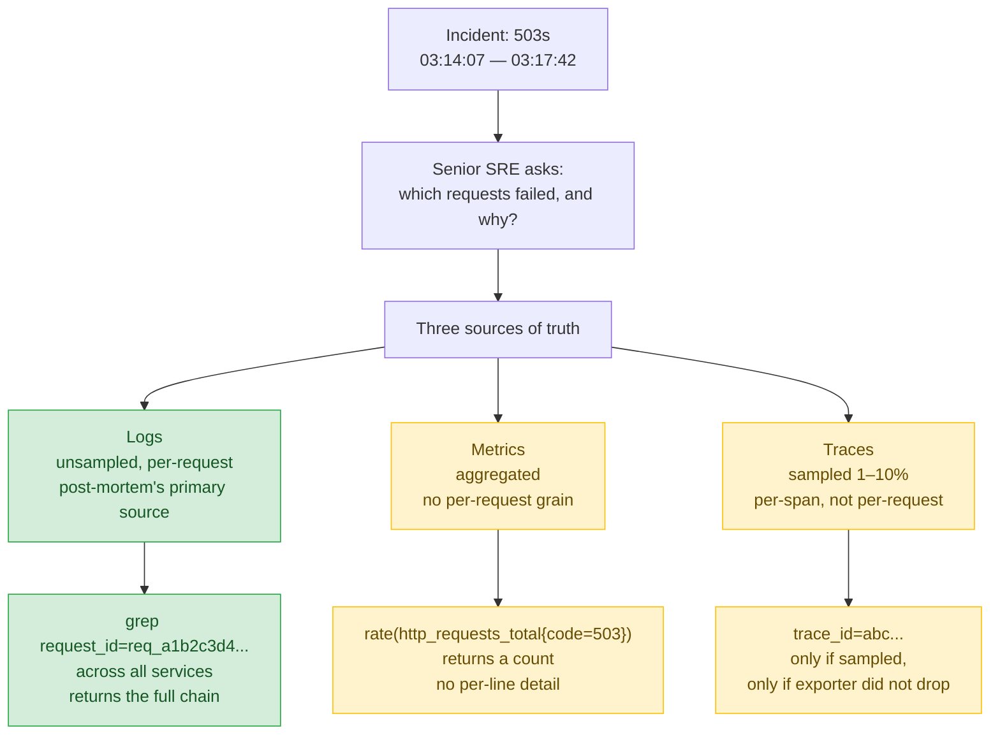
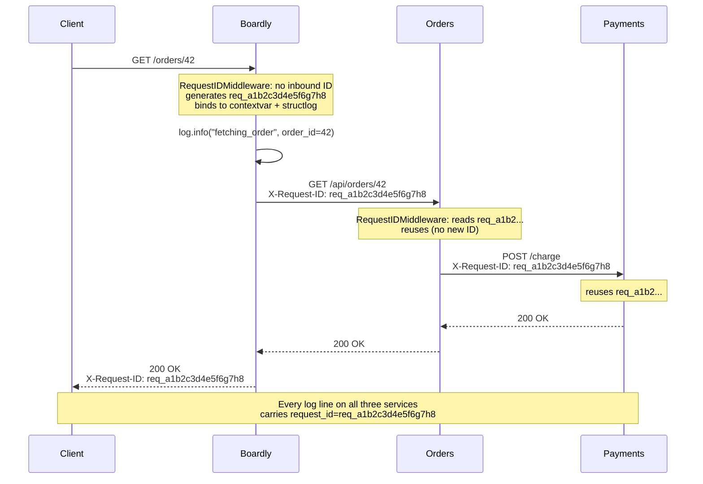

# Lesson 01: Structured Logging and Request IDs

*Giving `Boardly` a JSON logger, a request ID that survives the trip across three services, and the discipline to never log a bearer token.*

**You're at the very beginning of Section 13.**

Every observability stack you'll ever admire — the side project with one log file, the production system with a Grafana dashboard, the open-source library that ships its own OTel exporter — was once exactly where you are now: staring at a `print()` call and wondering why the support team can't find the line that proves the customer's bug. Take your time. Type every line. Read the JSON output. **This is how you learn.**


**Tip — Don't pick — combine: OpenTelemetry for tracing, structlog for structured logs, stdlib logging as the underlying engine for both. They are complementary, not alternatives.**

The most common confusion in 2026 Python observability is "which should I use — OTel, structlog, or stdlib `logging`?" **All three, wired together.** OpenTelemetry SDK is your *traces* (and increasingly metrics and logs via OTLP). `structlog` is your *structured logs* — the JSON event emitter with bound context. Python's stdlib `logging` module is the *underlying engine* that both `structlog` and OTel's log bridge sit on top of. The three are layered: `structlog` renders your log events; `structlog` writes through stdlib `logging` (so stdlib handlers, formatters, and `dictConfig` still work); OTel's instrumentation creates spans for your traces and stamps `trace_id`/`span_id` into the log records via a `LoggingHandler` or structlog processor. The right production wiring is: stdlib `logging` as the engine + `structlog` for the developer-facing API + OTel SDK for traces + a processor that injects `trace_id` into every log record (see the `trace_inject_processor` in Lesson 02). If you must pick only one for a tiny script: stdlib `logging` + `python-json-logger` (you can always add the others later). If you have >2 engineers: add `structlog`. If you have >1 service or care about latency: add OTel. Read the cross-link in Lesson 02 ([[13-Performance-and-Observability/OpenTelemetry-Tracing]]) for the integration pattern.


#observability #logging #structlog #request-id

## Learning Objectives

By the end of this lesson you will be able to:

1. **Configure `structlog`** to emit JSON logs with a stable schema and a per-request context.
2. **Write a `RequestIDMiddleware`** that generates a request ID on the way in, stamps every log line with it, propagates it on the way out via the `X-Request-ID` response header, and clears the context on the way out.
3. **Build an `httpx` transport** that copies the inbound request ID into every outbound call so the downstream service logs the same ID.
4. **Explain why `contextvars` is the async-safe replacement for `threading.local`** and why a module-level `logger.bind(...)` leaks across concurrent requests.
5. **Decide what *not* to log** — PII, secrets, full tokens — and enforce the rule with a processor.
6. **Reason about sampling** under high throughput, and explain why "log everything always" is a recipe for hiding errors.

## Prerequisites

Before starting, you need:

- **FastAPI 0.148.0** (verified Oct 2026), with `uv` 0.13.1 and Python 3.12.
- **The Middleware lesson** — [[03-FastAPI-Core/Middleware-and-Request-Order]]. You should already know where middleware sits in the request lifecycle, what "last added = outermost" means, and how a `BaseHTTPMiddleware` differs from a pure ASGI middleware. The middleware we write here is pure ASGI; you'll see why.
- **The Lifespan lesson** — [[03-FastAPI-Core/Application-and-Lifespan]]. The logger is configured in the lifespan startup block, before any traffic is served.
- **Async context managers and `contextvars`** — [[01-Python-Foundations/Iterators-Generators-Context-Managers]] and [[10-Async-Python/Event-Loop-and-Coroutines]]. The middleware uses a `ContextVar` to share the request ID with every coroutine in the request, without threading it through every function signature.
- **About an hour and a half of focused time.** The code is small (one configuration file, one middleware, one transport); the explanation is long because every line matters.

**The most common gap: `contextvars`.**

If you have never written a `ContextVar`, the request-id pattern looks magical. It isn't. A `ContextVar` is the standard-library primitive that lets you store a per-request value and read it from any coroutine in that request, without threading it through every function. Python's `threading.local` is broken for async (every coroutine on the same thread shares the same storage); `contextvars` is the async-safe replacement. If `ContextVar.set`, `ContextVar.get`, and `ContextVar.reset` make no sense to you, go read the first third of [[10-Async-Python/asyncio-Primitives]] and come back.


## Think Like a Senior SRE

Before we write a single line of code, sit with the mental model for a moment. A senior SRE reading this lesson does not see "structured logging" as a JSON-formatting convenience. They see logs as the **post-mortem's primary source** — the one artefact you can always reconstruct after the fact. Dashboards are sampled; metrics are aggregated; traces are sampled *and* aggregated. Logs are the only signal where you can ask "what happened to request `req_a1b2c3d4e5f6` at 03:14:07" and get a per-line answer with no approximation.

The senior SRE's three questions, asked of every log line, in this order:

1. **Can I find it?** — The line must carry a stable correlation key (`request_id`, `trace_id`) that I can grep or query without scrolling. A line without a correlation key is, in the post-mortem, an orphan.
2. **Can I trust it?** — The line must not have been redacted past usefulness, must not contain attacker-controlled content unescaped, must not be a `print()` that bypassed the processor chain. A line I cannot trust is worse than no line — it sends the post-mortem in the wrong direction.
3. **Can I afford it?** — The line must be cheap enough at 100 000 req/s that turning the level to DEBUG does not double the cloud bill. A line that is correct but unaffordable will be silently disabled in production within a week.

The first question is a *code* problem (the `RequestIDMiddleware` and `merge_contextvars` we build below). The second is a *security* problem (the `_redact` processor, validation of the inbound `X-Request-ID`, the JSON escape that defeats log injection — see [[#How an Attacker Thinks Logs as an Attack Surface]] later in this lesson). The third is an *operations* problem (sampling, retention, log aggregation tier sizing — see [[#Production Reality]]). All three are taught in this lesson; the engineering reflex is to ask all three *before* you ship — not after the first post-mortem where the logs were useless.

**A log line is a fact with three parts — when, what, and which request.**

`print()` gives you *when* and *what* (sort of). Structured logging adds *which request*, and makes all three queryable. The senior SRE's invariant: every log line that crosses a process boundary must carry the inbound correlation ID. A line that does not is, in the post-mortem, an orphan — you will see the line, you will know it ran, you will not know which request triggered it. Orphans are the lines that turn a 20-minute post-mortem into a 4-hour archaeology dig.




The diagram's colour-coding is the senior SRE's reflex: green is the per-request, unsampled signal you can always trust in a post-mortem; amber is the aggregated or sampled signals that give shape but lose the per-request grain. Metrics and traces are *amplifiers* — they tell you *which* requests to look at; the logs tell you *what happened to those requests*. A post-mortem that relies only on metrics answers "many 503s happened around 03:14"; a post-mortem that joins metrics to logs answers "request `req_a1b2c3d4e5f6` failed because the payments downstream returned a 503 from `POST /v1/charges` 4.2 seconds into the request." The second answer is the one that fixes the bug.

## The Problem

A user reports: "The app was slow at 3 AM and I think my charge failed." You ssh into the box, `tail -f` the log file, and you see this:

```
INFO:root:starting order flow
INFO:root:got user
INFO:root:calling payments
INFO:root:done
INFO:root:starting order flow
INFO:root:got user
INFO:root:calling payments
ERROR:root:something went wrong
INFO:root:done
```

Which `done` belongs to which `starting order flow`? Which `something went wrong`? You don't know. The log lines have no correlation ID. They have no timestamp you can join on. They have no request ID that matches the trace your colleague is looking at in a different dashboard. The user's complaint is unsolvable from the logs alone.

Plain `print()` and string-formatted `logging` give you *when* and *what happened in this process*. They do not give you *which request this line belongs to*. Structured logging — JSON output with a stable schema and a correlation ID baked into every line — is what turns "I think something broke" into "request `req_a1b2c3d4e5f6` spent 4.2 seconds in the payments service at 03:14:07." That is the entire reason this lesson exists.

Why is *structured* logging the answer, and not just "add a request_id field to your existing `logging.info(...)` calls"? A `logging.info(f"got user {user_id}")` line is a single string — the log aggregator stores it as one field, and to query "which user_id did this line see?" you regex the message. A `structlog.info("got_user", user_id=user_id)` line is a structured event: the aggregator stores `event="got_user"`, `user_id=42`, `request_id="req_..."`, `timestamp=...` as separate queryable fields. To find "every line that saw user_id=42" you filter on the `user_id` field, not regex the message. To find "every line in the request `req_...` chain" you filter on `request_id`. The shift is from "human-readable text we regex later" to "machine-readable fields we filter natively". The cost is using a logging library that emits JSON (structlog, python-json-logger); the benefit is the entire query surface of your observability backend becomes available.

**Note — Historical context — `print()` is not a logging strategy**

Every junior engineer's first instinct is `print()`. It works. It is also the most expensive logging decision you can ship. A `print()` goes to `stdout` unstructured, has no level, no timestamp, no request context, no sampling, and no rate limit. Production observability backends (Loki, Elasticsearch, Datadog, CloudWatch) treat `print()` output as raw strings — to query it, you have to regex it, and regex-ing logs is how you spend your Friday nights. Structured logging treats every line as a small JSON document with discrete, queryable fields. The cost is one library and ~20 lines of configuration; the benefit is the entire query surface of your observability backend.


## The Code

Here is the complete `boardly/logging.py` and `boardly/middleware.py` you'll write in this lesson. Save it mentally — every observability stack you ever build is a variation on these two files. Everything else in this section (OTel tracing, the N+1 diagnosis loop) is *additions to this foundation*.

```python
# boardly/logging.py
"""Boardly — structured logging configuration.

Lesson 13.1: JSON logs with request-id context, what-NOT-to-log
enforcement, and a sampling hook.
"""
import logging
import sys

import structlog
from structlog.contextvars import merge_contextvars, clear_contextvars
from structlog.processors import (
 TimeStamper,
 StackEffectRenderer,
 JSONRenderer,
 add_log_level,
)


# Fields we never let through to the renderer, no matter who binds them.
# If a developer types logger.info("ok", token=token), this drops the field
# and emits a warning so the leak is loud, not silent.
_REDACTED_FIELDS = frozenset({
 "password", "passwd", "secret", "token", "refresh_token",
 "access_token", "api_key", "authorization", "ssn", "card_number",
})


def _redact(logger, method_name, event_dict):
 """Processor: drop known-sensitive keys and warn when we do."""
 for key in list(event_dict.keys()):
 if key.lower() in _REDACTED_FIELDS:
 event_dict.pop(key)
 sys.stderr.write(
 f"[structlog] REDACTED field '{key}' from event "
 f"'{event_dict.get('event')}'\n"
 )
 return event_dict


def configure_logging(level: str = "INFO") -> None:
 """Configure structlog once, at startup. Call from the lifespan."""
 logging.basicConfig(
 format="%(message)s", # structlog does the JSON formatting
 stream=sys.stdout,
 level=level,
 )

 structlog.configure(
 processors=[
 merge_contextvars, # merge per-request ContextVars
 _redact, # strip PII / secrets
 add_log_level, # add "level": "info"
 TimeStamper(fmt="iso", utc=True),
 StackEffectRenderer(),
 JSONRenderer(), # final output is JSON
 ],
 wrapper_class=structlog.make_filtering_bound_logger(
 logging.getLevelName(level)
 ),
 logger_factory=structlog.PrintLoggerFactory(),
 cache_logger_on_first_use=True,
 )


# boardly/middleware.py
"""Boardly — ASGI middleware for request IDs.

Lesson 13.1: pure-ASGI middleware (no BaseHTTPMiddleware) so the
context is set before any other middleware runs.
"""
import contextvars
import uuid

import structlog
from starlette.types import ASGIApp, Receive, Scope, Send


request_id_var: contextvars.ContextVar[str] = contextvars.ContextVar(
 "request_id", default=""
)

REQUEST_ID_HEADER = "X-Request-ID"


class RequestIDMiddleware:
 """Pure-ASGI middleware. Last-added-outermost still applies."""

 def __init__(self, app: ASGIApp) -> None:
 self.app = app

 async def __call__(self, scope: Scope, receive: Receive, send: Send) -> None:
 if scope["type"] not in ("http", "websocket"):
 # Lifespan and other non-http scopes: pass straight through.
 return await self.app(scope, receive, send)

 # 1. Read the inbound X-Request-ID (if the upstream sent one).
 headers = dict(scope.get("headers", []))
 incoming = headers.get(REQUEST_ID_HEADER.lower().encode(), b"").decode()
 rid = incoming or f"req_{uuid.uuid4().hex[:16]}"

 # 2. Bind into structlog's context AND a raw ContextVar (for httpx).
 structlog.contextvars.bind_contextvars(request_id=rid)
 token = request_id_var.set(rid)

 # 3. Wrap `send` so the response carries the same ID back to the client.
 async def send_with_header(message):
 if message["type"] == "http.response.start":
 # Append, don't replace — the handler may have set headers.
 message["headers"] = [
 *message["headers"],
 (REQUEST_ID_HEADER.encode(), rid.encode()),
 ]
 await send(message)

 try:
 await self.app(scope, receive, send_with_header)
 finally:
 # 4. Clear so the next request on this worker doesn't inherit it.
 structlog.contextvars.clear_contextvars()
 request_id_var.reset(token)


# boardly/clients.py
"""Boardly — httpx transport that propagates the request ID."""
import httpx

from boardly.middleware import request_id_var, REQUEST_ID_HEADER


class PropagatingTransport(httpx.AsyncHTTPTransport):
 """Reads the current request_id_var and stamps it on every outbound call."""

 async def handle_async_request(self, request):
 rid = request_id_var.get()
 if rid:
 request.headers[REQUEST_ID_HEADER] = rid
 return await super().handle_async_request(request)


def build_http_client() -> httpx.AsyncClient:
 """One client, one pool — reuse across the app via lifespan."""
 return httpx.AsyncClient(
 transport=PropagatingTransport(),
 timeout=httpx.Timeout(5.0, connect=2.0),
 # See [[15-External-Integrations/HTTP-Clients-Timeouts-Retries]]
 # for the full reasoning on the Limits and http2 dials.
 )


# boardly/main.py
"""Boardly — main app. Lesson 13.1 wires logging + request-id middleware."""
from contextlib import asynccontextmanager

import structlog
from fastapi import FastAPI

from boardly.logging import configure_logging
from boardly.middleware import RequestIDMiddleware
from boardly.clients import build_http_client


logger = structlog.get_logger()


@asynccontextmanager
async def lifespan(app: FastAPI):
 # Configure logging BEFORE we accept traffic. If we did this lazily
 # on the first request, the first log line would be plain text.
 configure_logging()
 app.state.http = build_http_client()
 logger.info("app_started")
 yield
 await app.state.http.aclose()
 logger.info("app_stopped")


app = FastAPI(title="Boardly", version="0.2.0", lifespan=lifespan)

# Order matters: RequestIDMiddleware added LAST runs OUTERMOST (first on
# the way in, last on the way out). We want the request ID bound before
# any other middleware or handler logs anything.
app.add_middleware(RequestIDMiddleware)


@app.get("/orders/{order_id}")
async def get_order(order_id: int):
 log = logger.bind(order_id=order_id)
 log.info("fetching_order")
 resp = await app.state.http.get(f"https://upstream/api/orders/{order_id}")
 log.info("upstream_responded", status=resp.status_code)
 return resp.json()
```

That's ~150 lines across four files. Run it. Visit it. Change it. Break it. Fix it. That's the loop. We'll explain every line next — not just *what it does* but *what Python / structlog / Starlette do internally* when that line runs.

## Line-by-Line Deep Dive

This section is the heart of the lesson. Read it twice. Don't skip.

### `boardly/logging.py`: Lines 1–10 – Module docstring and imports

```python
"""Boardly — structured logging configuration.

Lesson 13.1: JSON logs with request-id context, what-NOT-to-log
enforcement, and a sampling hook.
"""
import logging
import sys

import structlog
from structlog.contextvars import merge_contextvars, clear_contextvars
from structlog.processors import (
 TimeStamper,
 StackEffectRenderer,
 JSONRenderer,
 add_log_level,
)
```

**What it does:** Pulls in the standard-library `logging` module, `sys` (for `stdout` and `stderr`), the `structlog` package, and a handful of structlog's built-in processors.

**Why we need each:**

- `logging` — `structlog` can replace `logging` entirely, but in production we want third-party libraries (uvicorn, httpx, sqlalchemy) to flow through the same handlers. `logging.basicConfig` wires structlog's output into the stdlib root logger, so anything that calls `logging.getLogger(__name__).info(...)` ends up in the same JSON stream as our structlog calls. This is non-negotiable in a real app — you do not want two log formats on the same `stdout`.
- `sys` — `sys.stdout` is the destination for logs in a container (Twelve-Factor App: "logs are event streams"). `sys.stderr` is where our redaction warning goes, so it shows up even if a downstream processor swallows the main line.
- `structlog` — the library. Latest stable as of Oct 2026.
- `merge_contextvars` — the processor that takes any `contextvars` you've bound via `structlog.contextvars.bind_contextvars(...)` and merges them into the event dict. This is how `request_id` ends up on every line without you passing it to every `logger.info(...)` call.
- `clear_contextvars` — the symmetric cleanup. Imported here for completeness even though we call it from the middleware (where it belongs). Importing it here is documentation; it reminds the reader that the *cleanup* lives in the middleware's `finally` block.
- `TimeStamper`, `StackEffectRenderer`, `JSONRenderer`, `add_log_level` — the four built-in processors we use. We could write our own; we don't. Each is ~30 lines of well-tested Python; the value is in knowing which order to put them in.

**Tip — Why processors are a chain**

A structlog processor is a function `(logger, method_name, event_dict) -> event_dict`. The output of one is the input of the next. The chain runs in order, and the final processor returns a string (or bytes) that goes to the configured destination. This means you can compose: add a level, add a timestamp, redact a field, render to JSON — each as a small, testable function. The mistake is to write one giant processor that does everything; the win is to write five small ones.


### `boardly/logging.py`: Lines 17–24 – The redaction list

```python
_REDACTED_FIELDS = frozenset({
 "password", "passwd", "secret", "token", "refresh_token",
 "access_token", "api_key", "authorization", "ssn", "card_number",
})
```

**What it does:** Defines the set of field names that the redaction processor will strip from any log event, regardless of who bound them.

**Why a `frozenset`:** Membership checks (`key.lower() in _REDACTED_FIELDS`) are `O(1)` on a `frozenset`, vs `O(n)` on a `list`. Logging is hot; we don't want to pay a linear scan per field per line. The `frozenset` is also immutable, which is documentation: nobody can accidentally append a new field at runtime and have the redaction set drift.

**Why these fields:** They are the canonical "things you must not log" — passwords, secrets, bearer tokens (access and refresh), API keys, `Authorization` headers, social security numbers, and primary account numbers (PAN, the long number across the front of a credit card). Anything matching one of these names, in any case, gets dropped. The list is not exhaustive; it's the safety net, not the policy. The *policy* is "log identifiers, not values" — see [What NOT to log](#what-not-to-log) below.

**Warning — The redaction list is a safety net, not a license.**

A developer who types `logger.info("auth_ok", token=token)` will see the field dropped and a warning printed. That is *better than leaking the token*, but it is not *as good as never binding the field in the first place*. The right pattern is to log only safe identifiers: `logger.info("auth_ok", user_id=user.id, token_jti=token.jti)`. The `jti` (JWT ID) is a random nonce that identifies the token session without being the token itself — useless to an attacker reading your logs.


### `boardly/logging.py`: Lines 27–39 – The redaction processor

```python
def _redact(logger, method_name, event_dict):
 """Processor: drop known-sensitive keys and warn when we do."""
 for key in list(event_dict.keys()):
 if key.lower() in _REDACTED_FIELDS:
 event_dict.pop(key)
 sys.stderr.write(
 f"[structlog] REDACTED field '{key}' from event "
 f"'{event_dict.get('event')}'\n"
 )
 return event_dict
```

**What it does:** Iterates the event dict, drops any sensitive key, writes a warning to `stderr`, and returns the (possibly modified) event dict.

**Why iterate a `list(...)` of keys, not the dict directly:** We're mutating the dict (`event_dict.pop(key)`) while iterating. Iterating a dict while mutating it raises `RuntimeError: dictionary changed size during iteration`. `list(event_dict.keys())` materialises the keys first; the iteration is over a snapshot.

**Why write to `sys.stderr`, not `logger.warning(...)`:** The redaction processor runs *inside* the logger. Calling `logger.warning(...)` from inside a processor would recurse into the same processor chain — infinite loop. `sys.stderr.write(...)` is a side-channel that bypasses structlog entirely. It's loud; it's a developer signal; it's not meant for production. In production you'd want a metric counter (`redacted_fields_total`) so you can alert on the rate.

**Student asks: why not just `raise` when a sensitive field is bound?**

Tempting. A `raise` would force the developer to fix the bug. But it would also crash the request that triggered it — and the request that triggered it is, almost by definition, the request you're trying to debug. The compromise is: strip the field, log loudly to stderr, return the cleaned event dict. The developer sees the warning, the request keeps going, the leak is plugged. If you want a stricter policy in CI, write a linter that greps for `logger.\w+\([^)]*token=` — the linter is where the "never type this" rule belongs, not the runtime.


**What happens inside a structlog processor at runtime**

A processor is a plain Python function with the signature `(logger, method_name, event_dict) -> event_dict | None`. structlog calls each processor in the chain, in order, on the *same* event_dict object (no copy; the dict is mutated in place). The chain has three termination conditions:
1. **A processor returns `None`** — the chain stops; the line is dropped. This is the canonical *sampling hook*: a processor that returns `None` 99% of the time for INFO events implements probabilistic sampling. The line never reaches `JSONRenderer`, never reaches `stdout`, never costs ingestion.
2. **A processor raises** — the chain stops; the line is lost; structlog logs a `ProcessorChainError` to stderr (or the configured error handler). The line that triggered the failure is *not* emitted, and the lines before it in the chain have already mutated the dict (the mutation is partial).
3. **The last processor returns a `str` (or `bytes`)** — the chain stops normally; the string is handed to the logger factory (`PrintLoggerFactory` in our case), which writes it to `stdout`. After this step, the event_dict is no longer in scope; the string is the only artefact.

The ordering constraint that bites teams: `merge_contextvars` must run *before* any processor that reads context (like a processor that adds `region=us-east-1` based on `request_id`), and *before* `_redact` (so a developer who binds `token=...` to the contextvar gets redacted, not just the field on the call site). Our chain has `merge_contextvars` first, `_redact` second — the right order. A team that adds a custom processor that reads `request_id` from the context *before* `merge_contextvars` runs will see `request_id` absent from the dict; the processor will treat every line as "no request_id" and misbehave. The processor order is the most important configuration in the file; the order is documented in the line-by-line section above.


### `boardly/logging.py`: Lines 42–62 – The `configure_logging` function

```python
def configure_logging(level: str = "INFO") -> None:
 """Configure structlog once, at startup. Call from the lifespan."""
 logging.basicConfig(
 format="%(message)s",
 stream=sys.stdout,
 level=level,
 )

 structlog.configure(
 processors=[
 merge_contextvars,
 _redact,
 add_log_level,
 TimeStamper(fmt="iso", utc=True),
 StackEffectRenderer(),
 JSONRenderer(),
 ],
 wrapper_class=structlog.make_filtering_bound_logger(
 logging.getLevelName(level)
 ),
 logger_factory=structlog.PrintLoggerFactory(),
 cache_logger_on_first_use=True,
 )
```

**What it does:** Configures stdlib `logging` to send raw messages to `stdout` at the configured level, then configures `structlog` with our processor chain, a filtering wrapper class, a `PrintLoggerFactory`, and `cache_logger_on_first_use=True`.

**Why `format="%(message)s"`:** stdlib `logging` formats every record through a `Formatter`. structlog has already formatted the record into a JSON string by the time it reaches stdlib. If stdlib applied its own formatter (`"%(asctime)s [%(levelname)s] %(message)s"`), we'd get a string prefixed with another string — `2026-10-19 03:14:07,123 [INFO] {"event": ...}`. That's not JSON; Loki can't parse it; Datadog can't index it. `format="%(message)s"` lets the JSON pass through untouched.

**The processor order matters.** Read it left-to-right:

1. `merge_contextvars` — first, so all subsequent processors see the per-request context. If `_redact` ran before this, a `request_id` that someone bound via `structlog.contextvars.bind_contextvars(request_id=...)` would not yet be in the dict.
2. `_redact` — second, so we drop sensitive fields before they're rendered. If `_redact` ran after `JSONRenderer`, the field would already be a string and we couldn't easily pop it.
3. `add_log_level` — adds `"level": "info"` (or `"warning"`, `"error"`, etc.) to the event dict. Run after redaction so a developer who binds `level="admin"` (the user's role) doesn't collide with the log level. (That said — don't bind a field called `level` for any reason; pick `severity` or `log_level` if you need a custom field.)
4. `TimeStamper(fmt="iso", utc=True)` — adds `"timestamp": "2026-10-19T03:14:07.123456+00:00"`. ISO-8601 in UTC is the only timestamp format that survives every backend; local time and epoch seconds both cause bugs.
5. `StackEffectRenderer` — computes the calling module and function name (the "stack effect") and adds them as fields. Useful for "which line of code emitted this?"
6. `JSONRenderer()` — the final step. Serialises the event dict to a JSON string. This *must* be last; after this, the event is a string, not a dict, and no further processor can mutate fields.

**Why `make_filtering_bound_logger(...)`:** structlog's default `BoundLogger` evaluates every processor even for filtered-out levels. `make_filtering_bound_logger` returns a class where `logger.debug(...)` is a no-op if the configured level is `INFO`. This is the perf win you want in production; `debug` calls in hot code paths become free.

**Why `PrintLoggerFactory`:** structlog can write to stdlib `logging` (`stdlib.LoggerFactory`) or directly to `print` (`PrintLoggerFactory`). We chose `PrintLogger` because we already wired `logging.basicConfig(stream=sys.stdout)` and the output format we want is the JSON the `JSONRenderer` produced. If you want a third-party library's `logging.getLogger(...)` calls to also be JSON, use `stdlib.LoggerFactory` and add `structlog.stdlib.ProcessorFormatter` to the chain. For `Boardly`, `PrintLoggerFactory` is enough.

**Why `cache_logger_on_first_use=True`:** structlog's `get_logger()` is cheap, but the first call per module does a metaprogramming dance to bind the right methods. Caching that on first use means the second call is essentially free. For a service with hundreds of loggers and high throughput, this matters.

**What `structlog.configure` actually does**

structlog has a *global* configuration object. `configure` sets it. After `configure`, every `structlog.get_logger()` call returns a `BoundLogger` that uses the configured processors, wrapper class, and factory. The configuration is module-level (process-wide). If you call `configure` mid-request, all loggers change behaviour mid-request. That's why we call it once, in the lifespan startup block, before any traffic.


**What happens inside a single `logger.info("fetching_order", order_id=42)` call**

When the configured `BoundLogger.info(...)` is called, structlog runs six steps in order, all on the calling coroutine, all synchronous:
1. **Build the event dict.** `{"event": "fetching_order", "order_id": 42}` — the positional `event` argument becomes the `event` key; the keyword arguments become the rest of the dict. No copy; the same dict is mutated through the chain.
2. **Merge contextvars.** `merge_contextvars` reads structlog's internal `ContextVar` (a dict-valued `ContextVar` set by `bind_contextvars`) and copies its keys into the event dict. After this step, the dict has `request_id`, `endpoint`, and any other contextvars you bound.
3. **Filter.** The `make_filtering_bound_logger` wrapper has already short-circuited `debug` calls when the level is `INFO`; for `info`, `warning`, `error` the call proceeds. The filtering happens *before* the event dict is built — that's the perf win, because no dict allocation happens for filtered-out levels.
4. **Run the processor chain.** `_redact`, `add_log_level`, `TimeStamper`, `StackEffectRenderer`, `JSONRenderer` — each is `def processor(logger, method_name, event_dict) -> event_dict` and runs in order. The chain mutates the event dict in place; the output of one is the input of the next. If any processor returns `None`, the line is dropped (the canonical sampling hook).
5. **Render.** `JSONRenderer` calls `json.dumps(event_dict, default=str)` and returns a string. After this step, the event is a string; no further processor can mutate fields.
6. **Write.** `PrintLoggerFactory`'s logger calls `print(string)` to `sys.stdout`. The `logging.basicConfig(stream=sys.stdout)` we configured means any stdlib logger that bridges through `ProcessorFormatter` writes to the same stream.

The total CPU cost of one INFO line, on a 2026 CPU, is ~5–10 microseconds — 2 μs for the event dict, 1 μs for the contextvar merge, 2 μs for the processor chain, 2 μs for the JSON serialize, and ~0.5 μs for the `print` (the kernel's pipe write is the slow part, but it's buffered and async from the event loop's perspective). At 100 000 req/s × 10 lines/request = 1 000 000 lines/s, the per-process CPU cost is ~5–10 seconds of CPU per second — *non-trivial*. This is why sampling matters; this is why `make_filtering_bound_logger` (which short-circuits `debug` before the dict allocation) is the production default.


### `boardly/middleware.py`: Lines 1–9 – Imports

```python
import contextvars
import uuid

import structlog
from starlette.types import ASGIApp, Receive, Scope, Send
```

**What it does:** Pulls in `contextvars` (stdlib), `uuid` (stdlib), `structlog`, and Starlette's ASGI type aliases.

**Why these imports:**

- `contextvars` — the standard-library primitive we'll use to share the request ID with every coroutine in the request, without threading it through every function signature.
- `uuid` — to generate the request ID when the upstream didn't send one. `uuid.uuid4().hex[:16]` gives us a 16-character hex string (`a1b2c3d4e5f6g7h8`-ish), which is enough entropy for a per-request correlation ID and short enough to be readable in logs. (A full UUID is 32 hex chars; the truncated form is a UX choice.)
- `structlog` — for `structlog.contextvars.bind_contextvars` and `clear_contextvars`.
- `ASGIApp, Receive, Scope, Send` — Starlette's type aliases for the ASGI callable signature. Pure ASGI middleware takes `(scope, receive, send)` directly; these types document that.

**Tip — Why not `from starlette.middleware import BaseHTTPMiddleware`?**

`BaseHTTPMiddleware` is convenient — you write `async def dispatch(request, call_next)` instead of the raw `(scope, receive, send)`. The cost: it wraps every request in an `anyio` task, which has measurable overhead (a few hundred microseconds per request) and a known streaming-response bug where the body is buffered. For `Boardly`'s request-id middleware, we need the request ID bound *before* any other middleware runs — and pure ASGI middleware runs earlier in the stack than `BaseHTTPMiddleware`. The pure-ASGI form is also a better teaching tool: you see what the framework actually does. The lesson on [[03-FastAPI-Core/Middleware-and-Request-Order]] has the full trade-off.


### `boardly/middleware.py`: Lines 12–17 – The `ContextVar` and the header constant

```python
request_id_var: contextvars.ContextVar[str] = contextvars.ContextVar(
 "request_id", default=""
)

REQUEST_ID_HEADER = "X-Request-ID"
```

**What it does:** Declares a module-level `ContextVar` for the request ID, with a default of `""`, and a constant for the HTTP header name we'll read and write.

**Why a `ContextVar` and not just `structlog.contextvars.bind_contextvars`:** We need *two* consumers of the request ID:

1. The logger (via `merge_contextvars`) — to stamp every log line.
2. The outbound `httpx` transport — to copy the ID into the `X-Request-ID` header of every downstream call.

`structlog.contextvars` only solves (1). For (2), the transport needs to read the current request ID without going through structlog. A `ContextVar` is the standard-library primitive both consumers can share: structlog's `merge_contextvars` reads it via its own internal ContextVar, and our `PropagatingTransport` reads it via `request_id_var.get()`. We bind it in two places (`structlog.contextvars.bind_contextvars(request_id=rid)` and `request_id_var.set(rid)`) so both consumers see it.

**Why the default is `""`:** If you call `request_id_var.get()` outside a request (e.g. in a startup hook, or in a worker that didn't inherit the context), you get `""` instead of `LookupError`. The transport's `if rid:` check then skips the header, and the downstream service generates its own ID. This is the graceful-degradation path; it's important.

**Why the header is `X-Request-ID`:** It's the de-facto standard. Most reverse proxies (nginx, Envoy, Linkerd) and most observability backends recognise it. Some teams use `X-Correlation-ID`; both are common. Pick one and use it everywhere. We pick `X-Request-ID`.

`X-` headers are deprecated per RFC 6648 (2012). Why use one anyway? RFC 6648 says "do not invent new `X-` headers; use a normal name like `Request-ID`". The recommendation is for *new* headers; `X-Request-ID` and `X-Correlation-ID` predate the deprecation and are entrenched in tooling (nginx, Envoy, Datadog all recognise them by their `X-` names). Renaming to `Request-ID` would break every reverse proxy and aggregator that recognises the `X-` form. The deprecation's intent was "stop using `X-` as a prefix for vendor extensions"; the intent was not "rename the entrenched ones". `X-Request-ID` stays. New headers you invent should not start with `X-`.

### `boardly/middleware.py`: Lines 20–22 – The middleware class

```python
class RequestIDMiddleware:
 """Pure-ASGI middleware. Last-added-outermost still applies."""

 def __init__(self, app: ASGIApp) -> None:
 self.app = app
```

**What it does:** Defines a class with an `__init__` that takes the next ASGI app in the chain and stores it. No base class; no `__call__` decorator.

**Why no base class:** Pure ASGI middleware is just a callable. The protocol is "the class takes `app` in `__init__`, and the instance is callable with `(scope, receive, send)`." Starlette's `add_middleware(RequestIDMiddleware)` does `self.user_middleware = Middleware(RequestIDMiddleware)` and then later wraps the app: `app = RequestIDMiddleware(app=previous_app)`. There's no enforcement; there's no inheritance; there's no decorator. It's a callable that wraps another callable.

**Why this matters:** `BaseHTTPMiddleware` exists because writing `async def dispatch(request, call_next)` is more pleasant than writing `async def __call__(self, scope, receive, send)`. But `BaseHTTPMiddleware` is a class that *itself* implements `__call__(self, scope, receive, send)`, builds a `Request` from `scope`, calls `dispatch`, and serialises the `Response` back to `send`. The cost of that convenience is a few hundred microseconds per request and a streaming-body buffering bug. For middleware that runs on every request, the pure-ASGI form is the right call.

### `boardly/middleware.py`: Lines 24–28 – The `__call__` and the early-return

```python
async def __call__(self, scope: Scope, receive: Receive, send: Send) -> None:
 if scope["type"] not in ("http", "websocket"):
 # Lifespan and other non-http scopes: pass straight through.
 return await self.app(scope, receive, send)
```

**What it does:** Receives the ASGI scope/receive/send triple. If the scope is not an HTTP or websocket request (i.e. it's a `lifespan` scope), passes straight through to the next app without binding anything.

**Why the early-return:** ASGI has three scope types: `http`, `websocket`, and `lifespan`. The lifespan events (`startup`, `shutdown`) flow through the same middleware stack as HTTP requests. If we bound a request ID on the lifespan scope, every log line emitted during startup would carry a `request_id` field — which is wrong; startup is not a request. The early-return ensures we only bind for actual HTTP traffic.

**What `scope` actually is**

A dict. The keys depend on `scope["type"]`. For an HTTP request, you get `type`, `asgi.version`, `http_version`, `method`, `scheme`, `path`, `query_string`, `headers` (a list of `(name_bytes, value_bytes)` tuples), `client` (`(host, port)`), `server` (`(host, port)`), and a few more. The headers are *bytes*, not strings — ASGI is bytes-clean for HTTP/2 support. That's why we decode in the next block.


### `boardly/middleware.py`: Lines 30–34 – Read the inbound header and generate an ID

```python
headers = dict(scope.get("headers", []))
incoming = headers.get(REQUEST_ID_HEADER.lower().encode(), b"").decode()
rid = incoming or f"req_{uuid.uuid4().hex[:16]}"
```

**What it does:** Converts the headers list into a dict, looks up the inbound `X-Request-ID` header, decodes it, and falls back to a freshly-generated ID if the upstream didn't send one.

**Why `dict(scope.get("headers", []))`:** ASGI delivers headers as a list of `(name_bytes, value_bytes)` tuples — e.g. `[(b"host", b"localhost:8000"), (b"x-request-id", b"req_abc")]`. We convert to a dict so we can look up by name. The cost is `O(n)` per request where `n` is the number of headers (typically 5–15); negligible.

**Why `.lower().encode()`:** HTTP header names are case-insensitive per RFC 7230. The client might send `X-Request-ID`, `x-request-id`, or `X-REQUEST-ID`. We normalise to lowercase bytes (`b"x-request-id"`) before looking up. (ASGI servers typically deliver headers in lowercase, but normalising defensively is cheap.)

**Why `incoming or f"req_..."`:** If the upstream sent a request ID (e.g. an Envoy proxy that already generated one), we reuse it. If it didn't, we generate one. The `req_` prefix is documentation: it lets you grep logs for `req_` and find request IDs (vs `user_`, `session_`, etc.). The 16-char hex is short enough to be readable in a dashboard and long enough (64 bits) that collisions are astronomically unlikely.

**Spot the bug — what happens if the upstream sends `X-Request-ID: ` (empty value)?**

`incoming` would be `""`, the `or` would fire, and we'd generate a new ID. That's the right behaviour. But what if the upstream sends `X-Request-ID: ../../etc/passwd`? An attacker trying to inject a log-forging payload? The `rid` would be `../../etc/passwd`, and our `JSONRenderer` would escape it correctly inside a JSON string — but it would still appear in the log line as a field value. If you grep logs for `../../etc/passwd`, you'd find this line. The defence is to *validate* the inbound ID against a regex (`^[A-Za-z0-9_-]{1,64}$`) and reject (or replace) anything that doesn't match. We've left that as Exercise 3.


### `boardly/middleware.py`: Lines 36–39 – Bind into both contexts

```python
structlog.contextvars.bind_contextvars(request_id=rid)
token = request_id_var.set(rid)
```

**What it does:** Binds `request_id=rid` into structlog's context (so `merge_contextvars` picks it up), and sets `request_id_var` to `rid` (so the outbound `httpx` transport picks it up). Stores the reset `token` for later cleanup.

**Why both:** structlog's `bind_contextvars` writes to its *own* internal `ContextVar` (which `merge_contextvars` reads). It does *not* write to our `request_id_var`. If we only called `bind_contextvars`, the transport would read `""` from `request_id_var.get()` and skip the header. If we only called `request_id_var.set(rid)`, the logger would not see `request_id` in the event dict. Two binds, two consumers, two reads. Slightly redundant; correct.

**Why store the `token`:** `ContextVar.set(value)` returns a `Token` object that you pass to `ContextVar.reset(token)` to undo the set. Without the `reset`, the value would leak across requests on the same worker (because the same asyncio task is reused for many requests, and the ContextVar is task-scoped). The `finally` block at the bottom uses this token to undo the set cleanly.

**Why structlog's `clear_contextvars` instead of a `reset`:** structlog's context is a *dict* of contextvars (one per bound key). `clear_contextvars()` clears them all. We don't have a token for structlog's context (the API doesn't return one); we use the unconditional `clear_contextvars()` instead. This is correct because we always want to clear, regardless of what came before.

**What `contextvars.ContextVar` actually does internally**

A `ContextVar` is a key into a per-context mapping. Python's `contextvars` module maintains a chain of `Context` objects; each `Context` is an immutable mapping from `ContextVar` to value. When you call `set(value)`, you get back a `Token`, and the current `Context` is replaced with a new `Context` that has your value bound. When you call `reset(token)`, the previous `Context` is restored. When `asyncio.create_task(...)` is called, the new task gets a *copy* of the current `Context` at the moment of creation — mutations in the child do not leak back. This is exactly the property you want: the background job's logs are stamped with the request that spawned it, but the request can finish without waiting.


### `boardly/middleware.py`: Lines 41–48 – Wrap `send` to add the response header

```python
async def send_with_header(message):
 if message["type"] == "http.response.start":
 message["headers"] = [
 *message["headers"],
 (REQUEST_ID_HEADER.encode(), rid.encode()),
 ]
 await send(message)
```

**What it does:** Defines a nested `send` wrapper that intercepts the `http.response.start` message and appends the `X-Request-ID` header to the response. For all other message types (e.g. `http.response.body`), passes through unchanged.

**Why wrap `send` and not `receive`:** ASGI is a bidirectional protocol: `receive` is the inbound stream (the request body, chunked), `send` is the outbound stream (the response, also chunked). The response *start* message (`http.response.start`) carries the status code and the response headers. To add a response header, we intercept this message. To modify the request body (e.g. to decompress it), we'd intercept `receive`. We don't need to modify the request body, so we leave `receive` alone.

**Why `*message["headers"], (new_header, ...)`:** The headers are a list of `(name_bytes, value_bytes)` tuples. We unpack the existing list (so we don't lose any headers the handler set) and append our new tuple. The `*` is Python's iterable-unpacking operator. The result is a new list (we don't mutate the original).

**Why intercept only `http.response.start`:** An ASGI HTTP response is sent as a series of messages: `http.response.start` (status + headers), then one or more `http.response.body` chunks. The headers are only on the *start* message. Appending to the headers of a body message would have no effect — ASGI servers ignore headers on body messages.

**Warning — Don't replace `message["headers"]`, append.**

If you write `message["headers"] = [(REQUEST_ID_HEADER.encode(), rid.encode())]`, you'd lose every header the handler set — `Content-Type`, `Content-Length`, `Cache-Control`, the lot. Always unpack the existing list and append. The same applies to `scope["headers"]` on the request side: it's a list, not a dict, and the order can matter for some clients.


### `boardly/middleware.py`: Lines 50–58 – Try/finally and cleanup

```python
try:
 await self.app(scope, receive, send_with_header)
finally:
 # Clear so the next request on this worker doesn't inherit it.
 structlog.contextvars.clear_contextvars()
 request_id_var.reset(token)
```

**What it does:** Calls the next app in the chain with our wrapped `send`. Regardless of outcome (success, exception, client disconnect), runs the cleanup: clears structlog's context and resets our ContextVar to its previous value.

**Why `try/finally`:** The next app might raise. If we didn't have a `finally`, the `ContextVar` would stay set, the next request on the same worker would inherit the *previous* request's ID, and you'd get cross-request contamination — the worst kind of log bug, because the logs still look fine; they're just *wrong*.

**Why `clear_contextvars` AND `reset(token)`:** They clear *different* context stores. `clear_contextvars` clears structlog's internal dict-of-contextvars. `reset(token)` clears *our* `request_id_var`. Both must be cleared; otherwise some leak.

**Why the order is `clear` then `reset`:** It doesn't actually matter for correctness — both are independent — but reading `clear` before `reset` documents the intent: "first, drop everything structlog knows; second, drop our raw var."

**Tip — The pattern: every bind must have a matching clear.**

This is the invariant. Anywhere you `bind_contextvars(...)` or `ContextVar.set(...)`, you must have a matching `clear_contextvars()` / `reset(token)` in a `finally` block. The `try/finally` ensures it runs even on exception. Without this, you'll see "ghost" request IDs — a request from an hour ago still showing up in the current request's logs. That's a debugging nightmare.


**What happens inside `ContextVar.reset(token)` at the asyncio task level**

When the middleware's `finally` runs `request_id_var.reset(token)`, the `contextvars` module does three things:
1. **Validate the token.** The token records both the `ContextVar` it was set on and the *previous value* (the empty string `""`, in our case). If you call `reset` with a token from a *different* `ContextVar`, it raises `RuntimeError("token was created by a different ContextVar")`. This is the defence against the bug where two middlewares accidentally share tokens.
2. **Restore the previous Context.** The `ContextVar` is a key into a per-`Context` mapping; each `Context` is an immutable dict-like object. `reset(token)` swaps the current `Context` for the one referenced by the token — the one that existed *before* the matching `set()`. The previous `request_id_var` value is restored to `""`.
3. **Invalidate the token.** The token can only be used once. Calling `reset` with the same token a second time raises `RuntimeError("token already used before")`.

The crucial detail for ASGI middleware: the `Context` is per-task, not per-thread. Uvicorn uses `asyncio`'s task model; each HTTP request runs as a task; the task has its own `Context` (a copy of the parent's at the moment of creation, per PEP 567). When `request_id_var.set(rid)` runs at the start of the request, the task's `Context` is replaced with a new one that has `request_id=rid` bound. When `reset(token)` runs in `finally`, the task's `Context` is replaced back with the original (no `request_id`). When the task completes, the `Context` is garbage-collected. The *next* HTTP request runs in a *different* task with a *different* `Context`; there is no cross-request contamination, even without the `finally` cleanup — but the `finally` cleanup is the *defence in depth* that catches the bug where the same task is reused (e.g. an `asyncio.Queue` consumer pattern) without a fresh `Context`. The `finally` is belt-and-suspenders; the per-task isolation is the load-bearing isolation.


### `boardly/clients.py`: Lines 1–14 – The propagating transport

```python
import httpx

from boardly.middleware import request_id_var, REQUEST_ID_HEADER


class PropagatingTransport(httpx.AsyncHTTPTransport):
 """Reads the current request_id_var and stamps it on every outbound call."""

 async def handle_async_request(self, request):
 rid = request_id_var.get()
 if rid:
 request.headers[REQUEST_ID_HEADER] = rid
 return await super().handle_async_request(request)
```

**What it does:** Subclasses `httpx.AsyncHTTPTransport` and overrides `handle_async_request` to add the `X-Request-ID` header to every outbound request, *if* we have one in the current context.

**Why a transport and not a wrapper around `AsyncClient`:** httpx's transport layer is the single point through which every request passes — including retries, redirects, and any internal httpx mechanics. Wrapping the client at a higher level (e.g. subclassing `AsyncClient` and overriding `request`) would miss internal calls. The transport is the right layer.

**Why `if rid`:** If we're outside a request (e.g. in a worker that didn't inherit the context, or in a startup hook), `request_id_var.get()` returns `""` (the default). Adding an empty `X-Request-ID` header would be worse than not adding one. The `if` skips the header; the downstream service generates its own ID. Graceful degradation.

**Why `super().handle_async_request(request)`:** Delegates to httpx's actual transport logic — connection pool, HTTP/2 multiplexing, TLS handshake. Our subclass only adds the header; it doesn't replace any transport behaviour.

**What `httpx.AsyncHTTPTransport` actually does**

It's a class that manages a connection pool, opens TCP connections (with optional TLS), serialises HTTP requests, parses HTTP responses, and returns `httpx.Response` objects. Subclassing it lets you intercept any of those steps. Our subclass intercepts *before* the connection is opened — we add the header, then hand off to the parent. The parent doesn't know we touched the request.


**What happens inside `httpx` when our `PropagatingTransport` runs**

When the calling coroutine does `await app.state.http.get(url)`, httpx walks a layered pipeline:
1. **Client-level.** `AsyncClient.get` builds an `httpx.Request` (method, URL, headers, params) and hands it to the transport — our `PropagatingTransport`, since we passed `transport=PropagatingTransport()` to the constructor. The `AsyncClient` itself is per-app (created in the lifespan); the same client and the same transport instance serve every request.
2. **Transport entry.** Our overridden `handle_async_request(request)` runs *before* any connection is opened. We read `request_id_var.get()` from the *calling coroutine's* `Context` — and because the calling coroutine is the same task that the ASGI middleware set `request_id_var` on, we see the correct `rid`. If we were called from a background task that didn't inherit the context, we'd see `""` (the default) and skip the header.
3. **Header mutation.** `request.headers[REQUEST_ID_HEADER] = rid` writes to httpx's `Headers` object (a case-insensitive multidict). The write is in-place; the `Headers` instance is shared between the request and the response (and the pool, if a connection is reused). The header is now on the wire.
4. **Parent transport.** `super().handle_async_request(request)` runs httpx's transport logic: check the connection pool for an idle `httpx.AsyncHTTPConnection` to this origin; if none, open a new TCP connection (with TLS handshake if `https`); send the request line and headers (including our `X-Request-ID`); read the response status line, headers, and body; return an `httpx.Response`.
5. **Connection reuse.** The connection is returned to the pool, marked idle, available for the next request to the same origin. The next request — even on a different calling coroutine — reuses the same connection. The `X-Request-ID` we set on the *previous* request is *not* on the new request (the `Headers` object is per-request, not per-connection); the new request's transport entry runs again, reads its own `rid` from its own `Context`, sets its own header.

The crucial detail: the `ContextVar` read in step 2 is the *calling coroutine's* context, not the transport's context and not the connection's context. This is why one shared `AsyncClient` (one process, one pool) can serve many concurrent requests with many different `request_id`s — each calling coroutine sees its own contextvar, even though the transport instance is shared. The isolation is at the asyncio-task level, not at the httpx-pool level.


### `boardly/clients.py`: Lines 17–24 – The client factory

```python
def build_http_client() -> httpx.AsyncClient:
 """One client, one pool — reuse across the app via lifespan."""
 return httpx.AsyncClient(
 transport=PropagatingTransport(),
 timeout=httpx.Timeout(5.0, connect=2.0),
 )
```

**What it does:** Constructs an `httpx.AsyncClient` with our propagating transport and a per-phase timeout.

**Why one client per app, not per request:** An `AsyncClient` owns a connection pool. Creating one per request would defeat the pool (every request opens a new TCP connection, no keep-alive). One client per app, created in the lifespan, shared across requests, torn down in the lifespan — this is the only correct shape. See [[03-FastAPI-Core/Application-and-Lifespan]] for the lifespan pattern, and [[15-External-Integrations/HTTP-Clients-Timeouts-Retries]] for the full reasoning on `Timeout` and `Limits`.

**Why `httpx.Timeout(5.0, connect=2.0)`:** A single number (`timeout=5.0`) sets all four phases (pool, connect, write, read) to 5 seconds. `httpx.Timeout(5.0, connect=2.0)` sets the *overall* timeout to 5 s but the *connect* timeout to 2 s — because if connecting takes more than 2 seconds, the host is almost certainly unreachable, and waiting the full 5 just delays the failure. The full rationale is in [[15-External-Integrations/HTTP-Clients-Timeouts-Retries]]; for now, the explicit form is the right default.

### `boardly/main.py`: Lines 1–15 – Imports

```python
from contextlib import asynccontextmanager

import structlog
from fastapi import FastAPI

from boardly.logging import configure_logging
from boardly.middleware import RequestIDMiddleware
from boardly.clients import build_http_client


logger = structlog.get_logger()
```

**What it does:** Pulls in `asynccontextmanager` (for the lifespan), `structlog` (for the logger), `FastAPI` (the class), and our three new modules. Creates a module-level logger.

**Why a module-level logger:** structlog's loggers are cheap to create (especially with `cache_logger_on_first_use=True`). A module-level `logger = structlog.get_logger()` is the standard pattern — every module that needs to log gets its own. The `__name__` of the module is captured automatically by `StackEffectRenderer`, so each log line knows which module emitted it.

**Tip — Why `structlog.get_logger()` instead of `logging.getLogger(__name__)`**

structlog's `get_logger()` returns a `BoundLogger` — a wrapper that uses our configured processors, our `merge_contextvars`, our `_redact`. The stdlib `logging.getLogger(__name__)` returns a stdlib `Logger`, which doesn't go through our processor chain (unless you also configure `stdlib.LoggerFactory` and `ProcessorFormatter`, which we don't, for simplicity). For `Boardly`, `structlog.get_logger()` is the right call. If you need a third-party library's stdlib loggers to also be JSON, add the stdlib bridge — see the structlog docs on `ProcessorFormatter`.


### `boardly/main.py`: Lines 17–28 – The lifespan

```python
@asynccontextmanager
async def lifespan(app: FastAPI):
 configure_logging()
 app.state.http = build_http_client()
 logger.info("app_started")
 yield
 await app.state.http.aclose()
 logger.info("app_stopped")
```

**What it does:** Configures logging, builds the httpx client, logs "app_started", yields control to Starlette (traffic is now accepted), and on shutdown closes the httpx client and logs "app_stopped".

**Why `configure_logging()` is first:** If we configured logging *after* yielding, every log line emitted during startup (including the `app_started` log itself) would be plain text. Configuring logging first means every subsequent log line — including the `app_started` line right below it — is JSON with a timestamp and a level.

**Why `logger.info("app_started")` has no `request_id`:** Because there is no request. Startup is a process-level event, not a request. The `merge_contextvars` processor will simply not find any `request_id` in the context, and the field will be absent from the line. That's correct; you don't want a fake `request_id` on startup logs.

**Why `app.state.http.aclose()`:** The `AsyncClient` owns a connection pool with open TCP connections. If we don't close it, the OS keeps the sockets in `TIME_WAIT` until they time out (typically 60–120 seconds), and a tight restart loop can exhaust ephemeral ports. `aclose()` is the async equivalent of `close()`; it gracefully shuts down the pool.

### `boardly/main.py`: Lines 31–36 – App construction and middleware order

```python
app = FastAPI(title="Boardly", version="0.2.0", lifespan=lifespan)

app.add_middleware(RequestIDMiddleware)
```

**What it does:** Constructs the app and adds the request-id middleware.

**Why `version="0.2.0"`:** We bumped the version to reflect that this lesson added observability infrastructure. The version is part of the OpenAPI metadata, surfaced at `/docs`. (A real app would read this from a `Settings` class — see [[04-Pydantic/Pydantic-Settings]].)

**Why `app.add_middleware(RequestIDMiddleware)` and not `app.add_middleware(RequestIDMiddleware, ...)` with keyword args:** Our middleware's `__init__` takes only `app`. There are no options. If we wanted to make the header name configurable, we'd add a kwarg to `__init__` and pass it via `app.add_middleware(RequestIDMiddleware, header_name="X-Correlation-ID")`.

**Why the order matters:** Starlette applies middleware in reverse order — *last added is outermost*. `RequestIDMiddleware` is the only middleware, so it's both outermost and innermost. When we add more middleware in later lessons (timing, auth), `RequestIDMiddleware` should remain *outermost* — we want the request ID bound before any other middleware logs. The rule: add `RequestIDMiddleware` *last*. See [[03-FastAPI-Core/Middleware-and-Request-Order]] for the full onion explanation.

### `boardly/main.py`: Lines 38–44 – The endpoint

```python
@app.get("/orders/{order_id}")
async def get_order(order_id: int):
 log = logger.bind(order_id=order_id)
 log.info("fetching_order")
 resp = await app.state.http.get(f"https://upstream/api/orders/{order_id}")
 log.info("upstream_responded", status=resp.status_code)
 return resp.json()
```

**What it does:** Defines a `GET /orders/{order_id}` endpoint that logs "fetching_order", makes an upstream HTTP call, logs "upstream_responded" with the status, and returns the upstream response.

**Why `logger.bind(order_id=order_id)` and not just `logger.info("fetching_order", order_id=order_id)`:** The bound form attaches `order_id` to *every* subsequent log line from `log` — `fetching_order`, `upstream_responded`, and any future `log.error(...)` if the call fails. The per-call form would attach it only to that one line. For a multi-line operation (an order fetch with several steps), the bound form is the right shape.

**Why the `request_id` field is on the line but not bound here:** It's bound by `merge_contextvars`, which reads from the ContextVar that the middleware set. We don't have to thread `request_id` through every function; the context does it for us. This is the entire point of the pattern.

**Why `app.state.http.get(...)`:** The httpx client is on `app.state` (set in the lifespan). We reach it via the `app` module-level global — a small cheat that works because `app` is in the module scope. In a real app you'd use a dependency: `def get_http(request: Request) -> httpx.AsyncClient: return request.app.state.http`. The dependency form is more testable (you can override it) and more explicit (you can read the dependency list and see what the endpoint needs).

## What NOT to Log

This deserves its own section because it's the most-violated rule in production logging.

**Never log:**

- PII: email, phone, full name, IP (or hash it: `email_hash=hashlib.sha256(email.encode()).hexdigest()[:12]`).
- Secrets: API keys, bearer tokens (access or refresh), passwords.
- Full request bodies when they contain payment data (PCI).
- Full response bodies when they contain PHI (HIPAA).
- Session cookies. The `Set-Cookie` header on the response side is also off-limits.

**Always log:**

- Identifiers: `user_id`, `order_id`, `account_id`, `tenant_id`. Stable, non-sensitive, queryable.
- Operational context: `endpoint`, `method`, `status`, `latency_ms`, `cache_hit`.
- The `jti` (JWT ID) instead of the token. The `jti` is a random nonce that identifies the token session; it's useless to an attacker reading your logs.

**Rule of thumb:** log **identifiers**, never **values** of sensitive fields. If you must log a value for debugging, hash it. If you must log a token, log only the last 4 characters (`token_last4=token[-4:]`).

**Danger — Tokens in logs are an attack vector.**

A common anti-pattern: `logger.info("auth_ok", token=token)`. The token is now in your logs. Logs are stored, indexed, searched, shipped to a third-party backend (Datadog, Elasticsearch), retained for months, and read by every engineer with log access. A leaked token is a leaked account. Our `_redact` processor catches this and drops the field — but the right answer is to never bind it in the first place. Linters and code review are the real defence.


## Execution Trace

A request crossing three services — `Boardly` (gateway), `orders` (downstream), `payments` (further downstream) — with one shared request ID:



A single Loki / Datadog query for `request_id=req_a1b2c3d4e5f6g7h8` returns the entire chain — the request, the upstream call, the charge, the response, in order, with timestamps. That's the whole point.

The same trace as a colour-coded topology. Green is the originating service (Boardly, where the request ID is generated), blue is each downstream service that *reuses* the inbound ID rather than minting its own, amber is the shared contextvar that every service binds on entry. The structural insight this diagram makes visible: every service in the chain does the same three things — read inbound `X-Request-ID` (or generate if missing), bind to contextvar, propagate on outbound calls. There is no "central correlation service"; the correlation is the convention. Each service is independently correct; together they form a traceable chain.

```mermaid
flowchart LR
    Client["Client<br/>no request_id"]
    Gen["Boardly: generate<br/>req_a1b2c3d4...<br/>bind to contextvar"]
    Propagate1["Orders: reuse<br/>req_a1b2c3d4...<br/>rebind contextvar"]
    Propagate2["Payments: reuse<br/>req_a1b2c3d4...<br/>rebind contextvar"]
    Logs["Three log streams<br/>all carry<br/>request_id=req_a1b2c3d4..."]
    Query["Single Loki query<br/>request_id=req_a1b2c3d4...<br/>returns the whole chain"]

    Client -->|GET /orders/42<br/>no X-Request-ID| Gen
    Gen -->|X-Request-ID: req_a1b2...| Propagate1
    Propagate1 -->|X-Request-ID: req_a1b2...| Propagate2
    Propagate2 -.->|200 OK| Propagate1
    Propagate1 -.->|200 OK| Gen
    Gen -.->|200 OK + X-Request-ID header| Client
    Gen --> Logs
    Propagate1 --> Logs
    Propagate2 --> Logs
    Logs --> Query

    style Client fill:#e2e3e5,stroke:#6c757d,color:#383d41
    style Gen fill:#d4edda,stroke:#28a745,color:#155724
    style Propagate1 fill:#d1ecf1,stroke:#0d6efd,color:#0c5460
    style Propagate2 fill:#d1ecf1,stroke:#0d6efd,color:#0c5460
    style Logs fill:#fff3cd,stroke:#ffc107,color:#664d03
    style Query fill:#fff3cd,stroke:#ffc107,color:#664d03
```



**Student asks: what happens if a downstream service in the chain is third-party and does not propagate our `X-Request-ID` header?**

The chain breaks at that hop. The third-party service mints its own request ID (or has none), and the logs on the third-party side cannot be correlated with the upstream `req_a1b2...`. The fix is *operational*, not code: you instrument the third-party call with a `client_logger.info("calling_third_party", target="acme", request_id=contextvar.get())` line *before* the call, and a `client_logger.info("third_party_responded", status=200, latency_ms=42, request_id=contextvar.get())` line *after*. The two log lines on *your* side bracket the third-party call, and a grep for your `request_id` returns the entry, the bracketing, the (unindexed) third-party latency, and the exit — enough to debug "the call to acme took 8 seconds, here is when we entered, here is when we exited". You cannot get the third-party's internal logs; you can prove the latency was on their side.


## Common Mistakes

### Mistake 1: Using a module-level `logger.bind(...)` for the request ID

```python
# WRONG
logger = structlog.get_logger().bind(request_id=rid) # module level
```

**Symptom:** It works for the first request on a worker. The second request logs with the *first* request's ID. The third request logs with the *second* request's ID. By the tenth, you're cross-contaminating requests.

**Why:** `logger.bind(...)` returns a new `BoundLogger`, but if you assign it to a module-level name, every import of that module gets the same bound logger. The bind is shared across requests. There's no per-request isolation.

**Fix:** Use `structlog.contextvars.bind_contextvars(request_id=rid)` in the middleware, and `merge_contextvars` in the processor chain. The context is per-task (and therefore per-request), not per-module.

### Mistake 2: Logging full bearer tokens

```python
# WRONG
logger.info("auth_ok", token=access_token)
```

**Symptom:** The token is in your logs. Anyone with log access can impersonate the user until the token expires. If the token has a long lifetime (refresh tokens, some service-to-service tokens), the window is large.

**Why:** Tokens are secrets. Logs are not secret. The intersection is a leak.

**Fix:** Our `_redact` processor catches this and drops the field. The right pattern: `logger.info("auth_ok", user_id=user.id, token_jti=token.jti)`. The `jti` is a random nonce that identifies the token session without being the token itself.

### Mistake 3: String interpolation before passing to structlog

```python
# WRONG
logger.info(f"got {x}")
```

**Symptom:** The log line has `event: "got 42"` and no `x` field. Downstream you can't query `x=42`; you'd have to regex the event string.

**Why:** structlog's whole point is key-value logging. `f"got {x}"` collapses the value into a string before structlog sees it. The information is lost.

**Fix:** `logger.info("got", x=x)`. The event name is "got", and `x` is a discrete field.

### Mistake 4: Switching the level to DEBUG in production "just for now"

```python
# WRONG (in production)
configure_logging(level="DEBUG")
```

**Symptom:** Log volume explodes by 10–100x. The observability backend bills you for ingestion. Errors are harder to find in the noise. It stays.

**Why:** "Just for now" is never just for now. DEBUG is a development setting; production is INFO or WARNING.

**Fix:** Make the level a deployment flag (`BOARDLY_LOG_LEVEL=INFO`). Switch it via the env, not via a code change. Use tail-based log sampling (see OpenTelemetry's tail-sampling processor) if you need DEBUG visibility without the volume.

### Mistake 5: Generating a new request ID on every hop

```python
# WRONG (in the middleware)
rid = f"req_{uuid.uuid4().hex[:16]}" # always generates, ignores inbound
```

**Symptom:** Each service in the chain logs a different request ID. Cross-service correlation is impossible.

**Why:** The whole point of the `X-Request-ID` header is that *one* ID follows the request across services. Always generating a new one defeats that.

**Fix:** `rid = incoming or f"req_..."`. Read the inbound header; reuse if present; generate if not. This is the line in the middleware that makes the pattern work.

### Mistake 6: Forgetting to `clear_contextvars()` in the `finally`

```python
# WRONG
async def __call__(self, scope, receive, send):
 structlog.contextvars.bind_contextvars(request_id=rid)
 await self.app(scope, receive, send)
 # no finally, no clear
```

**Symptom:** The next request on the same worker inherits the previous request's ID. Logs are cross-contaminated. You see "ghost" request IDs from requests that finished minutes ago.

**Why:** ASGI workers (uvicorn worker tasks) are reused across requests. The ContextVar is task-scoped; without explicit cleanup, it persists.

**Fix:** The `try/finally` with `clear_contextvars()` and `request_id_var.reset(token)`. Always.

## Engineering Trade-Offs

### `structlog` vs plain stdlib `logging` + `python-json-logger`

`structlog` is more ergonomic (key-value logging at the call site, contextvars, processors) and types better. It adds one dependency and a small learning curve. The alternative — stdlib `logging` with `python-json-logger` and a `logging.Filter` that injects `request_id` from a ContextVar — is fine and zero-dependency, but you write more boilerplate (the Filter, the JSON formatter, the context propagation). The trade-off is **developer ergonomics vs dependency footprint.** Pick `structlog` once the team grows past two people; pick `python-json-logger` for a single-process script.

### Sampling

At thousands of requests per second, logging every INFO line is expensive. Two strategies:

1. **Level-based:** only `WARNING+` in production. Cheap, but loses the happy-path breadcrumbs. When something breaks, you have only the error line, not the context that led to it.
2. **Probabilistic sampling:** log 100% of errors, 1% of successes. `structlog` doesn't ship this; you write a small processor that returns `None` (drop) for 99% of INFO events. OpenTelemetry's traces have a built-in `ParentBased(TraceIdRatioBased(0.1))` sampler — see [[OpenTelemetry-Tracing]].

The wrong approach is "log everything always." Storage is cheap until it isn't, and noisy logs make errors harder to find. The right approach is "log all errors, sample successes, keep a tail-based processor that promotes any trace with an error to 100% retention."

### Synchronous vs async log writes

Stdlib `logging` is blocking. A `FileHandler` writing to a slow disk stalls the event loop. In async services, either:

- Write to `stdout` and let the container runtime pipe it to your collector (recommended — see [[16-Deployment-and-DevOps/Docker-Multi-Stage-Non-Root]]). The container runtime does the buffering; your event loop never sees a slow disk.
- Use a `QueueHandler` and a dedicated writer thread. The handler is non-blocking; the writer thread takes the slow-disk hit.

For `Boardly`, we write to `stdout` (via `PrintLoggerFactory` and `logging.basicConfig(stream=sys.stdout)`). The container runtime handles the rest. This is the Twelve-Factor App pattern: "logs are event streams."

### JSON vs key=value (logfmt)

JSON is the default for `Boardly` because every backend (Loki, Elasticsearch, Datadog, Honeycomb) parses it natively. `logfmt` (`event=foo level=info request_id=req_...`) is more compact and human-readable in a terminal, but backends need a logfmt parser (most have one). Some teams ship JSON in production and logfmt in development, swapping via a config flag. We don't bother for `Boardly`; JSON everywhere is simpler.

## When This Breaks: A Senior Engineer's Debugging Guide

Logs fail in characteristic ways. Each failure has a fingerprint — the symptom you see in Grafana or Loki, the root cause, and the fix. The five failures below cover ~90% of the production log outages a senior SRE gets paged for.

### Failure 1: The missing `request_id`

**Symptom.** A Loki query for `request_id=req_a1b2c3d4e5f6` returns lines from `boardly-api` but nothing from `boardly-worker` or `boardly-billing`. The trace in Jaeger shows the request crossing all three services. The logs from two of the three services are missing.

**Diagnosis.** Run, in order:

1. `kubectl logs boardly-worker-xxx | grep req_a1b2c3d4e5f6` — if the worker emitted *any* log line for this request, the contextvar was set; if not, the worker either didn't process the request or processed it without inheriting the contextvar.
2. If the worker did process it: check whether the worker uses `asyncio.create_task(...)` to spawn the work. `create_task` copies the *current* `Context` at the moment of creation — if the worker was spawned by an `arq` task function that has no inbound HTTP request, the contextvar is empty. The fix is to either (a) inject the `request_id` into the arq job payload and re-bind it in the worker (`structlog.contextvars.bind_contextvars(request_id=job_kwargs["request_id"])` at the top of the task), or (b) use a `contextvars.copy_context()` to propagate the inbound context explicitly. Option (a) is the production pattern; the `request_id` is part of the job's persisted state and survives worker restarts.
3. If `boardly-billing` is missing: check whether the `httpx` client used there was constructed via `build_http_client()` (which installs the `PropagatingTransport`) or via a bare `httpx.AsyncClient()` (which does not). A service that builds its own client without the propagating transport silently drops the `X-Request-ID` header on outbound calls. The downstream mints its own ID and the chain breaks at that hop.

**Warning — The chain breaks at the laziest hop.**

A three-service chain with two well-instrumented services and one bare-`AsyncClient` service produces logs that look complete at the edges and are missing in the middle. The fix is not "log harder in the middle service"; the fix is "use the shared transport in the middle service." Same codebase, same team, same code review — the bug is a one-line import miss, not a discipline failure.


### Failure 2: Log volume at scale — the 1 TB/day surprise

**Symptom.** The Datadog or Loki bill triples in a week. The dashboard shows log volume growing from 200 GB/day to 1.2 TB/day. No deploy correlates with the growth. The `INFO` rate looks normal; the `DEBUG` rate has exploded.

**Diagnosis.** The most common cause is "someone turned DEBUG on for a single module to debug a problem, forgot to turn it off, and a hot code path logs at DEBUG." Find it by:

1. Query the aggregator for `level=debug` and group by `module` (or `service`/`logger`). One module will dominate.
2. `git log --all --oneline -- boardly/<module>.py | head -20` — find the commit that introduced the DEBUG call.
3. Look for `logger.debug(...)` inside a hot loop (a per-row DB loop, a per-chunk stream, a per-event webhook handler). One DEBUG per row × 10 000 rows/sec × 60 × 60 × 24 = 864 million lines/day from one module.

**Fix.** Two layers:

- *Immediate*: set `BOARDLY_LOG_LEVEL=INFO` and restart. The DEBUG calls become no-ops with `make_filtering_bound_logger` — the bound-logger wrapper short-circuits the call *before* the event dict is allocated, so even `logger.debug(...)` inside a hot loop costs essentially zero CPU after the level switch.
- *Structural*: add a sampling processor (one that returns `None` 99% of the time for `level=debug` events) for hot modules. Or — better — remove the DEBUG call from the hot loop entirely; debug info that requires per-row emission is what traces are for, not logs.

**Danger — The "DEBUG for one module" trap.**

`logging.getLogger("boardly.payments").setLevel(logging.DEBUG)` is a one-line change that, in a hot code path, can take a service from 200 GB/day to 1.2 TB/day in a single deploy. The level switch is invisible in the diff (it lives in a settings file or a runtime flag) and the volume growth is invisible until the bill arrives. Set per-module log levels only via a setting that requires an operator sign-off, and alert on `rate(log_lines_total{level="debug"}[5m]) > threshold` so the spike is caught before the bill.


### Failure 3: The log that nobody reads — finding signal in noise

**Symptom.** A post-mortem reveals that the bug was visible in the logs for 4 hours before the customer reported it. The relevant `WARNING` was emitted 14 000 times during that window. Nobody saw it.

**Diagnosis.** This is not a *logging* problem; it is an *alerting* problem. Logs that are not wired to an alert are write-only — they exist for the post-mortem, not for prevention. The senior SRE's reflex: every `WARNING` and `ERROR` event name should be in a metrics counter (`log_events_total{level="warning", event="circuit_open_rejected"}`), and every counter should have at least one alert rule. A `WARNING` with no alert is a *promise to read logs manually*, which is a promise no on-call can keep at 3 AM.

**Fix.** Add a `metrics_processor` to the structlog chain that increments a Prometheus counter for every `WARNING+` event:

```python
from prometheus_client import Counter

_log_events = Counter(
    "boardly_log_events_total",
    "Number of log events by level and event name",
    ["level", "event"],
)

def metrics_processor(logger, method_name, event_dict):
    level = event_dict.get("level", "info")
    if level in ("warning", "error", "critical"):
        _log_events.labels(
            level=level,
            event=event_dict.get("event", ""),
        ).inc()
    return event_dict
```

Wire it *before* the `JSONRenderer` (so the metric is counted even if a downstream processor fails). Alert on `rate(boardly_log_events_total{level="error"}[5m]) > 0` for known-bad events; alert on `rate(boardly_log_events_total{level="warning"}[5m]) > threshold` for known-noisy ones.

**The "logs are for post-mortems; alerts are for prevention" split.**

A log line is what you read *after* the incident; an alert is what wakes you up *during* the incident. They share the same source (the structured log event) but different consumers (the human reading Loki vs the Prometheus rule evaluating a counter). The senior SRE's rule: every event name that appears in a runbook must have both a log line (for the post-mortem) and a metric counter (for the alert). Events without runbooks can be logs-only.


### Failure 4: Log injection — the `X-Request-ID` that smuggled a newline

**Symptom.** A Loki query for `request_id=req_...` returns a line that has a second JSON object embedded in the middle of the `request_id` field. The line above and the line below look fine; this one line is corrupted.

**Diagnosis.** An attacker sent `X-Request-ID: req_legit\n{"event":"fake_line","level":"info"}` (URL-encoded newline in the header value). The middleware accepted the header verbatim, the structlog renderer escaped the `\n` as `\\n` inside the JSON string, but a downstream log shipper (Filebeat, Fluent Bit) split the line on the literal `\n` and the second JSON object appeared as a separate (forged) log line. The forged line says `"user_id":"admin"` — the attacker just planted evidence in your audit log.

**Fix.** Validate the inbound `X-Request-ID` against a strict regex (`^[A-Za-z0-9_-]{1,64}$`) and replace anything that doesn't match with a freshly-generated ID. This is Exercise 3 in the original lesson. Treat it as a security fix, not a nicety. The regex denies `\n`, `"`, `\`, control characters, and anything else that could break out of a JSON string or a log line.

**Danger — Log injection is real, and JSON does not save you.**

A common belief is "we emit JSON, so log injection is impossible." Wrong. JSON protects the *field value* (the `\n` is escaped), but it does not protect the *line boundary* — most log shippers split on `\n` *before* parsing JSON, so a `\n` in a header value produces a forged line. The defence is at the input boundary (validate the header), not at the output boundary (the JSON renderer). Validate every inbound correlation ID; the regex is one line.


### Failure 5: The credential that leaked through a third-party logger

**Symptom.** A bearer token appears in a log line in production. The `_redact` processor was supposed to drop it. The token field is not in the `_REDACTED_FIELDS` set.

**Diagnosis.** The token was logged by a third-party library (httpx, sqlalchemy, redis-py) that calls `logging.getLogger("httpx").debug(...)` with the request headers — including the `Authorization` header — at DEBUG level. The library's logger does not go through structlog's `_redact` processor; it goes through the stdlib `logging.basicConfig` we configured at the top of `configure_logging()`. The stdlib handler emits the raw record. The token is in `stdout`.

**Fix.** Two layers:

1. *Bridge* the third-party loggers through structlog's processor chain via `structlog.stdlib.LoggerFactory()` and `ProcessorFormatter`. Once bridged, the `_redact` processor sees every log record, regardless of source. See Exercise 6.
2. *Set* the third-party loggers to `WARNING` (or higher) by default in `configure_logging()`:

```python
for noisy in ("httpx", "httpcore", "asyncio", "sqlalchemy", "redis"):
    logging.getLogger(noisy).setLevel(logging.WARNING)
```

The DEBUG-level header-dump that httpx emits when you turn DEBUG on is the most common token leak in Python services. Deny it by default.

**Warning — The redaction list is a safety net, not a policy.**

A redaction processor only sees fields that pass through it. A third-party library that bypasses the processor chain (any unbridged stdlib logger) sees no redaction. The defence is structural: bridge every logger through the same processor chain, and gate DEBUG-level logging on a setting that requires an operator sign-off.


## How an Attacker Thinks: Logs as an Attack Surface

A senior engineer reading the `_redact` processor sees a defence — not the whole defence. An attacker reading the same code sees three attack surfaces: log injection (forge log lines), credential leakage (read secrets from logs), and timing correlation (infer private state from log patterns). Each is real; each has a defence beyond the redaction list.

### Log injection — forging evidence in your audit log

**The attack.** An attacker who can control any field that ends up in a log line — an `X-Request-ID` header, a `User-Agent`, a `username` on a signup form — can attempt to inject content that breaks the log line boundary. The payload is `"req_legit\n{\"event\":\"admin_login\",\"user_id\":\"admin\"}"`. The intent is to plant a forged line in your audit log that, in a future investigation, "proves" an admin login happened at a specific time. If your log shipper splits on `\n` before parsing JSON (most do), the forged line becomes a real line in your index.

**The defence.**

1. *Validate* every inbound field that becomes a log field against a strict regex. The `X-Request-ID` regex `^[A-Za-z0-9_-]{1,64}$` is the canonical example. Apply the same to usernames, client IDs, any field that an attacker controls and that ends up in a log line.
2. *Escape* at the output boundary: structlog's `JSONRenderer` escapes control characters inside JSON strings, so a `\n` in a field value becomes `\\n` in the JSON. But — as Failure 4 above shows — the line-splitter in many shippers runs *before* the JSON parser, so escaping at the output boundary is necessary but not sufficient. Validation at the input boundary is the load-bearing defence.
3. *Refuse* multi-line values entirely. If a field *must* accept arbitrary text (a comment, a description), log its hash, not its value: `description_hash=hashlib.sha256(text.encode()).hexdigest()[:12]`.

### Credential leakage — the silent exfiltration

**The attack.** An attacker who has read access to your logs (a junior engineer, a third-party SRE contractor, an attacker who has exfiltrated a Datadog API key) has access to every secret you have ever logged. Logs are stored, indexed, replicated to a third-party backend, retained for months or years, and read by every engineer with log access. A leaked bearer token in a log line is a leaked account — for the lifetime of the token, which for refresh tokens can be 30 days.

**The defence.**

1. *Never log values of sensitive fields.* The `_REDACTED_FIELDS` list catches the common names (`password`, `token`, `authorization`, etc.); the policy is "log identifiers, not values" — log `user_id`, not `email`; log `jti` (JWT ID), not `token`; log `card_last4`, not `card_number`.
2. *Bridge every logger through the processor chain.* A third-party library that bypasses the redaction processor is an exfiltration path. See Failure 5 above.
3. *Audit log access separately.* Logs that contain *any* user data (even hashed) should be in a separate index with separate access controls. The "log access" audit log is itself a log — but in a different backend, with different retention, with different alerting.
4. *Rotate* secrets that *might* have leaked. The senior engineer's reflex after any logging incident: assume the secret is in the logs, rotate it, treat the rotation as the fix (not "we'll check if it leaked"). The check takes longer than the rotation; the rotation is the safe default.

### Timing attacks via log correlation — inferring private state

**The attack.** An attacker who can correlate two log lines (the request they sent and a downstream log line they can observe, e.g. via a public status page or a third-party integration's logs) can infer private state. Example: an attacker sends a request to `POST /orders/42/charge` and observes, in a separate channel, that the *next* downstream log line from the payments service appears 1.2 seconds later. The 1.2 seconds correlates with a "card on file" path; a 4.5-second gap correlates with a "card-not-on-file, 3DS challenge" path. The attacker now knows whether user 42 has a card on file — information they did not have before.

**The defence.**

1. *Bound* the log emission to non-timing-sensitive events. Don't log "started 3DS challenge" — log "charge_completed" with a `flow_type` field *after* the flow completes. The post-completion log line carries the same information for the post-mortem but does not leak the *timing* of intermediate steps.
2. *Pad* observable timings where the timing channel is unavoidable. The constant-time-response pattern (return all responses in `max(observed_latency) + jitter`) closes the channel at the cost of p99 latency. Reserve this for high-sensitivity flows (auth, payment, MFA).
3. *Rate-limit* log queries. An attacker who can query `request_id=req_...` for *every* request ID can correlate across the whole fleet. A query rate limit (10 queries per minute per user) makes broad correlation infeasible.

**Danger — Logs are a side channel.**

Every log line that carries a timestamp and a correlation ID is a side channel for any private state that influences *when the line is emitted*. The senior engineer's reflex: if the timing of the log line is influenced by private state, the log line leaks that state. Either move the line to a non-timing-influenced event name, or pad the timing. The redaction list does not help here; the leak is structural, not field-level.


## Production Reality

The 200-line logging stack you just wrote runs in a context that the local `uvicorn` does not expose. Five production realities shape how it behaves at scale.

### 1 TB/day is a small log volume

A typical mid-traffic Python service — 5 000 req/s across 4 workers, 10 log lines per request — emits 50 000 lines/sec. At ~500 bytes per JSON line, that's 25 MB/s, or ~2.1 GB/day per service. A 20-service organisation ships 40 GB/day just from its Python services. Add the JVM services (10× the log volume per request), the Go services (5×), the nginx access logs (1 line per request, ~300 bytes), and the database query logs, and a modest platform is at 1–2 TB/day. The senior SRE's sizing rule: assume 1 TB/day per 100 services, and design the log aggregation tier to *index* only 1–10% of that volume; the rest is shipped to cold storage (S3, GCS) where retrieval takes minutes, not milliseconds.

The cost arithmetic that surprises teams: a Datadog or Splunk bill is roughly `$0.10–$0.50 per GB ingested, plus $0.01–$0.10 per GB retained per month`. At 1 TB/day ingested and 30-day retention, the ingestion cost is `$30–$150/day` and the retention cost grows by `$300–$3 000/month`. Sampling 90% of INFO lines (keeping 100% of WARNING+) cuts the ingestion cost by 10× — `$3–$15/day` — and the retention cost by 10× — `$30–$300/month`. The math is the reason every observability vendor offers a sampling processor; the math is the reason you should use one.

### Sampling strategies — head-based, tail-based, and the trade

Two sampling strategies, with different costs and different post-mortem fidelity:

**Head-based sampling** decides *at the start of a request* whether to log INFO lines for it. The decision is a hash of the `request_id` modulo N; the same request is consistently sampled (either fully logged or fully dropped). Pros: zero per-line overhead (the drop happens before the processor chain runs), no cross-service coordination. Cons: you cannot promote a request to 100% sampling *after* you see it failed — the decision was made before the failure.

**Tail-based sampling** decides *at the end of a request* whether to keep the lines, based on the request's outcome. Failed requests are kept at 100%; successful requests are sampled at 1%. Pros: every failed request is fully logged, no matter how rare the failure mode. Cons: every line must be buffered in memory until the request completes (memory cost), and the buffer must be in the same process as the request (cross-process tail sampling is hard).

The senior SRE's pattern: **head-based 10% sampling for INFO in normal operation; tail-based 100% retention for any request with a WARNING+ or a non-2xx response.** OpenTelemetry's `ParentBased(TraceIdRatioBased(0.1))` for traces, and the equivalent tail-sampling processor for logs, give you this. The combination gives you 10% sampling of happy-path traffic (enough to spot trends) and 100% retention of every failure (the post-mortem's primary source).

**The wrong default is "log everything always."**

Production logging is a cost–fidelity trade. "Log everything always" is the maximum-fidelity, maximum-cost corner of the trade space; it bills you for ingesting 10× the volume you'll ever query. "Sample 1%" is the minimum-cost, minimum-fidelity corner; it loses the rare-event signal. The senior SRE's reflex: pick the strategy that gives 100% retention of *what you will actually read in a post-mortem* (failures, warnings, slow requests) and aggressively sample the rest. Tail-based sampling is the operational pattern that implements that reflex.


### Log aggregation tier sizing

The log aggregation tier (Loki, Elasticsearch, Datadog's ingestion pipeline) has three layers, each with its own sizing rule:

1. **Shipper** (Fluent Bit, Vector, Filebeat) — runs as a sidecar or DaemonSet, reads `stdout` from the local container, batches, and ships. Sizing: 1 CPU and 512 MB RAM per 10 000 lines/sec sustained. The shipper is the first place logs queue under load; if the shipper's batch buffer fills, logs are dropped silently. Alert on `shipper_dropped_lines_total > 0`.
2. **Ingester** (the Loki distributor, the Elasticsearch ingest node, the Datadog agent intake) — receives batches, indexes, writes to the store. Sizing: 4 CPU and 4 GB RAM per 50 000 lines/sec sustained. The ingester is where most log pipelines fall over under load — a 2× spike in log volume (an outage that triggers 2× the warning rate) saturates the ingester and the backlog grows. Alert on `ingester_queue_depth > threshold`.
3. **Store / query layer** (S3 + Loki's index, Elasticsearch's data nodes, Datadog's index) — cold storage + query engine. Sizing: storage is cheap (S3 at `$0.023/GB/month`); index is expensive (Loki's chunk index, Elasticsearch's shard replicas). The rule: index 1–10% of the volume, store 100% cold. A query for a 30-day-old `request_id` is 1 second against the index, 30 seconds against the cold store. The trade is query latency vs index cost.

The senior SRE's tier-sizing rule: **index only WARNING+ events and 10% of INFO; store everything cold for 90 days; delete after 90 days unless a compliance hold requires longer.** The compliance hold (PCI, HIPAA, SOX) is the one reason to retain longer — and even then, the hold applies to *audit* logs (auth events, payment events), not to operational logs.

### Multi-region log shipping — the cross-region consistency problem

A service running in 3 regions (us-east-1, eu-west-1, ap-southeast-2) ships logs from each region to a central aggregator. Two patterns:

1. **Region-local aggregation, central query.** Each region has its own Loki/Elasticsearch; a federated query layer (Grafana's federation, Elasticsearch's cross-cluster search) queries all three. Pros: no cross-region log shipping traffic; region-local queries are fast. Cons: cross-region queries are slow; the federated layer is a single point of query failure.
2. **Central aggregation.** All regions ship to a single Loki/Elasticsearch cluster in one region. Pros: one query surface; one retention policy. Cons: cross-region shipping cost (data transfer fees for logs across regions, often `$0.02–$0.10/GB`); a single region's outage can lose logs.

The senior SRE's pattern: **region-local aggregation for operational logs (fast queries, no cross-region traffic); central aggregation for audit logs (compliance retention, single source of truth).** The split is "what do I query daily (operational, region-local) vs what do I keep for compliance (audit, central)."

### The retention cliff — what happens when the 30-day retention expires

The senior SRE's least-favourite day is the day a post-mortem needs logs from 35 days ago and the 30-day retention policy expired them. Two patterns help:

1. **Cold-tier promotion for incidents.** When an incident is declared, a script copies the relevant time window's logs (the affected services, the affected request IDs) to a long-term retention bucket (S3 with a 1-year lifecycle, Glacier for multi-year). The copy is the post-mortem's safety net.
2. **Audit-log retention is non-negotiable.** Auth events, payment events, access-control decisions are retained for the compliance window (PCI: 1 year; HIPAA: 6 years; SOX: 7 years). Operational logs (INFO, DEBUG, WARNING) are retained for 30–90 days. The split is by *event type*, not by *level* — a `payment_completed` event is retained for 1 year even if it's logged at INFO; a `circuit_open_rejected` WARNING is retained for 90 days even though it's WARNING.

**Warning — Retention is a security control.**

A 30-day retention policy is, from an attacker's perspective, a 30-day window for exfiltration to be useful. A token leaked today is rotated next week; the leak in the log is gone in 30 days. The senior engineer's reflex: retention is sized by the *longest secret lifetime* in the system — if refresh tokens live 30 days, operational logs should not live longer than 30 days. Audit logs (which contain no secrets by policy) can live longer.


## Exercises

**Tip — The 20-minute rule**

If you're stuck on an exercise for more than 20 minutes, re-read the relevant section above, then move on and come back. Learning isn't linear.


**Exercise 1 — Add an `endpoint` field.** Add a small middleware that runs *after* `RequestIDMiddleware` and binds `endpoint = scope["path"]` and `method = scope["method"]` into the structlog context. Verify every log line carries them.

**Exercise 2 — Implement probabilistic sampling.** Write a structlog processor that drops 90% of INFO events but keeps 100% of WARNING and ERROR. Use `random.random()`; seed it with the `request_id` so the same request is consistently sampled (either fully logged or fully dropped).

**Exercise 3 — Validate the inbound request ID.** Add a regex check (`^[A-Za-z0-9_-]{1,64}$`) on the inbound `X-Request-ID`. If it fails, generate a new ID and log a warning. This defeats log-forging attacks.

**Exercise 4 — Hash PII before logging.** Write a small helper `def hash_email(email: str) -> str: return hashlib.sha256(email.encode()).hexdigest()[:12]`. Use it in a `logger.info("user_login", email_hash=hash_email(user.email))` call. Verify the hash is stable across runs (so you can grep for a specific user across logs).

**Exercise 5 — Spot the bug.** This middleware looks fine but leaks the request ID across requests. Why?

```python
async def __call__(self, scope, receive, send):
 rid = f"req_{uuid.uuid4().hex[:16]}"
 logger.bind(request_id=rid) # bug here
 await self.app(scope, receive, send)
```

(Answer: `logger.bind(...)` without assignment returns a *new* `BoundLogger` that's immediately discarded. The original `logger` is unmodified. Use `structlog.contextvars.bind_contextvars(request_id=rid)` instead.)

**Exercise 6 — Bridge stdlib loggers.** Configure `structlog.stdlib.LoggerFactory()` and `ProcessorFormatter` so that a third-party library's `logging.getLogger("uvicorn.access").info(...)` call ends up in the same JSON stream. Verify by triggering a uvicorn access log.

## Verification

Run the app:

```bash
uv run uvicorn boardly.main:app --reload
```

In another terminal:

```bash
curl -v http://localhost:8000/orders/42
```

Expected `stdout` from the app:

```
{"event":"app_started","level":"info","timestamp":"2026-10-19T03:14:07.123456+00:00"}
{"event":"fetching_order","order_id":42,"request_id":"req_a1b2c3d4e5f6g7h8","level":"info","timestamp":"..."}
{"event":"upstream_responded","order_id":42,"request_id":"req_a1b2c3d4e5f6g7h8","status":200,"level":"info","timestamp":"..."}
```

Expected response headers (note the `X-Request-ID`):

```
< HTTP/1.1 200 OK
< x-request-id: req_a1b2c3d4e5f6g7h8
```

If you have an upstream service (or `httpbin.org`), verify the upstream received the `X-Request-ID` header. With `httpbin.org/headers`:

```bash
curl -v http://localhost:8000/orders/headers
# response body should include {"X-Request-ID": "req_..."}
```

Debugging tips:

- If `request_id` is missing from some lines, the emitter skipped `merge_contextvars`. Usually a third-party library using its own logger factory. Bridge it: route stdlib `logging` into structlog via `structlog.stdlib.LoggerFactory` (Exercise 6).
- If `request_id` is `""`, the middleware didn't run or the request path was pre-404. Check middleware order in `app.add_middleware(...)` calls — last added runs first.
- If `request_id` is the *same* on consecutive unrelated requests, you forgot the `clear_contextvars()` / `reset(token)` in the `finally` (Mistake 6).

## Previously Learned Here

These concepts were taught in earlier lessons. We link back instead of re-explaining:

- **Middleware** — [[03-FastAPI-Core/Middleware-and-Request-Order]]. New detail here: *writing* one that uses `ContextVars` and propagates a header on outbound, not just the in-process ordering rules. Also: pure-ASGI vs `BaseHTTPMiddleware` — Lesson 5 taught the trade-off; here we chose pure-ASGI.
- **FastAPI lifespan** — [[03-FastAPI-Core/Application-and-Lifespan]]. New detail: `configure_logging()` is called in the lifespan startup block, before traffic, so the `app_started` log line itself is JSON. The lifespan is also where the httpx client is built and torn down.
- **`contextvars`** — appears in [[10-Async-Python/asyncio-Primitives]] for cancellation tokens; here we use the same primitive to share log context safely across coroutines.
- **Exceptions (Python)** — [[01-Python-Foundations/Exceptions-Done-Right]]. The `try/finally` cleanup pattern in the middleware is the same one taught there: resources need explicit cleanup, even on the exception path.

## What's Next

In [[OpenTelemetry-Tracing]] we add the *second* signal: distributed traces. The trace and the log will share `trace_id` and `request_id`, so a slow trace in Jaeger links directly to the matching log query. You'll:

- Add `boardly/otel.py` with `TracerProvider`, `BatchSpanProcessor`, and the OTLP exporter.
- Instrument `FastAPI`, `httpx`, `sqlalchemy`, and `asyncpg` automatically.
- Add a manual span around a hot block of business logic.
- Bridge the trace context into the structlog processor chain so every log line carries `trace_id` and `span_id`.

By the end of Lesson 2, `Boardly` emits both logs and traces that share the same correlation IDs. A single query joins them.

## Sources

- **structlog — Configuration** — <https://www.structlog.org/en/stable/configuration.html> — accessed 2026-10-19 — canonical config reference, processor chains.
- **structlog — ContextVars** — <https://www.structlog.org/en/stable/context-vars.html> — accessed 2026-10-19 — how `merge_contextvars` works, why `threading.local` is broken for async.
- **structlog — Processors** — <https://www.structlog.org/en/stable/processors.html> — accessed 2026-10-19 — the built-in processors we used.
- **Python `logging`** — <https://docs.python.org/3/library/logging.html> — accessed 2026-10-19 — stdlib fallback when structlog is not chosen.
- **Python `contextvars`** — <https://docs.python.org/3/library/contextvars.html> — accessed 2026-10-19 — the `ContextVar`, `Token`, and `Context` primitives.
- **OWASP — Logging Cheat Sheet** — <https://cheatsheetseries.owasp.org/cheatsheets/Logging_Cheat_Sheet.html> — accessed 2026-10-19 — what not to log, PII, injection through log forgery.
- **Google SRE — The Log Handbook** — <https://sre.google/sre-book/monitoring-alerting/> — accessed 2026-10-19 — sampling and what a log line is *for*.
- **Twelve-Factor App — Logs** — <https://12factor.net/logs> — accessed 2026-10-19 — "logs are event streams," treat them as `stdout`.

## What We Learned

Let's recap. In this lesson you:

- **Configured `structlog`** with a JSON renderer, `merge_contextvars`, `add_log_level`, `TimeStamper`, `StackEffectRenderer`, and a custom `_redact` processor that strips sensitive fields.
- **Wrote `RequestIDMiddleware`** as pure-ASGI middleware that reads the inbound `X-Request-ID`, generates one if missing, binds it into both structlog's context and a raw `ContextVar`, wraps `send` to add the response header, and clears the context in a `finally` block.
- **Built `PropagatingTransport`** as an `httpx.AsyncHTTPTransport` subclass that copies the request ID into every outbound call.
- **Learned why `contextvars` is the async-safe replacement for `threading.local`** and why a module-level `logger.bind(...)` leaks across concurrent requests.
- **Decided what NOT to log** — PII, secrets, full tokens — and enforced the rule with the `_redact` processor and a list of redacted field names.
- **Reasoned about sampling** under high throughput, and saw why "log everything always" is a recipe for hiding errors.
- **Adopted the senior SRE's mental model** — three questions per log line (can I find it, can I trust it, can I afford it) — and saw that logs are the post-mortem's primary source because they are the only unsampled, per-request signal in the observability stack.
- **Walked through what happens inside** a single `logger.info(...)` call (event dict, contextvar merge, processor chain, JSON render, stdout write), a `ContextVar.reset(token)` call (validate, restore, invalidate), and the httpx transport entry (client-level, transport, header mutation, parent transport, connection reuse).
- **Diagnosed five production log failures** — the missing `request_id`, the 1 TB/day surprise, the log nobody reads, log injection, and the third-party-logger credential leak — each with its symptom, diagnosis, and fix.
- **Reasoned about the attacker's view** of logs as an attack surface: log injection (planting forged lines), credential leakage (reading secrets from logs), and timing correlation (inferring private state from log patterns). Each has a defence beyond the redaction list.
- **Sized the production logging stack** — 1 TB/day volumes, head-vs-tail sampling, three-tier aggregation sizing (shipper, ingester, store), multi-region shipping patterns, and the retention cliff that bites post-mortems.

Here's the mental model to walk away with: *a log line is a fact with three parts — when, what, and which request. Plain `print()` gives you when and what. Structured logging adds which request, and makes all three queryable. The mechanism is small: generate (or accept) an `X-Request-ID` on the way in, stash it in a `ContextVar`, configure your logger to read it, and copy it into every outbound HTTP call on the way out. Then a single query joins the entire chain. The senior SRE's invariant is that the same three questions — can I find it, can I trust it, can I afford it — apply to every line, in production, at 3 AM, under the post-mortem's pressure.*

---

> A note from your teacher
You just built the foundation of every observability stack you'll ever ship. Two hundred lines, and `Boardly`'s logs are now JSON, carry a request ID, and propagate that ID to every downstream service. The next time someone says "it was slow at 3 AM," you'll grep for the request ID and find the exact chain of calls, with timestamps, in order. That's the difference between "I think something broke" and "this is what happened." We'll add traces next, then we'll measure the slow query. See you in Lesson 02.


---

**Tags:** #observability #logging #structlog #request-id #review
**Previous:** [[00-Observability-MOC]]
**Next:** [[OpenTelemetry-Tracing]] →