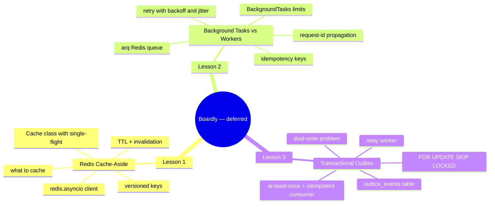
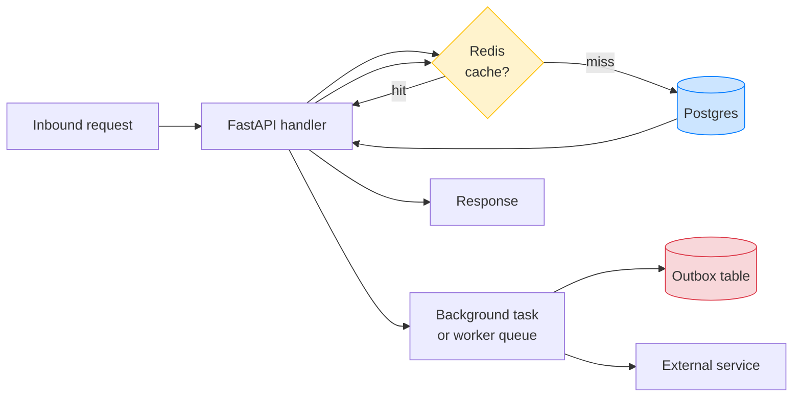

# Caching and Background Processing: Map of Content

**Bookmark this page.**

This is the **home base** for Section 14 — Caching and Background Processing. Every lesson in this folder, every pattern, every cross-reference back to the rest of the vault — all reachable from here. When you get lost, come back to the MOC.

Hello, friend. Pull up a chair.

You've built the observability stack. `Boardly` now emits structured logs with a request ID, OpenTelemetry traces that cross service boundaries, and the SQLAlchemy instrumentor's spans are visible in Jaeger. The N+1 has been measured, fixed with `selectinload`, and locked with a `raiseload` test. By every measure that matters, you can *see* the system.

Now we ask the second question: *when should the system do work at all?* Caching answers "I already computed this; don't recompute it." Background processing answers "the user doesn't need to wait for this." Both are tools you reach for *after* the obvious correctness, security, and performance fixes are in place — never instead of them.

In the next three lessons we are going to give `Boardly` a Redis cache (with stampede protection and a versioned-key trick for safe schema migrations), a durable worker queue (with `arq` as the canonical broker and `BackgroundTasks` for the small stuff), and a transactional outbox (so a database write and an event publish happen atomically or not at all). The thread that runs through all three lessons is the rule that opens every page of this section: *a cache is correct only as long as its invalidation strategy is correct; a worker is correct only as long as its consumer is idempotent. Everything else is plumbing.*

**You're in the right place.**

If you've reached for `BackgroundTasks` for an email send and then discovered your container restarted mid-send and the email never went out — this section was written for you. If you've cached a list endpoint and then watched it serve yesterday's data because no one invalidated the cache on write — this section was written for you. If you've shipped a "DB then publish" code path and then been paged at 2 AM because the publish failed and the customer was charged without an event — this section was written for you. We'll go slow. We'll explain every line. You will build a real cache, a real worker, and a real outbox on top of `Boardly`.

---

## The Boardly Progression

Three lessons. One growing application. By Lesson 3 your `Boardly` API has:

- A `Cache` class with `get_or_set(key, loader, ttl)` that does single-flight stampede protection via a per-key Redis lock, a versioned-key namespace (`orders_api:order:42:v3`) that lets you safely deploy schema changes by bumping the version tag, and a clean `invalidate(key)` hook.
- A durable worker queue via `arq` with retry policy (exponential backoff + jitter), idempotency (a Redis SETNX dedup key per job), and request-ID propagation (the inbound request ID flows into the job's logs).
- An `outbox_events` table written in the same transaction as the business write, drained by a relay worker using `SELECT ... FOR UPDATE SKIP LOCKED`, with an idempotent consumer that dedups by the outbox row's `id`.

And you'll know *why* every line is there.

---

## Lessons in Order

| # | Lesson | What you add to `Boardly` | Time |
|---|--------|---------------------------|------|
| 1 | [[Redis-Cache-Aside]] | `boardly/cache.py` with the `Cache` class, single-flight lock, versioned keys, and `get_or_set` / `invalidate`; the cached `GET /orders/{id}` endpoint; the write-around invalidation hook | 75–100 min |
| 2 | [[Background-Tasks-vs-Workers]] | `boardly/worker.py` with the `arq` worker and `send_receipt_email`, the durable `POST /orders/{id}/fulfill` endpoint, the `BackgroundTasks` version for comparison, and request-ID propagation | 75–100 min |
| 3 | [[Transactional-Outbox]] | `boardly/models/outbox.py` with `OutboxEvent`, the same-transaction insert in `OrderService.create_order`, the relay worker with `FOR UPDATE SKIP LOCKED`, and the idempotent consumer | 90–120 min |

**Tip — How to read this section**

Read the lessons **in order**. Lesson 2's worker shares Redis with Lesson 1's cache and uses the request-ID middleware from Section 13. Lesson 3's outbox relay is itself a worker (built on Lesson 2's pattern), and its consumer uses Lesson 1's idempotency trick (the SETNX dedup key). If you skip ahead, you'll bring in pieces you haven't built yet.

Each lesson follows the same shape: **Learning Objectives -> Prerequisites -> The Problem -> The Code -> Line-by-Line Deep Dive -> Execution Trace -> Common Mistakes -> Engineering Trade-Offs -> Exercises -> Verification -> Previously Learned Here -> What's Next -> Sources -> What We Learned**. Open the lesson in one pane and the `boardly/` source in another, side by side. Type the code yourself. Don't copy-paste. Typing is what makes it stick.

---

## When to Use Which

| You need to... | Use |
|---|---|
| Avoid recomputing a read-heavy, slow-changing value | [[Redis-Cache-Aside]] |
| Send a notification after the response is returned | `BackgroundTasks` (see [[Background-Tasks-vs-Workers]]) |
| Guarantee a side-effect survives a crash | A durable queue (`arq`) |
| Atomically update the DB *and* publish an event | [[Transactional-Outbox]] |
| Defer CPU-heavy work out of the request path | A worker pool |

---

## The Two Hard Problems

> There are only two hard problems in computer science: cache invalidation, naming things, and off-by-one errors.

— Phil Karlton (apocryphal, but accurate).

1. **Cache invalidation** — when is the cache wrong? [[Redis-Cache-Aside]] covers the strategies: TTL (always set one), explicit invalidation (when you know), and event-driven invalidation (when a write happens elsewhere). The transactional outbox is the durable answer to the third.
2. **At-least-once delivery** — workers crash, retries happen, so the same job runs twice. The consumer must be idempotent. [[02-Web-and-HTTP/Idempotency-Safe-Retries-Pagination]] is the foundation; [[Background-Tasks-vs-Workers]] and [[Transactional-Outbox]] apply it.

## Prerequisites

- [[03-FastAPI-Core/Background-Tasks-Streaming-Uploads]] — the FastAPI primitive you build on; we discuss when *not* to use it.
- [[03-FastAPI-Core/Application-and-Lifespan]] — the worker, the cache, and the outbox relay are all started in lifespan.
- [[07-SQLAlchemy/05-Session-and-Transaction-Management]] — the outbox pattern requires understanding transaction boundaries.
- [[13-Performance-and-Observability/Structured-Logging-and-Request-IDs]] — every cache hit/miss and every worker invocation should carry the request ID for traceability.

## Cross-references

- Caching is *not* a performance substitute: [[13-Performance-and-Observability/N-plus-1-and-Slow-Queries]] — measure and fix queries first. The cache is the *last* tool, not the first.
- The work you offload to a worker is usually an external integration: [[15-External-Integrations/00-Integrations-MOC]].
- Idempotency is the contract that lets at-least-once delivery be safe: [[02-Web-and-HTTP/Idempotency-Safe-Retries-Pagination]].

---

## Concepts First Taught Here

One recurring concept is taught for the first time in this section:

- **Transactional outbox** — first taught in [[Transactional-Outbox]]. The pattern that turns "two systems" (DB + queue) into "one system + a worker," using the database's atomicity across two writes to guarantee an event is published. Reused in [[15-External-Integrations/Circuit-Breakers]] (when the broker is down) and project work.

If a later section touches the transactional outbox, it links back here instead of re-explaining.

## Concepts Reused Here (not re-explained)

These were taught in earlier sections. We link back instead of repeating:

- `BackgroundTasks` — [[03-FastAPI-Core/Background-Tasks-Streaming-Uploads]]. We refine, not re-explain.
- `FastAPI lifespan` — [[03-FastAPI-Core/Application-and-Lifespan]].
- `Session / AsyncSession` — [[07-SQLAlchemy/05-Session-and-Transaction-Management]].
- `Transactions (SQL)` — [[06-SQL-Fundamentals/Transactions-Isolation-Locks]].
- `Idempotency` — [[02-Web-and-HTTP/Idempotency-Safe-Retries-Pagination]].
- `Dependency overrides` — [[12-Testing-and-Quality/Testing-FastAPI-Endpoints]].
- `OpenTelemetry` — [[13-Performance-and-Observability/OpenTelemetry-Tracing]].
- `Structured logging` — [[13-Performance-and-Observability/Structured-Logging-and-Request-IDs]].

---

## Reading Paths

Not everyone has three hours in one block. Pick a path:

### The Fast Path (2 hours)

Just want to add a Redis cache today? Read Lesson 1. You'll have a `Cache` class with stampede protection and the cached `GET /orders/{id}` endpoint. Come back for 2 and 3 when you need durable background jobs or atomic event publishing.

### The Thorough Path (5–7 hours)

Linear. The lessons deliberately build on each other: Lesson 2's worker shares Redis with Lesson 1's cache; Lesson 3's outbox relay is a worker using Lesson 2's patterns. Skip none of it.

**Example — Which path are you on?**

Open a daily note and write down: which path, when you'll study each lesson, and a target completion date. Committing to a schedule beats willpower every time.

---

## Verified Versions (October 2026)

This section targets the following versions, all verified current as of 2026-10-19:

| Package | Version | Notes |
|---------|---------|-------|
| FastAPI | 0.148.0 | Released 2026-10-19. |
| Starlette | 1.9.0 | Pinned by FastAPI. |
| Python | 3.12 | The canonical learner version. |
| Redis | 7.x | The data-structure server. |
| `redis-py` | latest stable | `redis.asyncio.Redis` for the async client. |
| `arq` | latest stable | Async-first Redis queue; our canonical durable worker. |
| `httpx` | latest stable | For the worker's outbound calls. |
| `tenacity` | latest stable | For retry policies (alternative to hand-rolled). |
| SQLAlchemy | 2.1.5 | For the outbox table. |
| PostgreSQL | 17.x | For `FOR UPDATE SKIP LOCKED`. |
| `structlog` | latest stable | Carried over from Section 13. |
| `uv` | 0.13.1 | The modern Python package runner. |

**Warning — Version pinning matters.**

`redis-py` merged `aioredis` into the main package as of 4.2+. Always import as `import redis.asyncio as redis` — the old `import aioredis` no longer works on modern redis-py. `arq` has had a stable API since 0.25+; all the code in this section uses the modern `WorkerSettings` form. If you're on an older `arq`, the import paths differ.

---

## Reference Links

- Redis documentation — <https://redis.io/>
- `redis-py` async docs — <https://redis-py.readthedocs.io/en/stable/examples/asyncio_examples.html>
- `arq` documentation — <https://arq-docs.helpmanual.io/>
- microservices.io — Transactional Outbox Pattern — <https://microservices.io/patterns/data/transactional-outbox.html>
- See [[21-Reference-Library/Source-Register]] for the full source list with dates accessed.

---

## The One Rule

> A cache is correct only as long as its invalidation strategy is correct. A worker is correct only as long as its consumer is idempotent. Everything else is plumbing.

---

**Your map is ready.**

Three lessons, one growing `Boardly` application, all reachable from this page. Pick a starting point and go. We'll see you on the other side.

---

**Tags:** #moc #caching #background #redis #arq #index #home
**Previous:** [[13-Performance-and-Observability/00-Observability-MOC]]
**Start:** [[Redis-Cache-Aside]] →
