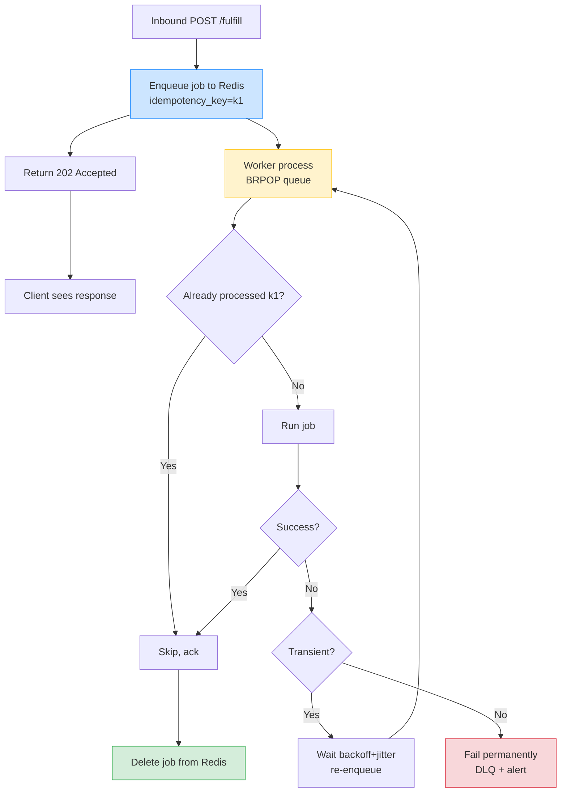

# Lesson 02: Background Tasks vs Workers

*Giving `Boardly` a durable worker queue with `arq`, retry with backoff and jitter, idempotency, and request-ID propagation — and the discipline to know when `BackgroundTasks` is enough and when it's a bug.*

**You're in the second lesson of Section 14.**

Every backend engineer has been here: a user signs up, you want to send a welcome email, you reach for FastAPI's `BackgroundTasks` because it's there. It works. The signup response comes back in 50 ms; the email goes out a moment later. Right up until the moment your container restarts mid-send and the email never goes out. Welcome emails are forgivable. Receipts for charged orders are not. This lesson is the line between them. Take your time. Build the worker. Restart it mid-job. Watch the job re-run. **This is how you learn.**


#background #arq #retries #idempotency

## Learning Objectives

By the end of this lesson you will be able to:

1. **Decide when `BackgroundTasks` is appropriate and when it is dangerous** — and explain the failure modes that make it best-effort.
2. **Set up a Redis-backed worker with `arq`** that survives crashes and restarts the in-flight job.
3. **Design retry policies with exponential backoff and jitter** — and explain why jitter matters at scale.
4. **Build idempotent workers** so at-least-once delivery is safe.
5. **Propagate the request ID** from the inbound request into the job so logs and traces continue across the boundary.
6. **Distinguish `BackgroundTasks`, `asyncio.create_task`, and a durable worker queue** — and pick the right one for the work.

## Prerequisites

Before starting, you need:

- **FastAPI 0.148.0**, `arq` (latest stable), Redis 7.x, all verified Oct 2026.
- **The BackgroundTasks lesson** — [[03-FastAPI-Core/Background-Tasks-Streaming-Uploads]]. You should have used `BackgroundTasks` before. This lesson refines the *decision*, not the mechanics.
- **The Lifespan lesson** — [[03-FastAPI-Core/Application-and-Lifespan]]. The worker is started in a separate process (not the same lifespan), but the queue client is built and torn down in the web process's lifespan.
- **The logging lesson** — [[13-Performance-and-Observability/Structured-Logging-and-Request-IDs]]. Every job carries the request ID forward, or you can't debug it.
- **The cache lesson** — [[Redis-Cache-Aside]]. The worker shares Redis with the cache; the same `SETNX` dedup pattern is reused for idempotency.
- **Idempotency** — [[02-Web-and-HTTP/Idempotency-Safe-Retries-Pagination]]. The contract that lets at-least-once delivery be safe.
- **About an hour and a half of focused time.** The code is ~150 lines; the concepts (at-least-once, idempotency, backoff with jitter) take time to settle.

**The most common gap: at-least-once is *not* exactly-once.**

True exactly-once delivery is a myth in distributed systems — it requires synchronised clocks and two-phase commit, neither of which is practical. At-least-once delivery plus idempotent consumers is the practical answer. The job *will* run at least once; under failures, it can run more than once. The consumer must tolerate that. Anyone selling you exactly-once is selling you at-least-once with idempotency hidden inside. Read [[02-Web-and-HTTP/Idempotency-Safe-Retries-Pagination]] first.


## The Problem

A user signs up. You send a welcome email. The signup response shouldn't wait for the email — the user is already in your DB, the email is a side-effect, send it later.

The naive answer is FastAPI's `BackgroundTasks`:

```python
@app.post("/signup")
async def signup(req: SignupReq, background: BackgroundTasks):
 user = await create_user_in_db(req)
 background.add_task(send_welcome_email, user.email)
 return {"user_id": user.id}
```

This works. It also fails silently in three ways:

1. **Container restart during the send.** The response was sent (200 OK to the client), but the background task hasn't run yet. A `SIGTERM` arrives; the task is cut off. The email never goes out. The user thinks they signed up; the email never arrives.
2. **Container OOM-kill.** Same as above, but faster. No graceful shutdown; the task is just gone.
3. **Task raises an exception.** The user already saw the 200; you have an unhandled error in a request the user thinks succeeded.

For "send a metrics counter increment" — fine. For "send an invoice email" — not fine. The rule of thumb: *if losing this work would make a customer call support, it belongs in a durable queue.*

What is the actual difference between `BackgroundTasks` and a durable queue? `BackgroundTasks.add_task(send_welcome_email, user.email)` schedules the task to run *in the same process, after the response is sent*. The task object lives in the FastAPI process's memory. If the process survives the request, the task runs; if the process dies (SIGTERM, OOM-kill, deploy), the task vanishes — there is no journal, no recovery, no replay. A durable queue, by contrast, writes the job to a *separate store* (Redis LIST, Postgres table, SQS) *before* returning the response. The web process can die; the worker process picks up the job from the store. The web process is now *not* in the critical path of the side-effect — it is in the critical path of "tell the store about the side-effect", which is fast and recoverable. The cost is the queue infrastructure (a Redis or a Postgres table or an SQS subscription); the benefit is "the side-effect survives the process". For low-stakes side effects (metrics, log lines) `BackgroundTasks` is right; for high-stakes ones (emails, receipts, payments) the queue is right.

The durable answer is a worker queue. The web process enqueues a job by writing a row to a queue (Redis LIST, Redis STREAM, a Postgres table, AWS SQS). The worker process picks up the job, executes, and either deletes it (success) or retries it (failure). The contract is **at-least-once delivery**: the job *will* run at least once; under failures, it can run more than once. The consumer must be idempotent.

This lesson builds the durable worker for `Boardly`. The contract: `POST /orders/{order_id}/fulfill` enqueues a `send_receipt_email` job; the worker picks it up; if it fails, it retries with backoff; if it succeeds, it acks; if it exceeds max retries, it goes to a dead-letter queue.

**Note — Historical context — from Celery to arq**

Background processing in Python goes back to Celery (2009), which was the canonical choice for a decade. Celery is feature-complete but heavy — it supports Redis, RabbitMQ, and a half-dozen other brokers, has a complex configuration, and is sync-first (the async support is bolted on). For a modern async FastAPI app, `arq` (2020) is the natural fit: async-native, Redis-backed, ~1k lines of code, simple to operate. `rq` (2012) is the sync alternative — simple, but blocking. We pick `arq` as the canonical choice for `Boardly` because the rest of the app is async. If your worker code is genuinely sync (a blocking C library, an old database driver), `rq` is the right choice; just don't run sync code inside an `arq` worker — it'll block the event loop and stall every other job.


## The Code

Here is the `arq` worker, the endpoint that enqueues, the `BackgroundTasks` version for comparison, and the request-ID propagation:

```python
# boardly/worker.py
"""Boardly — arq worker for durable background jobs.

Lesson 14.2: send_receipt_email with idempotency, retry with backoff
and jitter, request-id propagation via _request_id kwarg.
"""
import asyncio
import random

import structlog
from arq import Retry
from arq.connections import RedisSettings

logger = structlog.get_logger()


async def send_receipt_email(
 ctx, *, order_id: int, idempotency_key: str, _request_id: str = ""
) -> None:
 # 1. Bind the inbound request ID (if we have one) so this job's
 # logs are findable from the original request's trace.
 structlog.contextvars.bind_contextvars(
 request_id=_request_id,
 order_id=order_id,
 idempotency_key=idempotency_key,
 )

 log = logger.info("sending_receipt_email")

 # 2. Idempotency: check Redis for the key first.
 redis = ctx["redis"]
 seen_key = f"receipt_email_sent:{idempotency_key}"
 if await redis.set(seen_key, "1", nx=True, ex=86400) is None:
 logger.info("email_already_sent", idempotency_key=idempotency_key)
 return

 # 3. The actual work — send the email via an external provider.
 try:
 await _send_email_via_provider(order_id)
 except TransientEmailError as e:
 # 4a. Retry with backoff + jitter.
 logger.warning(
 "email_send_failed_transient", order_id=order_id, error=str(e)
 )
 raise Retry(defer=_backoff(ctx.get("job_try", 0)))
 except PermanentEmailError as e:
 # 4b. Don't retry — log and let the job fail (goes to DLQ).
 logger.error(
 "email_send_failed_permanent", order_id=order_id, error=str(e)
 )
 raise

 logger.info("receipt_email_sent", order_id=order_id)


async def _send_email_via_provider(order_id: int) -> None:
 """Real send would be an httpx call to an email provider."""
 await asyncio.sleep(0.5) # simulate the round-trip


class TransientEmailError(Exception):
 """Retry this — provider returned 5xx, timeout, etc."""


class PermanentEmailError(Exception):
 """Don't retry this — invalid email address, hard bounce, etc."""


def _backoff(attempt: int, base: float = 1.0, cap: float = 300.0) -> float:
 """Exponential backoff with full jitter. AWS-style."""
 raw = min(cap, base * (2 ** attempt))
 return random.uniform(0, raw)


class WorkerSettings:
 """arq worker config. Run with: arq boardly.worker.WorkerSettings"""
 functions = [send_receipt_email]
 redis_settings = RedisSettings(host="redis", port=6379)
 max_jobs = 10
 job_timeout = 60
 max_tries = 5

 @staticmethod
 async def on_startup(ctx):
 # arq supplies the Redis connection; we stash it for the function.
 ctx["redis"] = ctx.get("redis")
 logger.info("worker_started")

 @staticmethod
 async def on_shutdown(ctx):
 logger.info("worker_stopped")


# boardly/main.py — the web process
from contextlib import asynccontextmanager
import time

import structlog
from arq import create_pool
from arq.connections import RedisSettings
from fastapi import BackgroundTasks, FastAPI

from boardly.logging import configure_logging
from boardly.middleware import request_id_var


logger = structlog.get_logger()


@asynccontextmanager
async def lifespan(app: FastAPI):
 configure_logging()
 app.state.arq = await create_pool(RedisSettings(host="redis", port=6379))
 yield
 await app.state.arq.close()


app = FastAPI(title="Boardly", version="0.4.0", lifespan=lifespan)


# DURABLE — the right answer for customer-facing side-effects
@app.post("/orders/{order_id}/fulfill")
async def fulfill_order(order_id: int):
 idem_key = f"order_{order_id}_{int(time.time())}"
 await app.state.arq.enqueue_job(
 "send_receipt_email",
 order_id=order_id,
 idempotency_key=idem_key,
 _request_id=request_id_var.get(), # propagate for log correlation
 )
 return {"status": "queued", "idempotency_key": idem_key}


# BEST-EFFORT — fine for things you can afford to lose
@app.post("/orders/{order_id}/view")
async def view_order(order_id: int, background: BackgroundTasks):
 background.add_task(metrics_increment, "order_view", value=1)
 return await fetch_order(order_id)


async def metrics_increment(name: str, value: int = 1) -> None:
 """Stub — real version would push to Prometheus / StatsD."""
 pass


async def fetch_order(order_id: int) -> dict:
 return {"order_id": order_id}
```

That's ~150 lines across two files (plus a separate worker process). Run the worker in one terminal, the web app in another, hit the endpoint, watch the job run. Kill the worker mid-job and watch it re-run. We'll explain every line next.

## Line-by-Line Deep Dive

### `boardly/worker.py`: Lines 1–10 – Imports

```python
import asyncio
import random

import structlog
from arq import Retry
from arq.connections import RedisSettings
```

**What it does:** Pulls in `asyncio` (for `sleep` to simulate work), `random` (for jitter), `structlog` (the logger from Section 13), and `arq`'s `Retry` and `RedisSettings`.

**Why `from arq import Retry`:** `Retry` is the exception class you raise to tell `arq` "this job failed but try again later." Raising `Retry(defer=...)` re-enqueues the job with the given delay. Raising any other exception (after `max_tries` retries) fails the job permanently.

**Why `RedisSettings` and not `Redis`:** `arq` manages its own Redis connection; you tell it *where* Redis is via `RedisSettings`, and it builds the client. You don't pass a `redis.asyncio.Redis` instance to the worker.

### `boardly/worker.py`: Lines 17–25 – The function signature

```python
async def send_receipt_email(
 ctx, *, order_id: int, idempotency_key: str, _request_id: str = ""
) -> None:
```

**What it does:** Defines the worker function. Takes `ctx` (arq's context, positionally) and three keyword-only arguments: `order_id`, `idempotency_key`, `_request_id`.

**Why `ctx` is positional and the rest are keyword-only:** `arq` calls your function as `await fn(ctx, **kwargs)`. The `ctx` is positional; the kwargs come from the `enqueue_job` call. The `*` enforces that the rest are keyword-only — prevents accidental positional argument bugs.

**Why `_request_id` is underscore-prefixed:** `arq` reserves underscore-prefixed kwargs for its own use (e.g. `_job_id`, `_job_try`). By convention, we extend this for our own "non-business" parameters. The `_request_id` is metadata (the originating request's ID), not business data. The underscore signals "this is plumbing."

**Why `_request_id` defaults to `""`:** If the job is enqueued from a non-request context (e.g. a cron trigger, another worker), there's no inbound request ID. The default `""` is the graceful-degradation value. The middleware's `request_id_var.get()` returns `""` in those contexts too.

**Warning — When this breaks: the `_request_id` kwarg silently collides with arq's reserved namespace.**

`arq` reserves underscore-prefixed kwargs at enqueue time for its own use — `_job_id`, `_job_try`, `_defer_until`, `_defer_priority`. The collision surface is narrow but real: if you ever introduce a kwarg named `_job_try` (or any of the reserved names) as a business kwarg, `arq`'s `enqueue_job` silently routes it into the reserved bucket rather than into the function's `**kwargs`, and the function signature's default fills in instead. The symptom is the kwarg appears "stuck at its default" in the worker logs even though the producer swears it set it. The fix is to keep your underscore-prefixed kwargs to one (`_request_id`); for everything else, name without underscore. Verified in `arq` 0.26+ (Oct 2026). See [[03-FastAPI-Core/Background-Tasks-Streaming-Uploads]] for the underlying FastAPI background-task contract.


### `boardly/worker.py`: Lines 26–30 – Bind the request ID

```python
structlog.contextvars.bind_contextvars(
 request_id=_request_id,
 order_id=order_id,
 idempotency_key=idempotency_key,
)

log = logger.info("sending_receipt_email")
```

**What it does:** Binds the request ID, order ID, and idempotency key into the structlog context, then logs "sending_receipt_email".

**Why this matters:** The job runs in a separate process. Without explicit propagation, the worker's logs would have *no* request ID — the inbound request's ContextVar doesn't exist in the worker's context. By binding `_request_id` here, every subsequent log line from this job carries the same `request_id` as the original request. A query for `request_id=req_a1b2c3d4...` finds both the inbound request logs (in the web process) and the job's logs (in the worker process).

**Why also bind `order_id` and `idempotency_key`:** These are the job's business identifiers. Every log line from this job should carry them so a single query finds all lines for this order / this idempotency key.

**What `structlog.contextvars.bind_contextvars` does**

It calls `ContextVar.set(value)` for each key under the hood. The structlog context is a dict-of-contextvars (one per bound key). The bound values are merged into every event dict by the `merge_contextvars` processor. The context is task-scoped — it lives for the duration of the coroutine (here, the job). The next job on the same worker gets a fresh context.


### `boardly/worker.py`: Lines 32–36 – The idempotency check

```python
redis = ctx["redis"]
seen_key = f"receipt_email_sent:{idempotency_key}"
if await redis.set(seen_key, "1", nx=True, ex=86400) is None:
 logger.info("email_already_sent", idempotency_key=idempotency_key)
 return
```

**What it does:** Tries to `SETNX` a key with the idempotency key. If the key already exists (someone else has processed this), returns early without sending the email.

**Why this is the idempotency mechanism:** At-least-once delivery means the same job can run more than once. The same `idempotency_key` could be delivered to the worker twice (because the worker crashed between sending and acking, the job was re-enqueued, and now another worker — or the same worker after restart — picks it up). The `SETNX` ensures only one of those runs actually sends the email.

**Why `nx=True` returns `None` when the key exists:** The `nx` flag means "set only if not exists." If the key exists, the `set` call returns `None` (the set didn't happen). If the key doesn't exist, the `set` call returns `True` (the set happened). The `if ... is None` checks "did the set fail because the key exists?"

**Why `ex=86400` (24 hours):** The dedup key should live at least as long as the sender's retry window. Stripe retries for up to 24 hours; our key lives for 24 hours. After that, the same idempotency key would be processed again — but in 24 hours, the same idempotency key is unlikely to be re-sent (the original send is long done).

**Why `seen_key = f"receipt_email_sent:{idempotency_key}"`:** A namespace. Without it, the dedup key for "receipt email" would collide with the dedup key for "invoice PDF" if both used the same `idempotency_key`. The prefix `receipt_email_sent:` distinguishes them.

**Student asks: why is the dedup key in Redis, not in the application DB?**

Because the dedup check is on the *hot path* of the worker, and the worker's hot path should not do a Postgres write for every job it processes — that would turn a fast idempotency check into a connection-pool bottleneck. Redis `SET NX EX` is a single round-trip, sub-millisecond, and Redis is the natural home for "is this the first time we see this key in the next 24 hours". The application DB is for the work itself (the order, the email-sent audit row); Redis is for the dedup guard. If the dedup key expires (24 hours) and the same idempotency key is re-sent, the application DB's audit row is the second-line defence — a `SELECT FROM email_log WHERE idempotency_key = ?` finds the prior send and the worker can short-circuit. The two layers are independent: Redis for speed, Postgres for durability.


**Tip — The same `SETNX` pattern as the cache stampede lock.**

This is the same pattern as Lesson 1's `Cache.get_or_set` — `SET NX EX` to atomically claim a key. The lock pattern protects against concurrent recompute; the idempotency pattern protects against concurrent re-execute. Same primitive, different uses.


**Danger — How an attacker thinks: the idempotency-key namespace is a free Redis-DoS amplifier.**

The `seen_key = f"receipt_email_sent:{idempotency_key}"` pattern hashes whatever the producer passes — including user-supplied input routed from the request body or the `Idempotency-Key` HTTP header. An attacker who controls the idempotency key can submit 100 000 unique keys in 100 000 `POST /orders/{id}/fulfill` calls; each one claims a Redis slot for 24 hours (`ex=86400`); 100 000 calls × 24 h = a 14-day-equivalent footprint in a single afternoon; the Redis `maxmemory-policy` (typically `allkeys-lru`) starts evicting *cache* entries (the hot path of `Redis-Cache-Aside` reads) to make room for the orphaned dedup keys — the cache miss rate climbs, the DB load climbs, the cascade is real. Defences: (1) derive the `idempotency_key` server-side from `(user_id, order_id, action)` so the attacker can't create arbitrary keys; (2) cap the key length (a 64-byte `idempotency_key` is enough for any sane use; reject anything larger at the Pydantic-validator layer with `Annotated[str, StringConstraints(max_length=64)]`); (3) for high-stakes flows, move the dedup from Redis to a Postgres `UNIQUE(idempotency_key, action)` constraint with `ON CONFLICT DO NOTHING` — slower per-call but bounded by the DB, not by Redis memory. See [[11-Authentication-and-Security/Threat-Model-First]] + [[14-Caching-and-Background-Processing/Redis-Cache-Aside]].


### `boardly/worker.py`: Lines 38–47 – The actual work and the error handling

```python
try:
 await _send_email_via_provider(order_id)
except TransientEmailError as e:
 logger.warning(
 "email_send_failed_transient", order_id=order_id, error=str(e)
 )
 raise Retry(defer=_backoff(ctx.get("job_try", 0)))
except PermanentEmailError as e:
 logger.error(
 "email_send_failed_permanent", order_id=order_id, error=str(e)
 )
 raise
```

**What it does:** Calls the actual send function. On transient error, logs and raises `Retry` with a backoff delay. On permanent error, logs and re-raises (no retry).

**Why two exception classes:** A transient error is "the email provider returned 5xx, or timed out, or had a connection reset" — the failure is temporary, a retry might succeed. A permanent error is "the email address is invalid, or the user has unsubscribed, or the provider returned a 4xx that means 'don't try again'" — retrying won't help.

**Why `Retry(defer=...)`:** `arq`'s `Retry` exception tells the worker "re-enqueue this job with a delay of `defer` seconds." The worker catches `Retry`, schedules the re-enqueue, and the job runs again later. The `defer` is the backoff — long enough that the transient issue might have resolved.

**Why `ctx.get("job_try", 0)`:** `arq` tracks the number of times this job has been retried as `ctx["job_try"]`. The first try is `0`. We pass this to `_backoff` so the backoff grows with each retry — 1s, 2s, 4s, 8s, 16s, capped at 300s (5 min).

**Why the `PermanentEmailError` is just `raise`:** We don't retry. The exception propagates; `arq` catches it; the job fails permanently. After `max_tries`, `arq` moves the job to the dead-letter queue (or just drops it, depending on config). We log the error so the operator can investigate.

**Student asks: why not retry everything? The provider might come back.**

Two reasons: (1) retrying a permanent error wastes resources — you're sending requests you know will fail. (2) some permanent errors *must not* be retried — e.g. an unsubscribe. If the user has unsubscribed and you retry the send, you're violating their unsubscribe. Distinguishing transient from permanent is the difference between "be resilient" and "be respectful."


**Student asks: why full jitter (`random.uniform(0, raw)`) instead of "equal jitter" (`raw/2 + random.uniform(0, raw/2)`)?**

AWS's classic "Exponential Backoff With Jitter" paper compares three jitter strategies: no jitter (bad — every retry fires at the same instant, thundering herd), "equal jitter" (half the backoff is fixed, half is random — spreads retries but bounds the minimum to half the raw value), and "full jitter" (the entire backoff is random in `[0, raw]` — spreads retries maximally and allows the minimum to be near zero). Full jitter wins for *recovery* scenarios: when the system is recovering, the *first* retry that fires soonest is the one that succeeds, and the rest cancel. Full jitter gives you a chance of a near-zero delay, which means a fast retry can succeed and short-circuit the rest. Equal jitter forces every retry to wait at least `raw/2`, which slows recovery. The cost of full jitter is the *worst case* — sometimes a retry waits almost the full `raw`, which is slow for a single job. The trade-off favours full jitter for systems with many concurrent retriers (the herd is the dominant risk); equal jitter for systems with one retrier at a time (where the worst-case slowness is the dominant risk). For a worker pool, full jitter.


**Production reality: the transient/permanent split is an operational discipline, not a code annotation.**

In the toy version, `TransientEmailError` and `PermanentEmailError` are distinct classes raised by `_send_email_via_provider`. In production, the provider returns HTTP responses — `429 Too Many Requests` with `Retry-After: 300`, `400 invalid_email`, `503 service_unavailable`, `454 ThrottlingFailure` — and the worker has to *classify* them. The wrong move is to treat all 5xx as transient and all 4xx as permanent; Mailgun's `429` is retryable, Stripe's `402` is sometimes retryable (`card_declined` is permanent; `rate_limit_error` is transient), AWS SES's `454 ThrottlingFailure` is transient. The right move is an explicit `classify(provider_response) -> Literal["retry", "fail"]` map per provider, with `rate_limit` and `service_unavailable` as retryable, `validation` and `hard_bounce` as permanent, and `unknown_5xx` as retry-with-cap (treat as transient but cap retries at 2 to bound the load on a genuinely broken downstream). Maintain the map as code, version it, review it in PRs. The classification decision is logged at INFO so a missed classification is visible in the dashboards. See [[13-Performance-and-Observability/Structured-Logging-and-Request-IDs]] for the log schema that captures the classification decision, and [[15-External-Integrations/Circuit-Breakers]] for how the breaker observes the classified failures.


### `boardly/worker.py`: Lines 56–59 – The backoff function

```python
def _backoff(attempt: int, base: float = 1.0, cap: float = 300.0) -> float:
 """Exponential backoff with full jitter. AWS-style."""
 raw = min(cap, base * (2 ** attempt))
 return random.uniform(0, raw)
```

**What it does:** Computes the backoff delay for a given attempt. Exponential growth (`base * 2^attempt`), capped at `cap`, with full jitter (random in `[0, raw]`).

**Why exponential:** Linear retry (`1s, 2s, 3s, 4s, ...`) is too aggressive — under a downstream outage, you'd retry 60 times in 60 seconds. Exponential (`1s, 2s, 4s, 8s, ...`) spreads the retries: 5 retries in 31 seconds, 10 retries in 17 minutes.

**Why the `cap`:** Without it, attempt 10 retries after `2^10 = 1024` seconds (~17 minutes), attempt 20 after `2^20 ≈ 12 days`. The user has given up by then. `cap=300` (5 min) keeps the maximum retry delay reasonable.

**Why full jitter (`random.uniform(0, raw)`):** Without jitter, all retriers retry at the *same* time — the "thundering herd" of retries. If 1000 jobs all fail at attempt 3, they all retry at `2^3 = 8` seconds — exactly 8 seconds later, the downstream sees 1000 simultaneous retries. Jitter spreads the retries across `[0, 8]` seconds — the downstream sees a smooth ramp.

**Full jitter vs equal jitter vs decorrelated jitter**

AWS popularised "full jitter" — `random.uniform(0, raw)` — in their retry docs. The alternatives: "equal jitter" (`raw/2 + random.uniform(0, raw/2)`, never less than half the raw) and "decorrelated jitter" (`min(cap, random.uniform(base, raw * 3))`). Full jitter is the simplest and spreads the load most evenly. The other forms exist for cases where you want a minimum delay. Use full jitter unless you have a stated reason.


**Warning — When this breaks: the cap is reached, retries are exhausted, and the job silently disappears.**

The `_backoff` formula `min(300, base * 2 ** attempt)` means at attempt 8 the raw value caps at 300 s and stays there; with `max_tries = 5` the job dies after `1 + 2 + 4 + 8 + 16 = 31` seconds of deferred retries. If you bump `max_tries` to 10 (you will — someone wants longer retries), the total deferred time becomes `sum(min(300, 2 ** i) for i in range(10)) = 1 + 2 + 4 + 8 + 16 + 32 + 64 + 128 + 256 + 300 = 811 s` (~13.5 minutes) before the DLQ catches it. That is *invisible* to the operator unless the DLQ is wired with an alert — the job appears "in retry" in the dashboard for 13.5 minutes, then vanishes into the DLQ. The fix is to make the cap-and-max-tries relationship explicit: `max_tries = 5` * `cap = 300` * `total deferred budget = 5 min` is a coherent contract; `max_tries = 10` * `cap = 300` * `total = 13.5 min` may or may not be — only the SLO for "how long is this job allowed to be late" tells you. Wire the total into a metric (`arq_retry_total_seconds` histogram); alert when a single job's cumulative retry time exceeds the SLO. See [[13-Performance-and-Observability/OpenTelemetry-Tracing]] for the histogram convention.


### `boardly/worker.py`: Lines 62–82 – The `WorkerSettings` class

```python
class WorkerSettings:
 """arq worker config. Run with: arq boardly.worker.WorkerSettings"""
 functions = [send_receipt_email]
 redis_settings = RedisSettings(host="redis", port=6379)
 max_jobs = 10
 job_timeout = 60
 max_tries = 5

 @staticmethod
 async def on_startup(ctx):
 ctx["redis"] = ctx.get("redis")
 logger.info("worker_started")

 @staticmethod
 async def on_shutdown(ctx):
 logger.info("worker_stopped")
```

**What it does:** Defines the `arq` worker configuration. The worker process reads this class to know what functions to register, where Redis is, and the concurrency/timeout limits.

**Why a class and not a dict:** `arq`'s convention. The class name `WorkerSettings` is the canonical name; the `arq` CLI looks for it. You can rename it, but then you have to pass `--worker-class` to `arq`.

**Why `functions = [send_receipt_email]`:** The list of functions this worker can execute. `arq` matches the `enqueue_job("send_receipt_email", ...)` call to the function by *string name*. If you rename the function but forget to update the list, the job will be enqueued but never executed.

**Why `max_jobs = 10`:** The number of concurrent jobs the worker will run. 10 is a reasonable default for I/O-bound work (most jobs are waiting on external calls). For CPU-bound work, set to 1–2 (otherwise the event loop is starved).

**Why `job_timeout = 60`:** The hard limit per job. If a job exceeds 60 seconds, `arq` cancels it and marks it failed. Prevents a stuck job from blocking the worker indefinitely.

**Why `max_tries = 5`:** The maximum number of attempts before the job fails permanently. 5 tries with exponential backoff is `1 + 2 + 4 + 8 + 16 = 31` seconds of total backoff. Reasonable for most transient failures.

**Why `on_startup` and `on_shutdown`:** Lifecycle hooks. `on_startup` is called once when the worker starts; `on_shutdown` once when it stops. Useful for opening resources (DB sessions, httpx clients) and closing them. We just log; in a real worker, we'd open a DB session factory and an httpx client here.

**Warning — The function name in `enqueue_job` must match the function name in `functions`.**

```python
await app.state.arq.enqueue_job("send_receipt_email", ...)
```
The string `"send_receipt_email"` is matched against `functions = [send_receipt_email]`. `arq` uses `fn.__name__` to register. If you rename the function, update both. Mismatches are the #1 reason "my job never runs."


**Production reality: `max_jobs` must not exceed your DB pool size.**

`max_jobs = 10` means up to 10 concurrent worker tasks. If each task opens a SQLAlchemy session from `ctx["session_factory"]` and your DB pool is sized for the web process at `pool_size=10, max_overflow=10` (the SQLAlchemy 2.x default), the worker and the web process share the same Postgres — and at peak the worker alone can consume 10 connections, leaving the web process at zero. The symptom is intermittent `QueuePool limit of size 10 overflow 10 reached` errors on the web side under load, even when the web traffic is light. The fix is to size the worker's DB pool independently (`pool_size=8` for the worker, `pool_size=10` for the web) and bound `max_jobs` to `worker_pool_size * 0.8` to leave headroom. For an `arq` worker that talks to Redis only (no DB), `max_jobs` can be 50–100; for one that hits Postgres, stay near 10. Tie the worker pool to the DB pool at construction time — assert `max_jobs <= session_factory.pool_size` on `on_startup` so a misconfig fails loud, not silent. See [[13-Performance-and-Observability/N-plus-1-and-Slow-Queries]] for the pool math and the slow-query detection.


### `boardly/main.py`: The lifespan

```python
@asynccontextmanager
async def lifespan(app: FastAPI):
 configure_logging()
 app.state.arq = await create_pool(RedisSettings(host="redis", port=6379))
 yield
 await app.state.arq.close()
```

**What it does:** In the web process's lifespan, creates an `arq` connection pool and stashes it on `app.state.arq`. Tears it down on shutdown.

**Why the web process and the worker process are separate:** The web process serves HTTP; it doesn't run jobs. The worker process (`arq boardly.worker.WorkerSettings`) runs jobs; it doesn't serve HTTP. They share Redis as the queue. This separation is what makes the worker durable — if the web process restarts, the worker keeps running; if the worker restarts, the web process keeps serving.

**Why `await create_pool(...)`:** `create_pool` returns an `arq` connection pool that can `enqueue_job`. It's the producer side; the worker is the consumer side. Both connect to the same Redis.

**Warning — When this breaks: the producer pool isn't closed before the worker notices.**

The lifespan does `app.state.arq = await create_pool(...)` and `await app.state.arq.close()` on shutdown. `create_pool` opens 1+ TCP connections to Redis eagerly; `close()` closes them. The break is at deploy time: Uvicorn's `--graceful-timeout` (default 5 s in 0.148.0) sends SIGTERM, the lifespan's `yield` resumes, `close()` is called — but if the worker has 50 jobs in flight that each take 2 seconds and the worker's own `job_timeout = 60`, the worker doesn't drain in 5 seconds. Kubernetes kills the pod at `terminationGracePeriodSeconds` (default 30 s), and the 50 in-flight jobs are at-least-once redelivered — which is correct (at-least-once semantics) but observable: the next worker instance picks up 50 jobs at once and the bulkhead fills. The fix is to set `terminationGracePeriodSeconds = max_job_timeout + 30` (e.g. 90 s for `job_timeout = 60`) and to drain the producer pool eagerly (`app.state.arq.close()` returns immediately; the consumer side is what takes long). See [[16-Deployment-and-DevOps/Docker-Compose-Local-Dev]] for the local dev equivalent and [[03-FastAPI-Core/Application-and-Lifespan]] for the lifespan graceful-shutdown contract.


### `boardly/main.py`: The durable endpoint

```python
@app.post("/orders/{order_id}/fulfill")
async def fulfill_order(order_id: int):
 idem_key = f"order_{order_id}_{int(time.time())}"
 await app.state.arq.enqueue_job(
 "send_receipt_email",
 order_id=order_id,
 idempotency_key=idem_key,
 _request_id=request_id_var.get(), # propagate for log correlation
 )
 return {"status": "queued", "idempotency_key": idem_key}
```

**What it does:** Enqueues a `send_receipt_email` job with the order ID, an idempotency key, and the inbound request ID.

**Why `idem_key = f"order_{order_id}_{int(time.time())}"`:** The idempotency key is per-call. The same order can be fulfilled multiple times (e.g. customer clicks "fulfill" twice, or the operator retries). Each call gets a unique idempotency key — so each call sends a new email. If you wanted *exactly one* email per order, you'd use `idem_key = f"order_{order_id}"` (no timestamp) — the worker's dedup would then ensure the second call is a no-op.

**Why `_request_id=request_id_var.get()`:** This is the propagation. The web process's middleware set `request_id_var` to the current request's ID. We pass it as a kwarg to the job. The worker binds it into structlog's context. Every log line from the job now carries the same `request_id` as the original request. One query joins them.

**Why the response is `{"status": "queued", ...}` and not the email send result:** The endpoint's job is to enqueue, not to send. The send happens asynchronously in the worker. The client gets an immediate "queued" response and can poll a different endpoint (or receive a webhook) to learn the outcome. This is the "fire and forget" pattern, made durable.

**Danger — How an attacker thinks: the idempotency key `f"order_{order_id}_{int(time.time())}"` is enumerable.**

The key concatenates an attacker-predictable `order_id` (often sequential) and an attacker-predictable Unix timestamp rounded to seconds. An attacker who knows an order ID is `42` and the rough timestamp can enumerate `idempotency_key = "order_42_1697..."` for the last 60 seconds, submit a `POST /orders/42/fulfill` with the same key, and *the worker skips the email send* (because the dedup key already exists in Redis from the real call). The symptom: a legitimate fulfillment silently produces no email — the customer never gets their receipt — and the operator sees the enqueue succeed, the worker skip silently, no DLQ entry, no error log. The defence is to make the idempotency key *unguessable*: either (1) a server-side HMAC over `(user_id, order_id, action, nonce)` so the attacker can't forge it without the secret; (2) a UUID v7 (RFC 9562, time-ordered but unguessable) as the key; or (3) tie the dedup key to the *caller* (include `user_id` in the namespace) so a different caller's request with the "same" key still processes. Never derive the idempotency key from request-supplied input. See [[11-Authentication-and-Security/Threat-Model-First]] + [[02-Web-and-HTTP/Idempotency-Safe-Retries-Pagination]].


### `boardly/main.py`: The `BackgroundTasks` endpoint

```python
@app.post("/orders/{order_id}/view")
async def view_order(order_id: int, background: BackgroundTasks):
 background.add_task(metrics_increment, "order_view", value=1)
 return await fetch_order(order_id)


async def metrics_increment(name: str, value: int = 1) -> None:
 """Stub — real version would push to Prometheus / StatsD."""
 pass
```

**What it does:** Defines a "view" endpoint that increments a metric in the background and returns the order.

**Why this is fine for `BackgroundTasks`:** Losing this metric means "the metric is off by one for a minute." No customer is going to call support about that. `BackgroundTasks` is the right tool.

Why is "the metric is off by one for a minute" an acceptable loss, when "the email is off by one for a customer" is not? A missed metrics increment is *observability noise* — your dashboard shows 499 instead of 500 today, and tomorrow it shows 501 because the next increment lands. The cost is "your SLO dashboard is slightly noisy", which is a developer-experience problem, not a customer-experience problem. A missed email is *customer-visible* — the customer expects a receipt, does not get one, calls support, the support team does not know whether the order went through. The cost is "the customer loses trust". The difference is *who notices the loss*. The metric's loss is invisible to the customer; the email's loss is the customer's complaint. That is the dividing line for "use `BackgroundTasks`" vs "use a durable queue" — not "is it a side effect" (both are), not "is it fast" (both can be), but "does the customer notice if it is lost".

**Why `BackgroundTasks` is wrong for `send_receipt_email`:** Losing that email means "the customer didn't get a receipt for the order they just paid for." They *will* call support. A durable queue is the right tool.

**Tip — The decision criterion: "if I lost this work, would a customer notice?"**

If yes: durable queue. If no: `BackgroundTasks`. There's a third option — `asyncio.create_task(...)` for fire-and-forget side effects that are okay to lose mid-request. None of these are substitutes for the others; they're different points on the durability/complexity trade-off.


## Execution Trace

The lifecycle of a job, from enqueue to ack, with a crash and recovery:



The "ack" is the deletion from the queue. The job is "in flight" from `BRPOP` to `DELETE`. If the worker crashes between the two, the job is lost — `arq` and `rq` handle this with a separate "in-progress" queue and a heartbeat timeout; if the heartbeat dies, the job is moved back to the main queue. This is the at-least-once guarantee.

## Common Mistakes

### Mistake 1: Using `BackgroundTasks` for emails / receipts / payments

```python
# WRONG
@app.post("/orders/{order_id}/fulfill")
async def fulfill_order(order_id: int, background: BackgroundTasks):
 background.add_task(send_receipt_email, order_id) # not durable!
```

**Symptom:** The container restarts mid-send. The email never goes out. The customer never gets a receipt.

**Why:** `BackgroundTasks` runs in the same process. A `SIGTERM` or OOM-kill interrupts it. There's no retry, no durability, no recovery.

**Fix:** Use a durable queue (`arq`). Anything customer-facing goes in the queue.

### Mistake 2: Retrying without backoff

```python
# WRONG
for _ in range(5):
 try:
 await send_email()
 break
 except Exception:
 await asyncio.sleep(1) # fixed 1-second retry
```

**Symptom:** Under a downstream outage, you retry 5 times in 5 seconds. The downstream is still down. You've added 5x load for nothing.

**Why:** Fixed-delay retry is too aggressive. The downstream needs time to recover.

**Fix:** Exponential backoff. Each retry waits longer than the previous.

### Mistake 3: Retrying without jitter

```python
# WRONG
def backoff(attempt):
 return min(60, 2 ** attempt) # no jitter
```

**Symptom:** Under an outage that affected 1000 concurrent jobs, all 1000 retry at `2^3 = 8` seconds — exactly 8 seconds later, the downstream sees 1000 simultaneous retries. It's still down. They all retry again at `2^4 = 16` seconds. Repeat.

**Why:** Synchronised retries cause thundering herd.

**Fix:** Add jitter — `random.uniform(0, raw)` — so the retries spread across `[0, raw]` seconds.

### Mistake 4: Non-idempotent consumer

```python
# WRONG
async def send_receipt_email(ctx, *, order_id):
 # No idempotency check!
 await _send_email_via_provider(order_id)
```

**Symptom:** The worker crashes after sending the email but before acking. The job is re-enqueued. Another worker (or the same one after restart) picks it up. Sends the email again. The customer gets two receipts.

**Why:** At-least-once delivery means maybe-twice. Without idempotency, the second send is a duplicate.

**Fix:** The `SETNX` idempotency check. Always.

**Danger — How an attacker thinks: a re-delivered job that mutates state is a free replay primitive.**

If the worker writes a row `INSERT INTO email_log (order_id, sent_at) VALUES (...)` instead of `INSERT ... ON CONFLICT (idempotency_key) DO NOTHING`, an attacker who can cause the worker to crash mid-send (e.g. by flooding the worker's process with OOM-kill pressure via a large payload, or by triggering the `job_timeout` with a slow downstream) can force a replay — the second send writes a second row, and now the operator can't tell "the email was sent twice" from "the email was re-delivered once and the audit is wrong". The customer, however, sees two identical receipts. The defence is the *transactional audit row*: `INSERT INTO email_log (idempotency_key, order_id, sent_at) VALUES (...) ON CONFLICT (idempotency_key) DO NOTHING RETURNING xmax`, where `xmax = 0` means the row was newly inserted (this is the first send) and `xmax != 0` means the row already existed (this is a replay — short-circuit). For side effects that can't be made idempotent (sending an SMS — you can't "un-send" the second SMS), the Redis `SETNX` dedup is the *source of truth* for "did we already do this", not a hint. See [[02-Web-and-HTTP/Idempotency-Safe-Retries-Pagination]] + [[14-Caching-and-Background-Processing/Redis-Cache-Aside]] for the dedup primitive.


### Mistake 5: Job that runs longer than the timeout

```python
# WRONG
from arq import Actor

class WorkerSettings:
    job_timeout = 60           # ← arq kills any job past 60 s
    max_tries = 5              # ← and retries it

async def send_bulk_receipts(ctx, *, batch_id):
    # this legitimately takes 90 s on a 10-k-order batch
    for order_id in load_batch(batch_id):
        await send_receipt(order_id)   # ← cancels mid-loop, retried, cancels, retried, ...
```

**Symptom:** The job takes 90 seconds. `arq`'s `job_timeout = 60` cancels it at 60 seconds. The job is marked failed and retried. It runs for 60 seconds, gets cancelled, retried — forever.

**Why:** The timeout is a hard limit. A job that exceeds it is killed.

**Fix:** Either raise the timeout (if the work legitimately takes 90 seconds) or break the job into smaller pieces (if it's a long loop, chunk it).

```python
# RIGHT — chunk the long loop, keep the timeout tight
class WorkerSettings:
    job_timeout = 60      # stays; each chunk finishes well under this

async def send_bulk_receipts(ctx, *, batch_id, offset=0, chunk=500):
    ids = load_batch(batch_id, offset=offset, limit=chunk)
    for order_id in ids:
        await send_receipt(order_id)
    if has_more(batch_id, offset + chunk):
        # enqueue the next chunk as a fresh job; no one job runs long
        await ctx["pool"].enqueue_job("send_bulk_receipts",
                                      batch_id=batch_id,
                                      offset=offset + chunk,
                                      chunk=chunk)
```

**Warning — When this breaks: chunking re-introduces the dual-write problem.**

The fix proposes `enqueue_job("send_bulk_receipts", batch_id=..., offset=offset + chunk, ...)` to chain chunks. The break is when the *first* chunk finishes and enqueues the second, but the second's enqueue call itself fails (Redis down briefly, network blip). The first chunk has already acked and is gone; the second chunk never exists; the batch is now stuck at offset 500 forever, and there's no recovery — the operator has to find it manually by noticing that the batch never finished. The fix is the [[Transactional-Outbox]] pattern applied to the chunk pointer: write `chunk_pointer = 500` to Postgres in the same transaction as the chunk's work (so the work + the pointer advance are atomic), then a separate relay worker reads the pointer and enqueues the next chunk. If the enqueue fails, the relay retries; the pointer is the source of truth. See [[14-Caching-and-Background-Processing/Transactional-Outbox]] for the relay pattern.


### Mistake 6: Jobs that depend on per-request DB session

```python
# WRONG
async def send_receipt_email(ctx, *, order_id, db_session):
 # db_session was passed from the web request — it's closed now
 order = await db_session.get(Order, order_id) # raises
```

**Symptom:** The job raises "Session is closed" or "Connection already returned to pool."

**Why:** The web request's session was closed when the request ended. The job runs in a different process with no access to that session.

**Fix:** Open a new session in the worker:

```python
async def send_receipt_email(ctx, *, order_id):
 async with ctx["session_factory"]() as session:
 order = await session.get(Order, order_id)
 # ...
```

The session factory is created in `on_startup` and stashed on `ctx`.

### Mistake 7: Passing ORM objects in the job payload

```python
# WRONG
await app.state.arq.enqueue_job("send_receipt_email", order=order)
```

**Symptom:** The job payload doesn't serialise cleanly (ORM objects aren't JSON-serialisable), or it serialises but the worker can't deserialise into a useful object.

**Why:** `arq` serialises the job's kwargs to JSON (or msgpack). ORM objects don't serialise.

**Fix:** Pass IDs, not objects. The worker re-fetches:

```python
await app.state.arq.enqueue_job("send_receipt_email", order_id=order.id)
```

**Danger — How an attacker thinks: the ORM object leaks PII into the Redis queue.**

When `enqueue_job("send_receipt_email", order=order)` is attempted, `arq` calls `msgpack.packb` (or `json.dumps`) on the kwargs; the `Order` object's `__dict__` is serialised. If the `Order` model has a `payment_method_last4` or `billing_address` field, those go into the Redis queue (Redis persistence, RDB file on disk, backup snapshots — all of them now contain the PII). An attacker who gets read access to Redis (a misconfigured `redis-server --protected-mode no`, a CVE in the Redis version, a snapshot leaked to a public S3 bucket) walks away with the PII. The defence is to *never* pass ORM objects: (1) pass IDs, never objects — `enqueue_job("send_receipt_email", order_id=order.id)`; (2) if you must pass a denormalised view, pass a Pydantic model with `extra="forbid"` and explicit fields only — never the raw ORM; (3) audit `arq`'s `serialize`/`deserialize` hooks if you have to customise, and add a `sensitive_fields` denylist that fails loud at enqueue time. See [[11-Authentication-and-Security/Threat-Model-First]] + [[04-Pydantic/Validators-Strict-vs-Coercive]] for the strict-mode validator pattern.


### Mistake 8: No dead-letter queue

```python
# WRONG
from arq import ArqRedis

# default arq behaviour: failed jobs vanish after max_tries
# nothing is written, nothing is inspectable, the failure is invisible
```

**Symptom:** After `max_tries`, the job disappears. You have no record of what failed.

**Why:** By default, `arq` just drops failed jobs.

**Fix:** Configure a dead-letter queue (a separate Redis list for failed jobs). Alert on its size. See Exercise 5.

```python
# RIGHT — on_job_failure writes to a dead-letter list, alerts on growth
async def on_job_failure(ctx, job_id, exc):
    await ctx["redis"].lpush(
        "dlq:failed_jobs",
        json.dumps({
            "job_id": job_id,
            "function": ctx["job_try"],
            "error": repr(exc),
            "failed_at": datetime.now(timezone.utc).isoformat(),
        }),
    )
    size = await ctx["redis"].llen("dlq:failed_jobs")
    if size > 100:
        logger.error("dlq size above threshold", size=size)
        # alert on-call
class WorkerSettings:
    on_job_failure = on_job_failure
```

The DLQ is the difference between "a job failed six hours ago and we found out from a customer support ticket" and "a job failed six hours ago and the on-call engineer saw the alert at the time of failure". The cost is one Redis `LPUSH` per failure and one alert threshold to tune; the benefit is observability into the long tail of retries that never succeeded.

**Production reality: the DLQ is your ops intake queue, not a graveyard.**

A real DLQ is not just "where failed jobs go to die" — it's the work queue for the on-call engineer. The full pattern: (1) `LPUSH` the failed-job envelope (job_id, function, error, traceback, failed_at, original_args) so the operator can re-run with a debugger; (2) a `LLEN` gauge surfaced as a Prometheus metric (`dlq_size{queue="default"}`); (3) an alert when `dlq_size > 0` for more than N minutes (the N depends on the job — 5 min for receipts, 60 min for non-urgent sync); (4) a re-drive tool (`uv run python -m boardly.dlq redrive <job_id>`) that re-enqueues a job after a fix is deployed, with a fresh `idempotency_key` if the original was malformed; (5) TTL on the DLQ entries (default 30 days) so the queue doesn't grow unboundedly; (6) a per-function breakdown (`dlq_size{function="send_receipt_email"}`) so the operator sees which downstream is the chronic failure. The "no DLQ" failure is invisible by design — the job is gone, the customer is calling support. The DLQ makes it visible and actionable.


## Engineering Trade-Offs

### Background tasks vs durable workers vs cron

The decision criterion is: **what triggers the work?** A request, an event, or the clock?

- **A request** (the user clicked "place order" and we want to send a receipt email after responding) — `BackgroundTasks` if the work is forgivable (lost on crash, no user-visible failure) or a worker queue if the work must survive (lost on crash = user-visible failure).
- **An event** (an order was created; we want to publish to the inventory service; another worker should send the receipt email) — a worker queue consumer. The trigger is the *message*, not a request and not the clock. The worker consumes events as they arrive.
- **The clock** (every night at 2 AM we sweep stale carts; every hour we sync the inventory from the warehouse; every minute we check for expired sessions) — a **cron scheduler**, not a request-triggered worker.

The three trigger types map to three different primitives:

| Trigger | Primitive | FastAPI / Python option | When alone is enough |
|---|---|---|---|
| Request (forgivable work) | `BackgroundTasks` | FastAPI's built-in `BackgroundTasks` | Forgivable work — sending a notification email, posting to a low-stakes webhook. If the container dies after the response, the work is lost; that's acceptable. |
| Request (must survive) | Worker queue (event-triggered) | `arq` (async-native, Redis), `rq` (sync, Redis), Celery (sync, Redis/RabbitMQ), SQS / Pub/Sub / Kafka (managed) | Anything where losing the work = a user-visible failure. Sending transactional emails, charging a card, fulfilling an order. |
| Event (message-triggered) | Worker queue consumer (same primitives as above, different trigger) | Same — `arq` / `rq` / Celery / SQS | Reactions to events: order-placed → publish to inventory service; user-created → send welcome email. The worker listens, doesn't need to be told when to run. |
| Clock (time-triggered) | Cron scheduler | `arq cron` (built into arq), Celery Beat, APScheduler, GitHub Actions scheduled workflow, Kubernetes `CronJob`, OS `crontab` | Periodic maintenance: nightly cart sweep, hourly inventory sync, per-minute session expiry. |

**Cron jobs need their own worker pool and their own idempotency.**

A cron job is just a worker that runs *on a schedule instead of on a message*. Two operational caveats:
- **Run cron in a separate process**, not in the FastAPI request handler. The handler has the event loop and a worker count tuned for HTTP traffic; running a cron job inline will block a worker for the duration of the job. Either run a separate `arq` worker process with `cron_jobs=[...]` configured, or use Kubernetes `CronJob` to spin up a one-shot pod that runs the script and exits.
- **Cron jobs fire twice under failure.** If a cron job is still running when the next schedule tick fires (the job took longer than the interval), some schedulers run it again — concurrently. Other schedulers skip the tick. Either way, the job itself must be idempotent (an inventory sync that runs twice should converge to the same state). This is the same property the worker needs for retry-driven at-least-once delivery; see the [[17-Advanced-Architecture/Idempotency-and-Retries]] lesson.


**Student asks: when is a cron scheduler the right answer over an event-triggered worker?**

When the trigger is *the clock*, not *an event*. If you only run the inventory sync when the warehouse emits an `inventory_changed` event, you'll miss changes when the warehouse is down (the event never arrives). A nightly cron sync catches up regardless. Conversely, if the trigger is genuinely an event (the user placed an order), a cron job is wrong — you'd have to poll the orders table every minute, which is both slower (the user waits up to a minute for the next cron tick) and more expensive (you scan the whole table every minute even when there are no new orders). The right answer: events for events, cron for clock-triggered work. Most production systems use both.


### `BackgroundTasks` vs worker queue

`BackgroundTasks` is simpler — no Redis, no worker process, no infrastructure. The trade-off is durability. The decision criterion: *if the container dies after the response, is the work forgivable?* Yes → `BackgroundTasks`. No → queue.

### `arq` vs `rq` vs Celery vs SQS

- **`arq`** — async-native, Redis-backed, simple. Good default for async FastAPI.
- **`rq`** — sync, Redis-backed. Simple when your worker code is sync.
- **Celery** — feature-complete, sync-first, supports Redis/RabbitMQ/etc. Heavy. Worth it when you have complex DAGs or task chaining.
- **AWS SQS / GCP Pub/Sub / Kafka** — managed, scale-to-horizon. Best when you don't want to operate Redis, or when you outgrow it.
- **Postgres-as-queue** — using a table as a queue. Works for small scale; the [[Transactional-Outbox]] pattern is a special case of this.

### At-least-once vs at-most-once vs exactly-once

There are three delivery semantics a queue can promise. Knowing which one your queue gives you — and which one your consumer code assumes — is the difference between a system that survives failures and one that silently drops or duplicates work under load.

| Semantic | What it means | What you accept | When it is the right answer |
|---|---|---|---|
| **At-least-once** | A message will be delivered one or more times. Under failure (worker crash before ack, network partition, redelivery after visibility timeout) the same message can be delivered twice or more. | You accept duplicates. Your consumer **must** be idempotent — re-running the same job with the same `idempotency_key` must converge to the same state and side-effect count. | The default for nearly every queue you will use in production (`arq`, `rq`, Celery, SQS standard, RabbitMQ with at-least-once delivery, Kafka with consumer-group offset commits). Use this whenever the side effect is user-visible (email, receipt, payment, state mutation) and you can make the consumer idempotent. |
| **At-most-once** | A message will be delivered zero or one times. The producer fires it; if the consumer is down or the network drops, the message is **lost** and never redelivered. | You accept losing messages. Dropped work is invisible — there is no retry, no DLQ, no redelivery. | Rare. Use only for work where losing one item is cheaper than the cost of deduplication: fire-and-forget telemetry/metrics points (a dropped `requests_per_minute` sample is invisible 60 s later), best-effort cache invalidation hints (the next read repopulates), non-critical log shipping (the downstream log aggregator has its own buffer). Never use for user-visible state. |
| **Exactly-once** | A message will be delivered one time, no more, no less. | The aspiration; in practice unattainable without making the consumer idempotent — at which point "exactly-once" collapses into "at-least-once plus idempotent consumer." | This is not a real semantic, it is a *composed* one. When a vendor says "exactly-once", read the fine print: they mean "we deduplicate by `idempotency_key` on the producer side, and we redeliver at-least-once on the consumer side, and we expect *you* to deduplicate by `idempotency_key` on the consumer side too." That is at-least-once plus idempotency, with the dedup done twice. |

**At-least-once is the default. Build for it.**

Almost every queue you will touch in production — `arq`, `rq`, Celery, SQS standard, Kafka with consumer commits, RabbitMQ default — is at-least-once. The right mental model is: *the job will run at least once; under failure, it will run more than once; the consumer must tolerate that.* Once you internalise this, every other decision (idempotency key, `SETNX` dedup, transactional outbox, dedup on the consumer) falls out naturally as "how do I make running this twice safe?" rather than "how do I prevent this from running twice?" — the latter is a fight you will lose.


**Student asks: when is at-most-once actually the right answer?**

Three places. (1) **Fire-and-forget metrics** — a `requests_per_minute` or `cache_hit_rate` sample is dropped on the floor if the worker is down; the next sample 60 s later replaces it; nobody notices. (2) **Best-effort cache invalidation hints** — the producer says "hey, key X changed"; if the consumer never sees it, the next read repopulates the cache; the cost of redelivering is higher than the cost of the eventual refresh. (3) **Non-critical log shipping** — a dropped log line is invisible; the downstream aggregator has its own buffer and retries; nobody is going to chase a missing `INFO` line. In every other case — email, receipt, payment, state mutation, anything user-visible — at-most-once is wrong, and you should use at-least-once plus an idempotent consumer instead. If you find yourself reaching for at-most-once because "at-least-once is too complex", the right answer is almost always "make the consumer idempotent", not "give up on delivery".


**Warning — SQS has both — pick by queue type.**

AWS SQS has two flavours: **standard** (at-least-once, "at-least-once delivery" with "at-least-once processing" in the docs — and yes, they redeliver under failure) and **FIFO** (also at-least-once, but with stronger ordering and a 5-tps-per-queue throughput cap). Neither is exactly-once. SQS supports deduplication via `MessageDeduplicationId` on FIFO queues, which makes *the queue* deduplicate, but the consumer still must be idempotent because visibility timeouts and consumer-side failures can still cause redelivery. Don't confuse "the queue dedupes" with "exactly-once delivery" — they are not the same property.


**What does "exactly-once" really mean when a vendor says it?**

Read the fine print. Kafka's "exactly-once" (EOS) is the strongest in the industry — but it only applies **within a single Kafka transaction** that spans consumer-commit and producer-send. The moment your consumer side-effect is *outside Kafka* (writing to Postgres, sending an email), Kafka's EOS does not protect you. You still need an idempotent consumer (Postgres unique constraint on `idempotency_key`; an email sender that dedups by `idempotency_key` in Redis). The honest framing is: **exactly-once within the boundary of one transactional system, at-least-once across the boundary to any other system.** When your side-effect target is Postgres, the right pattern is the transactional outbox (Lesson 03) — write the outbox row and the state change in the same DB transaction, then a separate worker reads the outbox and emits the side effect. That gets you "at-least-once + idempotent consumer" composed into something that *behaves* like exactly-once from the outside.


**Tip — Compose exactly-once from at-least-once + idempotency, don't try to buy it.**

The pattern every production system actually uses: (a) the queue is at-least-once; (b) the consumer deduplicates by `idempotency_key` using a `SETNX` in Redis or a `UNIQUE` constraint in Postgres; (c) the consumer's side effect is itself idempotent (a `POST /charge` that already has a `Charge` row with the same `idempotency_key` returns the existing charge rather than creating a new one). Composed this way, the system behaves as exactly-once to the outside observer — even though underneath it's "at-least-once + dedup". The transactional outbox in Lesson 03 is the same pattern at one level up: write state + outbox in one DB transaction (atomic), then a worker reads the outbox and emits the side effect at-least-once, with idempotency_key on the consumer of the side effect. Composed, that's exactly-once.


**Cross-link — the deep dive on delivery semantics is in Section 17.**

For the formal definitions of at-least-once, at-most-once, and exactly-once; for the proof that exactly-once is unattainable without idempotency; for the worked example of composing exactly-once from at-least-once plus idempotent consumer; and for the trade-off matrix across message brokers (SQS vs Kafka vs RabbitMQ vs Redis Streams), read [[17-Advanced-Architecture/Event-Driven-Basics]]. This lesson shows you how to *operate* a worker under at-least-once semantics; Section 17 shows you how to *reason* about the semantics across brokers.


### Sync worker in an async app

If the work is genuinely sync (a blocking C library), run a separate `rq` worker process. Don't run it inside an async `arq` worker — it'll block the event loop and stall every other job.

## Exercises

**Tip — The 20-minute rule**

If you're stuck on an exercise for more than 20 minutes, re-read the relevant section above, then move on.


**Exercise 1 — Confirm `BackgroundTasks` is lost on crash.** Add a `BackgroundTasks` job that sleeps for 10 seconds and then writes to a file. Restart the container mid-flight and confirm the file is never written.

**Exercise 2 — Switch to `arq` and confirm durability.** Move the same work to an `arq` job. Restart the worker mid-flight and confirm the job re-runs to completion. Add an idempotency key and confirm it doesn't double-fire.

**Exercise 3 — Implement backoff by hand.** Write a test that forces 3 retries on a flaky function (fails 2 times, succeeds on the 3rd) and asserts the retry schedule under forced failures.

**Exercise 4 — Propagate the trace context.** Use the OTel context from Lesson 13.2 to propagate `trace_id` into the job (via a kwarg, like `_request_id`). Confirm in Jaeger that the job's spans appear as children of the request's spans.

**Exercise 5 — Add a dead-letter queue.** Configure `arq`'s `dead_letter_queue` (or roll your own). After `max_tries`, the job should be moved there. Alert on the DLQ size.

**Exercise 6 — Spot the bug.** This worker looks fine but the job runs twice. Why?

```python
async def send_receipt_email(ctx, *, order_id):
 await _send_email_via_provider(order_id)
 # no idempotency check
```

(Answer: no idempotency check. The worker crashes after sending but before acking, the job is re-enqueued, another worker picks it up, sends again. Add the `SETNX` idempotency check.)

**Exercise 7 — Enforce idempotency-key length and server-side derivation.** Add a Pydantic validator to the `SignupReq` model that rejects `idempotency_key` values longer than 64 chars or containing path-traversal characters (`/`, `..`, `\x00`). Construct two requests — one with a 70-char key, one with `../../etc/passwd` — and assert both return 422. Then refactor the endpoint to derive the key server-side from `(user_id, order_id, action)` and confirm the attack surface is closed. *Verify:* `uv run pytest tests/worker/test_idempotency_key_validation.py -k key_validation`.

**Exercise 8 — Reproduce the worker pool exhaustion.** Set `max_jobs = 50` in `WorkerSettings` and a DB pool `pool_size=10, max_overflow=0`. Fire 50 concurrent jobs that each open a session and `await session.execute(text("SELECT pg_sleep(1)"))`. Watch SQLAlchemy raise `QueuePool limit of size 10 overflow 0 reached` after the 10th concurrent job. Then set `max_jobs = 8`, re-run, and confirm no overflow and all 50 jobs complete (in ~5 batches of 10). *Verify:* `uv run pytest tests/worker/test_pool_sizing.py -k max_jobs_vs_pool`.

**Exercise 9 — Classify provider responses.** Extend `_send_email_via_provider` to call a mock Mailgun that returns, in sequence, `429 Too Many Requests` (with `Retry-After: 300`), `400 invalid_email`, `503 service_unavailable`, `454 ThrottlingFailure`. Implement `classify_response(status, body) -> Literal["retry", "fail"]` with the rules: `429`/`503`/`454` -> retry; `400 invalid_email` -> fail; unknown 5xx -> retry-with-cap (max 2). Assert each is routed to `Retry(defer=...)` or permanent failure correctly. *Verify:* `uv run pytest tests/worker/test_response_classifier.py -k classify`.

**Exercise 10 — Assert the DLQ envelope.** Trigger `on_job_failure` with a flaky job (raises on call 5). Inspect the LPUSH'd envelope and assert it contains: `job_id`, `function`, `error` (the repr of the exception), `failed_at` (ISO 8601 with timezone), `original_args` (the kwargs as serialised, not as Python objects — so the operator can re-enqueue from the DLQ entry without re-serialising). Then assert the `dlq_size` metric increments to 1. *Verify:* `uv run pytest tests/worker/test_dlq_envelope.py -k envelope`.

**Exercise 11 — Propagate the OTel trace context.** The lesson propagates `_request_id` (a string). Extend it to propagate the full OTel context: extract `{trace_id, span_id, trace_flags, baggage}` from `context.get_current()` in the web process, pass them as a `_otel_context` kwarg, and `context.attach(extract(_otel_context))` at the start of the worker function. Assert (with a `BasicTracer` in-memory exporter) that the worker's spans are children of the request's root span — same `trace_id`, parent `span_id` matches request's span. *Verify:* `uv run pytest tests/worker/test_otel_propagation.py -k trace_parent`.

**Exercise 12 — Reproduce the chunk-pointer dual-write.** Implement `send_bulk_receipts` with the chunk-chaining pattern from Mistake 5. Kill the worker (via `SIGKILL` to the test process) between chunk 1's ack and chunk 2's enqueue. Assert the batch is stuck at `offset=500` (no recovery, no chunk 2 ever enqueued). Then implement the [[Transactional-Outbox]] fix: write the chunk pointer to Postgres in the same transaction as the chunk's work; run a separate relay worker that reads the pointer and enqueues the next chunk. Kill the relay mid-enqueue; assert the relay retries and the batch completes. *Verify:* `uv run pytest tests/worker/test_chunk_pointer.py -k recovery`.

## Verification

```bash
# 1. Start Redis
docker run -d -p 6379:6379 redis

# 2. Run the worker in one terminal
uv run arq boardly.worker.WorkerSettings

# 3. Run the app in another
uv run uvicorn boardly.main:app --reload

# 4. Trigger a job
curl -X POST http://localhost:8000/orders/42/fulfill
# Expected: {"status":"queued","idempotency_key":"order_42_..."}

# 5. Watch the worker logs — you should see:
# sending_receipt_email order_id=42 idempotency_key=... request_id=req_...
# receipt_email_sent order_id=42 ...

# 6. Force a retry: make the job raise TransientEmailError on first call
# (e.g. by setting an env flag). Worker should retry with backoff.
# Check Redis for the queue depth:
docker exec -it redis redis-cli LLEN arq:queue:arq
```

Debugging tips:

- Jobs never run → the function name in `enqueue_job` doesn't match the function name in `WorkerSettings.functions`. They're matched by string.
- Jobs run twice → no idempotency check. Add the `SETNX`.
- Jobs hang → the job is blocked on something. Check `job_timeout` and look for sync calls in async code.
- Worker logs don't have `request_id` → you forgot `_request_id=request_id_var.get()` in `enqueue_job`.

## Previously Learned Here

These concepts were taught in earlier lessons. We link back instead of re-explaining:

- **`BackgroundTasks`** — [[03-FastAPI-Core/Background-Tasks-Streaming-Uploads]] for the mechanics. New detail: the *decision* — when to use it vs. when to upgrade to a durable queue.
- **FastAPI lifespan** — [[03-FastAPI-Core/Application-and-Lifespan]]. New detail: lifespan is where the queue client is built and torn down in the *web* process. The worker process has its own lifecycle (`on_startup` / `on_shutdown`).
- **Idempotency** — [[02-Web-and-HTTP/Idempotency-Safe-Retries-Pagination]] for HTTP. New detail: the same principle applied to job consumers, via a Redis-backed deduplication key.
- **OpenTelemetry** — [[13-Performance-and-Observability/OpenTelemetry-Tracing]]. New detail: propagating the trace context into the job is what makes a job's logs findable (Exercise 4).

## What's Next

In [[Transactional-Outbox]] we tackle the hardest version of "DB + side-effect must be atomic." The pattern: write the side-effect (an event) to an `outbox_events` table in the same transaction as the business write, and let a relay worker drain the table and publish. You'll:

- See the dual-write problem and why "DB then publish" is broken.
- Build the `outbox_events` table and the same-transaction insert.
- Build the relay worker with `SELECT ... FOR UPDATE SKIP LOCKED`.
- Make the consumer idempotent by the outbox row's `id`.

By the end of Lesson 3, `Boardly` has a correct, atomic event-publishing mechanism that survives any crash short of database loss.

## Sources

- **arq — Documentation** — <https://arq-docs.helpmanual.io/> — accessed 2026-10-19 — async Redis queue, job lifecycle, retry policies.
- **rq — Documentation** — <https://python-rq.org/> — accessed 2026-10-19 — sync alternative.
- **Celery — Documentation** — <https://docs.celeryq.dev/> — accessed 2026-10-19 — feature-complete comparison.
- **AWS — Amazon SQS** — <https://docs.aws.amazon.com/AWSSimpleQueueService/latest/SQSDeveloperGuide/> — accessed 2026-10-19 — managed queue comparison.
- **AWS Exponential Backoff** — <https://docs.aws.amazon.com/general/latest/gr/api-retries.html> — accessed 2026-10-19 — canonical backoff with jitter formula.
- **Google SRE — Distributed Systems** — <https://sre.google/sre-book/handling-overload/> — accessed 2026-10-19 — why jitter matters at scale.
- **FastAPI — Background Tasks** — <https://fastapi.tiangolo.com/tutorial/background-tasks/> — accessed 2026-10-19 — the official primitive's docs.

## What We Learned

Let's recap. In this lesson you:

- **Decided when `BackgroundTasks` is appropriate and when it is dangerous** — and explained the failure modes that make it best-effort.
- **Set up a Redis-backed worker with `arq`** that survives crashes and restarts the in-flight job.
- **Designed retry policies with exponential backoff and jitter** — and explained why jitter matters at scale.
- **Built idempotent workers** with a Redis `SETNX` dedup key.
- **Propagated the request ID** from the inbound request into the job so logs and traces continue across the boundary.
- **Distinguished `BackgroundTasks`, `asyncio.create_task`, and a durable worker queue** — and picked the right one for the work.

Here's the mental model to walk away with: *a worker is correct only as long as its consumer is idempotent. At-least-once delivery means maybe-twice; the consumer must tolerate that. `BackgroundTasks` is best-effort and lost on crash; a durable queue is the right answer for anything customer-facing. Retry with exponential backoff and jitter — without jitter, you cause thundering herds. Propagate the request ID into the job, or you can't debug it from the original request's logs.*

---

> A note from your teacher
You just gave `Boardly` a worker that survives crashes. The next time the container restarts mid-job, the job re-runs to completion — silently, idempotently, with the same request ID in the logs. The customer gets their receipt. The email is sent exactly once, even though the job ran twice. That's the contract: at-least-once delivery plus idempotent consumers. Next, we tackle the hardest version of "DB + side-effect must be atomic" — the transactional outbox. See you in Lesson 03.


---

**Tags:** #background #arq #retries #idempotency #review
**Previous:** [[Redis-Cache-Aside]]
**Next:** [[Transactional-Outbox]] →