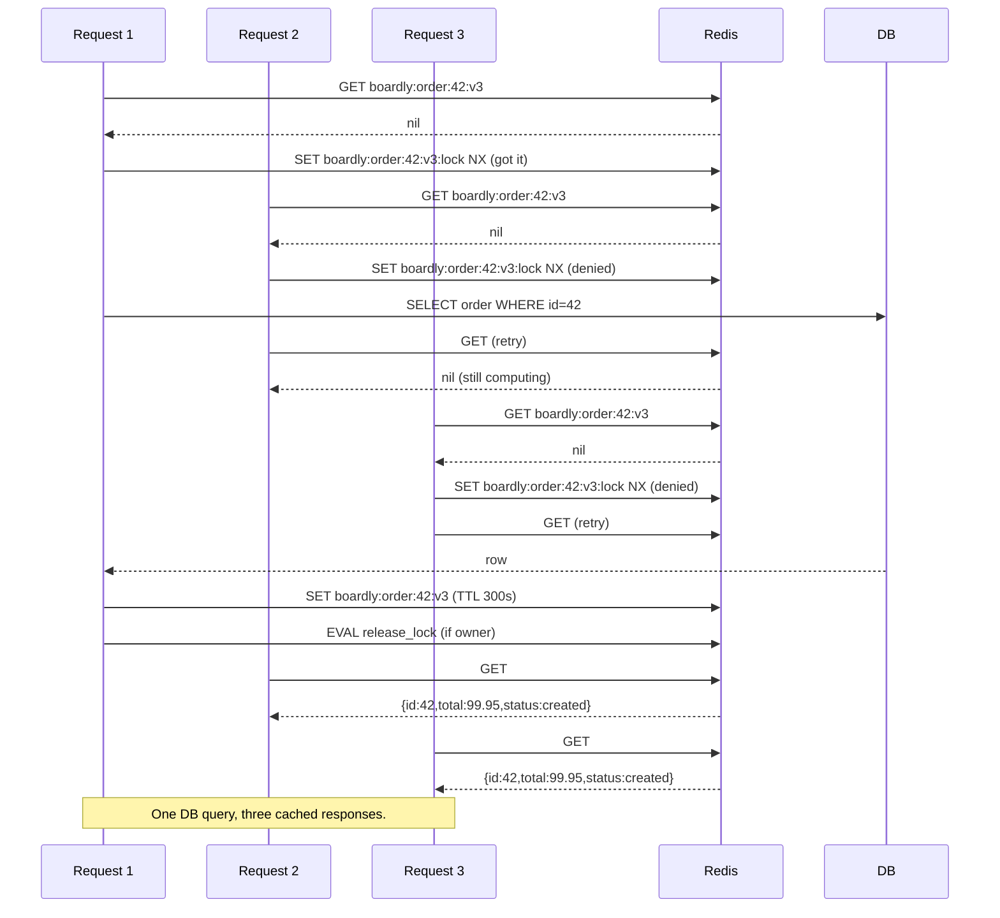
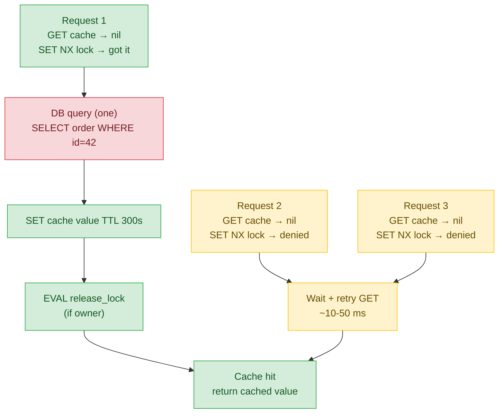

# Lesson 01: Redis Cache-Aside

*Giving `Boardly` a Redis cache with stampede protection, versioned keys, and a clear invalidation hook — and the discipline to know what to cache and what to leave alone.*

**You're at the very beginning of Section 14.**

Every backend engineer has been here: a query that takes 400 ms, a customer who wants it to take 4 ms, and the obvious answer is "cache it." The obvious answer is also the second-most-overused and second-most-misunderstood tool in backend engineering (the first being distributed transactions). Done right, a Redis cache takes that 400 ms query down to 2 ms. Done wrong, it serves stale data, explodes under load via the cache stampede, or hides a query bug that re-emerges the moment the cache misses. This lesson is the right way. Take your time. Build the `Cache` class. Watch the stampede happen and watch the lock stop it. **This is how you learn.**


#caching #redis #stampede #single-flight

## Learning Objectives

By the end of this lesson you will be able to:

1. **Explain why Redis is a *data-structure server*, not just a key-value store** — and pick the right data structure for an access pattern.
2. **Pick between sync `redis-py` and async `redis.asyncio`** for a FastAPI app — and explain why sync is always wrong in async code.
3. **Implement the cache-aside pattern** correctly: read-through with write-around, single-flight stampede protection.
4. **Design cache keys** with namespace, entity, ID, and version tag — and use the version-tag trick for safe schema migrations.
5. **Choose TTLs deliberately** — based on the *acceptable staleness*, not as a knee-jerk "one hour."
6. **Protect against the cache stampede** with a per-key lock and a Lua compare-and-delete for safe release.
7. **Decide what to cache and what not to** — and explain why caching an N+1 is a bug, not a fix.

## Prerequisites

Before starting, you need:

- **FastAPI 0.148.0**, Redis 7.x, `redis-py` (latest stable), all verified Oct 2026.
- **The N+1 lesson** — [[13-Performance-and-Observability/N-plus-1-and-Slow-Queries]]. Caching is the *last* tool, not the first. The query must already be tuned.
- **The logging lesson** — [[13-Performance-and-Observability/Structured-Logging-and-Request-IDs]]. Every cache hit/miss should carry the request ID for traceability.
- **`asyncio` primitives** — [[10-Async-Python/asyncio-Primitives]]. Stampede protection uses an async lock *in Redis* (not a Python `asyncio.Lock`), because the lock has to be shared across processes.
- **Dependency overrides** — [[12-Testing-and-Quality/Testing-FastAPI-Endpoints]]. The way you test cache misses vs hits without a real Redis is by overriding the `Cache` dependency with a fake.
- **About an hour and a half of focused time.** The code is ~150 lines; the patterns (stampede, single-flight, version tags) take time to settle.

**The most common gap: a Python `asyncio.Lock` is per-process.**

Stampede protection needs a lock that's shared across every process that serves the cache. A Python `asyncio.Lock` is per-process — it works between coroutines on the same event loop, but not between two uvicorn workers on the same machine, and not between two containers on the same Kubernetes pod. The lock has to live in Redis. The `SET NX EX` pattern is how you do that. Read the first third of [[10-Async-Python/asyncio-Primitives]] for the per-process version; this lesson extends it to the cross-process version.


## The Problem

You ship `Boardly` with a `GET /orders/{order_id}` endpoint that loads an order from Postgres. The query is tuned (you fixed the N+1 in the previous section), the index is good, `EXPLAIN ANALYZE` says 4 ms. At 1000 req/s, the database handles it fine. At 5000 req/s, the database starts to sweat. You want a cache.

The naive cache:

```python
@app.get("/orders/{order_id}")
async def get_order(order_id: int):
 cached = await redis.get(f"order:{order_id}")
 if cached:
 return json.loads(cached)
 order = await db.get(Order, order_id)
 payload = {"id": order.id, "total": float(order.total_usd)}
 await redis.set(f"order:{order_id}", json.dumps(payload), ex=300)
 return payload
```

This works for low load. At high load, it breaks in three ways:

1. **Cache stampede.** When the key expires, every concurrent request misses and starts the DB query. At 5000 req/s on a hot key, the DB sees 5000 simultaneous queries for the same row. The DB falls over.
2. **Stale data.** When the order is updated, the cache still has the old value. The next reader sees yesterday's total.
3. **Cross-entity collision.** If two services share the same Redis and both use `order:42` as a key, they collide. One service's cache returns the other's data.

This lesson fixes all three. The `Cache` class we'll build has single-flight stampede protection, an explicit `invalidate(key)` hook called on write, and a versioned-key namespace that prevents collisions and makes schema migrations safe.

Why does a cache *introduce* staleness when its whole purpose is to make reads faster? A cache is a *copy* of data that lives somewhere else (the database). The copy and the original are now two sources of truth, and they can diverge. The moment you `redis.set(...)` a value, the cache has a snapshot of the database at that instant; any subsequent database write makes the cache stale. The cache's value is "fast reads" — its cost is "the cache and DB can diverge". The three cache-design problems (stampede, staleness, collision) are all consequences of the divergence. Stampede is the divergence manifesting under load (the cache is empty, every request goes to the DB); staleness is the divergence manifesting over time (the cache has the old value, the DB has the new one); collision is the divergence manifesting across services (the cache has another service's value). Every cache design is a trade between speed (cache more) and divergence risk (cache less). The `Cache` class we build picks the speed side with explicit divergence-mitigation (invalidate on write, version-tag on schema change, single-flight on stampede).

**Note — Historical context — from memcached to Redis**

Caching in web apps goes back to the early 2000s, when LiveJournal wrote `memcached` to cache database rows. Memcached is a pure key-value store: bytes in, bytes out, with a TTL. Redis (2009) extended the model with data structures (lists, sets, hashes, sorted sets, streams) and persistence. For cache-aside, both work; Redis is the more common modern choice because it does double duty as a queue, a lock provider, and a pub/sub broker. `redis-py` (the Python client) merged `aioredis` into the main package as of 4.2+, so the async client is now `redis.asyncio.Redis`, not the old `aioredis`.


## The Code

Here is the complete `boardly/cache.py`, the cached endpoint, and the invalidation hook:

```python
# boardly/cache.py
"""Boardly — Redis cache-aside with single-flight stampede protection.

Lesson 14.1: namespace + entity + id + version-tag keys, TTL,
invalidate-on-write, single-flight lock, Lua compare-and-delete.
"""
import asyncio
import json
import uuid
from typing import Awaitable, Callable, TypeVar

import redis.asyncio as redis
import structlog

logger = structlog.get_logger()

T = TypeVar("T")

NAMESPACE = "boardly"
KEY_VERSION = "v3" # bump on incompatible schema change


def cache_key(entity: str, ident: str, extra: str = "") -> str:
 """Structured key: boardly:order:42:v3 or boardly:order_list:user=7:<sig>:v3."""
 parts = [NAMESPACE, entity, ident, KEY_VERSION]
 if extra:
 parts.append(extra)
 return ":".join(parts)


# Lua script: compare-and-delete. Releases the lock only if we still own it.
# This protects against releasing a lock that was re-acquired by another
# request after our timeout expired.
_RELEASE_LOCK_SCRIPT = """
if redis.call('GET', KEYS[1]) == ARGV[1] then
 return redis.call('DEL', KEYS[1])
end
return 0
"""


class Cache:
 """Cache-aside with single-flight stampede protection."""

 def __init__(self, client: redis.Redis) -> None:
 self.client = client

 async def get_or_set(
 self,
 key: str,
 loader: Callable[[], Awaitable[T]],
 ttl: int,
 lock_ttl: int = 10,
 ) -> T:
 # 1. Fast path — cache hit.
 cached = await self.client.get(key)
 if cached is not None:
 return json.loads(cached)

 # 2. Stampede protection — single-flight via a per-key lock.
 lock_value = uuid.uuid4().hex
 lock_key = key + ":lock"
 got_lock = await self.client.set(
 lock_key, lock_value, nx=True, ex=lock_ttl
 )
 if not got_lock:
 # Another request is computing; wait briefly and re-read.
 # Bounded retries prevent infinite waits if the lock holder crashed.
 for _ in range(10):
 await asyncio.sleep(0.1)
 cached = await self.client.get(key)
 if cached is not None:
 return json.loads(cached)
 # Lock holder died without writing — fall through to compute.

 try:
 value = await loader()
 await self.client.set(key, json.dumps(value), ex=ttl)
 return value
 except Exception:
 logger.warning("cache_loader_failed", key=key)
 raise
 finally:
 # Release the lock only if we still own it.
 if got_lock:
 await self._release_if_owner(lock_key, lock_value)

 async def invalidate(self, key: str) -> None:
 """Delete the cached value AND its lock. Call on write."""
 await self.client.delete(key, key + ":lock")

 async def _release_if_owner(self, lock_key: str, expected: str) -> None:
 await self.client.eval(_RELEASE_LOCK_SCRIPT, 1, lock_key, expected)


# boardly/orders_service.py
from sqlalchemy import select
from sqlalchemy.ext.asyncio import AsyncSession

from boardly.cache import Cache, cache_key
from boardly.models import Order


class OrderService:
 def __init__(self, db: AsyncSession, cache: Cache) -> None:
 self.db = db
 self.cache = cache

 async def get_order(self, order_id: int) -> dict:
 key = cache_key("order", str(order_id))

 async def loader() -> dict:
 order = await self.db.get(Order, order_id)
 if order is None:
 raise KeyError(f"order {order_id} not found")
 return {
 "id": order.id,
 "total_usd": float(order.total_usd),
 "status": order.status,
 }

 return await self.cache.get_or_set(key, loader, ttl=300, lock_ttl=10)

 async def update_order_status(self, order_id: int, new_status: str) -> None:
 order = await self.db.get(Order, order_id)
 if order is None:
 raise KeyError(f"order {order_id} not found")
 order.status = new_status
 await self.db.flush() # write without committing yet
 # Invalidate AFTER the DB write, BEFORE the response returns.
 # See [[Transactional-Outbox]] for the harder version.
 await self.cache.invalidate(cache_key("order", str(order_id)))
 await self.db.commit()


# boardly/main.py — lifespan with Redis
from contextlib import asynccontextmanager

import redis.asyncio as redis
from sqlalchemy.ext.asyncio import create_async_engine, async_sessionmaker


@asynccontextmanager
async def lifespan(app: FastAPI):
 pool = redis.ConnectionPool(
 host="redis", port=6379, max_connections=50
 )
 app.state.redis = redis.Redis(connection_pool=pool, decode_responses=True)
 engine = create_async_engine("postgresql+asyncpg://user:pw@db/boardly")
 app.state.session = async_sessionmaker(engine, expire_on_commit=False)
 yield
 await app.state.redis.aclose()
 await engine.dispose()


# boardly/routers/orders.py
from fastapi import APIRouter, Depends, HTTPException, Request


router = APIRouter(prefix="/orders", tags=["orders"])


@router.get("/{order_id}")
async def get_order(order_id: int, request: Request):
 async with request.app.state.session() as db:
 svc = OrderService(db, Cache(request.app.state.redis))
 try:
 return await svc.get_order(order_id)
 except KeyError:
 raise HTTPException(404)
```

That's ~150 lines across four files. Run it. Warm the cache. Send a stampede of concurrent requests and watch only one DB query fire. We'll explain every line next.

## Line-by-Line Deep Dive

### `boardly/cache.py`: Lines 1–15 – Module docstring and imports

```python
import asyncio
import json
import uuid
from typing import Awaitable, Callable, TypeVar

import redis.asyncio as redis
import structlog

logger = structlog.get_logger()

T = TypeVar("T")
```

**What it does:** Pulls in `asyncio` (for the bounded retry sleep), `json` (for serialisation), `uuid` (for the lock value), the typing primitives, `redis.asyncio` (the async client), and `structlog` (the logger from Section 13).

**Why `redis.asyncio` and not `redis`:** `redis` (the package) ships two clients: `redis.Redis` (sync) and `redis.asyncio.Redis` (async, formerly `aioredis`). The async client is a coroutine-based wrapper around the same RESP protocol. In a FastAPI app, you use `redis.asyncio.Redis` exclusively — a sync client in async code blocks the event loop on every command, which is exactly the failure mode you're trying to avoid.

**Why `TypeVar("T")`:** `get_or_set` is generic — the loader returns `T`, the cache stores and returns `T`. The `TypeVar` lets the type checker (and the reader) see that `get_or_set[str](...)` returns a `str`, not an `Any`.

**Why `logger = structlog.get_logger()` at module level:** Same pattern as Lesson 13.1 — module-level logger, captured `__name__`, used inside the class. The `request_id` will be on every line because `merge_contextvars` is still in the processor chain.

### `boardly/cache.py`: Lines 17–18 – Namespace and version tag

```python
NAMESPACE = "boardly"
KEY_VERSION = "v3" # bump on incompatible schema change
```

**What it does:** Declares the namespace prefix and the version tag for all cache keys.

**Why a namespace:** `Boardly`'s Redis is shared with the worker queue (`arq`), the rate limiter, the nonce cache from webhooks, and possibly sibling services. Every key `Boardly`'s cache writes needs a prefix that distinguishes it from everything else. `boardly` is the prefix. Without it, you get cross-entity collisions.

**Why a version tag:** When you ship a code change that changes the cached representation — say, you add a `currency` field to the cached `order` payload — old cached values are now wrong. You have two options:

1. Coordinated invalidation: deploy, then issue `DEL boardly:order:*` to flush the cache. Operational pain; you can forget.
2. Versioned keys: bump `KEY_VERSION = "v4"`. The new code reads `boardly:order:42:v4`, doesn't find it, recomputes. The old `boardly:order:42:v3` keys are orphaned and expire via TTL. No coordinated invalidation needed.

The version-tag trick is the right default. It's the same idea as "bump the cache-busting hash on your static assets" in frontend code.

**Production reality: the version tag is a deploy discipline enforced by code review, not by the runtime.**

There's no compile-time check that the developer remembered to bump `KEY_VERSION` when they added a field to the cached payload — the check is human. The mitigation that survives a forgotten bump is the TTL (every value expires in ~5 minutes anyway), but the *5-minute window* is the bad window: old containers read the new schema, ignore the unknown field, and serve a response missing the field; or worse, the new container reads the old schema and crashes on `KeyError`. The production defence is two-layered: (1) a CI check that greps the diff for changes to the cached-payload construction (the `def loader()` closures in services) and fails the build if `KEY_VERSION` was not touched in the same PR; (2) a canary deploy that runs for one TTL (5 minutes) at 1% traffic before promoting to 100%, so a forgotten bump shows up as a canary error rate spike before it hits the fleet. Both checks are cheap; both are rarely wired; the version tag is the migration safety net that depends on the safety net actually being installed.


**Tip — Bump the version tag on incompatible schema changes.**

The trigger is "the cached representation changed in a way that's incompatible with old code." Adding a field is incompatible (old code doesn't know to read it). Removing a field is incompatible (old code expects it). Changing a field's type is incompatible. Same field, same type, just a new value? Don't bump — the TTL will catch it.


### `boardly/cache.py`: Lines 21–26 – The `cache_key` function

```python
def cache_key(entity: str, ident: str, extra: str = "") -> str:
 parts = [NAMESPACE, entity, ident, KEY_VERSION]
 if extra:
 parts.append(extra)
 return ":".join(parts)
```

**What it does:** Constructs a structured cache key from a namespace, an entity type, an identifier, and an optional extra segment.

**What a key looks like:** `boardly:order:42:v3`. Or, for a collection: `boardly:order_list:user=7:limit=50:v3`.

**Why `:` as the separator:** Redis uses `:` as the conventional separator in key namespacing. The Redis CLI and most UIs (RedisInsight, etc.) display `:`-separated keys as a folder tree. So `boardly:order:42:v3` shows up as `boardly/ > order/ > 42:v3` in the UI. It's a UX choice, not a correctness one.

**Why include all four parts:**

- `boardly` — namespace. Prevents collisions with sibling services.
- `order` — entity type. Prevents collisions between `order:42` and `user:42` (same ID, different entity).
- `42` — the entity ID. The unique identifier for this particular order.
- `v3` — the version tag. Lets you safely ship schema changes without coordinated invalidation.

Why is the version tag `v3` not a hash of the code or a git SHA? A git SHA would work, but every deploy would change the version — meaning every deploy invalidates the entire cache, even deploys that do not touch the cached schema. The cost is "every deploy is a cold cache". A hand-bumped `v3` → `v4` only when the cached representation actually changes (a new field, a removed field, a type change). Most deploys do not bump the version, so most deploys preserve the cache. The trade-off is "developer discipline (remember to bump on schema change) vs. automation (bump on every deploy)". Boardly picks discipline; the version bump is a one-line PR with the schema change. The TTL is the safety net for the version-tag-forgotten case — even if you forgot to bump `v3` to `v4`, the cache expires in 5 minutes and the next read populates it with the new schema. The version tag is the *immediate* migration; the TTL is the *eventual* migration.

The `extra` argument is for collection keys where the identifier isn't a single ID — it's a tuple of parameters. We hash the parameters and use the hash as the `extra`. See Exercise 4.

**Danger — How an attacker thinks: the `extra` segment is a cardinality knob the attacker controls.**

If the `extra` is built from raw query parameters without hashing and cardinality bounding (e.g. `extra=f"user_id={user_id},limit={limit},offset={offset},sort={sort}"`), every distinct tuple is a distinct cache key. An attacker who controls `limit`, `offset`, and `sort` in the URL can craft an unbounded number of cache keys: `?limit=1&offset=0`, `?limit=1&offset=1`, ... — each one misses the cache, each one writes a fresh entry, each one occupies `value_size + overhead` bytes until TTL. At 5-minute TTL and 1 KB payloads, a 10 k-req/s botnet can fill Redis with ~3 GB of garbage in under a minute, hitting `maxmemory` and tripping the eviction policy. The defence: hash the params with `hashlib.blake2b` (deterministic, fast, 16-byte digest), *bound* the cardinality (limit must be in `[1, 100]`, offset must be in `[0, 10_000]`, sort must be in an allowlist), and reject the request before it reaches the cache layer if any param is out of bounds. See [[11-Authentication-and-Security/OWASP-API-Top-10]] for the broader API-abuse discipline.


**Spot the bug — what if you forgot the version tag?**

You'd deploy a new version of the code that adds a `currency` field to the cached payload. The old code that's still running on some containers reads the new cached payload, finds an unexpected field, and either ignores it (the bug — `currency` is missing from the response) or crashes (worse). The version tag is the migration safety net.


### `boardly/cache.py`: Lines 29–37 – The Lua release-lock script

```python
_RELEASE_LOCK_SCRIPT = """
if redis.call('GET', KEYS[1]) == ARGV[1] then
 return redis.call('DEL', KEYS[1])
end
return 0
"""
```

**What it does:** A Lua script that runs atomically in Redis: "if the lock's current value matches the expected value, delete it; otherwise return 0."

**Why this is a Lua script and not two Python calls:** If you did `GET lock_key` then `DEL lock_key` as two separate Redis calls, another process could acquire the lock between the two calls. Your `DEL` would then delete *their* lock, not yours. The Lua script is atomic — Redis executes the whole script as a single, uninterruptible operation.

**The scenario this protects against:**

1. Request A acquires the lock with value `aaa`.
2. Request A computes the value (takes 15 seconds; the lock TTL is 10).
3. The lock expires. Redis deletes it.
4. Request B acquires the lock with value `bbb`.
5. Request A finishes computing and tries to release "its" lock.
6. Without the Lua script: `DEL lock_key` deletes B's lock. Request B is now vulnerable to stampede — a third request can come in and recompute while B is still computing.
7. With the Lua script: the script checks `GET lock_key == "aaa"`, finds it's `"bbb"`, returns 0, doesn't delete. Request B's lock is preserved.

This is the canonical Redis distributed-lock pattern. It's not Redlock (which is for multi-node Redis); it's the single-instance version, which is enough for `Boardly`'s single Redis.

**Warning — When this breaks: `KEYS[1]` is not documentation; it's a hard requirement on Redis Cluster.**

The `KEYS[1]` declaration in `_RELEASE_LOCK_SCRIPT` looks like a comment — it's not. Redis Cluster uses the `KEYS` list to decide which slot to route the `EVAL` to. If your script touches a key but the key isn't in `KEYS`, the cluster raises `CROSSSLOT Cannot send to multiple keys in the same command` at runtime — not at registration. The single-instance Redis you develop against accepts the script silently; the moment you migrate to Redis Cluster (a common scaling step), the cache's `invalidate()` path crashes mid-write. The defence: every Lua script that touches a key *must* declare it in `KEYS`, even on single-instance Redis where it's a no-op. The `1` in `await self.client.eval(script, 1, lock_key, expected)` is the number of keys (currently 1: just `lock_key`); bump it if you ever touch a second key. CI smoke-test the script against a 3-shard cluster (see Exercise 10) so the CROSSSLOT error surfaces in CI, not at the migration.


**Why `KEYS[1]` and `ARGV[1]`**

Redis' `EVAL` command runs a Lua script with two argument lists: `KEYS` (the keys the script touches — Redis uses these for clustering) and `ARGV` (the values). Our script touches one key (`lock_key`) and one argument (`expected`). The `1` in `await self.client.eval(script, 1, lock_key, expected)` is the number of keys.


### `boardly/cache.py`: Lines 40–43 – The `Cache` class

```python
class Cache:
 """Cache-aside with single-flight stampede protection."""

 def __init__(self, client: redis.Redis) -> None:
 self.client = client
```

**What it does:** Defines a `Cache` class that takes a `redis.Redis` (async) client.

**Why a class and not a module-level function:** The class lets you swap the client for a fake in tests (dependency injection — see `boardly/deps.py` below). The class also gives you a place to put other methods later (`invalidate_pattern`, `warm`, etc.) without polluting the module namespace.

**Why no `async def __aenter__` / `__aexit__`:** The `Cache` doesn't own the client — the lifespan does. The `Cache` is a thin wrapper around a shared resource. If we made it a context manager, we'd have to decide whether `__aexit__` closes the client (it shouldn't — the lifespan does) or not (then why is it a context manager?). The cleaner design is "the `Cache` is stateless; the client is shared."

### `boardly/cache.py`: Lines 45–85 – The `get_or_set` method

```python
async def get_or_set(
 self,
 key: str,
 loader: Callable[[], Awaitable[T]],
 ttl: int,
 lock_ttl: int = 10,
) -> T:
 # 1. Fast path — cache hit.
 cached = await self.client.get(key)
 if cached is not None:
 return json.loads(cached)

 # 2. Stampede protection — single-flight via a per-key lock.
 lock_value = uuid.uuid4().hex
 lock_key = key + ":lock"
 got_lock = await self.client.set(
 lock_key, lock_value, nx=True, ex=lock_ttl
 )
 if not got_lock:
 for _ in range(10):
 await asyncio.sleep(0.1)
 cached = await self.client.get(key)
 if cached is not None:
 return json.loads(cached)

 try:
 value = await loader()
 await self.client.set(key, json.dumps(value), ex=ttl)
 return value
 except Exception:
 logger.warning("cache_loader_failed", key=key)
 raise
 finally:
 if got_lock:
 await self._release_if_owner(lock_key, lock_value)
```

**What it does:** The whole pattern in one method. (1) Try to read from cache; if hit, return. (2) If miss, try to acquire a per-key lock; if you get it, compute and write; if you don't, poll the cache for up to 1 second waiting for the lock holder to write. (3) On success, write to cache. (4) On exception, log and re-raise (don't poison the cache with an error value). (5) Always release the lock if you own it.

**Why the fast path is first:** Most calls are cache hits. The fast path is one Redis `GET` — ~0.5 ms on a local Redis, ~2 ms on a remote one. The stampede-protection code only runs on miss. Putting the fast path first means the common case is fast.

**Why `uuid.uuid4().hex` for the lock value:** The lock value is the "who am I" token. When we release the lock, we compare the lock's current value to our token; if they match, we own it and can delete. The token needs to be unique per request (not per process) so two requests on the same process don't both think they own the lock. `uuid.uuid4().hex` is a 32-char random hex string; collisions are astronomically unlikely.

**Why `nx=True, ex=lock_ttl`:** `nx=True` means "set only if not exists" — the atomic acquire. `ex=lock_ttl` means "expire after `lock_ttl` seconds" — the safety net so the lock is auto-released if the holder dies. Without `ex`, a crashed holder would leave the lock forever and the cache would be permanently locked.

**Why `lock_ttl=10` as the default:** The loader is expected to finish in well under 10 seconds. If it takes longer, the lock expires, another request can compute, and we get a small window of double-compute (not a stampede, just two compute). For very slow loaders (e.g. a 30-second analytics query), raise `lock_ttl`. For very fast loaders (a 50 ms lookup), lower it.

**Why poll up to 10 times with 100 ms sleep:** The lock holder is computing; we expect them to write within ~1 second. Polling 10 times × 100 ms = 1 second max. If they're still not done after 1 second, fall through to compute (the lock has likely expired by then). The bounded retry prevents infinite waits if the lock holder crashed without writing.

**Why `try/except/finally`:**

- `try`: compute and write.
- `except`: log the failure and re-raise. Don't write an error value to the cache — that would poison the cache for `ttl` seconds. The exception propagates so the caller can decide (return 500, queue for retry, etc.).
- `finally`: release the lock if we own it. Always runs, even on exception.

**Why `if got_lock` in the `finally`:** If we didn't get the lock (we're polling), we shouldn't try to release it — we don't own it. The `if` guards against this.

**What `SET NX EX` actually does**

The Redis `SET` command, with the `NX` option, sets the key only if it doesn't already exist. With the `EX` option, it sets the TTL. The combination `SET key value NX EX ttl` is atomic — it's one command, executed as one operation in Redis. If you did `SET key value NX` then separately `EXPIRE key ttl`, another client could observe the key without the TTL between the two calls, and try to use it as a permanent lock. The combined form is the right shape.


**Warning — When this breaks: the bounded-retry cliff turns a slow loader back into a stampede.**

The `for _ in range(10): await asyncio.sleep(0.1)` loop polls the cache for 1 second (10 retries × 100 ms). If the loader consistently takes longer than ~1 second — say, a 30-second analytics query with `lock_ttl=10` — every concurrent waiter falls through to compute after 1 second, the lock has just expired (or is about to), and you're back to N concurrent DB queries. The lock bought you a 1-second respite, not the full 30. The defence is to size `lock_ttl` to the loader's p99 latency plus a margin (a 30-second loader needs `lock_ttl=60`), *and* to size the retry budget to match (`range(60)` for a 60-second budget). The current defaults (`lock_ttl=10`, `range(10)` of 100 ms each = 1 s) assume a sub-second loader — that's right for the order-lookup example, wrong for analytics. Assert in tests (see Exercise 9) that `lock_ttl * 0.5 > loader_p99_latency` so the budget always covers the wait.


### `boardly/cache.py`: Lines 87–89 – The `invalidate` method

```python
async def invalidate(self, key: str) -> None:
 """Delete the cached value AND its lock. Call on write."""
 await self.client.delete(key, key + ":lock")
```

**What it does:** Deletes both the cached value and its lock. Call this on write — when the underlying data changes.

**Why delete both:** If you only delete the value, a lock might still be held (another request is mid-compute). When that request finishes, it writes the *old* value back to the cache. The cache is now stale until the next TTL. Deleting both ensures the next miss starts fresh.

**Why this is "write-around" and not "write-through":** Write-through would update the cache on write (`await self.client.set(key, new_value, ex=ttl)`). Write-around just deletes; the next read repopulates. Write-around is simpler — you don't need to know the new value's serialised form, you don't need to write to the cache under the write transaction's lock, and the next reader does the work. Write-through is faster on the next read but more complex. Cache-aside defaults to write-around.

**Tip — Invalidate *after* the DB write, not before.**

If you invalidate before the DB write, a concurrent read can re-populate the cache from the old DB value (the write hasn't committed yet). The order is: `db.flush()` (or `commit`) -> `cache.invalidate()`. For the harder version where the cache invalidation has to survive crashes, see [[Transactional-Outbox]].


**Production reality: `delete(key, key + ":lock")` is one round-trip, and the order is load-bearing.**

The `await self.client.delete(key, key + ":lock")` call deletes both keys in a single Redis round-trip — `redis-py`'s `delete` accepts a variadic key list and sends one `DEL key1 key2` command. The order of arguments matters: the value (`key`) is listed before the lock (`key + ":lock"`). If a concurrent request is mid-compute and holds the lock, deleting the value first means a concurrent reader that just polled and got `nil` will fall through to compute, win the (still-existing) lock, run the loader, and write the *fresh* value — exactly the single-flight discipline we want. Deleting the lock first would let the concurrent reader win a stale lock and recompute, but the value would already be gone, so the read would have hit the (now-stale) cached value until the recompute finished. The order `(value, lock)` is the correct ordering; the implementation encodes it as a positional tuple, so the order is enforced by the function signature — but a future refactor that "simplifies" to two separate `delete(key)` and `delete(key + ":lock")` calls would silently break the ordering. The dual-delete is one command, two keys, one round-trip.


### `boardly/cache.py`: Lines 91–93 – The Lua release helper

```python
async def _release_if_owner(self, lock_key: str, expected: str) -> None:
 await self.client.eval(_RELEASE_LOCK_SCRIPT, 1, lock_key, expected)
```

**What it does:** Runs the Lua script with the lock key and the expected value. Releases the lock only if we still own it.

**Why the underscore prefix:** This is a private method. External code shouldn't call it; it's an implementation detail of `get_or_set`. The convention is `_` prefix = private.

### `boardly/orders_service.py`: The service

```python
class OrderService:
 def __init__(self, db: AsyncSession, cache: Cache) -> None:
 self.db = db
 self.cache = cache

 async def get_order(self, order_id: int) -> dict:
 key = cache_key("order", str(order_id))

 async def loader() -> dict:
 order = await self.db.get(Order, order_id)
 if order is None:
 raise KeyError(f"order {order_id} not found")
 return {
 "id": order.id,
 "total_usd": float(order.total_usd),
 "status": order.status,
 }

 return await self.cache.get_or_set(key, loader, ttl=300, lock_ttl=10)

 async def update_order_status(self, order_id: int, new_status: str) -> None:
 order = await self.db.get(Order, order_id)
 if order is None:
 raise KeyError(f"order {order_id} not found")
 order.status = new_status
 await self.db.flush()
 await self.cache.invalidate(cache_key("order", str(order_id)))
 await self.db.commit()
```

**What it does:** Defines an `OrderService` with `get_order` (cached) and `update_order_status` (writes through and invalidates).

**Why the service takes both `db` and `cache`:** Both are dependencies. The service is the layer that knows how to combine them. The endpoint just calls the service. (In a real app, the service would be `Depends`-injected — see [[03-FastAPI-Core/Dependency-Injection]].)

**Why `loader` is a closure and not a method:** The loader needs `self.db` and `order_id`. The cleanest way to bind these is a closure — an inline `async def` that captures them. The alternative is `functools.partial(self._load_order, order_id)`, which is fine but more verbose.

**Why the loader raises `KeyError` on missing order:** The cache shouldn't store `None` or "not found" — that would poison the cache for `ttl` seconds. The loader raises; `get_or_set` re-raises; the endpoint translates to `404`. The cache stays clean.

**Why `ttl=300` (5 minutes):** For order data, 5 minutes of staleness is acceptable to the business. The order's `total_usd` doesn't change often; the `status` might change (the `update_order_status` path invalidates). 5 minutes is the *maximum* staleness; the actual staleness is bounded by when the next write happens (which invalidates).

**Why `await self.db.flush()` before `await self.cache.invalidate()`:** `flush()` sends the `UPDATE` SQL to the database without committing. The cache invalidation sees the new value (it's in the database, just not committed). If a concurrent read comes in *between* `flush` and `invalidate`, it reads from the database and gets the *old* value (the transaction hasn't committed) — that's fine, because the next read after `commit` will miss the cache (we invalidated) and re-populate from the new value.

**Why `await self.db.commit()` is last:** Commit the transaction, making the write visible. If commit fails, the cache invalidation we did is harmless — the next read repopulates from the (unchanged) DB value.

**Warning — The dual-write race.**

This pattern — `db.flush()` then `cache.invalidate()` then `db.commit()` — has a small race: a concurrent read between `flush` and `invalidate` reads the *old* DB value (transaction not committed) and writes it to the cache. Then `invalidate` runs, deleting the stale value. Then `commit` makes the new value visible. The next read misses and repopulates from the new value. The race is *self-correcting* in this case. For the harder version where the invalidation has to survive crashes (the cache invalidation is a side-effect that must happen *exactly once*), see [[Transactional-Outbox]].


**Danger — How an attacker thinks: the `order_id` URL parameter is an attacker-controllable cache-key component.**

The `cache_key("order", str(order_id))` call puts the URL parameter `order_id` directly into the Redis key. The namespace prefix (`boardly:`) and the version tag (`:v3`) are constants the attacker can't influence — but `42` is whatever they put in the URL. An attacker who sweeps `order_id` from 1 to 100 000 across 1 000 requests per second creates 100 000 distinct cache entries in ~100 seconds (each ~1 KB → ~100 MB of Redis RAM), each one survives the 5-minute TTL, and each one *also* creates a DB query on the first miss (100 000 queries against orders that may not exist → 100 000 `SELECT WHERE id` lookups hitting the PK index). The defence is three-layered: (1) bound the `order_id` input — reject values outside the range of *valid* order IDs (or pattern-validate UUIDs if that's the format); (2) cap the per-IP request rate at the edge (an order-list sweep is a sweep whether or not it's cached — see [[11-Authentication-and-Security/Threat-Model-First]]); (3) set `maxmemory` on Redis 7.x with `maxmemory-policy=allkeys-lru` so an attacker-driven sweep evicts old entries instead of crashing the cache (see the Mistake 4 callout below). The cache layer defends the database; the edge layer defends the cache.


### `boardly/main.py`: The lifespan

```python
@asynccontextmanager
async def lifespan(app: FastAPI):
 pool = redis.ConnectionPool(
 host="redis", port=6379, max_connections=50
 )
 app.state.redis = redis.Redis(connection_pool=pool, decode_responses=True)
 engine = create_async_engine("postgresql+asyncpg://user:pw@db/boardly")
 app.state.session = async_sessionmaker(engine, expire_on_commit=False)
 yield
 await app.state.redis.aclose()
 await engine.dispose()
```

**What it does:** Creates a Redis connection pool and an async session factory in the lifespan; tears both down in reverse order.

**Why `redis.ConnectionPool(max_connections=50)`:** The async client multiplexes commands over a single TCP connection by default, but a pool lets multiple commands run concurrently (each on its own connection from the pool). 50 is a reasonable default for a small service; tune up if you see pool waits.

**Why `decode_responses=True`:** By default, the async client returns bytes. With `decode_responses=True`, it returns strings — which is what you want when you store JSON. Without it, `json.loads(cached)` would fail because `cached` is bytes (you'd need `json.loads(cached.decode())`).

**Why `expire_on_commit=False`:** An SQLAlchemy detail — by default, `commit()` expires all loaded objects, meaning the next attribute access re-fetches from the DB. For an async session, this is a foot-gun (the re-fetch is a coroutine that won't be awaited). `expire_on_commit=False` keeps the loaded attributes valid after commit. See [[07-SQLAlchemy/05-Session-and-Transaction-Management]].

**Warning — When this breaks: `decode_responses=True` is a connection-pool setting, and it breaks any sibling module that stores binary data on the same Redis.**

`decode_responses=True` lives on the `redis.Redis(connection_pool=pool, decode_responses=True)` instance, and it applies to *every* `get`, `hget`, `lpop`, `lrange` call on that instance. If a sibling module (Celery's result backend, `arq`'s job store, an in-house feature-flag store) uses the *same* `app.state.redis` instance to store binary data — `pickle.dumps(...)`, `msgpack.packb(...)`, raw bytes — `decode_responses=True` calls `bytes.decode("utf-8")` on every read, which raises `UnicodeDecodeError` at the *read*, not at startup. The bug surfaces as `Worker raised exception: UnicodeDecodeError: 'utf-8' codec can't decode byte 0x80 in position 0: invalid start byte` on the first job the worker tries to dequeue — which can be hours after the deploy, depending on traffic. The defence: use *separate* Redis instances (or separate DB indexes via `redis.Redis(..., db=1)` vs `db=0`) for the cache and for the job queue, so `decode_responses=True` on one doesn't touch the other. The mistake is sharing a single client across concerns with different encoding needs; the fix is per-concern clients.


### `boardly/routers/orders.py`: The endpoint

```python
@router.get("/{order_id}")
async def get_order(order_id: int, request: Request):
 async with request.app.state.session() as db:
 svc = OrderService(db, Cache(request.app.state.redis))
 try:
 return await svc.get_order(order_id)
 except KeyError:
 raise HTTPException(404)
```

**What it does:** Defines the cached `GET /orders/{order_id}` endpoint. Opens a DB session, constructs an `OrderService` with the session and the cache, calls `get_order`, and translates `KeyError` to `404`.

**Why `async with request.app.state.session() as db`:** The session factory `app.state.session` is an `async_sessionmaker`. Calling it returns a new `AsyncSession`. The `async with` context manager commits on clean exit and rolls back on exception. See [[07-SQLAlchemy/05-Session-and-Transaction-Management]].

**Why `Cache(request.app.state.redis)` in the endpoint and not in the service:** The service takes the `Cache` as a dependency. The endpoint constructs it from `app.state.redis`. In a real app, you'd use `Depends(get_cache)` so tests can override the dependency with a fake. See Exercise 6.

## Execution Trace

The cache-aside flow with a stampede of three concurrent misses — only one DB query fires:



Without the lock, all three would have hit the DB. At 10,000 concurrent misses on a hot key, the database is dead.

The same flow as a colour-coded topology. Green is the request that wins the lock (the one that does the DB query and the cache set); amber is the requests that lost the lock and are waiting for the cache to be populated; red is the DB call — the *only* DB call across the three concurrent requests. The structural insight this diagram makes visible: the lock converts "N concurrent misses = N DB queries" into "N concurrent misses = 1 DB query + (N-1) cache-waits". The (N-1) cache-waits are short (~10 ms), so the user sees ~10 ms latency instead of an unbounded DB-load spike.



**Student asks: what if the lock-holder crashes before setting the cache? Do the waiters wait forever?**

No — the lock has a TTL (the same `EX 5` we set on the SET NX). If the holder crashes after winning the lock but before setting the cache, the lock expires in 5 seconds. The next waiter's `GET` returns nil, its `SET NX` succeeds (the lock is gone), and it becomes the new holder. The cost is "5 seconds of stalled requests during the crash recovery"; the benefit is "no manual intervention, no permanent stuck state". The TTL is the liveness guarantee — it bounds the worst-case stall. Without a TTL on the lock, a crashed holder would leave the lock claimed forever, and every subsequent request would wait forever. Always set a TTL on locks.


**Student asks: why the Lua `release_lock` script instead of just `DEL lock_key`?**

Because `DEL` is unconditional — it would delete the lock even if the current caller does not own it. Consider: R1 wins the lock (TTL 5s), crashes after 6s, R2 wins the lock on retry (TTL 5s), R2 finishes after 4s, R1's process restarts after 7s and tries to `DEL` the lock — `DEL` removes R2's lock while R2 is still working. Now R3 can win the lock and recompute while R2 is still computing — defeating the stampede protection. The Lua script is atomic: it checks `GET lock_key == my_token` and `DEL` only if true. R1's token is stale (R2 has a new token); R1's release is a no-op. The Lua script is the only correct way to release a Redis lock — `DEL` is wrong, always.


## What to Cache and What Not

This deserves its own section because it's the most-violated rule in caching.

**Cache:**

- Read-heavy, slow-changing reference data (countries, currencies, tax rates).
- Aggregations expensive to compute (top-N, totals, leaderboards).
- External API responses where the upstream is rate-limited.
- Per-user profile data that changes rarely.

**Don't cache:**

- Per-session state (use the session store).
- Anything where staleness is unsafe (balances in flight, live counters, real-time inventory).
- Anything where the cache hit rate would be under ~30% — the misses cost more than the saves.
- Anything that's only slow because of an N+1 (fix the N+1 first).
- Anything that's only slow because of a missing index (add the index first).

**Danger — Caching to hide an N+1 is a bug, not a fix.**

A common pattern: the list endpoint is slow because of an N+1. Someone wraps it in a cache. The cache hides the N+1. When the cache misses, the page is catastrophic — 8 seconds for one user, fine for the next 5 minutes. The bug is still there. The cache just hides it. Fix the N+1 with `selectinload` first; cache only after `EXPLAIN ANALYZE` agrees with you.


**Warning — When this breaks: read-from-replica + write-to-primary creates a stale-cache feedback loop.**

A subtler staleness bug than "we forgot to invalidate": a service that reads from a Postgres read replica (for read-scaling) and writes to the primary. The write commits on the primary at T+0; the `cache.invalidate()` runs at T+0.1; a concurrent read at T+0.2 misses the cache (good), reads from the replica (still replicating — sees the *old* value at T-1), populates the cache with the old value, and serves stale data for the next `ttl=300` seconds. The invalidation ran, but it was *re-populated from a stale source*. The defence is two-layered: (1) route cache-miss reads through the *primary* (or a replica with `synchronous_commit=on` for the cached entity), not a lagging async replica; (2) bound `ttl` to the worst-case replication lag plus a safety margin — if the replica can lag by 5 s, the cache `ttl` should be set assuming the cache might be 5 s stale, not 0. The cleaner architectural answer is to invalidate the cache via the [[Transactional-Outbox]] pattern with a `pg_logical_slot` listener that fires the invalidation *after* the replica has applied the change, not when the primary commits — but that's a [[17-Advanced-Architecture/Event-Driven-Basics]] topic, not a Lesson 01 fix.


## Common Mistakes

### Mistake 1: Caching to hide an N+1

```python
# WRONG
async def get_orders_with_items(session, cache, user_id):
 return await cache.get_or_set(
 cache_key("orders_with_items", str(user_id)),
 lambda: list_orders_with_items_buggy(session, user_id), # N+1
 ttl=300,
 )
```

**Symptom:** The cache hides the bug. When the cache misses, the page is catastrophic.

**Why:** The N+1 is still there. The cache just hides it. When the cache misses, the bug re-emerges.

**Fix:** Fix the N+1 first. Cache only after the query is tuned.

### Mistake 2: Caching user-specific data with a global key

```python
# WRONG
key = cache_key("user_profile", "current") # global!
```

**Symptom:** Cross-user data leak. User A sees user B's profile.

**Why:** The key doesn't include `user_id`. All users hit the same key.

**Fix:** Always include `user_id` in the key for user-scoped data: `cache_key("user_profile", str(user_id))`.

### Mistake 3: Storing ORM objects directly

```python
# WRONG
await self.client.set(key, json.dumps(order), ex=ttl)
```

**Symptom:** `TypeError: Object of type Order is not JSON serializable`. Or, if you use a custom encoder, you serialise SQLAlchemy internal state that breaks deserialisation.

**Why:** ORM objects hold session references, lazy-loaded attributes, and other SQLAlchemy internal state. They don't serialise cleanly.

**Fix:** Convert to a dict explicitly: `{"id": order.id, "total_usd": float(order.total_usd), ...}`. Or use Pydantic's `model_dump()`: `OrderRead.model_validate(order, from_attributes=True).model_dump()`.

### Mistake 4: No TTL

```python
# WRONG
await self.client.set(key, json.dumps(value)) # no ex=
```

**Symptom:** The cache grows until OOM. Redis evicts keys unpredictably (by `maxmemory-policy`, default `noeviction` which means Redis starts returning errors).

**Why:** A cache entry without a TTL is a memory leak. The cache is a cache, not a database.

**Fix:** Always set `ex=ttl`. Pick TTLs based on the *acceptable staleness*.

**Production reality: Redis 7.x's default `maxmemory-policy=noeviction` turns a TTL-less cache into a hard outage.**

The Mistake 4 symptom above says "Redis evicts keys unpredictably" — but the *default* `maxmemory-policy` on Redis 7.x is `noeviction`, which does *not* evict: it returns `OOM command not allowed when used memory > 'maxmemory'` on every write. To the cache layer this looks like every `set` failing silently (the `await self.client.set(...)` returns `None` instead of `True`, and `get_or_set` doesn't check the return value, so the cache appears to "miss" on every call — meaning every request becomes a DB query, the cache layer is now a no-op, and the database takes the full load). The fix is to set `maxmemory-policy=allkeys-lru` (or `volatile-lru` if you have non-cache keys on the same Redis that you want to protect) in `redis.conf` and to set `maxmemory` to a value that fits your instance's RAM budget with headroom for the connection pool, the Lua cache, and the AOF rewrite buffer. The TTL on every key is the *first* defence; the eviction policy is the *second* — wire both.


### Mistake 5: No stampede protection on hot keys

```python
# WRONG
async def get_or_set_naive(self, key, loader, ttl):
 cached = await self.client.get(key)
 if cached:
 return json.loads(cached)
 value = await loader()
 await self.client.set(key, json.dumps(value), ex=ttl)
 return value
```

**Symptom:** Works fine at low load. At 5000 concurrent misses on a hot key, the database is dead.

**Why:** Every concurrent miss fires the loader. No single-flight.

**Fix:** The lock-based single-flight pattern in our `Cache.get_or_set`. Always.

### Mistake 6: Releasing a lock you don't own

```python
# WRONG
finally:
 await self.client.delete(lock_key) # unconditional
```

**Symptom:** You delete a lock that was re-acquired by another request after your timeout expired. The other request is now vulnerable to stampede.

**Why:** Between the time your `SET NX` succeeded and your `DEL`, the lock's TTL may have expired. Another request acquired the lock. Your `DEL` deletes their lock.

**Fix:** The Lua compare-and-delete. Always.

### Mistake 7: Cache + DB writes in different transactions

```python
# WRONG
await self.db.commit()
await self.cache.invalidate(key) # if this fails, cache is stale
```

**Symptom:** Crash between `commit` and `invalidate` leaves the cache stale until TTL.

**Why:** The two operations are not atomic. A crash between them leaves inconsistency.

**Fix:** For the common case (cache invalidation is best-effort), accept the small stale window — the next read repopulates. For correctness-critical cases, use the [[Transactional-Outbox]] pattern.

**Danger — How an attacker thinks: the dual-write split-brain window is a window an attacker can *amplify*.**

The dual-write race described in the prose is a small window — a few milliseconds between `commit` and `invalidate`. An attacker who can issue many concurrent writes on the same key can *fill* that window with requests, each of which reads the old (pre-invalidation) value, each of which populates the cache with the old value, each of which survives until the TTL. The amplification: one attacker write that lands in the race window pollutes the cache for `ttl` seconds for *every* subsequent reader — the attacker has turned a millisecond race into a 5-minute stale-data outage. The defence is the [[Transactional-Outbox]] pattern (write the invalidation as a row in the same transaction as the data write, so the two are atomic from the database's perspective), plus a *per-key rate limit* on writes (an attacker who can issue 10 000 concurrent writes on one key is not a legitimate user — see [[15-External-Integrations/Circuit-Breaker-vs-Bulkhead-vs-Timeout]] for the bulkhead pattern that limits the blast radius). Cache invalidation is the attack surface; the outbox pattern is the closure.


### Mistake 8: Caching errors

```python
# WRONG
try:
 value = await loader()
except Exception as e:
 await self.client.set(key, json.dumps({"error": str(e)}), ex=ttl)
 raise
```

**Symptom:** The cache stores an error. The next read returns the cached error. The underlying problem may have resolved, but the cache serves the error for `ttl` seconds.

**Why:** Caching errors is a bug. The cache should only hold *successful* results.

**Fix:** Don't `SET` on exception. Our `get_or_set` re-raises without writing.

## Engineering Trade-Offs

### Redis vs Memcached vs in-process cache

| Aspect | In-process (`functools.lru_cache`, `cachetools.TTLCache`) | Memcached | Redis |
|---|---|---|---|
| Where the cache lives | Each worker's RAM; per-process | Networked shared RAM; multi-tenant | Networked shared RAM; single-tenant by default |
| Latency (cache hit) | sub-microsecond (dict lookup) | ~0.5–2 ms (TCP round-trip) | ~0.5–2 ms (TCP round-trip; pipeline helps) |
| Cross-worker coherence | None — each worker has its own cache; one worker's SET is invisible to the others | Yes — all workers share one memcached cluster | Yes — all workers share one Redis cluster |
| Survives process restart | No — in-RAM, dies with the process | No — also in-RAM, dies with the cluster | Yes (with `appendonly` AOF or RDB snapshots) |
| Data structures | Just dict / TTLCache (KV) | KV only (bytes in, bytes out) | KV + lists + sets + hashes + sorted sets + streams + Lua scripts |
| Persistence | N/A | N/A | AOF + RDB; can survive restarts |
| Use case | Tiny read-heavy reference data (a few KB) that's CPU-cheap to recompute; e.g. a config dict loaded at startup | Cache-only use cases where you don't already depend on Redis; pure KV with TTL is enough | The default — does double duty as queue / lock / pub-sub / cache; the right choice whenever you already have Redis for anything else |
| Cost | Free; per-worker memory | One extra service | One extra service (often the same Redis you use for queues) |

**Default:** Redis. Use in-process (`cachetools.TTLCache`) for tiny static-ish reference data (a config dict, a feature-flag list, a small enum) — anything where the cache hit is dominated by avoiding a 1 ms network round-trip *and* the data is small enough that each worker holding a copy is cheap. Use Memcached only when you have a cache-only workload and don't already depend on Redis; in practice, most FastAPI services already use Redis for queues or sessions, so Redis is the right call. In-process is also the right call for the *first* layer of a multi-tier cache: L1 = `cachetools.TTLCache` (in-process, sub-microsecond, dies on restart), L2 = Redis (networked, survives restart). The L1 hit-rate is what matters; L2 is the fallback.

**The L1+L2 pattern.**

Many production caches are two-tier: L1 in-process (per worker, sub-microsecond, dies on restart, no cross-worker coherence), L2 Redis (networked, survives restart, cross-worker coherent). On a cache miss at L1, check L2; on a miss at L2, compute and write both. The L1 hit-rate is what makes the latency budget; L2 is the fallback for the workers that haven't seen the key yet. The cost is two cache invalidation paths (L1 by TTL or by message, L2 by TTL or by message) — but the latency win is significant for very hot keys (single-digit µs vs single-digit ms). This lesson uses Redis-only for simplicity; the L1+L2 pattern is an exercise.


### Cache-aside vs read-through vs write-through

- **Cache-aside** — application manages cache. Default. Most flexible, most code.
- **Read-through** — cache library calls the loader on miss transparently. Less code, harder to debug.
- **Write-through** — every write goes to cache *and* DB synchronously. Stronger consistency, higher write latency.
- **Write-behind (write-back)** — write to cache, async-flush to DB. Best write latency, weakest durability.

Cache-aside is the right default until you have a measurable reason to move up.

### Sync vs async client

In FastAPI: always `redis.asyncio`. Sync client blocks the event loop. There is no scenario where blocking is correct in an async framework.

### What to cache vs what not

Cache:

- Read-heavy, slow-changing reference data.
- Aggregations expensive to compute (top-N, totals).
- External API responses where the upstream is rate-limited.

Don't cache:

- Per-session state (use the session store).
- Anything where staleness is unsafe (balances in flight, live counters).
- Anything where the cache hit rate would be under ~30%.

### Single-flight vs probabilistic early refresh (XFetch)

Single-flight (our lock) is the right default — it eliminates the stampede completely. The cost is that the locked-out requests wait up to `lock_ttl` for the lock holder to write.

XFetch is the upgrade for hot keys where even the locked-out wait is too long. Each reader, near the end of the TTL, refreshes the cache with a small probability proportional to staleness. Sprinkles the refresh load across many requests instead of all at once. Used by Varnish, Cloudflare, Netflix. More complex; only worth it when you can name the hot key.

**Production reality: the XFetch formula and the scale at which it pays off.**

The canonical XFetch refresh probability is `p = 1 - (ttl - staleness) / (beta * ttl)` where `staleness` is the time since the key was last refreshed and `beta` is a scaling factor (Netflix uses `beta=3`, Cloudflare uses `beta=2`). At `staleness=0.9 * ttl` and `beta=3`, `p ≈ 0.03` (3% of readers near the TTL boundary refresh). The payoff: instead of *one* request triggering a stampede of N concurrent misses at the TTL boundary, the refresh load is spread across ~30 requests over the last 10% of the TTL — the stampede disappears entirely. The cost: every reader must compute `p` and call `random.random()`, which is ~1 µs of CPU — negligible until you're at 50k req/s and it's 50 ms of CPU per second just for the XFetch math. The rule of thumb is: if your hot key's `concurrent_misses_at_ttl_boundary > 10` and your loader's `p99_latency > 100 ms`, XFetch pays for itself. Below that, single-flight is enough — `Boardly`'s 1 k req/s scale doesn't cross the threshold; Netflix's 10 M req/s does. The L1+L2 cache pattern (see the Engineering Trade-Offs above) is a cheaper alternative at `Boardly`'s scale — the L1 in-process layer absorbs the hot-key reads without the XFetch math.


## Exercises

**Tip — The 20-minute rule**

If you're stuck on an exercise for more than 20 minutes, re-read the relevant section above, then move on.


**Exercise 1 — Add `Cache-Control` headers.** Add `Cache-Control: max-age=300` to your cached responses so the cache TTL flows to the CDN edge. Verify with `curl -v`.

**Exercise 2 — Implement XFetch.** Add probabilistic early refresh on top of `get_or_set`. Each reader, near the end of the TTL, refreshes with probability proportional to staleness. Plot stampede load vs plain single-flight at scale.

**Exercise 3 — Test the stampede.** Write a test using `fakeredis` and `pytest-asyncio` that asserts: under 100 concurrent misses on the same key, exactly one DB query fires.

**Exercise 4 — Hash collection params.** Implement `list_key(user_id, limit, offset)` that hashes the params and uses the hash as the `extra` segment of the key. Verify that two different `(limit, offset)` tuples produce different keys.

**Exercise 5 — Spot the bug.** This cache invalidation looks fine but is racy. Why?

```python
async def update_order(order_id, new_status):
 await self.cache.invalidate(cache_key("order", str(order_id)))
 order = await self.db.get(Order, order_id)
 order.status = new_status
 await self.db.commit()
```

(Answer: invalidating *before* the DB write means a concurrent read can re-populate the cache from the old DB value. Always invalidate *after* the DB write.)

**Exercise 6 — Dependency injection for the cache.** Refactor the endpoint to use `Depends(get_cache)`. Override the dependency in tests with a fake `Cache` that records hits/misses. Verify that a hit doesn't touch the DB.

**Exercise 7 — Audit cache-key cardinality under attacker sweep.** Write a test that simulates an attacker sweeping `order_id` from 1 to 100 000, measure Redis memory growth with `redis-cli INFO memory | grep used_memory_human`. Then add per-IP rate limiting at the edge (use `slowapi` or a Redis-backed token bucket). Verify that with the rate limit at 100 req/s per IP, the sweep is throttled and `used_memory_human` stays bounded under 10 MB. The verification command is `uv run pytest tests/test_cache_key_cardinality.py -k test_attacker_sweep_is_throttled`.

**Exercise 8 — Diagnose Redis 7.x `noeviction` OOM.** Set `maxmemory 1mb` and `maxmemory-policy noeviction` on Redis 7.x (`docker run -p 6379:6379 redis:7 --maxmemory 1mb --maxmemory-policy noeviction`). Send 1 000 distinct cache writes. Confirm in the cache logs that `get_or_set` is silently failing (every `set` returns `None`, every read becomes a DB query — your cache layer is now a no-op). Switch to `--maxmemory-policy allkeys-lru`, retry, confirm the eviction policy kicks in (the `evicted_keys` counter in `INFO stats` climbs). The verification command is `uv run pytest tests/test_redis_eviction_policy.py -k test_noeviction_returns_none_allkeys_lru_evicts`.

**Exercise 9 — Reproduce the lock-TTL cliff.** Set `lock_ttl=1` (very tight), make the loader sleep for 2 seconds (longer than the lock TTL). Send 50 concurrent misses on the same cold key. In traces (see [[13-Performance-and-Observability/OpenTelemetry-Tracing]]) the DB span should appear *multiple times* — once for the original lock holder, then once for each waiter that fell through after 1 second. Plot the stampede cost (number of DB queries) as a function of `lock_ttl / loader_duration`. The verification command is `uv run pytest tests/test_lock_ttl_cliff.py -k test_loader_exceeds_lock_ttl_causes_fallthrough`.

**Exercise 10 — Verify the Lua release script in a Redis Cluster topology.** Spin up a 3-node Redis Cluster (`docker run -e IP=0.0.0.0 -p 7000-7005:7000-7005 -e STABLE_MASS=jess redis:7 --cluster-enabled yes`). Run the cache against a key whose hash slot is on a non-primary node. Confirm that *without* `KEYS[1]` declared in the Lua script, `EVAL` raises `CROSSSLOT Redis Cluster does not allow multiple keys in the same command`. Restore `KEYS[1]`, retry, confirm `EVAL` routes correctly to the right slot. The verification command is `uv run pytest tests/test_redis_cluster_lock_eval.py -k test_keys_decl_required_for_cluster_routing`.

**Exercise 11 — Test the dual-write race window.** Write a pytest with two coroutines: one calls `update_order_status(42, "paid")`, the other concurrently calls `get_order(42)`. Assert that *some* interleaving returns the stale (pre-update) value from the cache during the `db.flush -> cache.invalidate -> db.commit` window — confirm the race exists. Then implement the [[Transactional-Outbox]] pattern: write the invalidation message as a row in the same transaction as the order update, and have a background worker drain the outbox. Re-run the test, assert the stale-window has been eliminated (the cache is never populated with the pre-update value). The verification command is `uv run pytest tests/test_dual_write_race.py -k test_race_exists_pre_outbox_and_eliminated_post_outbox`.

**Exercise 12 — Implement the L1+L2 two-tier cache.** Add `cachetools.TTLCache` as L1 in front of the Redis L2 in `get_or_set`. On an L1 miss, check L2; on an L2 miss, compute and write both. Under a hot-key load test (`ab -n 50000 -c 100 http://localhost:8000/orders/42`), verify that the L1 hit rate is >80% and the Redis round-trip count (measured via a `redis.Redis` monitor) drops by the same proportion. Test that L1 invalidation propagates: a call to `invalidate(key)` must drop both the L1 entry and the L2 entry. The verification command is `uv run pytest tests/test_l1_l2_cache.py -k test_l1_hit_rate_and_l2_round_trip_reduction`.

## Verification

```bash
# 1. Run the app and warm the cache
uv run uvicorn boardly.main:app
curl http://localhost:8000/orders/42
curl http://localhost:8000/orders/42 # second call should hit cache

# 2. Inspect Redis
docker exec -it redis redis-cli
> KEYS boardly:*
> TTL boardly:order:42:v3 # should report ~300 seconds
> GET boardly:order:42:v3 # the JSON payload

# 3. Stress test the stampede protection
ab -n 5000 -c 100 http://localhost:8000/orders/42
# In traces (see [[OpenTelemetry-Tracing]]) the DB span should appear
# at most a handful of times, not 5000.
```

Debugging tips:

- Cache never hits → check `decode_responses=True` and the key matches between writes and reads.
- Cache grows unbounded → you forgot `ex=ttl` somewhere.
- Stampede happens → check the lock key construction (`key + ":lock"`) and the `nx=True` flag.
- Stale data after write → check that `update_order_status` calls `invalidate` *after* `flush`.

## Previously Learned Here

These concepts were taught in earlier lessons. We link back instead of re-explaining:

- **Dependency overrides** — [[12-Testing-and-Quality/Testing-FastAPI-Endpoints]]. New detail: using an override to swap a real `Cache` for a fake that records hits/misses, enabling deterministic cache tests.
- **`asyncio` primitives** — [[10-Async-Python/asyncio-Primitives]] for `asyncio.Lock`. New detail: a Python-only lock does *not* work across processes — the lock has to live in Redis, which is what the `SET NX` pattern achieves.
- **N+1** — [[13-Performance-and-Observability/N-plus-1-and-Slow-Queries]]. New detail: caching an N+1 is a bug, not a fix. Fix the query first.

## What's Next

In [[Background-Tasks-vs-Workers]] we add the second piece of deferred work: background processing. `BackgroundTasks` is FastAPI's built-in primitive for fire-and-forget; `arq` is the durable worker queue for anything you can't afford to lose. You'll:

- Use `BackgroundTasks` for the small stuff (metric increments, cache warming).
- Use `arq` for the real stuff (receipt emails, billing, anything customer-facing).
- Implement retry with exponential backoff and jitter.
- Build idempotent workers so at-least-once delivery is safe.
- Propagate the request ID from the inbound request into the job.

By the end of Lesson 2, `Boardly` has a durable worker that survives crashes and is safe to retry.

## Sources

- **Redis — Commands** — <https://redis.io/commands/> — accessed 2026-10-19 — `SET NX`, `EX`, `EVAL`.
- **redis-py — Async usage** — <https://redis-py.readthedocs.io/en/stable/examples/asyncio_examples.html> — accessed 2026-10-19 — the async client and connection pool.
- **Redis — Distributed Locks** — <https://redis.io/docs/manual/patterns/distributed-locks/> — accessed 2026-10-19 — the canonical Redlock discussion; cache-aside lock is a single-instance simplification.
- **Stripe — Cache Money** — <https://github.com/Shopify/cache_money> — accessed 2026-10-19 — production implementation of single-flight + XFetch.
- **Varnish — TTL freshness** — <https://varnish-cache.org/docs/trunk/users-guide/vcl-grace.html> — accessed 2026-10-19 — the origin of probabilistic early refresh.
- **AWS — Caching strategies** — <https://docs.aws.amazon.com/whitepapers/latest/caching-best-practices/caching-strategies.html> — accessed 2026-10-19 — cache-aside vs read-through vs write-through trade-offs.

## What We Learned

Let's recap. In this lesson you:

- **Explained why Redis is a *data-structure server*, not just a key-value store** — and picked `STRING` for cache values, with a glance at `HASH`, `ZSET`, and `STREAM` for other patterns.
- **Picked the async `redis.asyncio` client** — and explained why sync is always wrong in async code.
- **Implemented the cache-aside pattern** with single-flight stampede protection via a per-key Redis lock and a Lua compare-and-delete for safe release.
- **Designed cache keys** with namespace, entity, ID, and version tag — and used the version-tag trick for safe schema migrations.
- **Chose TTLs deliberately** based on the *acceptable staleness*.
- **Protected against the cache stampede** with a per-key lock, bounded retry polling, and a Lua release script.
- **Decided what to cache and what not to** — and explained why caching an N+1 is a bug, not a fix.

Here's the mental model to walk away with: *a cache is correct only as long as its invalidation strategy is correct. Cache-aside is the right default: read-through, write-around. Always set a TTL. Always invalidate on write. Always protect hot keys with single-flight. Use versioned keys so you can ship schema changes without coordinated invalidation. Cache only what is read-heavy and slow-changing; fix the N+1 first; cache last.*

---

> A note from your teacher
You just gave `Boardly` a cache that won't blow up under load. The stampede protection means a hot key won't take down your database; the version-tag trick means you can ship schema changes without an outage; the `invalidate-on-write` hook means your users don't see yesterday's data. The cache is the *last* tool you reached for — you measured, you tuned the query, you added the index, and only then did you cache. That discipline is what separates this lesson from a "just slap Redis on it" tutorial. Next, we add background workers. See you in Lesson 02.


---

**Tags:** #caching #redis #stampede #single-flight #review
**Previous:** [[00-Caching-MOC]]
**Next:** [[Background-Tasks-vs-Workers]] →