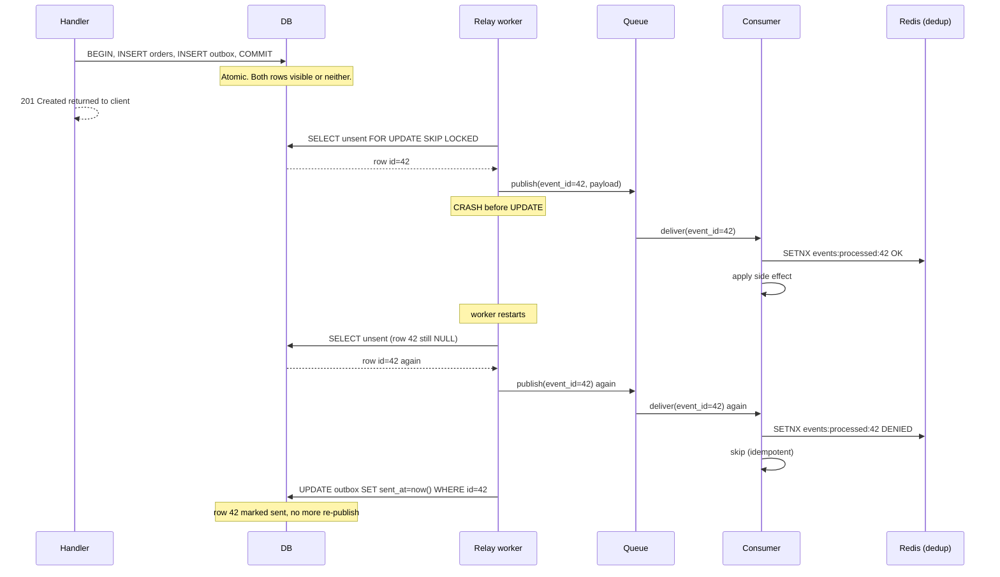
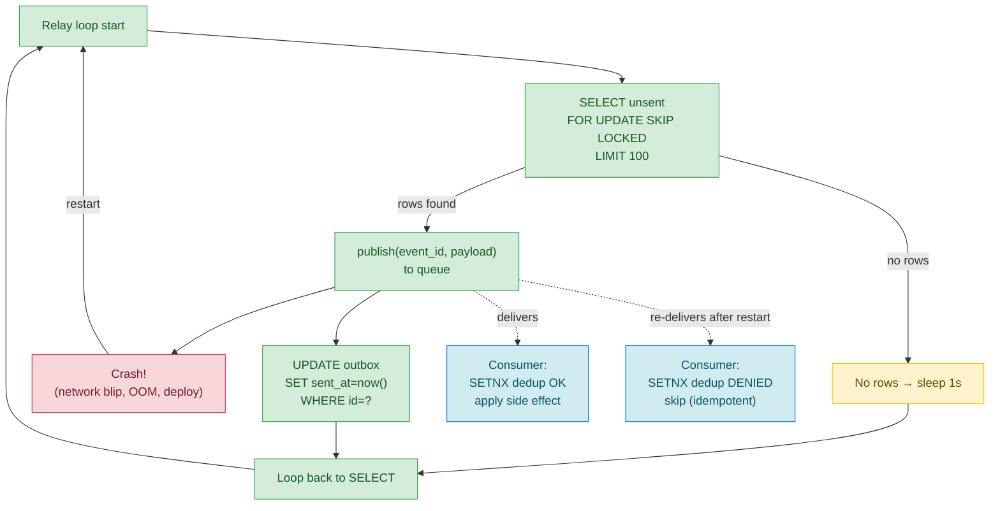

# Lesson 03: Transactional Outbox

*Giving `Boardly` an atomic "DB write + event publish" so a charge and its event happen together or not at all.*

**You're in the third lesson of Section 14.**

Every backend engineer who has touched a payments flow has been here: you charge a customer, you publish a `charge.succeeded` event, and somewhere between the two, something fails. The customer is charged but no one knows. Or the event is published for a charge that didn't happen. Both are bugs; one of them costs money. The transactional outbox pattern is the durable fix: write the event to an `outbox` table *in the same transaction* as the business write, and let a separate worker drain the table and publish. Atomicity comes from the database, not from "try harder." Take your time. Build the outbox. Crash the relay mid-publish. Watch the consumer dedup. **This is how you learn.**


#architecture #transactions #outbox #postgresql #canonical

## Learning Objectives

By the end of this lesson you will be able to:

1. **Explain the dual-write problem** and why naive "DB then queue" is broken.
2. **Implement the transactional outbox** with one extra table, one same-transaction insert, and one relay worker.
3. **Choose between `LISTEN/NOTIFY`, polling, and a dedicated worker** for dispatch — and explain the trade-offs.
4. **Use `SELECT ... FOR UPDATE SKIP LOCKED`** for concurrent relays that grab different rows without contention.
5. **Reason about at-least-once delivery** and the idempotent consumer contract.
6. **Identify when the outbox is overkill and when it is the only correct choice.**

## Prerequisites

Before starting, you need:

- **FastAPI 0.148.0**, SQLAlchemy 2.1.5, PostgreSQL 17.x, all verified Oct 2026.
- **The session lesson** — [[07-SQLAlchemy/05-Session-and-Transaction-Management]]. The outbox row is committed with the main write; this is "transaction boundaries 201."
- **The transactions lesson** — [[06-SQL-Fundamentals/Transactions-Isolation-Locks]]. Why ACID matters; we lean on it.
- **The workers lesson** — [[Background-Tasks-vs-Workers]]. The relay is a worker; we use the retry and idempotency principles.
- **The logging lesson** — [[13-Performance-and-Observability/Structured-Logging-and-Request-IDs]]. Every publish attempt should carry the request ID.
- **About two hours of focused time.** The pattern is conceptually simple but the implementation has many moving parts (table, trigger, relay, consumer).

**The most common gap: why "DB then publish" is broken.**

If you've never been bitten by the dual-write race, the outbox looks like overkill. It isn't. The race is real: between `await session.commit()` (the DB write) and `await publisher.publish(event)` (the queue publish), anything can fail. The process can crash. The network can drop. The broker can be down. In each case, you're left with one of two inconsistent states: (a) the DB has the write but no event, or (b) the broker has the event but no DB write. Both are bugs. The outbox fixes this by *not publishing inside the request* — it writes the event to the DB in the same transaction, and a separate worker drains and publishes. Atomicity comes from the database.


## The Problem

You charge a customer and need to publish a `charge.succeeded` event so the rest of the system can react (send a receipt email, update a read model, trigger fulfilment). The natural code is:

```python
async def charge_customer(session, user_id, amount):
 charge = await session.execute(
 insert(Charge).values(user_id=user_id, amount=amount, status="succeeded")
 )
 await session.commit() # DB write
 await publisher.publish( # queue publish
 "charge.succeeded",
 payload={"charge_id": charge.id, "user_id": user_id, "amount": amount},
 )
```

Two operations, two systems, no atomicity. Failure modes:

- **`commit()` succeeds, `publish()` fails.** The customer is charged; no event is published. The receipt email doesn't go out. The read model doesn't update. Fulfilment doesn't trigger. The customer support team gets a call: "I was charged but I didn't get a confirmation."
- **`publish()` succeeds, `commit()` fails.** Wait — `publish()` is after `commit()`, so this can't happen in this exact order. But it *can* happen if you flip the order: publish first, then commit. If the commit fails (rare but possible — constraint violation after a long-running transaction, deadlock victim, network partition), you have an event for a charge that doesn't exist. The receipt email goes out for a charge that didn't happen.
- **Process crashes between `commit()` and `publish()`.** The OS kills the process (OOM, deploy, hardware fault). The `await publisher.publish(...)` never runs. Same as case 1.

The dual-write problem in one sentence: *if a system needs to atomically update state A and side-effect B, and A and B are independent systems, atomicity across them is not free.*

Why not just publish *inside* the transaction and roll back if the publish fails? If you do `BEGIN; INSERT INTO orders (...); await publisher.publish(...); COMMIT;`, the publish is inside the transaction. If the publish fails, you roll back — the order row is gone, the event is gone, atomicity is preserved. The problem is: this only works if the broker (Redis, SQS, Kafka) participates in the same two-phase commit protocol as the database. Redis does not. SQS does not. Kafka does not (the KIP-618 transactional producer is broker-side, not cross-system). So your `await publisher.publish(...)` is *not* atomic with the DB transaction — even if you call it inside the BEGIN/COMMIT, the broker either got the message (and you can't unsend it on rollback) or did not (and you committed a transaction without the side effect). The outbox pattern's answer is to *stop trying* to be atomic across the two systems — instead, write the event to the *same* database as the business state (one transaction, one system, true atomicity), and have a *separate* relay process that reads the outbox and publishes to the broker (eventual consistency, with at-least-once delivery and consumer-side dedup). The outbox pattern trades "atomic publish" (impossible without 2PC) for "atomic write to outbox + relay-driven eventual publish" (always possible, just more moving parts).

**Note — Historical context — from 2PC to the outbox**

The classical answer to dual-write is two-phase commit (2PC, XA transactions). The coordinator asks both systems "can you commit?" (phase 1), gets yes from both, then sends "commit" (phase 2). 2PC is correct but operationally painful — it holds locks during coordination, it requires both systems to support XA, and the coordinator itself is a single point of failure. Modern stacks rarely use 2PC for application-level dual-write. The transactional outbox is the simpler alternative: use the database's atomicity (which you already have) to write both the business data and the event in one transaction. A separate worker drains the events and publishes them. Atomicity comes from the database, not from a coordinator. The pattern was popularised by Pat Helland in 2004 and formalised by Chris Richardson at microservices.io.


## The Code

Here is the outbox table, the same-transaction insert, the relay worker, and the idempotent consumer:

```python
# boardly/models/outbox.py
"""Boardly — outbox_events table for transactional outbox.

Lesson 14.3: same-transaction insert; relay worker drains and publishes.
"""
from datetime import datetime

from sqlalchemy import String, DateTime, BigInteger, JSON, Index, func, text
from sqlalchemy.orm import Mapped, mapped_column

from boardly.db import Base


class OutboxEvent(Base):
 __tablename__ = "outbox_events"

 id: Mapped[int] = mapped_column(BigInteger, primary_key=True)
 aggregate_type: Mapped[str] = mapped_column(String(64))
 aggregate_id: Mapped[str] = mapped_column(String(64))
 event_type: Mapped[str] = mapped_column(String(128))
 payload: Mapped[dict] = mapped_column(JSON)
 created_at: Mapped[datetime] = mapped_column(
 DateTime(timezone=True), server_default=func.now()
 )
 sent_at: Mapped[datetime | None] = mapped_column(
 DateTime(timezone=True), nullable=True
 )

 __table_args__ = (
 # Partial index on unsent rows. Without this, "SELECT ... WHERE sent_at
 # IS NULL" degenerates to a Seq Scan as the table grows.
 Index(
 "ix_outbox_unsent",
 "id",
 postgresql_where=text("sent_at IS NULL"),
 ),
 )


# boardly/orders_service.py
from sqlalchemy.ext.asyncio import AsyncSession

from boardly.models import Order
from boardly.models.outbox import OutboxEvent


class OrderService:
 def __init__(self, session: AsyncSession) -> None:
 self.session = session

 async def create_order(self, req: CreateOrderReq, user_id: int) -> Order:
 order = Order(
 user_id=user_id,
 total_usd=req.total_usd,
 status="created",
 )
 self.session.add(order)
 await self.session.flush() # get order.id without committing

 # Same transaction. If this commit rolls back, the event never exists.
 self.session.add(OutboxEvent(
 aggregate_type="order",
 aggregate_id=str(order.id),
 event_type="OrderCreated",
 payload={
 "order_id": order.id,
 "user_id": user_id,
 "total_usd": float(req.total_usd),
 },
 ))
 await self.session.commit()
 return order


# boardly/relay.py
"""Boardly — outbox relay worker.

Drains unsent rows from outbox_events, publishes to the queue,
marks sent. At-least-once; consumer must be idempotent.
"""
import asyncio

import structlog
from sqlalchemy import select, text, func
from sqlalchemy.ext.asyncio import AsyncSession

from boardly.models.outbox import OutboxEvent


logger = structlog.get_logger()


class OutboxRelay:
 def __init__(
 self,
 session_factory,
 publisher, # callable(payload, event_type, key, event_id)
 batch_size: int = 100,
 idle_wait: float = 1.0,
 ) -> None:
 self.session_factory = session_factory
 self.publisher = publisher
 self.batch_size = batch_size
 self.idle_wait = idle_wait

 async def run(self) -> None:
 while True:
 dispatched = await self._drain_once()
 if dispatched == 0:
 await asyncio.sleep(self.idle_wait)

 async def _drain_once(self) -> int:
 async with self.session_factory() as session:
 # FOR UPDATE SKIP LOCKED = concurrent relays grab different rows.
 stmt = (
 select(OutboxEvent)
 .where(OutboxEvent.sent_at.is_(None))
 .order_by(OutboxEvent.id)
 .limit(self.batch_size)
 .with_for_update(skip_locked=True)
 )
 rows = list((await session.execute(stmt)).scalars())
 if not rows:
 return 0

 for row in rows:
 try:
 await self.publisher(
 payload=row.payload,
 event_type=row.event_type,
 key=row.aggregate_id,
 event_id=row.id, # consumer dedup key
 )
 row.sent_at = func.now()
 except Exception as e:
 logger.warning(
 "publish_failed",
 event_id=row.id,
 error=str(e),
 )
 # Don't mark sent; will be retried next round.
 await session.rollback()
 return 0

 await session.commit()
 return len(rows)


# downstream consumer (separate service)
import redis.asyncio as redis


async def handle_order_created(
 event_id: int,
 payload: dict,
 redis_client: redis.Redis,
) -> None:
 seen = f"events:processed:{event_id}"
 if await redis_client.set(seen, "1", nx=True, ex=86400 * 7) is None:
 # Already processed this event_id. Skip.
 return
 # ... apply the side effect (e.g. update a read model, enqueue a job)
```

That's ~140 lines across four files. Run the relay in one process, the web app in another, create an order, watch the outbox row appear, watch the relay drain it. We'll explain every line next.

## Line-by-Line Deep Dive

### `boardly/models/outbox.py`: The model

```python
class OutboxEvent(Base):
 __tablename__ = "outbox_events"

 id: Mapped[int] = mapped_column(BigInteger, primary_key=True)
 aggregate_type: Mapped[str] = mapped_column(String(64))
 aggregate_id: Mapped[str] = mapped_column(String(64))
 event_type: Mapped[str] = mapped_column(String(128))
 payload: Mapped[dict] = mapped_column(JSON)
 created_at: Mapped[datetime] = mapped_column(
 DateTime(timezone=True), server_default=func.now()
 )
 sent_at: Mapped[datetime | None] = mapped_column(
 DateTime(timezone=True), nullable=True
 )
```

**What it does:** Defines the `outbox_events` table.

**Why each column:**

- `id` — the primary key. A `BigInteger` because the table grows unbounded; an `Integer` would overflow at ~2 billion rows. The `id` is the idempotency key the consumer uses — it's stable across re-publishes.
- `aggregate_type` — `"order"`, `"user"`, `"payment"`. Lets the consumer route by aggregate type. Also useful for partitioning if you scale to Kafka.
- `aggregate_id` — the row's PK in the business table, as a string (so it works for UUIDs, BigIntegers, composite keys). Multiple events can share one aggregate ID (e.g. `OrderCreated` then `OrderShipped`); the `id` is unique per event occurrence.
- `event_type` — `"OrderCreated"`, `"OrderShipped"`, `"OrderCancelled"`. The consumer dispatches by this.
- `payload` — JSONB. The event body. Keep it small — the changed fields and the version, not the whole row.
- `created_at` — when the event was written. Useful for ordering and for "events older than X are stale" alerts.
- `sent_at` — when the relay published. NULL = unsent. The relay's `WHERE` clause filters on this.

**Why `JSON` and not `JSONB`:** SQLAlchemy's `JSON` type maps to `JSONB` on Postgres by default. (On other databases, it falls back to whatever JSON-like type is available.) The `JSONB` type supports indexing and efficient queries; the `JSON` type doesn't. For our use case, we don't query the payload — we just store and retrieve it. `JSON` is fine.

**Why `BigInteger` for `id`:** Outbox tables grow unbounded. An `Integer` (32-bit) overflows at ~2 billion rows; a `BigInteger` (64-bit) doesn't overflow until ~9 quintillion. For a service that emits 10 events per second, an `Integer` overflows in 6 years; a `BigInteger` is effectively unlimited.

### `boardly/models/outbox.py`: The partial index

```python
__table_args__ = (
 Index(
 "ix_outbox_unsent",
 "id",
 postgresql_where=text("sent_at IS NULL"),
 ),
)
```

**What it does:** Creates a *partial* index on `id` for rows where `sent_at IS NULL`.

**Why a partial index:** Without it, the relay's query is:

```sql
SELECT * FROM outbox_events WHERE sent_at IS NULL ORDER BY id LIMIT 100
```

As the table grows (millions of rows, mostly with `sent_at` populated), this query degenerates to a `Seq Scan` — the database reads every row, filters on `sent_at IS NULL`, and returns the unsent ones. Slow.

With a partial index, the database indexes *only the unsent rows*. The query becomes an `Index Scan` returning the first 100 unsent rows, fast regardless of table size.

**Why `postgresql_where` and not just `where`:** SQLAlchemy's `Index` doesn't have a portable `where` argument. `postgresql_where` is the Postgres-specific extension. Other databases have their own partial-index syntax; for `Boardly` we only target Postgres.

**Why index on `id` (and not on `sent_at`):** The query orders by `id` (FIFO). Indexing on `id` lets the database return rows in order without a separate sort. Indexing on `sent_at` would also work but would require a sort.

**What a partial index actually is**

A partial index is an index that includes only rows matching a `WHERE` clause. The database stores only those rows in the index. Benefits: smaller index size, faster index maintenance on writes (only matching rows get indexed), faster queries that filter on the same `WHERE`. Partial indexes are a Postgres feature (also supported by SQLite; MySQL doesn't have them). For our use case, the partial index is essential — without it, the relay's query becomes slow as the table grows.


**Student asks: Why a partial index on `WHERE sent_at IS NULL` — would a full index on `sent_at` not do the same job?**

It would do a worse job, for three reasons. (1) **Size.** A full index on `sent_at` indexes every row in the table, including the millions of already-sent rows that the relay will never query again. After a year at 100 events/sec, you have ~3 billion rows in the index, of which maybe 100 are unsent at any moment. The partial index stores only those 100 unsent rows — bytes-of-RAM-per-row × 100 vs × 3 billion. The partial index fits in a single Postgres page; the full index does not. (2) **Write speed.** Every `INSERT` and every `UPDATE sent_at = now()` updates the index. With a full index, every "mark-sent" write is a B-tree insert (or delete, depending on how you model it). With a partial index, "mark-sent" *removes* the row from the index (the row no longer matches `WHERE sent_at IS NULL`); the index shrinks over time instead of growing. (3) **Planner behavior.** Postgres's planner sees a `SELECT … WHERE sent_at IS NULL` and recognises the partial index as the *only* index that matches the predicate — it is the obviously-correct access path. With a full index, the planner has to choose between the `sent_at` index (cheap to scan, but returns many matching rows) and a `Seq Scan` (cheap if the table is small) — and it sometimes chooses wrong on cold caches. The partial index makes the planner's job trivial, which means the query plan stays stable under load.


### `boardly/orders_service.py`: The same-transaction insert

```python
async def create_order(self, req: CreateOrderReq, user_id: int) -> Order:
 order = Order(
 user_id=user_id,
 total_usd=req.total_usd,
 status="created",
 )
 self.session.add(order)
 await self.session.flush() # get order.id without committing

 self.session.add(OutboxEvent(
 aggregate_type="order",
 aggregate_id=str(order.id),
 event_type="OrderCreated",
 payload={
 "order_id": order.id,
 "user_id": user_id,
 "total_usd": float(req.total_usd),
 },
 ))
 await self.session.commit()
 return order
```

**What it does:** Inserts an order and an outbox event in the same transaction.

**Why `await self.session.flush()` after the order insert:** `flush()` sends the `INSERT` SQL to the database without committing. The database assigns a primary key (`order.id`) and returns it. We use that `order.id` in the outbox event's `payload` and `aggregate_id`. Without `flush()`, `order.id` would be `None` (it's only assigned when the database sees the row).

**Why the outbox insert is in the same session, before `commit()`:** Both inserts are in the same transaction. Either both commit, or neither does. There is no intermediate state where the order exists without the event.

**Why `event_type="OrderCreated"` and not `"order_created"`:** A common convention is to use past-tense, PascalCase event names (`OrderCreated`, `OrderShipped`, `OrderCancelled`). This matches the AWS event-bridge convention and is the format most consumers expect. Pick a convention; use it everywhere.

**Why the `payload` includes `order_id`, `user_id`, `total_usd`:** The consumer needs these to act on the event. The `order_id` is also in `aggregate_id` (as a string), but having it in the payload as an integer is convenient. The `total_usd` is the order's total at the time of creation — useful for read models that need the historical value, not the current one.

**Tip — Keep payloads small.**

Resist the urge to put the entire aggregate state in the payload. The payload should be the *changed fields* and the *version*. Putting the whole row means events are huge (slow to serialise, slow to publish, slow on the wire). The consumer that needs the full state can fetch it by `aggregate_id`.


**Warning — Don't publish inside the transaction.**

The whole point of the outbox is *no publish inside the transaction*. If you call `await publisher.publish(...)` between `flush()` and `commit()`, you've reintroduced the dual-write race. The publish either happens inside the transaction (and can fail in a way that rolls back the transaction, leaving the order without an event) or outside (and you're back to the dual-write problem). The outbox's contract is: write the event to the DB; a separate worker publishes later.


**Student asks: Is the outbox insert in the same transaction as the order insert not slowing down the user's request — that is an extra write?**

It is an extra write, and it is the right trade-off. The numbers: a `POST /orders` handler that inserts one `Order` row takes ~2 ms (one `INSERT` + one `COMMIT` over a co-located Postgres). Adding the `OutboxEvent` insert in the same transaction adds one more `INSERT` (~0.5 ms) but does *not* add a second `COMMIT` (the commit is atomic — both writes durably persist in one fsync). Total handler latency goes from ~2 ms to ~2.5 ms. The 0.5 ms is invisible to the user. The alternative — *not* putting the event in the same transaction, and instead calling `publisher.publish()` *after* the commit — has the dual-write race: if the publish fails (broker down, network blip, OOM), the order is in the DB but the event is gone, and the consumer that should have been notified (the warehouse, the email service, the analytics pipeline) never sees it. The outbox's contract is "we will publish eventually, and we will publish exactly once" — and the only way to keep that contract is to write the event in the same transaction as the order. The 0.5 ms is the cost of correctness; it is the cheapest correctness you will ever buy.


### `boardly/relay.py`: The relay class

```python
class OutboxRelay:
 def __init__(
 self,
 session_factory,
 publisher,
 batch_size: int = 100,
 idle_wait: float = 1.0,
 ) -> None:
 self.session_factory = session_factory
 self.publisher = publisher
 self.batch_size = batch_size
 self.idle_wait = idle_wait
```

**What it does:** Defines the relay. Takes a session factory (so the relay can open its own DB sessions, separate from the web process), a publisher (any callable with the right signature), a batch size, and an idle wait.

**Why `session_factory` and not a session:** The relay runs in a separate process (like the `arq` worker). It opens a new session per drain cycle. The session factory (`async_sessionmaker`) is created once in `on_startup` and reused.

**Why `publisher` is a callable, not a class:** The publisher is "anything with a `__call__` that takes `payload, event_type, key, event_id`." It could be a Kafka producer, an SQS client, an `arq` enqueue, a Redis STREAM XADD. The relay is publisher-agnostic. This is dependency injection — see [[03-FastAPI-Core/Dependency-Injection]].

**Why `batch_size=100`:** The number of rows to drain per cycle. 100 is a reasonable middle — small enough to commit quickly (and not hold locks long), large enough to amortise the round-trip overhead. For high-throughput systems, raise to 500–1000.

**Why `idle_wait=1.0`:** When there are no unsent rows, the relay sleeps for 1 second before polling again. Prevents a busy-wait that hammers the database. For low-latency systems, use `LISTEN/NOTIFY` instead (see [below](#listennotify-vs-polling)).

### `boardly/relay.py`: The `run` loop

```python
async def run(self) -> None:
 while True:
 dispatched = await self._drain_once()
 if dispatched == 0:
 await asyncio.sleep(self.idle_wait)
```

**What it does:** The main loop. Drains a batch; if nothing was dispatched, sleeps; repeats forever.

**Why `while True`:** The relay is a long-running process. It runs until the process is killed (SIGTERM, OOM, deploy). For graceful shutdown, you'd add a signal handler that breaks the loop on SIGTERM; we omit that for clarity.

**Why `if dispatched == 0: await asyncio.sleep(...)`:** Without this, the relay would busy-wait — polling the database as fast as the event loop allows, hammering it with `SELECT ... WHERE sent_at IS NULL LIMIT 100` queries that return 0 rows. The sleep throttles the poll to once per second when there's nothing to do. For high-throughput, you'd replace the sleep with `LISTEN/NOTIFY` (see below).

### `boardly/relay.py`: The `_drain_once` method

```python
async def _drain_once(self) -> int:
 async with self.session_factory() as session:
 stmt = (
 select(OutboxEvent)
 .where(OutboxEvent.sent_at.is_(None))
 .order_by(OutboxEvent.id)
 .limit(self.batch_size)
 .with_for_update(skip_locked=True)
 )
 rows = list((await session.execute(stmt)).scalars())
 if not rows:
 return 0

 for row in rows:
 try:
 await self.publisher(
 payload=row.payload,
 event_type=row.event_type,
 key=row.aggregate_id,
 event_id=row.id,
 )
 row.sent_at = func.now()
 except Exception as e:
 logger.warning(
 "publish_failed",
 event_id=row.id,
 error=str(e),
 )
 await session.rollback()
 return 0

 await session.commit()
 return len(rows)
```

**What it does:** Drains one batch. (1) Opens a session. (2) Selects up to `batch_size` unsent rows, locking them with `FOR UPDATE SKIP LOCKED`. (3) For each row, publishes. (4) On success, marks `sent_at`. (5) On exception, rolls back and returns 0 (the row will be retried next cycle). (6) Commits.

**Why `with_for_update(skip_locked=True)`:** The magic. `FOR UPDATE` locks the rows so no other transaction can modify them; `SKIP LOCKED` skips rows that are already locked by another transaction. The result: multiple relays running concurrently grab *different* rows without contention. Postgres native feature.

**Why `order_by(OutboxEvent.id)`:** FIFO order. The oldest unsent row is drained first. Without ordering, the relay could drain a recent row before an old one — out-of-order delivery. (Note: the consumer should still tolerate out-of-order; the relay's order is best-effort.)

**Why `limit(self.batch_size)`:** Bounded batch. Without a limit, the relay would try to drain the entire table in one transaction, holding locks for too long.

**Why `row.sent_at = func.now()` and not `datetime.now()`:** `func.now()` is a SQL-side expression — the database's current time. Using `datetime.now()` would set the timestamp to the Python process's clock, which may drift from the database's clock. For consistency, use the database's clock.

**Why `await session.rollback()` on exception:** If a publish fails, we roll back the transaction. The `FOR UPDATE` locks are released (the rollback ends the transaction). The row stays `sent_at = NULL` — it will be retried next cycle. We `return 0` to trigger the `idle_wait` sleep (avoid hammering the database when the publisher is consistently failing).

**Why `return len(rows)` at the end:** Returns the count of dispatched rows. The caller (`run`) uses this to decide whether to sleep. If we drained 100 rows, we don't sleep — there might be more. If we drained 0 rows, we sleep.

**Spot the bug — what happens if the publisher succeeds for row 1, fails for row 2?**

The relay rolls back. Row 1's `sent_at = func.now()` is reverted (the rollback undoes it). Row 1 will be retried next cycle. This is correct — we don't want to publish row 1 and then leave row 2 unsent, because the consumer might depend on order. The cost is that row 1 gets re-published. The consumer must be idempotent (it dedups by `event_id`). That's the at-least-once contract.


### The idempotent consumer

```python
async def handle_order_created(
 event_id: int,
 payload: dict,
 redis_client: redis.Redis,
) -> None:
 seen = f"events:processed:{event_id}"
 if await redis_client.set(seen, "1", nx=True, ex=86400 * 7) is None:
 # Already processed this event_id. Skip.
 return
 # ... apply the side effect
```

**What it does:** Receives an event, dedups by `event_id`, applies the side effect only if not already processed.

**Why `event_id` (the outbox row's `id`) is the dedup key:** The outbox row's `id` is stable across re-publishes. The relay can publish the same row twice (if it crashes between publish and `sent_at` update); the consumer sees the same `event_id` twice; the second one is a no-op.

**Why `redis_client.set(seen, "1", nx=True, ex=86400 * 7)`:** Same `SETNX` pattern as Lesson 1's stampede lock and Lesson 2's job idempotency. The dedup key lives for 7 days — long enough that re-deliveries (which happen within minutes of the original) are caught.

**Why the consumer is *in a separate service*:** The consumer of the `OrderCreated` event might be the email service, the read-model updater, the fulfilment service. They're not in the same process as the relay. They receive the event via the broker (Kafka, SQS, RabbitMQ, Redis Streams). The dedup key has to live somewhere they all share — Redis is the natural choice.

**At-least-once, and why that's fine**

The relay can crash between publishing (the `await self.publisher(...)` call) and marking sent (the `row.sent_at = func.now()`). The event has been published, but `sent_at` is still NULL. The worker restarts, picks the same row again, and re-publishes. The consumer sees the same event twice. This is the at-least-once guarantee — the same shape as durable workers (see [[Background-Tasks-vs-Workers]]). The fix is consumer-side deduplication by the outbox row's `id`. The consumer stores "have I processed outbox_id=N?" and skips if so.


## Execution Trace

The full pattern with a crash and recovery, proving at-least-once is safe:



The same flow as a colour-coded topology, focused on the relay worker's loop. Green is the happy path (publish → mark sent → loop); red is the recoverable failure (publish → crash → restart → re-publish); blue is the consumer's idempotency guard (the dedup that absorbs the duplicate); amber is the idle branch (no rows found, sleep 1 s before the next loop). The structural insight this diagram makes visible: the relay never *deletes* the outbox row — it only *marks* it `sent_at`. The row stays in the table forever (or until an archive job moves it). The "still NULL" check on `sent_at` is the relay's idempotency — a crashed relay re-reads the row, re-publishes, and the consumer's dedup absorbs the duplicate. Two layers of idempotency (relay-level "re-read the row", consumer-level "dedup the event_id") make the system safe under crashes.



**Student asks: why does the relay never DELETE the outbox row? Stale rows accumulate forever.**

Two reasons: (1) the row is the *audit trail* of what was published — the `sent_at` timestamp and the `payload` are the proof that the event happened. Deleting it removes the audit. (2) the row is the relay's idempotency token — a crashed relay reads `WHERE sent_at IS NULL` to find what is unsent; if it deleted rows on success, a crash before delete would leave the row orphaned, and the next relay pass would re-publish it without a dedup guard (the consumer would dedup it, but the relay would never know it was a re-publish). Keeping the row, marking it `sent_at`, and re-reading on crash makes the relay idempotent at the relay layer. The cleanup is a separate archival job (e.g. `DELETE FROM outbox WHERE sent_at < now() - INTERVAL '7 days'`), run nightly, that removes the truly-old rows. The audit trail lives for a week; the idempotency token lives forever (or until archive).


**Student asks: why `FOR UPDATE SKIP LOCKED` and not just `FOR UPDATE`?**

Because `FOR UPDATE` blocks. If relay worker A locks rows 1-100 and relay worker B starts its `SELECT FOR UPDATE`, B blocks until A commits (or rolls back). At 1000 rows per minute throughput, B is stuck behind A for the duration of A's transaction — the parallelism you wanted from running two workers is gone. `SKIP LOCKED` makes B skip the rows A has locked and grab the next 100 unlocked rows — true parallelism. The trade-off: B might see rows that A would have committed by the time B finishes (rare; the rows A locked are still in flight). For an at-least-once relay, this is fine — the consumer's idempotency absorbs any duplicate. The rule: `FOR UPDATE SKIP LOCKED` for parallel work-queue relays; `FOR UPDATE` only when you genuinely need to block the second worker.


## Common Mistakes

### Mistake 1: Publishing inside the transaction

```python
# WRONG
async def create_order(self, req, user_id):
 self.session.add(order)
 await self.session.flush()
 self.session.add(OutboxEvent(...))
 await publisher.publish(...) # <-- publish INSIDE the transaction
 await self.session.commit()
```

**Symptom:** If `commit()` fails after the publish, you have an event for a non-existent order. The whole point of the outbox is *no publish inside the transaction*.

**Why:** The publish is a side-effect; it can't be rolled back. The transaction's atomicity doesn't extend to the publish.

**Fix:** Write the outbox row, commit, *then* let the relay publish. Never publish inside the transaction.

### Mistake 2: Relay that marks-sent before publishing

```python
# WRONG
row.sent_at = func.now()
await self.publisher(...)
await session.commit()
```

**Symptom:** A crash between marking sent and publishing loses the event forever.

**Why:** The relay marked the row as sent, so it won't be retried. But the publish didn't happen.

**Fix:** Always publish, *then* mark sent.

### Mistake 3: `SELECT` without `FOR UPDATE SKIP LOCKED`

```python
# WRONG
stmt = select(OutboxEvent).where(OutboxEvent.sent_at.is_(None)).limit(100)
```

**Symptom:** Concurrent relays grab the same rows. One publishes twice; the other errors on the update (the row's `sent_at` was already set).

**Why:** Without `FOR UPDATE`, both relays see the same unsent rows. Without `SKIP LOCKED`, both block on each other's locks until one commits.

**Fix:** `with_for_update(skip_locked=True)`. Always.

### Mistake 4: Consumer without idempotency

```python
# WRONG
async def handle_order_created(event_id, payload):
 # No dedup check!
 await send_receipt_email(payload["order_id"])
```

**Symptom:** A re-published event double-emails / double-charges / double-whatever.

**Why:** The relay can re-publish (crash between publish and ack). Without dedup, the consumer runs the side effect twice.

**Fix:** The `SETNX events:processed:{event_id}` dedup key. Always.

### Mistake 5: Reusing the order's PK as the event id

```python
# WRONG
event_id = order.id # WRONG
```

**Symptom:** Two events for the same order (`OrderCreated` then `OrderShipped`) both use `order.id` as their event ID. The consumer's dedup keys collide. The second event is incorrectly treated as a duplicate.

**Why:** Multiple events can share one aggregate ID. The outbox `id` is unique per event occurrence.

**Fix:** Use the outbox row's `id` (which is a separate sequence), not the aggregate's PK.

### Mistake 6: No backpressure on the relay

**Symptom:** If publishing is slow (the broker is down, the network is congested), the outbox table grows. The relay falls behind. The consumer's view of the world is increasingly stale.

**Why:** The relay's batch size is bounded, but its drain rate is limited by the publisher's throughput. If the publisher is slow, the relay falls behind.

**Fix:** Monitor `SELECT count(*) FROM outbox_events WHERE sent_at IS NULL`. Alert when it crosses a threshold (e.g. > 10000 rows, or > 60 seconds of lag).

### Mistake 7: Unbounded payload

```python
# WRONG
payload = {
 "order": order_to_dict(order), # entire order with all relationships
 "user": user_to_dict(user),
 # ...
}
```

**Symptom:** Events are huge. Serialisation is slow. The queue is full of giant messages. The consumer parses them slowly.

**Why:** Putting the entire aggregate state in the payload makes events huge.

**Fix:** Put the changed fields and the version, not the whole row. The consumer that needs the full state fetches it by `aggregate_id`.

## Engineering Trade-Offs

### Outbox vs naive dual-write

The outbox costs you: one extra table, one extra write per business transaction, one worker process to operate, one idempotency contract to enforce on every consumer. The naive dual-write costs you: correctness. For any write whose side-effect must happen, the outbox is the right answer.

### Outbox vs CDC (Debezium)

CDC reads the WAL directly and eliminates the relay — lower-latency and one fewer moving part, but it requires Debezium + Kafka in your stack. The pragmatic recommendation: outbox now, migrate to CDC when you outgrow the relay's polling cost.

### Polling vs `LISTEN/NOTIFY`

Polling is simpler, works fine up to ~10k events/sec on a single Postgres. `LISTEN/NOTIFY` adds wake-up latency reduction at the cost of plumbing. Skip it until you have a measured latency problem.

**`LISTEN/NOTIFY` setup (optional optimization):**

```sql
CREATE OR REPLACE FUNCTION notify_outbox() RETURNS trigger AS $$
BEGIN
 PERFORM pg_notify('outbox', NEW.id::text);
 RETURN NEW;
END;
$$ LANGUAGE plpgsql;

CREATE TRIGGER outbox_notify
 AFTER INSERT ON outbox_events
 FOR EACH ROW EXECUTE FUNCTION notify_outbox();
```

The relay then `LISTEN`s on the `outbox` channel; on wake-up, it runs `_drain_once`. Lower latency than polling, but you still fall back to polling as a safety net (the listener can miss a `NOTIFY` during reconnect).

### Postgres vs a real broker

You can put the outbox in Postgres and skip the broker entirely (use `LISTEN/NOTIFY` to fan-out to subscribers). This works for small systems but loses: durability across datacenter outages, replay, partitioning, and the rich ecosystem of Kafka/SQS. The pragmatic answer: outbox in Postgres, relay publishes to Kafka/SQS.

### Single large event vs many small events

Prefer many small events (`OrderCreated`, `OrderLineItemAdded`, `OrderShipped`) over one big event with the whole order. Small events compose; consumers subscribe only to what they need. Versioning small events is also easier.

## Exercises

**Tip — The 20-minute rule**

If you're stuck on an exercise for more than 20 minutes, re-read the relevant section above, then move on.


**Exercise 1 — Prove the dual-write race.** Write a failing test that proves naive `publish()` inside the transaction can lose events. Mock the publish to raise after a successful commit; show that the order is in the DB but the event is gone.

**Exercise 2 — Add `LISTEN/NOTIFY` to the relay.** Implement `LISTEN` on the `outbox` channel in the relay. Measure end-to-end latency vs polling (1 second idle wait). How much does the latency drop?

**Exercise 3 — Crash test.** Run the relay with a `publisher` that crashes the process mid-publish (use `os._exit(1)` after the publish but before the `sent_at` update). Verify on restart that the row is re-published and the consumer dedups.

**Exercise 4 — Concurrent relays.** Run two relays in parallel. Send 1000 events. Verify (via `pg_stat_statements` for the relay's `SELECT` and the consumer's dedup key count) that no event was published twice by both relays.

**Exercise 5 — Spot the bug.** This relay looks fine but loses events. Why?

```python
async def _drain_once(self):
 async with self.session_factory() as session:
 rows = (await session.execute(
 select(OutboxEvent).where(OutboxEvent.sent_at.is_(None)).limit(100)
 )).scalars()
 for row in rows:
 await self.publisher(payload=row.payload, event_id=row.id)
 row.sent_at = func.now()
 await session.commit() # <-- commits per row
```

(Answer: per-row commit releases the `FOR UPDATE` lock early, so a concurrent relay can grab the next row before this one finishes. Also, per-row commits are much slower than batch commits. Use `FOR UPDATE SKIP LOCKED` and a single commit at the end of the batch.)

**Exercise 6 — Outbox + CDC.** Sketch the Debezium configuration that reads the `outbox_events` table from the WAL and streams to Kafka. What does the relay look like (or is it gone)?

## Verification

```bash
# 1. Run the schema migration (see [[09-Alembic-Migrations/Alembic-Setup-and-Workflow]])
uv run alembic upgrade head
# Expect: "Running upgrade <rev> -> head" then a row in alembic_version with the
# latest revision id. The outbox_events table is now visible to \dt in psql.

# 2. Start the relay worker in one terminal
uv run python -m boardly.relay
# Expect: a startup log line like relay_started poll_interval_s=1.0 — no errors.

# 3. Create an order; verify an outbox row was inserted and the queue received it
curl -X POST http://localhost:8000/orders -d '{"total_usd":99.95}'
# Expect: 201 Created with {"order_id": <int>, "total_usd": 99.95}
psql -c "SELECT id, aggregate_id, event_type, sent_at FROM outbox_events ORDER BY id DESC LIMIT 5;"
# Expect: a row with event_type='OrderCreated', aggregate_id=<the order_id>,
# sent_at populated (after the relay wakes — usually <2 s).
# If sent_at is NULL after 30 s, the relay is not polling or the publisher is failing.

# 4. Crash test: kill the relay mid-publish (use a deliberate sleep in the
# publisher). Verify the row stays unsent on the first relay pass; on restart
# the relay re-grabs the same row (FOR UPDATE SKIP LOCKED releases on crash),
# the consumer dedups via the SETNX on event_id. Confirm the consumer's
# dedup key count for event_id is exactly 1, not 2.
```

Debugging tips:

- Outbox row count growing = relay is down or publishing is failing. Check `SELECT count(*) FROM outbox_events WHERE sent_at IS NULL`.
- Duplicate deliveries on the consumer = missing idempotency check. Add the dedup key.
- Events out of order on the consumer = you're using multiple relay workers. Either serialize by aggregate id (partition the queue by `aggregate_id`) or design consumers that tolerate ordering.

## Previously Learned Here

These concepts were taught in earlier lessons. We link back instead of re-explaining:

- **Transactions** — [[06-SQL-Fundamentals/Transactions-Isolation-Locks]] and [[07-SQLAlchemy/05-Session-and-Transaction-Management]]. New detail: using the database's atomicity *across* two writes to guarantee an event is published, rather than just to keep two business writes consistent.
- **Idempotency** — [[02-Web-and-HTTP/Idempotency-Safe-Retries-Pagination]] for HTTP, reused in [[Background-Tasks-vs-Workers]] for workers. New detail: the outbox row's `id` is the canonical idempotency key for events, because it's stable across re-publishes.
- **Session/AsyncSession** — [[07-SQLAlchemy/05-Session-and-Transaction-Management]]. New detail: same-transaction inserts across two tables (orders + outbox) is the entire mechanism.

## What's Next

This is the last lesson in Section 14. The next section, [[15-External-Integrations/00-Integrations-MOC]], is about being a well-behaved client of external services — HTTP APIs, webhooks, third-party integrations — and surviving their failures without taking your service down with them. The HTTP client there propagates the request ID set up in Section 13; the circuit breaker there is what protects the outbox relay when the broker is down; the webhook receiver there is the inbound side of the same "DB + side-effect must be atomic" problem the outbox solves on the outbound side.

## Sources

- **microservices.io — Transactional Outbox Pattern** — <https://microservices.io/patterns/data/transactional-outbox.html> — accessed 2026-10-19 — the canonical write-up of the pattern.
- **Microsoft — Choreography vs Orchestration** — <https://learn.microsoft.com/en-us/azure/architecture/microservices/design-patterns/choreography> — accessed 2026-10-19 — context for when outbox events drive choreography.
- **Debezium — Documentation** — <https://debezium.io/documentation/> — accessed 2026-10-19 — the CDC alternative that reads the WAL directly.
- **PostgreSQL — `LISTEN/NOTIFY`** — <https://www.postgresql.org/docs/current/sql-notify.html> — accessed 2026-10-19 — the wake-up channel.
- **PostgreSQL — `SKIP LOCKED`** — <https://www.postgresql.org/docs/current/sql-select.html#SQL-FOR-UPDATE-SHARE> — accessed 2026-10-19 — the lock-and-skip clause that enables concurrent relays.
- **Martin Fowler — Event Sourcing** — <https://martinfowler.com/eaaDev/EventSourcing.html> — accessed 2026-10-19 — outbox is a stepping stone toward full event sourcing; this distinguishes them.

## What We Learned

Let's recap. In this lesson you:

- **Explained the dual-write problem** and why naive "DB then queue" is broken.
- **Implemented the transactional outbox** with one extra table, one same-transaction insert, and one relay worker.
- **Used `SELECT ... FOR UPDATE SKIP LOCKED`** for concurrent relays that grab different rows without contention.
- **Built the idempotent consumer** with a Redis `SETNX` dedup key on the outbox row's `id`.
- **Reasoned about at-least-once delivery** and why it's fine when the consumer is idempotent.
- **Identified when the outbox is overkill and when it is the only correct choice.**

Here's the mental model to walk away with: *the transactional outbox turns "two systems" (DB + queue) into "one system + a worker," using the database's atomicity across two writes to guarantee an event is published. The same-transaction insert is the mechanism; the relay worker is the publisher; the consumer's dedup is the safety net. At-least-once delivery is the contract; idempotent consumers are the answer. Never publish inside the transaction. Always publish before marking sent. Always use `FOR UPDATE SKIP LOCKED` for concurrent relays.*

---

> A note from your teacher
You just gave `Boardly` a correct, atomic event-publishing mechanism. The next time the broker is down, the outbox table grows — and when the broker comes back, the relay drains it. The next time the relay crashes mid-publish, the consumer dedups. The customer's order and its event are now atomic, in the only sense that matters: they happen together or not at all, and the database is the source of truth. This is the hardest pattern in the section, and you've built it from scratch. The next section is external integrations — HTTP clients, webhooks, circuit breakers. The outbox relay is itself an external integration to the broker; we'll wrap it in a circuit breaker in Lesson 3 of Section 15. See you there.


---

**Tags:** #architecture #transactions #outbox #postgresql #canonical #review
**Previous:** [[Background-Tasks-vs-Workers]]
**Next:** [[15-External-Integrations/00-Integrations-MOC]] →