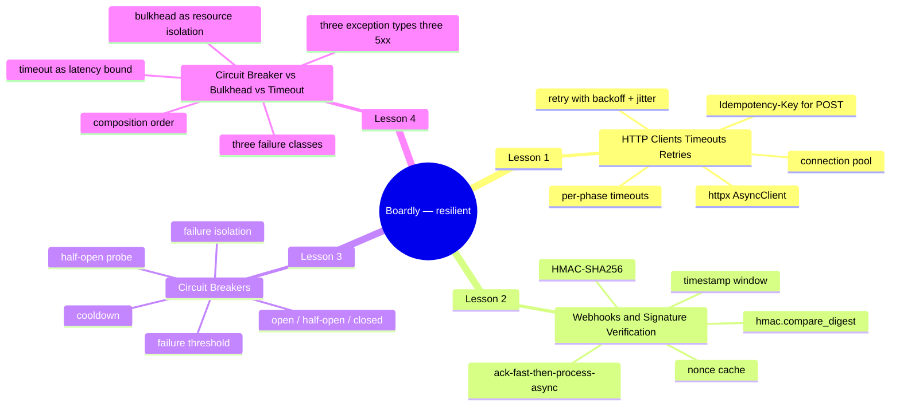
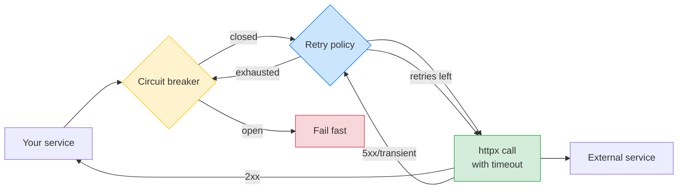

# External Integrations: Map of Content

**Bookmark this page.**

This is the **home base** for Section 15 — External Integrations. Every lesson in this folder, every pattern, every cross-reference back to the rest of the vault — all reachable from here. When you get lost, come back to the MOC.

Hello, friend. Pull up a chair.

Everything outside your process is a network call, and every network call will eventually fail in a way you didn't predict. The downstream service will get slow. The webhook sender will send a tampered signature. The third-party API will be rate-limited. The broker will go down. The DNS will return the wrong IP. The TLS handshake will fail. The connection will reset halfway through the response. Each of these is a different failure with a different fix, and the discipline of this section is matching the failure to the fix.

In the next three lessons we are going to give `Boardly` a well-behaved HTTP client (with explicit timeouts, connection pooling, retries with backoff and jitter, and an `Idempotency-Key` for non-idempotent verbs), a webhook receiver (with HMAC-SHA256 verification, replay protection, and ack-fast-then-process-async), and a hand-rolled async circuit breaker (with open/half-open/closed states and integration with the retry policy). The thread that runs through all three lessons is the rule that opens every page of this section: *every external call has a timeout, every timeout is explicit, every retry is safe, and every persistent outage is isolated by a circuit breaker.*

**You're in the right place.**

If you've shipped a `httpx.get(url)` call without a timeout, this section was written for you. If you've received a webhook without verifying the signature, this section was written for you. If you've watched a downstream outage cascade across your stack because every worker thread was blocked on a timeout, this section was written for you. We'll go slow. We'll explain every line. You will build a real HTTP client, a real webhook receiver, and a real circuit breaker on top of `Boardly`.

---

## The Boardly Progression

Four lessons. One growing application. By Lesson 4 your `Boardly` API has:

- A `ResilientClient` that wraps `httpx.AsyncClient` with per-phase timeouts (`httpx.Timeout(8.0, connect=2.0)`), a connection pool (`httpx.Limits(max_connections=100, max_keepalive_connections=20)`), retry with exponential backoff + full jitter, an `Idempotency-Key` header for `POST` calls, and request-ID propagation.
- A `POST /webhooks/stripe` endpoint that verifies the inbound `Stripe-Signature` header with `hmac.compare_digest`, rejects stale messages via a timestamp window, dedups via a Redis `SETNX` nonce cache, enqueues a worker job, and acks in <100 ms.
- A hand-rolled `CircuitBreaker` class with open / half-open / closed states, a configurable failure threshold and cooldown, a single-flight half-open probe, an `is_failure` predicate that ignores 4xx, and metrics on state transitions.
- A `Bulkhead` (`asyncio.Semaphore` wrapper) and `Timeout` (`asyncio.timeout` wrapper) in `boardly/resilience.py`, plus the `call_with_resilience` composition that wraps the outbound call as `timeout → bulkhead → breaker → httpx` and maps the three exception types (`BulkheadFullError`, `CircuitOpenError`, `TimeoutError`) to three 5xx codes (`503` + `Retry-After: 1`, `503` + `Retry-After: <cooldown>`, `504` + `Retry-After: 5`).

And you'll know *why* every line is there.

---

## Lessons in Order

| # | Lesson | What you add to `Boardly` | Time |
|---|--------|---------------------------|------|
| 1 | [[HTTP-Clients-Timeouts-Retries]] | `boardly/clients.py` with `ResilientClient` (httpx + timeouts + pool + retry + backoff + jitter + idempotency key + request-ID propagation); the `POST /orders/{id}/charge` endpoint that uses it | 75–100 min |
| 2 | [[Webhooks-and-Signature-Verification]] | `boardly/webhooks.py` with the Stripe-shaped webhook endpoint (HMAC-SHA256 verify, timestamp window, nonce cache, ack-fast-then-process-async); the worker that processes the verified event | 75–100 min |
| 3 | [[Circuit-Breakers]] | `boardly/circuit_breaker.py` with the hand-rolled async `CircuitBreaker`; the `PaymentsIntegration` that wraps the `ResilientClient` in a breaker; the breaker-state metric | 90–120 min |
| 4 | [[Circuit-Breaker-vs-Bulkhead-vs-Timeout]] | `boardly/resilience.py` with `Bulkhead`, `Timeout`, and `call_with_resilience` — the composition layer that wraps the same outbound call in all three resilience patterns (timeout → bulkhead → breaker → httpx) and maps their three exception types to three 5xx codes; the `PaymentsStack` Depends provider | 60–90 min |

**Tip — How to read this section**

Read the lessons **in order**. Lesson 2's webhook receiver offloads to the worker from Section 14. Lesson 3's circuit breaker wraps the `ResilientClient` from Lesson 1 and uses the OTel spans from Section 13 to make state transitions visible. Lesson 4 composes the bulkhead, the breaker from Lesson 3, and the timeout into one belt-and-braces wrapper. If you skip ahead, you'll bring in pieces you haven't built yet.

Each lesson follows the same shape: **Learning Objectives -> Prerequisites -> The Problem -> The Code -> Line-by-Line Deep Dive -> Execution Trace -> Common Mistakes -> Engineering Trade-Offs -> Exercises -> Verification -> Previously Learned Here -> What's Next -> Sources -> What We Learned**. Open the lesson in one pane and the `boardly/` source in another, side by side. Type the code yourself. Don't copy-paste. Typing is what makes it stick.

---

## The Three Failure Modes

When you call an external service, three things can go wrong:

| Failure | Symptom | Tool |
|---|---|---|
| Slow response | Request hangs | Timeouts + circuit breaker |
| Transient error | 503, 504, connection reset | Retry with backoff |
| Persistent outage | All requests fail | Circuit breaker (fail fast) |

The three lessons map to these three. The full picture is: every external call gets a **timeout**, gets **retried** with backoff only when retry is safe, and sits behind a **circuit breaker** so a sustained outage doesn't pin every worker thread.

---

## Prerequisites

- [[02-Web-and-HTTP/Idempotency-Safe-Retries-Pagination]] — retry is only safe for idempotent verbs; this is foundational.
- [[02-Web-and-HTTP/HTTP-Request-Lifecycle]] — a webhook is just an HTTP request.
- [[03-FastAPI-Core/Application-and-Lifespan]] — the HTTP client and circuit breaker are created in lifespan.
- [[13-Performance-and-Observability/OpenTelemetry-Tracing]] — external calls show up as client spans; you need this to see *why* a circuit opened.
- [[14-Caching-and-Background-Processing/Background-Tasks-vs-Workers]] — webhook processing is the canonical case for offloading to a worker.

## Cross-references

- The HTTP client here is the same one used to propagate request IDs in [[13-Performance-and-Observability/Structured-Logging-and-Request-IDs]].
- Workers calling external services ([[14-Caching-and-Background-Processing/Background-Tasks-vs-Workers]]) need circuit breakers; without one, a downstream outage backs up your job queue.
- The outbox relay ([[14-Caching-and-Background-Processing/Transactional-Outbox]]) calls a broker — that's an external integration that should sit behind a circuit breaker.

---

## Concepts First Taught Here

Two recurring concepts are taught for the first time in this section:

- **Circuit breaker** — first taught in [[Circuit-Breakers]]. The open / half-open / closed state machine that isolates a failing downstream so it doesn't cascade. Reused in [[Circuit-Breaker-vs-Bulkhead-vs-Timeout]] (composed with bulkhead + timeout) and in [[14-Caching-and-Background-Processing/Background-Tasks-vs-Workers]] (workers calling external services) and project work.
- **Bulkhead** — first taught in [[Circuit-Breaker-vs-Bulkhead-vs-Timeout]]. The `asyncio.Semaphore` wrapper that limits concurrent in-flight calls to a downstream so a slow one can't exhaust your worker pool. The resource-isolation counterpart to the circuit breaker's failure-isolation pattern. Composed with timeout + circuit breaker in the same lesson.

If a later section touches either concept, it links back here instead of re-explaining.

## Concepts Reused Here (not re-explained)

These were taught in earlier sections. We link back instead of repeating:

- `Idempotency` — [[02-Web-and-HTTP/Idempotency-Safe-Retries-Pagination]].
- `FastAPI lifespan` — [[03-FastAPI-Core/Application-and-Lifespan]].
- `Middleware` — [[03-FastAPI-Core/Middleware-and-Request-Order]].
- `OpenTelemetry` — [[13-Performance-and-Observability/OpenTelemetry-Tracing]].
- `Structured logging` — [[13-Performance-and-Observability/Structured-Logging-and-Request-IDs]].
- `Background tasks / workers` — [[14-Caching-and-Background-Processing/Background-Tasks-vs-Workers]].
- `Transactional outbox` — [[14-Caching-and-Background-Processing/Transactional-Outbox]].
- `HTTP request lifecycle` — [[02-Web-and-HTTP/HTTP-Request-Lifecycle]].
- `asyncio primitives` — [[10-Async-Python/asyncio-Primitives]].

---

## Reading Paths

Not everyone has four hours in one block. Pick a path:

### The Fast Path (2 hours)

Just want a typed HTTP client with timeouts today? Read Lesson 1. You'll have a `ResilientClient` with per-phase timeouts, a pool, retries with backoff, and an idempotency key. Come back for 2, 3, and 4 when you need to receive webhooks, isolate a downstream, or compose all three resilience patterns.

### The Thorough Path (6–8 hours)

Linear. The lessons deliberately build on each other: Lesson 2's webhook receiver offloads to the worker from Section 14; Lesson 3's circuit breaker wraps the client from Lesson 1 and uses the OTel spans from Section 13; Lesson 4 composes the bulkhead + the breaker + the timeout into one belt-and-braces wrapper. Skip none of it.

**Example — Which path are you on?**

Open a daily note and write down: which path, when you'll study each lesson, and a target completion date. Committing to a schedule beats willpower every time.

---

## Verified Versions (October 2026)

This section targets the following versions, all verified current as of 2026-10-19:

| Package | Version | Notes |
|---------|---------|-------|
| FastAPI | 0.148.0 | Released 2026-10-19. |
| Starlette | 1.9.0 | Pinned by FastAPI. |
| Python | 3.12 | The canonical learner version. |
| `httpx` | latest stable | Sync + async, HTTP/2 support. |
| `tenacity` | latest stable | Retry library (alternative to hand-rolled). |
| `hmac` (stdlib) | latest | For webhook signature verification. |
| `pybreaker` | latest stable | Optional; we hand-roll. |
| Redis | 7.x | For the nonce cache. |
| `structlog` | latest stable | Carried over from Section 13. |
| `uv` | 0.13.1 | The modern Python package runner. |

**Warning — Version pinning matters.**

`httpx` has had a stable async API since 0.18+; the `AsyncHTTPTransport` subclass form we use in Lesson 1 has been stable since 0.23+. The `Idempotency-Key` header is a de-facto standard (Stripe, AWS, most modern APIs); there's no RFC, but the convention is stable. `hmac.compare_digest` is in the standard library since Python 3.3+; the API hasn't changed.

---

## Reference Links

- httpx documentation — <https://www.python-httpx.org/>
- Stripe — Webhook Signatures — <https://docs.stripe.com/webhooks/signatures>
- Martin Fowler — CircuitBreaker — <https://martinfowler.com/breakers/>
- See [[21-Reference-Library/Source-Register]] for the full source list with dates accessed.

---

## The One Rule

> Every external call has a timeout. Every timeout is explicit. No exceptions.

---

**Your map is ready.**

Four lessons, one growing `Boardly` application, all reachable from this page. Pick a starting point and go. We'll see you on the other side.

---

**Tags:** #moc #integrations #http #resilience #circuit-breaker #bulkhead #timeout #index #home
**Previous:** [[14-Caching-and-Background-Processing/00-Caching-MOC]]
**Start:** [[HTTP-Clients-Timeouts-Retries]] →
