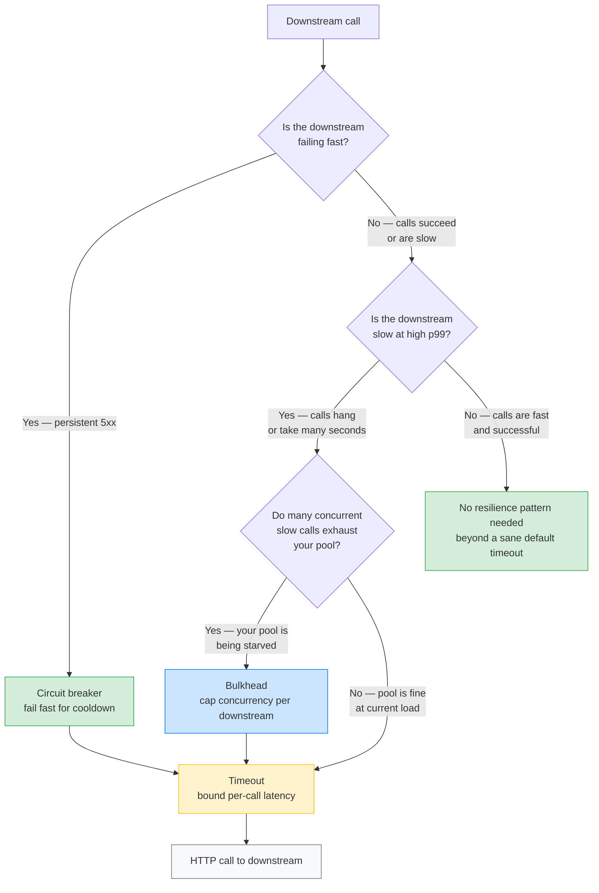
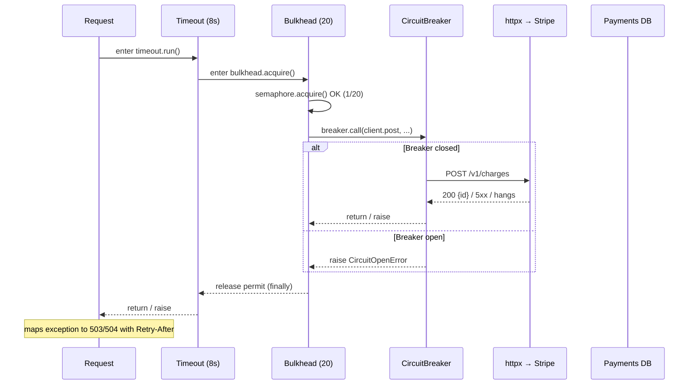

# Lesson 04: Circuit Breaker vs Bulkhead vs Timeout – When to Use What

*Three resilience patterns, three different problems they solve, one canonical request path that uses all three — and a decision tree so you stop guessing which one to reach for.*

**You made it to the capstone of Section 15.**

Lessons 01–03 each took one pattern in isolation: HTTP client + timeouts in Lesson 01, circuit breaker in Lesson 03. This lesson puts them *side by side on the same call* and adds the third pattern nobody remembers — the **bulkhead**. By the end, you'll know exactly which pattern defends against which failure, why "timeout alone" is the most expensive resilience decision you can make, and how the three compose into one belt-and-braces wrapper. Take your time. This is the lesson that turns "we have a circuit breaker" into "we are resilient to the three failure classes that kill services."


#resilience #circuit-breaker #bulkhead #timeout #comparison

## Learning Objectives

By the end of this lesson you will be able to:

1. **Name the three failure classes** the three patterns defend against — slow response, persistent outage, resource exhaustion — and pair each with its primary pattern.
2. **Explain why timeout alone is not enough** — a slow downstream with a 30 s timeout still pins N workers for 30 s each; the timeout bounds latency *per call* but not *across calls*.
3. **Explain when a bulkhead saves you and a circuit breaker wouldn't** — when the downstream is *slow* (not failing) and your own pool exhaustion is the actual outage.
4. **Implement a `Bulkhead`** as an `asyncio.Semaphore` wrapper with acquire-timeout and metrics, and a `Timeout` as an `asyncio.timeout()` context manager.
5. **Compose the three patterns in the right nesting order** — `timeout(...)` outside, `circuit_breaker.call(...)` inside that, `bulkhead.acquire(...)` inside that, then the HTTP call — and explain *why* this order (each layer defends against the failure of the layer inside it).
6. **Wire all three as FastAPI lifespan-owned resources** behind `Depends` providers, so a single route gets the whole stack by type-annotating one argument.
7. **Tune the three dials together** — pool size, breaker threshold, timeout budget — against a real concurrency target (100 req/s, 200 ms p99), not against vibes.
8. **Decide when each pattern is the right primary defence** — and recognise the two anti-patterns: "use only timeouts" and "use only a breaker".

## Prerequisites

Before starting, you need:

- **The HTTP client lesson** — [[15-External-Integrations/HTTP-Clients-Timeouts-Retries]]. The `ResilientClient` built there is what we wrap here. This lesson assumes you already know per-phase `httpx.Timeout`, `httpx.Limits`, retry-with-backoff, and `Idempotency-Key`.
- **The circuit-breaker lesson** — [[15-External-Integrations/Circuit-Breakers]]. We reuse the `CircuitBreaker` class verbatim. We do not re-explain the closed/open/half-open state machine here.
- **Async primitives** — [[10-Async-Python/asyncio-Primitives]]. `asyncio.Semaphore` is the bulkhead primitive; `asyncio.timeout` is the timeout primitive. If you can't explain what `Semaphore.acquire()` blocks on, go back and read Lesson 10.
- **FastAPI lifespan** — [[03-FastAPI-Core/Application-and-Lifespan]]. The bulkhead and the breaker are long-lived process resources created in lifespan.
- **FastAPI dependency injection** — [[03-FastAPI-Core/Dependency-Injection]]. The route gets the whole stack via a single `Depends` provider.
- **About an hour and a half.** The code is ~120 lines across one new file; the *composition reasoning* is what takes time.

**The most common gap: "we already have timeouts."**

Yes, you have timeouts. Every call in your service has a timeout (it does, right?). The question this lesson answers is: *is a timeout enough?* The honest answer is "no, unless your service has one worker and one downstream." If you have 100 worker tasks and a 30 s timeout and the downstream goes slow, you have 100 × 30 = 3000 worker-seconds of blocked work before the timeouts start firing. By then your event loop is starved and your liveness probe has failed. The bulkhead and the circuit breaker exist *because* a timeout alone is not enough. We'll prove it with the math in "The Problem" below.


## The Problem

Picture three outages. Each looks identical from the outside — `Boardly` returns 5xx to its callers — but each has a different cause and a different fix.

**Outage A — the slow downstream.** Stripe is up, but a deploy made their p99 jump from 200 ms to 28 seconds. `Boardly`'s `POST /orders/{id}/charge` calls Stripe; the call doesn't fail, it just takes 28 s. Your 30 s read timeout fires; the call eventually fails; the handler returns 504. With 100 req/s of charge traffic, you have 100 × 28 = 2800 in-flight requests at any moment. Your 100 worker tasks are all parked. New requests queue. The queue grows. Memory grows. Your liveness probe starts failing. Kubernetes restarts your pod. The restart kills the in-flight requests. Stripe recovers. You're back, but you were down for 10 minutes.

**Outage B — the broken downstream.** Stripe is down hard — 100% 5xx. Each call fails in 50 ms (their load balancer returns 503 fast). Your circuit breaker doesn't open because each failure is fast (no pile-up). But every customer-facing charge fails. Your dashboard is red. Customers complain. You're up (the breaker protects you), but you've lost the business capability.

**Outage C — the noisy neighbour.** Stripe is fine. Your *email* downstream is slow — Mailgun's deploy made their p99 jump to 45 s. You have 200 worker tasks total, shared across all routes. `POST /orders/{id}/charge` doesn't call Mailgun. But `POST /orders/{id}/fulfill` does. The fulfill route parks 200 worker tasks on Mailgun's 45 s calls. The charge route — which doesn't touch Mailgun — has no workers free. Charge traffic starts failing with 503 because *your own pool is exhausted*, not because Stripe is slow. You were killed by a downstream you don't even call from the failing route.

Each outage is real. Each costs money. Each needs a different defence:

| Outage | Failure class | What defends |
|---|---|---|
| A — slow downstream | Slow response on the call path | Timeout (per-call latency bound) + circuit breaker (fail fast across calls) |
| B — broken downstream | Persistent outage | Circuit breaker (failure isolation) |
| C — noisy neighbour | Resource exhaustion from one downstream | Bulkhead (resource isolation) |

Three patterns, three failure classes, three orthogonal defences. **Timeout** bounds latency per call. **Circuit breaker** stops calling a failing downstream for a cooldown. **Bulkhead** limits how many of your workers a single downstream can consume. They are *complementary*, not alternatives — a production-grade service uses all three.

**Student asks: Why is timeout alone not enough?**

A timeout bounds *one* call's latency. It does not bound *how many calls are in flight*. If your service accepts 100 req/s and the downstream takes 30 s before timing out, you have 100 × 30 = 3000 calls in flight at the steady state — all 100 workers are blocked, the 100th call from now will have to wait 30 s for a free worker. The timeout tells each individual request "give up after 30 s"; it does *not* tell the service "stop accepting new requests when workers are saturated". For that, you need the bulkhead (limits concurrent calls) and the circuit breaker (stops calling a known-bad downstream). The timeout is the *last* line of defence — the breaker and the bulkhead are the *first* and *second* lines, because they prevent the pile-up that the timeout eventually times out of.

Concretely: with a 30 s timeout alone, your p99 is 30 s (every call has to wait until the timeout fires). With a 30 s timeout *plus* a circuit breaker that opens after 5 failures, your p99 drops to 1 ms once the breaker opens (the call throws `CircuitOpenError` immediately). The timeout is still 30 s, but the breaker means you almost never reach it. The timeout is the safety net; the breaker is the goalkeeper.


**Student asks: When does a bulkhead save you but a circuit breaker wouldn't?**

When the downstream is *slow* but not *failing*. A circuit breaker opens when enough calls *fail*. A downstream that takes 28 s per call but eventually returns 200 isn't failing — it's just slow. Your breaker never opens because no call is a failure. But every call holds a worker for 28 s. If your pool is 100 workers and you have 100 req/s, the pool is fully consumed by 100 in-flight slow calls; the 101st call has no worker. The bulkhead — `Bulkhead(max_concurrency=20)` for the slow downstream — caps the in-flight count to 20. The 21st call gets a 503 immediately ("resource exhausted"), and the other 80 workers are free for *other* routes (including routes that don't even touch the slow downstream). The bulkhead contains the slow downstream to 20 workers, leaving 80 for the rest of the service. The breaker would not have opened; the bulkhead is the only thing that prevents cascade. This is why the bulkhead is its own pattern — it solves a problem the breaker and the timeout together cannot.




The decision tree above is the lesson's recommendation in one picture. Each diamond is a question you ask about *the downstream's behaviour*; each leaf is the pattern that defends against that behaviour. In production, you usually need *all three leaves active* — the tree shows which one is the *primary* defence for each failure class, but the other two are still in the request path as defence in depth.

## The Code

We are going to add one file to `Boardly` — `boardly/resilience.py` — that contains the `Bulkhead` and `Timeout` classes, plus the `PaymentsStack` that composes them with the existing `CircuitBreaker` from Lesson 03 around the existing `ResilientClient` from Lesson 01. Then we'll wire the whole stack as a single FastAPI dependency, so a route gets the full stack by annotating one argument.

Here is the code.

```python
# boardly/resilience.py
"""Boardly — Bulkhead + Timeout + CircuitBreaker composition.

Lesson 15.4: the three resilience patterns combined around the
ResilientClient from Lesson 15.1 and the CircuitBreaker from
Lesson 15.3. Designed to wrap any `async def` callable.
"""
from __future__ import annotations

import asyncio
from collections.abc import Awaitable, Callable
from contextlib import asynccontextmanager
from typing import Any, ParamSpec, TypeVar

import structlog

from boardly.circuit_breaker import CircuitBreaker, CircuitOpenError

logger = structlog.get_logger(__name__)

P = ParamSpec("P")
R = TypeVar("R")


class BulkheadFullError(Exception):
 """Raised when the bulkhead has no permits and acquire_timeout fires."""

 def __init__(self, name: str, max_concurrency: int) -> None:
 super().__init__(
 f"bulkhead {name!r} is full (max_concurrency={max_concurrency})"
 )
 self.name = name
 self.max_concurrency = max_concurrency


class Bulkhead:
 """Limits concurrent in-flight calls to one downstream.

 A wrapper around `asyncio.Semaphore` with:
 - a name (for metrics + logs)
 - a max_concurrency (the semaphore's initial permits)
 - an acquire_timeout (fail fast instead of queueing)
 - a gauge of in-flight count (for dashboards)

 Why a Semaphore, not a thread pool: in an async app, the "resource"
 we are bounding is a worker task (an event-loop slot), not an OS
 thread. `asyncio.Semaphore` is the right primitive for that.
 """

 def __init__(
 self,
 *,
 name: str,
 max_concurrency: int,
 acquire_timeout: float = 0.5,
 ) -> None:
 if max_concurrency < 1:
 raise ValueError("max_concurrency must be >= 1")
 self.name = name
 self.max_concurrency = max_concurrency
 self.acquire_timeout = acquire_timeout
 self._sem = asyncio.Semaphore(max_concurrency)
 self._in_flight = 0

 @property
 def in_flight(self) -> int:
 """Current in-flight count (for metrics)."""
 return self._in_flight

 @asynccontextmanager
 async def acquire(self) -> Any:
 """Acquire a permit, yield, release.

 Raises `BulkheadFullError` if no permit is available within
 `acquire_timeout`. The bounded acquire prevents the bulkhead
 itself from becoming a pile-up point — the 101st caller fails
 fast rather than queueing for 30 seconds.
 """
 try:
 await asyncio.wait_for(
 self._sem.acquire(), timeout=self.acquire_timeout,
 )
 except asyncio.TimeoutError:
 logger.warning(
 "bulkhead_full",
 bulkhead=self.name,
 max_concurrency=self.max_concurrency,
 in_flight=self._in_flight,
 )
 raise BulkheadFullError(self.name, self.max_concurrency)

 self._in_flight += 1
 try:
 yield
 finally:
 self._in_flight -= 1
 self._sem.release()


class Timeout:
 """Bounds the wall-clock latency of a coroutine.

 A thin wrapper around `asyncio.timeout` (Python 3.11+) that
 adds a name (for metrics + logs) and re-raises the right
 exception type. `asyncio.TimeoutError` is the stdlib name; we
 re-raise as `TimeoutError` (the builtin) for symmetry with the
 Bulkhead's `BulkheadFullError`.
 """

 def __init__(self, *, name: str, seconds: float) -> None:
 if seconds <= 0:
 raise ValueError("seconds must be > 0")
 self.name = name
 self.seconds = seconds

 @asynccontextmanager
 async def run(self) -> Any:
 """Context manager that cancels the inner block after `seconds`."""
 try:
 async with asyncio.timeout(self.seconds):
 yield
 except TimeoutError:
 logger.warning(
 "timeout_fired",
 timeout_name=self.name,
 seconds=self.seconds,
 )
 raise


async def call_with_resilience(
 *,
 bulkhead: Bulkhead,
 breaker: CircuitBreaker,
 timeout: Timeout,
 fn: Callable[P, Awaitable[R]],
 /,
 *args: P.args,
 **kwargs: P.kwargs,
) -> R:
 """Run `fn(*args, **kwargs)` wrapped in all three patterns.

 Nesting order (outermost → innermost):

 1. `timeout` — bounds the wall-clock time of the whole stack.
 If the inner two layers + the call exceed `seconds`,
 cancel everything and raise.
 2. `bulkhead` — limits concurrent in-flight calls. The
 acquire_timeout (default 0.5 s) means a full bulkhead fails
 fast rather than queueing — which would defeat the purpose
 (the queue would be the pile-up).
 3. `breaker` — opens after enough failures, fails fast for
 the cooldown, lets one probe through in half-open.
 4. `fn` — the actual HTTP call.

 Why this order: each layer defends against a failure of the
 layer inside it. The timeout defends against the breaker +
 bulkhead + call all hanging. The bulkhead defends against many
 calls piling up on a slow downstream. The breaker defends
 against a downstream that has been failing. The order is
 *outermost defends against the worst case of everything inside*.
 """
 async with timeout.run():
 async with bulkhead.acquire():
 return await breaker.call(fn, *args, **kwargs)
```

That's the resilience module — about 130 lines. Now we wire it as a FastAPI lifespan resource and a `Depends` provider, plus the route that uses the full stack.

```python
# boardly/main.py — lifespan addition (Lifespan from Lesson 03)
@asynccontextmanager
async def lifespan(app: FastAPI) -> AsyncIterator[None]:
 # ... existing resources ...

 # --- Resilience stack for the payments downstream ---
 app.state.payments_bulkhead = Bulkhead(
 name="payments",
 max_concurrency=20, # 20 concurrent calls to Stripe
 acquire_timeout=0.5, # 500 ms — fail fast if the bulkhead is full
 )
 # app.state.payments_breaker already exists (from Lesson 03)
 app.state.payments_timeout = Timeout(
 name="payments",
 seconds=8.0, # overall budget for the call + retry stack
 )
 yield
 # Bulkhead and Timeout hold no resources; nothing to close.
 # (The breaker's teardown was already in Lesson 03.)
```

```python
# boardly/dependencies.py — the single Depends provider
from dataclasses import dataclass
from typing import Annotated

from fastapi import Depends, Request
from boardly.resilience import Bulkhead, Timeout
from boardly.circuit_breaker import CircuitBreaker


@dataclass(frozen=True, slots=True)
class PaymentsStack:
 """One-stop bundle for the payments resilience stack.

 The route type-annotates `stack: PaymentsStack = Depends()` (well,
 depends on a factory that builds this) and gets the bulkhead,
 the breaker, and the timeout in one place. The actual HTTP call
 goes through `call_with_resilience(bulkhead=stack.bulkhead, ...)`.
 """
 bulkhead: Bulkhead
 breaker: CircuitBreaker
 timeout: Timeout


async def payments_stack(
 request: Request,
) -> PaymentsStack:
 """FastAPI Depends provider for the payments resilience stack."""
 return PaymentsStack(
 bulkhead=request.app.state.payments_bulkhead,
 breaker=request.app.state.payments_breaker,
 timeout=request.app.state.payments_timeout,
 )


PaymentsStackDep = Annotated[PaymentsStack, Depends(payments_stack)]


# --- The route that uses the full stack ---
@router.post("/orders/{order_id}/charge")
async def charge_order(
 order_id: int,
 stack: PaymentsStackDep,
 client: ResilientClientDep, # from Lesson 01
 current_user: CurrentUserDep, # from Lesson 11.03
) -> dict:
 """Charge a customer via the payments downstream.

 The full resilience stack wraps the call:
 - timeout(8s) → bulkhead(20) → circuit_breaker → httpx call
 """
 try:
 result = await call_with_resilience(
 bulkhead=stack.bulkhead,
 breaker=stack.breaker,
 timeout=stack.timeout,
 fn=client.post,
 url="/v1/charges",
 json={
 "amount": 4999,
 "currency": "usd",
 "order_id": order_id,
 "idempotency_key": f"order_{order_id}",
 },
 headers={"Idempotency-Key": f"order_{order_id}"},
 )
 except BulkheadFullError:
 raise HTTPException(
 status_code=503,
 detail={
 "error": "payments_busy",
 "message": "Too many concurrent payments calls; please retry.",
 },
 headers={"Retry-After": "1"},
 )
 except CircuitOpenError as e:
 raise HTTPException(
 status_code=503,
 detail={
 "error": "payments_unavailable",
 "message": "Payments downstream is in circuit-breaker cooldown.",
 "retry_after": int(e.remaining_seconds),
 },
 headers={"Retry-After": str(int(e.remaining_seconds))},
 )
 except TimeoutError:
 raise HTTPException(
 status_code=504,
 detail={
 "error": "payments_timeout",
 "message": "Payments downstream did not respond in time.",
 },
 headers={"Retry-After": "5"},
 )
 return {"charge_id": result["id"], "status": "succeeded"}
```

That's the whole addition: `boardly/resilience.py`, a few lines added to the lifespan in `boardly/main.py`, a `PaymentsStack` dataclass + provider in `boardly/dependencies.py`, and the `POST /orders/{order_id}/charge` route that uses it. Run it. Watch the trace. We'll go through every line next.

## Line-by-Line Deep Dive

This section is the heart of the lesson. Read it twice. Don't skip.

### `BulkheadFullError`: when the bulkhead is full

```python
class BulkheadFullError(Exception):
 def __init__(self, name: str, max_concurrency: int) -> None:
 super().__init__(...)
 self.name = name
 self.max_concurrency = max_concurrency
```

**What it does:** A custom exception so the route can distinguish "bulkhead full" from "circuit open" from "timeout fired". Each maps to a different 5xx with a different `Retry-After`.

**Why a custom exception and not just `asyncio.TimeoutError`:** Because the caller (the route handler) needs to make a *user-visible decision* based on *which* defence fired. Bulkhead full means "wait a bit and retry, we're saturated but the downstream is fine". Circuit open means "wait the cooldown, the downstream is broken". Timeout means "we don't know — could be slow, could be hung". Each gets a different `Retry-After` and a different error code. The custom exception type is the way to carry that information through the stack.

**Three exception types, three 5xx codes**

`BulkheadFullError` → `503` with `Retry-After: 1` (short — the saturation is transient).
`CircuitOpenError` → `503` with `Retry-After: <cooldown>` (long — wait for the breaker to probe).
`TimeoutError` → `504` with `Retry-After: 5` (medium — the downstream might just be slow).

The distinction matters for callers: a downstream client can implement "retry on 503 with `Retry-After: 1` immediately, but back off exponentially on 504" — the right behaviour for each failure class.


### `Bulkhead`: the resource isolation primitive

```python
class Bulkhead:
 def __init__(self, *, name, max_concurrency, acquire_timeout=0.5):
 if max_concurrency < 1:
 raise ValueError("max_concurrency must be >= 1")
 self.name = name
 self.max_concurrency = max_concurrency
 self.acquire_timeout = acquire_timeout
 self._sem = asyncio.Semaphore(max_concurrency)
 self._in_flight = 0
```

**What it does:** Wraps an `asyncio.Semaphore` with metadata (name, max_concurrency, acquire_timeout) and an in-flight counter for metrics.

**Why `asyncio.Semaphore` and not a thread pool:** In an async FastAPI app, the "resource" we are bounding is an *event-loop slot* (a coroutine that's holding an awaitable open), not an OS thread. `asyncio.Semaphore` is the right primitive for that. A thread pool (`concurrent.futures.ThreadPoolExecutor`) would be the right primitive for a *sync* app where each in-flight call is an OS thread — but we're not sync.

**Why keyword-only arguments (`*`):** Forces the caller to write `Bulkhead(name="payments", max_concurrency=20)` rather than `Bulkhead("payments", 20)`. The first is self-documenting at the call site; the second is a bug magnet when someone later adds a third positional arg and the call sites don't get updated.

**Why `acquire_timeout=0.5` default:** The bulkhead's job is to *fail fast* when full, not to *queue*. A bulkhead that queues has recreated the pile-up — the queue *is* the pile-up. The 0.5 s default says "if I can't get a permit in 500 ms, the bulkhead is saturated; throw `BulkheadFullError` and let the route return 503". The caller's retry policy can then back off, and the bulkhead drains.

**Tip — Tune `acquire_timeout` to your retry budget.**

If your client retries with `backoff_base=0.5`, an `acquire_timeout` of 0.5 s means a saturated bulkhead eats the first retry attempt. That's fine — the second retry will likely succeed (the bulkhead has drained). If your `backoff_base` is 2 s, set `acquire_timeout` to 0.1 s — failing fast is strictly better than waiting under a saturated bulkhead. The rule: `acquire_timeout` should be << `backoff_base`, so the retry path kicks in quickly.


**Why an in-flight counter on top of the Semaphore:** The Semaphore's `_value` is technically readable, but it's an implementation detail and it changes after `release()`. A plain integer we increment/decrement ourselves is more honest, more testable, and exposes a stable metric (`bulkhead.in_flight`) for Prometheus.

**Student asks: why is the bulkhead *per-downstream* and not one global bulkhead for the whole service?**

Because the whole point of the bulkhead is **resource isolation** — *one* slow downstream can't starve calls to *other* downstreams. If you have one global bulkhead of 100 permits, a slow Stripe can eat all 100 and your Mailgun calls (and your Twilio calls, and your S3 calls) have no permits. Per-downstream bulkheads mean Stripe gets 20 permits, Mailgun gets 20, Twilio gets 20, S3 gets 20 — a slow Stripe can only starve *Stripe callers*, not the whole service. The boardly main pool's 100 worker tasks are still shared across all routes, but no single downstream can eat more than its bulkhead allocation. The "noisy neighbour" outage from the lesson's "Outage C" is exactly what per-downstream bulkheads prevent.


### `Bulkhead.acquire`: the bounded context manager

```python
@asynccontextmanager
async def acquire(self):
 try:
 await asyncio.wait_for(
 self._sem.acquire(), timeout=self.acquire_timeout,
 )
 except asyncio.TimeoutError:
 logger.warning("bulkhead_full", ...)
 raise BulkheadFullError(self.name, self.max_concurrency)

 self._in_flight += 1
 try:
 yield
 finally:
 self._in_flight -= 1
 self._sem.release()
```

**What it does:** Tries to acquire a permit within `acquire_timeout`. If success, increments `_in_flight` and yields. The `try/finally` decrements and releases no matter how the inner block exits — normal return, exception, or cancellation.

**Why `asyncio.wait_for(self._sem.acquire(), timeout=...)` instead of `async with asyncio.timeout(...)` around `await self._sem.acquire()`:** Both work; the first is slightly more direct (it cancels the `acquire()` coroutine in place, no nesting of context managers). The principle either way is: bound the acquire, not just the inner work.

**Why `try/finally` and not a bare `yield`:** If the inner block raises (e.g. the downstream returned 500), the `finally` still releases the permit. If it doesn't, a single failure would leak the permit permanently — and after `max_concurrency` failures, the bulkhead would be permanently empty. The `try/finally` is the only honest way to write this.

**Warning — Don't release the Semaphore on cancellation without the `finally`.**

`asyncio` cancellation raises `BaseException`-derived `CancelledError` *inside* the awaiting coroutine. A bare `yield` (without `try/finally`) would not release the permit on cancellation — and your bulkhead would leak permits every time Kubernetes sends a `SIGTERM` mid-call. The `try/finally` block catches `BaseException` implicitly (Python's `finally` always runs) and releases the permit. This is the standard pattern for any `async with` that holds a resource.


**Warning — When this breaks: `_in_flight` is read from a different task than the one that incremented it.**

The `_in_flight` counter is a plain Python `int`, not an `asyncio`-protected counter. In single-threaded asyncio this is fine — there's no pre-emption between `acquire()` incrementing and the inner block running. The break is when someone wraps the bulkhead call in `asyncio.to_thread` or `run_in_executor` (e.g. to call a sync boto3 function from inside the resilience stack) — now the increment and the read can happen on different threads, the GIL doesn't help for non-atomic int operations on different threads, and the gauge becomes unreliable. The fix is to make `_in_flight` an `asyncio.Lock`-protected counter if you ever cross the async/thread boundary, or (simpler) to *not* cross that boundary — wrap the *entire* `Bulkhead.acquire()` in async, and only the inner sync call goes to `to_thread`. The in-flight gauge stays in async land. See [[10-Async-Python/asyncio-Primitives]] for the cross-thread `ContextVar` and counter rules.


### `Timeout`: the latency-bounding primitive

```python
class Timeout:
 def __init__(self, *, name, seconds):
 if seconds <= 0:
 raise ValueError("seconds must be > 0")
 self.name = name
 self.seconds = seconds

 @asynccontextmanager
 async def run(self):
 try:
 async with asyncio.timeout(self.seconds):
 yield
 except TimeoutError:
 logger.warning("timeout_fired", ...)
 raise
```

**What it does:** A named wrapper around `asyncio.timeout` (Python 3.11+, verified in 3.12). Cancels the inner block after `seconds` of wall-clock time, raises `TimeoutError` (the builtin) on cancellation.

**Why `asyncio.timeout` and not `asyncio.wait_for`:** `asyncio.timeout` is a context manager, which means it can wrap a block that contains *multiple* awaits (e.g. the bulkhead acquire + the breaker call + the httpx request). `asyncio.wait_for` is per-coroutine. For our composition, we want to bound the *whole stack* — bulkhead acquire + breaker + httpx — not just the httpx call. The context manager form is the right primitive.

**Why Python 3.11+ (and we require 3.12):** `asyncio.timeout` was added in 3.11. Before that, the stdlib had `asyncio.wait_for` (per-coroutine) and the third-party `async-timeout` package (context-manager-shaped, but a dependency). In 3.12, `asyncio.timeout` is the standard primitive and `async-timeout` is no longer needed. (See [[10-Async-Python/asyncio-Primitives]] for the version history.)

**Why re-raise the same `TimeoutError`:** `asyncio.timeout` raises `TimeoutError` (the builtin, since Python 3.11; before that, `asyncio.TimeoutError` which was an alias). We re-raise the same exception so the route handler's `except TimeoutError:` works without import shuffling. The `logger.warning` is for visibility — every timeout firing should show up in the dashboards.

**`asyncio.TimeoutError` vs `TimeoutError`**

In Python 3.11+, `asyncio.TimeoutError` is an alias for the builtin `TimeoutError`. In 3.10 and below, they were distinct. Since we target 3.12, we use `TimeoutError` (the builtin) everywhere. If you're stuck on 3.10, replace with `asyncio.TimeoutError` and the behaviour is the same. The lesson [[10-Async-Python/asyncio-Primitives]] has the full version table.


**Danger — How an attacker thinks: the outer timeout masks a retry amplifier.**

A naive operator sets `timeout = 30s` and the `ResilientClient` retry count to 5 with `backoff_base = 0.5`. A malicious (or just naive) downstream that returns 200 in 29.5 s causes the client to retry 5 times — total wall-clock for one inbound request: 5 × 29.5 = 147.5 s of pinned worker. With 100 worker tasks, the attacker needs only 100 inbound requests to fully saturate the service for ~150 seconds. The defence is that the *overall* `Timeout(8s)` in `call_with_resilience` bounds the *entire* retry stack — the inner retries each get a fraction of the budget. Configure `ResilientClient` to give up retries when the outer timeout is close to firing (use `asyncio.timeout`'s `remaining()` method, Python 3.12+, to bail out of the retry loop with `break` when `remaining() < backoff_base * 2`). Without the outer timeout, a single attacker request amplifies to 147 worker-seconds; with it, the amplification is capped at 8 worker-seconds — an 18× reduction. See [[15-External-Integrations/HTTP-Clients-Timeouts-Retries]] for the retry-with-backoff pattern that respects the outer budget.


### `call_with_resilience`: the composition

```python
async def call_with_resilience(
 *, bulkhead, breaker, timeout, fn, /, *args, **kwargs,
) -> R:
 async with timeout.run():
 async with bulkhead.acquire():
 return await breaker.call(fn, *args, **kwargs)
```

**What it does:** Wraps the call `fn(*args, **kwargs)` in three nested context managers, outermost = timeout, middle = bulkhead, innermost = circuit breaker.

**Why this nesting order (and not another):** Each layer defends against the failure of the layer inside it. Consider the four possible failure modes:

1. **The downstream returns 200 quickly.** All three layers pass through. The timeout doesn't fire. The bulkhead permit is held briefly. The breaker sees a success, stays closed. The route gets the response.
2. **The downstream is slow (10 s on a 2 s timeout).** The timeout fires first (outermost layer). The cancellation propagates inward: bulkhead's `yield` is cancelled, the `finally` releases the permit, breaker sees a `TimeoutError` (which counts as a failure). The route sees `TimeoutError`. If this is the 6th consecutive timeout, the breaker opens. *The timeout bounds the latency, the breaker learns from the failure.*
3. **The downstream is broken (5xx fast).** The breaker (innermost) sees the failure. If the breaker is closed, the call returns 5xx; the route sees it. If the breaker is now open (failure threshold reached), the next call's breaker.call raises `CircuitOpenError` immediately. The bulkhead's `acquire` was held for ~1 ms (the time it took the breaker to fail). The timeout didn't fire. The route sees `CircuitOpenError`.
4. **The downstream is slow AND many concurrent calls.** The bulkhead caps concurrency at 20. The 21st call's `acquire` waits 500 ms; if no permit frees up, it raises `BulkheadFullError` — *before* the breaker or the timeout sees anything. The route returns 503 fast. The 20 in-flight calls each take 2 s (the timeout) and then fail; the breaker sees 20 failures and opens; the bulkhead drains. The 21st-and-onward calls now see `CircuitOpenError` (the breaker opened). The system recovers in 2 s, not 30 s.

Each layer's failure mode triggers the layer outside it appropriately. The order is not arbitrary — it's *outermost defends against the worst case of everything inside*.

**Student asks: What if the bulkhead is *inside* the breaker instead of outside?**

Then a saturated bulkhead (which raises `BulkheadFullError`) would count as a failure for the breaker, and 20 simultaneous bulkhead-fulls would open the breaker — even though the downstream is fine. The breaker would open *because your own pool is saturated*, not because the downstream is broken. That's the wrong failure signal. The bulkhead-outside-breaker order means: bulkhead-full means "I'm saturated, retry later" (no failure counted for the downstream); breaker-open means "the downstream itself is broken" (genuine failure). The two patterns stay semantically distinct.

The rule: **the layer that detects *your own* resource pressure goes outside the layer that detects *the downstream's* failures**. Bulkhead = your pressure. Breaker = downstream's failures. Timeout = a slow call (which is both — but the timeout is a "give up" signal, not a "the downstream is broken" signal, so it can be the outermost).


**Student asks: What if the timeout is *inside* the bulkhead?**

Then the timeout cancellation only cancels the httpx call, not the bulkhead's `acquire`. If the bulkhead is saturated and the `acquire_timeout` is 30 s (unusual, but say you misconfigured), you've held the worker for 30 s before the timeout fires. The timeout should bound *the whole stack*, not just the call. The outermost position is correct.


**Production reality: per-process breakers diverge under multi-worker Uvicorn.**

The `CircuitBreaker` instance lives on `app.state.payments_breaker` — one instance per Uvicorn worker process. With `--workers 4`, you have 4 independent breakers, each with its own failure count and open/closed state. The break: worker 1 sees 5 failures and opens its breaker; workers 2, 3, 4 still see the downstream as fine (their failure counts are lower because load isn't perfectly balanced) and keep sending traffic. The downstream stays overloaded because only 25 % of the fleet (worker 1) stopped calling. The fix is a shared-state breaker: a Redis-backed failure counter (`INCR breaker:payments:failures` with `EXPIRE` on transition to open) so all workers see the same count. The trade-off is one Redis round-trip per failure (which is fine — failures should be rare). For services with one Uvicorn worker (common in dev and small prod), the per-process breaker is fine; for `--workers > 1`, use the shared form. See [[15-External-Integrations/Circuit-Breakers]] + [[14-Caching-and-Background-Processing/Redis-Cache-Aside]] for the shared-counter pattern.


### Lifespan ownership: why the bulkhead and timeout are not module-level

```python
app.state.payments_bulkhead = Bulkhead(...)
app.state.payments_timeout = Timeout(...)
```

**What it does:** Creates the bulkhead and timeout as lifespan-owned resources on `app.state`, just like the engine and the breaker from earlier lessons.

**Why not module-level singletons:** Module-level singletons are created at import time. Tests that import `boardly.main` would create the bulkhead — but `asyncio.Semaphore`'s internal state is bound to the running event loop, and tests have their own event loop. The lifespan-created bulkhead is bound to the production event loop; tests override the lifespan entirely (via `dependency_overrides` or by replacing `app.state.payments_bulkhead` with a test fixture). Same pattern as the engine and the breaker — see Lesson 03's Mistake 5 (module-level resource creation).

**Why `Bulkhead` and `Timeout` have no teardown:** The Semaphore and the `asyncio.timeout` context manager hold no OS resources — they're just in-memory counters and cancellation state. Nothing to close. The lifespan's shutdown block for the payments stack is just the breaker (which has a metrics flush); the bulkhead and timeout are no-ops on shutdown.

### `PaymentsStack`: the dataclass bundle

```python
@dataclass(frozen=True, slots=True)
class PaymentsStack:
 bulkhead: Bulkhead
 breaker: CircuitBreaker
 timeout: Timeout
```

**What it does:** Bundles the three resilience objects into one immutable, slotted dataclass. The route gets the bundle via `Depends`, not three separate `Depends` calls.

**Why a dataclass and not three separate `Depends` calls:** Three separate calls means three separate function calls per route invocation, three separate attribute lookups on `request.app.state`, and three separate type annotations on the route signature. The dataclass bundles them — one `Depends`, one type annotation, one argument. The route signature stays clean: `stack: PaymentsStackDep`.

**Why `frozen=True`:** The stack is immutable — the route shouldn't be able to mutate `stack.bulkhead._sem`. Frozen makes the dataclass hashable (which doesn't matter here, but it's a good default for value types).

**Why `slots=True`:** Faster attribute access, smaller memory footprint, and prevents accidentally adding new attributes. The Python 3.10+ `slots=True` for `dataclass` is the modern form.

### The route handler: three exception types, three 5xx codes

```python
@router.post("/orders/{order_id}/charge")
async def charge_order(order_id, stack, client, current_user):
 try:
 result = await call_with_resilience(
 bulkhead=stack.bulkhead, breaker=stack.breaker,
 timeout=stack.timeout, fn=client.post, url="/v1/charges", ...
 )
 except BulkheadFullError:
 raise HTTPException(503, ..., headers={"Retry-After": "1"})
 except CircuitOpenError as e:
 raise HTTPException(503, ..., headers={"Retry-After": str(int(e.remaining_seconds))})
 except TimeoutError:
 raise HTTPException(504, ..., headers={"Retry-After": "5"})
 return {...}
```

**What it does:** Calls `call_with_resilience` with the three resilience objects and the httpx `client.post` callable. Catches the three exception types and maps each to a different 5xx with a different `Retry-After`.

**Why three different `Retry-After` values:** Each `Retry-After` is a hint to the caller about how long to wait before retrying. The hint should match the failure class:

- Bulkhead full → wait 1 s (the saturation is transient; the bulkhead drains fast).
- Circuit open → wait the breaker's remaining cooldown (the downstream is genuinely broken; wait for the half-open probe).
- Timeout → wait 5 s (we don't know if the downstream is slow or hung; a medium backoff is right).

**Why `Retry-After` and not just status codes:** The HTTP spec (RFC 9110 § 10.2.3) says `Retry-After` is a hint the client MAY honour. A well-behaved client (Stripe's own retry logic, your SPA's fetch wrapper) reads the header and waits. A naive client ignores it and retries immediately — which is fine, because the resilience stack still defends you. The header is a *cooperation* signal, not a requirement.

**Tip — `Retry-After` is a hint, not a command.**

Some clients honour `Retry-After`; some don't. Your resilience stack has to defend you regardless. The header is for the *cooperative* clients — the ones that read it and back off, reducing your load. The non-cooperative clients will retry immediately and hit the same resilience wall (bulkhead full, circuit open, timeout) — which is fine. The system degrades gracefully either way.


**Danger — How an attacker thinks: the `Retry-After` header is an injection vector if you put raw integers in.**

The route does `headers={"Retry-After": str(int(e.remaining_seconds))}` — the `int(...)` is the right move (a non-integer would be a header-injection vector if an attacker could control `e.remaining_seconds`). But the *real* header-injection surface is when a future refactor passes the breaker's cooldown as a string from a config dict: `headers={"Retry-After": config["breaker_cooldown"]}` and the config is `{"breaker_cooldown": "30\r\nX-Evil: yes"}` — the resulting response has an extra header `X-Evil: yes` injected by the attacker who controls the config (a misconfigured feature flag, a leaked admin endpoint that updates the config). The defence is the same as for any user-controllable header value: validate-or-coerce with `str(int(value))`, never `str(value)`; or use Starlette's `Response` constructor which rejects CRLF in header values (FastAPI 0.148.0 / Starlette 1.9.0 raise `ValueError` on CRLF). Don't bypass the constructor — `Response(headers=...)` is the safe path; manually setting `raw_headers` is the unsafe one. See [[HTTP-Headers-Deep-Dive]] for the header-injection deep dive.


## Execution Trace

Run the app:

```bash
uv run uvicorn boardly.main:app --reload
```

Now picture the three outages from "The Problem" and trace each through the resilience stack.

### Outage A: Stripe is slow (28 s p99)

1. Request 1 arrives at `POST /orders/42/charge`. The route calls `call_with_resilience(timeout=8s, bulkhead=20, breaker=closed)`.
2. The timeout's 8 s starts ticking. The bulkhead acquires a permit (permit count: 1/20). The breaker is closed; it calls `client.post(...)`.
3. The httpx call hangs — Stripe is slow. After 8 s, `asyncio.timeout` cancels the inner block. The bulkhead's `finally` releases the permit (count: 0/20). The breaker sees a `TimeoutError` (failure count: 1, threshold: 5).
4. The route catches `TimeoutError`, returns 504 with `Retry-After: 5`.
5. Requests 2–5 do the same. Failure count climbs to 5. Breaker opens (cooldown: 30 s).
6. Request 6: bulkhead acquires (count: 1/20), breaker is open → `CircuitOpenError` immediately (1 ms). Bulkhead releases. Route returns 503 with `Retry-After: 30`.
7. Requests 7–1000 do the same. Each one is a 1 ms 503. Workers are free. Event loop is responsive. Liveness probe stays green. Stripe is still slow, but `Boardly` is up.
8. After 30 s, the breaker goes half-open. Request N+1 is the probe — it runs the full stack. If Stripe recovered, the call succeeds, breaker closes, traffic resumes. If not, breaker re-opens for another 30 s.

**Production reality: the liveness probe is the next domino.**

The story ends with "Kubernetes restarts your pod" — but the more common production story is that the liveness probe fails *before* the restart, and Kubernetes *also* restarts the *other* pods in the Deployment (because they're all hitting the same slow Stripe). The cascade: Stripe slow → all pods' worker pools saturate → all pods' liveness probes start failing (because the probe handler can't get a worker) → Kubernetes restarts all pods simultaneously → all in-flight requests die → Stripe recovers, but you're still cold-starting. The defence is the bulkhead (which keeps worker slots free for the liveness probe handler by limiting how many slots a downstream can consume) and the circuit breaker (which fails fast so the probe handler doesn't sit behind 30 s of timeouts). Concretely: reserve a small bulkhead (`/healthz` gets its own `max_concurrency=5` permit, *outside* the downstream bulkheads) so the probe always has workers even when every downstream is saturated. See [[Health-Checks-and-Probes]] + [[03-FastAPI-Core/Middleware-and-Request-Order]] for the probe-middleware ordering.


### Outage B: Stripe is broken (100% 5xx, fast)

1. Request 1: timeout starts (8 s), bulkhead acquires (1/20), breaker is closed. httpx call returns 5xx in 50 ms. Breaker sees failure (1/5).
2. The route does NOT catch the 5xx as one of the resilience exceptions — the httpx call succeeded at the HTTP layer, just with a 5xx status. The `is_failure` predicate inside the breaker decides: 5xx counts as failure. The breaker increments its failure count.
3. Requests 2–5 do the same. Breaker opens at failure 5.
4. Request 6: `CircuitOpenError` (1 ms). Route returns 503 with `Retry-After: 30`.
5. Stripe stays broken. Every call after request 5 is a 1 ms 503. Workers are free.
6. After 30 s, breaker goes half-open. Probe runs. Stripe is still 5xx. Breaker re-opens. (Repeat until Stripe recovers.)

**Warning — When this breaks: the breaker oscillates and the operator mistakes it for a breaker bug.**

The story says "your circuit breaker doesn't open because each failure is fast (no pile-up)". The break is when the operator misreads this as "the breaker is working — see, it's not even opening". It isn't — the breaker's threshold (5 failures) is being met, but the failure *rate* is so fast (50 ms per call) that 5 failures happen in 250 ms, the breaker opens, half-opens 30 s later, sees one fast failure, re-opens, and the cycle repeats. The downstream is genuinely broken; the breaker is genuinely open; but from the operator's dashboard the breaker looks "always open, never recovering", which feels like a breaker bug. The fix is to surface `breaker_state` transitions as a Prometheus counter (`breaker_transitions_total{from="closed",to="open"}`) and the half-open probe outcomes (`breaker_probe_results_total{outcome="success"}`); a 100 % failure rate in half-open is the signal to page the downstream's owner, not to tune the breaker. See [[13-Performance-and-Observability/OpenTelemetry-Tracing]] for the metric-surfacing convention.


### Outage C: Mailgun is slow (45 s p99); charge route doesn't call Mailgun

1. Charge route's bulkhead is `payments` (Stripe's). It is unaffected.
2. The Mailgun-using route has its own bulkhead (`notifications`, max_concurrency=20).
3. Mailgun calls saturate the `notifications` bulkhead (20/20). The 21st Mailgun call gets `BulkheadFullError`, returns 503 immediately.
4. The charge route's workers are free — they use the `payments` bulkhead, not the `notifications` bulkhead. Charge traffic continues unaffected.
5. Without the bulkhead, the Mailgun calls would have consumed all 200 of the event loop's worker tasks; the charge route would have no workers free, even though Stripe is fine. The bulkhead prevents cascade.

**Production reality: per-tenant bulkheads are the multi-tenant SaaS pattern.**

The "noisy neighbour" outage is *worse* in a multi-tenant SaaS: the noisy neighbour is another *customer*. If Customer A's webhook storm fills the shared Mailgun bulkhead, Customer B's password-reset email (which uses the same Mailgun) is also starved. The pattern in production SaaS is a *two-level* bulkhead: per-tenant permits (Customer A gets 10, Customer B gets 10, capped) *inside* a per-downstream bulkhead (Mailgun gets 50 total). The per-tenant bulkhead is typically a Redis `INCR` with TTL (a token bucket per `tenant_id`); the per-downstream bulkhead is the in-process `Bulkhead` from this lesson. The composition gives "no tenant can starve another tenant, and no downstream can starve the whole service". The trade-off is the per-tenant Redis round-trip on every call — at 10 000 req/s that's 10 000 Redis `INCR`s per second per downstream, which Redis handles trivially (it's a single `INCR` + `EXPIRE` pipeline). See [[17-Advanced-Architecture/Multi-Tenancy]] for the tenant-identity extraction and the per-tenant token bucket pattern.




The sequence diagram shows the nesting order: the timeout contains the bulkhead contains the breaker contains the httpx call. Each layer's exit (normal or exceptional) propagates outward through the stack, with `try/finally` blocks releasing resources along the way.

## Common Mistakes

### Mistake 1: Timeouts only, no bulkhead, no breaker

```python
# WRONG (no resilience layering)
async def charge_order(order_id):
 return await client.post("/v1/charges", json=..., timeout=30.0)
```

**Symptom:** A slow downstream (28 s) times out after 30 s, but by then 100 workers are parked and the service is down. The 30 s timeout bounds *one* call; it does not bound *how many calls are in flight* or *whether the downstream is broken*.

**Fix:** Wrap in the full stack — `timeout(8s) → bulkhead(20) → breaker → httpx`. The timeout is the safety net, not the only defence. See "The Problem" for the math.

**Danger — How an attacker thinks: a timeout-only path is a free DoS amplifier.**

Without a bulkhead or breaker, the only thing that stops a slow downstream from killing the service is the *timeout*. An attacker who discovers the timeout (30 s, in this example) can submit N concurrent slow requests — each pins a worker for 30 s. The attacker needs only N = worker_pool_size requests to fully saturate the service for 30 s; they need N × (30 s / request_interval) requests to keep it saturated indefinitely. With 100 workers and 30 s timeouts, that's 100 requests per 30 s = 3.3 req/s of attacker effort to keep the service down. A bulkhead (`max_concurrency=20`) makes the saturation reach only 20 workers (the other 80 stay free for the liveness probe and other routes); a breaker opens after 5 failures and the attacker's requests start failing in 1 ms — the attacker now has to flood the *breaker threshold* every 30 s, which is much harder. The timeout is the last line of defence; the breaker and bulkhead are the load-bearing ones. See [[11-Authentication-and-Security/Threat-Model-First]] for the threat-modelling framing.


### Mistake 2: Bulkhead with `acquire_timeout=None` (unbounded queueing)

```python
# WRONG
Bulkhead(name="payments", max_concurrency=20, acquire_timeout=None)
# Then `await self._sem.acquire()` queues indefinitely.
```

**Symptom:** When the downstream is slow, the 21st call doesn't fail fast — it queues in the Semaphore's internal waiter list. The waiter list grows. Each waiter holds a worker. The bulkhead has recreated the pile-up it was supposed to prevent.

**Fix:** Always set `acquire_timeout` to a small value (0.1–1 s). The bulkhead's job is to *fail fast*, not to queue. A bulkhead that queues is a worse-than-no-bulkhead — it adds an extra layer of unbounded waiting on top of the slow downstream.

**Warning — When this breaks: the bulkhead becomes a queue and the queue becomes the pile-up.**

The fix says "always set `acquire_timeout` to a small value". The break is when someone sets `acquire_timeout=10` (not None, but still too long) "to give slow calls a chance". The bulkhead now queues up to 10 s of waiting callers; each waiting caller is holding a worker task; the pile-up is back, just inside the bulkhead's waiter list instead of inside the downstream. The visible symptom: `bulkhead.in_flight` shows 20 (saturated), but the actual in-flight count (worker tasks parked on `acquire()`) is 80; the dashboard says "20 in-flight" while the service is dying. The fix is to monitor both the `in_flight` gauge *and* the waiter count (export `bulkhead_waiting` as a separate metric, computed as `max(0, len(self._sem._waiters))` — yes, the underscore-prefix is the access; it's documented as a stability boundary); alert if `bulkhead_waiting > 0` for more than 1 second — a non-zero waiter count means the bulkhead is saturated *and* the `acquire_timeout` is too long. See [[13-Performance-and-Observability/OpenTelemetry-Tracing]] for the gauge-and-waiter dual-metric pattern.


### Mistake 3: One global bulkhead for the whole service

```python
# WRONG
app.state.global_bulkhead = Bulkhead(name="global", max_concurrency=100)
# All downstreams share this one bulkhead.
```

**Symptom:** A slow Stripe eats all 100 permits. Calls to Mailgun, Twilio, S3 — which don't even touch Stripe — get `BulkheadFullError` because they share the global bulkhead. One slow downstream cascades to all routes, which is the exact failure the bulkhead was supposed to prevent.

**Fix:** One bulkhead per downstream. Stripe gets `payments_bulkhead(20)`, Mailgun gets `notifications_bulkhead(20)`, Twilio gets `sms_bulkhead(20)`, S3 gets `storage_bulkhead(20)`. Total permits across downstreams can exceed the worker count — that's fine, because not all downstreams will be saturated at once.

### Mistake 4: Breaker outside bulkhead (wrong nesting order)

```python
# WRONG
async with bulkhead.acquire(): # bulkhead inside breaker
 async with timeout.run():
 return await breaker.call(...)
# Wait — this isn't even valid nesting. The point is the order:
# if the breaker is OUTSIDE the bulkhead, BulkheadFullError
# propagates up through breaker.call() and counts as a failure.
```

**Symptom:** The breaker sees `BulkheadFullError` as a failure and opens after 5 bulkhead-fulls — even though the downstream is healthy and you're just saturated. The breaker opens for the wrong reason, and now your healthy downstream gets a 30 s cooldown.

**Fix:** Bulkhead *outside* breaker. `BulkheadFullError` propagates out past the breaker; the breaker only sees genuine downstream failures. See "Line-by-Line Deep Dive" for the reasoning.

**Production reality: the wrong nesting order is worse than no breaker at all.**

The fix says "bulkhead *outside* breaker". The production reality is that the wrong-order breaker is *worse* than no breaker, because it opens under saturation (a transient, self-correcting condition) and *stays open for the cooldown* (30 s) — during which the downstream is fine but the service is refusing traffic. The customers see 503s; the operator sees a "breaker open" alert; the on-call page happens; the breaker has re-opened by the time the on-call logs in; the operator sees the downstream is fine; the operator closes the ticket as "no repro". The actual fault (the wrong nesting order) is invisible. The fix is an integration test that asserts the breaker does *not* open when the bulkhead saturates (forces a `BulkheadFullError` without forcing a downstream failure); the test fails loud at PR time if the order is inverted. See [[12-Testing-and-Quality/Async-Testing]] for the `pytest.mark.asyncio` + `unittest.mock.patch` pattern that asserts breaker state across concurrent calls.


### Mistake 5: Timeout too long (or absent)

```python
# WRONG
Timeout(name="payments", seconds=120.0) # 2 minutes
# or
Timeout(name="payments", seconds=None) # never
```

**Symptom:** A slow downstream parks workers for up to 2 minutes (or forever). The timeout's job is to bound the *worst-case* latency — and a 2-minute timeout means a 2-minute worst case. With 100 workers and 100 req/s, that's 200 worker-minutes of blocked work before timeouts fire.

**Fix:** The timeout should match your SLO. For a 200 ms p99 SLO, a 2 s timeout is generous (10× SLO); an 8 s timeout is the upper bound (40× SLO). Anything above 30 s is almost certainly a misconfiguration — your service is down long before the timeouts fire.

**Warning — "Generous" timeouts are the enemy of resilience.**

A 60 s timeout feels safe ("we don't want to fail legit slow requests"). It is the opposite of safe — it means a slow downstream parks your workers for 60 s, which is enough to kill the service. Tighten the timeout, accept that some legit slow requests will fail (they'd fail anyway when your service dies), and rely on retries + breakers to recover. The timeout is the *last* defence; it should fire rarely.


**Production reality: a long timeout on a sync helper deadlocks the event loop.**

A 60 s timeout feels safe until you realise it's wrapping a *sync* call inside the handler. If the call is `httpx.Client.post` (sync, not async), the 60 s timeout means 60 s of *event loop blocked* — every other coroutine on the same loop is frozen. The bulkhead's in-flight counter is meaningless (the loop can't even check it); the breaker's failure count can't update (the loop is frozen); the liveness probe can't respond (the loop is frozen). The cascade is *total*: one sync call with a 60 s timeout can deadlock the entire worker. The fix is to *never* use sync calls in an async handler; if you must, wrap them with `anyio.to_thread.run_sync(...)` so the sync call runs on a thread pool and the event loop stays responsive. The timeout then bounds the thread-pool call, not the event loop. See [[10-Async-Python/Event-Loop-and-Coroutines]] for the event-loop blocking rules and [[15-External-Integrations/HTTP-Clients-Timeouts-Retries]] for the sync-vs-async client choice.


### Mistake 6: Pool size and bulkhead size disagreeing

```python
# WRONG
app.state.payments_bulkhead = Bulkhead(name="payments", max_concurrency=200)
# But httpx.Limits(max_connections=100)
```

**Symptom:** The bulkhead allows 200 concurrent calls, but the httpx pool only has 100 connections. The 101st–200th calls wait on the httpx pool (bounded by the pool timeout, not the bulkhead timeout). The bulkhead's `in_flight` counter says 200, but the actual concurrent httpx calls are capped at 100. The bulkhead's stated capacity is a lie.

**Fix:** The bulkhead's `max_concurrency` should be ≤ the httpx pool's `max_connections`. If the pool is 100 and you want the bulkhead to allow 20 to Stripe (and 20 to Mailgun, etc.), set `Bulkhead(max_concurrency=20)`. The pool is shared; the bulkhead partitions it.

### Mistake 7: Forgetting to release the bulkhead permit on cancellation

```python
# WRONG
async def acquire(self):
 await self._sem.acquire()
 self._in_flight += 1
 yield # no try/finally!
 self._in_flight -= 1
 self._sem.release()
```

**Symptom:** A `CancelledError` mid-call (Kubernetes `SIGTERM`, upstream client disconnect) propagates out of `yield` without running the decrement or the release. After `max_concurrency` cancellations, the bulkhead is permanently empty. Every subsequent call gets `BulkheadFullError`.

**Fix:** `try/finally` around `yield`. Python's `finally` runs on `BaseException`, which includes `CancelledError`. This is the same pattern as the engine dispose in [[03-FastAPI-Core/Application-and-Lifespan]]'s Mistake 2.

**Warning — When this breaks: a single deployment permanently empties the bulkhead.**

The break is the deployment itself. Kubernetes sends SIGTERM; Uvicorn starts graceful shutdown; in-flight tasks get `CancelledError`. If the bulkhead's `acquire` doesn't have `try/finally`, the `CancelledError` propagates out of `yield` without releasing the permit. With 20 in-flight calls at shutdown, 20 permits are leaked. The new pod starts with `Semaphore(20)` freshly initialised (because the new pod has a new `Bulkhead` instance — the bulkhead is per-process), so the *new* pod is fine; but if you're running a long-lived process (e.g. an `arq` worker that doesn't restart between deploys, or a Jupyter kernel hosting the bulkhead for dev), the bulkhead empties and stays empty. The fix is the `try/finally` (always) plus the discipline of "the bulkhead is per-process, so deploys reset it" (which is correct — you want the new pod to start fresh). The deployment pattern that triggers this is `kubectl rollout restart` with `--max-surge=1` and `terminationGracePeriodSeconds=30` — the old pod's permits leak, the new pod's don't, but the old pod is still serving until SIGTERM completes. See [[10-Async-Python/asyncio-Primitives]] + [[16-Deployment-and-DevOps/Docker-Compose-Local-Dev]] for the deployment-time cancellation pattern.


## Engineering Trade-Offs

### The three patterns side by side

| Aspect | Timeout | Bulkhead | Circuit breaker |
|---|---|---|---|
| Defends against | Slow response (per call) | Resource exhaustion (across calls) | Persistent outage (across calls) |
| Failure signal | Wall-clock time exceeded | Concurrency limit hit | Failure count exceeded |
| Failure class | Latency-bound | Concurrency-bound | Availability-bound |
| Cost | Cheap (one `asyncio.timeout`) | Cheap (one Semaphore) | Cheap (one Lock + counter) |
| State | None (per-call) | Counter + Semaphore (per-process) | Counter + state machine (per-process or shared) |
| When alone is enough | Single-worker toy app | Never (use with timeout) | Single-downstream, single-route app |
| When alone is NOT enough | Any production app | Any production app | Any production app |

The three patterns are *complementary*. None of them alone is enough for a production service. The right answer is "use all three, layered in the right order".

### The decision tree: which pattern is the *primary* defence?

The Mermaid flowchart at the top of this lesson is the decision tree. The rule:

1. Is the downstream *failing fast* (persistent 5xx)? → **Circuit breaker** is the primary defence.
2. Is the downstream *slow* (high p99, eventually returns)? → Is your pool being saturated? → **Bulkhead** is the primary defence; timeout is the safety net.
3. Is the downstream *fine* but you want a worst-case bound? → **Timeout** alone (with a sane default).

In production, you usually have all three active — the decision tree tells you which one is the *first* to fire under each failure class.

### Tuning the three dials together

| Dial | Tuning rule | Default for a 100 req/s service |
|---|---|---|
| `timeout.seconds` | 10× your p99 SLO | 2 s (for a 200 ms SLO) |
| `bulkhead.max_concurrency` | Smaller of (pool size / downstreams, expected concurrent calls × 1.5) | 20 |
| `bulkhead.acquire_timeout` | 0.1–1 s; << your retry `backoff_base` | 0.5 s |
| `breaker.failure_threshold` | High enough to ignore noise, low enough to fire before pile-up | 5 |
| `breaker.cooldown` | Long enough for the downstream to recover, short enough to retry soon | 30 s |

The three dials interact: a tighter timeout means more failures means the breaker opens faster means the bulkhead drains faster. Tune them as a set, not as independent values. A good integration test (see Exercises) simulates a slow downstream and asserts the breaker opens within N seconds and the bulkhead stays below max_concurrency throughout.

### Bulkhead vs circuit breaker: the trade-off nobody mentions

A bulkhead and a circuit breaker both *limit the impact of a slow downstream*, but they do it differently:

- **Bulkhead:** caps concurrency. The slow downstream still gets called (up to the cap); the bulkhead limits how many of your workers it eats. The downstream *might recover on its own* — your calls keep probing it. Recovery is automatic when the downstream recovers. No cooldown.
- **Circuit breaker:** caps the call rate (to zero) for a cooldown. The slow downstream is not called at all (after the threshold). Recovery requires the half-open probe to succeed. Cooldown is the cost.

For a *transient* slow-down (a GC pause, a deploy, a brief network blip), the bulkhead is enough — the downstream recovers on its own, the bulkhead drains, traffic resumes. For a *sustained* outage (the downstream is genuinely broken), you need the breaker — calling it 20 times per second for 30 minutes just wastes work.

**Heuristic:** Use both. The bulkhead contains the slow downstream while the breaker decides whether the slowness is persistent. The breaker's failure threshold should be high enough that a 30-second blip doesn't open it (transient slowness handled by the bulkhead); the breaker opens only for sustained outages.

**The "always both" rule, with a caveat.**

In a service with multiple downstreams, the rule is: per-downstream bulkhead (always), per-downstream breaker (usually), per-call timeout (always). The exception: a downstream that's so reliable (your own DB on localhost) that the breaker's noise is worse than the breaker's protection — e.g. a Postgres on localhost has a 5 ms p99 and never goes "down" in a way the breaker could meaningfully detect. For localhost Postgres, use a tight timeout + a bulkhead; skip the breaker. For any *network* downstream (Stripe, Mailgun, S3), use all three.


### `asyncio.Semaphore` vs a thread pool for the bulkhead

For an async FastAPI app, `asyncio.Semaphore` is correct — it bounds the number of in-flight *coroutines*, which is what you want when the resource you're protecting is an event-loop slot. For a sync Flask/Django app, a `concurrent.futures.ThreadPoolExecutor(max_workers=N)` is correct — it bounds the number of in-flight *threads*. The conceptual pattern is the same (limit concurrency to a downstream); the primitive differs because the resource differs.

If you're in an async app but calling a *sync* downstream library (e.g. a sync boto3 call), use `asyncio.Semaphore` *plus* `asyncio.to_thread(...)` — the bulkhead bounds the in-flight coroutine count, and `to_thread` offloads the actual blocking call to a thread. This is the same pattern as Lesson 01's `ResilientClient` uses for sync calls.

## Exercises

**Tip — The 20-minute rule**

If you're stuck on an exercise for more than 20 minutes, re-read the relevant section above, then move on. Learning isn't linear.


**Exercise 1 — Watch the bulkhead drain.** Write a test that fires 50 concurrent calls at `call_with_resilience` with a downstream that sleeps 2 s per call. With `max_concurrency=20`, assert that at most 20 calls are in flight at any moment (use the `in_flight` metric) and that the 21st–50th calls take ~2 s each (waiting for permits), not ~100 ms (which would indicate the bulkhead wasn't acquired).

**Exercise 2 — Reproduce Outage C.** Set up two routes — `/charge` (uses `payments_bulkhead`) and `/notify` (uses `notifications_bulkhead`). Make the notify downstream sleep 10 s. Fire 50 concurrent `/notify` calls, then 50 concurrent `/charge` calls. Assert the charge calls succeed quickly (Stripe is fine) even though the notify calls are stuck. Without bulkheads, both routes would block on the shared worker pool.

**Exercise 3 — Tune the breaker threshold.** With `max_concurrency=20` and a downstream that fails 50% of the time, what breaker threshold opens the breaker in the fewest total requests without false-positiving on transient noise? (Hint: a threshold of 1 opens on the first failure; a threshold of 100 never opens. Plot failures-to-open vs threshold.)

**Exercise 4 — Mismatched pool and bulkhead.** Set `httpx.Limits(max_connections=10)` but `Bulkhead(max_concurrency=20)`. Fire 50 concurrent calls. Watch the httpx pool timeout fire on calls 11–20 (which were let through the bulkhead but blocked on the pool). What does the route return? (Answer: a mix of 504s from the pool timeout and 200s from the first 10 calls. The bulkhead's stated capacity (20) is a lie; tune them to match.)

**Exercise 5 — Cancel mid-call.** Fire a call, then `task.cancel()` it after 100 ms. Assert that `bulkhead.in_flight` returns to 0 after the cancellation propagates. Without the `try/finally` in `acquire()`, this test would fail — the permit would leak.

**Exercise 6 — Probe the half-open.** With the breaker open (5 failures), call `call_with_resilience` 10 times. Assert that exactly 1 of the 10 actually calls the downstream (the half-open probe) and the other 9 raise `CircuitOpenError`. (Hint: use a mock downstream that counts calls.)

**Exercise 7 — Compose with retries.** The `ResilientClient` from Lesson 01 has its own retry layer (backoff + jitter). Where does it fit in the nesting? (Hint: *inside* the breaker — retries are per-call, the breaker is per-service. The order is `timeout → bulkhead → breaker → retry → httpx`.) Re-run the integration test from Exercise 1 with retries on. Does the bulkhead still bound concurrency? (Answer: yes, because the retry is inside the bulkhead's `acquire()` context — the permit is held across all retry attempts.)

**Exercise 8 — Add a per-route bulkhead override.** Some routes need a larger bulkhead (a search route with high traffic) or a smaller one (a background-job route with low traffic). Add an optional `bulkhead_override` parameter to `PaymentsStack` so a route can override the lifespan-level default. Document the trade-off (route-level bulkheads add config complexity but allow per-route tuning).

**Exercise 9 — Reproduce the per-process breaker divergence.** Run Uvicorn with `--workers 4` against a flaky downstream (50 % failure rate). Send 100 requests across the 4 workers; observe (via Prometheus labels `worker_id`) that one worker's breaker opens while the others stay closed — log the `breaker_state` per worker and assert at least one worker stays in `closed` while another is in `open` after 50 requests. Then implement a Redis-backed shared-state breaker (an `INCR breaker:payments:failures` with `EXPIRE` on transition to `open`); re-run; assert all 4 workers transition to `open` within 1 second of each other. *Verify:* `uv run pytest tests/resilience/test_shared_breaker.py -k multi_worker`.

**Exercise 10 — Header-injection test on `Retry-After`.** Construct a `CircuitBreaker` whose `remaining_seconds` is a string `"30\r\nX-Evil: yes"` (simulating a misconfigured config dict — store the value as a Python string in `request.app.state.config`). Assert the route's `Retry-After` header is `"30"` (because of the `int(...)` coercion) and the `X-Evil` header is *not* present in the response. Then remove the `int(...)` coercion from the route, re-run, and observe the injection — `X-Evil: yes` appears in the response headers. *Verify:* `uv run pytest tests/resilience/test_retry_after_injection.py -k header`.

**Exercise 11 — Per-tenant bulkhead composition.** Add a per-tenant Redis-backed token bucket (10 permits per `tenant_id` per 10 s, via `INCR tenant:{tid}:tokens` + `EXPIRE 10`) *inside* the per-downstream `Bulkhead`. Fire 50 requests from tenant A and 50 from tenant B; assert that tenant A saturates at 10 in-flight and tenant B continues to get 200s (use a downstream mock that sleeps 1 s per call and assert the in-flight count per tenant from the token bucket). *Verify:* `uv run pytest tests/resilience/test_tenant_bulkhead.py -k fairness`.

**Exercise 12 — Breaker transition metrics.** Add a Prometheus counter `breaker_transitions_total{from,to}` and `breaker_probe_results_total{outcome}`. Drive the breaker through 5 `closed→open` transitions and 10 half-open probes (8 failing, 2 succeeding). Assert the counter values match (5 transitions closed→open, 5 open→half-open, 2 half-open→closed, 8 half-open→open). *Verify:* `uv run pytest tests/resilience/test_breaker_metrics.py -k transitions`.

**Exercise 13 — Outer-budget-aware retry termination.** Compose the `ResilientClient` retry layer inside the breaker (per Exercise 7 of the original lesson). Configure the retry to give up when the outer `Timeout(8s)` has less than 1 s remaining — use `asyncio.timeout`'s `remaining()` API (Python 3.12+, returns `float`, raises `LookupError` if no timeout is active). Assert that with a downstream that returns 200 in 2 s and a retry-with-backoff of 3 s, the *second* retry does *not* fire (the outer budget is exhausted after the first retry + first attempt). *Verify:* `uv run pytest tests/resilience/test_time_budget.py -k remaining`.

## Verification

Run the app, then exercise each pattern in isolation:

```bash
# 1. Start the app
uv run uvicorn boardly.main:app --reload

# 2. Make a successful call (all three patterns pass)
curl -sv -X POST http://127.0.0.1:8000/orders/42/charge \
 -H "Authorization: Bearer <jwt>" 2>&1 | grep 'HTTP/'
# Expected: < HTTP/1.1 200 OK
# {"charge_id":"ch_...","status":"succeeded"}

# 3. Simulate a slow downstream (point Stripe at a 10 s sleep endpoint)
# Now repeat the charge call. After 8 s, you should see:
# < HTTP/1.1 504 Gateway Timeout
# Retry-After: 5

# 4. Repeat 5 times. The 6th call should return 503 immediately:
# < HTTP/1.1 503 Service Unavailable
# Retry-After: 30
# (Breaker is open)

# 5. Wait 30 s. The next call should probe the downstream. If Stripe is
# still slow, breaker re-opens. If Stripe recovered, breaker closes.

# 6. Simulate a saturated bulkhead: fire 30 concurrent calls (only 20 fit
# in the bulkhead). The 21st-30th should return:
# < HTTP/1.1 503 Service Unavailable
# Retry-After: 1
# (Bulkhead full)
```

If all six steps produce the expected status codes and `Retry-After` headers, your resilience stack is correctly wired.

## Previously Learned Here

These concepts were taught in earlier lessons. We link back instead of re-explaining:

- **HTTP clients + timeouts** — [[15-External-Integrations/HTTP-Clients-Timeouts-Retries|Lesson 01]]. The `ResilientClient` we wrap here was built there. Per-phase `httpx.Timeout`, `httpx.Limits`, retry with backoff, `Idempotency-Key`.
- **Circuit breaker** — [[15-External-Integrations/Circuit-Breakers|Lesson 03]]. The `CircuitBreaker` class we reuse here was built there. The closed/open/half-open state machine, the `is_failure` predicate, the lifespan wiring.
- **`asyncio.Semaphore` and `asyncio.timeout`** — [[10-Async-Python/asyncio-Primitives]]. The bulkhead and the timeout are wrappers around these primitives. If `Semaphore.acquire()` blocking on the internal counter is fuzzy, revisit Lesson 10.
- **FastAPI lifespan** — [[03-FastAPI-Core/Application-and-Lifespan]]. The bulkhead and timeout are lifespan-owned resources, exactly like the engine and the Redis pool.
- **FastAPI dependency injection** — [[03-FastAPI-Core/Dependency-Injection]]. The `PaymentsStack` is a `Depends` provider; the route gets it via type annotation.

## What's Next

This is the last lesson in Section 15. From here, the natural progression is:

- [[14-Caching-and-Background-Processing/Background-Tasks-vs-Workers|Section 14 Lesson 01 — Background Tasks vs Workers]]: workers that call external services need the resilience stack built here. The natural composition: `arq` worker → `call_with_resilience` → external API.
- [[14-Caching-and-Background-Processing/Transactional-Outbox|Section 14 Lesson 03 — Transactional Outbox]]: the outbox relay is an external call (to a broker) that should sit behind a circuit breaker.
- [[13-Performance-and-Observability/OpenTelemetry-Tracing|Section 13 Lesson 02 — OpenTelemetry Tracing]]: the bulkhead's `in_flight` and the breaker's state transitions should show up as OTel metrics. Wire them in.
- [[18-Portfolio-Projects/02-Multi-Tenant-Billing-SaaS|Project 02 — Multi-Tenant Billing SaaS]]: this project has Stripe integration at its core — apply the resilience stack from this lesson there.

If you've followed this section in order, you now have: a typed HTTP client with per-phase timeouts, pool, retries, and idempotency keys (Lesson 01); a webhook receiver with HMAC verification, replay protection, and ack-fast-then-process-async (Lesson 02); a hand-rolled circuit breaker (Lesson 03); and now the composition pattern that ties the bulkhead, the breaker, and the timeout into one belt-and-braces wrapper (Lesson 04). The next sections build on top.

### Forward references (taught later, but visible from here)

These concepts show up in this lesson's reading — but they are formally taught in later sections. Skim now for shape; the canonical lessons will re-teach them:

- **Per-process vs shared-state breaker** — [[15-External-Integrations/Circuit-Breakers|Lesson 03]] (cross-link). The same question applies to the bulkhead: per-process (default) vs shared (Redis-backed counter). The trade-off is the same — per-process is simpler, shared is correct under multi-worker Uvicorn.
- **Worker-pool-as-bulkhead** — [[14-Caching-and-Background-Processing/Background-Tasks-vs-Workers|Section 14 Lesson 01]]. A separate `arq` queue per downstream is a different way to bulkhead: the queue's worker count bounds the downstream's concurrency. The in-process `Bulkhead` class in this lesson and the out-of-process `arq` queue are two implementations of the same pattern — pick by whether your work is in-process or durable.

## Sources

- **Microsoft Azure Architecture Center — Bulkhead pattern** — <https://learn.microsoft.com/en-us/azure/architecture/patterns/bulkhead> — accessed 2026-10-19 — the canonical reference for the bulkhead as an isolation pattern.
- **Microsoft Azure Architecture Center — Circuit Breaker pattern** — <https://learn.microsoft.com/en-us/azure/architecture/patterns/circuit-breaker> — accessed 2026-10-19.
- **Microsoft Azure Architecture Center — Retry pattern** — <https://learn.microsoft.com/en-us/azure/architecture/patterns/retry> — accessed 2026-10-19.
- **Google SRE — Cascading Failures** — <https://sre.google/sre-book/handling-overload/> — accessed 2026-10-19 — the chapter on overload, queueing, and cascading failures that motivates the bulkhead + breaker combination.
- **Netflix Hystrix wiki — Bulkhead** — <https://github.com/Netflix/Hystrix/wiki/> — accessed 2026-10-19 — the original microservices-era reference for the bulkhead pattern, now deprecated in favour of resilience4j; the conceptual model travelled.
- **Python `asyncio` — `Semaphore`** — <https://docs.python.org/3/library/asyncio-sync.html#asyncio.Semaphore> — accessed 2026-10-19 — the stdlib primitive the bulkhead wraps.
- **Python `asyncio` — `timeout`** — <https://docs.python.org/3/library/asyncio-task.html#asyncio.timeout> — accessed 2026-10-19 — the 3.11+ stdlib context manager the timeout wraps.
- **`httpx` — Limits** — <https://www.python-httpx.org/advanced/pool_limits/> — accessed 2026-10-19 — the per-client pool that should match your bulkhead size.
- **`tenacity` documentation** — <https://tenacity.readthedocs.io/> — accessed 2026-10-19 — the retry library; integrates inside the breaker (innermost of the resilience stack).
- **Martin Fowler — CircuitBreaker** — <https://martinfowler.com/breakers/> — accessed 2026-10-19.
- **FastAPI 0.148.0 release notes** — <https://fastapi.tiangolo.com/release-notes/> — verified 0.148.0 released 2026-10-19.

## What We Learned

Let's recap. In this lesson you:

- **Named the three failure classes** — slow response, persistent outage, resource exhaustion — and paired each with its primary defence (timeout, circuit breaker, bulkhead).
- **Proved why timeout alone is not enough** — a slow downstream with a 30 s timeout pins N workers for 30 s each; the timeout bounds latency *per call* but not *across calls*.
- **Proved when a bulkhead saves you and a circuit breaker wouldn't** — when the downstream is slow but not failing, the breaker never opens; the bulkhead caps concurrency to prevent cascade.
- **Implemented `Bulkhead`** as an `asyncio.Semaphore` wrapper with `acquire_timeout` (fail fast, don't queue) and an in-flight gauge for metrics.
- **Implemented `Timeout`** as a thin named wrapper around `asyncio.timeout` (Python 3.11+).
- **Composed the three patterns in the right nesting order** — `timeout` outside, `bulkhead` in the middle, `breaker` inside that, then the httpx call. Each layer defends against the worst case of the layer inside it.
- **Wired the whole stack as a single `Depends` provider** behind a `PaymentsStack` dataclass, so a route gets the full stack by type-annotating one argument.
- **Mapped the three exception types to three 5xx codes** with three different `Retry-After` values, so cooperative callers can back off appropriately.
- **Hit and fixed the seven classic resilience composition mistakes** — timeouts only, unbounded acquire, global bulkhead, wrong nesting order, too-generous timeout, pool/bulkhead mismatch, permit leak on cancellation.

Here's the mental model to walk away with: *the timeout bounds one call's latency. The bulkhead bounds how many calls are in flight. The circuit breaker decides whether to call at all. Three patterns, three failure classes, three orthogonal defences. Use all three. Nest them in the right order. Map their failures to the right 5xx codes. Your service will stay up when any one of your downstreams goes down — which is the definition of "resilient".*

---

> A note from your teacher
You've reached the end of Section 15. Four lessons, one growing `Boardly` application, the full toolkit for talking to the outside world — typed HTTP clients with per-phase timeouts, webhook receivers with HMAC verification, hand-rolled circuit breakers, and now the composition pattern that ties the bulkhead, the breaker, and the timeout into one wrapper. The pattern from this lesson — `timeout → bulkhead → breaker → httpx` — is the one production services ship. It's not the simplest pattern. It's not what most tutorials teach. But it's the one that survives all three failure classes — slow, broken, and saturating — without trading one off against the other. The next sections take this substrate and build on top: workers that call external services, outbox relays that publish to brokers, observability that makes the resilience visible. The resilience you built here stays. See you in Section 14 (or 16, or wherever you go next).


---

**Tags:** #resilience #circuit-breaker #bulkhead #timeout #comparison #review
**Previous:** [[Circuit-Breakers]]
**Next:** [[16-Deployment-and-DevOps/00-Deployment-MOC]] →