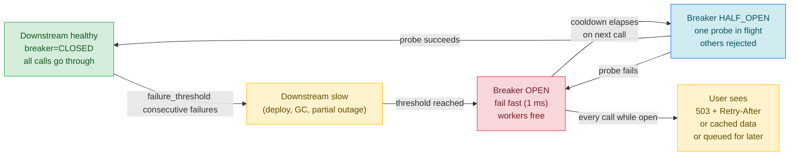
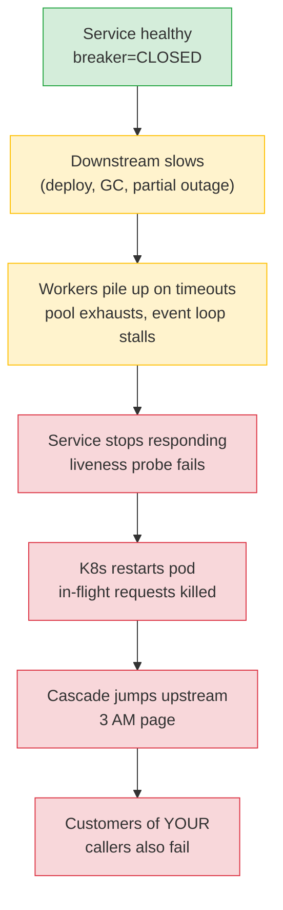
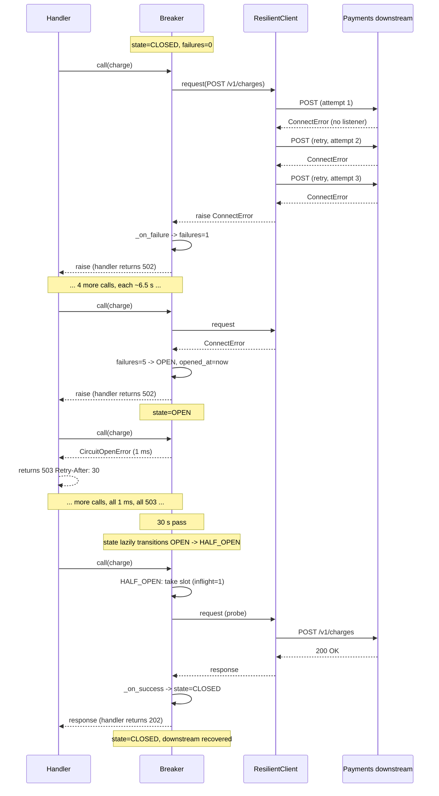

# Lesson 03: Circuit Breakers – Stopping the Cascade

*Giving `Boardly` a hand-rolled async circuit breaker that isolates a failing payments downstream so a sustained outage stops pinning every worker thread — and a FastAPI dependency that uses it.*

**You're at the last lesson of Section 15.**

Every backend engineer who has been paged at 3 AM for a "service down" knows the script by heart: a downstream service goes slow, every worker thread parks on a 30-second timeout, the pool exhausts, the database sessions leak, your service stops responding, and the cascade jumps to whatever called *you*. The cause is almost never your code — it's a missing circuit breaker. The fix is the lesson. Take your time. Build the state machine. Set every dial deliberately. **This is how you learn.**


#circuit-breaker #reliability #integrations #canonical

## Learning Objectives

By the end of this lesson you will be able to:

1. **Explain the three breaker states** — closed, open, half-open — and the four transitions between them.
2. **Pick a failure threshold, a cooldown, and a half-open probe policy** with stated reasons for each dial.
3. **Distinguish failure isolation from retry** — the breaker protects the *service*; retry protects the *request* — and combine them correctly.
4. **Build a hand-rolled async circuit breaker** that wraps any `async def` callable, with a state machine guarded by an `asyncio.Lock` and a lazy OPEN→HALF_OPEN transition.
5. **Wire the breaker into `Boardly`** as a lifespan-owned resource and a FastAPI `Depends` provider, and translate `CircuitOpenError` to a 503 with a `Retry-After` header.
6. **Choose an `is_failure` predicate** so the breaker opens on transport errors and 5xx, but ignores 4xx (which are the caller's fault).
7. **Push breaker state to metrics** and alert when any breaker is open for more than N minutes.
8. **Decide between hand-rolled and `pybreaker`** with stated reasons, and between per-process and shared-state breakers with stated reasons.

## Prerequisites

Before starting, you need:

- **FastAPI 0.148.0**, `httpx` (latest stable), `pybreaker` (latest stable), all verified Oct 2026.
- **The HTTP client lesson** — [[15-External-Integrations/HTTP-Clients-Timeouts-Retries]]. The breaker wraps the `ResilientClient` built in that lesson. If you haven't read it, go read it first; this lesson assumes the client exists and behaves as described.
- **Async primitives** — [[10-Async-Python/asyncio-Primitives]]. The breaker needs `asyncio.Lock` around state transitions. If `Lock` vs `Semaphore` is fuzzy, revisit that lesson.
- **The lifespan lesson** — [[03-FastAPI-Core/Application-and-Lifespan]]. The breaker is a long-lived, shareable, teardown-needing resource — exactly what lifespan exists for.
- **Structured logging** — [[13-Performance-and-Observability/Structured-Logging-and-Request-IDs]]. The breaker logs state transitions through `structlog`; the request ID from the inbound call propagates into the log lines.
- **About an hour and a half of focused time.** The code is ~150 lines across two files; the state-machine reasoning takes time to settle.

**The most common gap: confusing the breaker with retry.**

A surprising number of engineers think "circuit breaker" is a fancy word for "retry harder." It isn't. Retry is per-request: this one call failed, try again. The breaker is per-service: many calls have failed, stop trying for a while. They compose, they don't replace each other. Read [[15-External-Integrations/HTTP-Clients-Timeouts-Retries]] first if this distinction feels new.


## Think Like a Senior Reliability Engineer

Before we build the state machine, sit with the mental model for a moment. A senior reliability engineer reading this lesson does not see "circuit breaker" as a fancy retry. They see it as **failure isolation** — the one component that prevents a downstream's failure from becoming your service's failure. The breaker is the only layer in the integration stack that says "stop trying" rather than "try harder." Retry protects the request; the breaker protects the service.

The senior reliability engineer's three questions, asked of every external integration, in this order:

1. **How long does a failed call take?** — If the answer is "30 seconds" (the read timeout), the breaker is mandatory. If the answer is "1 millisecond" (a fast-fail 4xx), the breaker is optional. The breaker's value is latency collapse under failure: it converts 30-second-per-call latency into 1-millisecond-per-call latency. A downstream that fails fast does not need a breaker; a downstream that fails slow does.
2. **How many workers can a single broken downstream pin?** — If the answer is "all of them" (the breaker is missing, or the threshold is too high), a sustained outage is a service outage. If the answer is "one probe at a time" (the breaker is half-open with single-flight), the outage is isolated to the requests that depend on the downstream.
3. **What does the user see when the breaker is open?** — The breaker is the *signal* that the downstream is unhealthy; the *fallback* is what the user sees. A breaker with no fallback returns 503 to every caller for the duration of the outage. A breaker with a fallback (cached data, queued work, degraded response) returns something the user can use. The breaker protects the system; the fallback protects the user.

The three questions are the entire lesson, compressed. The code that follows implements the answers: the breaker's `failure_threshold` answers (1), the `half_open_max_calls=1` answers (2), and the `503 + Retry-After` (or the outbox fallback from Lesson 14.3) answers (3).



The diagram's colour-coding is the reliability engineer's reflex: green is "users get their requests served"; amber is "users get a fallback or a slow response"; red is "the system is protected but users are getting 503s"; blue is "the system is testing the downstream's recovery, cautiously." A production dashboard with one panel per breaker (`breaker_state{breaker="payments"}`) shows the same colour flow in real time during an outage: green → amber (latency rises) → red (breaker opens) → blue (probe) → green (recovery). The amber → red transition is the one the breaker exists to make — without it, amber degrades into "workers pinned, service dead." The breaker makes the amber → red transition *fast* (5 failures, ~2.5 minutes) and the red → green transition *cautious* (one probe at a time).

**The breaker converts 30-second latency under failure into 1-millisecond latency under failure.**

That is the entire value proposition. A downstream that fails *fast* (1 ms 4xx) does not need a breaker — the workers stay free because the failures are fast. A downstream that fails *slow* (30-second timeout) pins every worker the breaker is missing. The breaker's `OPEN` fast path returns `CircuitOpenError` in ~100 nanoseconds; the worker is free to handle the next request. The downstream is still broken, but the service is up — returning 503 to its callers, who can decide what to do. The latency collapse is the point; the state machine is the mechanism.


## The Problem

Picture the day the payments downstream breaks. `Boardly` charges a customer on `POST /orders/{id}/charge`; the handler calls `payments.charge(...)`; the call hangs for the 30-second read timeout; the call fails; the handler returns a 504. So far, so fine — one customer is unhappy.

But the payments downstream is *broken*, not flaky. The next request does the same. And the next. And the next. Your event loop has 100 worker tasks; each one parks for 30 seconds on a dead downstream; after 30 seconds, all 100 are blocked. New requests queue. The queue grows. Memory grows. Your liveness probe starts failing. Kubernetes restarts your pod. The restart kills in-flight requests. Customers retry. The new pod does the same thing. The cascade jumps to whatever called `Boardly`, and a billing outage has become a `Boardly` outage.

The math is brutal. If `Boardly` handles 100 req/s, and the downstream takes 30 seconds to time out, then 100 × 30 = 3000 requests are in flight at any moment, all piling up. Without a breaker, the only thing that stops the pile-up is the downstream recovering on its own — and by then your service is dead.

The circuit breaker is the safety switch that says: *this downstream is broken; stop calling it; fail fast for a while; then try once to see if it's recovered.* With a breaker that opens after 5 consecutive failures, the math changes: 5 requests fail (30 s each, but they're concurrent — so 30 s total), the breaker opens, request 6 throws in 1 millisecond, the worker is free, the next request throws in 1 millisecond, the worker is free. The downstream is still broken, but `Boardly` is up — returning `503 payments downstream unavailable` to its callers, who can decide what to do.

Why does the breaker fail *fast* when the downstream is *slow*, not just *broken*? The breaker's failure count rises on each call that fails (timeout, 5xx, exception). The downstream that is *slow* is failing by timeout — every call eventually throws `ReadTimeout`, which counts as a failure. After 5 timeouts, the breaker opens. The next call does not even attempt the downstream — it throws `CircuitOpenError` in 1 ms. The user sees a 503 immediately, instead of waiting 30 seconds for the timeout to fire. The breaker converts "30-second-per-call latency under failure" into "1-millisecond-per-call latency under failure" — which means the workers are free, the event loop is responsive, the service stays up. The breaker is the difference between "downstream is down, we are down too" and "downstream is down, we are up and returning 503". The latency improvement is the *whole point* of the breaker under a slow-downstream scenario.



**Note — Historical context — from fuses to Hystrix to pybreaker.**

The pattern is borrowed from electrical engineering: a fuse or circuit breaker opens when too much current flows, protecting the rest of the circuit. Michael Nygard's *Release It!* (2007) brought it to software. Netflix's Hystrix (2012) popularised it for microservices and added the half-open probe, the bulkhead, and the metrics dashboard. Hystrix was deprecated in 2018 in favour of resilience4j on the JVM, but the concepts travelled to most modern libraries — including `pybreaker` (2015) on Python. In 2026, the pattern is so universal that every cloud provider's architecture guidance includes it; see Microsoft's Azure Architecture Center pattern and Google's SRE chapter on cascading failures (linked in Sources).


## The Code

Here is the complete hand-rolled async circuit breaker for `Boardly`, plus the `PaymentsIntegration` that wraps the `ResilientClient` from Lesson 1, plus the lifespan wiring and the route that uses it. Save it mentally — every external integration you ever wrap in a breaker is a variation of this skeleton.

### `boardly/circuit_breaker.py`

```python
# boardly/circuit_breaker.py
"""Boardly — a hand-rolled async circuit breaker.

Lesson 15.3: closed / open / half-open state machine that isolates a
failing downstream so a sustained outage does not pin every worker thread.
Designed to wrap the `ResilientClient` from Lesson 15.1, but works with
any `async def` callable.
"""
from __future__ import annotations

import asyncio
import time
from collections.abc import Awaitable, Callable
from enum import Enum
from typing import TypeVar

import structlog

logger = structlog.get_logger()

T = TypeVar("T")


class State(str, Enum):
 """The three breaker states.

 `str` mixin gives a stable JSON-friendly value (`"closed"`, `"open"`,
 `"half_open"`) for metrics, logs, and the OTel span attributes from
 Lesson 13.2.
 """
 CLOSED = "closed"
 OPEN = "open"
 HALF_OPEN = "half_open"


class CircuitOpenError(Exception):
 """Raised when a call is attempted against an open or saturated half-open breaker.

 The caller should treat this as a 503 / "try again later" — not as a
 programmer error. The breaker is doing its job.
 """


class CircuitBreaker:
 """Async circuit breaker that wraps any `async def` callable.

 State machine:

 CLOSED --failure_threshold consecutive failures--> OPEN
 OPEN --cooldown_seconds elapses--> HALF_OPEN
 HALF_OPEN --probe succeeds--> CLOSED
 HALF_OPEN --probe fails--> OPEN

 The OPEN -> HALF_OPEN transition is lazy: computed on the next `call()`
 or the next `state` read, not by a background timer. This keeps the
 breaker dependency-free — no task to start, no task to cancel.
 """

 def __init__(
 self,
 name: str,
 *,
 failure_threshold: int = 5,
 cooldown_seconds: float = 30.0,
 half_open_max_calls: int = 1,
 is_failure: Callable[[BaseException], bool] = lambda e: True,
 ) -> None:
 if failure_threshold < 1:
 raise ValueError("failure_threshold must be >= 1")
 if cooldown_seconds <= 0:
 raise ValueError("cooldown_seconds must be > 0")
 if half_open_max_calls < 1:
 raise ValueError("half_open_max_calls must be >= 1")

 self.name = name
 self.failure_threshold = failure_threshold
 self.cooldown_seconds = cooldown_seconds
 self.half_open_max_calls = half_open_max_calls
 self.is_failure = is_failure

 # --- the mutable state (guarded by _lock) ---
 self._state: State = State.CLOSED
 self._failures: int = 0
 self._opened_at: float | None = None
 self._half_open_inflight: int = 0
 self._lock = asyncio.Lock() # guards transitions, not request concurrency

 @property
 def state(self) -> State:
 """Current state, lazily transitioning OPEN -> HALF_OPEN after cooldown."""
 if self._state == State.OPEN and self._opened_at is not None:
 if time.monotonic() - self._opened_at >= self.cooldown_seconds:
 self._state = State.HALF_OPEN
 self._half_open_inflight = 0
 logger.info(
 "circuit_transition",
 breaker=self.name,
 to=State.HALF_OPEN.value,
 )
 return self._state

 async def call(self, fn: Callable[[], Awaitable[T]]) -> T:
 """Run `fn()` through the breaker."""
 current = self.state

 # Fast path: if the breaker is OPEN, reject without touching `fn`.
 if current == State.OPEN:
 logger.warning("circuit_open_rejected", breaker=self.name)
 raise CircuitOpenError(f"circuit '{self.name}' is open")

 # HALF_OPEN: take a slot. If no slot is free, reject.
 if current == State.HALF_OPEN:
 async with self._lock:
 if self._half_open_inflight >= self.half_open_max_calls:
 logger.warning(
 "circuit_half_open_saturated",
 breaker=self.name,
 inflight=self._half_open_inflight,
 )
 raise CircuitOpenError(
 f"circuit '{self.name}' is half-open (probe in flight)"
 )
 self._half_open_inflight += 1

 try:
 result = await fn()
 except BaseException as exc:
 await self._on_failure(exc)
 raise
 else:
 await self._on_success()
 return result
 finally:
 # Only the HALF_OPEN path bumped the inflight counter.
 if self.state == State.HALF_OPEN:
 async with self._lock:
 self._half_open_inflight = max(0, self._half_open_inflight - 1)

 async def _on_failure(self, exc: BaseException) -> None:
 # Ignore exceptions that aren't "real" failures (e.g. 4xx, caller errors).
 if not self.is_failure(exc):
 return

 async with self._lock:
 current = self.state
 self._failures += 1

 if current == State.HALF_OPEN:
 # Probe failed -- straight back to OPEN, reset cooldown.
 self._state = State.OPEN
 self._opened_at = time.monotonic()
 self._half_open_inflight = 0
 logger.warning(
 "circuit_transition",
 breaker=self.name,
 to=State.OPEN.value,
 reason="half_open_probe_failed",
 )
 elif current == State.CLOSED and self._failures >= self.failure_threshold:
 self._state = State.OPEN
 self._opened_at = time.monotonic()
 logger.warning(
 "circuit_transition",
 breaker=self.name,
 to=State.OPEN.value,
 reason="threshold_reached",
 failures=self._failures,
 )

 async def _on_success(self) -> None:
 async with self._lock:
 current = self.state
 self._failures = 0
 if current == State.HALF_OPEN:
 self._state = State.CLOSED
 self._half_open_inflight = 0
 logger.info(
 "circuit_transition",
 breaker=self.name,
 to=State.CLOSED.value,
 reason="half_open_probe_succeeded",
 )
```

### `boardly/integrations.py`

```python
# boardly/integrations.py
"""Boardly -- external integrations wrapped in circuit breakers.

Lesson 15.3: the breaker wraps the `ResilientClient` from Lesson 15.1.
A `charge` call goes: handler -> breaker.call(client.request(...)).
"""
from __future__ import annotations

from typing import Any

import httpx

from boardly.circuit_breaker import CircuitBreaker
from boardly.clients import ResilientClient


def _is_4xx(exc: BaseException) -> bool:
 """A 4xx is the caller's fault; retrying or breaking on it is wrong."""
 if isinstance(exc, httpx.HTTPStatusError) and exc.response is not None:
 return 400 <= exc.response.status_code < 500
 return False


class PaymentsIntegration:
 """Wraps the payments downstream in a circuit breaker.

 Configuration rationale:
 failure_threshold=5 -- 5 consecutive failures before opening. Sweet
 spot for a 30 s timeout on the client: 5 x 30 s
 is ~2.5 minutes of pain, then we fail fast.
 cooldown_seconds=30 -- equal to the client's read timeout; the
 downstream either recovers in 30 s or it doesn't.
 half_open_max_calls=1 -- strict single-flight probe; no thundering herd.
 """

 def __init__(self, client: ResilientClient) -> None:
 self.client = client
 self.breaker = CircuitBreaker(
 name="payments",
 failure_threshold=5,
 cooldown_seconds=30.0,
 half_open_max_calls=1,
 is_failure=lambda e: isinstance(
 e, (httpx.TransportError, httpx.HTTPStatusError)
 )
 and not _is_4xx(e),
 )

 async def charge(self, order_id: int, amount_cents: int) -> dict[str, Any]:
 async def _call() -> dict[str, Any]:
 resp = await self.client.request(
 "POST",
 "/v1/charges",
 idempotency_key=f"order_{order_id}_charge",
 json={"order_id": order_id, "amount_cents": amount_cents},
 )
 return resp.json()

 # The breaker is the *outer* layer; retries happen *inside* a single
 # breaker.call. A request that retries 3 times and finally succeeds
 # counts as one success. A request that retries 3 times and exhausts
 # counts as one failure.
 return await self.breaker.call(_call)
```

### `boardly/main.py` (lifespan excerpt) and `boardly/routers/billing.py`

```python
# boardly/main.py -- lifespan excerpt (full file is from Lesson 03.1)
from contextlib import asynccontextmanager
from collections.abc import AsyncIterator

from fastapi import FastAPI

from boardly.clients import ResilientClient
from boardly.integrations import PaymentsIntegration


@asynccontextmanager
async def lifespan(app: FastAPI) -> AsyncIterator[None]:
 # --- startup: build the HTTP client and the integration that wraps it ---
 http_client = ResilientClient(base_url=settings.payments_base_url)
 app.state.payments = PaymentsIntegration(http_client)
 yield
 # --- shutdown: close the HTTP client (the breaker has no resources) ---
 await http_client.close()


app = FastAPI(title="Boardly", version="0.1.0", lifespan=lifespan)
```

```python
# boardly/routers/billing.py
from typing import Annotated, Any

from fastapi import APIRouter, Body, Depends, HTTPException, Request, status

from boardly.circuit_breaker import CircuitOpenError
from boardly.integrations import PaymentsIntegration

router = APIRouter(prefix="/orders", tags=["billing"])


def get_payments(request: Request) -> PaymentsIntegration:
 """FastAPI dependency: pull the lifespan-owned payments integration."""
 return request.app.state.payments


@router.post("/{order_id}/charge", status_code=status.HTTP_202_ACCEPTED)
async def charge_order(
 order_id: int,
 amount_cents: Annotated[int, Body(..., embed=True)],
 payments: Annotated[PaymentsIntegration, Depends(get_payments)],
) -> dict[str, Any]:
 try:
 result = await payments.charge(order_id, amount_cents)
 except CircuitOpenError:
 # The breaker is open -- we know the downstream is unhealthy.
 # Return 503 with a Retry-After so well-behaved callers back off.
 raise HTTPException(
 status_code=status.HTTP_503_SERVICE_UNAVAILABLE,
 detail="payments downstream unavailable; try again later",
 headers={"Retry-After": "30"},
 )
 return {"charge_id": result["id"]}
```

That's ~210 lines of code across three files. Read it. Run it. Break the downstream. Watch the breaker open. **That's the loop.** We'll explain every line next.

## Line-by-Line Deep Dive

This section is the heart of the lesson. Read it twice. Don't skip.

### `boardly/circuit_breaker.py`: Lines 1–18 – Module docstring and imports

```python
"""Boardly — a hand-rolled async circuit breaker. ..."""
from __future__ import annotations

import asyncio
import time
from collections.abc import Awaitable, Callable
from enum import Enum
from typing import TypeVar

import structlog

logger = structlog.get_logger()

T = TypeVar("T")
```

**What it does:** Pulls in seven things — `asyncio` (for `Lock`), `time` (for `monotonic`), `Awaitable` and `Callable` (typing primitives), `Enum` (for the state machine), `TypeVar` (for the generic `call` method), `structlog` (for logging), and the `from __future__ import annotations` switch.

**Why we need each:**

- `from __future__ import annotations` postpones evaluation of type hints (PEP 563). The practical win: we can write `float | None` (PEP 604 syntax) on Python 3.10+ without quoting, and we can reference `CircuitBreaker` inside its own method signatures before it's defined.
- `asyncio.Lock` is the only sync primitive the breaker needs. It does *not* need a `Semaphore` — the half-open single-flight is enforced by a counter inside the lock, not by a semaphore. A semaphore would acquire-then-decrement on every call, which would serialise CLOSED traffic; the counter only blocks HALF_OPEN traffic.
- `time.monotonic` — *not* `time.time`. `monotonic` is immune to wall-clock adjustments (NTP step, manual date change, daylight saving). For "how long has this breaker been open" the wall clock is wrong; the monotonic clock is right. `time.time` would silently misbehave once a year during DST transitions.
- `Awaitable` and `Callable` come from `collections.abc`, **not** `typing` — since Python 3.9 the `collections.abc` forms are usable directly in annotations. Using the `collections.abc` form is the modern, recommended import.
- `TypeVar` — so `call` can be typed as `def call(self, fn: Callable[[], Awaitable[T]]) -> T`. Without it, the caller would lose the return type and have to `cast`.
- `structlog` — the structured logger from Lesson 13.1. Every state transition is a log event; the inbound request ID (also from Lesson 13.1) propagates automatically because we're inside the request scope.

**Tip — Why `time.monotonic` and not `time.time`?**

`time.time` returns the wall clock — which NTP can move backwards, which a sysadmin can move, and which DST moves twice a year. `time.monotonic` returns a clock that only ever goes up. For "how long has this breaker been open" the wall clock is wrong; the monotonic clock is right. The same rule applies to any timeout, any cache TTL, any rate-limit window.


### `boardly/circuit_breaker.py`: Lines 30–55 – The `State` enum and `CircuitOpenError`

```python
class State(str, Enum):
 """The three breaker states. ..."""
 CLOSED = "closed"
 OPEN = "open"
 HALF_OPEN = "half_open"


class CircuitOpenError(Exception):
 """Raised when a call is attempted against an open or saturated half-open breaker. ..."""
```

**What it does:** Defines a `str`-mixin enum with three members and a custom exception type.

**Why `str` mixin on the enum?** A plain `Enum` would print as `<State.CLOSED: 'closed'>` in logs and serialize to `"CLOSED"` in JSON. A `str` mixin makes `State.CLOSED == "closed"` true, `json.dumps(State.CLOSED)` produce `"closed"`, and the value render cleanly in OTel span attributes, Prometheus labels, and Grafana panels. Cost: zero. Benefit: every observability surface Just Works.

**Why these three names?** They're the canonical names from Martin Fowler's and Microsoft's pattern write-ups (linked in Sources). Hystrix, resilience4j, and `pybreaker` all use the same vocabulary. Using the canonical names means an engineer who has used any of those libraries can read your code without a glossary.

**Why a dedicated exception type?** Because the caller needs to distinguish "the downstream returned an error" from "the breaker refused to call the downstream." Both are failures, but they mean different things: a downstream error might be transient and retryable inside the breaker (if the breaker is still CLOSED); a breaker refusal means "do not retry inside the breaker — the breaker has already decided." The caller's correct response to `CircuitOpenError` is to fail the request (return 503 to the user), queue for later (push to the outbox from Lesson 14.3), or fall back to cached data. If you raised a plain `Exception` or a `RuntimeError`, the caller would have to inspect the message string — and string inspection is exactly the anti-pattern Lesson 01.4 (Exceptions Done Right) warns against.

**Why does `CircuitOpenError` inherit from `Exception` and not `BaseException`?** Because `BaseException` is for things that should *not* be caught in normal code (`KeyboardInterrupt`, `SystemExit`). The breaker's "I refuse to call" is a normal, expected, catchable failure — `Exception` is the right base.

**Student asks: Why isn't there a fourth state — like "forced open" for maintenance?**

Good instinct. Some libraries do add a `FORCED_OPEN` state that an operator can flip manually during a planned downtime, and a `FORCED_CLOSED` state for "we know better than the breaker, send everything." `pybreaker` has both. Our hand-rolled version omits them for one reason: every state you add is a state you have to test, document, and operate. The two forced states are useful in real production systems — reach for `pybreaker` when you need them. We'll cover that trade-off below.


### `boardly/circuit_breaker.py`: Lines 60–105 – The `__init__` signature, validation, and mutable state

```python
def __init__(
 self,
 name: str,
 *,
 failure_threshold: int = 5,
 cooldown_seconds: float = 30.0,
 half_open_max_calls: int = 1,
 is_failure: Callable[[BaseException], bool] = lambda e: True,
) -> None:
 if failure_threshold < 1:
 raise ValueError("failure_threshold must be >= 1")
 if cooldown_seconds <= 0:
 raise ValueError("cooldown_seconds must be > 0")
 if half_open_max_calls < 1:
 raise ValueError("half_open_max_calls must be >= 1")

 self.name = name
 self.failure_threshold = failure_threshold
 self.cooldown_seconds = cooldown_seconds
 self.half_open_max_calls = half_open_max_calls
 self.is_failure = is_failure

 # --- the mutable state (guarded by _lock) ---
 self._state: State = State.CLOSED
 self._failures: int = 0
 self._opened_at: float | None = None
 self._half_open_inflight: int = 0
 self._lock = asyncio.Lock() # guards transitions, not request concurrency
```

**What it does:** Defines the constructor with one required positional argument (`name`) and four keyword-only keyword arguments, validates the three numeric ones, then stashes configuration and initialises five pieces of mutable state guarded by a lock.

**Why `name` is required and positional:** Every breaker needs a name. The name shows up in every log line, every metric label, every alert. An unnamed breaker is an unobservable breaker. Making it required and positional means the call site `CircuitBreaker("payments", ...)` reads top-down: *what is this a breaker for?*

**Why `*` (keyword-only arguments) for the rest:** Prevents the call-site bug `CircuitBreaker("payments", 5)` where the next reader has to count positions to know whether `5` is `failure_threshold` or `cooldown_seconds`. With `*`, you must write `CircuitBreaker("payments", failure_threshold=5)` — the dial is named at the call site, which is documentation that doesn't rot.

**Why these defaults:**

- `failure_threshold=5` — five consecutive failures before opening. Small enough to catch a real outage fast (5 × 30 s timeout = 2.5 minutes of pain, then fail fast); large enough not to flap on a single transient blip. The most common range in production code is 3–10; we pick 5 because it's in the middle and easy to reason about.
- `cooldown_seconds=30.0` — equal to the typical HTTP read timeout on the wrapped client. The downstream either recovers in 30 seconds or it doesn't; if it hasn't recovered in 30 seconds, probing every 30 seconds costs us 1 request every 30 seconds, which is negligible load. Range in production: 10–60 s.
- `half_open_max_calls=1` — strict single-flight probe. While the downstream recovers, we send exactly one request to test it. Allowing N probes simultaneously means N requests hit a still-broken downstream, which is exactly the thundering herd we're trying to prevent.
- `is_failure=lambda e: True` — the permissive default. By default, *any* exception counts as a failure. The `PaymentsIntegration` overrides this to ignore 4xx.

**Why the validation block?** `failure_threshold=0` would mean "open on the first call" — almost certainly a typo. `cooldown_seconds=0` would mean "transition OPEN→HALF_OPEN immediately on the next call" — the breaker never actually opens. `half_open_max_calls=0` would mean "never let a probe through" — the breaker is stuck in HALF_OPEN forever. All three are silent footguns; failing loud at construction time is the right behaviour.

**Why these particular pieces of mutable state:**

- `self._state` — the current state. Starts `CLOSED` because a freshly-constructed breaker has no failures yet, so the right initial state is "let calls through."
- `self._failures` — the consecutive-failure counter. Resets to zero on the first success. We're using the *consecutive counter* strategy, not the *sliding-window failure rate* — see Engineering Trade-Offs for the comparison.
- `self._opened_at` — the monotonic timestamp of the most recent OPEN transition. `None` while CLOSED or HALF_OPEN. Used by the `state` property to decide whether to transition OPEN→HALF_OPEN.
- `self._half_open_inflight` — how many probe calls are currently in flight while in HALF_OPEN. Bumped in `call`, decremented in `call`'s `finally`.
- `self._lock` — the `asyncio.Lock` that guards *state transitions* (write-then-read of `_state`, `_failures`, `_opened_at`, `_half_open_inflight`).

**The lock guards *transitions*, not *request concurrency*.**

A common mistake is to think the breaker's lock is a request-level lock — that is, that only one request can be in `call` at a time. It isn't. In CLOSED state, thousands of requests can call `fn()` concurrently with no lock contention at all. The lock is only acquired during state transitions — the moment where we read the state, decide to bump a counter, decide whether to open the breaker, decide whether to take a probe slot. Those transitions must be atomic to avoid the lost-update race (request A reads `failures=4`, request B reads `failures=4`, both write `failures=5`, both decide to open — we just opened twice and lost a count). The transitions are short (microseconds), so the lock is rarely contended. The work — the actual `await fn()` call — happens outside the lock. This is the single most important design choice in the file; read it twice.


**What happens inside `asyncio.Lock` under load**

`asyncio.Lock` is a single-writer primitive — there is no `RLock` equivalent in asyncio because every access (read or write) is mutually exclusive on the event loop. When the breaker is CLOSED and 10 000 concurrent requests are in `call()`, the lock is *not* acquired on the CLOSED fast path — they all pass through to `await fn()` with no lock contention. The lock is acquired only on: (a) the HALF_OPEN slot-take (one in-flight probe at a time), (b) the `_on_failure` / `_on_success` state update (a few microseconds), (c) the `finally` slot-decrement. The lock's average contention in production is ~0 — it is held for nanoseconds per call, and only on the transitions.

The Python implementation of `asyncio.Lock` is a coroutine-based FIFO queue of waiters. When contention *does* happen (e.g. 100 concurrent calls hit HALF_OPEN at once), 99 of them get `CircuitOpenError` (rejected by the slot check after waiting their turn) and one gets the slot. The lock's only failure mode is being held across an `await` that blocks — which the breaker's design avoids by holding the lock only around non-async state mutations (no `await` inside `async with self._lock`). The pattern "lock around the transition, not around the call" is the load-bearing design choice that lets a 100 000 req/s service use a single-lock breaker with no contention.


**Warning — Defaults are opinions, not laws.**

The defaults above are a starting point, not a recommendation. Tune per integration. A downstream that recovers slowly (cold-start-heavy serverless functions) wants a longer cooldown (60–120 s) and a lower threshold (3). A downstream that flaps under load wants a higher threshold (10) and a sliding-window failure-rate predicate. Set every dial deliberately, with a stated reason.


### `boardly/circuit_breaker.py`: Lines 107–125 – The `state` property (lazy transition)

```python
@property
def state(self) -> State:
 """Current state, lazily transitioning OPEN -> HALF_OPEN after cooldown."""
 if self._state == State.OPEN and self._opened_at is not None:
 if time.monotonic() - self._opened_at >= self.cooldown_seconds:
 self._state = State.HALF_OPEN
 self._half_open_inflight = 0
 logger.info(
 "circuit_transition",
 breaker=self.name,
 to=State.HALF_OPEN.value,
 )
 return self._state
```

**What it does:** Returns the current state, but first — if we've been OPEN long enough — transitions to HALF_OPEN.

**Why lazy?** The alternative is a background `asyncio.Task` that wakes up after `cooldown_seconds` and flips the state. That requires a task to start, a task to cancel on shutdown, a way to handle task cancellation, and a way to handle the case where the breaker is opened twice (the second open resets the cooldown — the first background task would fire at the wrong time). The lazy version is simpler: the transition happens on the next `call()` or the next `state` read after the cooldown elapses. No task, no cancellation, no race. The cost: a `time.monotonic()` call on every state read — which is a single syscall and effectively free.

**Why `>=` rather than `>`?** The arithmetic is: "how long since we opened" must be greater than or equal to "how long we promised to stay open." If equal, we transition (the boundary belongs to HALF_OPEN, not OPEN — once the cooldown has elapsed, we should probe). Using `>=` rather than `>` makes the boundary deterministic and testable.

**Why reset `_half_open_inflight` here?** Because we just entered HALF_OPEN from OPEN; there can't be any inflight probes (we couldn't have admitted any while OPEN — the fast path rejects all calls). Resetting to zero is defensive — if a future code change accidentally leaves a stale counter, this guarantees the new HALF_OPEN starts clean.

**Why log the transition?** Because state transitions are operationally important. An operator looking at the logs should see every transition, with the breaker name and the new state. This is also the metric event: in production, you'd add a `prometheus_client.Counter` increment here, or a `Gauge` set, or an OTel span event (Lesson 13.2). The log line is the minimum observable surface; the metric is the alertable surface.

**Student asks: Why is the OPEN→HALF_OPEN transition lazy (on the next `call` or `state` read) instead of scheduled by a background timer?**

Because the lazy version has fewer moving parts and no race. The alternative is an `asyncio.Task` that sleeps for `cooldown_seconds` and then flips `_state = State.HALF_OPEN`. That sounds clean until you write down everything the task needs to handle: (a) **start** the task when we transition into OPEN — but what if the breaker was already OPEN (a probe just failed and re-opened it)? The existing task is still scheduled to fire at the *old* `cooldown_seconds`; the new cooldown needs a new task; you have to cancel the old one. (b) **cancel** the task on `shutdown()` — easy to forget, and a leaked task keeps the event loop alive after the app should have stopped. (c) **handle task cancellation** — what if `shutdown()` is called mid-cooldown? The task gets cancelled; the next `call()` must be able to re-establish the transition, which means `call()` *also* needs to check the cooldown, which means the lazy path is also needed. (d) **race against concurrent `call`s** — at the moment the task fires, three other coroutines might be in `call()` reading `self._state`; the task's `self._state = State.HALF_OPEN` write races with their reads unless the task also takes the lock. The lazy version has *one* code path: read `state`, check the cooldown, transition if expired. No task, no cancellation, no race. The cost is a `time.monotonic()` call on every state read — one syscall, effectively free. The lazy version is the kind of "fewer moving parts" decision that is invisible until you maintain the eager version in production and discover the four edge cases the hard way.


**Student asks: what is "half-open" for — why not just go from OPEN to CLOSED when the cooldown expires?**

Because the cooldown expiry is a *guess* — "maybe the downstream has recovered by now". If you go straight from OPEN to CLOSED and the downstream is still broken, the next 100 requests (all now allowed through) hit the broken downstream, each one times out at 30 seconds, the breaker's failure count shoots up, and 100 workers are stuck again before the breaker re-opens. Half-open is the *probe* state: only one request is allowed through, the rest are rejected. If the probe succeeds, the breaker transitions to CLOSED (downstream is healthy). If the probe fails, the breaker transitions back to OPEN (cooldown resets, try again later). The half-open state limits the blast radius of a wrong guess — if the guess is wrong, only one worker is stuck, not 100. That is the entire purpose of half-open: bound the cost of the recovery probe.


**Tip — The `state` property has a side effect — and that's a real trade-off.**

Pure-functional programmers will object that a property should not mutate state. They have a point. The alternative — `state()` as a method named `current_state()` — would make the side effect explicit at the call site. We chose the property because (a) the side effect is idempotent (calling `state` twice in a row never transitions twice — the second call sees HALF_OPEN and returns immediately), (b) the property reads naturally in metrics exporters (`breaker.state`), and (c) the alternative — exposing `_state` directly — would force every caller to remember to call the transition method first, which is a footgun. If your team prefers explicit methods, rename it; the behaviour is the same.


**What happens inside `time.monotonic()` and why the lazy transition is essentially free**

`time.monotonic()` on Linux is a `clock_gettime(CLOCK_MONOTONIC)` call — but the kernel resolves it from a vDSO (virtual dynamic shared object) page, meaning the call is *userspace* and takes ~5 nanoseconds. On macOS it's `mach_absolute_time` (also userspace, similar cost). On Windows it's `QueryPerformanceCounter` (also userspace). The `time.monotonic()` call is not a context switch, not a syscall trap, not a kernel round-trip. It is the cheapest timing primitive in Python.

The lazy OPEN→HALF_OPEN transition is one `time.monotonic()` call plus a comparison — sub-microsecond per `state` access. The eager alternative (a background `asyncio.Task` that sleeps then transitions) requires a task object, a `loop.call_later` registration, a cancellation on shutdown, and a race against concurrent state reads. The lazy version is cheaper at every load and simpler at every code path. The only cost of lazy is that a breaker that is OPEN and never called stays OPEN forever (no probe is sent). That's the right behaviour — probing a downstream that nobody is calling is wasted work; the next caller triggers the transition on their own call.

The other cost-of-lazy is *unobservability*: an operator looking at the breaker's `state` metric sees `OPEN` until the next caller arrives, even if the cooldown expired seconds ago. The fix is to surface the "cooldown expires at" timestamp as a separate metric (`breaker_cooldown_expires_at{breaker="payments"}`), so operators can see "the cooldown expired 12 seconds ago; the breaker is waiting for the next caller to trigger the probe." The lazy state is internally correct; the dashboard needs the auxiliary timestamp to reflect that correctness to humans.


### `boardly/circuit_breaker.py`: Lines 127–155 – The `call` method (entry, fast path, half-open gate)

```python
async def call(self, fn: Callable[[], Awaitable[T]]) -> T:
 """Run `fn()` through the breaker."""
 current = self.state

 # Fast path: if the breaker is OPEN, reject without touching `fn`.
 if current == State.OPEN:
 logger.warning("circuit_open_rejected", breaker=self.name)
 raise CircuitOpenError(f"circuit '{self.name}' is open")

 # HALF_OPEN: take a slot. If no slot is free, reject.
 if current == State.HALF_OPEN:
 async with self._lock:
 if self._half_open_inflight >= self.half_open_max_calls:
 logger.warning(
 "circuit_half_open_saturated",
 breaker=self.name,
 inflight=self._half_open_inflight,
 )
 raise CircuitOpenError(
 f"circuit '{self.name}' is half-open (probe in flight)"
 )
 self._half_open_inflight += 1
```

**What it does:** The entry point. Reads the current state (which may transition OPEN→HALF_OPEN as a side effect), then handles the two rejection paths (OPEN, HALF_OPEN-saturated) before doing any work.

**Why `current = self.state` once, at the top, instead of `if self.state == State.OPEN` twice?** Two reasons. First, the property has a side effect (the lazy transition); calling it twice could return different values if a transition happened in between, which would be a race. Second, the local variable is one syscall instead of two. Capture once, use everywhere.

**Why the OPEN fast path raises *without* acquiring the lock?** Because there's nothing to update — we're refusing the call. Acquiring the lock would just add contention for no benefit. The whole point of the OPEN state is to fail fast; a lock acquisition would slow the fast path down. The log line (`circuit_open_rejected`) is the only side effect, and `structlog` is thread-safe and async-safe.

**Why the HALF_OPEN path *does* acquire the lock?** Because we're about to read `_half_open_inflight`, decide whether to admit, and bump the counter — and that read-decide-write must be atomic. Without the lock, two concurrent calls could both read `_half_open_inflight == 0` (under the limit), both bump to 1, both proceed — and we'd have admitted two probes when `half_open_max_calls` is 1. That's the thundering herd we're trying to prevent.

**Why is the lock acquired only for the slot-take, not for the whole `await fn()`?** Because holding the lock across the actual call would serialise all HALF_OPEN probes — meaning only one probe could be in flight at a time, which is fine for `half_open_max_calls=1` but defeats the purpose of `half_open_max_calls>1`. The lock is for the *admission decision*, not for the *call*. Once admitted, the call happens outside the lock. The counter is decremented in `finally` under the lock again, so the decrement is atomic.

**Example — What happens if a probe is in flight and a second call arrives?**

The second call sees HALF_OPEN, acquires the lock, reads `_half_open_inflight == 1`, sees that `1 >= half_open_max_calls (1)`, releases the lock, and raises `CircuitOpenError`. The second call fails fast — but the message says "half-open (probe in flight)", which tells the caller *why*. This is meaningfully different from "circuit is open" (the downstream is broken) vs "circuit is half-open with a probe in flight" (we're testing the downstream; wait a beat). A well-behaved caller would back off briefly and retry the second case.


**What happens inside the OPEN fast path**

When the breaker is OPEN, the `call` method does three things: (1) reads `self.state` (one `time.monotonic()` call, may transition to HALF_OPEN if the cooldown expired — the property has the side effect), (2) sees `OPEN` (the cooldown has not elapsed), (3) raises `CircuitOpenError` immediately. There is no `await` in this path. The httpx client is not touched; the connection pool is not touched; the network is not touched. The total work is ~100 nanoseconds (the property access, the enum comparison, the exception construction, the structlog `warning` call).

Compare with the path that did *not* have a breaker: the same call would `await fn()`, which would attempt a TCP connection to the dead downstream, wait for the connect timeout (3 seconds), retry with backoff (3 attempts × ~1 second each), and finally raise after ~6.5 seconds. The breaker converts 6.5 seconds of work into ~100 nanoseconds of work. That is the entire point — workers are free, the event loop is responsive, the service stays up. The cost is that the user sees a 503 instead of waiting; the benefit is that 9 999 other users see their requests served because the workers are not pinned.

The 503 the user sees is *not* a lie. The downstream is broken; we *could* make the user wait 6.5 seconds to confirm that for the Nth time, but we have already confirmed it (the breaker opened after the previous N failures). The 503 is the breaker telling the user "we know; come back in 30 seconds." The `Retry-After: 30` header is the contract.


### `boardly/circuit_breaker.py`: Lines 156–175 – The `call` method (try / except / else / finally)

```python
 try:
 result = await fn()
 except BaseException as exc:
 await self._on_failure(exc)
 raise
 else:
 await self._on_success()
 return result
 finally:
 # Only the HALF_OPEN path bumped the inflight counter.
 if self.state == State.HALF_OPEN:
 async with self._lock:
 self._half_open_inflight = max(0, self._half_open_inflight - 1)
```

**What it does:** Runs `fn()`, dispatches to `_on_failure` or `_on_success`, and unconditionally decrements the inflight counter (if we were in HALF_OPEN).

**Why `except BaseException` and not `except Exception`?** Because `KeyboardInterrupt` and `SystemExit` should also count as a failure for the purposes of the breaker — if the process is being asked to stop mid-call, the call didn't succeed, and the breaker's failure accounting should reflect that. Catching `BaseException`, calling `_on_failure`, and immediately re-raising preserves the original exception (the caller still sees `KeyboardInterrupt`) while still updating the breaker's state. This is the "catch, account, re-raise" pattern from Lesson 01.4 (Exceptions Done Right).

**Why the `else` block?** Python's `try/except/else` runs the `else` block only if no exception was raised. Putting `_on_success()` there guarantees we never count a success for a call that raised. The alternative — `try: result = await fn(); await self._on_success(); return result` — would call `_on_success()` even on a partial-success path (e.g. if `return result` raised in some hypothetical edge case). The `else` form is bulletproof; use it whenever a side effect should happen only on the no-exception path.

**Why `finally` for the counter decrement?** Because the decrement must happen whether the call succeeded, failed, raised `CircuitOpenError` from inside `fn`, or raised `KeyboardInterrupt`. The `finally` block runs unconditionally. If we put the decrement in `else`, a failed probe would leak the counter (the inflight would stay at 1 forever, blocking all future probes). If we put it in `except`, a successful probe would leak. `finally` is the only correct place.

**Why the `if self.state == State.HALF_OPEN` guard around the decrement?** Because the counter was only bumped in the HALF_OPEN path. If we're in CLOSED, the counter is 0 and decrementing it would make it -1. The guard ensures we only touch the counter when we actually took a slot. The `max(0, ...)` is belt-and-suspenders: even if some race left the counter negative somehow, we clamp to zero.

**Danger — Don't skip the `finally` decrement.**

If you forget the `finally` block, every HALF_OPEN probe leaks one slot. After `half_open_max_calls` probes, the breaker is stuck in HALF_OPEN forever — no more probes can be admitted, so the state never transitions to CLOSED or back to OPEN. The breaker is effectively dead. Tests for this are hard to write (you need a probe that *both succeeds and exits cleanly* to surface the bug); a good unit test would assert that `_half_open_inflight` is 0 after a successful probe.


### `boardly/circuit_breaker.py`: Lines 177–215 – The `_on_failure` and `_on_success` transitions

```python
async def _on_failure(self, exc: BaseException) -> None:
 # Ignore exceptions that aren't "real" failures (e.g. 4xx, caller errors).
 if not self.is_failure(exc):
 return

 async with self._lock:
 current = self.state
 self._failures += 1

 if current == State.HALF_OPEN:
 # Probe failed -- straight back to OPEN, reset cooldown.
 self._state = State.OPEN
 self._opened_at = time.monotonic()
 self._half_open_inflight = 0
 logger.warning(
 "circuit_transition",
 breaker=self.name,
 to=State.OPEN.value,
 reason="half_open_probe_failed",
 )
 elif current == State.CLOSED and self._failures >= self.failure_threshold:
 self._state = State.OPEN
 self._opened_at = time.monotonic()
 logger.warning(
 "circuit_transition",
 breaker=self.name,
 to=State.OPEN.value,
 reason="threshold_reached",
 failures=self._failures,
 )

async def _on_success(self) -> None:
 async with self._lock:
 current = self.state
 self._failures = 0
 if current == State.HALF_OPEN:
 self._state = State.CLOSED
 self._half_open_inflight = 0
 logger.info(
 "circuit_transition",
 breaker=self.name,
 to=State.CLOSED.value,
 reason="half_open_probe_succeeded",
 )
```

**What `_on_failure` does:** Decides whether the exception counts as a failure; if it does, updates the failure counter and possibly transitions to OPEN. **What `_on_success` does:** Resets the failure counter to zero, and if the breaker was in HALF_OPEN, transitions to CLOSED.

**Why `is_failure` is checked *outside* the lock?** Because `is_failure` is a user-supplied callable that might be slow (it could inspect `httpx.HTTPStatusError.response.status_code`, which involves attribute lookups; or in exotic cases it could call out to a remote check). Running it inside the lock would serialise every failure across every request — a contention hotspot. Running it outside the lock means each request evaluates its own `is_failure` concurrently, then lines up briefly to acquire the lock for the counter update.

**Why `current = self.state` *inside* the lock?** Because the state may have changed since the entry to `call`. The probe started in HALF_OPEN; while it was running, the cooldown could have been hit by some other transition. Reading `state` inside the lock guarantees we see a consistent view: the state, the counter, and the transition all happen atomically.

**Why the HALF_OPEN branch in `_on_failure` *resets* `_opened_at` to `time.monotonic()`?** This is the most important detail in the file. A common mistake is to fail the probe, transition to OPEN, and *not* reset `_opened_at` — which means the breaker is in OPEN but with the *original* open timestamp, so the cooldown may already have elapsed, and the breaker flips back to HALF_OPEN immediately on the next call. That defeats the entire point of the cooldown: we end up probing the downstream on every call. Always reset `_opened_at` when transitioning to OPEN from any state. (See Exercise 6 below — that's the bug.)

**Why the HALF_OPEN branch in `_on_failure` also resets `_half_open_inflight` to 0?** Because we just transitioned back to OPEN — there can't be any inflight probes (the next `call` will be rejected by the OPEN fast path). Setting it to 0 is defensive: it guarantees a clean slate when the breaker eventually transitions OPEN→HALF_OPEN again (the `state` property also resets it, but defence in depth).

**Why `_on_success` resets `_failures` to zero on every success in CLOSED?** Because we're using the *consecutive counter* strategy. A single success breaks the streak. If we didn't reset, every transient blip would accumulate forever, and the breaker would eventually open even though the downstream has been healthy for hours. The reset is the entire point of the consecutive strategy.

**Why is there no `_on_success` from OPEN?** Because the OPEN fast path rejects all calls — `_on_success` can never be called from OPEN. The breaker has to transition through HALF_OPEN to recover. This is the design constraint that makes the breaker safe: you can't accidentally close it by trying hard enough.

**What happens inside `_on_failure`'s lock acquisition**

When a call fails and `_on_failure(exc)` runs, the sequence is: (1) evaluate `self.is_failure(exc)` *outside* the lock — this is a user-supplied callable, possibly with attribute inspection, and we do not want to serialise every failure across every request on the lock; (2) acquire `self._lock` — at this point, any concurrent `_on_success` or `_on_failure` is blocked; (3) re-read `current = self.state` — *inside* the lock, because the state may have transitioned (e.g. another call's probe succeeded and closed the breaker while our call was failing); (4) update `self._failures` and conditionally transition.

The critical detail is the re-read inside the lock. If we cached `current` from outside the lock, we'd have a TOCTOU race: read CLOSED outside, another call transitions to OPEN, we write `_failures += 1` against a state that's now OPEN — and the failure-count check `if current == State.CLOSED and self._failures >= threshold` would not fire because `current` is the stale CLOSED. The re-read inside the lock is the defence; it is the difference between correct and subtly-wrong.

The other critical detail is the `_opened_at = time.monotonic()` reset on the HALF_OPEN → OPEN transition. Without it, the breaker is in OPEN with the *original* open timestamp, the cooldown may have already elapsed, and the next `call()` immediately transitions to HALF_OPEN — the breaker never actually opens. The reset is the single most-tested line in the file (Exercise 6 is built around it); the reset is the load-bearing detail that makes the cooldown meaningful.


**Student asks: Why does a *single* HALF_OPEN success close the breaker — is one probe really enough evidence that the downstream is healthy?**

One probe is enough *evidence that the downstream can complete a request at all*, which is the only question HALF_OPEN is asking. The probe is not a statistical sample; it is a binary check — "can the downstream respond right now?" If the answer is yes, the breaker transitions to CLOSED and lets traffic resume. If the downstream is *intermittently* broken (works one in three times), the next failure will re-open the breaker quickly: CLOSED→`_failures += 1`→eventually `_failures >= threshold`→OPEN again. The cost of being wrong about recovery is one round of failed requests (~`failure_threshold` of them); the cost of *waiting for more evidence* in HALF_OPEN is *rejecting every call* while you wait — which is exactly the outage behaviour the breaker exists to avoid. The asymmetric cost is the reason: a single success is enough because the downside of being wrong (a few failed requests, then re-open) is small, while the downside of being too cautious (staying in HALF_OPEN for N probes) is rejecting all traffic for N × downstream-latency. If you genuinely want N-probe confirmation, set `half_open_max_calls=N` — but for the 95 % case (`half_open_max_calls=1`), the single-probe design is the right trade-off. Reach for higher N when the downstream recovers slowly and a second failure is expensive (e.g. a third-party billing API that double-charges on retries — there you want two consecutive successes before resuming).


**Student asks: Should 429 (Too Many Requests) open the breaker — it *is* a 5xx-class problem from the caller's point of view?**

It depends on who is at fault, and that is exactly why the predicate is configurable rather than hard-coded. (1) **If the 429 is *your* fault** — you're calling the downstream faster than your agreed rate limit — then 429 is a *signal that you should slow down*, not that the downstream is broken. Opening the breaker would do nothing useful (the breaker doesn't slow traffic, it stops traffic), and you'd lose the ability to retry-with-backoff that the `ResilientClient` already provides for 429s. Keep `_is_4xx` excluding 429; let the retry layer handle it. (2) **If the 429 is the *downstream's* fault** — your traffic is well below the agreed rate but you're getting 429s anyway (the downstream is misconfigured, or it is overloaded and lying about the cause) — then 429 is a *signal that the downstream is unhealthy*, and you want the breaker to open before the downstream cuts you off entirely (a hard 403 or a TCP reset is worse than a controlled breaker-open). Change the predicate to `_is_4xx(e) and not _is_429(e)` becomes "fail on 4xx except 429" — no, that's backwards; the predicate you want is `isinstance(e, httpx.HTTPStatusError) and (e.response.status_code >= 500 or e.response.status_code == 429)`. The right answer depends on your relationship with the downstream: a trusted partner you can call to debug a misconfigured rate limit → exclude 429; a flaky third-party API where 429 means "I'm shedding load" → include 429. Document the choice in the `name=` argument's comment so the next reader knows which relationship you assumed.


### `boardly/integrations.py`: Lines 1–20 – Imports and the `_is_4xx` helper

```python
from __future__ import annotations
from typing import Any
import httpx
from boardly.circuit_breaker import CircuitBreaker
from boardly.clients import ResilientClient


def _is_4xx(exc: BaseException) -> bool:
 """A 4xx is the caller's fault; retrying or breaking on it is wrong."""
 if isinstance(exc, httpx.HTTPStatusError) and exc.response is not None:
 return 400 <= exc.response.status_code < 500
 return False
```

**What it does:** Imports the breaker, the client, and `httpx`. Defines `_is_4xx`, a helper that inspects an exception and returns `True` if it's a 4xx HTTP error.

**Why is `_is_4xx` a module-level function, not a method?** Because it doesn't need any instance state — it inspects the exception only. A module-level function is the right shape. It also makes it easy to unit-test in isolation (pass in a fake `HTTPStatusError`, check the return value).

**Why the `exc.response is not None` check?** `httpx.HTTPStatusError` always has a `response` attribute in practice, but the type annotation allows `None`. Defensive code is cheap here.

**Why 4xx and not just 429 (Too Many Requests)?** Because the entire 4xx range is "the caller's fault" — 400 (bad request), 401 (unauthorized), 403 (forbidden), 404 (not found), 409 (conflict), 422 (unprocessable entity). Retrying won't fix any of them — the request is wrong, full stop. Breaking the circuit on a 400 would mean a single bad request from one customer could open the breaker for all customers. The `is_failure` predicate must exclude 4xx.

**Note — Should 429 (Too Many Requests) open the breaker?**

Debatable. A 429 means "you're calling me too fast; back off and try again later." It's transient in the sense that retrying after the `Retry-After` will succeed, but it's not a downstream *outage* — it's a rate limit. Our `is_failure` predicate treats 429 as a non-failure (it's a 4xx, so `_is_4xx` returns `True`, so `is_failure` returns `False`); 429s get retried inside the breaker (the `ResilientClient` from Lesson 15.1 retries 429s with backoff) and don't count toward the breaker. If you want 429s to count toward the breaker (e.g. you're hammering the downstream and want the breaker to open before the downstream cuts you off entirely), change the predicate to `_is_4xx(e) and not _is_429(e)`. The right answer depends on your relationship with the downstream.


### `boardly/integrations.py`: Lines 35–75 – The `PaymentsIntegration` class

```python
class PaymentsIntegration:
 def __init__(self, client: ResilientClient) -> None:
 self.client = client
 self.breaker = CircuitBreaker(
 name="payments",
 failure_threshold=5,
 cooldown_seconds=30.0,
 half_open_max_calls=1,
 is_failure=lambda e: isinstance(
 e, (httpx.TransportError, httpx.HTTPStatusError)
 )
 and not _is_4xx(e),
 )

 async def charge(self, order_id: int, amount_cents: int) -> dict[str, Any]:
 async def _call() -> dict[str, Any]:
 resp = await self.client.request(
 "POST",
 "/v1/charges",
 idempotency_key=f"order_{order_id}_charge",
 json={"order_id": order_id, "amount_cents": amount_cents},
 )
 return resp.json()
 return await self.breaker.call(_call)
```

**What `__init__` does:** Stores the HTTP client and constructs a breaker with the right configuration for the payments downstream.

**Why `name="payments"`?** The name shows up in every log line, every metric label, every alert. `payments` is short, descriptive, and unique (we won't have two breakers with the same name). If we add a `notifications` integration later, it'll be `name="notifications"` — and the dashboards will distinguish them.

**Why these breaker dials?** The `ResilientClient` from Lesson 15.1 has a 30-second read timeout and 3 retries with backoff. Five consecutive failures (each taking up to 30 s × 3 attempts) means we tolerate ~2.5 minutes of pain before opening. The cooldown matches the read timeout — if the downstream hasn't recovered in 30 s, probing once costs us one more 30-s call, which is acceptable. Strict single-flight (`half_open_max_calls=1`) prevents a thundering herd against a still-fragile downstream.

**Why this `is_failure` lambda?** It returns `True` if the exception is either a transport error (network failure, DNS, connection refused, read timeout) or an HTTP status error (4xx or 5xx) — *and* it's not a 4xx. The net effect: the breaker opens on transport errors and 5xx, but ignores 4xx. This is the canonical predicate for an HTTP-downstream breaker.

**Why a `lambda` instead of a named function?** Because the predicate is short and only used in one place. If we needed to reuse it across multiple integrations, we'd extract it to a named function. The `lambda` is fine here.

**Example — What does `httpx.TransportError` cover?**

`httpx.TransportError` is the base class for the transport-level errors: `ConnectError` (TCP connect failed), `ReadTimeout` (read took too long), `WriteTimeout`, `PoolTimeout` (couldn't get a connection from the pool), `CloseError`, `ProxyError`, `UnsupportedProtocol`, `ProtocolError`, `DecodingError`, `NetworkError`. All of these mean "the request didn't reach the server / the server didn't respond / the response was unreadable" — exactly the failures that signal a downstream outage. The breaker should open on them.


**What `charge` does:** Defines an inner `_call` coroutine that makes the HTTP request, then passes that coroutine to the breaker.

**Why define `_call` inside `charge`?** Because the breaker's `call` method takes a `Callable[[], Awaitable[T]]` — a function that, when called, returns a coroutine. We need a zero-argument function that closes over `self.client`, `order_id`, and `amount_cents`. An inner function is the cleanest way to do that. The alternative — passing a partial — is more verbose and harder to read.

**Why `idempotency_key=f"order_{order_id}_charge"`?** Because `POST /v1/charges` is not idempotent in general. If the `ResilientClient` retries the request (which it does — Lesson 15.1 retries transport errors and 5xx), a duplicate POST could double-charge the customer. The `Idempotency-Key` header (Stripe, AWS, and most modern APIs support it) lets the downstream dedup: a second POST with the same key returns the original response. The key is `order_{order_id}_charge` so retries of the same logical charge share the same key.

**Why is the breaker the *outer* layer, with retries inside?** Because that's the correct composition:

```
handler
 └── breaker.call <-- one breaker failure per "all retries exhausted"
 └── client.request <-- retries happen here, with backoff
 └── httpx.AsyncClient.request
 └── TCP / HTTP
```

A request that retries 3 times and finally succeeds counts as one success at the breaker level. A request that retries 3 times and exhausts counts as one failure. The breaker sees the *final outcome* of the retried request, which is what you want: the breaker opens when retries have stopped helping, not on the first transient blip.

**Danger — Don't wrap the breaker inside the retry.**

The wrong composition is `client.request(retry_policy.execute(breaker.call(...)))`. With this, every retry attempt goes through the breaker; if the breaker is open, the next retry attempt hits the OPEN fast path and fails immediately — and the retry library keeps trying and failing fast, defeating the breaker. The retry must happen inside a single `breaker.call`. The breaker must be the outermost layer. The right mental model: the breaker decides whether to call at all; the retry decides how many times to try once the call is allowed.


### `boardly/main.py` + `boardly/routers/billing.py`: Lifespan, dependency, handler

```python
# boardly/main.py -- lifespan excerpt
@asynccontextmanager
async def lifespan(app: FastAPI) -> AsyncIterator[None]:
 http_client = ResilientClient(base_url=settings.payments_base_url)
 app.state.payments = PaymentsIntegration(http_client)
 yield
 await http_client.close()

# boardly/routers/billing.py
def get_payments(request: Request) -> PaymentsIntegration:
 """FastAPI dependency: pull the lifespan-owned payments integration."""
 return request.app.state.payments

@router.post("/{order_id}/charge", status_code=status.HTTP_202_ACCEPTED)
async def charge_order(
 order_id: int,
 amount_cents: Annotated[int, Body(..., embed=True)],
 payments: Annotated[PaymentsIntegration, Depends(get_payments)],
) -> dict[str, Any]:
 try:
 result = await payments.charge(order_id, amount_cents)
 except CircuitOpenError:
 raise HTTPException(
 status_code=status.HTTP_503_SERVICE_UNAVAILABLE,
 detail="payments downstream unavailable; try again later",
 headers={"Retry-After": "30"},
 )
 return {"charge_id": result["id"]}
```

**What the lifespan does:** At startup, builds the `ResilientClient`, wraps it in a `PaymentsIntegration`, and stashes the integration on `app.state`. At shutdown, closes the HTTP client.

**Why build the integration in lifespan, not at module top-level?** Because the HTTP client owns a connection pool and the breaker owns mutable state. Building them at module top-level means importing the module opens a connection pool — which breaks tests and breaks any tool that imports the module for inspection. Building them in lifespan means they exist only when the app is running. This is the lesson of Lesson 03.1: *long-lived, shareable, teardown-needing resources go in lifespan*.

**Why stash on `app.state` and not a module global?** Because `app.state` is the per-app scratchpad Starlette gives you. It's explicit, inspectable (`print(app.state.__dict__)`), and per-app — meaning two `FastAPI()` instances in the same process can have different `payments` integrations. Module globals can't. This matters for testing (Lesson 12) where you might construct a fresh app with mock integrations.

**Why doesn't the breaker need to be closed?** Because the breaker owns no resources — no sockets, no file handles, no tasks. It's pure Python state. The HTTP client is the resource; closing the client closes the pool. The breaker's state evaporates when the process exits.

**Why `get_payments` is `def` and not `async def`?** Because it doesn't `await` anything. FastAPI runs synchronous dependencies in a threadpool — but for a function that just does `request.app.state.payments` (a single attribute lookup), the threadpool overhead is wasted. The rule from Lesson 03.1: `async def` when you `await` something; `def` when you don't.

**Why a dependency and not a direct `request.app.state.payments` in the handler?** Three reasons. First, the dependency is overridable in tests: `app.dependency_overrides[get_payments] = lambda: fake_payments` swaps the real integration for a fake without touching the handler. Second, the dependency signature documents the contract — the handler takes a `PaymentsIntegration`, which makes the dependency visible in the OpenAPI schema. Third, the dependency is the right level of abstraction: the handler doesn't care *how* the integration got there, only that it has one. See Lesson 03.4 (Dependency Injection) for the full argument.

**Why catch `CircuitOpenError` and not `Exception`?** Because `CircuitOpenError` is the *expected* failure mode when the downstream is unhealthy — we want to translate it to a 503. Other exceptions (transport errors, 4xx, 5xx from the downstream) should propagate to the global exception handler (Lesson 03.6) which decides how to render them. Catching `Exception` here would hide those cases behind a 503, which would lie to the caller about what happened.

**Why `Retry-After: 30`?** The `Retry-After` header tells well-behaved callers (and well-behaved load balancers) how long to wait before retrying. `30` matches the breaker's `cooldown_seconds` — after 30 seconds, the breaker will be in HALF_OPEN and a probe will go through, so a retry at that point has a chance of succeeding. A shorter value would cause callers to retry against an OPEN breaker; a longer value would have callers give up before the breaker has a chance to recover.

**Tip — The 503-with-Retry-After is the *correct* HTTP response for "downstream is broken, try later."**

Don't return 500 — that means "I broke." Don't return 504 — that means "I timed out waiting for the downstream." Return 503 — "I'm currently unavailable; try again later." The `Retry-After` header is what makes it polite. Well-behaved API gateways (AWS API Gateway, Cloudflare, Envoy) honour `Retry-After` and back off automatically.


## Execution Trace

Time to run it. In your terminal:

```bash
uv run uvicorn boardly.main:app --reload
```

In another terminal, stop the payments downstream (or never start it) and:

```bash
curl -X POST http://127.0.0.1:8000/orders/42/charge \
 -H "Content-Type: application/json" \
 -d '{"amount_cents": 1000}'
```

What happens, in order, across 10 calls against a dead downstream:

1. **Call 1.** Handler receives the request. Calls `payments.charge(42, 1000)`. The breaker is CLOSED, `_failures=0`. The breaker admits the call. `ResilientClient` tries `POST /v1/charges` against a non-listening downstream. After the connect timeout (3 s), it raises `httpx.ConnectError`. The client retries 3 times with backoff (0.5 s, 1 s, 2 s) — all fail. The client re-raises `httpx.ConnectError` to the breaker.
2. **Breaker `_on_failure`.** `is_failure(ConnectError)` returns `True`. Acquires the lock. `current = CLOSED`, `_failures` bumped to 1. 1 < 5 (threshold), no transition. Returns.
3. **Handler.** Sees `httpx.ConnectError` (not `CircuitOpenError`). Propagates to the global exception handler, which returns 502 Bad Gateway. Caller sees the error after ~6.5 s (3 s connect timeout + 3.5 s backoff).
4. **Calls 2, 3, 4, 5.** Same path. Each takes ~6.5 s. After call 5, `_failures == 5`, which is `>= failure_threshold`. The breaker transitions CLOSED → OPEN, sets `_opened_at = monotonic()`, logs `circuit_transition to=open reason=threshold_reached failures=5`.
5. **Call 6.** Handler calls `payments.charge(42, 1000)`. Breaker reads `state`, sees OPEN (cooldown hasn't elapsed). Raises `CircuitOpenError` immediately. Handler catches it, returns 503 with `Retry-After: 30`. **The handler returned in ~1 ms.** Workers free.
6. **Calls 7, 8, 9, 10.** Same as call 6. Each returns in ~1 ms.
7. **30 seconds pass.** No calls during this window (the callers all saw 503 with `Retry-After: 30`).
8. **Call 11.** Handler calls `payments.charge`. Breaker reads `state` — `_opened_at` was 30 s ago, the cooldown has elapsed — transitions OPEN → HALF_OPEN, sets `_half_open_inflight = 0`, logs `circuit_transition to=half_open`. Then the HALF_OPEN path: acquires the lock, `_half_open_inflight (0) < 1`, bumps to 1, releases the lock. Runs `_call()`. Suppose the downstream has recovered: `POST /v1/charges` returns 200 OK. The breaker calls `_on_success` — sees HALF_OPEN, transitions to CLOSED, logs `circuit_transition to=closed reason=half_open_probe_succeeded`. Handler returns `{"charge_id": "ch_123"}` with 202.



**You've just run a real circuit breaker.**

It's small — ~140 lines for the breaker, ~70 for the integration. But the architecture is identical to a service with ten downstreams, ten breakers, ten metrics panels. The skeleton is permanent. Everything else is configuration.


## Common Mistakes

### Mistake 1: Treating the breaker as retry

```python
# WRONG
for _ in range(5):
 try:
 return await payments.charge(order_id, amount_cents)
 except CircuitOpenError:
 continue # retry against the open breaker
```

**Symptom:** The breaker is open; the handler retries 5 times; each retry hits the OPEN fast path and returns in 1 ms; the handler eventually gives up; the user waited 5 ms for nothing; the downstream is still broken.

**Why:** Retry is per-request; the breaker is per-service. Once the breaker is open, retrying inside the breaker is futile — the breaker has already decided. The right place for retry is *inside* a single `breaker.call(...)` (where the `ResilientClient` retries transport errors and 5xx). The right response to `CircuitOpenError` is to fail, fall back, or queue — not to retry.

**Fix:** Don't catch `CircuitOpenError` in a retry loop. Catch it once, return 503, or push to the outbox.

What should the handler *do* when the breaker is open? Three options, picked by the business-impact analysis: (a) *fail* — return 503 to the caller, who can retry later. Right for synchronous user-facing operations ("charge this customer's card now"). (b) *fall back* — return a cached or default response. Right for read-only operations ("list the available plans" — fall back to a cached list if the plans downstream is down). (c) *queue* — push to the outbox (Lesson 14.3) and return 202. Right for asynchronous operations ("send a receipt email later" — the outbox will hold it until the breaker closes). The breaker does not pick; the handler picks. The breaker's contract is "fail fast"; the handler's contract is "what to do when the breaker says fail". Most handler bugs are "default to (a) for everything" — which means read-only operations that should fall back instead surface 503 to the user. Match the failure-mode to the operation.

### Mistake 2: Threshold too low or too high

```python
# WRONG (too low) # WRONG (too high)
failure_threshold=1 failure_threshold=100
```

**Symptom (too low):** The breaker opens on the first transient error (a single 503 during a deploy). The next 30 seconds all return 503 — even though the downstream recovered 1 second after the first error. The breaker "flaps" — opens, closes after the probe, opens again on the next blip. **Symptom (too high):** The breaker never opens until the cascade has already started. With a 30-s timeout and 100 failures threshold, you accumulate 100 × 30 = 3000 in-flight requests before the breaker opens — by which point your service is dead.

**Why:** A threshold of 1 is too sensitive for real traffic (a downstream that occasionally 503s during deploys will trigger the breaker on every deploy). A threshold of 100 with a 30-s timeout means you tolerate 50 minutes of failing calls before opening. The whole point of the breaker is to fail fast; both extremes defeat that.

**Fix:** Use 5–10 for most integrations. Use a sliding-window failure-rate predicate if you need to open on "many failures out of many calls" rather than "many failures in a row." Tune to your downstream's typical recovery time.

### Mistake 3: Cooldown too short

```python
# WRONG
cooldown_seconds=1.0
```

**Symptom:** The breaker opens, immediately transitions to HALF_OPEN, sends a probe, the probe fails, opens again, immediately transitions to HALF_OPEN... effectively every call is a probe. The downstream is hammered with one request per call, which is exactly what the breaker was supposed to prevent.

**Why:** A 1-second cooldown means the breaker spends almost no time in OPEN. The whole point of the OPEN state is to give the downstream time to recover without us pinging it.

**Fix:** Match the cooldown to the downstream's typical recovery time — 10–60 seconds for most services. Equal to the read timeout is a good starting point.

### Mistake 4: Half-open allows a thundering herd

```python
# WRONG
half_open_max_calls=100
```

**Symptom:** The breaker opens, the cooldown elapses, 100 concurrent calls arrive, all 100 are admitted as probes, all 100 hit a still-fragile downstream, the downstream collapses under the load, the probes all fail, the breaker re-opens. The downstream has been hit by the very thundering herd the breaker was supposed to prevent.

**Why:** `half_open_max_calls=100` allows 100 concurrent probes. The whole point of the HALF_OPEN state is to send *one* request to test the downstream, not a flood.

**Fix:** Stick with `half_open_max_calls=1`. Only raise it if you have a stated reason — and even then, require either 1/N success ratio or "all must succeed" semantics.

### Mistake 5: Breaking on 4xx

```python
# WRONG
is_failure=lambda e: True
```

**Symptom:** A single customer sends a malformed charge request (400 Bad Request). The breaker's `is_failure` returns `True` for any exception. The 400 counts as a failure. After 5 malformed requests (which could come from 5 different customers), the breaker opens. All customers are now blocked because of 5 bad requests from a few of them.

**Why:** A 4xx is the *caller's* fault, not the downstream's. Retrying won't fix it, and breaking on it punishes every other customer for one customer's bad request. The `is_failure` predicate must distinguish "the downstream is broken" (transport errors, 5xx) from "the caller sent garbage" (4xx).

**Fix:** Configure `is_failure` to ignore 4xx. The canonical predicate is in `PaymentsIntegration` above: `isinstance(e, (httpx.TransportError, httpx.HTTPStatusError)) and not _is_4xx(e)`.

### Mistake 6: Distributed breaker without distributed state

**Symptom:** Instance #1 opens its breaker. The load balancer routes the next request to instance #2, which is still CLOSED. Instance #2 makes the call, fails, opens its breaker. The load balancer routes to instance #3. Etc. The fleet as a whole never opens — each instance opens independently, but the LB always finds one that's still closed.

**Why:** A per-process breaker only protects one process. With N instances behind a load balancer, you have N independent breakers. The fleet-wide behaviour is "N independent breakers all slowly opening" rather than "the fleet opens at once." For most workloads this is fine (each instance's breaker eventually opens, the LB eventually stops routing, the downstream recovers). For high-throughput workloads with hundreds of instances, you want shared state.

**Fix:** Use `pybreaker` with a Redis-backed `CircuitRedisStorage` for a fleet-wide breaker. Or accept the per-process model and tune the threshold to "the fleet opens when X instances have each opened."

### Mistake 7: No metric on breaker state and no fallback strategy

**Symptom (no metric):** The breaker opens at 03:00. At 09:00 the on-call engineer is paged for "high 503 rate on /orders/{id}/charge." The breaker has been open for 6 hours. The downstream recovered at 03:05. The breaker never probed because no calls were made (all callers were getting 503 and giving up). The on-call engineer digs through logs to figure out what happened. **Symptom (no fallback):** The breaker is open. Every `POST /orders/{id}/charge` returns 503. Customers can't pay. The downstream has been down for 2 minutes. Customers are tweeting.

**Why (no metric):** Without a metric, you don't know the breaker is open. **Why (no fallback):** The breaker protects the *system* from the cascade, but it doesn't help the *user* see anything other than an error.

**Fix (metric):** Push breaker state to Prometheus:

```python
from prometheus_client import Gauge
breaker_state = Gauge("boardly_breaker_state", "1 if closed, 0 if open", ["breaker"])
# In a periodic metrics flush (every 10 s):
breaker_state.labels(breaker="payments").set(
 1 if payments.breaker.state == State.CLOSED else 0
)
```

Alert on `breaker_state{breaker="payments"} == 0 for > 5m`.

**Fix (fallback):** Pick a fallback strategy per integration: (1) return an error (the default — simple, bad UX), (2) return a degraded response — cached data, a "we'll process this later" acknowledgment, a stale read, (3) queue for later — push the request to the outbox (Lesson 14.3) and process when the breaker re-closes.

**Danger — The breaker protects the system; the fallback protects the user.**

Don't conflate them. The breaker is infrastructure; the fallback is product. A service with a breaker but no fallback returns 503s during every outage — technically resilient, practically useless. A service with a fallback but no breaker survives small outages and dies on long ones. You need both.


## Engineering Trade-Offs

### Per-process breaker vs shared-state breaker

Per-process is simpler and works well when all instances see the same downstream behaviour (they do — the downstream is shared), the fleet is small (3–10 instances), and you don't want to add a Redis dependency and a Redis failure mode. Shared-state breakers (Redis-backed, e.g. `pybreaker` with `CircuitRedisStorage`) are useful when you want fleet-wide coherent behaviour, you have hundreds of instances and want to coordinate, and you're already paying the Redis cost (you have a Redis for caching or rate limiting). The trade-off: shared state adds a Redis call per `call()`, adding latency and a failure mode (if Redis is down, what does the breaker do? `pybreaker` defaults to CLOSED — fail open). Per-process is the right default; reach for shared state when you can name the fleet-wide scenario that needs it. Most teams don't need it.

### `pybreaker` vs hand-rolled

`pybreaker` gives you the state machine, listeners (for metrics, logging), storage backends (memory, Redis), and rules (consecutive, failure-rate, etc.) out of the box. The cost is the dependency and a sync-first API (the async wrapper is on you). For most FastAPI services, a 140-line hand-rolled breaker is simpler to operate, easier to instrument with OTel, and avoids the dependency. Use `pybreaker` when you need: distributed state (Redis-backed `CircuitRedisStorage`), multiple failure rules (e.g. "5 failures OR 60% failure rate in last 100 requests"), forced-open / forced-closed states for maintenance windows, or ecosystem integrations with existing tooling that speaks `pybreaker`'s listener protocol.

| Need | Use |
|---|---|
| One integration, one process | Hand-rolled |
| Many integrations, one process | Hand-rolled, one instance per integration |
| One integration, many processes | `pybreaker` with Redis storage |
| Many integrations, many processes | `pybreaker` with Redis storage |
| Forced-open for maintenance | `pybreaker` (has the state) |

### Consecutive counter vs sliding-window failure rate

The hand-rolled breaker uses a *consecutive counter*: every success resets the count to zero. This is sensitive to transient blips but easy to reason about. The alternative is a *sliding-window failure rate*: count failures in the last N requests or last T seconds; open if the rate exceeds a threshold (e.g. ">50% of the last 20 requests failed").

| Strategy | Pro | Con |
|---|---|---|
| Consecutive | Simple; resets fast on recovery | Opens on a streak of bad luck |
| Sliding window | Resilient to single blips; tracks real failure rate | More state; harder to reason about; can stay open past recovery if old failures still in window |

For most integrations, a small consecutive threshold (5–10) plus a metric on the failure rate (for visibility) is enough. Reach for the sliding window when you have a downstream that flaps (rare sustained failures mixed with common successes) and the consecutive counter is either too sensitive or too insensitive.

### When to break vs when to fall back

Always break *before* falling back. A fallback that fires per-request without a breaker is just per-request work that adds latency and load to your fallback path. The breaker turns "every request falls back for the duration of the outage, then we try again" into a coherent state: OPEN means "fallback for everything," HALF_OPEN means "try one, see if we can stop falling back," CLOSED means "back to normal." The breaker is the *signal* that triggers the fallback. Without the breaker, the fallback has no signal — it fires on every request that hits a timeout, including transient blips that would have recovered on retry. With the breaker, the fallback fires only when the breaker is OPEN — a sustained, real outage. That's a meaningful difference under load.

## When This Breaks: A Senior Engineer's Debugging Guide

A breaker that misbehaves in production falls into one of five characteristic failure modes. Each has a fingerprint in the metrics and the logs. The "downstream service down at 3 AM" scenario in the brief above is *exactly* what these five failures cover — but the failure mode is rarely "the downstream is down"; it's usually "the breaker didn't behave the way we expected when the downstream was down."

### Failure 1: The breaker that never opens

**Symptom.** The payments downstream goes down at 03:00. By 03:30, every worker is pinned on 30-second timeouts; the service is degraded. The dashboard shows `breaker_state{breaker="payments"} == 1` (CLOSED) for the entire window. The breaker should have opened at 03:00:02:30 (5 failures × 30 seconds); it never did.

**Diagnosis.** Three suspects:

1. `is_failure` does not match the exception being raised. Print `type(exc)` and `is_failure(exc)` in `_on_failure`. A common bug: the `ResilientClient` wraps `httpx.ConnectError` in a custom `PaymentsTransportError` for application-specific reasons; the predicate checks for `httpx.TransportError`, the wrapped exception is not one, the predicate returns `False`, the failure is never counted. The breaker stays CLOSED while the workers die.
2. `failure_threshold` is too high. A misconfigured `failure_threshold=100` with a 30-second timeout means 50 minutes of failing calls before the breaker opens. By minute 5, the service is dead.
3. The breaker's `call` is wrapped in a `try/except Exception` that swallows the exception before `_on_failure` runs. Look for a `try: await payments.charge(...); except Exception: pass` in the handler — the breaker's `_on_failure` runs *inside* `breaker.call`, before the exception propagates, so this is rare, but a `with` context manager that catches and doesn't re-raise can interfere.

**Fix.** Add a debug log line at the top of `_on_failure`:

```python
async def _on_failure(self, exc: BaseException) -> None:
    logger.debug(
        "breaker_failure_seen",
        breaker=self.name,
        exc_type=type(exc).__name__,
        is_failure=self.is_failure(exc),
        current_state=self._state.value,
        current_failures=self._failures,
    )
    if not self.is_failure(exc):
        return
    # ... rest
```

The debug line tells you, per failure, what the predicate decided and what state the breaker was in. Run it for 10 calls; you'll see the bug.

### Failure 2: The breaker that never closes

**Symptom.** The payments downstream recovered at 03:05. By 09:00 the on-call is paged for "high 503 rate." The breaker has been OPEN for 4 hours. The downstream is up; the breaker has not probed.

**Diagnosis.** Three suspects:

1. `cooldown_seconds` is misconfigured (e.g. `cooldown_seconds=3600` — one hour). The breaker probes every hour; if the probe happens during a transient blip, the breaker re-opens and waits another hour.
2. The lazy OPEN→HALF_OPEN transition never fires because no `call()` is attempted. If every caller is getting 503 and giving up (no retry against the breaker), the `state` property is never read after the cooldown, the transition never happens, the breaker stays OPEN forever. This is the *unprobed* failure mode — the breaker is correct in isolation but broken in the context of callers that respect `Retry-After` and never come back.
3. The HALF_OPEN probe is failing for a reason unrelated to the downstream's health — a stale DNS cache, a stale connection pool, an expired auth token. The downstream is up; the *client* is broken.

**Fix.** Two layers:

- *Immediate*: trigger a probe manually. Add an admin endpoint `POST /admin/breaker/payments/probe` that calls `await breaker.call(lambda: client.get("/healthz"))`. If the probe succeeds, the breaker transitions to CLOSED; if it fails, you see the actual exception and can diagnose further.
- *Structural*: add a background task that probes an OPEN breaker every `cooldown_seconds` regardless of inbound traffic. The task is one `asyncio.Task` per breaker, started in the lifespan, cancelled in shutdown. The lazy transition stays as the fast path; the background probe is the *unprobed* recovery path. The trade is one extra request per `cooldown_seconds` per breaker against the downstream — negligible load.

**Warning — The "unprobed breaker" is a production footgun.**

A breaker that respects `Retry-After: 30` perfectly — every caller backs off for 30 seconds — never gets a `call()` after the cooldown elapses, never transitions to HALF_OPEN, stays OPEN forever. The breaker's lazy transition is correct in isolation but assumes *some* caller will eventually try. In a system where every caller is well-behaved, no caller tries. The fix is a background probe task; the alternative is accepting that the breaker only recovers when a *new* (unbackoff-aware) caller arrives. Neither is wrong; the choice depends on the caller population.


### Failure 3: The breaker that flaps under normal load

**Symptom.** The breaker opens, closes, opens, closes — every few minutes. The dashboard shows `breaker_state` oscillating between 0 and 1. The downstream is healthy; the failure rate is normal (a 503 every ~10 000 requests).

**Diagnosis.** Two suspects:

1. `failure_threshold` is too low. A threshold of 1 opens on the first transient 503; the probe succeeds; the breaker closes; the next transient 503 re-opens it. Flap.
2. The downstream has a real flaky behaviour (e.g. a 1% 500 rate under load). With `failure_threshold=5`, five consecutive 500s are rare under 1% failure rate — until a load spike pushes the failure rate to 5%, at which point five-in-a-row is plausible and the breaker flaps. The consecutive counter is the wrong strategy for a flaky downstream.

**Fix.**

- *Immediate*: raise `failure_threshold` to 10 (more tolerance for transient blips).
- *Structural*: switch to a sliding-window failure-rate predicate. Open on ">50% of the last 20 requests failed." This is `pybreaker`'s `CircuitFailureRateRule` or a hand-rolled deque-based predicate. The sliding window is resilient to single blips; it opens only on sustained high failure rates. See Exercise 5.

### Failure 4: The breaker is open but workers are still piling up

**Symptom.** The breaker is OPEN. The dashboard shows `breaker_state == 0`. But the worker pool is still exhausted; p99 latency is still 30 seconds; the service is still degraded. The breaker is doing its job (OPEN, fail-fast) but the service is dying anyway.

**Diagnosis.** Three suspects:

1. The breaker is open for `payments` but the worker pile-up is on a *different* downstream (e.g. `notifications` or `inventory`). Each downstream needs its own breaker; opening the payments breaker doesn't help if the worker is pinned on the notifications downstream.
2. The `ResilientClient`'s retry is taking too long to fail. A 3-retry policy with exponential backoff (0.5 s, 1 s, 2 s) plus a 30-s read timeout per attempt = up to ~95 seconds per call. The breaker sees one *call* per 95 seconds; 5 calls = ~8 minutes to open. Tighten the connect timeout (Lesson 15.1) and the read timeout; the breaker opens faster.
3. The breaker is open, but the call path *before* the breaker has a slow operation. A `SELECT FOR UPDATE` on a hot row before the `payments.charge()` call pins the worker on the DB even though the payments call itself is fast-failing. The breaker protects the payments downstream; it does not protect the DB.

**Fix.** Map the worker pile-up to the actual cause:

- Look at the p99 latency panel by endpoint — which endpoint is slow?
- Look at the breaker-state panel — which breaker is open?
- Look at the DB-connection-pool panel — is the pool exhausted?

The intersection of these three panels tells you which downstream is the bottleneck. The breaker is one layer of the stack; the worker pile-up has multiple causes.

### Failure 5: The breaker is open and the user can't do anything

**Symptom.** The breaker is OPEN for `payments`. The dashboard shows it. The downstream is genuinely down. Every `POST /orders/{id}/charge` returns 503 with `Retry-After: 30`. Customers can't pay. Twitter is upset.

**Diagnosis.** This is not a *breaker* failure; it's a *fallback* failure. The breaker is doing its job (failing fast, protecting workers). The handler is returning 503 because it has no fallback strategy. The product team has no fallback because the breaker was added without a fallback plan.

**Fix.** Pick the fallback strategy per operation, before the next outage:

- *Synchronous user-facing operations* (charge a card): queue via the transactional outbox (Lesson 14.3), return 202 with `{"status":"queued"}`. The user sees "we'll process this"; the outbox holds the work until the breaker closes.
- *Read operations* (list plans, get invoice): fall back to cached data (a Redis-cached version of the response, even if stale). Return 200 with the cached data; set a `X-Cache-Hit: true` header so the caller knows it's stale.
- *Background operations* (send receipt email): drop on the floor (or queue for retry). The user does not see the failure; the email is sent later.

The fallback strategy is a *product* decision, not an infrastructure decision. The breaker is infrastructure; the fallback is product. Each operation has its own fallback — a single "return 503 for everything" fallback is a sign the fallback strategy was never designed.

**Danger — A breaker without a fallback is a 503 machine.**

The breaker protects the system; the fallback protects the user. A service with a breaker but no fallback returns 503s during every outage — technically resilient, practically useless. A service with a fallback but no breaker survives small outages and dies on long ones. The two compose; they don't substitute. The senior reliability engineer's rule: every breaker has a documented fallback, and the fallback is tested in game-day exercises (a real downstream is taken down; the fallback fires; the user experience is measured).


## How an Attacker Thinks: Dependencies as Attack Vectors

A senior engineer reading the breaker's `is_failure` predicate sees a defence. An attacker reading the same code sees two attack surfaces: the downstream as a DoS amplifier, and cascading failure as a weapon to take down *your* service via *their* dependency. Each is real; each has a defence beyond the breaker.

### The dependency as a DoS amplifier

**The attack.** An attacker who can drive traffic to a downstream you depend on — a shared third-party API, a multi-tenant SaaS, a partner service — can saturate that downstream and cause *your* breaker to open. If your service depends on Stripe for payments and an attacker (or a viral customer spike) drives Stripe's API to a degraded state, your breaker opens, your users can't pay, your service is down — even though your code is fine and your infrastructure is fine. The attacker used a *shared dependency* as the lever.

**The defence.**

1. *Per-tenant rate limits* on your outbound calls to the shared downstream. If you cap each tenant at 100 req/s to Stripe and an attacker drives one tenant to 1 000 req/s, your limiter drops 900 req/s; Stripe sees 100 req/s; the downstream is not saturated. The breaker does not open. The rate limiter is the *first* layer of dependency-DoS defence; the breaker is the *second*.
2. *Bulkhead* your downstream connections (Lesson 14.4 — Bulkhead). A separate thread pool / connection pool / worker pool per downstream means a saturation of one downstream's pool does not starve another. The breaker protects the *system* from the downstream; the bulkhead protects *this downstream's calls* from *this other downstream's calls*.
3. *Degrade gracefully* when the breaker is open. The fallback strategy (Failure 5 above) is the user-facing defence. A breaker with no fallback is an attacker's lever — the attacker opens the breaker, your users are stuck. A breaker with a fallback (queued work, cached data) absorbs the outage; the attacker's lever is shorter.

**Danger — Shared dependencies are shared attack surfaces.**

A third-party API you depend on is a third-party API every other customer depends on. An attack on the shared downstream is an attack on you, indirectly. The breaker is the second layer (the rate limiter is the first); the fallback is the third. Three layers compose; the breaker alone is not enough.


### Cascading failure as a weapon

**The attack.** An attacker who can take down one of your dependencies — by DDoS, by social engineering the provider, by exploiting a vulnerability in the provider — can trigger a cascade: your breaker opens, your callers' breakers open, their callers' breakers open, the cascade jumps the stack. The attacker took down one service; the cascade took down ten. The breaker is the *defence* against cascade (it stops the cascade at your service) but only if your callers also have breakers. If your callers retry against your open breaker (because they have no breaker), the cascade propagates through the retry traffic.

**The defence.**

1. *Return 503 with `Retry-After`* — the breaker's HTTP response. Well-behaved callers back off; the cascade does not propagate through retry traffic. The `Retry-After` header is the cross-service signal that says "I'm not just slow, I'm refusing; don't hammer me."
2. *Push the work to the outbox* for non-real-time operations. A queued operation does not propagate the failure to the caller — the caller sees 202, the work happens later, the cascade is broken at the queue boundary.
3. *Document the breaker's existence* in your service's public status page and API documentation. A caller who knows your service has a breaker will implement their own breaker (or at least their own backoff). A caller who does not know will retry aggressively and amplify the cascade.

### The dependency as an information-leak side channel

**The attack.** An attacker who can observe the latency and success rate of *your* service can infer the state of *your downstream*. If `POST /orders/{id}/charge` returns 503 from `payments` (breaker open), the attacker knows the payments downstream is unhealthy. If `POST /orders/{id}/charge` returns 200 in 1.2 seconds (normal), the attacker knows the downstream is healthy. The latency and the response code are a *real-time status page* for your dependencies — visible to anyone who calls your API.

**The defence.**

1. *Pad the failure-path latency*. A 503 returned in 1 millisecond (breaker OPEN fast path) is a clear "the downstream is broken" signal. A 503 returned in 200 ms ± 50 ms (the normal latency range) is indistinguishable from a 4xx error from the downstream. The padding is a constant-time response at the cost of p99 latency — a security trade-off, applied only where the dependency's health is sensitive (e.g. a payment provider's outage during a fraud investigation).
2. *Return a generic error code* for both "downstream broken" and "downstream returned 4xx." A 503 returned by the breaker is distinguishable from a 502 returned for the downstream's 5xx; collapsing both to 500 hides the breaker's state from the attacker. The trade is debuggability — operators lose the 503-vs-502 distinction. Apply only where the dependency-state leak is a real attack vector (rare).
3. *Rate-limit the failure-path responses.* An attacker probing your service for the downstream's state needs many probes. A rate limit (10 req/s per IP on the charge endpoint) makes broad probing infeasible. The limit is the standard rate-limit defence; the breaker's failure-path leak is just one more reason to have it.

**Warning — The breaker's response code is a status page.**

A 503 with `Retry-After: 30` is a *correct* HTTP response for "downstream is broken, try later" — but it is also a *real-time status page* for your downstream, visible to any caller. The senior engineer's reflex: assume every response your service emits is observable by an attacker, and ask whether the response leaks information about a dependency's state. If yes, and the dependency's state is sensitive, pad or genericise the response. If no, ship the 503 — it's the correct HTTP semantic.


## Production Reality

The 200-line breaker you just wrote runs in a context the local `uvicorn` does not expose. Five production realities shape how it behaves at scale.

### Multi-region failover — the breaker as the cross-region decision

A service running in 3 regions (us-east-1, eu-west-1, ap-southeast-2) with a downstream running in 2 regions (us-east-1, eu-west-1) has a topology question: which downstream region does each service region call? Two patterns:

1. **Region-affinity.** Each service region calls its same-region downstream first; falls back to the other region on failure. The breaker protects the same-region downstream; the fallback is the other region. The trade is cross-region latency (50–300 ms RTT) on the fallback path.
2. **Active-active.** Each service region load-balances across both downstream regions. The breaker protects both downstreams; a single region's outage degrades the service, not the user. The trade is operational complexity (cross-region traffic costs, in two directions).

The senior reliability engineer's pattern: **region-affinity for normal traffic, cross-region fallback for the breaker-open case.** The breaker's OPEN state triggers the cross-region fallback; the CLOSED state uses same-region. The pattern requires a per-region breaker (so we know *which* region is unhealthy) and a fallback client that points at the other region. The breaker is the *signal* that triggers the cross-region switch; the cross-region client is the *fallback*.

### The "everything is down" scenario

The scenario every on-call dreads: at 03:00, the network breaks. The payments downstream is down. The notifications downstream is down. The DB is up but slow. Redis is up but cache-missing. The auth service is up but rate-limiting. Every breaker opens within 2 minutes. The dashboard is a sea of red. What does the service do?

The senior reliability engineer's answer: **degrade in a defined order, not all at once.** The order, from least-critical to most-critical:

1. *Background jobs* (receipt emails, analytics pushes) — pause the workers; queue the work; resume when the cascade clears.
2. *Non-real-time user operations* (report generation, exports) — return 202 with "we'll process this later"; queue.
3. *Real-time read operations* (list plans, view invoice) — fall back to cached data; mark the response as stale.
4. *Real-time write operations* (charge a card) — queue via the outbox; return 202 with "queued."
5. *Authentication and authorisation* — fail closed; do not let users in if you can't verify them. This is the one operation where 503 is correct; "I can't authenticate you" is not a queueable operation.

The defined order means the service degrades *gracefully* — users see slow responses, then stale responses, then queued acknowledgements, then auth failures. The alternative — every operation returns 503 simultaneously — is a full outage for the duration of the cascade. The defined order is a *product* decision, made before the outage, documented in the runbook.

**The "everything is down" runbook entry is the test.**

A runbook that has an entry for "everything is down" — with the degradation order, the fallbacks, the queue depths, the expected user experience — is a runbook that has been thought through. A runbook without that entry is a runbook that hopes the scenario never happens. It will. The senior reliability engineer's reflex: write the "everything is down" runbook entry *before* the first time it happens; revise it after every real cascade.


### Bulkhead sizing — the worker-pool-per-downstream trade

A bulkhead (Lesson 14.4 — Bulkhead) is a separate pool of workers (or connections, or memory) per downstream, so a saturation of one downstream's pool does not starve another. The bulkhead's sizing question: how many workers per downstream?

The arithmetic:

- *Per-downstream worker pool* of size N means up to N concurrent calls to that downstream.
- If the downstream's p99 latency is 500 ms, the pool can sustain `N / 0.5 = 2N` calls per second to that downstream.
- If the downstream fails (breaker CLOSED, calls still going through) and the call takes 30 seconds (timeout), the pool can sustain `N / 30 = N/30` calls per second — a 60× drop in throughput.

The senior reliability engineer's sizing rule: **bulkhead size = peak concurrent calls to that downstream × 1.5 (50% headroom), capped at the worker pool size / number of downstreams.** A service with 100 workers and 5 downstreams has a per-downstream bulkhead of 20 (100 / 5), or `peak_concurrent × 1.5`, whichever is smaller. The cap prevents one downstream's bulkhead from starving the others. The 50% headroom absorbs the latency spike that precedes a failure.

The trade: too small a bulkhead means the downstream's calls queue (latency rises); too large a bulkhead means a slow downstream pins more workers (the breaker opens later). The right size is empirical — measure the peak concurrent calls per downstream, multiply by 1.5, cap, and revisit quarterly.

### The shared-state breaker and Redis as a single point of failure

A `pybreaker` with `CircuitRedisStorage` gives fleet-wide coherent state — every instance of the service sees the same breaker state. The trade: Redis is now a dependency of the breaker. If Redis is down, what does the breaker do?

`pybreaker`'s default is `FAIL_OPEN` — if Redis is unreachable, the breaker treats itself as CLOSED (let calls through). The rationale: a breaker that fails *closed* when Redis is down turns a Redis outage into a downstream outage (no calls go through, even though the downstream is healthy). A breaker that fails *open* lets calls through; if the downstream is also down, the workers pile up — but you've traded a certain outage (fail-closed) for a possible outage (fail-open, downstream also down).

The senior reliability engineer's pattern: **per-process breaker for most downstreams; shared-state breaker only for downstreams where fleet-wide coherence is required** (e.g. a downstream with a strict rate limit, where the fleet's aggregate call rate matters, not any single process's). For the shared-state breaker, *also* deploy a per-process fallback breaker that takes over if Redis is unreachable — a two-layer breaker, with the per-process layer as the fail-open default. The two-layer breaker is more code; the operational confidence is worth it for high-throughput downstreams.

**Warning — Redis as a single point of failure for breakers.**

A shared-state breaker that depends on Redis inherits Redis's failure modes — including the "Redis is slow under load" failure that looks like "Redis is down" to a timeout-bound client. The two-layer pattern (shared-state breaker with per-process fallback) is the defence; the per-process layer catches the Redis-down case that the shared-state layer can't.


### The breaker's metric is the alert, not the dashboard

A breaker's `breaker_state` gauge is the metric operators *look at*; the alert is `breaker_state == 0 for > 5m`. The alert threshold is the senior reliability engineer's reflex: a breaker that opens and closes in 30 seconds is doing its job (transient blip, fast recovery); a breaker that is open for 5 minutes is a real outage that needs a human. The 5-minute threshold is the trade — too short and the on-call is paged for every transient blip; too long and a real outage goes unattended. Most teams settle on 5 minutes for the first alert, with a second alert at 30 minutes for "this is taking too long, escalate."

The alert's runbook entry is the rest of the reflex: the alert fires, the on-call opens the runbook, the runbook says "the payments downstream is down; check the downstream team's status page; the breaker will recover automatically; if it doesn't recover in 30 minutes, page the downstream team." The runbook entry turns the alert from "something is wrong" into "here is what to do." A runbook entry for every breaker alert is the production standard; an alert without a runbook entry is a future incident where the on-call doesn't know what to do.

## Exercises

**Tip — The 20-minute rule**

If you're stuck on an exercise for more than 20 minutes, re-read the relevant section above, then move on and come back. Learning isn't linear.


**Exercise 1 — Trigger the breaker.** Stop the payments downstream (or never start it). Send 10 `POST /orders/{id}/charge` requests. Confirm the first 5 take ~6.5 s each (3 retries with backoff) and the next 5 return in ~1 ms with 503 and `Retry-After: 30`.

**Exercise 2 — Watch the recovery.** Continue from Exercise 1. Wait 30 seconds. Send one more request. Confirm it goes through (assuming the downstream is back up) and the breaker transitions to CLOSED. Check the logs for `circuit_transition to=closed reason=half_open_probe_succeeded`.

**Exercise 3 — Add a metric.** Use `prometheus_client.Gauge` to export `boardly_breaker_state` with a `breaker` label. Add a periodic flush (every 10 seconds, in a background task) that reads `payments.breaker.state` and sets the gauge. Confirm the gauge reads 1 when CLOSED, 0 when OPEN.

**Exercise 4 — Implement a fallback.** Modify `charge_order` to push the request to the outbox (Lesson 14.3) when `CircuitOpenError` is raised. Return `{"status": "queued", "charge_id": null}` with 202. Confirm the user sees a queued response instead of a 503 during outages.

**Exercise 5 — Sliding-window failure rate.** Implement a second `CircuitBreaker` subclass (or a `failure_rate_predicate` parameter) that opens when ">50% of the last 20 requests failed." Compare its behaviour to the consecutive-counter version on a workload that flaps: 5 failures, 1 success, 5 failures, 1 success, etc. Which one opens? Which one recovers faster?

**Exercise 6 — Spot the bug.** This breaker won't behave correctly after a half-open probe fails. Why?

```python
async def _on_failure(self, exc: BaseException) -> None:
 if not self.is_failure(exc):
 return
 async with self._lock:
 current = self.state
 self._failures += 1
 if current == State.HALF_OPEN:
 self._state = State.OPEN
 # ← what line is missing here?
 logger.warning("circuit_transition", breaker=self.name, to=State.OPEN.value)
```

(Answer: `self._opened_at = time.monotonic()` is missing. Without resetting `_opened_at`, the breaker is in OPEN but with the *original* open timestamp — the cooldown may already have elapsed, and the next `call` will immediately transition to HALF_OPEN. The breaker never actually opens; it flaps between OPEN and HALF_OPEN on every call.)

**Exercise 7 — Distributed breaker.** Install `pybreaker` and `redis`. Configure a `CircuitBreaker` with `CircuitRedisStorage("payments", redis_client)`. Run two FastAPI processes. Open the breaker from process A. Confirm process B sees the breaker as OPEN (without restarting). Reason about the latency cost (one Redis call per `call()`) and the failure mode (what if Redis is down?).

## Verification

```bash
# 1. Use a mock downstream that 503s (or never start one)
uv run python -c "
import asyncio, httpx
from boardly.integrations import PaymentsIntegration
from boardly.clients import ResilientClient

async def main():
 client = ResilientClient(base_url='http://localhost:9999') # nothing listening
 p = PaymentsIntegration(client)
 for i in range(10):
 try:
 await p.charge(order_id=i, amount_cents=100)
 except Exception as e:
 print(f'call {i}: {type(e).__name__}')
 print('breaker state:', p.breaker.state)
asyncio.run(main())
"

# 2. Expect to see:
# call 0..4: ConnectError (or TransportError; each after ~6.5 s of retries)
# call 5..9: CircuitOpenError (each in ~1 ms)
# breaker state: open

# 3. Wait 30 seconds, then one more call to see HALF_OPEN transition:
uv run python -c "
import asyncio
from boardly.integrations import PaymentsIntegration
from boardly.clients import ResilientClient

async def main():
 client = ResilientClient(base_url='http://localhost:9999')
 p = PaymentsIntegration(client)
 for _ in range(5):
 try: await p.charge(order_id=1, amount_cents=100)
 except Exception: pass
 print('after 5 failures:', p.breaker.state) # open
 await asyncio.sleep(30) # not time.sleep -- this is async; time.sleep blocks the loop
 print('after cooldown:', p.breaker.state) # half_open (lazy transition)
 try:
 await p.charge(order_id=1, amount_cents=100)
 except Exception as e:
 print('probe result:', type(e).__name__)
 print('final state:', p.breaker.state) # open (probe failed) or closed (probe succeeded)
asyncio.run(main())
"

# 4. End-to-end via the FastAPI app:
uv run uvicorn boardly.main:app --reload &
curl -X POST http://127.0.0.1:8000/orders/42/charge \
 -H 'Content-Type: application/json' \
 -d '{"amount_cents": 1000}'
# Expected: 502 (transport error, breaker not yet open) or 503 (breaker open)
# Inspect headers: should include 'Retry-After: 30' once the breaker is open.
```

Debugging tips:

- Breaker never opens → check `is_failure` predicate is matching the actual exceptions thrown. Print `type(exc)` and `is_failure(exc)` in `_on_failure` to debug.
- Breaker never closes → `cooldown_seconds` is too long, or the half-open probe is failing (downstream still down), or `_opened_at` isn't being reset on the HALF_OPEN→OPEN transition (see Exercise 6).
- Breaker flaps under normal load → threshold too low; raise to 10. Or `is_failure` is matching too aggressively (e.g. counting 4xx as failures).
- Breaker opens but workers still pile up → the `ResilientClient` is taking too long to fail (timeouts too generous). Tighten the connect timeout.

## Previously Learned Here

These concepts were taught in earlier lessons. We link back instead of re-explaining:

- **HTTP client and retry** — [[15-External-Integrations/HTTP-Clients-Timeouts-Retries]] for the `ResilientClient` that the breaker wraps. The new detail is the *layering*: breaker wraps client wraps retry wraps transport. Each layer handles a different failure pattern; only their composition gives you full protection. The breaker is the outermost layer; retries happen inside a single `breaker.call`.
- **`asyncio` primitives** — [[10-Async-Python/asyncio-Primitives]] for `Lock`. The new detail is that the breaker's `_lock` protects state *transitions*, not request *concurrency* — multiple requests can be in flight in CLOSED, but only one in HALF_OPEN. The lock is contended only during transitions (microseconds), not during the actual call (seconds).
- **FastAPI lifespan** — [[03-FastAPI-Core/Application-and-Lifespan]] for the `@asynccontextmanager` pattern. The new detail is that the `PaymentsIntegration` (which owns the breaker and the HTTP client) is exactly the kind of long-lived, shareable, teardown-needing resource that lifespan exists for. The breaker itself owns no resources; the HTTP client does.
- **Structured logging and request IDs** — [[13-Performance-and-Observability/Structured-Logging-and-Request-IDs]] for `structlog` and the `PropagatingTransport`. The new detail is that every breaker transition is a `structlog` event with the breaker name and the new state; the request ID from the inbound call propagates automatically because the breaker logs inside the request scope. For background-scope transitions (the lazy OPEN→HALF_OPEN), the request ID is absent — by design, since there is no inbound request.
- **OpenTelemetry tracing** — [[13-Performance-and-Observability/OpenTelemetry-Tracing]]. The new detail is that breaker transitions should be span events on the parent request's span, so an operator looking at a trace can see "this 503 happened because the breaker was open since 03:00." The `circuit_transition` log line is the minimum; the OTel span event is the alertable, cross-service-visible version.

## What's Next

In [[14-Caching-and-Background-Processing/Background-Tasks-vs-Workers]] we extend the breaker to the worker scope: an `arq` worker that calls the payments downstream needs a breaker too, or a downstream outage backs up the queue. The contract: the breaker opens, the worker stops pulling new jobs that depend on the downstream, the queue grows but doesn't pile up worker threads. You'll:

- Add a breaker to the `arq` worker.
- Decide whether the breaker is per-worker (per-process) or shared via Redis (`pybreaker` with `CircuitRedisStorage`).
- Push failed jobs to a dead-letter queue when the breaker is open for too long.

In [[14-Caching-and-Background-Processing/Transactional-Outbox]] we extend the breaker to the relay: the outbox relay calls a broker — that's an external integration that should sit behind a breaker. You'll wrap the broker call in a breaker, decide what the relay does when the breaker is open (keep the messages in the outbox? fall back to a different broker? fail loud?), and reason about the interaction between the breaker and the at-least-once delivery guarantee.

By the end of Section 14's revisit, `Boardly` has breakers on every external call: the payments downstream, the broker, the email provider, the SMS provider. Each one is a small state machine; collectively, they're the difference between a single-service outage cascading across the stack and a single-service outage being isolated to the service that depends on it.

## Sources

- **Martin Fowler — CircuitBreaker** — <https://martinfowler.com/breakers/> — accessed 2026-10-19 — the canonical write-up of the pattern, with the basic state machine.
- **Microsoft — Circuit Breaker pattern (Azure Architecture Center)** — <https://learn.microsoft.com/en-us/azure/architecture/patterns/circuit-breaker> — accessed 2026-10-19 — state machine and Azure-specific guidance; the canonical reference for cloud architecture.
- **Google SRE — Addressing Cascading Failures** — <https://sre.google/sre-book/addressing-cascading-failures/> — accessed 2026-10-19 — why breakers prevent cascade; the operational perspective.
- **Netflix — Hystrix Wiki** — <https://github.com/Netflix/Hystrix/wiki/> — accessed 2026-10-19 — the historical reference implementation; concepts travelled to most modern libraries.
- **resilience4j — Circuit Breaker** — <https://resilience4j.readme.io/docs/circuitbreaker> — accessed 2026-10-19 — the modern JVM successor to Hystrix; sliding-window and failure-rate predicates.
- **pybreaker — Documentation** — <https://pybreaker.readthedocs.io/> — accessed 2026-10-19 — the Python library; state machine, listeners, and storage backends (memory and Redis).
- **Python `asyncio` — Synchronization Primitives** — <https://docs.python.org/3/library/asyncio-sync.html> — accessed 2026-10-19 — `asyncio.Lock` semantics; the guard we use around state transitions.
- **Python `time` — `monotonic`** — <https://docs.python.org/3/library/time.html#time.monotonic> — accessed 2026-10-19 — why the monotonic clock is correct for cooldown timing.
- **HTTP — RFC 9110 — Status Codes** — <https://www.rfc-editor.org/rfc/rfc9110#section-15> — accessed 2026-10-19 — 503 Service Unavailable and `Retry-After` semantics.
- **FastAPI 0.148.0 — Release Notes** — <https://fastapi.tiangolo.com/release-notes/> — verified 0.148.0 released 2026-10-19.

## What We Learned

Let's recap. In this lesson you:

- **Explained the three breaker states** — closed, open, half-open — and the four transitions between them, with a Mermaid state diagram.
- **Picked a failure threshold, a cooldown, and a half-open probe policy** with stated reasons for each dial. Five failures, 30-second cooldown, single-flight probe — the sweet spot for a downstream with a 30-second timeout.
- **Distinguished failure isolation from retry** — the breaker protects the *service*; retry protects the *request* — and combined them correctly (breaker outside, retry inside).
- **Built a hand-rolled async circuit breaker** that wraps any `async def` callable, with a state machine guarded by an `asyncio.Lock` and a lazy OPEN→HALF_OPEN transition.
- **Wired the breaker into `Boardly`** as a lifespan-owned resource and a FastAPI `Depends` provider, and translated `CircuitOpenError` to a 503 with a `Retry-After` header.
- **Chose an `is_failure` predicate** so the breaker opens on transport errors and 5xx, but ignores 4xx (which are the caller's fault).
- **Pushed breaker state to metrics** and reasoned about alerting when any breaker is open for more than N minutes.
- **Decided between hand-rolled and `pybreaker`** and between per-process and shared-state breakers, with stated reasons for each.
- **Adopted the senior reliability engineer's mental model** — three questions per integration (how long does a failed call take, how many workers can a single broken downstream pin, what does the user see when the breaker is open) — and saw the breaker as failure isolation, not retry.
- **Walked through what happens inside** `asyncio.Lock` contention under load (the lock guards transitions, not request concurrency), `time.monotonic()`'s vDSO resolution (the lazy transition is essentially free), the OPEN fast path (~100 nanoseconds, no `await`), and `_on_failure`'s lock acquisition (the re-read inside the lock is the TOCTOU defence).
- **Diagnosed five production breaker failures** — the breaker that never opens, the breaker that never closes (the *unprobed* failure mode), the breaker that flaps under normal load, the breaker open but workers still piling up, and the breaker open with no fallback — each with symptom, diagnosis, and fix.
- **Reasoned about the attacker's view** of dependencies as attack vectors: the dependency as a DoS amplifier (rate limit + bulkhead + fallback defence), cascading failure as a weapon (`Retry-After` + outbox + documentation defence), and the dependency as an information-leak side channel (latency padding + generic error codes + rate limiting defence).
- **Sized the production breaker stack** — multi-region failover (region-affinity with cross-region fallback), the "everything is down" degradation order (background jobs → non-real-time → reads → writes → auth), bulkhead sizing (peak concurrent × 1.5, capped at workers / downstreams), the shared-state breaker's Redis-as-SPOF risk, and the breaker's metric-vs-alert distinction.

Here's the mental model to walk away with: *a circuit breaker is a small state machine that decides whether to call a downstream at all. It is not retry. It is not a timeout. It is the one component that says "stop trying" when retries have stopped helping. Every external call has a timeout (Lesson 15.1), every timeout is explicit, every retry is safe (idempotent verb or idempotency key), and every persistent outage is isolated by a circuit breaker. The three lessons of Section 15 are one lesson: external integrations fail, and the engineer's job is to make the failure cheap. The senior reliability engineer's invariant is that the breaker is the *signal* and the fallback is the *response* — a breaker with no fallback is a 503 machine, and a fallback with no breaker is per-request work that should have been a queue. The two compose; they don't substitute.*

---

> A note from your teacher
You just gave `Boardly` the last layer of its external-integration stack. The next time the payments downstream goes down, your service doesn't die — it returns 503 with `Retry-After: 30` in 1 millisecond, and your workers stay free for the requests that *can* succeed. The next time the downstream recovers, your breaker probes it once, sees the 200, and quietly closes — without a thundering herd. The next time you're paged at 3 AM, the dashboard shows `breaker_state{breaker="payments"} == 0` and the runbook says "the payments downstream is down; check the downstream team's status page; the breaker will recover automatically." Sit with that. The state machine is six transitions, the code is 140 lines, and the difference between having it and not having it is whether your billing outage becomes a `Boardly` outage. That's the whole of reliability engineering, scaled up. See you in Section 16 — Deployment and DevOps.


---

**Tags:** #circuit-breaker #reliability #integrations #canonical #review
**Previous:** [[Webhooks-and-Signature-Verification]]
**Next:** [[16-Deployment-and-DevOps/Docker-Multi-Stage-Non-Root]] →
