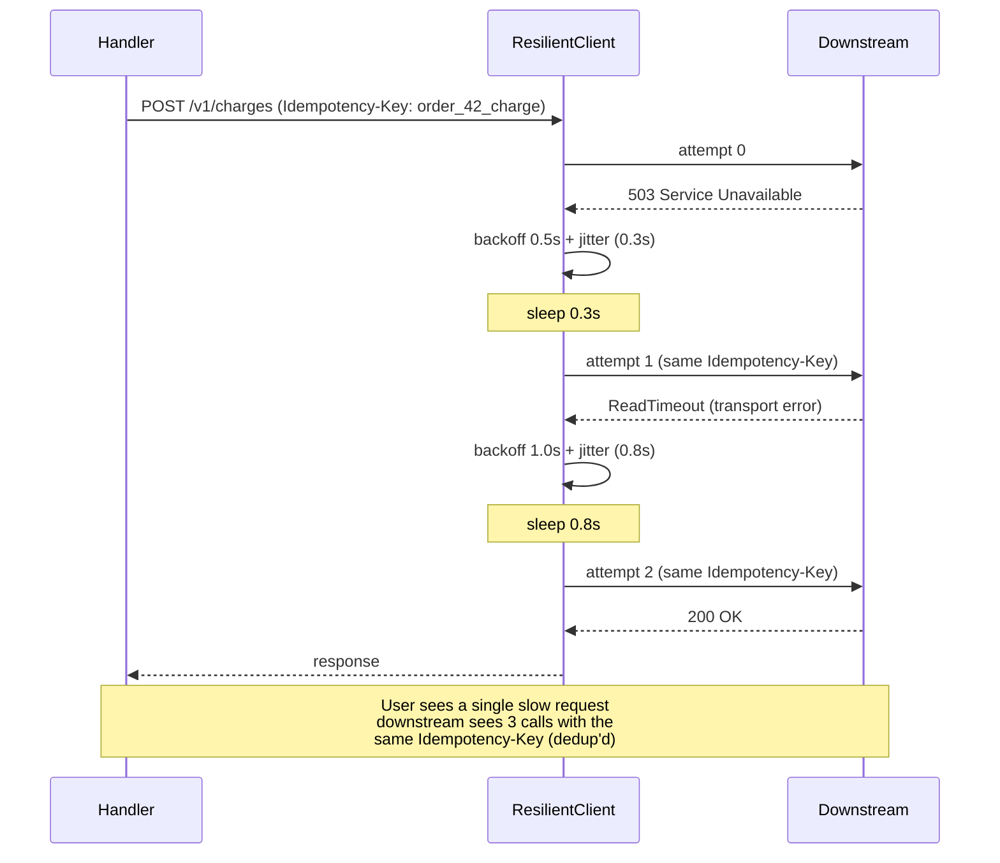
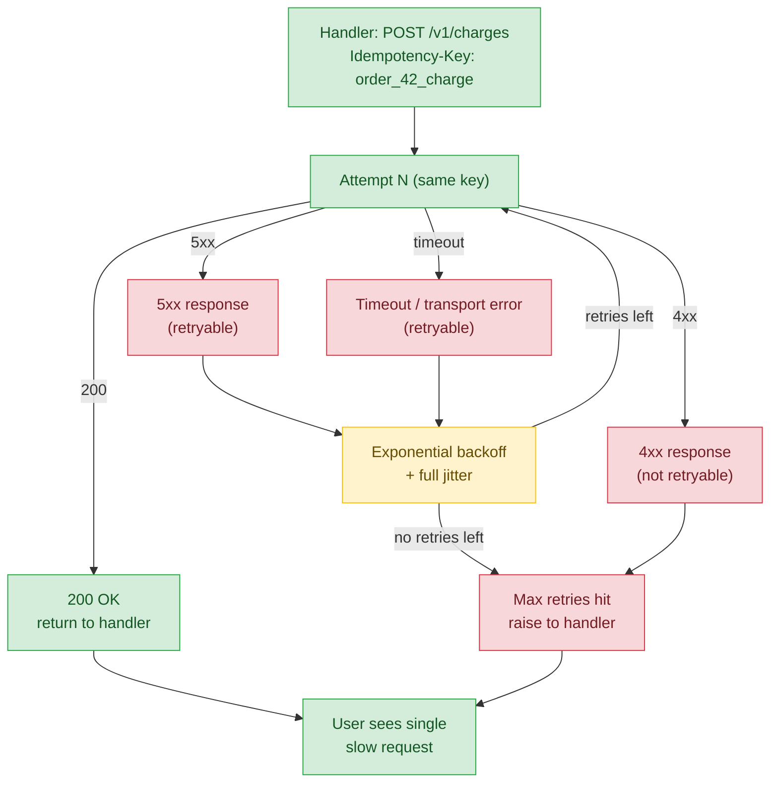

# Lesson 01: HTTP Clients, Timeouts, and Retries

*Giving `Boardly` a well-behaved HTTP client with per-phase timeouts, a connection pool, retry with backoff and jitter, and an `Idempotency-Key` for non-idempotent verbs.*

**You're at the very beginning of Section 15.**

Every backend engineer has been here: a downstream service goes slow, your worker thread parks forever, your event loop stalls, your pool exhausts, your database sessions leak, your service stops responding, and someone's phone rings at 3 AM. The cause is almost always the same: a `httpx.get(url)` call with no timeout. The fix is the lesson. Take your time. Build the client. Set every dial deliberately. **This is how you learn.**


#http #httpx #retries #idempotency

## Learning Objectives

By the end of this lesson you will be able to:

1. **Configure `httpx` (sync and async)** with explicit per-phase timeouts (connect, read, write, pool).
2. **Tune a connection pool** for your real concurrency — and explain why a too-small pool silently caps your throughput.
3. **Implement retries with exponential backoff and full jitter** — and explain why jitter matters at scale.
4. **Distinguish transport errors from HTTP error responses** — and explain which to retry.
5. **Send an `Idempotency-Key` header for POST calls** so retries are safe even for non-idempotent verbs.
6. **Build a client that propagates the request ID** from the inbound request.
7. **Pick `httpx` over `aiohttp` and `requests`** with stated reasons.

## Prerequisites

Before starting, you need:

- **FastAPI 0.148.0**, `httpx` (latest stable), all verified Oct 2026.
- **Idempotency** — [[02-Web-and-HTTP/Idempotency-Safe-Retries-Pagination]]. Retry is only safe for idempotent verbs (or with an idempotency key). This is the foundation.
- **HTTP request lifecycle** — [[02-Web-and-HTTP/HTTP-Request-Lifecycle]]. A request has four phases (pool, connect, write, read); each can hang independently.
- **The Lifespan lesson** — [[03-FastAPI-Core/Application-and-Lifespan]]. The client is built once and torn down once in lifespan.
- **The logging lesson** — [[13-Performance-and-Observability/Structured-Logging-and-Request-IDs]]. The client propagates the inbound request ID via the `PropagatingTransport` from that lesson.
- **Async** — [[10-Async-Python/Event-Loop-and-Coroutines]]. The async client is the right choice in a FastAPI app.
- **About an hour and a half of focused time.** The code is ~150 lines; the dial-tuning reasoning takes time to settle.

**The most common gap: HTTP has four phases, each of which can hang.**

A `httpx.get(url)` looks like one operation. It's four: (1) acquire a connection from the pool, (2) connect (TCP + TLS handshake), (3) write the request bytes, (4) read the response. Each can hang independently. `httpx.Timeout(5.0)` sets all four to 5 s; `httpx.Timeout(5.0, connect=2.0, read=10.0)` lets you tune them independently. The right shape depends on your workload. Read [[02-Web-and-HTTP/HTTP-Request-Lifecycle]] first if this is new.


## The Problem

A naive `httpx.get(url)` call has no timeout. Well, `httpx`'s default is `Timeout(5.0)` — but a developer who passes `timeout=None` for "just this once" is asking for a 3 AM call. When the downstream service is slow, the request hangs forever. Workers pile up. The pool exhausts. The event loop stalls. Your service stops responding.

The fix is layered:

1. **Per-phase timeouts.** Don't set one number; set four. The connect timeout should be short (2–5 s) — if connecting takes more than 2 s, the host is almost certainly unreachable. The read timeout can be longer for slow endpoints.
2. **Connection pooling.** `httpx.Limits(max_connections=100, max_keepalive_connections=20)` bounds how many sockets are open at once. A too-small pool silently caps your throughput.
3. **Retries with backoff and jitter.** Retry only transient errors. Retry only idempotent operations (or with an idempotency key). Retry with exponential backoff and full jitter, capped, so a thundering herd of retries doesn't take down the downstream you just restored.
4. **Idempotency key for non-idempotent verbs.** `POST` is not idempotent in general. Retrying it can double-create. The `Idempotency-Key` header lets the server dedup — Stripe, AWS, and most modern APIs support it.

This lesson builds the `ResilientClient` for `Boardly`. The contract: `POST /orders/{order_id}/charge` calls the payments service via the client; the client retries transient errors with backoff; the client never retries without an idempotency key on POST; the client propagates the inbound request ID.

Why are timeouts, retries, and idempotency keys taught in one lesson, when they could each be their own? The three are not independent — they form a single resilience budget. A timeout bounds *how long* a single attempt can take; a retry policy bounds *how many* attempts you make; an idempotency key makes the retries *safe* for non-GET methods. Without the timeout, a single slow downstream consumes a worker forever and the retry never gets a chance. Without the retry, a single transient 503 surfaces to the user as a 500. Without the idempotency key, a retry of a `POST /charge` can double-charge the customer. Each one alone is necessary-but-insufficient; together they form the "resilient client" contract. The lesson teaches them together because they are *used* together — separating them into three lessons would force the student to mentally stitch the three halves, when the whole is what production code looks like.

**Note — Historical context — from `requests` to `httpx`**

For a decade, `requests` was the canonical Python HTTP client. It's sync-only, no HTTP/2, no async. `aiohttp` (2014) filled the async gap; it's faster on some workloads but has a less ergonomic API and a more mature HTTP/1. `httpx` (2019) is the modern alternative: same API for sync and async, HTTP/2 support, well-typed, ecosystem default. For a FastAPI app, `httpx` is the right call. We use it exclusively in this lesson.


## The Code

Here is the `ResilientClient` and the endpoint that uses it:

```python
# boardly/clients.py
"""Boardly — resilient HTTP client.

Lesson 15.1: httpx.AsyncClient with per-phase timeouts, pool,
retry with backoff + jitter, Idempotency-Key for POST,
request-ID propagation via the PropagatingTransport from Lesson 13.1.
"""
import asyncio
import random
from typing import Any

import httpx
import structlog

from boardly.middleware import request_id_var, REQUEST_ID_HEADER


logger = structlog.get_logger()


# Idempotent verbs can always be retried.
IDEMPOTENT_METHODS = frozenset({"GET", "HEAD", "OPTIONS", "PUT", "DELETE"})

# Statuses that mean "try again later."
RETRYABLE_STATUSES = frozenset({429, 500, 502, 503, 504})


class ResilientClient:
 """Async HTTP client with timeouts, pool, retry, idempotency, propagation."""

 def __init__(
 self,
 *,
 base_url: str,
 timeout: float = 10.0,
 connect_timeout: float = 3.0,
 max_connections: int = 100,
 max_keepalive: int = 20,
 max_retries: int = 3,
 backoff_base: float = 0.5,
 backoff_cap: float = 30.0,
 ) -> None:
 self.client = httpx.AsyncClient(
 base_url=base_url,
 timeout=httpx.Timeout(timeout, connect=connect_timeout),
 limits=httpx.Limits(
 max_connections=max_connections,
 max_keepalive_connections=max_keepalive,
 keepalive_expiry=30.0,
 ),
 # The PropagatingTransport is from Lesson 13.1; it stamps the
 # inbound X-Request-ID on every outbound call. Note: when a custom
 # transport is supplied, the client-level `http2=` flag is ignored —
 # the HTTP/2 toggle lives on the transport, so pass it here.
 transport=PropagatingTransport(http2=True),
 )
 self.max_retries = max_retries
 self.backoff_base = backoff_base
 self.backoff_cap = backoff_cap

 async def request(
 self,
 method: str,
 url: str,
 *,
 idempotency_key: str | None = None,
 **kwargs: Any,
 ) -> httpx.Response:
 attempt = 0
 # POST/PUT/PATCH need an idempotency key to be retry-safe.
 can_retry = (
 method.upper() in IDEMPOTENT_METHODS
 or idempotency_key is not None
 )

 # The PropagatingTransport stamps X-Request-ID; we add Idempotency-Key here.
 headers = kwargs.pop("headers", {}) or {}
 if idempotency_key:
 headers["Idempotency-Key"] = idempotency_key
 kwargs["headers"] = headers

 while True:
 try:
 resp = await self.client.request(method, url, **kwargs)

 # Retryable status? Retry with backoff.
 if (
 resp.status_code in RETRYABLE_STATUSES
 and can_retry
 and attempt < self.max_retries
 ):
 wait = self._backoff(attempt)
 # Respect Retry-After if present (429, 503).
 ra = resp.headers.get("Retry-After")
 if ra:
 try:
 wait = max(wait, float(ra))
 except ValueError:
 pass # might be an HTTP-date; ignore for simplicity
 logger.info(
 "http_retry",
 method=method, url=url,
 status=resp.status_code,
 attempt=attempt, wait=wait,
 )
 await asyncio.sleep(wait)
 attempt += 1
 continue

 # Non-retryable status — raise for status, let caller decide on 4xx.
 resp.raise_for_status()
 return resp

 except httpx.TransportError as e:
 # ConnectError, ReadTimeout, RemoteProtocolError, etc.
 if can_retry and attempt < self.max_retries:
 wait = self._backoff(attempt)
 logger.warning(
 "http_transport_error",
 method=method, url=url,
 error=str(e), attempt=attempt, wait=wait,
 )
 await asyncio.sleep(wait)
 attempt += 1
 continue
 raise
 except httpx.HTTPStatusError:
 raise # 4xx — let the caller decide
 except Exception:
 logger.exception(
 "http_unexpected_error", method=method, url=url
 )
 raise

 def _backoff(self, attempt: int) -> float:
 """Exponential backoff with full jitter (AWS-style)."""
 raw = min(self.backoff_cap, self.backoff_base * (2 ** attempt))
 return random.uniform(0, raw)

 async def close(self) -> None:
 await self.client.aclose()

 async def __aenter__(self):
 return self

 async def __aexit__(self, *exc):
 await self.close()


# PropagatingTransport is from Lesson 13.1 — reproduced here for completeness.
# In the real codebase, it lives in boardly/clients.py and is shared.
class PropagatingTransport(httpx.AsyncHTTPTransport):
 async def handle_async_request(self, request):
 rid = request_id_var.get()
 if rid:
 request.headers[REQUEST_ID_HEADER] = rid
 return await super().handle_async_request(request)


# boardly/main.py — the lifespan wires the client
from contextlib import asynccontextmanager

import structlog
from fastapi import FastAPI, Request

from boardly.clients import ResilientClient
from boardly.logging import configure_logging
from boardly.middleware import request_id_var


logger = structlog.get_logger()


@asynccontextmanager
async def lifespan(app: FastAPI):
 configure_logging()
 app.state.payments = ResilientClient(
 base_url="https://payments.example.com",
 timeout=8.0, connect_timeout=2.0,
 max_connections=50, max_keepalive=10,
 )
 yield
 await app.state.payments.close()


app = FastAPI(title="Boardly", version="0.5.0", lifespan=lifespan)


@app.post("/orders/{order_id}/charge")
async def charge_order(order_id: int, request: Request):
 client = request.app.state.payments
 # POST is non-idempotent by default; provide an idempotency key
 # so a retry-safe dedup happens server-side.
 idem = f"order_{order_id}_charge"
 resp = await client.request(
 "POST", "/v1/charges",
 idempotency_key=idem,
 json={"order_id": order_id, "amount": 9995, "currency": "usd"},
 )
 return resp.json()
```

That's ~150 lines across two files. Run it. Send a request. Force a 503 from the downstream and watch the retry. We'll explain every line next.

## Line-by-Line Deep Dive

### `boardly/clients.py`: Lines 1–10 – Imports

```python
import asyncio
import random
from typing import Any

import httpx
import structlog

from boardly.middleware import request_id_var, REQUEST_ID_HEADER
```

**What it does:** Pulls in `asyncio` (for `sleep`), `random` (for jitter), the `Any` typing primitive, `httpx`, `structlog`, and the request-ID middleware pieces from Lesson 13.1.

**Why `httpx` and not `aiohttp` or `requests`:** `httpx` is the modern, well-typed, ecosystem-default client with both sync and async APIs and HTTP/2 support. `aiohttp` is faster on some workloads but has a less ergonomic API. `requests` is sync-only. For a FastAPI app, `httpx` is the right call.

### `boardly/clients.py`: Lines 17–18 – The idempotent-methods set

```python
IDEMPOTENT_METHODS = frozenset({"GET", "HEAD", "OPTIONS", "PUT", "DELETE"})
```

**What it does:** Defines the set of HTTP methods that are idempotent by spec — retrying them has the same effect as the original.

**Why a `frozenset`:** Membership check is `O(1)`. The set is immutable, which is documentation (no one can accidentally append at runtime).

**Why these methods:** Per RFC 7231:

- `GET` — safe and idempotent (read-only, no side-effect).
- `HEAD` — safe and idempotent.
- `OPTIONS` — safe and idempotent.
- `PUT` — idempotent (replacing a resource with the same value twice gives the same end state).
- `DELETE` — idempotent (deleting a resource that's already deleted is the same end state as deleting it once).
- `POST` — **not idempotent** in general (creating a resource twice creates two resources).
- `PATCH` — not idempotent in general (depends on the patch semantics).

**Why `POST` is the tricky one:** A `POST /charges` that gets a 503 might have been processed by the server (the response was lost) or might not have been (the server was down). Retrying naively can double-charge. The `Idempotency-Key` header lets the server dedup — Stripe, AWS, and most modern APIs support it.

Why is `PUT` idempotent and `POST` not, when both can create resources? `PUT /users/42` says "set the resource at /users/42 to this state". Calling it twice with the same state gives the same end state — one user, with the field values you sent. `POST /users` says "create a new resource under /users, server picks the ID". Calling it twice creates two resources, each with its own server-assigned ID. The difference is *who picks the URL* — `PUT`'s URL is the caller's responsibility, so the second `PUT` overwrites the first; `POST`'s URL is the server's responsibility, so the second `POST` mints a new URL. The same body sent to `PUT /users/42` twice is one user; sent to `POST /users` twice is two users. That is the spec definition of idempotent. The idempotency-key header *makes POST behave like PUT* — the downstream stores `idem:key → response`, so the second POST with the same key returns the first POST's response rather than creating a second resource. The idempotency key is the "PUT for POST" upgrade.

**`DELETE` idempotency is debatable.**

Strictly, `DELETE` is idempotent per RFC 7231 (the *end state* of "deleted" is the same whether you delete once or twice). But the *response* differs — the first `DELETE` returns 200, the second returns 404. If your code keys on the response, "idempotent" doesn't help. The pragmatic rule: retry `DELETE` only if your consumer tolerates either 200 or 404.


**Danger — How an attacker thinks: the `Idempotency-Key` is a stable cross-request correlation identifier.**

The lesson's key is `f"order_{order_id}_charge"` — predictable from the URL path. An attacker who can read your traffic (a compromised TLS-termination proxy, a misconfigured CDN access log, a `tcpdump` on a co-located box in the cloud provider's metadata network) sees every retry of the *same* logical operation arrive at the downstream with the *same* key. The retries are no longer anonymous — they're a cluster. An attacker who captures the downstream's webhook delivery (Stripe publishes event IDs in the dashboard) and matches them to the `Idempotency-Key` pattern from your inbound traffic now has end-to-end correlation: "this customer's charge attempt at 14:32 was retried 3 times because the downstream was at 503" — a competitive-intelligence leak (charge-retry patterns reveal *which* customers' charges fail; those customers are high-value social-engineering targets). The defenses: (1) rotate the key per logical operation, not per request — `f"order_{order_id}_{op_kind}_{op_version}"` where `op_version` bumps on each *user-initiated* retry, not on the client's automatic retry; (2) hash the key with a per-deployment salt so the downstream sees a UUID, not a predictable pattern: `idem = hashlib.sha256(f"{order_id}:{op_kind}:{settings.IDEM_SALT}".encode()).hexdigest()`; (3) treat the key as you would a session token — never log it in full, never surface it in client-facing error responses. The `Idempotency-Key` is not a free correlation pass for the receiver; it's a *consent token* for the receiver to dedup, and a passive observer can dedup *and* profile. See [[11-Authentication-and-Security/Threat-Model-First]] for the trust-boundary framing and [[13-Performance-and-Observability/Structured-Logging-and-Request-IDs]] for the redaction seam.


### `boardly/clients.py`: Lines 21–22 – The retryable-statuses set

```python
RETRYABLE_STATUSES = frozenset({429, 500, 502, 503, 504})
```

**What it does:** Defines the set of HTTP status codes that mean "try again later."

**Why these statuses:**

- `429 Too Many Requests` — rate-limited. Retry after `Retry-After` seconds.
- `500 Internal Server Error` — server error. *Might* be transient; might be a bug. Retry cautiously — many 500s are bugs, not transient.
- `502 Bad Gateway` — proxy/gateway got a bad response from the upstream. Often transient.
- `503 Service Unavailable` — server is overloaded or down. Often transient. Respect `Retry-After`.
- `504 Gateway Timeout` — proxy/gateway timed out waiting for the upstream. Often transient.

**Why not `4xx` (other than 429):** A `400 Bad Request` means the request is wrong; retrying won't fix it. A `401 Unauthorized` means the credentials are wrong; retrying won't fix it. A `404 Not Found` means the resource doesn't exist; retrying won't fix it. Retry only when retrying might help.

**Why include `500`:** This is debatable. Many 500s are bugs; retrying wastes resources. But some 500s are transient (a brief database outage, a deploy in progress). The pragmatic rule: retry 500s only if you know the upstream is idempotent and the error is transient. If you don't know, don't retry 500s — drop `500` from the set.

**Warning — Retrying `500` errors is a judgement call.**

If the upstream is your own service and you know the 500 is transient (a deploy, a brief DB outage), retry. If the upstream is a third party and you don't know what the 500 means, don't retry — you might retry a bug. Tune per integration.


### `boardly/clients.py`: Lines 25–50 – The constructor

```python
def __init__(
 self,
 *,
 base_url: str,
 timeout: float = 10.0,
 connect_timeout: float = 3.0,
 max_connections: int = 100,
 max_keepalive: int = 20,
 max_retries: int = 3,
 backoff_base: float = 0.5,
 backoff_cap: float = 30.0,
) -> None:
 self.client = httpx.AsyncClient(
 base_url=base_url,
 timeout=httpx.Timeout(timeout, connect=connect_timeout),
 limits=httpx.Limits(
 max_connections=max_connections,
 max_keepalive_connections=max_keepalive,
 keepalive_expiry=30.0,
 ),
 transport=PropagatingTransport(http2=True),
 )
 self.max_retries = max_retries
 self.backoff_base = backoff_base
 self.backoff_cap = backoff_cap
```

**What it does:** Constructs an `httpx.AsyncClient` with all the dials set, plus our propagating transport.

**Why `*` (keyword-only arguments):** Prevents accidental positional argument bugs. The caller has to write `ResilientClient(base_url=..., timeout=...)` explicitly.

**Why `httpx.Timeout(timeout, connect=connect_timeout)`:** A single number (`timeout=5.0`) sets all four phases (pool, connect, write, read) to 5 s *each* — they are independent per-phase deadlines, not a shared 5 s budget. `httpx.Timeout(timeout, connect=connect_timeout)` keeps `timeout` as the *default* for any phase you do not name, and overrides only `connect`. So `Timeout(10.0, connect=3.0)` means `pool=10`, `connect=3`, `write=10`, `read=10` — four independent deadlines. The connect timeout should be short — if connecting takes more than 2 seconds, the host is almost certainly unreachable.

#### `httpx.Timeout` per-phase: what each phase defends against

`httpx.Timeout` exposes four independent phase timeouts; understanding what each defends against is what makes the per-phase configuration worth the extra typing over a single float:

- **`pool` (default = `timeout`):** the time to *acquire* a connection from the client's pool. If `max_connections=100` and all 100 are in flight, the 101st request blocks waiting for a free slot. The pool timeout bounds this wait — the request gets a `PoolTimeout` after `pool` seconds instead of hanging forever. Defends against *pool exhaustion under downstream slowness*: a slow Stripe API holding 100 connections for 30 s each would, without a pool timeout, cause your 101st caller to wait 30 s for a slot. Set `pool` to *less than* the downstream's worst-case call time.
- **`connect` (we set 3 s):** the time to establish a *new* TCP+TLS connection (not used if a keepalive connection is reused). A healthy downstream connects in <500 ms; if `connect` exceeds 2 s, the host is unreachable (DNS broken, firewall dropping SYN, downstream crashed without RST). Bounding `connect` short (3 s) is what prevents the "DNS resolution hangs for 30 s" failure mode — every retry that needs a fresh connect is bounded to 3 s, and only the *first* retry incurs `connect` at all (subsequent retries reuse a keepalive if one was established).
- **`write` (default = `timeout`):** the time to *send* the request body. For a small JSON POST this is sub-millisecond; for a large multipart upload (file upload to S3), it can be seconds. Set `write` higher when uploading large bodies — the default `timeout` is too tight for a 50 MB upload over a 10 Mbit/s link (~40 s).
- **`read` (default = `timeout`):** the time to *receive* the response body, measured from the first byte of the response to the last. A downstream that accepts the request, holds for 25 s, then streams a 2 MB response would have ~25 s of read time — `read=timeout=10` would fail the request midway through the response. Set `read` higher than the downstream's documented worst-case processing time, *plus* the response-streaming time.

The four phases are *independent* per-phase deadlines — there is no shared "overall" ceiling. The `timeout` you pass positionally is just the default value httpx copies into any phase you do not name explicitly. So `Timeout(10.0, connect=3.0)` produces `pool=10`, `connect=3`, `write=10`, `read=10` — four unrelated countdowns, each restarted when its phase begins. Worst-case wall-clock for one request is the *sum*: `pool + connect + write + read` = `10 + 3 + 10 + 10` = 33 s, not 10 s. The `connect=3` we set means "spend at most 3 s on the connect phase alone — fail fast if the host is unreachable; pool/write/read each still have their own 10 s budget to spend as needed". Without per-phase, all four phases share the *same* 10 s deadline (so a hung connect could burn the full 10 s before the request fails) — exactly the failure mode `connect=3` defends against, while leaving pool/write/read at the more generous 10 s default.

**Verify it yourself.**

`python -c "import httpx; t = httpx.Timeout(10.0, connect=3.0); print(t.pool, t.connect, t.write, t.read)"` prints `10.0 3.0 10.0 10.0` — four independent values, not one ceiling.


**Why a short `connect` matters more than a short `read`.**

An unreachable downstream fails `connect` *fast* (the OS SYN retransmit timer is ~1 s, then SYN+retransmit, then give up at ~6 s — but `httpx` gives up at `connect=3`). A slow downstream fails `read` *slowly* (the downstream accepted the connection, the bytes are trickling in, `read` bounds the wait). The two failure modes have different business impact: an unreachable downstream means "the integration is down — break the circuit" (see Lesson 03); a slow downstream means "the integration is overloaded — back off and retry" (see Lesson 02). The short `connect` gives you the signal that the breaker should open; the longer `read` gives you the signal that retry-with-backoff is the right response. Without the per-phase split, both failure modes look identical (one big timeout) and you can't route them to the right defense.


**Why `httpx.Limits(max_connections=100, max_keepalive_connections=20, keepalive_expiry=30.0)`:**

- `max_connections=100` — the maximum number of TCP connections the client will open at once. Once this is reached, new requests wait (bounded by the pool timeout) for a free connection.
- `max_keepalive_connections=20` — the maximum number of *idle* connections to keep warm. After a request finishes, the connection goes back to the pool. If the pool has 20 idle connections, the next request reuses one (no TCP handshake). If the pool has more than 20 idle, the extras are closed.
- `keepalive_expiry=30.0` — drop idle connections after 30 s. Prevents the pool from holding stale connections that the server has closed.

**Production reality: match `max_connections` to the *downstream's* concurrency cap, not your app's.**

Stripe's published ceiling is ~100 concurrent connections per merchant account; Twilio's is ~50; Mailgun's is ~20; AWS S3's is ~550 per S3-multi-region-access-point ARN. If your app's natural concurrency is 500 RPS but Stripe caps you at 100, a `max_connections=500` pool *will not* give you 5x throughput — it gets you rate-limited (429) or refused (SYN to RST). The pool size is the bulkhead *partition* between your service and one external dependency; size it to the *cheapest* of {your concurrency, the downstream's cap}. When you integrate multiple downstreams, give each one its own `ResilientClient` (one pool per service — see Mistake 10) so a slow Stripe does not starve a fast Mailgun by holding slots in a shared pool. The bulkhead pattern in [[Circuit-Breaker-vs-Bulkhead-vs-Timeout]] is the architectural extension of this rule.


**Warning — When this breaks: `max_keepalive` > `max_connections` is silently capped; `keepalive_expiry` shorter than the server's idle close creates reconnect churn.**

`httpx.Limits` silently truncates `max_keepalive_connections` to `max_connections` — a `Limits(max_connections=10, max_keepalive_connections=20)` becomes `max_keepalive=10` with no warning, and your "20 idle connections to reuse" mental model is wrong by 2x. The reverse mismatch is the actual outage: `keepalive_expiry=5.0` against a downstream that closes idle connections at 10 s (the default for many Go `net/http` servers) means your client reuses a connection the server already half-closed — every reuse is a `RemoteProtocolError`, every retry re-does the TCP+TLS handshake, and your `connect` timeout suddenly dominates your latency. The defense: set `keepalive_expiry` *below* the downstream's documented idle-close (Stripe's is 30 s; nginx's default `keepalive_timeout` is 65 s; Cloudflare's is shorter and undocumented). Measure with a 10-minute histogram of httpx connection churn — if reconnects-per-second tracks your RPS, your expiry is too aggressive. See [[13-Performance-and-Observability/N-plus-1-and-Slow-Queries]] for the same N+1-style "invisible per-call overhead" failure mode in a different layer.


**Why `transport=PropagatingTransport(http2=True)`:** Two things at once. (1) The transport stamps the inbound `X-Request-ID` on every outbound request — it's the `PropagatingTransport` from Lesson 13.1, reused here. (2) The `http2=True` kwarg enables HTTP/2 *on that transport*.

**Warning — When you pass a custom `transport=`, the client-level `http2=` flag is ignored.**

`httpx.AsyncClient.__init__` only consults its own `http2=` flag when it has to construct the default `AsyncHTTPTransport` for you. Once you hand it a transport instance, that transport's `http2` setting wins — and `AsyncHTTPTransport` defaults to `http2=False`. So `httpx.AsyncClient(transport=MyTransport(), http2=True)` *silently* runs HTTP/1.1, because `MyTransport()` was constructed with the default `http2=False` and the client's `http2=True` is never read. The fix is to pass `http2=True` to the transport: `transport=PropagatingTransport(http2=True)` (the subclass inherits `AsyncHTTPTransport.__init__`, which accepts `http2` as a keyword). If you skip this, the bug is invisible — requests still succeed, just slower under concurrency than you expected.


**Why HTTP/2 at all:** Multiplexes multiple requests over a single TCP connection. Large wins against modern servers, especially under high concurrency. Some old corporate proxies break HTTP/2; pass `http2=False` to the transport if you see protocol errors.

**Warning — When this breaks: HTTP/2 Rapid Reset (CVE-2023-44487) turns your outbound client into an amplifier against a downstream that hasn't patched.**

CVE-2023-44487 (disclosed October 2023) is an HTTP/2 protocol-level DoS where a client opens many streams and immediately cancels them with a `RST_STREAM` frame — the server's per-stream setup cost is paid but the per-stream revenue (the response) is never delivered. Your `ResilientClient` does not deliberately do this, but a misbehaving retry path can: a `ReadTimeout` after the response headers have arrived triggers an httpx-internal stream reset, and under sustained timeout conditions your client cancels many streams per second against one downstream connection. Most public HTTP/2 servers (nginx >= 1.25.3, Cloudflare, AWS ALB) shipped patches by late October 2023 that cap `MAX_CONCURRENT_STREAMS` per connection. Your *outbound* httpx client does not need to defend against rapid reset on its own — but if your downstream is a self-hosted nginx < 1.25.3 or any HTTP/2 server you operate, the *outbound* client becomes the attacker; you must patch the downstream, not the client. The symptom in your client metrics: an unexplained spike in `RemoteProtocolError` and HTTP/2 stream resets when the downstream is under load, with the downstream's CPU at 100% but its request count flat. See [[13-Performance-and-Observability/OpenTelemetry-Tracing]] for the client-side metrics that surface this.


**Why `max_retries=3`:** Three retries with exponential backoff gives `0.5 + 1 + 2 = 3.5` seconds of total backoff (with `backoff_base=0.5`). Enough for most transient failures; not so much that the user gives up.

**Why `backoff_base=0.5` and `backoff_cap=30.0`:** The base is the initial delay; the cap is the maximum. Without the cap, attempt 10 retries after `2^10 = 1024` seconds (~17 min), by which time the user has given up.

**Tip — Match the pool size to your real concurrency.**

A pool that's too small silently caps your throughput. For a 100 ms round trip, a 10-connection pool caps you at `10 / 0.1 = 100 req/s`, no matter how fast your code. Match `max_connections` to your real concurrency, not your wishful concurrency.


### `boardly/clients.py`: Lines 52–113 – The `request` method

```python
async def request(
 self,
 method: str,
 url: str,
 *,
 idempotency_key: str | None = None,
 **kwargs: Any,
) -> httpx.Response:
 attempt = 0
 can_retry = (
 method.upper() in IDEMPOTENT_METHODS
 or idempotency_key is not None
 )

 headers = kwargs.pop("headers", {}) or {}
 if idempotency_key:
 headers["Idempotency-Key"] = idempotency_key
 kwargs["headers"] = headers

 while True:
 try:
 resp = await self.client.request(method, url, **kwargs)

 if (
 resp.status_code in RETRYABLE_STATUSES
 and can_retry
 and attempt < self.max_retries
 ):
 wait = self._backoff(attempt)
 ra = resp.headers.get("Retry-After")
 if ra:
 try:
 wait = max(wait, float(ra))
 except ValueError:
 pass
 logger.info(
 "http_retry",
 method=method, url=url,
 status=resp.status_code,
 attempt=attempt, wait=wait,
 )
 await asyncio.sleep(wait)
 attempt += 1
 continue

 resp.raise_for_status()
 return resp

 except httpx.TransportError as e:
 if can_retry and attempt < self.max_retries:
 wait = self._backoff(attempt)
 logger.warning(
 "http_transport_error",
 method=method, url=url,
 error=str(e), attempt=attempt, wait=wait,
 )
 await asyncio.sleep(wait)
 attempt += 1
 continue
 raise
 except httpx.HTTPStatusError:
 raise
 except Exception:
 logger.exception(
 "http_unexpected_error", method=method, url=url
 )
 raise
```

**What it does:** The whole retry policy in one method. (1) Decide if we can retry based on the method and the idempotency key. (2) Add the `Idempotency-Key` header if provided. (3) Loop: make the request, retry on retryable status or transport error, raise on 4xx, return on 2xx. (4) Respect `Retry-After` if present.

**Why `can_retry` is computed once at the top:** The method and the idempotency key don't change between retries. Compute once; reuse.

**Why `kwargs.pop("headers", {})`:** The caller might pass headers via `kwargs`; we want to add `Idempotency-Key` to them, not replace them. `pop` removes the headers from `kwargs`, we modify them, we put them back via `kwargs["headers"] = headers`. The `or {}` handles the case where the caller passed `headers=None`.

**Why the `Retry-After` parsing is in a try/except:** `Retry-After` can be either a number of seconds (`Retry-After: 30`) or an HTTP date (`Retry-After: Wed, 21 Oct 2026 07:28:00 GMT`). We try `float(ra)`; if that fails (it's a date), we ignore it. The full implementation would parse the date; we keep it simple.

**Warning — When this breaks: `float()` accepts `nan`, `inf`, and scientific notation — and `asyncio.sleep(float("nan"))` blocks the worker.**

A downstream that returns `Retry-After: nan` (a misconfigured proxy, a deliberate probe) slips through `float(ra)` because `float("nan")` does *not* raise `ValueError` — it returns `float("nan")`. Then `max(wait, float("nan"))` is `nan` (NaN propagates through `max`), and `await asyncio.sleep(nan)` raises `RuntimeError: ... got future ... that is already acquired` or, on some Python/asyncio combinations, blocks the worker for the worker's whole lifetime. The same applies to `Retry-After: 1e18` (a billion years — the worker sleeps until the OS kills it) and `Retry-After: -1` (benign numerically, but a signal the downstream is broken). The defense: validate `0 < float(ra) < 3600` (one hour is the RFC 9110 section 10.2.3 ceiling for a reasonable retry-after) before passing to `asyncio.sleep`. Better: parse with `int(ra)` first (which raises `ValueError` on `nan`/`inf`/scientific notation) and fall back to the HTTP-date parser only on the `int()` failure. The current code is fine for a well-behaved Stripe; it's broken against a malicious or buggy proxy that emits pathological `Retry-After` values to deadlock your workers.


**Why `resp.raise_for_status()` only on non-retryable status:** If the status is retryable, we've already handled it (either retried or exhausted retries). For non-retryable statuses (2xx, 4xx), we call `raise_for_status()` which raises `HTTPStatusError` on 4xx/5xx. The caller catches `HTTPStatusError` and decides what to do (return 404, return 400, etc.).

**Why the `except httpx.HTTPStatusError: raise`:** This catches the `HTTPStatusError` from `raise_for_status()` and re-raises it without retry. The caller gets the 4xx and decides. Retrying a 4xx is a bug — the request is wrong; retrying won't fix it.

**Why the `except Exception` log and re-raise:** Any unexpected exception (a bug in our code, a serialisation error, etc.) is logged with `logger.exception` (which captures the traceback) and re-raised. We don't retry unexpected exceptions — they might not be transient.

**Danger — How an attacker thinks: an attacker who controls the URL the client calls is one `follow_redirects=True` away from SSRF.**

The `ResilientClient.request("POST", url)` is safe when `url` is a constant (`"/v1/charges"` against a fixed `base_url`). The moment a route accepts a user-supplied `callback_url` and the handler does `await client.request("POST", user_callback_url)`, the client becomes a server-side request forgery (SSRF) primitive: an attacker who submits `callback_url="http://169.254.169.254/latest/meta-data/iam/security-credentials/MyRole"` asks your service to fetch AWS instance credentials and POST them to a URL the attacker controls. Two failure modes make this catastrophic: (1) `httpx.AsyncClient(follow_redirects=True)` silently follows a 301 from `http://attacker.example/redirect` to `http://169.254.169.254/...` — the SSRF never sees the IP literal in the user input, the redirect hides it; (2) the `Idempotency-Key` mechanism is now attacker-controlled (the attacker picks the key), so retries dedup *their* requests, not yours. The defenses: (a) reject user-supplied URLs whose host is not on an allowlist (`urllib.parse.urlparse(url).hostname in ALLOWED_CALLBACK_HOSTS`); (b) resolve the host yourself with `socket.getaddrinfo` and reject if it resolves to a private IP range (RFC 1918, link-local `169.254.0.0/16`, loopback `127.0.0.0/8`, IPv6 `::1` and `fc00::/7`); (c) do *not* enable `follow_redirects` on a client that calls user-supplied URLs — or wrap the redirect in a custom transport that re-runs the allowlist on each hop. SSRF is the highest-leverage attack against outbound HTTP clients because the client runs *inside* your network, where the metadata service is one TCP connection away. See [[11-Authentication-and-Security/OWASP-API-Top-10]] (Server-Side Request Forgery) and [[11-Authentication-and-Security/Threat-Model-First]] for the threat-model framing.


**Spot the bug — what happens if the caller passes `method="post"` (lowercase)?**

`method.upper()` returns `"POST"`. `IDEMPOTENT_METHODS` is `{"GET", "HEAD", "OPTIONS", "PUT", "DELETE"}` — `"POST"` is not in it. So `can_retry` is `False` unless the caller also passes `idempotency_key`. The request goes through; the retry loop is bypassed (because `can_retry and attempt < self.max_retries` is `False`). This is correct — `POST` without an idempotency key is not retry-safe.


### `boardly/clients.py`: Lines 115–118 – The backoff

```python
def _backoff(self, attempt: int) -> float:
 """Exponential backoff with full jitter (AWS-style)."""
 raw = min(self.backoff_cap, self.backoff_base * (2 ** attempt))
 return random.uniform(0, raw)
```

**What it does:** Computes the backoff delay for a given attempt. Exponential growth (`base * 2^attempt`), capped at `cap`, with full jitter (random in `[0, raw]`).

**Why exponential:** Same reasoning as Lesson 14.2 — linear retry is too aggressive; exponential spreads the retries.

**Why the `cap`:** Without it, attempt 10 retries after 1024 s (~17 min). The user has given up. The cap keeps the maximum reasonable.

**Why full jitter:** Without jitter, all retriers retry at the same time — the "thundering herd" of retries. If 1000 requests all fail at attempt 3, they all retry at `2^3 = 8` seconds — exactly 8 seconds later, the downstream sees 1000 simultaneous retries. Jitter spreads the retries across `[0, 8]` seconds.

**Full jitter is the AWS-recommended form.**

AWS popularised "full jitter" — `random.uniform(0, raw)` — in their retry docs. The alternatives: "equal jitter" (`raw/2 + random.uniform(0, raw/2)`, never less than half the raw) and "decorrelated jitter" (`min(cap, random.uniform(base, raw * 3))`). Full jitter is the simplest and spreads the load most evenly. Use it unless you have a stated reason for a minimum delay.


**Production reality: retries are a load multiplier on a downstream that's already failing.**

When the downstream is at 503, every failed request retries 3 times — your 1000-QPS service sends 4000 QPS to the downstream at the *worst moment* (when it's already overloaded). The retry storm is a real outage amplifier: the Google SRE book cites cascading-failure scenarios where retries tripled the load and turned a 30-second blip into a 30-minute outage. Three mitigations, in order of leverage: (1) cap the retry *budget* per downstream — a token bucket of N retries per second per service, exhausted when N retries fire, refilled at a rate the downstream can absorb (a hand-rolled `asyncio.Semaphore` per downstream is a poor man's version; the [[Circuit-Breakers]] lesson is the real defense); (2) fail *fast* when the downstream is unhealthy — once you've seen 10 consecutive 503s, stop retrying for 30 s (this is the circuit breaker's *open* state); (3) differentiate user-initiated retries from server-initiated retries — the customer clicking "Retry" should bump the request to the front of the queue; the client's automatic retry should *not*. The retry policy in this lesson is correct for *transient* failures (one-off 503s, brief timeouts); it becomes an outage amplifier under *sustained* failure, which is what the circuit breaker exists to detect. Read this lesson and [[Circuit-Breakers]] as one resilience budget, not two.


### `boardly/main.py`: The lifespan and endpoint

```python
@asynccontextmanager
async def lifespan(app: FastAPI):
 configure_logging()
 app.state.payments = ResilientClient(
 base_url="https://payments.example.com",
 timeout=8.0, connect_timeout=2.0,
 max_connections=50, max_keepalive=10,
 )
 yield
 await app.state.payments.close()


@app.post("/orders/{order_id}/charge")
async def charge_order(order_id: int, request: Request):
 client = request.app.state.payments
 idem = f"order_{order_id}_charge"
 resp = await client.request(
 "POST", "/v1/charges",
 idempotency_key=idem,
 json={"order_id": order_id, "amount": 9995, "currency": "usd"},
 )
 return resp.json()
```

**What it does:** Constructs the `ResilientClient` in the lifespan; uses it in the endpoint.

**Why one client per app, not per request:** An `httpx.AsyncClient` owns a connection pool. Creating one per request would defeat the pool. One client per app, created in the lifespan, shared across requests, torn down in the lifespan.

**Why `idem = f"order_{order_id}_charge"`:** The idempotency key is per-logical-operation. The same order charged twice (e.g. customer clicks "charge" twice) should result in *one* charge — the second call is dedup'd server-side. Using `f"order_{order_id}_charge"` (no timestamp) ensures both calls have the same key. If you wanted *each* click to create a separate charge, you'd add a timestamp.

**Why the endpoint returns `resp.json()`:** The downstream's response is passed through. In a real app, you'd validate the response with Pydantic before returning; here we trust the downstream's contract.

## Execution Trace

A request that fails twice (transient) and succeeds on the third try:



The same retry flow as a colour-coded topology. Green is the user-visible happy path (one request, one response); amber is the client's retry loop (exponential backoff with jitter, bounded retries); red is the downstream failure modes the retry absorbs (503, ReadTimeout). The structural insight this diagram makes visible: the Idempotency-Key is the *only* thing that makes retries safe for non-GET methods. Without it, a retry of a `POST /v1/charges` could double-charge the customer. With it, the downstream sees three calls with the same key and dedups to one — the customer is charged once, the retry was invisible to them, the operator sees a single slow request in the trace.



**Student asks: why retry 5xx but not 4xx?**

Because 5xx is "the server had a problem" (a transient one — overload, restart, internal error, network blip upstream), and the next attempt might succeed. 4xx is "your request was wrong" (a 400 Bad Request is wrong on the first attempt and on the hundredth), and retrying just wastes the server's time. The line is sharper than it looks: a 429 (Too Many Requests) with a `Retry-After` header is *retryable* — it is a 4xx that says "you sent too many; wait, then try again". A 409 (Conflict) on an idempotent request with a stale `If-Match` header is *retryable* if you re-fetch the resource. The rule of thumb is "5xx is retryable by default; 4xx is not retryable by default; override per-status as your threat model demands". Boardly's retryable-statuses list is `{429, 500, 502, 503, 504}` (matching `RETRYABLE_STATUSES` above) plus transport errors (timeouts, connection resets) — anything where the failure is *not the request's fault*.


**Student asks: why does the Idempotency-Key need to be in the *header* and not the body?**

Because the downstream dedup logic needs to see the key *before* it parses the body. If the key were in the body, the downstream would have to parse the body (potentially expensive — large JSON, streaming uploads) before it could check "have I seen this before?". With the key in the header, the downstream can check a Redis `SETNX idem:{key}` *before* touching the body — and short-circuit on duplicate. The header is also where the HTTP spec conventionally puts cross-cutting metadata (Authorization, Content-Type, X-Request-Id); the Idempotency-Key is exactly that kind of metadata. Stripe, AWS, and the IETF draft all standardised on the header form (`Idempotency-Key`). The body is for the request payload; the header is for the request's metadata. The idempotency key is metadata.


## Common Mistakes

### Mistake 1: No timeout

```python
# WRONG
resp = await httpx.AsyncClient().get(url) # default is 5s, but...
resp = await httpx.AsyncClient(timeout=None).get(url) # the 3 AM call
```

**Symptom:** A slow downstream hangs the request forever. Workers pile up. The pool exhausts.

**Why:** Without a timeout, the request waits indefinitely.

**Fix:** Always set `httpx.Timeout(...)`. Even the default 5 s is better than `None`.

### Mistake 2: One timeout for everything

```python
# WRONG
client = httpx.AsyncClient(timeout=5.0) # all phases 5s
```

**Symptom:** A 5 s read timeout is wrong for a long-poll endpoint (too short) and wrong for a health check (too long).

**Why:** The four phases have different acceptable durations. The connect timeout should be short (2 s). The read timeout can be long for slow endpoints.

**Fix:** `httpx.Timeout(timeout, connect=connect_timeout)`. Tune per route if needed.

### Mistake 3: Retrying POST without an idempotency key

```python
# WRONG
resp = await client.request("POST", "/v1/charges", json={...}) # no idem key
```

**Symptom:** A 503 on the first call (the server processed the charge but the response was lost). Retry. The customer is charged twice.

**Why:** `POST` is not idempotent. Retrying without an idempotency key can double-create.

**Fix:** Always send an `Idempotency-Key` header for POSTs you'll retry. Stripe, Square, AWS, and most modern APIs dedup server-side.

### Mistake 4: Retrying 4xx errors

```python
# WRONG
RETRYABLE_STATUSES = frozenset({400, 401, 403, 404, 429, 500, 502, 503, 504})
```

**Symptom:** Retrying a 400 (bad request) wastes resources. Retrying a 401 (unauthorized) won't help.

**Why:** 4xx errors mean the request is wrong. Retrying won't fix it.

**Fix:** Only retry 429, 5xx (and be cautious about 500).

### Mistake 5: Retry without backoff

```python
# WRONG
for _ in range(3):
 try:
 return await client.request("POST", url)
 except httpx.TransportError:
 continue
```

**Symptom:** A 503 + immediate retry at 1000 QPS is a DoS against your own downstream.

**Why:** Fixed-delay or no-delay retries hammer the downstream.

**Fix:** Exponential backoff. Each retry waits longer.

### Mistake 6: Retry without jitter

```python
# WRONG
def backoff(attempt):
 return min(60, 2 ** attempt) # no jitter
```

**Symptom:** Synchronised retries spike the downstream at the same instant.

**Why:** Without jitter, all retriers retry at the same time.

**Fix:** Add full jitter — `random.uniform(0, raw)`.

### Mistake 7: Pool sized too small

```python
# WRONG
ResilientClient(
    base_url="https://payments.example.com",
    limits=httpx.Limits(max_connections=10, max_keepalive_connections=2),
)
# The service behind this client is happy to take 50 concurrent calls.
# The pool holds at 10. 11th request waits for a connection.
```

**Symptom:** Caps your throughput silently. The downstream is fine; your pool is the bottleneck. p99 latency rises under load because requests queue on the pool, not on the downstream — but from the outside, the symptom looks the same as a slow downstream.

**Why:** A too-small pool means new requests wait for a free connection.

**Fix:** Match `max_connections` to your real concurrency. Measure first: what is the 95th percentile of in-flight calls to this downstream at peak? Set `max_connections` to ~1.5× that. Keep `max_keepalive_connections` at ~50–80% of `max_connections` so keepalive is helpful without starving fresh-connection capacity.

```python
# RIGHT
ResilientClient(
    base_url="https://payments.example.com",
    limits=httpx.Limits(max_connections=64, max_keepalive_connections=32),
)
```

### Mistake 8: Pool sized too large

```python
# WRONG
ResilientClient(
    base_url="https://payments.example.com",
    limits=httpx.Limits(max_connections=10000),
)
# Stripe's published guidance: do not exceed ~100 concurrent connections per merchant account.
# A 10 000-connection pool against that endpoint gets you rate-limited or banned.
```

**Symptom:** The downstream rejects or rate-limits. You're sending too many concurrent connections.

**Why:** A too-large pool means the downstream can't handle your concurrency. The downstream either throttles you (returning 429) or refuses connections (SYN→RST). Your pool's headroom is bought at the cost of being rate-limited when you actually use it.

**Fix:** Match `max_connections` to your downstream's capacity, not your wishful capacity. Read the downstream's published limits (most payment/SMS/email providers publish them). For Stripe, ~100; for Twilio, ~50; for Mailgun, ~20. Set `max_connections` at or below the published limit. The bulkhead (Lesson 15.2) is the right tool to *partition* a too-large pool across multiple downstreams.

### Mistake 9: Not closing the client

```python
# WRONG
@asynccontextmanager
async def lifespan(app: FastAPI):
 app.state.payments = ResilientClient(...)
 yield
 # forgot to close
```

**Symptom:** The client escapes lifespan. Sockets leak. The process eventually runs out of file descriptors.

**Why:** The client owns a connection pool with open sockets. Without `aclose()`, they're not closed.

**Fix:** `await app.state.payments.close()` in the lifespan teardown.

### Mistake 10: Sharing one client across base URLs

```python
# WRONG
client = ResilientClient(base_url="https://payments.example.com")
# later, trying to call a different service:
await client.request("GET", "https://shipping.example.com/track/123")
```

**Symptom:** The connection pool is keyed to `payments.example.com`. Calling `shipping.example.com` opens new connections; the pool's keepalive doesn't help.

**Why:** Each `base_url` is its own pool. One client per service.

**Fix:** One `ResilientClient` per external service. Build them in the lifespan; stash on `app.state`.

## Engineering Trade-Offs

### `httpx` vs `aiohttp` vs `requests`

- **`httpx`** — modern, sync + async API, HTTP/2 support, well-typed, ecosystem default. Use this.
- **`aiohttp`** — async-only, faster on some workloads, more mature HTTP/1. Less ergonomic API. Use when you benchmark a measurable advantage.
- **`requests`** — sync-only, no HTTP/2, no async. Use only for tiny scripts.

### Library-provided retry vs hand-rolled

`httpx-retries` and `tenacity` are libraries that add retry to httpx. They're convenient but hide the backoff schedule and the retry condition under a decorator. Hand-rolled retry is more transparent and easier to assert against in tests; library retry is faster to ship. Pick based on whether the team reads the library's source.

### Idempotency key per call vs per session

Per-call keys (Stripe-style `Idempotency-Key: charge_<order_id>`) are safest — they're stable across retries of the same logical operation. Per-session keys are easier (a UUID at request start) but lose dedup across user-initiated retries. Per-call is the right default.

### HTTP/2 vs HTTP/1.1

HTTP/2 multiplexes multiple requests over one TCP connection — large wins against modern servers, especially under high concurrency. Some old corporate proxies break HTTP/2; turn off (`http2=False`) if you see protocol errors.

## Exercises

**Tip — The 20-minute rule**

If you're stuck on an exercise for more than 20 minutes, re-read the relevant section above, then move on.


**Exercise 1 — Verify timeouts fire.** Configure an `AsyncClient` with `httpx.Timeout(1.0)`. Use `httpx.MockTransport` to simulate a slow downstream. Confirm a `ReadTimeout` is raised.

**Exercise 2 — Verify retries.** Use `httpx.MockTransport` to return 503 twice and 200 once. Confirm the `ResilientClient` retries and succeeds on the third try. Confirm only one downstream call had a 200; the first two had 503.

**Exercise 3 — Honor `Retry-After`.** Make the mock return 429 with `Retry-After: 2`. Confirm the client waits 2 seconds (or the backoff, whichever is larger) before retrying.

**Exercise 4 — Bounded concurrency.** Fan out 1000 requests against a rate-limited mock using `asyncio.Semaphore(50)`. Confirm p99 latency stays under 1 s.

**Exercise 5 — Spot the bug.** This client retries 4xx errors. Why is that wrong, and how would you fix it?

```python
RETRYABLE_STATUSES = frozenset({400, 404, 429, 500, 502, 503, 504})
```

(Answer: 400 means the request is wrong; 404 means the resource doesn't exist. Retrying won't fix either. Drop 400 and 404.)

**Exercise 6 — Idempotency key per call vs session.** Implement both forms. Confirm that the per-call form deduplicates a customer-initiated retry (the same logical operation twice), while the per-session form does not.

**Exercise 7 — SSRF defense.** Configure an `httpx.AsyncClient(follow_redirects=True)` and submit a request to a mock that responds with a 301 to `http://169.254.169.254/latest/meta-data/`. Confirm the client raises (or refuses the redirect) instead of fetching the metadata endpoint. Add a custom transport that re-runs the host allowlist on each redirect hop.

Verify: `uv run pytest tests/clients/test_resilient_client.py::test_ssrf_redirect_rejected -v` — the test asserts the request fails before any TCP connect to `169.254.169.254`.

**Exercise 8 — Pool exhaustion under a slow downstream.** Spin up an `httpx.MockTransport` handler that sleeps 10 s before responding. Configure `ResilientClient(max_connections=5)` with `httpx.Timeout(10.0, pool=2.0)`. Send 20 concurrent requests via `asyncio.gather`. Confirm the 6th-onwards requests raise `httpx.PoolTimeout` within ~2 s and the first 5 succeed after 10 s.

Verify: `uv run pytest tests/clients/test_pool_exhaustion.py -v` — the test counts `PoolTimeout` raises and confirms the timing window.

**Exercise 9 — Backoff cap relationship.** Set `backoff_base=1.0, backoff_cap=8.0, max_retries=4`. Trigger 4 consecutive retries against a mock that always 503s. Confirm total wall-clock backoff is bounded by `cap * max_retries` = 32 s (in practice less, because of full jitter — every sleep is `random.uniform(0, min(8, 1 * 2^attempt))`). Assert `total_sleep <= 32.0` and `total_sleep >= 0`.

Verify: `uv run pytest tests/clients/test_backoff_cap.py::test_total_backoff_bounded -v`.

**Exercise 10 — Idempotency-key sent on every retry.** Use an `httpx.MockTransport` that records the `Idempotency-Key` header on each call. Trigger 3 retries (503 twice, 200 once). Confirm the downstream received 3 calls, all with the *same* `Idempotency-Key` value (the sender always re-sends the key; dedup is the receiver's job, but the sender must be consistent).

Verify: `uv run pytest tests/clients/test_idempotency_key.py::test_same_key_sent_on_every_retry -v`.

**Exercise 11 — `Retry-After` validation.** Send a 429 with `Retry-After: nan` and again with `Retry-After: 1e18`. Confirm neither blocks the worker indefinitely — the validator should reject both as out-of-range (`0 < float(ra) < 3600`) and fall back to the backoff default. Then send `Retry-After: 2` and confirm the worker sleeps exactly 2 s (the documented minimum-delay floor).

Verify: `uv run pytest tests/clients/test_retry_after.py::test_nan_rejected tests/clients/test_retry_after.py::test_huge_value_rejected -v`.

**Exercise 12 — HTTP/2 negotiation.** Point the client at a known HTTP/2 endpoint (the `httpx` test fixtures serve HTTP/2 over TLS via `h2` and `h2-protocol`). Confirm `response.http_version == "HTTP/2"` with `http2=True`. Then disable HTTP/2 (`http2=False`) against the same endpoint and confirm `response.http_version == "HTTP/1.1"`. The test guards against the Mistake in the `**Warning — When you pass a custom transport=**` callout above — the silent HTTP/1.1 downgrade.

Verify: `uv run pytest tests/clients/test_http2_negotiation.py -v`.

## Verification

```bash
# 1. Use a slow mock to confirm timeouts fire
uv run python -c "
import asyncio, httpx
async def main():
 async with httpx.AsyncClient(timeout=httpx.Timeout(1.0)) as c:
 try:
 await c.get('https://httpbin.org/delay/5')
 except httpx.ReadTimeout:
 print('timeout fired OK')
asyncio.run(main())
"
# Expect: "timeout fired OK" printed within ~1 s of the request.
# If the call hangs for 5 s instead, httpx.Timeout was not applied —
# check you constructed Timeout(...) and passed it to AsyncClient, not to .get().

# 2. Use httpx.MockTransport to assert retries
uv run pytest tests/clients/test_resilient_client.py -v
# Expect: tests covering the retry matrix pass:
# test_2xx_does_not_retry
# test_5xx_retries_then_succeeds_on_third_attempt
# test_4xx_does_not_retry (defends against Mistake 5)
# test_idempotency_key_sent_on_retry
# test_backoff_has_jitter (two retries have different sleep durations)

# 3. Confirm request ID propagation:
curl -H 'X-Request-ID: test-123' http://localhost:8000/orders/1/charge
# Expect: a 2xx response and X-Request-ID: test-123 in the downstream's logs
# (or httpbin's /headers response body, if you point base_url at httpbin.org).
# If the downstream sees no X-Request-ID, the PropagatingTransport from
# Lesson 13.1 is not wired into the AsyncClient — check your lifespan.
```

Debugging tips:

- Timeouts never fire → check `httpx.Timeout` was actually passed (a bare `timeout=5.0` works, but `None` disables).
- Retries fire on 200 OK → the `RETRYABLE_STATUSES` set is wrong, or `raise_for_status()` is happening before the retry check.
- Pool exhaustion symptoms (`PoolTimeout`) → increase `max_connections` or fix the downstream so connections return faster.

## Previously Learned Here

These concepts were taught in earlier lessons. We link back instead of re-explaining:

- **Idempotency** — [[02-Web-and-HTTP/Idempotency-Safe-Retries-Pagination]] for HTTP verbs. New detail here is the `Idempotency-Key` header as the mechanism that makes `POST` retry-safe — the same conceptual idempotency, extended to a non-idempotent verb via server-side dedup.
- **FastAPI lifespan** — [[03-FastAPI-Core/Application-and-Lifespan]]. The new detail is that the `AsyncClient` is *exactly* the kind of expensive, shareable, teardown-needing resource that lifespan exists for.
- **Structured logging** — [[13-Performance-and-Observability/Structured-Logging-and-Request-IDs]]. The `PropagatingTransport` is from that lesson; we reuse it here.

## What's Next

In [[Webhooks-and-Signature-Verification]] we add the *inbound* side of HTTP integrations: receiving webhooks from external systems. The contract: verify the signature with `hmac.compare_digest`, defeat replay attacks with a timestamp window and a nonce cache, and ack-fast-then-process-async. You'll:

- Build a Stripe-shaped webhook receiver.
- Use `hmac.compare_digest` to avoid timing attacks.
- Add a timestamp window (5 minutes) and a Redis `SETNX` nonce cache.
- Offload the real work to an `arq` worker (from Section 14).

By the end of Lesson 2, `Boardly` can receive webhooks safely and ack within the sender's timeout.

## Sources

- **httpx — Documentation** — <https://www.python-httpx.org/> — accessed 2026-10-19 — async client, timeouts, limits.
- **httpx — Timeouts** — <https://www.python-httpx.org/advanced/timeouts.html> — accessed 2026-10-19 — per-phase timeout configuration.
- **httpx — Connection Pools** — <https://www.python-httpx.org/advanced/resource-limits.html> — accessed 2026-10-19 — `Limits` and keep-alive.
- **HTTP — RFC 7231 — Idempotent Methods** — <https://datatracker.ietf.org/doc/html/rfc7231#section-4.2.2> — accessed 2026-10-19 — what idempotent means in spec.
- **Stripe — Idempotent Requests** — <https://docs.stripe.com/api/idempotent_requests> — accessed 2026-10-19 — the canonical `Idempotency-Key` pattern.
- **AWS — Exponential Backoff** — <https://docs.aws.amazon.com/general/latest/gr/api-retries.html> — accessed 2026-10-19 — full-jitter formula reference.
- **Google SRE — Addressing Cascading Failures** — <https://sre.google/sre-book/addressing-cascading-failures/> — accessed 2026-10-19 — why retries without backoff cause outages.

## What We Learned

Let's recap. In this lesson you:

- **Configured `httpx` (async)** with explicit per-phase timeouts (connect, read, write, pool).
- **Tuned a connection pool** for your real concurrency — and explained why a too-small pool silently caps your throughput.
- **Implemented retries with exponential backoff and full jitter** — and explained why jitter matters at scale.
- **Distinguished transport errors from HTTP error responses** — and explained which to retry.
- **Sent an `Idempotency-Key` header for POST calls** so retries are safe even for non-idempotent verbs.
- **Built a client that propagates the request ID** from the inbound request.
- **Picked `httpx` over `aiohttp` and `requests`** with stated reasons.

Here's the mental model to walk away with: *every external call has a timeout, every timeout is explicit, every retry is safe (idempotent verb or idempotency key), and every retry has backoff with jitter. The pool is sized to your real concurrency. One client per external service, created in lifespan, shared across requests, torn down in lifespan. The downstream sees your retries as repeated calls with the same Idempotency-Key; it dedups; you see a single slow request.*

---

> A note from your teacher
You just gave `Boardly` a well-behaved HTTP client. The next time the downstream goes slow, your request times out in 8 seconds instead of hanging forever. The next time the downstream returns 503, your client retries with backoff and jitter — and doesn't take the downstream down with a thundering herd. The next time you POST a charge, the `Idempotency-Key` ensures a retry doesn't double-charge. That's the contract: every call has a timeout, every retry is safe, every pool is sized. Next, we add the inbound side — webhooks. See you in Lesson 02.


---

**Tags:** #http #httpx #retries #idempotency #review
**Previous:** [[00-Integrations-MOC]]
**Next:** [[Webhooks-and-Signature-Verification]] →