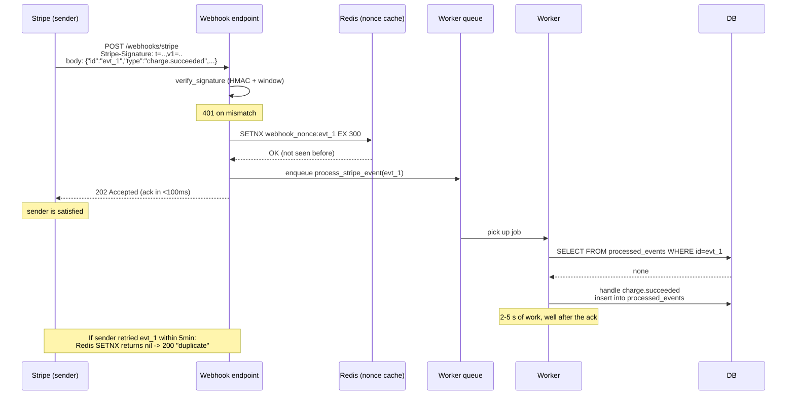
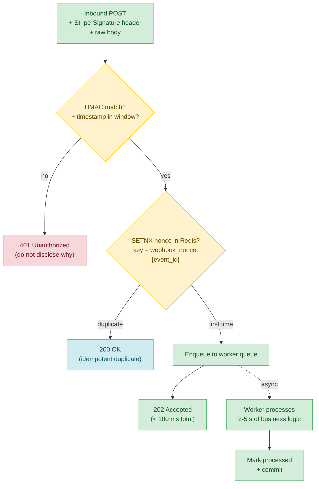

# Lesson 02: Webhooks and Signature Verification

*Giving `Boardly` a webhook receiver that verifies the signature with `hmac.compare_digest`, defeats replay attacks with a timestamp window and a nonce cache, and acks fast before offloading to a worker.*

**You're in the second lesson of Section 15.**

Every backend engineer who has integrated with a payment provider has been here: you expose a `POST /webhooks/stripe` endpoint so Stripe can tell you when a charge succeeds. Anyone on the internet can send a POST to that endpoint — that's the point. If you process the webhook without verifying it came from Stripe, an attacker can forge `charge.succeeded` events and ship your customers' orders for free. Signature verification is not optional; it is the entire security model of inbound webhooks. Take your time. Build the receiver. Forge a webhook and watch it 401. **This is how you learn.**


#security #webhooks #hmac #idempotency

## Learning Objectives

By the end of this lesson you will be able to:

1. **Verify an inbound webhook's HMAC-SHA256 signature** using `hmac.compare_digest` to avoid timing attacks.
2. **Defeat replay attacks** with a timestamp window and a Redis `SETNX` nonce cache.
3. **Design a webhook endpoint** that returns `2xx` immediately and defers real processing to a worker.
4. **Implement idempotency on the receiver side** so duplicate deliveries are safe.
5. **Distinguish Stripe, GitHub, and Slack signature formats** — and abstract them behind a per-provider verifier.
6. **Pick HMAC vs asymmetric signatures (JWS)** with stated reasons.

## Prerequisites

Before starting, you need:

- **FastAPI 0.148.0**, Redis 7.x, all verified Oct 2026. The `hmac` and `hashlib` modules are in the standard library.
- **HTTP request lifecycle** — [[02-Web-and-HTTP/HTTP-Request-Lifecycle]]. A webhook is just an HTTP request.
- **Idempotency** — [[02-Web-and-HTTP/Idempotency-Safe-Retries-Pagination]]. Webhook senders retry; you must dedup.
- **Background tasks / workers** — [[14-Caching-and-Background-Processing/Background-Tasks-vs-Workers]]. Webhook processing is the canonical case for offloading to a worker.
- **The logging lesson** — [[13-Performance-and-Observability/Structured-Logging-and-Request-IDs]]. The webhook endpoint should propagate the inbound request ID into the worker.
- **About an hour and a half of focused time.** The code is ~100 lines; the security reasoning takes time to settle.

**The most common gap: `==` vs `hmac.compare_digest`.**

A naive signature check looks like `if signature != expected: reject()`. The `!=` operator returns as soon as the first byte that differs is found. An attacker who can measure response timing can byte-by-byte brute-force the correct signature — send a fake signature, observe timing, change one byte until timing changes by one nanosecond, move on. This is a timing attack. `hmac.compare_digest(a, b)` runs in constant time relative to the input length — it always compares every byte. The cost is one nanosecond per webhook; the benefit is that you cannot brute-force the signature by timing. Always use `compare_digest` for cryptographic comparisons.


## The Problem

A webhook is a POST request from an external system (Stripe, GitHub, Slack, Twilio) to your service. The body is the event payload; the headers include a signature computed by the sender. The signature lets the receiver verify two things:

1. **Authenticity** — the sender knows the shared secret.
2. **Integrity** — the body hasn't been tampered with in transit.

A third property is often forgotten:

3. **Freshness** — the message is recent, not captured and replayed.

The naive receiver:

```python
@app.post("/webhooks/stripe")
async def stripe_webhook(request: Request):
 event = await request.json()
 if event["type"] == "charge.succeeded":
 await ship_order(event["data"]["order_id"])
 return {"status": "ok"}
```

This is broken in three ways:

1. **No signature verification.** Anyone can forge a `charge.succeeded` event.
2. **No replay protection.** An attacker who captures one valid webhook can replay it forever.
3. **Synchronous processing.** If `ship_order` takes 5 seconds, Stripe (whose timeout is 30 s) might retry. You process the same event multiple times — potentially with different side effects.

This lesson fixes all three. The receiver: verifies the signature, dedups via a nonce cache, enqueues a worker job, and acks in <100 ms.

**Note — Historical context — from basic auth to HMAC to JWS**

Early webhook integrations (2000s) used HTTP basic auth: the sender sent a username and password. That's a plaintext credential on every request; anyone with TLS-termination access (a man-in-the-middle proxy, a misconfigured CDN) could read it. HMAC (hash-based message authentication code) replaced basic auth: the sender and receiver share a secret; the sender computes a hash of the message with the secret and sends the hash; the receiver recomputes and compares. The secret never travels. Asymmetric signatures (JWS, Ed25519) extend this: the sender has a private key, the receiver has a public key, the sender signs with the private, the receiver verifies with the public. Key distribution is safer (public keys can be shared openly). HMAC is the default for almost every webhook integration in 2026; JWS is the upgrade for high-stakes integrations.


## The Code

Here is the Stripe-shaped webhook endpoint with signature verification, timestamp window, nonce cache, and async dispatch:

```python
# boardly/webhooks.py
"""Boardly — inbound webhook receiver.

Lesson 15.2: HMAC-SHA256 verify with compare_digest, timestamp
window, Redis SETNX nonce cache, ack-fast-then-process-async.
"""
import hashlib
import hmac
import json
import time
from typing import Any

import redis.asyncio as redis
from fastapi import APIRouter, HTTPException, Request, Response
import structlog


logger = structlog.get_logger()


router = APIRouter(prefix="/webhooks", tags=["webhooks"])

# In production, load from settings, not from code.
WEBHOOK_SECRET = "whsec_..."
REPLAY_WINDOW_SECONDS = 300 # 5 minutes


def _parse_stripe_signature(header: str) -> tuple[int, str]:
 """Parse 't=1700000000,v1=abc...' into (timestamp, signature)."""
 parts: dict[str, str] = {}
 for chunk in header.split(","):
 if "=" in chunk:
 k, _, v = chunk.partition("=")
 parts[k.strip()] = v.strip()
 t = parts.get("t")
 v1 = parts.get("v1")
 if not (t and v1):
 raise HTTPException(401, "malformed signature header")
 try:
 ts = int(t)
 except ValueError:
 raise HTTPException(401, "bad timestamp")
 return ts, v1


def verify_signature(
 *,
 secret: str,
 raw_body: bytes,
 signature_header: str,
) -> None:
 """Raise HTTPException(401) if verification fails. Constant-time compare."""
 if not signature_header:
 raise HTTPException(401, "missing signature")

 ts, v1 = _parse_stripe_signature(signature_header)

 # 1. Freshness window.
 if abs(time.time() - ts) > REPLAY_WINDOW_SECONDS:
 raise HTTPException(401, "stale webhook")

 # 2. Compute the expected HMAC over "timestamp.body".
 signed_payload = f"{ts}.".encode() + raw_body
 expected = hmac.new(
 secret.encode(), signed_payload, hashlib.sha256
 ).hexdigest()

 # 3. Constant-time compare. Do NOT use ==.
 if not hmac.compare_digest(expected, v1):
 raise HTTPException(401, "signature mismatch")


@router.post("/stripe")
async def stripe_webhook(request: Request) -> Response:
 # 1. Read the RAW body BEFORE FastAPI parses it as JSON.
 # HMAC must be computed over the exact bytes the sender sent.
 raw = await request.body()
 sig = request.headers.get("Stripe-Signature", "")

 # 2. Verify or 401.
 verify_signature(
 secret=WEBHOOK_SECRET,
 raw_body=raw,
 signature_header=sig,
 )

 # 3. Parse the verified body.
 event: dict[str, Any] = json.loads(raw)
 event_id: str = event["id"] # e.g. evt_1Hf...

 # 4. Nonce cache — reject replays inside the window.
 redis_client: redis.Redis = request.app.state.redis
 if await redis_client.set(
 f"webhook_nonce:{event_id}", "1", nx=True, ex=REPLAY_WINDOW_SECONDS
 ) is None:
 logger.info("webhook_duplicate_rejected", event_id=event_id)
 # Stripe retries aggressively; respond 200 so it stops.
 return Response(status_code=200, content='{"status":"duplicate"}')

 # 5. Enqueue the real work and ack.
 arq = request.app.state.arq
 await arq.enqueue_job(
 "process_stripe_event",
 event_id=event_id,
 event_type=event["type"],
 payload=event["data"],
 _request_id=getattr(request.state, "request_id", ""),
 )
 logger.info(
 "webhook_accepted",
 event_id=event_id,
 event_type=event["type"],
 )
 return Response(status_code=202, content='{"status":"accepted"}')


# boardly/worker.py — the actual processor
async def process_stripe_event(
 ctx, *, event_id: str, event_type: str, payload: dict,
 _request_id: str = "",
) -> None:
 structlog.contextvars.bind_contextvars(
 request_id=_request_id, stripe_event_id=event_id
 )
 log = logger.bind(event_type=event_type)
 log.info("processing_event")

 # Durable idempotency: the nonce cache TTL expires; durable
 # idempotency lives in the DB.
 async with ctx["session_factory"]() as session:
 if await event_already_processed(session, event_id):
 log.info("event_already_processed")
 return

 if event_type == "charge.succeeded":
 await handle_charge_succeeded(session, payload)
 elif event_type == "charge.failed":
 await handle_charge_failed(session, payload)
 else:
 log.info("event_type_ignored")

 await mark_event_processed(session, event_id)
```

That's ~120 lines across two files. Run it. Send a tampered webhook and watch it 401. Send a replay and watch it 200 with `duplicate`. We'll explain every line next.

## Line-by-Line Deep Dive

### `boardly/webhooks.py`: Lines 1–14 – Imports and constants

```python
import hashlib
import hmac
import json
import time
from typing import Any

import redis.asyncio as redis
from fastapi import APIRouter, HTTPException, Request, Response
import structlog


logger = structlog.get_logger()


router = APIRouter(prefix="/webhooks", tags=["webhooks"])

WEBHOOK_SECRET = "whsec_..."
REPLAY_WINDOW_SECONDS = 300
```

**What it does:** Pulls in the standard-library crypto modules (`hashlib`, `hmac`), `json`, `time`, the typing primitive, the async Redis client, FastAPI router primitives, and `structlog`. Defines the router prefix, the webhook secret, and the replay window.

**Why `hashlib` and `hmac`:** `hashlib` provides the SHA-256 hash function. `hmac` provides the HMAC construction (which uses a secret + a hash function to produce a keyed hash). Both are in the standard library; no external crypto dependency.

**Why `redis.asyncio` and not a sync client:** Same reasoning as Lesson 14.1 — a sync client in async code blocks the event loop.

**Why `WEBHOOK_SECRET = "whsec_..."`:** In production, this would be loaded from `Settings` (see [[04-Pydantic/Pydantic-Settings]]). Never commit a real secret to source control. For the lesson, the placeholder documents the shape.

**Why `REPLAY_WINDOW_SECONDS = 300` (5 minutes):** Stripe's retry window for unacked webhooks starts at ~1 minute and grows. A 5-minute window covers the first 3–4 retries. If a webhook is captured and replayed within 5 minutes, our timestamp check would catch it (the timestamp is in the past). The nonce cache (below) catches replays of *recent* webhooks even within the window.

**Danger — How an attacker thinks: the webhook secret is a refresh token, not a TLS certificate — treat rotation as routine, not rare.**

The webhook secret (`whsec_...`) lives in five places by the time it's in production: Stripe's dashboard, your `Settings`, your CI secrets, your runtime environment, your container's env. Each is a leak surface. An attacker who compromises *any one* of them (a Stripe dashboard admin's session token, a CI log that printed `os.environ`, a container image with the env baked in, an `.env` file committed by accident) can mint arbitrary webhooks with a fresh timestamp and a fresh nonce — the freshness window and the nonce cache offer zero defense against an attacker who already holds the secret. Signature verification defends against attackers who *don't* have the secret; it does nothing against attackers who *do*. The defenses: (1) rotate quarterly — Stripe lets you roll the webhook signing secret from the dashboard; treat it like an OAuth refresh token, not like a TLS certificate (a TLS cert is public-key — the private key lives in one place and rotation is rare; a webhook secret is shared-symmetric and rotation should be routine); (2) support *two* active secrets during the rotation window — `WEBHOOK_SECRETS: list[str]` in `Settings`, verify against each in turn, retire the old one only after the new one has been deployed for one full Stripe retry cycle (~24h); (3) never log the secret in full — even `logger.debug` lines that print `f"verifying with {secret}"` end up in a log aggregator that gets exfiltrated in a breach; log only the first 4 characters (`whsec_abc…`) as a fingerprint for rotation-state diagnosis. See [[11-Authentication-and-Security/Password-Hashing]] for the same "the credential is in five places, all of them leak surfaces" framing.


### `boardly/webhooks.py`: Lines 17–33 – The signature parser

```python
def _parse_stripe_signature(header: str) -> tuple[int, str]:
 """Parse 't=1700000000,v1=abc...' into (timestamp, signature)."""
 parts: dict[str, str] = {}
 for chunk in header.split(","):
 if "=" in chunk:
 k, _, v = chunk.partition("=")
 parts[k.strip()] = v.strip()
 t = parts.get("t")
 v1 = parts.get("v1")
 if not (t and v1):
 raise HTTPException(401, "malformed signature header")
 try:
 ts = int(t)
 except ValueError:
 raise HTTPException(401, "bad timestamp")
 return ts, v1
```

**What it does:** Parses the Stripe signature header (a string like `t=1700000000,v1=abc123,v0=def456`) into a dict, extracts the timestamp and the v1 signature, and returns them.

**Why Stripe's format is `t=...,v1=...`:** Stripe sends the timestamp as `t=<unix>`, the primary signature as `v1=<hex>`, and optionally a legacy signature as `v0=<hex>`. We only verify `v1`. The format is documented at <https://docs.stripe.com/webhooks/signatures>.

**Why `chunk.partition("=")`:** Splits on the *first* `=` only. If the signature value itself contained `=` (it doesn't, but defensively), `partition` would handle it. `chunk.split("=", 1)` would also work.

**Why `k.strip()` and `v.strip()`:** Defensive against stray whitespace. Stripe doesn't send whitespace, but some proxies add it.

**Why raise `HTTPException(401)`:** A malformed signature header is indistinguishable from an attacker who's probing the endpoint. Reject with 401. Never 500 — 500 makes the sender retry; 401 makes it stop.

**Warning — When this breaks: the parser's `k.strip()`/`v.strip()` is permissive enough to pass log-forging payloads into your structured logs.**

The current parser accepts `t=1700000000,v1=abc` — but also accepts `t=1;DROP TABLE,v1=abc` (the `t=` value is unconstrained; it just has to contain `=` and split on the first one). The 401 response is correct (the HMAC will fail), but the *log line* the endpoint writes (`logger.info("webhook_signature_mismatch", header=sig)`) lands the raw header value in your log aggregator — a `t=<value>` containing newline characters becomes a new line in your log file, where it looks like a legitimate INFO message. The attack is log forging, not signature forgery — the attacker doesn't break the HMAC, they break the audit trail. The defenses: (1) the regex `^[0-9]+$` on the parsed `t` value (Exercise 4) rejects anything that isn't a Unix timestamp before it reaches the logger; (2) the structlog `_redact` processor from [[13-Performance-and-Observability/Structured-Logging-and-Request-IDs]] strips newlines from any inbound header that gets logged; (3) the `parts.get("v1")` value should be length-checked (`len(v1) == 64` — a SHA-256 hex digest is exactly 64 characters) before logging, so an attacker who controls the header can't ship arbitrary-length junk into your log aggregator's parsing budget. The parser is correct; the logging around it is the soft underbelly.


### `boardly/webhooks.py`: Lines 36–62 – The verifier

```python
def verify_signature(
 *,
 secret: str,
 raw_body: bytes,
 signature_header: str,
) -> None:
 """Raise HTTPException(401) if verification fails. Constant-time compare."""
 if not signature_header:
 raise HTTPException(401, "missing signature")

 ts, v1 = _parse_stripe_signature(signature_header)

 # 1. Freshness window.
 if abs(time.time() - ts) > REPLAY_WINDOW_SECONDS:
 raise HTTPException(401, "stale webhook")

 # 2. Compute the expected HMAC over "timestamp.body".
 signed_payload = f"{ts}.".encode() + raw_body
 expected = hmac.new(
 secret.encode(), signed_payload, hashlib.sha256
 ).hexdigest()

 # 3. Constant-time compare. Do NOT use ==.
 if not hmac.compare_digest(expected, v1):
 raise HTTPException(401, "signature mismatch")
```

**What it does:** The full verification. (1) Parse the signature header. (2) Check the timestamp is within the freshness window. (3) Compute the expected HMAC over `timestamp + "." + raw_body`. (4) Constant-time compare.

**Why check the freshness *before* computing the HMAC:** Computing the HMAC is cheap (microseconds), but the freshness check is even cheaper (a comparison). If the webhook is stale, we don't even need to verify the signature — it's a replay regardless. Checking freshness first is a small optimisation; more importantly, it's clearer: "is this fresh? If not, reject. If yes, does the signature match?"

**Why `signed_payload = f"{ts}.".encode() + raw_body`:** Stripe's signed payload is the timestamp (as a string), a literal `.` character, and the raw body. The `.` is the separator. Without it, an attacker could craft a payload that hashes the same way (length-extension attacks on HMAC are not possible, but the separator is part of the spec and we follow it).

**Why `secret.encode()`:** `hmac.new` takes bytes, not strings. `.encode()` converts the string to bytes (UTF-8 by default).

**Why `hashlib.sha256`:** The hash function used inside the HMAC. SHA-256 is the standard for HMAC in 2026. (SHA-1 is broken; SHA-512 is fine but overkill.)

**Why `hmac.compare_digest(expected, v1)`:** Constant-time comparison. Both arguments are strings (or bytes — `compare_digest` handles both). The function compares every byte, regardless of where the first mismatch is. This is the defence against timing attacks.

**Danger — `==` is a timing attack.**

`if expected != v1: raise 401` looks fine. It isn't. The `!=` operator returns as soon as the first byte that differs is found. An attacker who can measure response timing (down to nanoseconds, with enough samples) can byte-by-byte brute-force the correct signature: send a fake signature, observe timing, change one byte until timing changes by one nanosecond, move on. After 64 bytes (the length of a SHA-256 hex digest), they have the correct signature. With the correct signature, they can forge any webhook. Always use `hmac.compare_digest` for cryptographic comparisons.


**Warning — When this breaks: `compare_digest` short-circuits on a *length* mismatch — and `len(v1) != 64` is the cheapest probe.**

`hmac.compare_digest(a, b)` raises `TypeError` if the inputs are not both `str` or both `bytes` (good — fast fail), but it returns `False` *immediately* if `len(a) != len(b)` — the constant-time guarantee only kicks in when the lengths match. An attacker who probes the endpoint with `v1=abc` (3 bytes) vs `v1=abc...` (64 bytes) sees a measurable timing difference even with `compare_digest`, because the 3-byte input is rejected at the length check, not after 64 byte comparisons. The defense: length-check *before* `compare_digest` — `if len(v1) != 64: raise HTTPException(401)` rejects all wrong-length inputs at the same wall-clock time, removing the length-based timing channel. This is also why the `**Warning — When this breaks**` callout above recommends length-checking `v1` before logging — the same length check defends both the log path and the verify path. The SHA-256 hex digest is *always* 64 lowercase hex characters; anything else is either a malformed header or a probing attacker. Reject at the boundary.


### `boardly/webhooks.py`: Lines 65–72 – The endpoint signature

```python
@router.post("/stripe")
async def stripe_webhook(request: Request) -> Response:
 raw = await request.body()
 sig = request.headers.get("Stripe-Signature", "")
```

**What it does:** Defines the endpoint. Reads the raw body and the signature header.

**Why `await request.body()` and not `await request.json()`:** The HMAC must be computed over the *exact bytes* the sender sent. If we parsed the JSON first (which involves decoding, parsing, and re-serialising), the bytes would differ — whitespace, key ordering, escaping. The signature wouldn't match. Read the raw bytes first; verify; *then* parse.

**Why `request.headers.get("Stripe-Signature", "")`:** The signature header is named `Stripe-Signature`. HTTP header names are case-insensitive; `request.headers` is a case-insensitive dict-like. The default `""` handles the case where the header is missing (we'll reject in `verify_signature`).

**Why `-> Response` and not `-> dict`:** We want to control the status code precisely (`200` for duplicate, `202` for accepted, `401` for unverified). Returning a `Response` gives us that control. Returning a `dict` would force us into 200 by default.

**Warning — When this breaks: `await request.body()` buffers the full body in RAM — and a malicious sender can POST 10 GB.**

The `raw = await request.body()` line reads the *entire* request body into a single `bytes` object before the HMAC is computed. A sender who POSTs a 10 GB body to `/webhooks/stripe` causes your endpoint to allocate 10 GB of RAM per concurrent malicious request — three concurrent requests exhaust a 32 GB box and the OOM killer takes down FastAPI entirely. Stripe's legitimate webhook bodies are <50 KB; anything larger is either a misconfigured sender or an attacker. The defense: install Starlette's `ContentSizeLimitMiddleware` *before* the webhook route — a 256 KB cap on the `/webhooks/*` prefix rejects the large body with a 413 *before* `request.body()` is ever called, and the rejection happens before the HMAC computation (so a 10 GB body with a forged signature still gets a 413, not a 401 — saving the HMAC compute on top of the RAM). The middleware must run before signature verification, not after — a 10 GB body that takes 30 s to verify is still a DoS even if it eventually 401s. See [[03-FastAPI-Core/Middleware-and-Request-Order]] for the middleware-order reasoning.


### `boardly/webhooks.py`: Lines 74–80 – Verify

```python
verify_signature(
 secret=WEBHOOK_SECRET,
 raw_body=raw,
 signature_header=sig,
)
```

**What it does:** Calls the verifier. Raises `HTTPException(401)` on failure.

**Why the verifier raises instead of returning a bool:** Cleaner call site. The endpoint doesn't have to check `if not verify_signature(...): raise 401`. The verifier does the raising. The endpoint's happy path is just the line after the call.

### `boardly/webhooks.py`: Lines 82–85 – Parse the verified body

```python
event: dict[str, Any] = json.loads(raw)
event_id: str = event["id"]
```

**What it does:** Parses the raw body as JSON and extracts the event ID.

**Why parse *after* verifying:** If the body is malformed JSON, we'd raise an exception. If we parsed before verifying, an attacker could send malformed JSON to crash the endpoint. Verifying first means we only parse authenticated, integrity-checked bytes.

**Why `event_id = event["id"]`:** Stripe's event IDs look like `evt_1Hf...`. The ID is the canonical dedup key — Stripe retries the same event with the same ID.

### `boardly/webhooks.py`: Lines 87–94 – The nonce cache

```python
redis_client: redis.Redis = request.app.state.redis
if await redis_client.set(
 f"webhook_nonce:{event_id}", "1", nx=True, ex=REPLAY_WINDOW_SECONDS
) is None:
 logger.info("webhook_duplicate_rejected", event_id=event_id)
 return Response(status_code=200, content='{"status":"duplicate"}')
```

**What it does:** Tries to `SETNX` a key with the event ID. If the key exists (someone else has processed this event), returns 200 "duplicate".

**Why `nx=True`:** Same `SETNX` pattern as Lesson 14.1 (stampede lock) and Lesson 14.2 (job idempotency). Atomically claim the key; reject if already claimed.

**Why `ex=REPLAY_WINDOW_SECONDS`:** The nonce cache TTL matches the replay window. After 5 minutes, the key expires; if Stripe retries with the same event ID later (unlikely), we'd process it again. The durable idempotency (in the worker, via `processed_events` table) catches this.

**Why return 200 on duplicate (and not 429 or 409):** Stripe retries aggressively if it doesn't get a 2xx. Returning 429 or 409 would make Stripe retry the same event forever — wasting both Stripe's and your resources. Returning 200 says "I got it; stop retrying."

**The nonce cache is the *first* line of replay defense, not the only one.**

The Redis `SETNX` on `event_id` with a 5-minute TTL catches *retries within the replay window* — the common case (Stripe retries at +30s, +2min, +5min because your server was slow). It does *not* catch retries outside the window (Stripe's last-ditch retry at +6 hours, or a Stripe-side replay). For those, the durable idempotency check in the worker (`processed_events` table, joined on `event_id`) is the second line — it catches a replay even after the Redis nonce has expired. The Redis check is fast (~1 ms) and answers "did I see this in the last 5 minutes?"; the Postgres check is durable and answers "have I ever processed this event?". You need both — Redis alone loses the long-tail replays, Postgres alone pays a DB round-trip on every duplicate within the window.


**Warning — When this breaks: Redis unreachable turns the nonce `SETNX` from a fast-path dedup into a webhook outage.**

The `await redis_client.set(...)` call raises `redis.exceptions.ConnectionError` if Redis is briefly unreachable (a network blip, a Redis failover, a maintenance window). The current endpoint propagates that exception as a 500 — Stripe sees a 5xx, retries the same event forever, and your Redis outage becomes a webhook outage *and* a Stripe-retry-storm outage, compounding the original problem. The defense: wrap the nonce `SETNX` in a `try/except redis.exceptions.RedisError` that, on failure, falls through to the durable `processed_events` table check (slower, but Postgres is typically on a different failure domain than Redis). The trade-off: during a Redis outage, you lose the fast-path dedup and pay a Postgres round-trip per webhook, *and* you accept a small duplicate-within-the-window risk if two concurrent requests for the same `event_id` both miss the Redis check and both pass the Postgres check (the `INSERT ... ON CONFLICT DO NOTHING` defense in the worker catches this — see the callout in the worker section below). The contract shifts from "never process a duplicate within 5 minutes" to "maybe process a duplicate within 5 minutes during a Redis outage" — the latter is the lesser outage. Make the fall-through explicit in the code: `try: setnx; except RedisError: logger.warning(...); pass`.


### `boardly/webhooks.py`: Lines 96–111 – Enqueue and ack

```python
arq = request.app.state.arq
await arq.enqueue_job(
 "process_stripe_event",
 event_id=event_id,
 event_type=event["type"],
 payload=event["data"],
 _request_id=getattr(request.state, "request_id", ""),
)
logger.info(
 "webhook_accepted",
 event_id=event_id,
 event_type=event["type"],
)
return Response(status_code=202, content='{"status":"accepted"}')
```

**What it does:** Enqueues the worker job with the event details and the inbound request ID. Logs "accepted". Returns 202 Accepted.

**Why enqueue *before* acking:** The enqueue is a Redis write — fast (~1 ms). If we acked first and the enqueue failed, the event would be lost (Stripe thinks we got it; we have no record). Enqueue first; if it fails, the endpoint raises an exception, Stripe doesn't get a 2xx, and it retries. Safe.

**Why `_request_id=getattr(request.state, "request_id", "")`:** The `RequestIDMiddleware` from Lesson 13.1 set `request.state.request_id` (well, actually it set the ContextVar, but the convention is to also stash it on `request.state` for easy access). We pass it to the worker so the worker's logs carry the same `request_id` as the inbound webhook request. One query joins them.

**Why `getattr(request.state, "request_id", "")`:** Defensive. If the middleware didn't run (e.g. in a test where the app is constructed without the middleware), `request.state.request_id` would raise `AttributeError`. `getattr` with a default avoids that.

**Why `202 Accepted` (and not `200 OK`):** Semantically, "I've accepted the webhook and queued it for processing" is `202 Accepted`. `200 OK` is "I've processed it." Stripe accepts both; some senders distinguish. We use 202 for the new-event case and 200 for the duplicate case (where we've already processed it and want the sender to stop).

**Tip — Ack-fast-then-process-async — the cardinal webhook rule.**

The webhook endpoint must return 2xx in *under a few seconds*, no matter how slow the processing is. Stripe's contract is ~20s before it gives up; GitHub's is ~10s; Slack's is ~3s. If you process synchronously — charge the card, update the DB, send the receipt email — the response time is the sum of all those latencies, and the sender's timeout is the upper bound. Exceed it and the sender retries, and now you have *two* events for the same thing. The ack-fast pattern (validate signature → enqueue job → return 202) decouples the response time from the processing time. The signature verification is bounded (~1 ms for HMAC); the Redis enqueue is bounded (~1 ms); the response is fast (~5 ms total). The processing happens in the worker, where slow is fine. See Lesson 14.2 ([[14-Caching-and-Background-Processing/Background-Tasks-vs-Workers]]) for the arq-based worker that consumes the queue.


**Warning — The replay window has to be longer than the slowest legitimate retry.**

`REPLAY_WINDOW_SECONDS = 300` (5 minutes) is the conventional choice, but it's a *floor*, not a *ceiling*. If Stripe's documented retry schedule includes a retry at +5min and your server was slow on the first attempt, the +5min retry can arrive at exactly 5:01 — outside your window. The replay window now fails as a replay defense (the nonce has expired). Two mitigations: (1) make the window 2× the slowest documented retry (Stripe's slowest retry is 24h, so the window alone is not enough — you need durable idempotency too); (2) the durable idempotency check (the `processed_events` table in the worker) catches the long-tail replay. Treat the Redis nonce as a *fast path* dedup, not the *whole* dedup strategy.


**Danger — How an attacker thinks: the inbound `X-Request-ID` header is attacker-controlled and ends up in your worker's structlog context.**

The `_request_id=getattr(request.state, "request_id", "")` is logged into the worker's structlog context via `structlog.contextvars.bind_contextvars(request_id=_request_id, ...)`. An attacker who sends `X-Request-ID: evil\n2026-10-19 12:00:00 INFO fake_log_line "user=admin"` (with a literal newline in the header) injects a forged log line into your log aggregator — a Splunk or Loki query for `request_id=evil` now returns the attacker's injected line alongside the real ones, and a harried on-call engineer might trust the fake line. The defense: never trust an inbound header to be a UUID; always *generate* the request ID server-side and only honor the inbound header for trace propagation from a *trusted upstream* (your CDN, your gateway). The pattern: `request_id = inbound_header if is_trusted_upstream(request) and uuid_valid(inbound_header) else generate_new_uuid()`. The structlog `_redact` processor from [[13-Performance-and-Observability/Structured-Logging-and-Request-IDs]] is the second layer — it strips newlines and non-printable characters from any inbound header before binding it into the context. Without both layers, the worker's logs are an attacker-controllable text channel.


### `boardly/worker.py`: The processor

```python
async def process_stripe_event(
 ctx, *, event_id: str, event_type: str, payload: dict,
 _request_id: str = "",
) -> None:
 structlog.contextvars.bind_contextvars(
 request_id=_request_id, stripe_event_id=event_id
 )
 log = logger.bind(event_type=event_type)
 log.info("processing_event")

 async with ctx["session_factory"]() as session:
 if await event_already_processed(session, event_id):
 log.info("event_already_processed")
 return

 if event_type == "charge.succeeded":
 await handle_charge_succeeded(session, payload)
 elif event_type == "charge.failed":
 await handle_charge_failed(session, payload)
 else:
 log.info("event_type_ignored")

 await mark_event_processed(session, event_id)
```

**What it does:** The actual processor. Binds the request ID and event ID into the structlog context. Opens a DB session. Checks if the event was already processed (durable idempotency). Routes by event type. Marks the event as processed.

**Why two layers of idempotency (nonce cache + `processed_events` table):** The nonce cache catches replays within 5 minutes (fast, in Redis). The `processed_events` table catches replays after 5 minutes (durable, in the DB). Without the table, a Stripe retry that arrives 6 minutes after the original would re-process.

**Why route by `event_type`:** Different events need different handlers. `charge.succeeded` triggers fulfilment. `charge.failed` triggers a notification. Unknown events are logged and ignored (don't crash on events you don't know about — Stripe adds new event types).

**Why `mark_event_processed` is in the same transaction as the handler:** Atomicity. If the handler succeeds but `mark_event_processed` fails, the event will be re-processed on the next delivery. If they're in the same transaction, either both commit or neither does.

**Warning — When this breaks: two workers consuming the same queue race the `SELECT ... WHERE event_id = ?` check.**

The current worker does `SELECT FROM processed_events WHERE id = ?` and then `INSERT INTO processed_events ...` — a classic TOCTOU (time-of-check-to-time-of-use) race. Two workers consuming the same queue concurrently (a normal arq deployment has N workers per queue for throughput) can both miss the SELECT, both proceed to the handler, and both INSERT — the second INSERT either raises `IntegrityError` on a primary-key constraint (good — but the handler's side-effect already happened) or, worse, silently creates a duplicate row if there's no unique constraint. The defenses, in order of leverage: (1) `INSERT INTO processed_events (event_id, ...) VALUES (?, ...) ON CONFLICT (event_id) DO NOTHING RETURNING (xmax = 0) AS inserted` — the `ON CONFLICT DO NOTHING` makes the INSERT atomic and the `RETURNING (xmax = 0)` lets the worker know whether *it* won the race or someone else already had the row (the `xmax` trick is a PostgreSQL-specific idiom — see [[08-PostgreSQL/Types-UUID-Identity-JSONB]] for the JSONB context and [[06-SQL-Fundamentals/Transactions-Isolation-Locks]] for the isolation-level framing); (2) an explicit per-`event_id` Redis lock acquired before the SELECT (slower, but works across databases); (3) make the handler itself idempotent by construction (the handler for `charge.succeeded` checks "is this order already shipped?" before shipping — defense in depth, not a substitute for the unique constraint). The unique constraint on `processed_events.event_id` is the non-negotiable floor — without it, the worker's idempotency guarantee is a hope, not a guarantee.


**Production reality: the `processed_events` table grows unbounded — add a 90-day TTL.**

The `processed_events` table has one row per processed event. At 1000 events per day, that's 365 000 rows per year; at 100 000 events per day (a busy SaaS), that's 36.5 M rows per year — a 1 GB+ table that slows every `SELECT WHERE event_id = ?` because the index grows, the autovacuum cost grows, and the query planner reconsiders its plan. The defense: a nightly cleanup job (`DELETE FROM processed_events WHERE created_at < now() - interval '90 days'`) or a `PARTITION BY RANGE (created_at)` partitioning scheme with `DROP TABLE` on old partitions. The 90-day window covers Stripe's longest documented retry (24h) with a 90× margin — any retry that arrives after 90 days is almost certainly a manual replay (handled by the admin redeliver endpoint, Exercise 6), not an automatic one. See [[09-Alembic-Migrations/Data-Migrations-Safely]] for the partition-creation migration pattern and [[08-PostgreSQL/EXPLAIN-ANALYZE-and-Query-Plans]] for the index-size diagnosis.


## Execution Trace

The full inbound flow: receive -> verify -> dedup -> enqueue -> ack -> worker:



The same flow as a colour-coded topology. Green is the verified-and-processed happy path (the legitimate webhook); amber is the verification + dedup boundary (the security and idempotency checks that gate the work); red is the rejection path (signature mismatch or replay outside the window — 401); blue is the idempotent-duplicate path (200 OK, not a rejection). The structural insight this diagram makes visible: the webhook endpoint does *almost no work* — it verifies, dedups, enqueues, acks. The actual business logic (the `charge.succeeded` handling) happens in the worker, *after* the 202 ack. That separation is what makes webhook ingestion resilient to sender retries: Stripe can re-send the webhook 10 times, the endpoint acks in 100 ms each time (Redis SETNX short-circuits the duplicate), the worker processes once.



**Student asks: can an attacker really measure timing over the network to defeat `==` and steal the HMAC?**

Yes — see Käsper-Stiller (2009) and Crosby-Wallach (2003). The `==` operator short-circuits on the first byte that differs. An attacker who can submit a candidate signature and observe the response time can distinguish "0 bytes matched" (the comparison failed on the first byte, ~microseconds) from "1 byte matched" (the comparison failed on the second byte, slightly longer). Repeat for each byte position, varying that byte until the response time ticks up by a few microseconds — you have found the correct byte. Repeat for 64 bytes. The attack needs ~256 attempts per byte × 64 bytes = ~16 000 requests, and nanosecond-resolution timing — achievable on a co-located attacker with enough samples. `hmac.compare_digest` (and `secrets.compare_digest`) is the constant-time alternative: it always compares all bytes, with the same total time regardless of where the difference is. The attacker learns nothing from timing. The cost is one function call; the benefit is closing a real, demonstrated attack class. Use it always.


**Student asks: why verify before parsing the JSON? Surely we can parse and then verify the parsed payload.**

Because parsing the JSON *before* verifying the signature means your JSON parser (a complex, attack-surface-laden piece of code) is processing attacker-controlled input. A JSON parser bug — a buffer overflow, a quadratic-time-on-deeply-nested-input DoS, a unicode-normalisation issue — becomes exploitable before the signature check rejects the request. Verifying first means the parser only ever runs on input that the sender has authenticated — the attack surface is the HMAC verification (a fixed-size, fixed-format, well-audited code path), not the JSON parser (a sprawling, version-volatile code path). The rule: authenticate, then parse. The same rule applies to TLS (verify the cert, then parse the application data) and to OAuth2 (verify the JWT, then parse the claims). The pattern is "the verifier is the only code that touches untrusted input; everything downstream is trusted".


**Student asks: why return 202 Accepted and not 200 OK after enqueueing?**

Because 202 means "I have accepted the request but have not finished processing it" — which is the truth. The webhook endpoint's contract is "I received your event, verified it, deduped it, and enqueued it for processing". The endpoint has *not* processed the event; the worker has not run; the database has not been updated. Returning 200 OK would lie — it would claim the work is done, and the sender could legitimately conclude "the side-effect has happened". If the worker later crashes, the sender will not retry (because 200 means "done") and the event is lost. 202 means "I will do this later, you can stop sending" — the sender is satisfied, the endpoint has the truth, the worker has the work. The HTTP status code is a contract; pick the one that matches the actual state.


## Practical Application

Things you can do that make webhook receivers reliable in production:

- **Run your endpoint behind a known CDN** (Cloudflare, Fastly). They handle TLS, rate-limit abuse, and absorb the SYN flood if someone tries to DoS your webhook URL.
- **Log every `event_id` and `event_type` even before processing** so you have an audit log of what arrived. Structured logging carries the request ID.
- **Make your worker idempotent against the sender's `event_id`**, not just your own job ID. The nonce cache TTL expires; durable idempotency lives in the DB.
- **Version your handler** — Stripe ships API versions. Pin to a version; bump deliberately.
- **Have a manual re-deliver command** — when something goes wrong, you'll need to fetch an event by ID and replay it through your own handler. Stripe's CLI (`stripe listen --forward-to`) is the local-dev equivalent.

## Common Mistakes

### Mistake 1: `==` instead of `compare_digest`

```python
# WRONG
if signature != expected:
 raise HTTPException(401)
```

**Symptom:** A timing attack against the signature. The attacker byte-by-byte brute-forces the correct signature.

**Why:** `!=` returns as soon as the first byte differs. Response timing leaks the byte position of the first mismatch.

**Fix:** `hmac.compare_digest(expected, signature)`. Always.

### Mistake 2: Parsing JSON before verifying

```python
# WRONG
event = await request.json()
verify_signature(raw_body=...) # but we don't have the raw bytes anymore
```

**Symptom:** The signature never matches — the bytes you're verifying against aren't the bytes the sender signed.

**Why:** `request.json()` parses the body and discards the raw bytes. If you then re-serialise, the bytes differ (whitespace, key ordering, escaping).

**Fix:** Read `await request.body()` first; verify; *then* `json.loads(raw)`.

### Mistake 3: No timestamp window

```python
# WRONG
# (no freshness check)
expected = hmac.new(...).hexdigest()
if not hmac.compare_digest(expected, v1):
 raise 401
```

**Symptom:** A captured webhook can be replayed forever.

**Why:** Without a freshness check, an attacker who captures one valid webhook (e.g. by compromising a TLS-termination proxy once) can replay it indefinitely.

**Fix:** Include the timestamp in the signed payload and check `abs(time.time() - ts) < 300`.

### Mistake 4: No nonce cache

```python
# WRONG
# (no SETNX)
```

**Symptom:** The timestamp window doesn't catch a replay inside the window. Stripe retries the same event 4 times in 5 minutes; you process it 4 times.

**Why:** The timestamp window is a freshness check, not a dedup check. It catches replays of *old* webhooks, not replays of *recent* ones.

**Fix:** The Redis `SETNX` nonce cache. The dedup key is the event ID.

### Mistake 5: Synchronous processing

```python
# WRONG
@router.post("/stripe")
async def stripe_webhook(request):
 ...
 if event_type == "charge.succeeded":
 await ship_order(payload["order_id"]) # takes 5s
 return Response(status_code=200)
```

**Symptom:** Takes too long; Stripe times out at 30 s; retries; you process twice.

**Why:** Synchronous processing exceeds the sender's timeout.

**Fix:** Ack fast; offload to a worker. Always.

### Mistake 6: Returning 5xx on duplicate

```python
# WRONG
if redis_setnx_failed:
 raise HTTPException(409, "duplicate")
```

**Symptom:** The sender keeps retrying forever.

**Why:** The sender treats 4xx and 5xx as "retry." Returning 429 or 409 means "I'm not happy; retry."

**Fix:** Return 200 on duplicates. The sender stops.

### Mistake 7: Using the same secret across environments

```python
# WRONG (in staging)
WEBHOOK_SECRET = "whsec_production_secret_..." # leaked from prod
```

**Symptom:** Test secrets leak; production secrets are gold. If staging's secret leaks, an attacker who has staging access can forge production webhooks.

**Fix:** Use distinct secrets per environment. Load from `Settings` (env vars).

### Mistake 8: Logging the raw body

```python
# WRONG
logger.info("webhook_received", body=raw.decode())
```

**Symptom:** Webhook bodies contain user data (PII, payment data). Logging them leaks it.

**Why:** Bodies are sensitive.

**Fix:** Log `event_id`, `event_type`, *not* the payload.

### Mistake 9: Trusting the webhook's `created_at` for ordering

```python
# WRONG
async def process_event(ctx, *, event_id, payload):
    last_event_at = ctx["redis"].get(f"last_event_at:{payload['aggregate_id']}")
    if payload["created_at"] <= last_event_at:
        return  # ← assumes ordering; silently drops legitimately new events
    await apply(payload)
    await ctx["redis"].set(f"last_event_at:{payload['aggregate_id']}",
                           payload["created_at"])
```

**Symptom:** You assume events arrive in order. They don't. Stripe (and most senders) retry on transport failure with a delay; a webhook for an event at T+0s that failed delivery is re-sent at T+30s, arriving *after* the webhook for an event at T+15s that succeeded first try. The receiver that trusted `created_at` for ordering has now silently dropped the T+0s event (the "older" one, by `created_at`), losing state.

**Why:** Delivery is at-least-once and out-of-order. Network delays, retries, and concurrency all reorder events. The `created_at` timestamp tells you when the sender *emitted* the event, not when you *received* it, and not the order in which the sender's retries actually landed.

**Fix:** Use the `event_id` as your dedup; never assume order. If you need ordering, partition by `aggregate_id` and process serially per partition (a single-threaded consumer per `aggregate_id`, or a per-aggregate Redis lock that serializes processing). The sender's `created_at` is informational; the receiver's `event_id` dedup is the contract.

```python
# RIGHT — dedup by event_id, serialize by aggregate_id
async def process_event(ctx, *, event_id, payload):
    ag = payload["aggregate_id"]
    async with ctx["redis"].lock(f"agg:{ag}", timeout=30):   # serialize per-aggregate
        if await ctx["redis"].get(f"seen:{event_id}"):
            return  # duplicate — sender retried; ignore
        await apply(payload)
        await ctx["redis"].set(f"seen:{event_id}", b"1", ex=7 * 86400)
```

### Mistake 10: No retry idempotency on the worker

```python
# WRONG (worker)
async def process_stripe_event(ctx, *, event_id, payload):
 await ship_order(payload["order_id"]) # no idempotency check
```

**Symptom:** Stripe retries the same event; the worker ships the order twice.

**Fix:** The `processed_events` table check. Always.

## Engineering Trade-Offs

### HMAC vs asymmetric signatures (JWS)

HMAC requires a shared secret. If you rotate secrets, both ends need the new value at the same time. Asymmetric signatures (JWS, Ed25519) use a private key on the sender and a public key on the receiver — rotation is easier, key distribution is safer. The cost is complexity; HMAC is the default for almost every webhook integration. Use JWS when the sender is large, when you can't share secrets securely, or when the webhook crosses trust boundaries.

**Student asks: When should I push back on HMAC and insist on JWS — and when is HMAC the right call?**

Push for JWS when *any one* of these is true: the sender and receiver cross organisational trust boundaries (you receive webhooks from a third-party SaaS whose admins you do not control); the secret would have to be distributed to many receivers (a fan-out webhook where each downstream consumer would otherwise need the shared secret, expanding the leak surface); or the rotation process cannot tolerate a "both ends update simultaneously" window (a leaked HMAC secret requires rotating both ends before the next webhook arrives — JWS lets you rotate the sender's private key and publish the new public key on a JWKS endpoint, no receiver coordination needed). HMAC is the right call when the integration is with one trusted counterparty (you and Stripe, you and GitHub — both endpoints are operated by parties you trust to handle a shared secret), the secret distribution is one-to-one, and the rotation cadence is months, not minutes. The default for the next integration you write should be HMAC, because the *operational complexity* of JWS (JWKS caching, key-id handling, public-key pinning, signature-algorithm confusion defences — see [[11-Authentication-and-Security/OAuth2-JWT-Access-Refresh]] Mistake 1) is real. Switch to JWS when the threat model demands it — a public-key-on-receiver, private-key-on-sender split is exactly the right shape for cross-organisation trust; a shared secret is exactly the right shape for two-party trust.


### Stripe's signature format vs GitHub's vs Slack's

Every sender has a slightly different signature scheme:

- **Stripe** — `Stripe-Signature: t=...,v1=...`, signed payload is `timestamp + "." + body`.
- **GitHub** — `X-Hub-Signature-256: sha256=...`, signed payload is just the body.
- **Slack** — `X-Slack-Signature: v0=...`, signed payload is `v0:timestamp:body`.

Abstract this per sender; don't pretend there's a "generic webhook verifier." Each provider's verifier is its own small class. The verification *logic* (compare_digest, timestamp window, nonce cache) is shared; the parsing is per provider.

### Sync vs async processing

Sync is simpler (one process, no queue, no worker). It's also wrong for any webhook whose processing exceeds the sender's timeout. The threshold: if `processing_time + retry_buffer > sender_timeout`, you must offload. For Stripe's 30 s timeout and a 5 s processing time, you have margin — but a slow downstream in your processing path eats that margin fast. The right pattern is always offload.

### Storing raw events

Storing every raw event in S3 or a `raw_events` table lets you replay failures and audit. Cost: storage and privacy (PII in payloads). The right trade-off: store `event_id` + `type` + `processed_at` in a small table, store the payload in S3 with a 30-day lifecycle, encrypt at rest.

## Exercises

**Tip — The 20-minute rule**

If you're stuck on an exercise for more than 20 minutes, re-read the relevant section above, then move on.


**Exercise 1 — Verify a tampered body.** Write a test using `httpx.MockTransport` and `hmac` that proves a webhook with a tampered body returns 401.

**Exercise 2 — Verify the nonce cache.** Implement the nonce cache with a Redis `SETNX`. Prove a replayed webhook within the window is rejected (returns 200 "duplicate").

**Exercise 3 — Implement a GitHub verifier.** Add a `GitHubVerifier` class that handles the `X-Hub-Signature-256` format. Write parameterised tests over both Stripe and GitHub.

**Exercise 4 — Validate the inbound timestamp.** Add a regex check on the inbound `t` value (`^[0-9]+$`). Reject if it doesn't match. This catches log-forging attacks via the timestamp. (Hint: an attacker who controls the inbound body but not the HMAC secret still controls the `Stripe-Signature` header value at the byte level — a `t` like `1;DROP TABLE` would land in your logs as `event_id=t=1;DROP TABLE`. A regex reject at the parse step stops the injection at the boundary; the verifier then sees a 401, not a logged SQL fragment. Pair this with `structlog`'s `_redact` processor from Lesson 13.1 for defense in depth.)

**Exercise 5 — Spot the bug.** This webhook looks fine but accepts forged events. Why?

```python
@router.post("/stripe")
async def stripe_webhook(request):
 event = await request.json()
 sig = request.headers.get("Stripe-Signature", "")
 # verify uses the parsed body, not the raw bytes:
 expected = hmac.new(SECRET.encode(), json.dumps(event).encode(), hashlib.sha256).hexdigest()
 if not hmac.compare_digest(expected, sig):
 raise HTTPException(401)
 ...
```

(Answer: the HMAC is computed over `json.dumps(event)`, which is *not* the bytes Stripe signed. Stripe signs the raw body. The signature will never match. Read the raw body first; verify over the raw bytes.)

**Exercise 6 — Manual re-deliver.** Add an admin endpoint `POST /admin/redeliver/{event_id}` that fetches the event from S3 (or the `raw_events` table) and re-enqueues the worker job. Useful for re-processing after a bug fix.

**Exercise 7 — Body-size defense.** Install Starlette's `ContentSizeLimitMiddleware` with a 256 KB cap on the `/webhooks/*` route prefix. Send a 1 MB body with a forged signature. Confirm the response is 413 *before* signature verification (the middleware must run before `verify_signature`, not after). Send a 50 KB body with a forged signature and confirm it still 401s.

Verify: `uv run pytest tests/webhooks/test_body_size_limit.py -v` — the test asserts 413 on the 1 MB body and 401 on the 50 KB body.

**Exercise 8 — Redis-down fallback.** Stop Redis (or point the client at a dead port). Send a webhook with a valid signature. Confirm the endpoint falls through to the durable `processed_events` table check and acks with 202 (with a documented duplicate-within-the-window risk during the Redis outage). Confirm the warning log line `webhook_nonce_redis_unavailable` is emitted. Restart Redis and confirm the next webhook hits the fast path again.

Verify: `uv run pytest tests/webhooks/test_redis_down_fallback.py -v` — the test fakes the Redis outage with `redis.exceptions.ConnectionError` and asserts the endpoint still acks.

**Exercise 9 — Log-injection defense.** Send a webhook with `X-Request-ID: "evil\n2026-10-19 12:00:00 INFO fake_log_line"` (literal newline). Confirm the structlog `_redact` processor strips the newline before binding the value into the worker's context. Confirm the resulting log line is a single line, not two.

Verify: `uv run pytest tests/webhooks/test_log_injection.py::test_request_id_sanitized -v` — the test captures the structlog output and asserts no newline characters.

**Exercise 10 — Secret rotation.** Configure `WEBHOOK_SECRETS` as a list of two secrets (old, new). Verify a webhook signed with the *old* secret verifies (during the rotation window) and acks with 202. Verify a webhook signed with a *non-listed* secret returns 401. Confirm the response time doesn't leak which secret matched (the verifier iterates both in constant time using `compare_digest` against each, never short-circuiting).

Verify: `uv run pytest tests/webhooks/test_secret_rotation.py -v` — the test covers old-secret-accepted, new-secret-accepted, and unknown-secret-rejected.

**Exercise 11 — Worker-race idempotency.** Spawn two worker processes consuming the same queue (use `arq.Worker` with `max_jobs=1` per process and a shared Redis queue). Inject the same `event_id` into the queue twice (simulating a Stripe retry that lands during the worker's processing window). Confirm the `processed_events` table `INSERT ... ON CONFLICT (event_id) DO NOTHING` ensures only one worker processes; the other returns `event_already_processed`. Confirm the handler's side-effect (e.g., a `ship_order` call) is invoked exactly once across both workers.

Verify: `uv run pytest tests/webhooks/test_worker_race.py::test_duplicate_event_idempotent -v` — the test uses `multiprocessing.Pool` to run two workers concurrently and asserts the side-effect count.

**Exercise 12 — Forged-signature storm.** Send 1000 forged webhooks (random 64-char hex signatures) concurrently. Confirm all return 401 in <1 s total wall-clock and the Redis `SETNX` is never reached (the verifier short-circuits before the nonce cache). Confirm no Redis write happened during the storm (the verifier is the boundary that absorbs the SYN-flood equivalent for inbound webhooks).

Verify: `uv run pytest tests/webhooks/test_forged_storm.py::test_verifier_short_circuits -v` — the test uses `httpx.AsyncClient` to send 1000 concurrent forged requests and asserts the Redis mock's `set` method was never called.

## Verification

```bash
# 1. Use Stripe CLI to forward real events to your local endpoint
stripe listen --forward-to http://localhost:8000/webhooks/stripe

# 2. Trigger an event
stripe trigger charge.succeeded

# 3. Expect logs:
# webhook_accepted event_id=evt_... event_type=charge.succeeded
# processing_event event_id=evt_... event_type=charge.succeeded
# event_processed event_id=evt_...

# 4. Tamper test: send a webhook with a wrong signature, expect 401
curl -X POST http://localhost:8000/webhooks/stripe \
 -H "Stripe-Signature: t=$(date +%s),v1=deadbeef" \
 -d '{"id":"evt_test","type":"charge.succeeded"}'
# Expect HTTP 401.

# 5. Replay test: send the same event twice within 5 minutes.
# First: 202 Accepted. Second: 200 {"status":"duplicate"}.
```

Debugging tips:

- 401 on a real webhook → check the secret matches the dashboard, and the raw body wasn't re-serialised by a proxy in front of you.
- Duplicates being processed → your nonce cache TTL is shorter than the sender's retry window; raise it.
- Worker never fires → the enqueued function name doesn't match the registered name (see [[14-Caching-and-Background-Processing/Background-Tasks-vs-Workers]]).

## Previously Learned Here

These concepts were taught in earlier lessons. We link back instead of re-explaining:

- **Idempotency** — [[02-Web-and-HTTP/Idempotency-Safe-Retries-Pagination]] for the HTTP method level. New detail: *receiver-side* idempotency — the sender retries, the receiver dedups by the sender's event ID. Same principle, opposite side of the wire.
- **Background tasks / workers** — [[14-Caching-and-Background-Processing/Background-Tasks-vs-Workers]]. New detail: the decision criterion for *webhook* handling — ack-fast-then-process-async is the only right answer because the sender's timeout is short and the retry is automatic.
- **Structured logging** — [[13-Performance-and-Observability/Structured-Logging-and-Request-IDs]]. New detail: the webhook endpoint should propagate the inbound request ID into the worker, so the processing of `evt_X` is findable from the inbound log.

## What's Next

In [[Circuit-Breakers]] we add the third piece of external-integration resilience: the circuit breaker. When the downstream service is failing, retrying makes it worse. The breaker opens, fails fast, lets the downstream recover, probes with one request, and re-closes. You'll:

- Build a hand-rolled async `CircuitBreaker` with open / half-open / closed states.
- Configure the failure threshold, cooldown, and half-open probe policy.
- Wrap the `ResilientClient` in a breaker so a sustained outage doesn't pin your workers.
- Distinguish "breaker opens" from "request retries" and combine them correctly.

By the end of Lesson 3, `Boardly` has the full resilience stack: timeout + retry + circuit breaker.

## Sources

- **Stripe — Webhook Signatures** — <https://docs.stripe.com/webhooks/signatures> — accessed 2026-10-19 — canonical `t=..,v1=..` format and verification steps.
- **GitHub — Webhooks — Securing** — <https://docs.github.com/en/webhooks/using-webhooks/validating-webhook-deliveries> — accessed 2026-10-19 — `X-Hub-Signature-256` format.
- **Slack — Verifying Requests** — <https://api.slack.com/authentication/verifying-requests-from-slack> — accessed 2026-10-19 — `v0:timestamp:body` format.
- **Python — `hmac`** — <https://docs.python.org/3/library/hmac.html> — accessed 2026-10-19 — `compare_digest` and HMAC primitives.
- **OWASP — Insecure Direct Object Reference** — <https://owasp.org/www-community/attacks/> — accessed 2026-10-19 — why unauthenticated endpoints are an attack surface.
- **Stripe — Idempotent Requests** — <https://docs.stripe.com/api/idempotent_requests> — accessed 2026-10-19 — why receiver-side dedup matters even with sender retries.

## What We Learned

Let's recap. In this lesson you:

- **Verified an inbound webhook's HMAC-SHA256 signature** using `hmac.compare_digest` to avoid timing attacks.
- **Defeated replay attacks** with a timestamp window and a Redis `SETNX` nonce cache.
- **Designed a webhook endpoint** that returns `2xx` immediately and defers real processing to a worker.
- **Implemented idempotency on the receiver side** so duplicate deliveries are safe.
- **Distinguished Stripe, GitHub, and Slack signature formats** — and abstracted them behind a per-provider verifier.
- **Picked HMAC vs asymmetric signatures (JWS)** with stated reasons.

Here's the mental model to walk away with: *a webhook is an HTTP POST from an external system. Verify the signature with `compare_digest` (never `==`). Check the timestamp is within the freshness window. Dedup via a Redis `SETNX` nonce cache. Ack fast; offload to a worker. Make the worker idempotent against the sender's event ID. The signature gives you authenticity and integrity; the timestamp window gives you freshness; the nonce cache gives you short-term dedup; the `processed_events` table gives you durable dedup. All four layers together make the receiver correct.*

---

> A note from your teacher
You just gave `Boardly` a webhook receiver that can't be forged. The next time someone tries to send a fake `charge.succeeded` event, your endpoint returns 401 in 1 millisecond. The next time Stripe retries the same event, your endpoint returns 200 "duplicate" and Stripe stops retrying. The next time a real `charge.succeeded` event arrives, your endpoint acks in 50 milliseconds and the worker ships the order asynchronously. That's the contract: verify, dedup, ack, offload. Next, the circuit breaker — the last piece of the resilience stack. See you in Lesson 03.


---

**Tags:** #security #webhooks #hmac #idempotency #review
**Previous:** [[HTTP-Clients-Timeouts-Retries]]
**Next:** [[Circuit-Breakers]] →