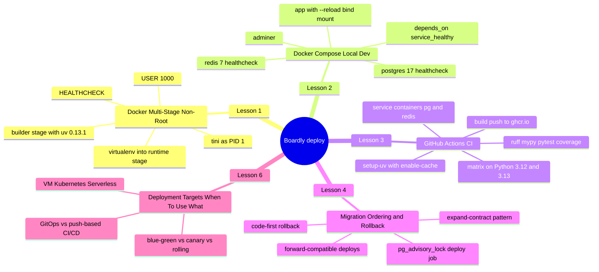
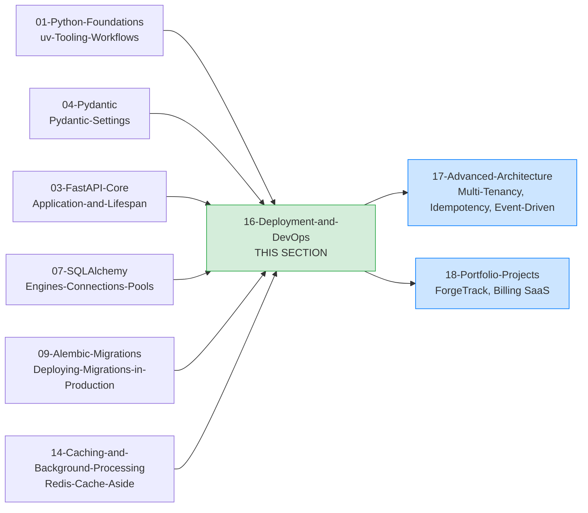

# Deployment and DevOps: Map of Content

**Bookmark this page.**

This is the **home base** for Section 16 — Deployment and DevOps. Every lesson in this folder, every container, every CI pipeline, every rollback plan, every deployment target, every deploy strategy — all reachable from here. When a deploy goes sideways at 2 a.m., come back to the MOC.

Hello, friend. Pull up a chair.

You've spent the first fifteen sections building `Boardly`: a typed FastAPI app, routers and dependencies, a Pydantic settings layer, a real SQLAlchemy async stack, Postgres-tuned queries, Alembic migrations, a test suite, caching, and background workers. The app runs on `127.0.0.1:8000` under `uv run uvicorn boardly.main:app --reload`. It is — and we say this with love — a development server. It is the sketch of a service. It is not yet a deployable service.

This section is the bridge between "it runs on my laptop" and "it survives a deploy to production." Five lessons. One growing `Boardly` deployment. Each lesson adds one structural piece: a container, a local dev stack, a CI pipeline, a migration-deploy job, and a documented choice of deployment target. By the end of Lesson 6 you will be able to take any FastAPI service you've ever written and ship it to a cluster, byte-for-byte identical between staging and production, with a tested rollback waiting in your back pocket — and you will be able to defend the platform choice in a senior interview.

**You're in the right place.**

If you've dockerized a Python app and watched it balloon to 1.2 GB, run as `root`, and crash on the first `SIGTERM` — this section was written for you. We'll go slow. We'll explain every line of the Dockerfile, every line of the `compose.yaml`, every line of the workflow file. You will ship a real thing.

---

## The Boardly Deployment Progression

Five lessons. One growing deployment. By Lesson 6 your `Boardly` deploy pipeline has:

- A two-stage `Dockerfile` that builds a virtualenv with `uv 0.13.1`, copies only the venv + app into a slim runtime image, drops privileges to UID 1000, and runs `tini -> uvicorn` so signals propagate.
- A `compose.yaml` that boots `app` + `postgres` + `redis` + `adminer` with healthchecks gating startup order, a bind mount for source, and a `.env`-driven config.
- A `.github/workflows/ci.yml` that matrixes on Python 3.12 and 3.13, runs ruff + mypy + pytest with coverage against service-container Postgres and Redis, then builds and pushes the image to `ghcr.io` on `main`.
- A deploy script that acquires a Postgres advisory lock, runs `alembic upgrade head`, releases the lock, and then rolls the new code — and the expand-contract reasoning that lets every migration be safe to roll back.
- A documented answer to the platform question — where the image runs in production (VM, Kubernetes, serverless, or managed app platform), how a new version rolls out (rolling, blue-green, or canary), and who triggers the deploy (push-based CI or pull-based GitOps).

And you'll know *why* every line is there.

---

## Lessons in Order

| # | Lesson | What you add to `Boardly` | Time |
|---|--------|---------------------------|------|
| 1 | [[Docker-Multi-Stage-Non-Root]] | A production `Dockerfile` with builder + runtime stages, `uv 0.13.1` install into `/app/.venv`, `USER 1000`, `HEALTHCHECK /healthz`, `tini` as PID 1, exec-form `CMD` | 75–100 min |
| 2 | [[Docker-Compose-Local-Dev]] | A `compose.yaml` with `app`, `postgres:17`, `redis:7`, `adminer`, healthchecks (`pg_isready`, `redis-cli ping`), `depends_on: condition: service_healthy`, `.env` wiring, a `dev` target with `--reload` and a bind mount | 60–90 min |
| 3 | [[GitHub-Actions-CI]] | A `.github/workflows/ci.yml` with a Python 3.12/3.13 matrix, `astral-sh/setup-uv` with `enable-cache`, `uv sync --frozen --all-extras`, ruff, mypy, pytest with coverage, a `build` job that builds the image with `cache-from: type=gha`, and a `push` job on `main` that tags and pushes to `ghcr.io` with an SBOM | 90–120 min |
| 4 | [[Migration-Ordering-and-Rollback]] | A `scripts/deploy_migrations.py` that wraps `alembic upgrade head` in a `pg_advisory_lock`, plus the expand-contract pattern across five phases for renaming `users.name` to `users.full_name`, plus the rollback reasoning (code first, schema optionally) | 75–100 min |
| 5 | _(slot reserved for a future observability or profiling topic — see [[21-Reference-Library/Changelog]] Known Limitations)_ | — | — |
| 6 | [[Deployment-Targets-When-To-Use-What]] | The same `boardly:0.1.0` image deployed three ways — on a VM with `compose.prod.yml`, on Kubernetes with a `Deployment` + `Service` + `Ingress`, on Google Cloud Run as a serverless `Service` — plus the blue-green vs canary vs rolling deploy strategy comparison and the GitOps vs push-based CI/CD control-plane comparison | 90–120 min |

**Lesson 05 is intentionally reserved for future expansion**

The Lessons-in-Order table skips from Lesson 4 (Migration Ordering) directly to Lesson 6 (Deployment Targets). Lesson 05's slot is held open for a future topic — most likely a production-grade observability or profiling lesson that builds on `13-Performance-and-Observability`'s `OpenTelemetry-Tracing` and `Structured-Logging-and-Request-IDs` once the `Boardly` deployment from this section is running in a cluster and producing real traces. The Changelog (`[[21-Reference-Library/Changelog]]`) records this as a Known Limitation. The "Five lessons. One growing deployment." phrasing used in the prose above and below counts Lessons 1, 2, 3, 4, and 6 — five lessons that exist on disk today — not Lessons 1 through 6. Lesson 06 is numbered as it is (rather than renumbered to 05) so future inbound links from the broader vault (`Concept-Registry`, `Curriculum-Index`, `Progress-Tracker`) stay stable when Lesson 05 is added.

**Tip — How to read this section**

Read the lessons **in order**. Each lesson's artifacts are a strict superset of the previous one — the `Dockerfile` from Lesson 1 is the image the `compose.yaml` in Lesson 2 builds; the same `Dockerfile` is what the CI pipeline in Lesson 3 builds and pushes; the same image is what the migration deploy job in Lesson 4 runs *before* the new code rolls; the same image is what Lesson 6 deploys three ways. If you skip ahead, you'll bring in machinery you haven't built yet.

Each lesson follows the same shape: **Learning Objectives -> Prerequisites -> The Problem -> The Code -> Line-by-Line Deep Dive -> Execution Trace -> Common Mistakes -> Engineering Trade-Offs -> Exercises -> Verification -> Previously Learned Here -> What's Next -> Sources -> What We Learned**. Open the lesson in one pane and the relevant file (`Dockerfile`, `compose.yaml`, `ci.yml`, `deploy_migrations.py`, `k8s/boardly.yaml`, `cloud-run.service.yaml`) in another. Type the file yourself. Don't copy-paste. Typing is what makes it stick.

---

## How This Section Fits in the Vault

Deployment is where every prior decision lands: the lifespan that opens the SQLAlchemy engine pool (Section 03 + 07), the Pydantic Settings instance that reads env vars (Section 04), the migrations the deploy job runs (Section 09), the Redis pool the cache-aside pattern depends on (Section 14). None of those sections covered what happens when you `docker build`, when the orchestrator sends `SIGTERM`, when two replicas start at the same time. This section does.

---

## Concepts First Taught Here

This section does not introduce a registered recurring concept as its canonical home. The two canonical lessons in the next section (`17-Advanced-Architecture/Multi-Tenancy` and `17-Advanced-Architecture/Idempotency-and-Retries`) own those concepts. What we *do* teach here that is worth registering later:

- **Container hygiene** (multi-stage, non-root, `HEALTHCHECK`, exec-form `CMD`, signal propagation via `tini`) — first taught in [[Docker-Multi-Stage-Non-Root]]. We treat this as the section's signature topic. If a later section's lesson deploys a container, it links back here.
- **Service-container startup ordering** (`depends_on: condition: service_healthy`, `pg_isready`, `redis-cli ping`) — first taught in [[Docker-Compose-Local-Dev]]. The same healthcheck primitives reappear in CI as `--health-cmd` options.
- **The expand-contract migration pattern** — first taught in [[Migration-Ordering-and-Rollback]]. Multi-tenant schema changes (Section 17) build directly on this.

---

## Concepts Reused Here (not re-explained)

These were taught in earlier sections. We link back instead of repeating:

- **`uv`** — [[01-Python-Foundations/uv-Tooling-Workflows]]. Decision D-006 in the [[21-Reference-Library/Engineering-Decision-Log]] locks `uv` in as the default project manager. We use `uv sync`, `uv pip install`, `uv run`, and `UV_PROJECT_ENVIRONMENT` to pin the venv path.
- **Pydantic Settings** — [[04-Pydantic/Pydantic-Settings]]. Every env var a container needs (`APP_DATABASE_URL`, `APP_REDIS_URL`, feature flags) flows through a `BaseSettings` instance with `env_prefix="APP_"`.
- **FastAPI lifespan** — [[03-FastAPI-Core/Application-and-Lifespan]]. Lifespan opens the SQLAlchemy engine pool, the Redis pool, the OpenTelemetry tracer provider; it closes them on shutdown. The container's `HEALTHCHECK` depends on lifespan finishing.
- **ASGI** — [[02-Web-and-HTTP/ASGI-Starlette-Uvicorn]]. Production runs `uvicorn` (or `gunicorn -k uvicorn.workers.UvicornWorker`) behind a reverse proxy.
- **Session/AsyncSession** — [[07-SQLAlchemy/05-Session-and-Transaction-Management]]. The session-per-request pattern is set up in the FastAPI dependency; migrations run in their own short-lived session in the deploy job.
- **Alembic** — Decision D-003 makes Alembic the only production schema manager. [[Migration-Ordering-and-Rollback]] builds on [[09-Alembic-Migrations/Deploying-Migrations-in-Production]].
- **Connection pool** — [[07-SQLAlchemy/02-Engines-Connections-Pools]]. The deploy job uses a single-connection engine, not the app's pool, so it cannot hold pool slots during a long migration.

---

## Section-Level Engineering Decisions

These are the deployment defaults that apply across all five lessons. They are intentionally rigid so the lessons can assume them.

- **Base image**: `python:3.12-slim`. Pinned by digest in real registries (`python:3.12-slim@sha256:...`). The `slim` variant is glibc-based, so binary wheels from PyPI work without a C toolchain in the runtime.
- **Package manager**: `uv 0.13.1`, locked file `uv.lock`, `uv sync --frozen` in CI. Verified Oct 2026 version. Every command in this section uses it.
- **App server**: `uvicorn boardly.main:app --host 0.0.0.0 --port 8000`. Behind `gunicorn -k uvicorn.workers.UvicornWorker --workers N` when scaling beyond one process per container.
- **Reverse proxy**: external (NGINX, ALB, Cloud Run) terminates TLS and proxies to the container on `:8000`.
- **Process model**: one process per container in the simple case. Horizontal scaling is container replicas, not threads inside one container.
- **Migrations**: one job, one replica, `alembic upgrade head`. Never `create_all()`. Never migrations inside the request path. Never migrations inside the lifespan startup of every container.
- **Secrets**: injected as env vars from the platform secret store. Never baked into the image. The image is the same in every environment. Every example in this section uses `__REDACTED__` or `change-me` for any value a reader might be tempted to copy.
- **Signal handling**: `tini` is PID 1; `uvicorn` is its child. `SIGTERM` from the orchestrator propagates through `tini` to `uvicorn`, which drains in-flight requests, runs lifespan shutdown, and exits.
- **Healthcheck split**: `/healthz` is liveness (the process is up and serving, never touches the DB); `/readyz` is readiness (the process can serve real traffic, touching the DB is fine). The Docker `HEALTHCHECK` hits `/healthz`; the orchestrator's readiness probe hits `/readyz`.

---

## Reading Paths

Not everyone has four hours in one block. Pick a path:

### The Fast Path (90 minutes)

Just want to ship a container today? Read Lesson 1, then the "Verification" section of Lesson 3. You'll have a non-root image and a CI pipeline that builds it. Come back for Lessons 2, 4, and 6 as the codebase grows.

### The Thorough Path (6–7 hours)

Linear. The lessons deliberately build on each other: the Dockerfile's runtime stage is the same image the compose stack extends with a `dev` target; the CI pipeline reuses the Dockerfile's `runtime` target as its build target; the migration deploy job consumes the image that CI pushes; Lesson 6 deploys that same image three ways and compares the deploy strategies and control planes. Skip none of it.

**Example — Which path are you on?**

Open a daily note and write down: which path, when you'll study each lesson, and a target completion date. Committing to a schedule beats willpower every time.

---

## Verified Versions (October 2026)

This section targets the following versions, all verified current as of 2026-10-19:

| Package / Tool | Version | Notes |
|----------------|---------|-------|
| Python | 3.12 | The canonical learner version. 3.13 also works; the CI matrix runs both. |
| `uv` | 0.13.1 | The modern Python package runner. Verified Oct 2026. |
| FastAPI | 0.148.0 | The ASGI framework. |
| Starlette | 1.9.0 | Pinned by FastAPI. |
| Pydantic | v2.14.1 | Pydantic v2 only. |
| SQLAlchemy | 2.1.5 | When we touch it (mostly in Lesson 4 and the deploy script). |
| Alembic | 1.20.0 | Migration tooling. |
| PostgreSQL | 17.x | In compose and CI service containers. |
| Redis | 7.x | In compose and CI service containers. |
| Docker | latest stable | Multi-stage builds, `COPY --from=...`, `HEALTHCHECK`. |
| Docker Compose | v2 | The `compose.yaml` syntax. |
| GitHub Actions | latest runner | `ubuntu-24.04` is the verified October 2026 runner image. |
| `astral-sh/setup-uv` | v5 (latest stable) | `enable-cache: true`, `cache-dependency-glob: uv.lock`. |
| `docker/build-push-action` | v6 | `cache-from: type=gha`, `cache-to: type=gha,mode=max`. |
| `tini` | 0.19.0 | PID 1 in containers. |

**Warning — Version pinning matters in deployment more than anywhere else.**

A Dockerfile that says `FROM python:3.12-slim` (without a digest) will silently swap its base image when Python publishes a new patch. A `pyproject.toml` without `uv.lock` will install different transitive deps on Tuesday than it did on Monday. The image you build locally and the image the cluster runs must be **byte-for-byte identical**, or "works on my machine" becomes "worked in staging but not in prod." Pin versions; pin digests in real registries; commit `uv.lock`.

---

## Reference Links

- Docker — Multi-stage builds — <https://docs.docker.com/build/building/multistage/>
- Docker — Dockerfile reference — <https://docs.docker.com/reference/dockerfile/>
- Docker Compose — Compose file reference — <https://docs.docker.com/compose/compose-file/>
- GitHub Actions — Workflow syntax — <https://docs.github.com/actions/using-workflows/workflow-syntax-for-github-actions>
- `astral-sh/setup-uv` — <https://github.com/astral-sh/setup-uv>
- Astral — `uv` Docker integration — <https://docs.astral.sh/uv/guides/integration/docker/>
- krallin / `tini` — <https://github.com/krallin/tini>
- PostgreSQL — `pg_advisory_lock` — <https://www.postgresql.org/docs/current/functions-admin.html#FUNCTIONS-ADVISORY-LOCK>
- Alembic — Operations reference — <https://alembic.sqlalchemy.org/en/latest/ops.html>
- Kubernetes — Documentation — <https://kubernetes.io/docs/> (used in Lesson 6)
- Google Cloud Run — Documentation — <https://cloud.google.com/run/docs> (used in Lesson 6)
- Argo CD — Documentation — <https://argo-cd.readthedocs.io/> (used in Lesson 6 for the GitOps comparison)
- Fly.io — Documentation — <https://fly.io/docs/> (used in Lesson 6 for the managed-app-platform comparison)
- See [[21-Reference-Library/Source-Register]] for the full source list with dates accessed.

---

**Your map is ready.**

Five lessons, one growing `Boardly` deployment, all reachable from this page. Pick a starting point and go. We'll see you on the other side.

---

**Tags:** #moc #deployment #devops #index #home
**Previous:** [[15-External-Integrations/00-Integrations-MOC]]
**Start:** [[Docker-Multi-Stage-Non-Root]] ->
