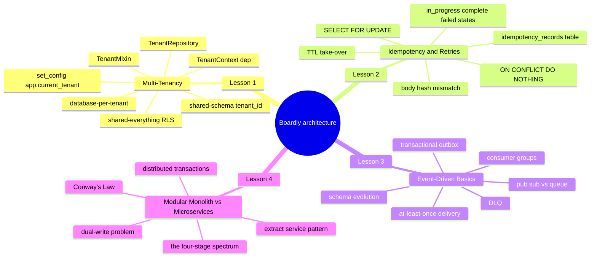
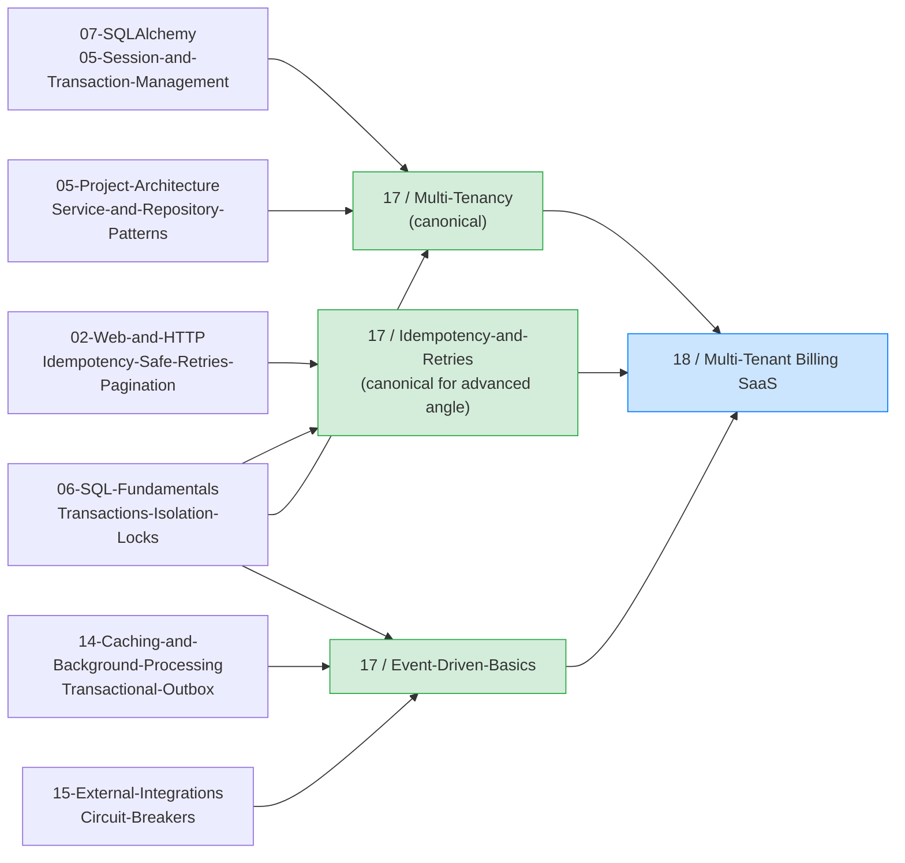

# Advanced Architecture: Map of Content

**Bookmark this page.**

This is the **home base** for Section 17 — Advanced Architecture. Four lessons: three architectural patterns that separate a "FastAPI app that works" from "a backend that scales to many customers, many integrations, and many failure modes", plus one comparison lesson that situates those patterns on the modular-monolith-to-microservices spectrum. When a 2 a.m. incident touches tenant isolation, idempotency, event delivery, or the architecture decision itself, come back to the MOC.

Hello, friend. Pull up a chair.

You shipped `Boardly` to production in Section 16. Non-root container, healthchecked, CI pipeline that pushes to `ghcr.io` on `main`, deploy job that runs migrations safely. The app serves real traffic. It works.

Now we ask the questions that turn "it works" into "it scales": how do you keep customer A's data out of customer B's hands when both live in the same application? How do you stop a flaky network from double-charging a customer whose mobile client retried? How do you make a downstream consumer's failure not take down the producer?

These are the load-bearing patterns of a real SaaS backend. None of them are required to ship a first deploy; all of them become load-bearing once you have paying customers, multiple consumers of your data, or external systems that emit unreliable signals.

**You're in the right place.**

If you've shipped a FastAPI service and the next step is "support multiple customers" or "stop double-charging" or "decouple producers from consumers" — this section was written for you. We'll go slow. We'll explain every line. You will build a real thing.

---

## The Boardly Advanced-Architecture Progression

Four lessons. One growing `Boardly` application. By Lesson 4 your `Boardly` API has:

- A multi-tenant data layer with `tenant_id` on every model, a `TenantContext` carried on the SQLAlchemy session, a `TenantRepository` that enforces the filter, and an RLS policy as defense-in-depth.
- A server-side idempotency store keyed by `(tenant_id, key)` with `in_progress`/`complete`/`failed` states, a TTL on `in_progress` for crash recovery, and a `SELECT ... FOR UPDATE` for concurrent duplicates.
- An event-driven producer with a transactional outbox, a relay process, idempotent consumers, and a dead-letter queue for poison messages.
- A documented answer to the architecture-spectrum question — where on the modular-monolith-to-microservices spectrum `Boardly` is, and what it would take to extract a module as a service.

And you'll know *why* every line is there.

---

## Lessons in Order

| # | Lesson | What you add to `Boardly` | Time |
|---|--------|---------------------------|------|
| 1 | [[Multi-Tenancy]] | `TenantMixin` on every model, `TenantContext` dependency, `tenant_session()` that sets `app.current_tenant` via `set_config`, generic `TenantRepository` enforcing `WHERE tenant_id = ...`, RLS policy migration as defense-in-depth | 75–100 min |
| 2 | [[Idempotency-and-Retries]] | `IdempotencyRecord` table keyed by `(tenant_id, key)` with `in_progress`/`complete`/`failed` states, `with_idempotency` route wrapper, `ON CONFLICT DO NOTHING` for first-writer-wins, `SELECT ... FOR UPDATE` for the loser-waits path, TTL take-over for crashed attempts, body-hash mismatch check | 90–120 min |
| 3 | [[Event-Driven-Basics]] | `OutboxEvent` table, `record_payment` that inserts charge + outbox in one transaction, `outbox_relay` process that publishes pending rows with `pg_advisory_lock`-style `FOR UPDATE SKIP LOCKED`, `processed_events` table for consumer idempotency, DLQ consumer that pages on-call | 75–100 min |
| 4 | [[Modular-Monolith-vs-Microservices]] | The same `POST /projects` feature with notification fan-out implemented three ways — (a) module in a monolith with in-process call, (b) extracted service with synchronous HTTP call, (c) extracted service with outbox + worker — plus the four-stage spectrum, Conway's Law, the dual-write problem, distributed transactions, and the seven classic microservices mistakes | 75–100 min |

**Tip — How to read this section**

Read the lessons **in order**. Each lesson's code is a strict superset of the previous one — the `TenantContext` from Lesson 1 is the `tenant_id` that the idempotency table is keyed by in Lesson 2; the transactional outbox from Lesson 3 uses the same `AsyncSession` that the tenant session from Lesson 1 produces; the consumer idempotency in Lesson 3 is the same pattern as the server-side idempotency in Lesson 2, just keyed by `event_id` instead of HTTP header. Lesson 4 is the comparison lesson — it situates the three patterns on the modular-monolith-to-microservices spectrum and explains why `Boardly` is at stage B (modular monolith) and what it would take to move to stage C (modular monolith with async integration) or stage D (microservices).

Each lesson follows the same shape: **Learning Objectives -> Prerequisites -> The Problem -> The Code -> Line-by-Line Deep Dive -> Execution Trace -> Common Mistakes -> Engineering Trade-Offs -> Exercises -> Verification -> Previously Learned Here -> What's Next -> Sources -> What We Learned**. Open the lesson in one pane and the relevant file (`boardly/tenancy.py`, `boardly/idempotency.py`, `boardly/services/payments.py`, `scripts/outbox_relay.py`) in another. Type the code yourself. Don't copy-paste. Typing is what makes it stick.

---

## How This Section Fits in the Vault

Section 17 is where the components from Sections 02–15 combine into architectural patterns. Multi-tenancy composes DI (03) + sessions (07) + repositories (05) + transactions (06). Server-side idempotency composes HTTP idempotency (02) + transactions (06) + sessions (07) + DI (03). Event-driven architecture composes the transactional outbox (14) + idempotency (Lesson 2) + transactions (06) + circuit breakers (15).

---

## Concepts First Taught Here

Two recurring concepts are taught for the first time in this section. They each have a canonical lesson.

- **Multi-tenancy** — first taught in [[Multi-Tenancy]]. The `TenantMixin`, `TenantContext`, `tenant_session`, `TenantRepository`, and the RLS defense-in-depth backstop.
- **Idempotency (advanced angle)** — first taught in [[Idempotency-and-Retries]]. The server-side store: the `IdempotencyRecord` table, the `in_progress`/`complete`/`failed` state machine, the `ON CONFLICT DO NOTHING` + `SELECT ... FOR UPDATE` pattern, the TTL take-over. (The basic HTTP-side view of idempotency was first taught in [[02-Web-and-HTTP/Idempotency-Safe-Retries-Pagination]] — Lesson 2 of this section links back instead of re-explaining the basics.)

If a later section (the Billing SaaS portfolio project in Section 18, the HTTP-clients lesson in Section 15) touches one of these, it links back here instead of re-explaining. That's the rule from [[00-Start-Here/Concept-Registry]].

**The Concept-Registry lists Idempotency with two canonical angles.**

The HTTP-side angle (HTTP methods, the `Idempotency-Key` header, client-side retry contract) is first taught in [[02-Web-and-HTTP/Idempotency-Safe-Retries-Pagination]]. The advanced angle (server-side store, partial-failure recovery, concurrent duplicates) is co-canonical at [[Idempotency-and-Retries]] — both entries are linked from [[00-Start-Here/Concept-Registry]]. Lesson 2's frontmatter has `first_taught_in: "17-Advanced-Architecture/Idempotency-and-Retries"` for the advanced angle; it links back to the basic lesson instead of re-explaining.

---

## Concepts Reused Here (not re-explained)

These were taught in earlier sections. We link back instead of repeating:

- **Idempotency (HTTP-side view)** — [[02-Web-and-HTTP/Idempotency-Safe-Retries-Pagination]]. Safe methods, the `Idempotency-Key` header, the client-side retry contract.
- **Transactions (SQL)** — [[06-SQL-Fundamentals/Transactions-Isolation-Locks]]. Idempotency at the server level needs a transactional store; multi-tenancy needs transactions across per-tenant sessions; the transactional outbox needs a single transaction for the main write + the outbox write.
- **Session/AsyncSession** — [[07-SQLAlchemy/05-Session-and-Transaction-Management]]. Multi-tenancy carries the `tenant_id` on the session; the outbox writer uses the same session.
- **Repository pattern** — [[05-Project-Architecture/Service-and-Repository-Patterns]]. In multi-tenancy, the repository is where the `tenant_id` filter is enforced, not the route.
- **Transactional outbox** — [[14-Caching-and-Background-Processing/Transactional-Outbox]]. [[Event-Driven-Basics]] references it as the canonical "exactly-once-ish" producer pattern.
- **Dependency injection** — [[03-FastAPI-Core/Dependency-Injection]]. The `TenantContext` and the `Idempotency-Key` header are both dependencies.
- **Circuit breakers** — [[15-External-Integrations/Circuit-Breakers]]. Consumers of external APIs (e.g. the email service) wrap calls in a circuit breaker.

---

## Section-Level Engineering Decisions

- **Default multi-tenancy model**: shared-schema with `tenant_id` on every row and repository-enforced filters. This is the most common choice for SaaS apps that need not be financial-grade. Database-per-tenant is the right choice when compliance or noisy-neighbor isolation demands it; RLS is the right choice when you want defense-in-depth on top of shared-schema. We teach shared-schema as the default, with the other two as alternatives.
- **Default idempotency strategy**: a Postgres table `idempotency_records` keyed by `(tenant_id, key)`, with `in_progress` and `complete` states, plus a `UNIQUE` constraint and `ON CONFLICT DO NOTHING` to handle concurrent duplicate keys. Redis is acceptable for low-stakes flows; Postgres is the default for anything that touches money.
- **Default event backbone**: an external broker (NATS, Kafka, SNS+SQS, Google Pub/Sub). Redis Streams works for small systems. The transactional outbox is the producer pattern regardless of the broker.
- **Default delivery guarantee**: at-least-once, with consumer-side idempotency. Exactly-once is a goal, not a property; you achieve its effect by composing at-least-once delivery with idempotent consumers.

---

## Reading Paths

Not everyone has four hours in one block. Pick a path:

### The Fast Path (90 minutes)

Just want to add multi-tenancy to your existing app? Read Lesson 1 only. You'll have a `TenantContext`, a `TenantRepository`, and an RLS backstop. Come back for Lessons 2, 3, and 4 when you have payment flows, external consumers, or an architecture review.

### The Thorough Path (5–6 hours)

Linear. The lessons deliberately build on each other: Lesson 1's `TenantContext` is what Lesson 2's idempotency key is scoped by; Lesson 2's idempotency pattern is what Lesson 3's consumers use to deduplicate deliveries; Lesson 4 situates all three on the architecture spectrum and gives you the language to defend the modular-monolith choice in a senior interview. Skip none of it.

**Example — Which path are you on?**

Open a daily note and write down: which path, when you'll study each lesson, and a target completion date. Committing to a schedule beats willpower every time.

---

## Verified Versions (October 2026)

This section targets the following versions, all verified current as of 2026-10-19:

| Package / Tool | Version | Notes |
|----------------|---------|-------|
| Python | 3.12 | The canonical learner version. |
| FastAPI | 0.148.0 | The ASGI framework. |
| Starlette | 1.9.0 | Pinned by FastAPI. |
| Pydantic | v2.14.1 | Pydantic v2 only. |
| SQLAlchemy | 2.1.5 | The async ORM. |
| asyncpg | 0.30+ | The PostgreSQL async driver. |
| PostgreSQL | 17.x | With RLS, advisory locks, and `set_config`. |
| Redis | 7.x | For the optional fast-path cache in Lesson 2. |
| `uv` | 0.13.1 | For running the outbox relay and consumer scripts. |
| NATS JetStream | latest | For the event broker in Lesson 3 (broker-agnostic patterns). |

**Warning — Multi-tenancy and idempotency are correctness-critical patterns.**

A bug in multi-tenancy is a security incident (tenant A reads tenant B's data). A bug in idempotency is a billing incident (a customer is double-charged). A bug in event delivery is a data-loss incident (an event is dropped). Test these patterns with integration tests, not just unit tests. The Verification section of each lesson shows the integration tests.

---

## Reference Links

- Microsoft — Multi-tenant SaaS patterns — <https://learn.microsoft.com/azure/architecture/guide/multitenant/considerations/tenancy-models>.
- AWS — SaaS architecture — <https://aws.amazon.com/saas/> — pool-vs-bridge-vs-silo models.
- PostgreSQL — Row Security Policies — <https://www.postgresql.org/docs/current/ddl-rowsecurity.html>.
- Stripe — Idempotent Requests — <https://docs.stripe.com/api/idempotent_requests>.
- IETF — The Idempotency-Key HTTP Header Field — <https://datatracker.ietf.org/doc/draft-ietf-httpapi-idempotency-key-header/>.
- PostgreSQL — `INSERT ... ON CONFLICT` — <https://www.postgresql.org/docs/current/sql-insert.html>.
- NATS — JetStream — <https://docs.nats.io/nats-concepts/jetstream>.
- Apache Kafka — Consumer groups — <https://kafka.apache.org/documentation/#consumer_groups>.
- Brandur — "Transactional outbox" — <https://brandur.org/request-coalescing>.
- Pat Helland — "Life beyond Distributed Transactions" — <https://www.ics.uci.edu/~cs223/papers/cidr07p15.pdf>.
- See [[21-Reference-Library/Source-Register]] for the full source list with dates accessed.

---

**Your map is ready.**

Four lessons, one growing `Boardly` application, all reachable from this page. Pick a starting point and go. We'll see you on the other side.

---

**Tags:** #moc #architecture #advanced #index #home
**Previous:** [[16-Deployment-and-DevOps/00-Deployment-MOC]]
**Start:** [[Multi-Tenancy]] ->
